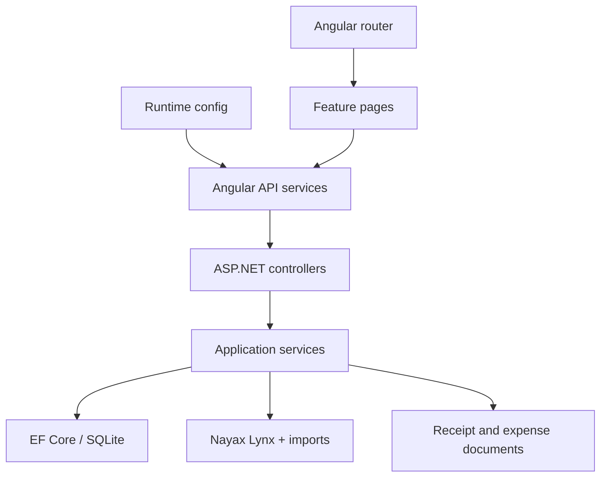
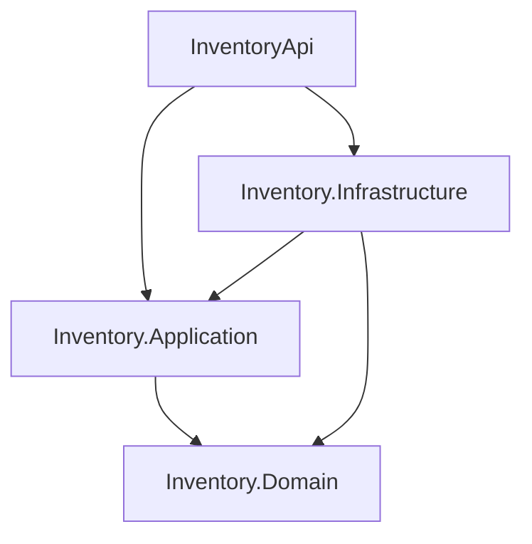
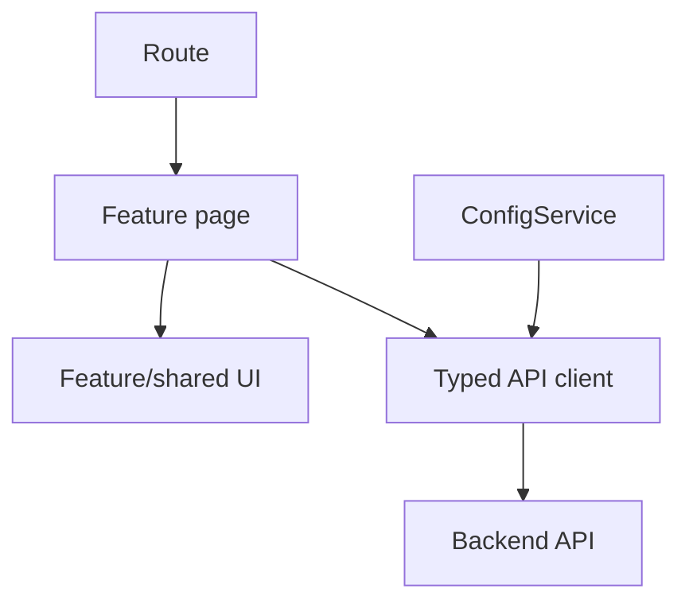
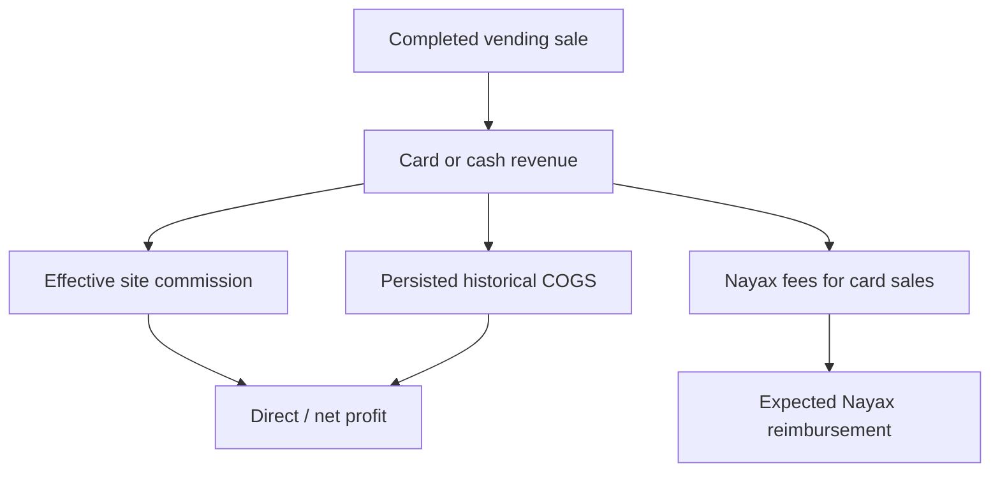

# InventoryApp architecture

## Purpose

InventoryApp is a modular full-stack application for operating a vending-machine business. It manages products, suppliers, purchasing documents, physical stock, supplier orders, machine replenishment, Nayax sales/imports, historical cost, fees, commissions, expenses, reconciliation, and management/accounting reports.

This document describes the repository at the `main` baseline inspected on 17 September 2026 and the intended incremental architecture. It is a guide for maintainers and coding agents; existing tests remain the executable specification.

## Runtime stack

| Area | Technology |
| --- | --- |
| Backend | ASP.NET Core Web API on .NET 10 |
| Persistence | EF Core 10, SQLite, code-first migrations |
| External integration | Nayax Lynx HTTP API and imported reimbursement/workbook data |
| Documents | Purchase and operating-expense files behind `IDocumentStorage`, with metadata in SQLite. `DocumentStorage:Provider` selects the implementation: `FileSystem` (the default) keeps them under the content root's `protected-files/`, outside the web root, with a legacy `wwwroot/{category}` read fallback; `AzureBlob` keeps them in a private Azure container under `tenants/{businessId}/...`, authenticated with a managed identity. Static-file middleware is disabled and no SAS or public URL is ever generated, so no document has an anonymous URL |
| Observability | Azure Monitor OpenTelemetry (`Azure.Monitor.OpenTelemetry.AspNetCore`) exporting requests, dependencies, metrics, `ILogger` logs and exceptions to Application Insights, registered only when `APPLICATIONINSIGHTS_CONNECTION_STRING` is configured. See [Observability and error telemetry](#observability-and-error-telemetry-issue-165) |
| Frontend | Angular 19 standalone components, TypeScript, RxJS, Tailwind-based styling |
| Backend tests | xUnit, Moq, EF Core InMemory and SQLite |
| Hosting | Azure App Service API and Azure Static Web Apps frontend |
| Automation | GitHub Actions |

### SQLite operating assumptions and scale strategy (issue #53)

The production database is the single SQLite file EF Core opens through
`ConnectionStrings:DefaultConnection` (`backend/InventoryApi/appsettings.json`), which defaults to
`Data Source=inventory.db` — a path relative to the API process's working directory
(`backend/InventoryApi/Program.cs`). No committed `appsettings.Production.json` overrides that
default; a different value can only come from an App Service application setting
(`ConnectionStrings__DefaultConnection`), which is Azure configuration outside this repository and
not verifiable from source.

**Where the file lives and what persists.** Azure App Service keeps exactly one directory durable
across process restarts and reboots, and shared across every instance if the plan ever scales to
more than one: `/home` (Windows: `d:\home`), mounted from the platform's own storage rather than
the ephemeral per-instance disk. A normal zip/package deployment through `azure/webapps-deploy@v2`
(`.github/workflows/vm-manager.yml`) extracts the published output under `/home/site/wwwroot`, so
the default relative `inventory.db` path resolves inside that persistent directory today, and the
file survives ordinary app restarts.

That default is fragile for two reasons this repository cannot verify from source, because they
are Azure App Service configuration, not code:

1. **Run-From-Package.** If the App Service is configured with `WEBSITE_RUN_FROM_PACKAGE=1` (a
   common App Service deployment mode), `wwwroot` is mounted **read-only** from the deployed
   package, and a relative `inventory.db` path would not be writable at all. Confirm this setting
   for the live app before relying on the default relative path.
2. **Deployment overwrite.** Even where `wwwroot` is writable, it is also the deployment target.
   Placing the database file inside the same directory the deployment pipeline writes to is an
   avoidable risk, independent of exactly how a given deployment happens to behave.

**Operational recommendation** (an App Service configuration change, not a code change — this
issue does not alter any production setting): point `ConnectionStrings__DefaultConnection` at an
absolute path outside `wwwroot` but still under the persistent `/home` mount, for example
`Data Source=/home/data/inventory.db`, and confirm `WEBSITE_RUN_FROM_PACKAGE` is unset or `0` for
this app. A human operator must make and verify this against the live App Service; it is not
something an automated agent may apply (`AGENTS.md` reserves Azure/App Service configuration
changes for humans).

**Concurrency and locking limits.** The API opens the database with `Microsoft.Data.Sqlite`'s
default journal mode (rollback journal, not WAL — nothing in `Program.cs` configures
`journal_mode`) and the driver's default busy timeout (`Default Timeout=30`, i.e. 30 seconds).
SQLite allows unlimited concurrent readers but only one writer at a time; a second writer blocks
for up to the busy timeout and then fails with `SQLITE_BUSY` rather than queuing indefinitely. In
this single-process deployment that is a soft limit on request latency under write-heavy
concurrent load (for example simultaneous imports and sale-costing writes), not a hard outage —
but it does not extend to multiple concurrently writing processes: **the App Service plan for this
app must stay pinned to a single instance (no scale-out) while SQLite remains the store.** SQLite's
file locking is unreliable over the kind of shared, network-backed storage `/home` becomes once
more than one instance mounts it, so running two instances against the same database file is not a
supported configuration.

**Monitoring signals that indicate SQLite pressure** — none of these are wired into automated
alerting today (that is future work, not part of this change), but are the observable evidence
worth watching for:

- `SQLITE_BUSY`/timeout exceptions in the application log
  (`Microsoft.Data.Sqlite.SqliteException` with `SqliteErrorCode == 5`), especially clustered
  around import or reconciliation jobs.
- API request latency growth specifically on write endpoints (imports, sale costing, purchases,
  stock adjustments) that does not correlate with CPU/memory pressure — a symptom of writers
  queued behind the single-writer lock rather than genuine compute cost.
- Database file size approaching the App Service plan's storage quota, or backup/restore
  durations (see below) growing enough to threaten the business's recovery-time expectations.

The first two are searchable in Application Insights once the connection string is configured (see
[Observability and error telemetry](#observability-and-error-telemetry-issue-165)); turning either
into an alert or a paging rule remains the future work this paragraph describes.
- Any deliberate move to more than one App Service instance for this app, which SQLite's
  single-writer, file-locking model does not support safely.

**Measurable triggers to migrate to a server database (Azure SQL or PostgreSQL).** Any one of
these is a concrete, evidence-based reason to plan the migration, not a speculative one:

1. The App Service plan needs more than one concurrently running instance (for availability or
   throughput) — SQLite cannot be safely shared across instances at all.
2. Recurring `SQLITE_BUSY` write-timeout errors under normal (non-incident) load, observed rather
   than anticipated.
3. A verified backup/restore cycle (see below) exceeds the business's acceptable recovery time
   because the file has grown large enough that a full-file backup and restore no longer fits the
   maintenance window.
4. A second live business is onboarded whose Nayax integration needs to run concurrently with the
   first (see [Tenant ownership](#tenant-ownership-issue-64): the Nayax client is single-tenant
   today) in a way that increases concurrent write load beyond what one SQLite writer sustains.

None of these are currently met; the current single-business, single-instance deployment is within
SQLite's supported envelope. This issue does not migrate the database (explicitly out of scope for
issue #53); it defines what would justify doing so.

**Where a server-database migration would live.** If one of the triggers above is met, the target
is a Clean Architecture change, not a drop-in connection-string swap. Since issue #307
`AppDbContext`, the EF entities (`Inventory.Infrastructure/Models`) and the migrations
(`Inventory.Infrastructure/Migrations`) are owned by `Inventory.Infrastructure`, which is where a
provider migration belongs too — behind the same narrow persistence ports this document already
describes for migrated features, so `Inventory.Domain` and `Inventory.Application` stay unaware of
which relational engine is in use.

What stays in `InventoryApi` is the provider *choice*, not the model: `Program.cs` holds the
`Microsoft.EntityFrameworkCore.Sqlite` package reference and the single `options.UseSqlite(...)`
call that reads `ConnectionStrings:DefaultConnection`, and `InventoryApi/Bootstrap` holds
`DatabaseSchemaStartup` and the `migrate-database` command. A provider swap therefore touches the
composition root and `Inventory.Infrastructure`, and must leave the EF entities and the applied
migration history alone.

**The `dotnet ef` arguments changed with that move.** The migrations project and the startup
project are now different projects, so the tooling needs both:

```bash
dotnet ef migrations add <Name> \
  --project backend/Inventory.Infrastructure \
  --startup-project backend/InventoryApi
dotnet ef migrations has-pending-model-changes \
  --project backend/Inventory.Infrastructure \
  --startup-project backend/InventoryApi
```

No `MigrationsAssembly` configuration is needed: EF Core resolves the migrations assembly from the
`DbContext`'s own assembly by default, and the context and its migrations are in the same project
(`MigrationRelocationTests.Inventory_Infrastructure_is_the_migrations_assembly` asserts exactly
that, so splitting them again fails a test rather than a deployment).

**Backup and restore procedure.** SQLite's Online Backup API — the same engine feature the
`sqlite3` CLI's `.backup` command and `Microsoft.Data.Sqlite`'s
`SqliteConnection.BackupDatabase` both call — copies a consistent snapshot of the database to a
new file without requiring the source connection, or the API process holding it, to stop.
`backend/Inventory.IntegrationTests/Operations/SqliteBackupRestoreTests.cs` proves this mechanically: it
backs up a live SQLite file while the source connection that created it stays open (mirroring a
running API process) and confirms the resulting copy passes `PRAGMA integrity_check` and contains
exactly the committed rows, then proves a second backup taken later, still without closing that
connection, reflects the writes committed in between.

**The supported command (issues #331 and #332).** `backend/InventoryApi`'s published executable has
a `backup-database` CLI mode, dispatched before the web host is built — the same early-command
pattern as `bootstrap-business` and `migrate-database`, so taking a backup and starting the API
are mutually exclusive paths through `Program.cs` and never run during normal startup. It takes
exactly one of two mutually exclusive modes: `--output <path>` retains a verified snapshot at a
path the operator names (issue #331), and `--upload` stages a verified snapshot, uploads it to the
private backup container, and removes the local copy (issue #332, described below). They are
mutually exclusive because they dispose of the snapshot in opposite ways; passing both is refused
rather than resolved by guessing. It opens the
same configured database the API would (`ConnectionStrings:DefaultConnection`, falling back to the
relative `Data Source=inventory.db` default — that relative default is not rejected merely for
being relative, only if the resolved file does not exist or cannot be opened), copies it with the
same Online Backup API described above (never a filesystem `cp`), and refuses an `--output` path
that already exists, matches the source, or sits inside the API's content root/web root, so a
snapshot can never land somewhere a redeploy or publish step would silently discard or overwrite
it. Once the snapshot is written it runs `PRAGMA integrity_check` itself and reports the result,
the snapshot's SHA-256, and the elapsed duration — without ever printing the connection string — and
exits non-zero on any failure:

```bash
dotnet InventoryApi.dll backup-database --output /home/data/backups/inventory-20260101T000000.db
```

This is the command the scheduled backup WebJob (issue #333, below) also calls; routine backups
are scheduled, not run by hand. Manual, one-off verification uses the identical command.
Retention/alerting and automated restore remain out of scope for this command — retention is a
storage-lifecycle policy and alerting is an Azure Monitor rule, both human-applied (see [Backup
retention, alerting and restore rehearsal](#backup-retention-alerting-and-restore-rehearsal-issue-334)
below), and restore stays the deliberate, human-run `sqlite3` procedure below.

**Uploading the verified snapshot off the instance (issue #332).** `backup-database --upload` is
the create-verify-upload workflow, in one command:

```bash
dotnet InventoryApi.dll backup-database --upload
```

It takes and verifies the snapshot exactly as the retained mode does — Online Backup API,
`PRAGMA integrity_check`, SHA-256 — but into a staging file under the OS temporary path
(`inventoryapp-backup-staging/`), which is outside the API's content root and `wwwroot`; the same
content-root guard that protects `--output` still checks the staged path rather than trusting it.
Each invocation stages into its own freshly named subdirectory of that staging root
(`run-<yyyyMMdd>T<HHmmss>Z-<random>/`) rather than straight into it, because the UTC instant is
precise only to the second: two runs that overlap — the scheduled job and an operator running the
command by hand, or a slow upload still in flight when the next run starts — must not contend for
one path, and neither run's cleanup may remove the other's snapshot while it is still being
uploaded. Only a snapshot that completed and passed verification is uploaded: the uploader accepts
a type that can only describe a verified snapshot, and re-hashes the staged file against the
checksum verification produced before sending a byte, so a staged copy that was replaced or
truncated in between is refused. The staged file (and any SQLite sidecar files) are removed in a
`finally` path after success, failure, or an exception such as an unreachable storage account,
followed by the run's own now-empty directory — the cleanup deletes only those paths, by name and
inside that directory, so another run's staged snapshot and anything an operator keeps in the
staging root are never touched. A cleanup that could not finish is reported and exits non-zero
rather than quietly leaving a complete copy of every business's data on the instance's disk. Exit
code is `0` only when the snapshot verified, the upload verified, and nothing was left behind.

Each run writes to a private container, under two prefixes:

| Object | Name | Written |
|---|---|---|
| Per-snapshot | `daily/inventory-<yyyyMMdd>T<HHmmss>Z.db` | Every run, from the snapshot's UTC instant |
| Per-month recovery point | `monthly/<YYYY-MM>/inventory-<YYYY-MM>.db` | On the first successful upload in that UTC calendar month |

The monthly recovery point is chosen by the upload itself, not by a storage lifecycle rule: a rule
can expire objects, but nothing in the account knows which daily snapshot a month should keep. The
name is deterministic from the month alone, and the write is a conditional create
(`If-None-Match: *`), so "is this the first upload of this month?" is answered by the service in
the same request that would write it. Three consequences matter operationally: a month whose first
scheduled run was missed still gets a recovery point from whichever verified snapshot arrives
first (including a manual `--upload` early in the month, which is acceptable because it is a
verified snapshot); a retry or any later upload in the same month leaves the existing monthly
object byte-for-byte unchanged and reports it as already present rather than as a failure; and no
object under either prefix is ever overwritten — an occupied `daily/` name stops the run instead.
The seam the uploader is written against (`IBackupBlobContainer`) has no delete and no overwrite
operation at all, so retention cannot be performed by this code path even accidentally.

Each uploaded object carries three pieces of metadata — `createdutc` (the snapshot's UTC instant),
`sha256` (the checksum verification computed) and `kind` (`daily` or `monthly`). They are
operational facts, readable from a storage browser; none describes, samples or summarises the data
inside the snapshot, and none is or can become a credential. The upload is then verified as
completed by reading each object's length and recorded checksum back and comparing them to the
snapshot that was sent — the content itself is never downloaded. A write the service accepted but
did not store as sent is reported as a failure, not as a recovery point.

**Required configuration, identity and container (issue #332).** Two non-secret settings, read
from App Service application settings or environment variables, and read only by this command:

```text
BackupStorage__BlobServiceUri=https://<storage-account>.blob.core.windows.net
BackupStorage__ContainerName=database-backups          # database-backups-dev for development
```

There is no account key, SAS token, client secret or storage connection string to configure, and
none is accepted: authentication is `DefaultAzureCredential` — the App Service's managed identity
when the scheduled job runs the command, and the operator's own Azure sign-in when they run it by
hand — and the configuration gate rejects a service URI carrying a query string or embedded
credentials, which is what a SAS token or an account key would look like. Nothing in the upload
path logs a credential; the command prints object names, byte counts, the checksum and the
integrity result, never a connection string or snapshot content. An unconfigured or unusable
destination is refused **before** any snapshot is taken, so an upload that cannot reach its
destination never spends time copying the database first.

The human prerequisites below are stated for a human to apply; **no production Azure resource,
role assignment or policy is created or changed by this repository or by any agent**, and the
deployment configuration is not visible here, so a human must verify it before rollout:

| # | Prerequisite | Why |
|---|---|---|
| 1 | A **private** container (for example `database-backups`), separate from the `business-documents` container | A snapshot is a complete copy of every business's data. Its own container keeps its access, retention and auditing independent of document storage, and no public/anonymous access is a hard requirement. |
| 2 | A storage account outside the App Service's own storage failure domain | A backup that lives only next to the database it protects does not survive whatever destroys the database. |
| 3 | **System-assigned managed identity** on the App Service | The command authenticates as the application itself, with no credential stored anywhere. |
| 4 | **`Storage Blob Data Contributor`** granted to that identity at the narrowest practical scope — preferably the backup container alone | Least privilege for what this flow actually does: create an object that does not exist and read object properties back. `Storage Blob Data Reader` cannot write; account-wide Contributor would also grant access to business documents. Delete is not required by this flow — retention is separate, human-controlled work. |
| 5 | Encryption confirmed: **at rest** by Azure Storage service-side encryption (AES-256, enabled on every account and not optional), and **in transit** by HTTPS/TLS — the configuration gate refuses any non-loopback endpoint that is not `https`, and "secure transfer required" should be enabled on the account | The snapshot contains financial and business records. Infrastructure-level encryption is the expectation for both states; the final encryption policy (including any customer-managed key) remains a human decision. |

The equivalent operator procedure, using the `sqlite3` CLI (the standard SQLite tool;
<https://sqlite.org/cli.html>) against the App Service's persistent database path, remains
available for a host where the published `dotnet` application is not on hand, or to rehearse the
underlying mechanism:

1. **Prefer a quiet window, but do not rely on stopping the app.** The Online Backup API produces
   a consistent snapshot even while writes continue; stopping the App Service first (or scaling to
   zero) removes any residual risk but is not required for backup correctness. Do not run a plain
   filesystem `cp` of the `.db` file while the app is running — unlike the backup API, a raw copy
   can capture a database file mid-write and is not guaranteed consistent.
2. **Take the backup:**

   ```bash
   sqlite3 /home/data/inventory.db ".backup '/home/data/backups/inventory-$(date +%Y%m%dT%H%M%S).db'"
   ```

3. **Verify the backup immediately**, before trusting it:

   ```bash
   sqlite3 /home/data/backups/inventory-<timestamp>.db "PRAGMA integrity_check;"
   ```

   A result other than a single `ok` row means the backup is not trustworthy; take it again.
4. **Store the verified backup somewhere other than the App Service's own `/home` mount** (for
   example downloaded to a workstation, or uploaded to separate storage) — a backup that lives only
   next to the database it protects does not survive whatever destroys the database.
   `backup-database --upload` is the supported, automated form of this step; this manual
   alternative exists for a host where the published `dotnet` application is not on hand.
5. **Restore** by stopping the API, replacing the live database file with the verified backup (or
   pointing the connection string at the restored file), and starting the API again:

   ```bash
   sqlite3 /home/data/backups/inventory-<timestamp>.db ".backup '/home/data/inventory.db'"
   ```

   Restoring does overwrite live data and must only be run deliberately, by a human, after
   confirming the target file is the one meant to be replaced — this is the one step in the
   sequence that is not safe to automate or run against a live app.

This procedure, and the non-destructive local check in the README, do not touch any production
connection string, credential, or data; every example above uses a placeholder path that a human
operator supplies for their own environment.

**Database operations that change stored business data are named maintenance operations, never ad hoc
SQL.** `bootstrap-business`, `migrate-documents`, the historical GST classification Preview/Apply, the
costing repair and the [Nayax sale timestamp repair](#nayax-sale-timestamp-repair-preview-then-apply-issue-472)
are the shape every such operation takes: an explicit, reviewable preview; an apply bound to that
preview and refused when the database moved underneath it; an audit row naming what changed, from
which verified source, and which operator confirmed it; and idempotence, so running it again after it
succeeded changes nothing. None of them is reachable by submitting SQL, and the platform diagnostics
API must never become their execution path (AGENTS.md § Architecture rules, § Database and
migrations).

Two of this procedure's steps are load-bearing for such an operation, and the repair runbook below
names them explicitly: **step 2 and 3 - a verified snapshot taken and `PRAGMA integrity_check`ed
before the apply** - are the recovery point, because an apply that succeeded is not undone by the
application (there is no reversal path for an audited historical correction, by design); and **step 5
- the deliberate, human-run restore** - is the only rollback for a repair an operator later judges
wrong. Inside one apply, rollback is the database transaction: a failure leaves nothing behind, which
is a different guarantee from undoing a committed repair and must not be confused with it.

#### Scheduling the backup with an App Service WebJob (issue #333)

A backup must happen whether or not anyone signs in, which is the one workload in this application
that genuinely cannot stay request-driven (see [Azure Functions and background
workloads](#azure-functions-and-background-workloads-decision-criteria-issue-68)). The schedule is
a **triggered Linux App Service WebJob** that runs inside the App Service the API already runs in,
and it ships in the API's own `dotnet publish` output:

```text
backend/InventoryApi/App_Data/jobs/triggered/database-backup/
├── run.sh          # invokes the published executable's backup-database --upload
└── settings.job    # {"schedule": "0 0 15 * * *"} - daily at 15:00 UTC
```

App Service reads a triggered WebJob from `App_Data/jobs/triggered/<job name>/` under the deployed
site root, and that site root is the publish directory, so the two files are declared as publish
content in `InventoryApi.csproj` (`<Content Include="App_Data\jobs\**\*"
CopyToPublishDirectory="PreserveNewest" />`) and need an explicit declaration because the Web SDK's
default content globs cover `wwwroot`, `*.config` and `*.json` only. **Deploy Production** already
publishes that project and deploys the whole output directory, so the job reaches production with
the API and **no GitHub Actions workflow changed** (`.github/workflows/vm-manager.yml` builds and
tests only; it has not published or deployed since issue #343 — see [Build and
delivery](#build-and-delivery)). `App_Data` is not under `wwwroot` and is never served as static
content.

**The job holds no logic, no path and no setting.** `run.sh` invokes the one supported command,
from the application's own directory, and propagates its exit code:

```bash
dotnet InventoryApi.dll backup-database --upload
```

Five properties of that script are deliberate:

- **It names no database.** The database backed up is whatever
  `ConnectionStrings:DefaultConnection` resolves to for the API — an absolute path under `/home` if
  one is configured, or the relative default. The script passes no path and sets no connection
  string, and because it runs the command **from the published application's directory** a relative
  default resolves exactly where it resolves for the running API. Moving the database is therefore
  a configuration change only; nothing in the job has to be edited to follow it.
- **It finds the application rather than assuming its own working directory is it.** App Service
  copies a triggered WebJob's files to a temporary directory before running them, so the script
  looks for `InventoryApi.dll` in `WEBROOT_PATH` (when the platform provides it), then
  `$HOME/site/wwwroot`, then four levels above itself for a host that runs it in place. Not finding
  it fails the run; it never falls back to a guessed path.
- **Exit code is the contract.** `backup-database --upload` exits `0` only when the snapshot
  verified, the upload verified and the staged copy was removed, and the script exits with exactly
  that code, so a failed backup is a failed WebJob run in the job's history rather than a green run
  with a bad log line.
- **It logs the run and nothing sensitive.** A UTC-stamped `START` line, then either `COMPLETED` or
  `FAILED (<reason>)`, both with the elapsed duration. The artifact metadata an operator needs —
  the uploaded `daily/`/`monthly/` object names, the snapshot's SHA-256, its byte count and the
  integrity result — comes from the command's own output, which the job inherits, so there is one
  place that decides what a backup run reports and no second parser to keep in step. Neither the
  script nor the command prints a connection string, a credential, a query or any row of business
  data. The job's own failures use the same `FAILED (<reason>)` shape as the command's, so the
  failed-run alert below catches a job-level failure (the application not found, no `dotnet` host)
  as well as a command-level one.
- **It needs no monthly logic.** The month's single recovery point is created by the upload itself,
  on the first successful upload in each UTC calendar month, scheduled or manual (see above).

**Why 15:00 UTC, and why in the artifact.** The schedule lives in `settings.job` in the deployment
artifact rather than in portal configuration, so it is reviewable in a diff and survives a
redeploy. `settings.job` CRON has **six** fields starting at seconds, so `0 0 15 * * *` is
15:00:00 daily — a five-field expression would silently mean something else. 15:00 UTC is 01:00 or
02:00 in `Australia/Sydney` depending on daylight saving, which is outside trading hours for a
vending business, and it is the cadence the 36-hour missing-backup alert of issue #334 is specified
against. A WebJob's CRON is evaluated in UTC unless the app's `WEBSITE_TIME_ZONE` setting changes
the container's time zone, which is one of the settings a human must confirm below. Changing the
window means changing this file and re-confirming the alert window with it.

**Prerequisites, and what only a human can confirm.** This repository contains no Azure resource
configuration and cannot see the deployed App Service, so the rows below are the operating
assumptions this packaging is built on, each with the human check that confirms it against the live
app. **No agent and no workflow in this repository applies any of them.**

| # | Prerequisite | Why it matters | How a human confirms it |
|---|---|---|---|
| 1 | The app is a **code deployment of the publish output to a Linux App Service** (the mode `deploy-production.yml` performs with `azure/webapps-deploy`), not a custom container | A custom container image does not read `App_Data/jobs`, so the job would never be discovered and this packaging would be the wrong mechanism | The App Service's deployment/publish mode in the portal. If it is ever moved to a container, this job stops working and needs its own issue, not a quiet fix |
| 2 | **WebJobs are available on the plan and the job is listed after a deployment** | The schedule is inert if the platform never registers the job | After the first deployment carrying it, the WebJobs blade lists `database-backup` as `Triggered` with the `0 0 15 * * *` schedule |
| 3 | **Always On** is enabled, which requires **Basic or higher** (Free/Shared cannot) | A scheduled WebJob only fires while the app is running; an idle app that has been unloaded runs nothing, and the missed run is then only visible through issue #334's alert | Configuration → General settings → Always On = On, and the plan tier |
| 4 | The plan stays pinned to **one instance** | The database is a single SQLite file on the App Service's `/home` mount, which is why the whole deployment is single-instance (see above). Scaling out would also multiply the scheduled run | The plan's instance count and any autoscale rule |
| 5 | `ConnectionStrings__DefaultConnection` points at the **persistent, absolute** `/home` path the API actually uses | The job backs up exactly what the API reads. An absolute configured path removes the relative default's dependence on the working directory for both of them | The App Service application setting, read in the portal — never pasted into this repository, an issue or a pull request |
| 6 | `WEBSITE_RUN_FROM_PACKAGE`, if set, still exposes `App_Data/jobs` from the mounted package, and the database is **not** inside `wwwroot` | Run-from-package mounts `wwwroot` read-only; a database inside the deployment target is an avoidable risk either way (see the README) | The application setting, plus confirming the job appears and runs (row 2 and row 7) |
| 7 | The **first scheduled run succeeds end to end** | Everything above is an assumption until one real run has taken a snapshot, uploaded it and exited `0` | The job's run history and its log output, plus the new `daily/` object (and the month's `monthly/` object) in the backup container |
| 8 | The managed identity and backup container prerequisites of issue #332 are in place | The job authenticates as the application; it adds no credential of its own, and there is no secret in the WebJob | The prerequisite table above (private container, system-assigned identity, least-privilege `Storage Blob Data Contributor`) |

Two further notes a human should know when confirming row 2 and row 7. The platform runs a `.sh`
WebJob through a shell, so the script does not rely on its Unix executable bit surviving the
artifact upload, the zip deployment and the extraction — a chain this repository cannot control;
`.gitattributes` does pin the job's files to LF endings in every checkout, because a CRLF `run.sh`
would fail on its first line. And the WebJob is a second process reading the same SQLite file as
the API: that is a reader, not a second writer, and the Online Backup API is what makes it
consistent (see the top of this section), so it stays inside the single-writer envelope the
deployment already requires.

**What the repository verifies, and what it cannot.**
`backend/Inventory.IntegrationTests/Operations/BackupWebJobPackagingTests.cs` asserts the packaging and the
invocation: both files exist at the triggered-WebJob path, the project declares them as publish
content with `CopyToPublishDirectory` (the exact mechanism that puts them in the deployed artifact),
the schedule is the six-field daily 15:00 UTC expression, the script's executable lines name no
database path, connection string or `--output` destination, and — by running the real script under
`bash` against a fake `dotnet` and a throwaway application directory — that it invokes
`InventoryApi.dll backup-database --upload` from the application's directory, exits with the
command's own exit code, logs start, completion/failure and duration, and fails without invoking
anything when the application is not found. No test takes a backup, reaches Azure or runs
`dotnet publish`. **Nothing about the live plan, Always On, the connection string or the schedule
actually firing is verified from this repository**; those are rows 1-7 above.

#### Backup retention, alerting and restore rehearsal (issue #334)

Taking and uploading a verified snapshot (#331, #332) and scheduling it (#333) answer "does a
recovery point exist?". Three questions are left, and this subsection answers all three as
**design and operator instructions only**:

1. **Retention** — backup storage must stay bounded without losing the long-horizon recovery
   points, which is a storage-lifecycle question, not a compute one.
2. **Alerting** — a failed run and a run that never happened must both become visible, because an
   unnoticed gap in backups is only discovered when a restore is needed.
3. **Rehearsal** — a backup nobody has ever restored is an assumption, so restoring must be
   practised somewhere that is not production.

**Nothing here creates or changes an Azure resource.** This repository contains no Bicep,
Terraform or Azure resource configuration, and deliberately gains none in this change: the
lifecycle policy, the diagnostic settings, the action group and the two alert rules are **human
production setup steps**, listed with their verification in [Human production setup, and how to
verify it](#human-production-setup-and-how-to-verify-it) below. No agent and no workflow in this
repository may apply them. The values below (30 days, 12 months, 36 hours, the proposed severities
and destination) are proposals that a human confirms against the business's recovery point and
recovery time objectives before applying them; see [Decisions a human must confirm
first](#decisions-a-human-must-confirm-first).

**Retention: an Azure Blob lifecycle policy on the backup container.** Retention is expressed as a
storage-account lifecycle management policy, not as code. That choice is deliberate and matters for
safety: the lifecycle engine deletes as the storage *service*, so the App Service's managed
identity still needs nothing beyond the create/read permissions prerequisite 4 above grants it, the
`IBackupBlobContainer` seam still has no delete or overwrite operation, and no application code
path — scheduled or manual — can ever remove a recovery point. Retention and backup creation stay
in different hands on purpose.

The policy expires per-snapshot objects after 30 days and monthly recovery points after 12 months:

```json
{
  "rules": [
    {
      "enabled": true,
      "name": "expire-daily-database-snapshots-after-30-days",
      "type": "Lifecycle",
      "definition": {
        "filters": {
          "blobTypes": [ "blockBlob" ],
          "prefixMatch": [ "database-backups/daily/" ]
        },
        "actions": {
          "baseBlob": {
            "delete": { "daysAfterCreationGreaterThan": 30 }
          }
        }
      }
    },
    {
      "enabled": true,
      "name": "expire-monthly-recovery-points-after-12-months",
      "type": "Lifecycle",
      "definition": {
        "filters": {
          "blobTypes": [ "blockBlob" ],
          "prefixMatch": [ "database-backups/monthly/" ]
        },
        "actions": {
          "baseBlob": {
            "delete": { "daysAfterCreationGreaterThan": 365 }
          }
        }
      }
    }
  ]
}
```

Applying and reading it back (the operator's own Azure sign-in; `--policy @<file>` takes exactly
the JSON above):

```bash
az storage account management-policy create \
  --account-name <storage-account> --resource-group <resource-group> \
  --policy @backup-lifecycle-policy.json

az storage account management-policy show \
  --account-name <storage-account> --resource-group <resource-group>
```

Eight properties of that policy are decisions rather than syntax:

- **A lifecycle `prefixMatch` starts with the container name**, so the prefixes above must be
  edited to match whatever `BackupStorage__ContainerName` is actually set to. The development
  container (`database-backups-dev`) needs its own rules — a second prefix entry when it shares the
  account, or the same policy applied to its own account — because a policy is per storage account
  and a prefix is per container.
- **The two prefixes are disjoint and nothing broader is ever used.** A rule whose prefix were the
  container alone, or the shared `inventory-` file-name stem, would match both object families and
  expire the monthly recovery points after 30 days. The prefixes are the whole safety mechanism
  here, which is why the uploader writes two separate prefixes rather than one flat namespace.
- **The `kind` metadata (`daily`/`monthly`) cannot be used as a filter.** Lifecycle rules can match
  blob index tags, not blob metadata, and the uploader writes metadata. The prefix is therefore the
  only discriminator available, and the metadata stays what it was designed to be: an operational
  fact a human reads from a storage browser.
- **`daysAfterCreationGreaterThan`, not `daysAfterModificationGreaterThan`.** No object under
  either prefix is ever overwritten (an occupied `daily/` name stops the run; the monthly object is
  a conditional create), so creation is the snapshot's own instant and the only age that means
  anything. Measuring from a modification time would make retention depend on an event that by
  design never happens.
- **12 months is written as 365 days**, because the policy's unit is whole days. In a 12-month
  window containing 29 February the deletion therefore falls one day before the calendar
  anniversary; a human who wants the anniversary guaranteed sets 366 instead. This is an
  approximation that is documented rather than hidden.
- **Deletion is not instantaneous.** The lifecycle engine runs once a day, changes to a policy can
  take up to 24 hours to take effect and the first run after enabling can take up to 48 hours, so
  an object a day or two past its threshold is expected, not a policy failure. Nothing in the
  recovery design depends on prompt deletion.
- **Blob soft delete needs no extra action, and does not unbound retention.** With soft delete
  enabled on the account, an object the lifecycle engine deletes becomes a soft-deleted blob and is
  retained for the account's soft-delete retention period, after which the storage service
  permanently deletes it by itself. Nothing has to be added to the policy above to purge
  soft-deleted blobs, and no lifecycle action can target them. Retention therefore stays bounded:
  the only effects are that the container's billed size trails the policy by the soft-delete window,
  and that a mis-scoped prefix stays recoverable for that long. Enabling a short soft-delete window
  purely as that safety net is a reasonable human decision (see [Decisions a human must confirm
  first](#decisions-a-human-must-confirm-first)), and it is a decision, not a requirement. With soft
  delete off, a lifecycle delete is immediate and permanent and a mis-scoped prefix is
  unrecoverable — which is what the disjoint prefixes above exist to prevent.
- **Blob versioning and snapshots do need their own actions.** This is the case where the policy
  above would be genuinely incomplete. Previous versions and snapshots are not covered by a
  `baseBlob` action, so bounded retention requires adding the matching `version` and `snapshot`
  delete actions; without them those copies accumulate behind the expired current versions. Either
  feature can also change what happens to the current version — with versioning enabled a
  `baseBlob` delete turns the current version into a previous version rather than removing the data,
  and a base blob that still has an active snapshot is not removed by a `baseBlob` delete at all.
  Neither feature is enabled on the backup container by this design, and leaving both off is the
  recommendation: a backup object is written once and never modified, so a version or snapshot of it
  carries nothing the `daily/`/`monthly/` names do not already carry. A human who turns either on
  owns extending this policy in the same change and confirming with `az storage account
  management-policy show` that the extra actions are present.

**How a monthly recovery point survives daily expiry.** The 30-day rule and the 12-month rule
would be in conflict if the month's recovery point were a *reference* to a daily snapshot. It is
not, and three independent properties keep the two retention horizons from interacting:

1. **The monthly object is its own complete copy, written by the upload itself.** The uploader
   creates `monthly/<YYYY-MM>/inventory-<YYYY-MM>.db` on the **first successful upload of that UTC
   calendar month** — a full-content write, not a snapshot, a soft link, a tag or a server-side
   reference to a `daily/` object. Deleting every `daily/` object in that month leaves it
   byte-for-byte intact.
2. **It is created at the start of the month, not at the end of the daily horizon.** With the daily
   schedule of #333 the month's recovery point exists within a day of the month beginning, roughly
   29 days before the earliest `daily/` object of that month can reach 30 days. There is no window
   in which a month has no recovery point but its daily objects are already expiring, and no
   ordering dependency between the lifecycle engine and the backup job.
3. **The prefixes isolate the rules.** The daily rule cannot match a `monthly/` name, so the only
   way to lose a monthly point to retention is to broaden a prefix — the mistake the second bullet
   list above exists to prevent.

The consequence is a predictable recovery horizon: every day of the last 30 days, plus one verified
point per month for the last 12 months, and the oldest monthly point disappearing about a year
after the month it represents. The one case that produces no monthly recovery point at all is a
calendar month in which **no** upload ever succeeded — which is exactly what the missing-backup
alert below exists to make impossible to miss, rather than something retention can repair.

**Alerting: a failed run and a missing backup are two different signals.** The scheduled job can
fail in two shapes, and only covering both makes silence unambiguous (the observability criterion
in [Azure Functions and background workloads](#azure-functions-and-background-workloads-decision-criteria-issue-68)
demands exactly that: "nothing in the log" and "the job never started" must be distinguishable):

| Alert | What it catches | Source | Why this source |
|---|---|---|---|
| **Backup run failed** | A run that happened and reported failure: the command exited non-zero because the snapshot, its `PRAGMA integrity_check`, the upload, the upload's read-back verification, or the staged-copy cleanup failed | Log search over the App Service's `AppServiceConsoleLogs` diagnostic category in a Log Analytics workspace | App Service exposes no platform **metric** for a WebJob's exit code, so the non-zero result has to be observed through the job's log output. The `backup-database` command already prints a distinctive failure line before exiting non-zero |
| **No backup in 36 hours** | A run that never happened or produced nothing: the WebJob disabled, removed by a deployment, starved by Always On being off, the App Service stopped, or a "successful" run that wrote no object | Log search over `StorageBlobLogs` for successful writes under the `daily/` prefix | It observes the **artifact** rather than the job's own claim about itself. A job that cannot run also cannot report that it did not run, so the absence of a recovery point has to be detected somewhere other than in the job |

*Alert 1 — failed backup run.* Exit code is the contract: `backup-database` exits `0` only when the
snapshot verified, the upload verified and nothing was left behind, and the WebJob of #333 exits
with that code unchanged. The queryable manifestation of that exit code is the command's own
output, which the WebJob inherits — plus the job's own `FAILED (<reason>)` line, written in the same
shape for a failure before the command is reached (see [Scheduling the backup with an App Service
WebJob](#scheduling-the-backup-with-an-app-service-webjob-issue-333)):

```kusto
AppServiceConsoleLogs
| where _ResourceId =~ "<app-service-resource-id>"
| where ResultDescription contains "FAILED ("
    or ResultDescription contains "Database backup - REFUSED:"
    or ResultDescription contains "No snapshot was uploaded:"
    or ResultDescription contains "Staged copy     : NOT REMOVED"
| project TimeGenerated, ResultDescription
```

Rule settings: evaluation frequency 1 hour, time range **2 hours**, threshold "number of results
greater than 0", severity 2. The window is deliberately twice the frequency. A rule evaluates only
over log data that has already been ingested, and both ingestion and evaluation can be delayed, so
a window equal to the frequency does **not** guarantee that every minute is examined exactly once:
a failure line that lands after its own hour was evaluated would never be looked at again. The
overlapping hour means a failure line is normally examined twice and one failed run can notify
twice, which is accepted for the same reason as Alert 2's 36-hour window — for the business's last
line of defence a duplicate notification is a far cheaper mistake than a missed one. A human who
prefers at most one notification per failure sets the time range equal to the frequency instead,
and accepts that a late-ingested failure line can then be missed entirely. Two further caveats a
human must close when applying it: confirm which diagnostic category actually carries the job's
standard output on the deployed plan (on a Linux App Service the container's stdout/stderr lands in
`AppServiceConsoleLogs`) and re-check the query against one real failed run of the job, because
this alert was specified before the job that feeds it existed. Where
`APPLICATIONINSIGHTS_CONNECTION_STRING` is configured (see [Observability and error
telemetry](#observability-and-error-telemetry-issue-165)), the same `ILogger` output is also
queryable in Application Insights `traces`; the rule above deliberately does not depend on that,
because a backup alert should not be switched off by a telemetry setting.

*Alert 2 — no `daily/` object within 36 hours.* The query asks the storage account whether a new
per-snapshot object actually arrived:

```kusto
StorageBlobLogs
| where AccountName == "<storage-account>"
| where OperationName in ("PutBlob", "PutBlockList")
| where StatusText == "Success"
| where Uri contains "/database-backups/daily/"
| summarize uploads = count()
| where uploads == 0
```

Rule settings: evaluation frequency 1 hour, time range **36 hours**, threshold "number of results
greater than 0", severity 1. Three details are load-bearing:

- **`summarize` without a `by` clause returns one row even when nothing matched**, so `uploads == 0`
  produces a row to alert on. A query that merely filtered rows would return nothing in the failure
  case and fire no alert — the classic way a missing-signal alert silently never works.
- **Do not enable the rule's "alert on no data" option.** The healthy case legitimately returns no
  rows; treating no data as a failure would invert the alert.
- **36 hours is chosen against #333's daily 15:00 UTC schedule.** A 24-hour cadence means one
  missed or failed run leaves the newest recovery point 24 hours stale, and the alert fires 12
  hours after the missed run rather than waiting for a second consecutive miss. It therefore
  tolerates nothing worse than a single late run, while leaving enough slack for a slow upload or a
  rescheduled window not to page anyone. The trade-off is accepted deliberately: a single transient
  failure that the next run would have healed still raises one alert, which for the business's last
  line of defence is the right direction to err in.

Both rules need the same two prerequisites — a diagnostic setting on the **App Service** sending
`AppServiceConsoleLogs`, and one on the storage account's **blob service** sending `StorageWrite`,
both to the same Log Analytics workspace — plus an action group holding the destination. Two things
to note when enabling the storage setting: `StorageWrite` logs every write to the account,
including the `business-documents` container, so it carries business document object names (never
content, and never a credential) and has a volume and retention cost; and a short workspace
retention is appropriate for both reasons. The alert's action group must notify a human and must
**not** invoke an automation runbook, Logic App or Function that restores anything — see the
prohibition below.

**Restore rehearsal in a separate test location.** A recovery point is only proven by restoring it,
so the rehearsal below is the evidence that the backup chain works. It is deliberately a *copy*
procedure: every step reads from the backup container and writes only inside a throwaway directory,
and no step touches the live database file, the production connection string or production
configuration. A rehearsal needs no more than read access to the backup container (the operator's
own Azure sign-in with `Storage Blob Data Reader` is enough — it never writes to the container, and
must not be given a role that could).

1. **Choose the recovery point and record its facts.** The newest `daily/` object proves the
   current chain; a `monthly/` object proves the long-horizon one, and a rehearsal should
   occasionally use a monthly point rather than always the newest daily snapshot. Read back the
   object's `createdutc`, `sha256` and `kind` metadata:

   ```bash
   az storage blob metadata show --auth-mode login \
     --account-name <storage-account> --container-name database-backups \
     --name daily/inventory-<yyyyMMdd>T<HHmmss>Z.db
   ```

2. **Download into a dedicated, empty test location** — a workstation or a non-production host,
   outside any API content root, `wwwroot` and `/home/data`, and never over an existing file:

   ```bash
   rehearsal_dir="$HOME/restore-rehearsal/$(date -u +%Y%m%dT%H%M%SZ)"
   mkdir -p "$rehearsal_dir"
   az storage blob download --auth-mode login \
     --account-name <storage-account> --container-name database-backups \
     --name daily/inventory-<yyyyMMdd>T<HHmmss>Z.db \
     --file "$rehearsal_dir/inventory-restored.db"
   ```

3. **Verify the checksum** of the downloaded file against the `sha256` metadata from step 1 — the
   same checksum the upload verified before and after transfer, which is what makes this an
   end-to-end check of the whole path rather than of the download alone:

   ```bash
   sha256sum "$rehearsal_dir/inventory-restored.db"   # shasum -a 256 on macOS; Get-FileHash on Windows
   ```

   A mismatch ends the rehearsal: the object is not a recovery point, and that is an incident to
   investigate before the next scheduled run, not something to retry.
4. **Verify integrity**, which must return exactly one `ok` row:

   ```bash
   sqlite3 "$rehearsal_dir/inventory-restored.db" "PRAGMA integrity_check;"
   ```

5. **Run application-level checks against the copy.** Integrity only proves the file is a
   structurally sound SQLite database; these prove it is *this application's* database and that the
   current code can work with it:

   ```bash
   sqlite3 "$rehearsal_dir/inventory-restored.db" "PRAGMA foreign_key_check;"            # no rows
   sqlite3 "$rehearsal_dir/inventory-restored.db" \
     "SELECT MigrationId FROM __EFMigrationsHistory ORDER BY MigrationId DESC LIMIT 1;"

   ConnectionStrings__DefaultConnection="Data Source=$rehearsal_dir/inventory-restored.db" \
     dotnet InventoryApi.dll migrate-database --dry-run
   ```

   `migrate-database --dry-run` is an early CLI mode that never builds the web host and never
   applies anything, so it reports whether the snapshot's schema matches the deployed code —
   "already up to date", or the exact list of migrations a restore of this snapshot would need —
   while leaving the copy unmodified. Follow it with business-level spot checks that compare the
   copy against figures already known for a **closed** period: machine, product, sale and purchase
   row counts, the latest sale date, that every tenant-owned row still carries its owning business,
   and one or two report totals (a closed month's bookkeeping figures, for example) against what
   was recorded for that month. For a fuller rehearsal a non-production API instance can be pointed
   at the copy and the report loaded through the application; that instance must use its own
   non-production Nayax, Entra and storage settings, never production ones.
6. **Record the evidence.** A rehearsal that leaves no record cannot be relied on later. Note the
   date and operator, the object name and its `createdutc`/`kind`, the checksum comparison result,
   the `integrity_check` and `foreign_key_check` results, the pending-migration result, which
   business figures were compared, and the **elapsed wall-clock time from step 2 to the end of step
   5**. That duration is the measured input to the recovery-time trigger in [Measurable triggers to
   migrate to a server database](#sqlite-operating-assumptions-and-scale-strategy-issue-53) above —
   trigger 3 is otherwise an assumption nobody has tested.
7. **Delete the copy.** The download is a complete copy of every business's financial data. Remove
   the file and the rehearsal directory when the checks are done, never leave it on a shared
   machine, and never commit it:

   ```bash
   rm -rf "$rehearsal_dir"
   ```

Cadence is a human decision (see below), but the rehearsal should at least follow any change to the
backup, upload or restore path, any release that adds migrations touching large or financial
tables, and a regular calendar interval — quarterly is the proposal — so that the recovery-time
measurement stays current rather than historical.

**No automatic overwrite or restore of the live production database.** This is a prohibition, not a
preference, and it binds every participant:

- **No code path, CLI mode, WebJob, GitHub Actions workflow, alert action, automation runbook,
  script or agent may write to, overwrite or replace the live production database file.** The
  `backup-database` command only ever reads the database and writes a new snapshot; nothing in this
  repository restores one. Automating the restore is not a missing feature, it is excluded by
  design.
- **An alert must never trigger a restore.** The two alert rules above notify a human; their action
  group exists to tell somebody that recovery may be needed, and the decision about whether, from
  which recovery point, and when is the human's.
- **A restore is the deliberate, human-run procedure in step 5 of the operator procedure above** —
  stop the API, confirm the target file is the one meant to be replaced, write the verified backup
  over it, start the API again. It overwrites live business data, so it is run by a human who has
  confirmed the target, never by a schedule, a retry, a repair or a convenience script.
- **The rehearsal is not a restore and must never become one.** Every command in it names a
  throwaway path under the rehearsal directory; a rehearsal that writes to `/home/data/inventory.db`
  is a production restore performed by accident, which is why the download, the integrity check,
  the schema check and the cleanup all operate on the copy by name.
- **Recovery from a bad schema migration is a restore, decided by a human** (see
  [Build and delivery](#build-and-delivery)): neither startup nor `migrate-database` rolls a
  migration back, and a failed deployment never gives an agent authority to restore, revert or
  deploy (`AGENTS.md` § Security and deployment safeguards).

##### Human production setup, and how to verify it

Every row below is applied by a human in Azure. This repository creates none of them, has no
infrastructure-as-code to express them, and no agent may apply them; the verification column is how
the human proves the step actually took effect, since none of it is visible from this repository.

| # | Human setup step | How to verify it |
|---|---|---|
| 1 | Apply the lifecycle policy to the backup storage account, with the prefixes edited to the real container name | Read the policy back with `az storage account management-policy show` and compare it to the JSON above. There is no dry run for lifecycle, so also check the first expiry window: more than 31 days after enabling, `az storage blob list --auth-mode login --account-name <storage-account> --container-name database-backups --prefix daily/` should show no object older than about 31–32 days |
| 2 | Confirm the monthly recovery points survived the first daily expiry | The same `az storage blob list` with `--prefix monthly/` lists one object per calendar month since the uploader started, each with its own `createdutc`; none of them disappears when the daily objects of the same month do |
| 3 | Add a diagnostic setting on the App Service sending `AppServiceConsoleLogs` to a Log Analytics workspace | Run the Alert 1 query in Log Analytics over a window containing a known backup run and confirm the job's output is there at all — if the query returns nothing for a run that happened, the category is wrong, not the job |
| 4 | Add a diagnostic setting on the storage account's blob service sending `StorageWrite` to the same workspace | Run the Alert 2 query's body without the final two lines and confirm it lists the `daily/` writes of the last day |
| 5 | Create the action group with the confirmed destination | Use the action group's own test-notification feature and confirm the notification arrives |
| 6 | Create the two log search alert rules with the settings above | For Alert 2, evaluate the query over a window that is known to contain no `daily/` upload (any window before the backup job existed) and confirm it returns a row — this proves the missing-backup detection works without disabling anything in production. For Alert 1, confirm end to end on a **non-production** instance or development container by making a run fail there (for example an unreachable `BackupStorage__BlobServiceUri`); never break the production configuration to test an alert |
| 7 | Run the first restore rehearsal and record its evidence | The recorded rehearsal evidence from step 6 of the rehearsal procedure, including the measured duration |

##### Decisions a human must confirm first

These are not decided by this document, and the parent backup work (#330) is not operationally
complete until they are:

- **Recovery point objective.** The daily schedule of #333 implies up to 24 hours of lost work
  (36 hours before the alert fires). Confirm that is acceptable for a business whose data is
  financial, or change the schedule.
- **Recovery time objective.** Measured by the rehearsal, not assumed. Confirm the measured
  duration is acceptable; a rehearsal that exceeds it is trigger 3 for moving off single-file
  SQLite.
- **Retention values.** 30 days of daily snapshots and 12 months of monthly recovery points, and
  whether any longer-horizon or compliance retention applies to financial records.
- **Alert destination and severity.** Which person or address the action group notifies, and
  whether severity 1/2 matches how they are monitored.
- **Rehearsal cadence**, and who owns running it.
- **Optional blob soft delete** on the backup container as a safety net against a mis-scoped
  lifecycle prefix, and whether blob versioning and snapshots stay disabled on the account. Soft
  delete needs no change to the lifecycle policy; enabling versioning or snapshots does, and the
  policy must be extended in the same change.

## Current repository structure

```text
InventoryApp/
├── backend/
│   ├── InventoryApi/                HTTP boundary and composition root only; the folder set is frozen by ApiLayerOwnershipTests (issue #154)
│   │   ├── Adapters/Mapping/        Response-DTO projections only; no persistence adapter since issue #309
│   │   ├── Adapters/Nayax/          E2ETestNayaxLynxClient, the test double the E2ETest host registers (issue #46)
│   │   ├── Adapters/PlatformAdmin/  The ILogger audit adapters for the Super Admin's business decisions and lifecycle actions (issues #544, #545) and for support sessions (issue #550), here for the same reason
│   │   ├── Adapters/PlatformDiagnostics/  The ILogger audit adapter, here because the event carries the request correlation id (issue #336)
│   │   ├── App_Data/jobs/           The App Service WebJob that triggers the backup command (issue #333)
│   │   ├── Auth/                    Authentication, the capability policies (issue #525), BusinessScopeMiddleware, SupportSessionAuditMiddleware (issues #551, #672), the E2E test host's scheme and fixture
│   │   ├── Bootstrap/               DatabaseSchemaStartup and the human-invoked commands (host-owned, calling Infrastructure services)
│   │   ├── Controllers/
│   │   ├── DTOs/                    API-owned transport contracts
│   │   ├── Http/                    Exception handlers (ProblemDetails mapping) and the liveness/readiness health checks
│   │   ├── Observability/           Application Insights telemetry registration (issue #165)
│   │   ├── Properties/              Launch and service-dependency settings
│   │   ├── Swagger/                 OpenAPI configuration and the published-schema compatibility boundary
│   │   ├── Program.cs               Composition root; chooses the SQLite provider
│   │   └── InventoryApi.csproj
│   ├── Inventory.Domain/            NayaxFeeSettings rule, reporting policies/calculations (Inventory.Domain.Reporting.<Feature>), Purchases.PurchaseTotalValidationPolicy; other features not yet migrated
│   ├── Inventory.Application/       NayaxFeeSettings use cases/ports, Categories/Suppliers use cases/ports, Nayax.INayaxLynxClient port/DTOs, reporting use cases/contracts (Inventory.Application.Reporting.<Feature>), Purchases.ComputePurchaseTotalValidation, the two Imports use cases (ImportPendingReimbursementXmlFiles, ImportNayaxSales) with their source/reader/store ports and the CatalogueReview use cases that replaced the direct catalogue import (issue #739), Documents.IDocumentStorage, shared Inventory.Application.Time.IClock/IBusinessCalendar; other features not yet migrated
│   ├── Inventory.Infrastructure/    Data/AppDbContext.cs and Data/BusinessOwnershipEnforcer.cs, Models/ (EF entities and enums), Migrations/ (SQLite schema history) — all since issue #307; Reporting.Persistence.Ef<Feature>…FactsProvider (the ten reporting EF fact providers), Reporting.Persistence.EfReportingSharedQueries and Data.EfNayaxSalesQueries — all since issue #308; Persistence.Ef<Feature>Store/Provider (every other EF persistence adapter) and Persistence.NayaxSaleCosting — all since issue #309; Nayax.NayaxLynxClient/NayaxLynxOptions (Nayax Lynx HTTP client) and Nayax.NayaxCatalogSnapshotProvider, SystemClock/CurrentBusinessCalendar/ZonedBusinessCalendar adapters (Inventory.Infrastructure.Time), FileSystemDocumentStorage and AzureBlobDocumentStorage (Inventory.Infrastructure.Documents), FileSystemPendingReimbursementXmlSource and ClosedXmlNayaxSalesWorkbookReader (Inventory.Infrastructure.Imports), Reporting.ReportExportFileWriter (CSV/XLSX byte encoding), Sites.SiteNameResolver, the verified-snapshot blob uploader (Inventory.Infrastructure.Backups); other features not yet migrated
│   │   ├── Data/                    AppDbContext, tenant query filters, BusinessOwnershipEnforcer, EfNayaxSalesQueries, EfSalesProviderQueries
│   │   ├── Migrations/              SQLite schema history and AppDbContextModelSnapshot
│   │   ├── Models/                  EF entities and enums
│   │   ├── Persistence/             Every non-reporting EF adapter behind an Application persistence port (issue #309)
│   │   └── Reporting/Persistence/   The reporting EF fact providers and their shared queries (issue #308)
│   ├── Inventory.UnitTests/         Pure Domain/Application tests; references only Inventory.Domain and Inventory.Application (issue #311)
│   └── Inventory.IntegrationTests/  Database, API, adapter, migration, bootstrap and architecture tests (issue #311)
├── frontend/inventory-app/
│   ├── src/app/
│   │   ├── components/          Feature pages and shared UI
│   │   ├── layout/              Application shell navigation: sidebar, navigation data, user menu, shared breadcrumbs (breadcrumbs/)
│   │   ├── models/              Shared TypeScript contracts
│   │   ├── services/            API clients and UI services
│   │   ├── auth/                Entra redirect callback and the browser authentication providers
│   │   ├── app.config.ts        Angular providers and startup
│   │   └── app.routes.ts        Application routes
│   ├── src/assets/config.json       Runtime API configuration
│   ├── proxy.conf.json              Local API proxy
│   ├── e2e/                         Opt-in Playwright end-to-end suite: its own npm project
│   └── package.json
├── .github/workflows/
├── AGENTS.md
└── scripts/
```

The Angular application uses standalone components. `app.config.ts` registers the router, HTTP client, and a startup initializer that loads the API base URL. Routes load their page components lazily with `loadComponent`, except the public `/auth` Entra redirect callback, which stays eagerly imported (see [Routing and loading](#routing-and-loading)). Pages keep their own view state and call singleton services, which use `HttpClient` to reach the API.

The API's production dependency skeleton (`Inventory.Domain`, `Inventory.Application`, `Inventory.Infrastructure`) is wired into the `InventoryApi` composition root through `AddApplicationServices()`/`AddInfrastructureServices()` extension methods. The Nayax fee-settings slice (GET/POST `api/settings/nayax-processing-fee-rates`) is the first feature moved into this shape: `Inventory.Domain.NayaxFeeSettings.NayaxFeeRate` validates the configured rate, `Inventory.Application.NayaxFeeSettings` holds the `ListNayaxFeeRates`/`SaveNayaxFeeRate` use cases and the `INayaxFeeRateStore` port (`SaveNayaxFeeRate` also takes the shared `Inventory.Application.Time.IClock` port, promoted out of this feature slice into a shared Application abstraction — see [Time](#time)), `Inventory.Infrastructure.Clock.SystemClock` implements `IClock`, and `SettingsController` only binds HTTP input and maps the use-case result. `INayaxFeeRateStore` is implemented by `Inventory.Infrastructure.Persistence.EfNayaxFeeRateStore`, registered by `AddInfrastructureServices()`. It was an API-owned adapter in `InventoryApi/Adapters/Persistence` for most of this migration, because `AppDbContext` and the EF entities were API-owned too; issue #307 moved those into `Inventory.Infrastructure`, issue #308 took the reporting half of the adapter family, and issue #309 (Persistence 8/8 of #153) took this one with the rest. The bookkeeping report (GET `api/reports/bookkeeping`) is the second feature moved into this shape, following the same pattern: `Inventory.Domain.Reporting.Bookkeeping.BookkeepingProfitPolicy` computes profit/margin/GST/net-settlement from already-aggregated facts, `Inventory.Application.Reporting.Bookkeeping.GetBookkeepingReport` is the use case, `IBookkeepingReportFactsProvider` is its narrow port, and `Inventory.Infrastructure.Reporting.Persistence.EfBookkeepingReportFactsProvider` is its EF adapter (API-owned until issue #308 relocated it), now composing the Application-owned fee and commission use cases. `ReportsController` calls `GetBookkeepingReport` directly for that endpoint; at that point in the migration, the legacy `ReportingService.GetBookkeepingAsync` delegated to the same use case so CSV/XLSX export and the GST report (which reuses bookkeeping's result) stayed on one authoritative implementation, until issue #92 removed `ReportingService` entirely (see below). The daily report (GET `api/reports/daily`) is the third feature moved into this shape, following the same pattern: `Inventory.Domain.Reporting.Daily.DailyRowPolicy` computes each day's profit/margin/reconciliation status from already-aggregated facts, reusing the shared `Inventory.Domain.Reporting.ReconciliationStatusPolicy` (placed there, alongside `ReportingCalculations`, so the still-legacy reconciliation report can reuse the same policy once it migrates instead of reimplementing it), `Inventory.Application.Reporting.Daily.GetDailyReport` is the use case, `IDailyReportFactsProvider` is its narrow port, and `Inventory.Infrastructure.Reporting.Persistence.EfDailyReportFactsProvider` is its EF adapter (API-owned until issue #308 relocated it). Its completed-sale cost query and period-level imported-reimbursement summary are shared with `EfBookkeepingReportFactsProvider` through `Inventory.Infrastructure.Reporting.Persistence.EfReportingSharedQueries` rather than duplicated a third time; its per-date reimbursement grouping is specific to daily and has no bookkeeping equivalent. `ReportsController` calls `GetDailyReport` directly for that endpoint; at that point in the migration, the legacy `ReportingService.GetDailyAsync` delegated to the same use case so CSV/XLSX export stayed on one authoritative implementation, until issue #92 removed `ReportingService` entirely (see below). The reconciliation report (GET `api/reports/reconciliation`) is the fourth feature moved into this shape, following the same pattern: `Inventory.Domain.Reporting.Reconciliation.ReconciliationPeriodPolicy` computes each period's (and the totals row's) gross/settlement difference and status from already-aggregated facts, reusing the shared `Inventory.Domain.Reporting.ReconciliationStatusPolicy` daily also calls, `Inventory.Application.Reporting.Reconciliation.GetReconciliationReport` is the use case, `IReconciliationReportFactsProvider` is its narrow port, and `Inventory.Infrastructure.Reporting.Persistence.EfReconciliationReportFactsProvider` is its EF adapter (API-owned until issue #308 relocated it). Its completed and all-status sales queries are shared with `EfBookkeepingReportFactsProvider`/`EfDailyReportFactsProvider` through `EfReportingSharedQueries`; its per-reimbursement-period `Include` graph and card-gross fallback cascade are specific to reconciliation and have no bookkeeping or daily equivalent. `ReportsController` calls `GetReconciliationReport` directly for that endpoint; at that point in the migration, the legacy `ReportingService.GetReconciliationAsync` delegated to the same use case so CSV/XLSX export stayed on one authoritative implementation, until issue #92 removed `ReportingService` entirely (see below). The machine and product profitability reports (GET `api/reports/machine-profitability` and GET `api/reports/product-profitability`) are the fifth and sixth features moved into this shape, following the same pattern: `Inventory.Domain.Reporting.Profitability.ProfitabilityRowPolicy` computes the per-machine/per-product cost/gross-profit/margin gate shared by both reports, and `Inventory.Domain.Reporting.Profitability.MachineDirectProfitPolicy` computes machine profitability's direct-profit completeness rule (COGS complete, no missing Nayax fee rates, complete commission coverage), reusing the shared `ReportingCalculations`. `Inventory.Application.Reporting.MachineProfitability.GetMachineProfitabilityReport` and `Inventory.Application.Reporting.ProductProfitability.GetProductProfitabilityReport` are the use cases; `IMachineProfitabilityReportFactsProvider`/`IProductProfitabilityReportFactsProvider` are their narrow ports; `Inventory.Infrastructure.Reporting.Persistence.EfMachineProfitabilityReportFactsProvider`/`EfProductProfitabilityReportFactsProvider` are their EF adapters (API-owned until issue #308 relocated them), reusing `EfReportingSharedQueries`' completed-sale query. The machine profitability adapter also composes the migrated Application fee and commission use cases; its site-commission resolution is shared with `EfBookkeepingReportFactsProvider` through `EfReportingSharedQueries.GetMachineCommissionsAsync`/`GetSiteCommissionAsync` rather than duplicated a third time, while its per-machine operating-expense breakdown has no equivalent in the already-migrated adapters and stayed local. Nayax product matching (`NayaxProductMatcher`, previously `InventoryApi.Services.NayaxProductMatcher` only) is deterministic Domain business logic and moved to `Inventory.Domain.Reporting.ProductMatching.ProductMatcher`, operating on a Domain-owned `ProductMatchCandidate(Id, Name)` rather than the persistence `Product` entity; the product profitability use case calls it directly on its own catalogue projection, and the EF adapter never calls it (matching stays out of the persistence adapter). `InventoryApi.Services.NayaxProductMatcher` (used by machine service, sale costing, inventory cost rebuild, import, and site commissions — outside that migration's scope) first became a thin wrapper delegating to the same Domain implementation, so both stayed on one authoritative matching algorithm instead of two, and issue #301 then deleted the wrapper once its last callers (the uploaded sales import, `EfLatestNayaxSalesStore` and `EfInventoryCostLedgerStore`) called the Domain matcher on their own candidate projections. `ReportsController` calls `GetMachineProfitabilityReport`/`GetProductProfitabilityReport` directly for those endpoints; at that point in the migration, the legacy `ReportingService.GetMachineProfitabilityAsync`/`GetProductProfitabilityAsync` delegated to the same use cases so CSV/XLSX export and the dashboard report (which reuses product profitability's result) stayed on one authoritative implementation, until issue #92 removed `ReportingService` entirely (see below). GST, dashboard, and transactions have since moved too (see the reporting migration track below); every individual report family has migrated, and issue #92 completed the final shared-query audit: it found no further duplication to consolidate (every already-migrated adapter already shared what could be shared through `EfReportingSharedQueries`) and removed the legacy `InventoryApi.Services.ReportingService`/`IReportingService`. `Inventory.Application.Reporting.Export.GetReportExportRows` is now the one authoritative export-row-building step for every report, called directly by `ReportsController`'s single export endpoint; its CSV/XLSX byte encoding sits behind the Application-owned `Inventory.Application.Reporting.Export.IReportExportFileWriter` port, implemented by `Inventory.Infrastructure.Reporting.ReportExportFileWriter` since issue #306 and registered by `AddInfrastructureServices()`, so the controller injects the port and ClosedXML stays out of both `Inventory.Application` and `InventoryApi` (which no longer references the package at all). The Nayax Lynx HTTP client/configuration boundary (issue #49) also moved into this shape: `Inventory.Application.Nayax` holds the configuration-agnostic `INayaxLynxClient` port and its DTOs, and `Inventory.Infrastructure.Nayax` holds the concrete adapter — `NayaxLynxClient`, the one typed `NayaxLynxOptions` contract (`BaseUrl`, `OperatorId`, `AccessToken`), and `NayaxLynxConfiguration`, which validates the non-secret fields at startup and resolves `AccessToken` by preferring the consolidated `NayaxLynx:AccessToken` configuration key over the legacy `Nayax:Token` key so the already deployed Key Vault/App Service secret (`Nayax__Token`) keeps working without a coordinated rollout. `NayaxUpstreamException` (see [External integration errors](#external-integration-errors)) lives in `Inventory.Infrastructure.Nayax` rather than alongside the port, because it carries HTTP-specific diagnostics that `CleanArchitectureDependencyTests` forbids `Inventory.Application` from depending on. `Program.cs` binds `NayaxLynxOptions` from configuration, resolves `AccessToken`, and registers the client through `AddNayaxLynxClient()`, which also attaches the bounded timeout/retry/circuit-breaker policy (issue #48; see [HTTP resilience policy](#http-resilience-policy)). `NayaxCatalogSnapshotProvider` and the transaction sales report's fact provider (`EfTransactionSalesReportFactsProvider`, an InventoryApi resident until issue #308) depend only on the relocated `INayaxLynxClient` port and its DTOs, not on the concrete client or its configuration; the snapshot provider itself left `InventoryApi.Adapters.Nayax` for `Inventory.Infrastructure.Nayax` with issue #306, because reading the remote catalogue needs no `AppDbContext`. `ImportService` no longer appears in that list either: issue #300 moved its product catalogue import to `Inventory.Application.Imports.ImportNayaxProductCatalog` and removed its `INayaxLynxClient` dependency (issue #739 then replaced that use case outright with the catalogue review — see [Provider catalogue review](#provider-catalogue-review-link-or-create-and-change-review-issue-738)), and issue #301 moved its last endpoint, the uploaded Nayax sales import, to `Inventory.Application.Imports.ImportNayaxSales` and deleted the service outright. The migrated `Inventory.Application.Commissions.GetSiteCommissionReport` use case and the inventory-cost transition use cases (issue #298, which replaced `InventoryCostTransitionService`) also consume that port; the product, site and machine services that used to appear in this list no longer call Nayax at all, because issues #240/#241 moved their live reads into `Inventory.Application` use cases that depend on the same port. No EF adapter lives in `InventoryApi` any more: the reporting fact providers and their shared queries went to `Inventory.Infrastructure.Reporting.Persistence` in Persistence 7/8 (issue #308) with the completed-sale predicate `EfNayaxSalesQueries` to `Inventory.Infrastructure.Data`, and the remaining feature stores went to `Inventory.Infrastructure.Persistence` in Persistence 8/8 (issue #309), which removed `InventoryApi/Adapters/Persistence` altogether. `Program.cs` is the composition root, and it is also where the persistence *provider* is chosen: it holds the `UseSqlite` call and the connection string, while the model, the entities and the migration history are owned by `Inventory.Infrastructure` (issue #307). Startup delegates schema handling to `DatabaseSchemaStartup`, where Development, `Testing`, and Production all auto-migrate (issue #201; another non-Production environment may too, under an explicit override), and a database whose migration attempt fails does not complete startup rather than serving requests against a schema its code does not match. Migrations may also still be applied explicitly by a human with the `migrate-database` command (dry run first), for diagnostics or ahead of a deployment window.



## Current strengths

- Most feature controllers already depend on service interfaces.
- The backend has meaningful tests for products, stock, purchases, supplier orders, costing, imports, fees, commissions, machine profitability, reporting, and migrations.
- Nayax transaction status and payment-method classification are centralized.
- Historical sale cost and its provenance are persisted.
- Reconciliation and incomplete-data states are represented explicitly.
- The frontend has a centralized runtime API configuration, typed services, reusable report-page behavior, and shared toast/confirmation UI.
- Standalone Angular components keep feature code independent of NgModule structure.
- Every production deployment runs complete repository validation on the exact `main` commit before deploying it (Deploy Production, issue #343).
- `AppDbContext` no longer enables `UseLazyLoadingProxies()` (issue #52). Every navigation an endpoint serialises or a service reads after materialization is loaded explicitly with `Include`/`ThenInclude` (for example `EfProductCatalogStore`, which serves both the product endpoints and the machine product listing, and `EfPurchaseStore.UpdateAsync`) or, where the caller may still change the owning foreign key afterwards, with a single explicit `Entry(...).Reference(...).LoadAsync()` once the final value is known (`EfOperatingExpenseStore.UpdateAsync`, formerly `OperatingExpensesController.Update`/`UpdateWithAttachment` before the operating-expenses slice moved persistence into that adapter). What a request loads from the database is visible in its query, not implied by which properties a response happens to touch.

## Current pressure points

- ~~HTTP, use cases and domain calculations still live in one project.~~ **Resolved (issue #154).** `InventoryApi` is the HTTP boundary and composition root only; no business service, use-case orchestration, financial/classification rule or persistence implementation remains in it, and `ApiLayerOwnershipTests` fails if one returns — see [InventoryApi](#inventoryapi). EF Core, Nayax, file storage and export generation left first: issue #306 moved the non-EF adapters, issue #307 `AppDbContext`, the EF entities and the migrations, and issues #308/#309 the whole EF adapter family. Reporting had already left: its use cases live in `Inventory.Application.Reporting.<Feature>`, its calculations in `Inventory.Domain.Reporting.<Feature>`, its CSV/XLSX byte encoding in `Inventory.Infrastructure.Reporting` (issue #306) and, since issue #308, its EF/Nayax fact providers in `Inventory.Infrastructure.Reporting.Persistence`; only its HTTP controller remains in `InventoryApi`. `Purchases.PurchaseTotalValidationPolicy`/`ComputePurchaseTotalValidation` were the first pieces of the purchase slice to move out (see the [Purchase rename plan](#purchase-rename-plan)); the purchase and supplier-order upload/update/delete orchestration followed in issue #281, and issue #304 removed the last `InventoryApi` services for them, so only their HTTP controllers and the API-owned response DTOs remain here.
- The machine, site, purchase and inventory-cost-transition services no longer exist either: the transition services moved to `Inventory.Application.Costing` (issue #298), `PurchaseService`/`SupplierOrderService` were deleted by issue #304, and `MachineService`/`SiteService` by issue #302; their EF adapters (`EfPurchaseStore`/`EfSupplierOrderStore` and `EfMachineDashboardFactsStore`/`EfSiteFactsStore`) were the documented temporary API-owned persistence adapters until issue #309 relocated them to `Inventory.Infrastructure.Persistence`.
- ~~The site-commission controller still directly accesses `AppDbContext`.~~ **Resolved.** No controller accesses a `DbContext`: the commission endpoints go through `Inventory.Application.Commissions` and `ISiteCommissionStore`, whose EF adapter is Infrastructure-owned since issue #309, exactly as fee settings, categories/suppliers and operating expenses do. Issue #154's `DbContext` rule pins it for every controller at once rather than per slice.
- `Product` contains persistence state, business calculations, and transient Nayax/UI fields.
- Several tests use EF Core InMemory where SQLite behavior may be more representative.
- Frontend contracts are split between a broad `models.ts` file and service-local report interfaces. `reporting.service.ts` is already a large multi-report API client.
- Some page components, especially administration and reporting pages, contain substantial orchestration and presentation logic.
- Report state is locally managed, but date-range logic and financial formatting can accidentally erase `null`/unknown meaning if reused without care.
- Frontend component and router test coverage (categories 3-4 in [Frontend tests](#frontend-tests) below) is still thin. Category 5 is no longer absent: issue #46 added a browser-level end-to-end suite over the most valuable workflows, but it is an opt-in command rather than part of repository validation, so it does not protect a change unless somebody runs it.
- Branch protection and required-check configuration live in GitHub repository settings and must be enabled separately from source-controlled workflows.

These are reasons to improve boundaries, not reasons for a wholesale rewrite.

## Backend target: pragmatic Clean Architecture with vertical slices

The application remains a single deployable modular monolith. This is the structure the backend now
has, not only the one it is heading for: the migration track below is complete through its final
enforcement step (issue #154), and the only items still open are the two persistence-model and
published-contract leftovers named in [Remove legacy structure](#backend-migration-track) item 11.
The projects are:

```text
backend/
├── InventoryApi/                    HTTP host and composition root
├── Inventory.Application/          Feature use cases and external ports
├── Inventory.Domain/               Business rules and domain types
├── Inventory.Infrastructure/       EF, Nayax, files, imports, exports
├── Inventory.UnitTests/            Pure domain/application tests
└── Inventory.IntegrationTests/     Database, API and adapter tests
```



### Inventory.Domain

Contains stable business language and deterministic rules:

- Products, reorder policy and inventory movements.
- Costing quantity/value and weighted-average calculations.
- Sale-cost status/source and costing results.
- Commission agreement semantics and calculations.
- Financial-year/date-range value types where appropriate.
- Pure reporting calculations such as GST extraction, gross profit, and margins.
- Purchase GST classification vocabulary, the purchase input-GST rule, its reporting-period aggregation and the purchase line identity rule (`Inventory.Domain.Gst`, `Purchases.PurchaseGstPolicy`, `Reporting.Gst.PurchaseInputGstPolicy`, `Purchases.PurchaseLineIdentityPolicy`; see [Purchase GST classification](#purchase-gst-classification-issue-429) and [Purchase input GST in the GST accounting aid](#purchase-input-gst-in-the-gst-accounting-aid-issue-432)).
- The provider vocabulary and the report availability rule (`Inventory.Domain.Providers.ExternalProvider`/`ProviderDataSource`, `Inventory.Domain.Reporting.Availability.ReportAvailabilityPolicy`; see [Provider identity on the local row](#provider-identity-on-the-local-row-issues-732-759-and-735) and [Report availability model](#report-availability-model-issue-730)).

It must not reference ASP.NET Core, EF Core, HTTP, filesystem APIs, ClosedXML, configuration, or concrete Nayax clients.

### Inventory.Application

Contains use cases grouped by feature, request/response contracts, validation, orchestration, and narrow ports:

```text
Inventory.Application/
├── Products/
├── Stock/
├── Purchases/
├── SupplierOrders/
├── Expenses/
├── Commissions/
├── Imports/
└── Reporting/
```

Examples include `CreateOperatingExpense`, `RecordCommissionPayment`, `ImportNayaxSales`, `GetBookkeepingReport`, `RebuildHistoricalCosts`, and `ComputePurchaseTotalValidation`.

Application code determines what must happen. It does not know the physical database, file path, HTTP endpoint, or spreadsheet library used to make it happen.

#### Concurrency inside one request: the scoped EF context (issue #313)

A use case may overlap independent *remote* work, but never two operations on its own persistence
scope. `AppDbContext` and the EF-backed ports over it are registered scoped
(`backend/InventoryApi/Program.cs`), so every call a use case makes into such a port during one
request reaches the same `DbContext` instance — and a `DbContext` supports only one operation at a
time; starting a second before the first completes throws. SQLite's synchronous async implementation
usually finishes the first call before the second begins, which hides the defect in tests and local
runs while a genuinely asynchronous provider rejects it, so this is a source-level rule rather than
something a passing test suite demonstrates.

- **Concurrency is correct for independent remote reads, and the bounded Nayax fan-outs stay
  concurrent.** The per-site/per-machine `INayaxLynxClient.GetMachineProductsAsync` fan-out is a bound
  on the *remote* system, and it is kept. Do not serialize remote requests to avoid a database problem
  they do not cause.
- **A Nayax call is not free of the context any more, and the credential path owns that (issue
  #667).** Since [Per-business Nayax credentials](#per-business-nayax-credentials-issue-520) every
  ordinary Nayax call resolves the business's own operator id and token through the request's scoped
  `AppDbContext`, and a Nayax `401` writes a status back through it. Several calls of one fan-out
  therefore reach the context at once. `Inventory.Infrastructure.Persistence.EfNayaxConnectionStore`
  admits one of them at a time — the database work only, so the HTTP requests still overlap, each
  caller still reads its own snapshot and a cancelled caller stops waiting. **The use case's own
  obligation is unchanged and now covers the remote calls too:** do not start other scoped
  persistence work while a Nayax call is in flight. `GetNayaxCatalogReconciliation` awaits its two
  remote reads before its local ones, and `GetSiteSummaries` awaits the machine-product fan-out
  before its batched completed-sales read, for exactly that reason.
- **Serialize or batch the scoped reads.** Either await the port calls one at a time
  (`ResolveMachineProductPricing`, `GetSiteProducts`), or replace an overlapping per-item read with one
  scoped read whose facts are distributed in memory (`GetSiteSummaries` loads every site's recent
  completed sales once, for the whole fleet's machine ids, then selects each site's own sales from the
  result by machine id). Batching must not widen what is loaded beyond the caller's own tenant: the
  read stays scoped by the central `AppDbContext` query filters, never by an ad hoc `BusinessId`
  predicate (see [Tenant ownership](#tenant-ownership-issue-64)).
- **Do not create a second context, an unscoped read, or a background scope** to make a concurrent
  shape work. That bypasses the request's tenant scope and its change tracking, and is a boundary
  violation rather than a performance trade-off.
- **Keep cancellation and failure behaviour.** Pass the request's `CancellationToken` into every call,
  await every task that was started so one side's failure cannot leave another unobserved, and let the
  failure propagate: a partial result must never be returned as a complete one.

Call-sequence regression tests are what hold this in place; see
[Backend tests](#backend-tests) for the yielding-recorder pattern they use and for the EF command
interceptor that makes the overlap itself fail deterministically on SQLite.

### Inventory.Infrastructure

Contains adapters and technical implementation:

- `AppDbContext` and its entity configurations/tenant query filters (`Inventory.Infrastructure/Data`), the `BusinessOwnershipEnforcer` that guards every `SaveChanges`, the EF entities and enums (`Inventory.Infrastructure/Models`), and the EF Core migrations plus `AppDbContextModelSnapshot` (`Inventory.Infrastructure/Migrations`) — all relocated from `InventoryApi` by issue #307 with no schema change and no migration renamed. This project owns the `Microsoft.EntityFrameworkCore`/`Microsoft.EntityFrameworkCore.Relational` package references; the SQLite provider and the connection string stay in the composition root (see [InventoryApi](#inventoryapi)), so swapping the relational engine does not mean moving the model.
- The report facts providers behind the Application's reporting ports (`Inventory.Infrastructure/Reporting/Persistence`, namespace `Inventory.Infrastructure.Reporting.Persistence`): the ten `Ef<Feature>…FactsProvider` adapters for bookkeeping, daily, reconciliation, machine/product profitability, GST, dashboard, inventory valuation, transaction sales and Nayax processing fees, plus the `EfReportingSharedQueries` helpers they share — all relocated from `InventoryApi/Adapters/Persistence` by issue #308 with no query, report or schema change, and registered by `AddInfrastructureServices()` instead of in `Program.cs`. The completed-sale predicate they filter on is `Inventory.Infrastructure.Data.EfNayaxSalesQueries`, next to `AppDbContext`, because the costing and commission adapters call it too - they were still API-owned when issue #308 placed it there, and issue #309 brought them into the same assembly.
- Every other EF adapter behind an Application persistence port (`Inventory.Infrastructure/Persistence`, namespace `Inventory.Infrastructure.Persistence`): the 29 `Ef<Feature>Store`/`Ef<Feature>Provider` adapters for tenancy membership, Nayax fee settings, site commissions, categories, suppliers, operating expenses, products and the product catalogue, purchases and supplier orders, inventory movements/cost ledger/sale costing/cost transitions/costing repairs, stock adjustments, site and machine dashboard facts, purchase-price history and bulk purchase-cost facts, the local catalogue snapshot, machine stock events, outstanding supplier-order quantities, Pick List storage stock, latest Nayax sales, Take Inventory adjustments, and the three imports — plus the `NayaxSaleCosting` entity/contract mapping the two sale-importing adapters share. All relocated from `InventoryApi/Adapters/Persistence` by issue #309 (Persistence 8/8 of #153) with no query, transaction, schema or API change, and registered by `AddInfrastructureServices()` instead of in `Program.cs`. `InventoryApi/Adapters/Persistence` no longer exists, so `InventoryApi` owns no persistence implementation at all; `PersistenceAdapterOwnershipTests` and `ReportingAdapterOwnershipTests` pin that. Adapters written since that move land in the same folder for the same reason — `EfNayaxConnectionStore` (issue #518) is the current one.
- Nayax Lynx HTTP client (`Inventory.Infrastructure.Nayax.NayaxLynxClient`) and imported-file parsers, plus the remote half of the Nayax catalog reconciliation (`Inventory.Infrastructure.Nayax.NayaxCatalogSnapshotProvider`, behind the Application's `CatalogReconciliation.INayaxCatalogSnapshotProvider` port; issues #55/#306).
- Encryption of a business's own stored Nayax access token (`Inventory.Infrastructure.Nayax.AesGcmNayaxTokenProtector` and the fail-closed `UnconfiguredNayaxTokenProtector`, behind the Infrastructure-internal `INayaxTokenProtector`; issue #518). Deliberately *not* an Application port: the cipher, the keys and their configuration are adapter concerns, which is what keeps Key Vault out of the inner layers. See [Per-business Nayax connection](#per-business-nayax-connection-issue-518).
- Document storage for purchase documents and operating-expense attachments (`Inventory.Infrastructure.Documents.FileSystemDocumentStorage` and `AzureBlobDocumentStorage`, behind the Application's `Documents.IDocumentStorage` port; see [Document storage](#document-storage)).
- CSV/XLSX report exporters (`Inventory.Infrastructure.Reporting.ReportExportFileWriter`, behind the Application's `Reporting.Export.IReportExportFileWriter` port; issue #306). It owns ClosedXML together with `Imports.ClosedXmlNayaxSalesWorkbookReader` and encodes already-formatted rows only - it never derives or recomputes a report value.
- The site display name derived from a site's Nayax machine names (`Inventory.Infrastructure.Sites.SiteNameResolver`, behind the Application's `Sites.ISiteNameResolver` port; issue #306). Nayax identifies a site with `CustomerID` but publishes no site name, so deriving one is an adapter's job, not a domain rule.
- Clock/timezone adapter (`Inventory.Infrastructure.Clock.SystemClock`, `Inventory.Infrastructure.Time.CurrentBusinessCalendar` over `ZonedBusinessCalendar`; see [Time](#time)).

Use narrow feature-specific ports. A generic repository that leaks persistence semantics into every feature is not a goal.

### InventoryApi

Contains:

- Controllers and HTTP-specific models.
- Authentication/authorization and middleware.
- OpenAPI configuration.
- Dependency injection and application startup.
- HTTP error/result mapping.
- The persistence *provider* decision: the `Microsoft.EntityFrameworkCore.Sqlite` reference, the single `options.UseSqlite(ConnectionStrings:DefaultConnection)` call in `Program.cs`, and the `Microsoft.EntityFrameworkCore.Design` reference the `dotnet ef` tooling needs. The model itself is not here (issue #307).
- The startup schema decision and the human-invoked commands in `InventoryApi/Bootstrap`: `DatabaseSchemaStartup`, `migrate-database`, `bootstrap-business`, `migrate-documents`, `migrate-nayax-connection`, `resolve-nayax-sale-products` (issue #758) and the database backup commands.
- The one hosted background drain, `Auth/MemberProfileRefreshWorker` (issue #524): it opens a new service scope per queued member display-name and email refresh and invokes the `Inventory.Application` use case in it. Hosting glue, not a use case — it holds no rule, resolves no `DbContext`, and logs only the outcome. See [Member display name and email](#member-display-name-and-email-issue-524).

Controllers do not implement accounting, inventory, persistence, or filesystem rules.

**That list is now the complete and enforced ownership of this project (issue #154).** With every
slice of #145-#153 migrated, `InventoryApi` is the HTTP boundary and the composition root and holds
nothing else: no business service, no use-case orchestration, no financial or classification rule,
and no persistence implementation. `ApiLayerOwnershipTests`
(`backend/Inventory.IntegrationTests/Architecture/`) is where that is enforced rather than merely
described, and each rule below fails by naming the offending type, file or line:

- **No business service.** No type in the assembly has a name ending in `Service`. The composition
  root's own `...ServiceCollectionExtensions`/`...Extensions` helpers are deliberately not matched:
  registering a service is composition, implementing one is not.
- **Neither retired layer folder.** No git-tracked file under `InventoryApi/Services` or
  `InventoryApi/Adapters/Persistence`. Use-case and domain logic belongs in
  `Inventory.Application`/`Inventory.Domain`, an EF adapter in `Inventory.Infrastructure`.
- **Only the folders listed above.** The project's top-level git-tracked folders are frozen as an
  exact set, each mapped to one of these responsibilities — `Adapters`, `App_Data`, `Auth`,
  `Bootstrap`, `Controllers`, `DTOs`, `Http`, `Observability`, `Properties`, `Swagger`. Adding or
  removing one is a decision about what the HTTP boundary is for, made here and in that test
  together.
- **Every controller delegates.** Each controller is constructed with at least one
  `Inventory.Application` dependency, so a controller that reimplemented a rule inline — taking
  nothing but an `ILogger` and computing the answer itself — fails rather than quietly satisfying
  every negative rule. Only the constructor parameters answer this question, with generic
  arguments and element types unwrapped so a use case injected as `IEnumerable<T>` still counts. An
  `Inventory.Application` type in an action's parameter or return type does *not* satisfy it: a
  controller applying a rule at the boundary itself would still bind and serialise the records a use
  case returns, so counting its whole declared surface would answer "yes" for exactly the controller
  this rule exists to catch. A regression fixture in the test holds that distinction in place.
- **A `DbContext` only in the composition root and the operator commands.** Checked against the
  compiled assembly, so a doc comment explaining why a type must *not* touch EF (as
  `BusinessScopeMiddleware` does) is not read as the violation it forbids. Exactly four namespaces
  may depend on `Microsoft.EntityFrameworkCore` or `Inventory.Infrastructure.Data`: the global
  namespace `Program.cs` compiles into (the `AddDbContext`/`UseSqlite` provider decision and the one
  scope that runs the startup schema step), `InventoryApi.Bootstrap` (the operator-only boundary
  below), `InventoryApi.Http.HealthChecks` (the readiness probe, which exists to prove database
  connectivity) and `InventoryApi.Auth.E2ETesting` (the disposable E2E host's fixture). Widening
  that set is a decision about where unmediated or unrestricted data access may live, and therefore
  a human one.
- **No `DbSet` at all.** Enforced as an absolute over the git-tracked sources, in code and in
  comments alike: the mapped model's query surface belongs to `Inventory.Infrastructure.Data.AppDbContext`.
- **No persistence type in a controller's declared surface** — not a constructor parameter, injected
  field, property, action parameter or return type, including the ones wrapped in
  `Task<>`/`ActionResult<>`/`IEnumerable<>`. This is the metadata counterpart of the source scan
  under "No controller names the persistence model" below, and neither subsumes the other: a source
  scan cannot see an entity arriving through an aliased or generic type, and a declared-surface scan
  cannot see a local variable.
- **The financial and classification rules stay Domain-owned.** `EffectiveFinancialConfiguration`,
  `SiteCommissionCalculator`, `PaymentMethodClassifier` and `NayaxTransactionStatusClassifier` are
  declared exactly once each, in `Inventory.Domain.FinancialConfiguration`, in no other production
  assembly, and no file under `InventoryApi` even names one — the endpoints call the migrated
  `Inventory.Application` use cases, which apply them. See
  [Financial and classification ownership](#temporary-api-owned-exception-and-its-enforcement-issue-145)
  below.
- **No entity query expression in the inner layers.** `Inventory.Domain` and
  `Inventory.Application` declare no `IQueryable` and no `Expression<Func<...>>`: a port returns
  already-materialised facts, which is what lets a use case be tested with a fake and a Domain rule
  with plain values.
- **No reference to the retired `InventoryApi.Services` namespace** anywhere in the project, so no
  stale dependency-injection registration or `using` directive can point at code that no longer
  exists. The inner layers keep naming it in their own doc comments on purpose, recording which
  legacy implementation each migrated use case replaced.

These complement rather than restate the per-slice ownership tests: `ProjectDependencyDirectionTests`
reads the `.csproj` files and the git-tracked controller sources, `CleanArchitectureDependencyTests`
checks the compiled layer-to-layer direction, and `PersistenceAdapterOwnershipTests`/
`ReportingAdapterOwnershipTests` pin where each relocated adapter ended up.

**InventoryApi owns no persistence model (issue #307) and no persistence adapter (issue #309).**
`InventoryApi/Data`, `InventoryApi/Models` and `InventoryApi/Migrations` no longer exist;
`ProjectDependencyDirectionTests.InventoryApi_owns_no_db_context_persistence_model_or_migration`
fails if any of them comes back, and its positive counterpart asserts the relocated files really are
in `Inventory.Infrastructure`. A migration generated with the wrong `--project` therefore fails a
test instead of quietly creating a second schema history. `InventoryApi/Adapters/Persistence` is
gone the same way: `PersistenceAdapterOwnershipTests.InventoryApi_owns_no_persistence_adapter_folder`
fails if a file appears under it, its positive counterpart asserts the 29 adapters and
`NayaxSaleCosting` really are under `Inventory.Infrastructure/Persistence`, and a third test fails if
`Program.cs` names any of them again. A new EF adapter belongs in `Inventory.Infrastructure`, beside
`AppDbContext`. What the composition root keeps is the *provider* decision above - the
`AddDbContext`/`UseSqlite` call and the connection string - which a host calling
`AddInfrastructureServices()` must still make.

**The `Bootstrap` commands stay thin host commands (issue #309).** `BusinessBootstrapper`,
`DocumentMigrator`, `DatabaseMigrationCommand`, `NayaxConnectionMigrator` (issue #519), the
database backup commands and `DatabaseSchemaStartup` were reviewed with the adapter relocation and
deliberately left in
`InventoryApi/Bootstrap`: they keep calling `Inventory.Infrastructure` services directly, and none of
their persistence logic moved into an Infrastructure service. They are not request-path persistence
adapters - they implement no `Inventory.Application` port, nothing injects them, and each command is
reachable only from the argument branches at the top of `Program.cs`, before the web host is built -
and what they depend on is already Infrastructure-owned: `AppDbContext` and its
`BusinessOwnershipEnforcer` (issue #307), `Inventory.Infrastructure.Documents.Migration`'s
`IDocumentMigrationDestination`, and `Inventory.Infrastructure.Backups`' verified-snapshot uploader.
Two properties argue against turning them into reusable Infrastructure services. First, the three
commands that construct an `AppDbContext` with `UnscopedBusinessScope.Instance`
(`bootstrap-business`, `migrate-database`, `migrate-documents`) are the only code in the repository
permitted to do so (AGENTS.md § Tenant ownership and data isolation); keeping them in the project no
request is served from is what keeps that opt-in visibly exceptional, where an injectable
Infrastructure service would put unrestricted access one DI registration away from a request path.
Second, their work - an EF-model-driven ownership backfill, a cross-business document copy, an
operator-facing migration dry run, a snapshot verification, a one-time credential move - is a
deliberate one-off operation with console output and an exit code, not a port a use case calls.
Their behaviour, argument parsing, transaction boundaries and audit output are unchanged by issue
#309.
`migrate-nayax-connection` is the newest of them and deliberately takes neither property of the
first: it constructs no unrestricted context at all, because every read and write of the credential
goes through a context scoped to the one business it resolved (see
[Migrating the Nayax connection](#migrating-the-nayax-connection-issue-519)).

**No controller names the persistence model (issue #305).** Since the last controller slice of #153,
no file under `InventoryApi/Controllers` references the EF entity namespace at all: a controller
binds and validates the API-owned request contracts in `InventoryApi.DTOs`, invokes an
`Inventory.Application` use case, and serialises an API-owned response DTO that a response mapper in
`InventoryApi/Adapters/Mapping` projected from the use case's record. An EF entity reached the wire
on these endpoints only because the controller could name it, which is also what would have made
moving `AppDbContext` into `Inventory.Infrastructure` a client-visible contract change rather than
the relocation issue #307 was able to make it.
`ProjectDependencyDirectionTests.No_controller_references_the_persistence_models`
(`backend/Inventory.IntegrationTests/Architecture/`) enforces it over the git-tracked controller files
against the current namespace, `Inventory.Infrastructure.Models`, and fails on a fully qualified
`Inventory.Infrastructure.Models.X` reference as well as on a `using` directive, so the rule cannot
be satisfied by qualifying the type instead of importing it.

The persistence model is still reachable from two deliberate, named places in the API project: the
Swagger compatibility boundary (see [OpenAPI documentation](#openapi-documentation)), and the
stock-adjustment reason/source members of the stock DTOs - `InventoryApi.DTOs.StockAdjustmentDto.Reason`
on the request side and `InventoryApi.DTOs.ProductStockAdjustmentResponse.Reason`/`Source` on the
response side. Their wire enums are the ones that boundary keeps published:
`Inventory.Infrastructure.Models.StockAdjustmentReason`/`StockAdjustmentSource` are reached from the pinned
`StockAdjustment` response component and from the legacy `Product` component the pinned
purchase/supplier-order schemas reference, so a same-named API-owned copy makes Swashbuckle fail
document generation with a duplicate-schema-id error, and renaming or duplicating the published
component is an API-contract change issue #305 excludes. This is a **temporary compatibility
exception**, not a target state, and `InventoryApi.Tests.Swagger.StockAndExpenseSchemaContractTests`
fails as soon as the pinned components stop publishing them, which is the signal that the stock DTOs
can become fully API-owned with no document change.

**Issue #154 deliberately did not retire it.** Earlier text said these two enums would move with the
persistence models under #153/#154; that was wrong about #154, whose explicit exclusions forbid an
API contract change. Retiring the exception means either renaming the published
`StockAdjustmentReason`/`StockAdjustmentSource` components or duplicating them under a second schema
id, because a same-named API-owned copy makes Swashbuckle fail document generation with a
duplicate-schema-id error — a client-visible change to the published document, not a refactor. It is
also the narrowest form the exception can take: both are wire enums on API-owned DTOs, reached only
inside a controller method body through a DTO member, and the enforcement above forbids an entity in
a controller's own signature precisely so this one case cannot grow into the general one. Retiring it
needs its own issue, with the contract decision made explicitly — a deliberate component rename with
its own contract tests, or the whole stock-adjustment reason/source vocabulary becoming API-owned at
the same time the published document changes.

#### Temporary API-owned exception and its enforcement (issue #145)

**This exception is closed (issue #154).** The section below is the record of how it was opened,
shrunk slice by slice and finally removed; it is history, not a live deviation. Nothing in
`InventoryApi` is now permitted to be a temporary resident, and what enforces that is the rule set
under [InventoryApi](#inventoryapi) above rather than the allow-list described here. One documented
compatibility exception survives it, deliberately and with its own reasoning: the Swagger published-schema
boundary and the two stock-DTO wire enums it keeps publishing, which cannot be retired without the API
contract change #154 excludes.

`InventoryApi/Services` held the
use-case/domain logic that predates the `Inventory.Domain`/`Inventory.Application` split; the folder
no longer exists. Inventory movement recording and the product cost rebuild (issue #296), sale
costing with its backfills (issue #297) and the inventory-cost transition (issue #298) have already
left it for `Inventory.Application.Costing`, and the pending reimbursement XML import (issue #299),
the Nayax product catalogue import (issue #300) and the uploaded Nayax sales import (issue #301) for
`Inventory.Application.Imports`. Imports have left it entirely: issue #301 deleted
`ImportService`/`IImportService` with the last of the three, so no import endpoint is served from
this folder any more. The products
delegator has left it entirely too: issue #303 deleted `ProductService`/`IProductService` and their
registration, so `ProductsController` now injects the `Inventory.Application.Products` use cases
directly and serialises the API-owned `InventoryApi.DTOs.ProductResponse` instead of the EF `Product`
entity (item 6 of the [Backend migration track](#backend-migration-track)). The purchases and
supplier-orders delegators followed: issue #304 deleted
`PurchaseService`/`IPurchaseService`/`SupplierOrderService`/`ISupplierOrderService` and their
registrations, so `PurchasesController`/`SupplierOrdersController` inject the
`Inventory.Application.Purchases`/`Inventory.Application.SupplierOrders` use cases directly and
serialise the API-owned `InventoryApi.DTOs.PurchaseResponse`/`SupplierOrderResponse` instead of the EF
`Purchase`/`SupplierOrder` entities (item 7 of the same track). The Sites/Machines delegators were
last: issue #302 deleted `MachineService`/`IMachineService`/`SiteService`/`ISiteService` and their
registrations, so `MachinesController`/`SitesController` inject the
`Inventory.Application.Machines`/`Inventory.Application.Sites` use cases directly and the machine
endpoints serialise the API-owned `InventoryApi.DTOs.MachineResponse` and the shared
`InventoryApi.DTOs.ProductResponse` instead of the `Machine`/`Product` types (item 9 of the same
track). The last file went with the non-EF adapters: issue #306 merged
`Services/SiteNameResolver.cs` - the pure site-name-from-machine-names helper - and its
`Adapters/Persistence/SiteNameResolverAdapter` wrapper into
`Inventory.Infrastructure.Sites.SiteNameResolver`, so `InventoryApi/Services` and
`Services/Interfaces` are both gone and the allow-list that froze the folder is empty. The two controllers that had no
delegator left to remove but still named the persistence model were last: issue #305 pointed
`StockController` at the API-owned `InventoryApi.DTOs.ProductStockAdjustmentResponse` and gave the
operating-expense DTOs an API-owned `InventoryApi.DTOs.OperatingExpenseCategory`, which closed the
`InventoryApi/Controllers` side of this exception entirely (see "No controller names the persistence
model" above).
`InventoryApi/Adapters` now holds no adapter the migration left behind. Its `Mapping` folder is the
HTTP boundary's own response-DTO projection work, and the two other folders beside it are API-owned
by nature rather than by deferral: `Adapters/Nayax` holds `E2ETestNayaxLynxClient`, the test double
the dedicated `E2ETest` host registers in place of the real Nayax client so an end-to-end run has
nothing configured that could reach the live operator account (see
[End-to-end testing authentication](#end-to-end-testing-authentication-issue-46)), and
`Adapters/PlatformDiagnostics` holds `LoggingPlatformDiagnosticsAudit`, which is in this layer
because the audit event it emits carries the request's correlation id (see
[Platform diagnostics](#platform-diagnostics-issue-336)). `Mapping` holds the response-DTO projections
`ProductRecordResponseMapper` (the products DTO projection, and
since issue #302 the machine-slot projection onto the same DTO),
`PurchaseResponseMapper`/`SupplierOrderResponseMapper` (the purchase and supplier-order DTO
projections), `MachineResponseMapper`/`SiteResponseMapper` (the machine dashboard and site DTO
projections, issue #302; the entity-shaped `ProductResponseMapper` they replaced is deleted),
`StockAdjustmentResponseMapper` (the stock-movement DTO projection, entity-shaped until issue #305)
and `StockHistoryResponseMapper`. Those feed `Inventory.Application` results onto API-owned
contracts at the HTTP boundary, which is where they belong - see the
per-slice detail under [Backend migration track](#backend-migration-track). Beside them sits
`FinancialFigureVisibility`, which is not a projection but the one argument two of them take: whether
the current request may be shown the business's financial figures, resolved from
`Inventory.Application.Access.CurrentCapabilities` and nothing else (issue #698, see
[Machine and product financial redaction](#machine-and-product-financial-redaction-issue-698)).

The `Persistence` half of this exception is closed. `Adapters/Export`
and `Adapters/Nayax` went with issue #306, which moved the three adapters that needed no
`AppDbContext` into `Inventory.Infrastructure`: `ReportExportFileWriter` (now behind the
`IReportExportFileWriter` port), `NayaxCatalogSnapshotProvider` and the site-name resolver. Issue
#307 then moved `AppDbContext`, the EF entities and the migrations there too, which left the
adapters under `Adapters/Persistence` with no dependency reason to be API-owned at all - they
reached *into* `Inventory.Infrastructure` for everything they touched. Issue #308 moved the ten
`Ef<Feature>ReportFactsProvider` adapters, `EfNayaxProcessingFeeFactsProvider` and
`EfReportingSharedQueries` into `Inventory.Infrastructure.Reporting.Persistence` with the
completed-sale predicate `EfNayaxSalesQueries` into `Inventory.Infrastructure.Data`, and issue #309
moved the remaining 29 feature stores and `NayaxSaleCosting` into
`Inventory.Infrastructure.Persistence`, deleting `InventoryApi/Adapters/Persistence`. `Program.cs`
registers none of them; `AddInfrastructureServices()` does. What remains of the whole exception is
`Adapters/Mapping` above, which is not a temporary deviation but the HTTP boundary's own work, plus
the Swagger compatibility boundary and the two stock-DTO wire enums named under
[InventoryApi](#inventoryapi), which #154 kept for the contract reason recorded there and bounded
rather than retired. Neither is a place for new business logic to land.

**Financial and classification ownership (issues #150/#153/#154).**
`EffectiveFinancialConfiguration`, `SiteCommissionCalculator`, `PaymentMethodClassifier`, and
`NayaxTransactionStatusClassifier` were temporary `InventoryApi.Services` residents, not permanent
exceptions to the target architecture. Issue #150 moved their deterministic effective-date,
commission, payment-method, and transaction-status rules into `Inventory.Domain`, using
Domain-owned inputs and types rather than EF entities. It also moved commission
and processing-fee orchestration into `Inventory.Application`, reusing the existing NayaxFeeSettings
contracts and use cases rather than reimplementing that slice.

Entity-specific queries such as `CompletedSalePredicate` over the persistence `NayaxSales` model
belong in persistence adapters, not Domain. Since issue #308 the completed-sale expression lives in
`Inventory.Infrastructure.Data.EfNayaxSalesQueries`, beside the `AppDbContext` and the entities it
queries (issue #307) and beside the reporting adapters that moved with it; the costing and
commission adapters that also call it followed into `Inventory.Infrastructure.Persistence` in
Persistence 8/8 of #153 (issue #309).
`Inventory.Domain.FinancialConfiguration.NayaxTransactionStatusIds.Completed` remains the
one authoritative "status 12 is an approved sale" rule the expression applies, which is why the
expression itself is persistence and not a second status rule. Reporting, Sites/Machines,
commission, costing and import consumers now use the authoritative migrated rules; in particular,
#151 can classify transaction statuses without depending on the legacy API service,
`EfLatestNayaxSalesStore` uses the same status rule, and Products'
`ResolveMachineProductPricing` resolves commission/fee through the shared Sites financial port.
None of those adapters is API-owned any more: `EfNayaxProcessingFeeFactsProvider` and
`EfNayaxSalesQueries` left with the reporting half in issue #308, and `EfSiteCommissionStore` with
the Sites/Machines fact stores in Persistence 8/8 of #153 (issue #309), which completed the
relocation this paragraph used to describe as outstanding — see item 9 of the
[Backend migration track](#backend-migration-track). Row-level and aggregate-report coverage
policies remain distinct.
The obsolete API implementations and their exact legacy-services allow-list entries were removed
after migrating their callers.

Issue #154 narrowed `EfNayaxSalesQueries` back to `internal`. Issue #308 had to make it `public`
while the sale-costing, inventory-cost-ledger and site-commission stores calling its predicate were
still API-owned; with all three in the same assembly since #309, the completed-sale expression can no
longer be taken out of the layer that can translate it — a caller outside `Inventory.Infrastructure`
now fails to compile rather than failing a review. `ApiLayerOwnershipTests` asserts both that the type
is not externally visible and that `Inventory.Domain`/`Inventory.Application` declare no `IQueryable`
or expression tree of their own, which is the general form of the same rule.

`Inventory.Application.Commissions.GetSiteCommissionReport` and the agreement/payment use cases
orchestrate the commission endpoints through `ISiteCommissionStore`.
`Inventory.Application.NayaxProcessingFees.GetNayaxProcessingFees` uses
`INayaxProcessingFeeFactsProvider` and the existing `INayaxFeeRateStore`.
`Inventory.Domain.FinancialConfiguration.NayaxProcessingFeePolicy` owns the actual-versus-estimated
fee and GST calculations. The controller routes and DTO contracts are unchanged, and the per-sale
transaction-row fee/commission policy remains distinct from aggregate report coverage and
completeness rules.

Issue #154 ran after these migrations and #153 and proved the outcome rather than asserting it:
`EffectiveFinancialConfiguration`, `SiteCommissionCalculator`, `PaymentMethodClassifier` and
`NayaxTransactionStatusClassifier` are each declared exactly once, in
`Inventory.Domain.FinancialConfiguration`, in no other production assembly, and no file under
`InventoryApi` names any of them — so there is no second answer to what a sale earned, or to whether
it was card, cash or completed, reachable from an endpoint. #241's transitional use of these helpers
through the API services was never a permanent exception, and the rules above make reintroducing one
a test failure. The API retains the HTTP boundary responsibilities listed under
[InventoryApi](#inventoryapi) — authentication, authorization, middleware, HTTP error/result mapping,
OpenAPI, the persistence *provider* decision, the startup schema decision and the human-invoked
operator commands — and nothing in this enforcement narrows them; what it removes is any room for a
legacy business service beside them.

What issue #145 added was enforcement that the `InventoryApi/Services` side of the exception stopped
growing silently. `ProjectDependencyDirectionTests.Only_the_documented_legacy_services_remain_in_InventoryApi_Services`
(`backend/Inventory.IntegrationTests/Architecture/`) froze the exact, named set of git-tracked files in
that folder; the moment a file was added, removed, or renamed there, the
test failed and named the mismatch. A new slice's use-case or domain logic had to go into
`Inventory.Application`/`Inventory.Domain` instead of extending the legacy folder; growing the
exception stayed possible, but only as a conscious, reviewed edit to both that allow-list and this
paragraph, never as a silent side effect of an unrelated change. Shrinking it followed the same rule:
issue #296 removed `InventoryCostService.cs`, `InventoryCostRebuildService.cs`,
`InventoryCostRebuildResult.cs`, `Interfaces/IInventoryCostService.cs` and
`Interfaces/IInventoryCostRebuildService.cs` from the allow-list in the same change that deleted them,
issue #297 likewise removed `SaleCostingService.cs` and `Interfaces/ISaleCostingService.cs`,
issue #298 removed `InventoryCostTransitionService.cs` and `Interfaces/IInventoryCostTransitionService.cs`,
issue #299 removed `ImportService.Xml.cs` in the same change that migrated the pending
reimbursement XML import, issue #300 removed `ImportService.Products.cs` in the same change that
migrated the Nayax product catalogue import, issue #301 removed the last four import entries -
`ImportService.cs`, `ImportService.NayaxSales.cs`, `Interfaces/IImportService.cs` and
`NayaxSalesWorkbook.cs` - in the same change that migrated the uploaded Nayax sales import, and
issue #303 removed `ProductService.cs`
and `Interfaces/IProductService.cs` in the same change that pointed `ProductsController` at the
Products use cases and gave the product endpoints their own response DTO, and issue #304 removed
`PurchaseService.cs`, `SupplierOrderService.cs`, `Interfaces/IPurchaseService.cs` and
`Interfaces/ISupplierOrderService.cs` in the same change that did the same for
`PurchasesController`/`SupplierOrdersController`. Issue #302 removed `MachineService.cs`,
`SiteService.cs`, `Interfaces/IMachineService.cs` and `Interfaces/ISiteService.cs` in the same
change that pointed `MachinesController`/`SitesController` at the Machines and Sites use cases and
gave the machine endpoints API-owned response DTOs, which also emptied the `Interfaces` folder.
The allow-list is therefore empty. Its last entry, `SiteNameResolver.cs`, left with the non-EF
adapter relocation rather than with a delegator (issue #306): the pure site-name-from-machine-names
helper and the `Adapters/Persistence/SiteNameResolverAdapter` wrapper that implemented
`ISiteNameResolver` for it merged into `Inventory.Infrastructure.Sites.SiteNameResolver`, which
`AddInfrastructureServices()` registers and which `EfTransactionSalesReportFactsProvider` calls
through the same static entry point it used before.
`NayaxProductMatcher.cs` left the list with the import (issue #301): its last callers - the uploaded
sales import, `EfLatestNayaxSalesStore` and `EfInventoryCostLedgerStore` - now call the Domain
`Inventory.Domain.Reporting.ProductMatching.ProductMatcher` on their own candidate projections, so
the wrapper over the persistence `Product` entity had no reason to exist.
While the migration ran, `InventoryApi/Adapters/*` was deliberately not frozen the same way: unlike
`Services`, adding a temporary EF/Nayax/export adapter there for a migrating slice (mirroring
`EfNayaxFeeRateStore`) was the established, expected pattern for the track, not scope creep - it
implemented an `Inventory.Application`-owned port rather than containing use-case logic itself. That
latitude ended with the track: a new adapter now belongs in `Inventory.Infrastructure`, beside
`AppDbContext`, and `Adapters/Persistence` is one of the two folders #154 forbids outright.

**Issue #154 replaced that allow-list with enforcement.** An empty allow-list can only prove that
one folder name stays unused; it says nothing about a business service landing somewhere else in the
project under a different path, which is exactly what a closed exception needs to rule out. The
test above is therefore gone, and `ApiLayerOwnershipTests` states the rule positively instead - no
type named `*Service` anywhere in the assembly, neither retired folder, only the documented
top-level folders, every controller constructed with a use case, a `DbContext` only in the four named
namespaces, no `DbSet`, no persistence type in a controller's surface, the four financial rules
Domain-only and unnamed at the boundary, no entity query expression in Domain or Application, and no
reference to the retired namespace. See [InventoryApi](#inventoryapi) for the full rule set and what
each one is for. Acceptance criterion 7 of that issue was verified by introducing a deliberate
violation of every rule - a legacy service with a `DbSet` and an `AppDbContext` dependency under
`InventoryApi/Services`, a duplicate `SiteCommissionCalculator`, a controller taking no use case and
publishing the EF `Product` entity, an `IQueryable` in `Inventory.Domain`, and a publicly visible
completed-sale predicate - confirming all eleven rules failed and named the offender, then removing
it.

`CleanArchitectureDependencyTests` (same directory) is the complementary, compiled-assembly side of
the boundary: `Domain_must_not_depend_on_Application_Infrastructure_or_Api`,
`Application_must_not_depend_on_Infrastructure_or_Api`, and `Infrastructure_must_not_depend_on_Api`
cover the `InventoryApi` reference direction; `Infrastructure_must_not_depend_on_ASP_NET_HTTP_types`
(added by issue #145) keeps the ASP.NET Core web-host surface (`HttpContext`, middleware, MVC types)
out of `Inventory.Infrastructure` now that it is a real target for adapters, alongside the existing
rules keeping ASP.NET Core, EF Core, `HttpClient`, and ClosedXML types out of `Inventory.Domain` and
`Inventory.Application`. `Inventory.Infrastructure` may still depend on EF Core and outbound HTTP
clients (`System.Net.Http`) - those are exactly what an adapter is for - it is only the ASP.NET Core
web-request-pipeline surface that must stay confined to `InventoryApi`.

### Authentication and authorization

Authentication/authorization is an `InventoryApi`/frontend boundary concern (issue #38). Identity-provider types stay confined to that boundary:

- **Backend.** `Program.cs` calls `AddInventoryApiAuthentication(...)`, which registers `AddAuthentication(JwtBearerDefaults.AuthenticationScheme).AddMicrosoftIdentityWebApi(builder.Configuration.GetSection("AzureAd"))` for every environment except the dedicated end-to-end testing host (see [End-to-end testing authentication](#end-to-end-testing-authentication-issue-46) below) — and, when and only when a customer identity tenant is configured, a second named bearer scheme pinned to that tenant behind an issuer-selecting policy scheme (see [Trusted issuers and the two bearer schemes](#trusted-issuers-and-the-two-bearer-schemes-issue-710) below) — and calls `UseAuthentication()` before `UseAuthorization()`. Every controller carries `[Authorize]` plus `[RequiredScope("access_as_user")]` (`Microsoft.Identity.Web.Resource`), so a request without a bearer token is rejected `401 Unauthorized` and a request whose token lacks the delegated `access_as_user` scope is rejected `403 Forbidden`, both by ASP.NET Core's authentication/authorization middleware before any controller action runs. Every business endpoint additionally declares the capability their caller's role must grant, enforced by the same middleware — see [Capability authorization](#capability-authorization-issue-525) and [Capability authorization on the Manager and Owner endpoints](#capability-authorization-on-the-manager-and-owner-endpoints-issue-526); the only endpoints that declare none are `GET /api/me/access`, `GET /api/me/account-state` and the platform diagnostics surface, each for its own recorded reason — and `UseAuthorization()` deliberately runs before `BusinessScopeMiddleware`, which is why the capability handler resolves membership itself rather than waiting for the scope that middleware publishes. The non-secret `AzureAd` configuration (`Instance`, `TenantId`, `ClientId`, `Scopes`) lives in `appsettings.json`; the `ClientId` is the API app registration's public application ID, used only to validate the token audience, never a client secret. `Microsoft.Identity.Web`/`Microsoft.AspNetCore.Authorization`/JWT types are used only in `InventoryApi` (`Program.cs` and controllers) and must never appear in `Inventory.Domain` or `Inventory.Application`; if a use case ever needs the caller's identity, define a narrow neutral Application port instead of exposing Microsoft identity-provider types across that boundary.
- **Frontend.** The Angular SPA authenticates through MSAL (`@azure/msal-angular`, `@azure/msal-browser`). `frontend/inventory-app/src/app/auth-config.ts` defines the SPA/API Entra application IDs, the delegated `access_as_user` scope (`loginRequest`), and `buildProtectedResourceMap(apiBaseUrl, authority)`, which keys MSAL's protected-resource map off `ConfigService.apiBaseUrl` rather than a hard-coded host. `src/app/auth/browser-auth-providers.ts` wires `MsalInterceptor` (attaches `Authorization: Bearer <token>` to matching requests), `MsalGuard` (redirect-based route protection), and `MSAL_INTERCEPTOR_CONFIG` (built from that dynamic map), and `app.config.ts` spreads those providers into the application config, so the bearer token is attached correctly whether `ConfigService.apiBaseUrl` resolves to the local dev proxy (`/api`) or the deployed Azure API's absolute URL — see [Runtime configuration and API contracts](#runtime-configuration-and-api-contracts). `app.routes.ts` applies `MsalGuard` to every application route except two public ones: the `/auth` callback route (`AuthCallbackComponent`), which must stay reachable without authentication so the Entra redirect can complete, and the `/sign-in` authority chooser of issue #711 (`SignInComponent`), which is what replaces the automatic redirect when a second authority is configured — see [The sign-in choice and the Google journey](#the-sign-in-choice-and-the-google-journey-issue-711) below. `AppComponent` drives sign-in/sign-out (`MsalService.loginRedirect`/`logoutRedirect`) and reflects the active account in the header.
- **Protected documents.** Static-file middleware does not run controller authorization, so an uploaded document under `wwwroot` would be downloadable by anyone who knew its generated file name no matter what `[Authorize]` says. `Program.cs` therefore registers no static-file middleware at all — the API serves no public assets, since the Angular application is a separate Azure Static Web App — and `Inventory.Infrastructure.Documents.FileSystemDocumentStorage` stores purchase documents and operating-expense supporting documents under `{ContentRoot}/protected-files/{category}/`, outside the web root. The only way to read one is `GET /api/purchases/{id}/file` or `GET /api/operating-expenses/{id}/attachment` — the sole, canonical OperatingExpense attachment route; the legacy `GET /api/operating-expenses/{id}/receipt` alias was removed (issue #61) once verification confirmed no in-repository or external caller used it, with no deprecation period. Documents uploaded before this rule still sit in `wwwroot/{category}` and stay readable and deletable through the same endpoints (the adapter falls back to that location) but no longer have an anonymous URL. Because these endpoints require a bearer token, the frontend must fetch them through `HttpClient` (`PurchaseService.getFile`, `OperatingExpenseService.getAttachment`, both `responseType: 'blob'`) and render them from an object URL; an `<a href>`/`` pointing straight at the endpoint is a plain browser request that carries no token and gets `401`.
- **A second trusted issuer, when one is configured: customer identity through Microsoft Entra External ID.** [docs/identity-provider-decision.md](identity-provider-decision.md) is the approved design (issue #709, under #708); issue #710 implemented its § 5 token-validation half, issue #711 the SPA's Google journey against it, and issue #712 the local email-and-password journey through the same hosted user flow. The API validates bearer tokens from one configured External ID tenant beside workforce Microsoft sign-in — see [Trusted issuers and the two bearer schemes](#trusted-issuers-and-the-two-bearer-schemes-issue-710) below — and the SPA offers that tenant's hosted journey as **Continue with Google or an email address** — see [The sign-in choice and the Google journey](#the-sign-in-choice-and-the-google-journey-issue-711) and [The local email and password journey](#the-local-email-and-password-journey-issue-712). Identity linking is deferred (#713 — a person signing in a different way is a different actor with no membership), and issue #714 is the consolidated security, staging and rollback validation: its automated half is in place — see [Verifying the customer identity rollout](#verifying-the-customer-identity-rollout-issue-714) below — while every hosted-provider check remains a human staging step that blocks production activation. Both configuration sections — the API's `ExternalId` and the SPA's `externalIdSettings` — are **empty in source control**, so a deployment that has not been configured by a human behaves exactly as the bullets above describe, with no second authority anywhere.
- **Authentication is not ownership.** Accepting users from multiple Microsoft Entra tenants (`TenantId: "common"`) establishes *who* the caller is. *Whose data they may see* is decided separately by business ownership, described below, and *what they may do with it* by their membership role's capabilities — see [Membership roles and capabilities](#membership-roles-and-capabilities-issue-521) and [Capability authorization](#capability-authorization-issue-525).

#### Trusted issuers and the two bearer schemes (issue #710)

This API trusts **either one or two** token issuers, and which it is comes from configuration alone, decided in the composition root before any request exists. Everything about it is in `backend/InventoryApi/Auth/ExternalIdentity/`, and [docs/identity-provider-decision.md](identity-provider-decision.md) § 5 is the design it implements.

**The shipped state is one issuer.** The `ExternalId` section in `appsettings.json` carries three empty identifiers, and empty means this API trusts no customer identity tenant at all: the second scheme is not registered, there is nothing for a token or a later edit to select, every External ID token is `401`, and workforce Microsoft sign-in is byte for byte what it was. A **half-filled or malformed** section means exactly the same thing, deliberately — a configuration mistake must never become "accept whatever arrives" and must never take workforce sign-in down with it — and is recorded as a startup error, because the deployment that filled it in intended something that is not happening. `ExternalIdAuthenticationDecision` is that decision as a value (`NotConfigured`, `Incomplete`, `Registered`, `SyntheticHost`), so it can be logged and asserted rather than inferred from which schemes happen to exist. The identifiers are **not secrets** — the API validates with the authority's published keys and the SPA is a PKCE public client, so neither holds a client secret — but no real identifier is committed here; they are App Service application settings (`ExternalId__Instance`, `ExternalId__TenantId`, `ExternalId__ClientId`), exactly as `PlatformAdmin` is.

**Two schemes, and their asymmetry is the design.** With a complete section the API registers:

- the **workforce** scheme, unchanged: `AddMicrosoftIdentityWebApi` on the `AzureAd` section, still `TenantId: common`, still the identity library's own Entra issuer validation — so it accepts a tenant-specific issuer from **any** Entra tenant, each bound to that token's own `tid`. That binding is what makes multi-tenant acceptance safe and is what "workforce sign-in is preserved" means: a work or school account in a tenant nobody here has heard of still signs in. It must never be replaced by a literal issuer string, a single-tenant authority or a tenant allowlist.
- the **customer identity** scheme (`ExternalIdBearerScheme`, `"ExternalIdBearer"`): single-tenant and pinned. Its issuer is not written in this repository — it discovers the configured tenant's OpenID Connect metadata document and accepts exactly the issuer that document publishes, with the signing keys from the same document. One issuer, no wildcard, no pattern, no second tenant. It additionally asserts `tid` against the configured tenant explicitly, so a validated token can never assert a tenant it chose itself.

Neither scheme accepts the other's values, and the two sets are **never pooled**: each pins its own registration's audience (`PinnedAudiences`, both the bare application id and the `api://` App ID URI, so either accepted-token-version setting validates), because merging them would let a token one tenant issued for its own API be accepted as the other's. Which access-token version each registration issues stays a human portal setting.

**Routing is not trust.** `IssuerSelectingPolicyScheme` is a policy scheme that reads the **unvalidated** `iss` of the presented token for one purpose: choosing which scheme performs the real validation. It routes to the pinned scheme when that issuer names the configured tenant, and to the workforce scheme in every other case — including no token, several authorization headers, a non-bearer credential and a value that is not a JWT. The workforce scheme is the default in both directions on purpose: it answers the challenge when there is no token, and a routing mistake can only send a token to a validator that refuses it rather than take existing sign-in down. A token routed to the wrong scheme is `401`, never an acceptance.

**Both schemes accept delegated access tokens for this API and nothing else.** `BearerTokenValidationRules.RequireDelegatedAccessToken` refuses a token that carries no delegated scope at all, or that carries the `nonce`/`at_hash`/`c_hash` claims that bind an *ID* token to a sign-in. An ID token presented as a bearer token and an app-only token with roles and no `scp` are therefore `401` on both authorities, and this API has no app-only surface to add a branch for. **The `401`/`403` separation is unchanged for every token this API was ever meant to accept**: a delegated access token that simply lacks `access_as_user` is authenticated and then refused `403` by `[RequiredScope]`, exactly as before — what changed is that a token with no delegated purpose at all is now refused by authentication instead of by authorization.

**Failure is closed, in every direction.** An authority whose metadata cannot be read — unreachable, unresolvable, or a key refresh that fails — refuses that authority's tokens with `401` instead of failing the request, through `FailClosedIdentityMetadata`, which answers with a document naming no issuer and publishing no key and logs the real cause as an error. Nothing skips the issuer check, trusts an unverified signature, accepts a key set that no longer publishes the token's key, or falls back to the other authority: an outage of the customer identity authority leaves workforce sign-in working and accepts nothing. The health endpoint does not probe either authority and must not start.

**Nothing about identity or ownership changed.** `ActorIdentity` and `EntraActorIdentityAccessor` are untouched: the actor is the validated `(tid, oid)` pair for every issuer, both halves required, both GUIDs, every recognised spelling present must agree, and `sub` is still read by nothing. A customer identity user is an ordinary actor whose `tid` happens to be the External ID tenant — the same object id in two trusted tenants is two separate actors with their own businesses and roles — and one who holds no membership is `403` on every business endpoint, which is the design's own phase-3 success criterion. There is no schema change, no migration, no account linking, and the platform administrator remains one configured workforce `(tid, oid)` pair: the same object id presented from the customer identity tenant reaches no platform-admin endpoint.

**What proves it.** `backend/Inventory.IntegrationTests/Auth/TrustedIssuerTokenValidationTests` mints tokens with its own signing keys against stubbed metadata documents and runs the design's § 5.4 regression table through the real pipeline: two different workforce tenants accepted, the pinned tenant accepted, and `401` for an attacker-tenant token claiming the pinned tenant's `tid`, the pinned issuer with a foreign `tid`, an issuer-to-`tid` mismatch inside the workforce scheme, an issuer neither rule accepts, each audience presented to the other scheme, another application's audience, an ID token, an app-only token, an untrusted or rotated-away signing key, and an expired or not-yet-valid token — plus `403` for a delegated token without the required scope and for a token that resolves no actor. `ExternalIdBearerSchemeCompositionTests` pins the empty, absent, half-filled and malformed configuration cases and the routing rule; `E2ETestAuthenticationCompositionTests` pins that a configured customer identity tenant adds no real scheme to the end-to-end host and never registers the synthetic one anywhere else. No test key or metadata stub is reachable from a non-test code path.

#### The sign-in choice and the Google journey (issue #711)

Issue #710 taught the API to trust a second issuer; this is the browser's side of it, and it is the whole of the Google journey. Everything about it is in `frontend/inventory-app/src/app/auth-config.ts` and `src/app/auth/`, and [docs/identity-provider-decision.md](identity-provider-decision.md) § 4 journey C, § 9 and § 12 is the design it implements.

**Google is reached through the broker, never directly.** The customer identity action — labelled **Continue with Google** by this issue and **Continue with Google or an email address** since issue #712 added the local journey to the same flow — redirects to the configured External ID tenant's own sign-up/sign-in user flow, in which a human has enabled Google as a built-in provider; the person authenticates to that tenant, which redirects to Google and back, and the SPA acquires an access token *the tenant* issued. The application never contacts Google, never exchanges a Google ID token for anything, and sends **no provider-selection parameter of its own** — no `domain_hint`, no `login_hint`, nothing invented. Which providers a hosted page offers is the tenant's user flow, which is configuration, not code. The actor the API resolves is the validated `(tid, oid)` pair exactly as for every other sign-in: the Google `sub` and any `idp` claim beside it are read by nothing, and `ActorIdentity`/`EntraActorIdentityAccessor` are untouched by this issue as they were by #710.

**The authority is chosen before any redirect, and never switched on a live MSAL instance.** MSAL partitions its token cache by client id and authority, so the two authorities are two configurations with two client ids rather than one instance repointed at runtime — repointing is precisely what serves a token issued by one authority out of the other's cache. `selected-authority.ts` holds the choice in `localStorage`; `browser-auth-providers.ts` builds `MSAL_INSTANCE`, the guard's `authRequest` and the interceptor's protected-resource map for that one authority, so the scope asked for is always the signed-in authority's own API audience and never the other's. `SignInService` starts the redirect on the bootstrapped instance when it already belongs to the chosen authority, and otherwise builds that authority's own instance (`AUTHORITY_CLIENT_FACTORY`) after recording the choice, so the page the redirect returns to bootstraps the matching instance and completes it there. The External ID token request names `openid` and `profile` **explicitly**, because External ID issues `oid` and `tid` only when `profile` is requested (design § 4) and they are the entire identity the API reads.

**"Once" means once per tab, because `localStorage` is shared by every tab of this origin.** Those three configurations are built by three separate Angular factories at three different moments — the interceptor's is not constructed until the first request goes through `HttpClient` — so a second tab writing a different choice between any two of them would hand one authority's `PublicClientApplication` the *other* authority's scopes, and the token acquisition that follows would fail; the same write landing while a redirect is in flight would bring the visitor back into a tab bootstrapped for an authority that did not start their journey. `readSelectedAuthority()` therefore answers from a **snapshot pinned in `sessionStorage`**, which is per tab and survives the redirect round trip: the first read in a tab takes it from the shared record, every later read in that tab returns it, and choosing an authority re-pins it because that is the tab's new decision. A pin is checked against the configuration on every read like the shared record is, so clearing the configuration — the § 15.1 rollback lever — reaches an open tab too, and a sign-out clears both. A browser that refuses `sessionStorage` falls back to reading the shared record each time, exactly as the application did before the snapshot existed.

**There is no silent fallback and no automatic retry.** A chosen authority that cannot issue a token is an error reported on `/sign-in` with the same two choices; nothing tries the other authority, acquires a token for the other audience, or starts a second redirect. That is both the design's § 9.2 rule — a silent fallback would change who the caller is, and with `(tid, oid)` that changes which business they resolve — and what stops `/auth` becoming a redirect loop. `AppComponent`'s redirect handler reports a refused or broken callback and navigates to `/sign-in` instead of leaving the callback page saying "Signing you in..." for ever, and a cancelled journey is told apart from a broken one by the provider's own error code so the two get different sentences.

**How the choice reaches every route.** `SignInAuthorityGuard` is registered under the `MsalGuard` token, with the real guard beside it under `MSAL_REDIRECT_GUARD`. It intervenes only when all three of "a second authority is configured", "nobody is signed in" and "no choice is on record" hold; otherwise every decision is `MsalGuard`'s, unchanged. **With no customer identity tenant configured it never intervenes at all**, which is why the shipped behaviour — one authority, redirect straight to it — is byte for byte what it was. Overriding that one token is how forty route definitions stay untouched, and is the same mechanism the end-to-end build already uses (see [End-to-end testing authentication](#end-to-end-testing-authentication-issue-46) below).

**The destination survives the round trip without becoming a caller-supplied return URL.** The guard records the page it refused — from the router state, never from a query parameter or anything the authorize response carries — in the tab's `sessionStorage` (`intended-destination.ts`, the pending invite token's store and 15-minute window), and it is handed to MSAL as the redirect start page. `isInternalDestination` refuses an absolute URL, a protocol-relative `//host` or `/\host`, anything carrying a backslash, whitespace or a control character, and the two authentication addresses `/auth` and `/sign-in`. An invite is unaffected: `inviteTokenAddressBarGuard` still strips the token into its own store and redirects to the tokenless `/invite` during route recognition, before any `canActivate` guard runs, so `/invite` is the only thing the sign-in ever carries or returns to — see [Invite acceptance page](#invite-acceptance-page-issue-535).

**It survives a cancelled or broken one too, and that is what "preserve the destination through cancellation" means.** The destination is held until a sign-in **completes**, not until it is first read: a redirect that could not start leaves the person on `/sign-in` pressing an action again, and a cancelled hosted journey comes back to `/auth` carrying nothing and is sent to `/sign-in` for the same reason, so consuming it at the start of the attempt would quietly land the retry on the application's home page instead — and for `/invite`, on a home page that says nothing about the invitation still waiting. `peekIntendedDestination` therefore reads without consuming and re-validates every time (dropping an expired, tampered or unreadable one as it reads), and `AppComponent` calls `clearIntendedDestination` on the one callback that completes, which is also MSAL's own cue to navigate there. **A retry never extends the window**: reusing a destination only reads it, so `storedAt` stays the instant the guard recorded it and an abandoned sign-in expires exactly when it would have. Only a fresh refusal by the guard records a new destination with a new instant.

**Nothing is linked, and the welcome page says so.** Identity linking is deferred (#713), so a Google identity is a new actor: no membership, no role, no inherited access, and nothing written by presenting a token. A matching email address links nothing — an address is display-only data here and no authorization, membership, invite or onboarding decision reads one — and Google sign-in on its own never redeems an invite. The person therefore lands on the existing `NoMembership` welcome page, which is now the one place that explains why: each way of signing in is a separate account, and the supported advice is to keep using the same one.

**What proves it.** `auth-config.spec.ts` pins the two authorities' separate client ids, authorities and audiences, the explicit `profile` scope, and that every half-filled or non-`https` configuration means "not configured". `auth/selected-authority.spec.ts` pins the three-part question, the per-tab snapshot — another tab's write reaching neither a bootstrapped tab nor one whose redirect is in flight — and that clearing the configuration takes a browser that chose the second authority back to workforce sign-in, the design's § 15.1 rollback lever. `auth/intended-destination.spec.ts` pins the refusals above, that a destination survives repeated reads until it is cleared, and that reading it never extends its window. `auth/sign-in.service.spec.ts` pins which instance a redirect is made on, the start page, the absence of any provider hint, that no failure falls back to the other authority, and that a redirect which could not start — including one whose client could not be built, with `/invite` held — leaves the destination for the retry. `auth/sign-in.component.spec.ts` and `auth/browser-auth-providers.spec.ts` pin the rendered actions, their loading and error states, the guard's three-part condition, and that the guard and interceptor configurations stay on one authority while the shared choice changes under them; `app.component.spec.ts` pins the header action, the sign-out forgetting the choice, the refused callback keeping the destination, and the completed callback releasing it. On the API side, `TrustedIssuerTokenValidationTests` adds the two regressions this journey turns on: a Google identity sharing an existing member's mailbox inherits nothing and gains no membership row, and a customer identity resolves through its directory `oid` while the upstream Google `sub` resolves nobody.

#### The local email and password journey (issue #712)

Issue #711 made the customer identity tenant's hosted journey reachable; this is the other journey that same flow offers — a person registering or signing in with any deliverable email address and a password, including a custom company domain, with no Microsoft or Google account involved (design § 4 journey D, and § 16's #712 row). It is the same authority, the same MSAL configuration, the same `(tid, oid)` actor and the same user flow as the Google journey: **the only new thing in this repository is what the sign-in page says.**

**The managed credential boundary: this application has no credentials to handle.** There is no password field, no registration form, no verification page and no recovery link anywhere in it; no password, password hash, verification code, reset code or recovery token is ever received, stored, logged, put in a URL or sent to the API; and there is no endpoint, DTO, column or configuration key for one. Registering, verifying the mailbox with the provider's one-time code, signing in, and resetting a forgotten password all happen on the External ID tenant's own hosted pages, which is the whole point of choosing a managed provider (design § 3: credential storage, credential-stuffing defence, verification and recovery are a permanent liability this repository has no reason to own). `SignInService` starts one redirect carrying scopes and, at most, the in-application page to return to — `sign-in.service.spec.ts` asserts the request has exactly those two keys, so a `loginHint`, a `prompt` or an invented query parameter cannot be added without a failing test.

**One action, because one hosted flow offers both journeys.** An External ID application has exactly one user flow, and which providers that flow offers is tenant configuration (design § 13 items 5 and 6). Nothing in the verified record confirms a supported way for a relying application to preselect one of them, and this application invents none, so a second button would send the person to the identical page and promise a choice the application does not make. The single action therefore names both journeys, and the line beside it says the hosted page is where you choose a Google account or use an email address and password. A second line says where creating an account, verifying an address and resetting a password happen, states that Inventory Manager never sees or stores a password and cannot reset one, and answers the expired-code case — start again from `/sign-in` and the hosted page issues a new code — because an expired verification or reset code is entirely inside the provider's journey and never reaches a URL here.

**Email verification is the provider's gate, and the application reads no address for any decision.** External ID verifies the mailbox with a one-time code *during sign-up, before the account exists* (design § 13 item 7), so there is no "unverified account" state for this API to recognise: an incomplete registration has no directory object, hence no `oid`, hence no token. Beyond that, verification could not widen anything here even if it were asserted, which is the property that makes the boundary robust rather than configuration-dependent: no authorization, membership, invite, onboarding or Super Admin decision reads an email address, `email_verified` or any other profile claim (see [Member display name and email](#member-display-name-and-email-issue-524)). A customer identity that holds no membership gets `403` from every business endpoint and reaches only `GET /api/me/account-state`, exactly as a workforce stranger does.

**Nothing is linked, duplicated or inherited by mailbox.** Identity linking stays deferred (#713), so a local account that registers an address an existing member already uses — through a work account or through Google — is a new actor with no membership, no role and no inherited access, and presenting its token writes no membership row. A duplicate registration of one address is a second directory object and therefore a second actor. An email change or a password reset at the provider changes no `(tid, oid)`, so it can neither move nor widen a membership: the same pair resolves the same business and role whether the token carries a different address, an unverified one, or none at all. The `NoMembership` welcome page is where this is explained, and it now names an email address beside the work account and Google.

**A failure says one of two fixed sentences.** A refused credential journey is where "no such account" leaks, because the provider's own error text names the mailbox, the directory and often the reason. `classifySignInFailure` reduces a failure to *cancelled* or *failed* from the provider's error **code** alone, and only those two application-authored sentences are rendered, so the page never discloses whether an address has an account here and never shows provider text.

**No new configuration, and the same rollback lever.** Journey D needs no identifier, flag or setting beyond issue #710's `ExternalId` section and issue #711's `externalIdSettings` — it is the same tenant, registration and flow — so clearing those settings removes both journeys at once (design § 15.1), and a deployment no human has configured shows no customer identity action, says nothing about passwords, and signs in exactly as it did before. Everything that makes the journey *work* is human portal configuration: enabling email with password inside the user flow, its verification and self-service password reset, and the available anti-abuse and MFA controls — see [README.md § Signing in with an email address and password](../README.md#signing-in-with-an-email-address-and-password-issue-712) for the recorded control set, its verified gaps (no built-in bot or sign-up fraud protection, no built-in per-IP throttling) and the staging checks a human performs.

**What proves it.** `auth/sign-in.component.spec.ts` pins the single action's label, the hosted-flow line, the registration/verification/reset help line, the absence of any `input` or `form` element on the page, that a deployment with no customer identity tenant says nothing about passwords at all, and that a refused sign-in renders one generic sentence and never the provider's description, account name or error code. `auth/sign-in.service.spec.ts` pins the exact keys of the redirect request. `access/welcome.component.spec.ts` pins that the separate-accounts explanation names an email address. On the API side, `TrustedIssuerTokenValidationTests` adds four regressions: a local account sharing a member's mailbox inherits nothing and gains no membership row, a second registration of one mailbox is a second actor with nothing of the first, neither an unverified nor a verified mailbox claim reaches a business endpoint on a direct API request, and a member's changed, unverified or absent address decides nothing about their membership.

#### Verifying the customer identity rollout (issue #714)

Issues #710, #711 and #712 each proved their own piece. This is the consolidated validation of the whole rollout, and the thing it is most careful about is **what a passing build does not mean**. [docs/identity-rollout-verification.md](identity-rollout-verification.md) is the document of record: the verification matrix, the staging smoke tests, the phased enablement, the observability signals, the incident and rollback procedure, and the production go/no-go checklist.

**Three kinds of evidence, declared per row and never pooled.** A *synthetic API/JWT* test says what the API accepts, refuses and resolves for a given token. A *synthetic browser journey* says what the SPA decides, stores, refuses and asks MSAL for. Only a *human hosted-provider staging run* can say that a tenant exists, that a provider is enabled inside its user flow, that the application is associated with that flow, and that a real token carries the claims the design assumes. Each row is `passed`, `failed` or `not verified`, and the automated suites cannot produce the third kind of evidence — which is why `docs/identity-rollout-verification.md` § 2.6 lists every hosted-provider row as **not verified** and § 7 treats that as blocking.

**What the automated half covers, and where it lives.** `backend/Inventory.IntegrationTests/Auth/CustomerIdentityRolloutMatrixTests` runs the provider × account-state × role matrix through the real pipeline with real tokens from **both** trusted issuers, reusing issue #710's signing keys and stubbed metadata documents so the validation under test is the one that ships: invitation redemption in both directions, the already-a-member `409` that stands in for a linking conflict, every non-member account state reported identically per issuer with `403` from every business endpoint, revocation taking effect on the next request, deactivation ending access and cancelling live invites with reactivation restoring the member's own role, a role granting the same capabilities whichever issuer signed the member in, the whole platform-admin surface refusing a customer identity (T9), and two-business isolation across the issuers (T8). `CustomerIdentityRollbackRehearsalTests` rehearses design § 15's lever 1 over **one database read by three hosts in turn** — configured, rolled back, configured again — so "memberships and outstanding invites are retained and work again when the settings are restored" is asserted as a property of data surviving a configuration change; it also keeps the legacy Super Admin recovery route tested while customer identity sign-in is off, and asserts that a refused issuer, an expired token and a successful redemption leave no bearer token, invitation token or mailbox in the logs. On the browser side, `frontend/inventory-app/src/app/auth/customer-identity-journey.spec.ts` composes the real units into whole journeys: an interrupted invite acceptance through a cancellation and a retry with the token reaching no MSAL request, cache or stored destination; the two authorities sharing no client id, authority or audience while both keep one cache location, so the partition is the client id; a provider switch asking only the newly chosen authority for a token; the § 15.1 rollback lever landing on a tab part-way through; and a destination outside this application never becoming a redirect start page.

**Nothing in the application changed.** This is a verification task: no production code, no configuration default, no contract and no schema is touched by it, and the suites above are evidence rather than behaviour. A test here that fails is a finding about #710, #711 or #712, not about #714.

#### End-to-end testing authentication (issue #46)

There is exactly one exception to the two bullets above, and it exists so the browser-level end-to-end suite can reach protected pages and endpoints without an interactive Entra sign-in — which issue #46 explicitly does not test. Everything about it is in `backend/InventoryApi/Auth/E2ETesting/`.

**The gate.** `E2ETestEnvironment.IsEnabled` is the only way into any of it, and it answers `true` for exactly one hosting environment name, `E2ETest`, compared ordinally. The decision is made from the host the process was started as, before any request exists: no header, query string, route value, cookie or request body takes part in it, there is no endpoint that turns it on, and there is no configuration key that can. A near-miss name (`e2etest`, `E2ETest2`) is not that environment. The `E2ETest` host is a local test host only; it is never deployed, and `deploy-production.yml` deploys the API with its own environment.

**What the host swaps, and nothing else.** `AddInventoryApiAuthentication` (`InventoryApiAuthenticationExtensions`) makes one either/or decision: the E2E host registers `E2ETestAuthenticationHandler` and no other scheme, and **every** other environment — Production, Development, the backend suite's `Testing`, and any future one — registers the real `AddMicrosoftIdentityWebApi` bearer scheme this composition always registered — and, in those other environments alone and only when one is configured, the pinned customer identity scheme of issue #710, which this host never gets whatever is configured. There is no public method that registers the test scheme, so no other part of the application can add it to a host. The same gate also registers `E2ETestNayaxLynxClient` (`Adapters/Nayax/`) in place of the real Nayax HTTP client, so the E2E host has nothing configured that could call the live operator account, and `E2ETestFixture` seeds the suite's two synthetic businesses into the disposable database that host was pointed at.

**It authenticates; it does not authorise.** The synthetic principal carries the same `(tid, oid)` claim pair and the same `scp: access_as_user` scope a real access token carries, from a closed, compile-time set of three synthetic actors (`E2ETestActors`). Everything after authentication is the production pipeline: `[Authorize]`, `[RequiredScope]`, `BusinessScopeMiddleware`, the `BusinessMembership` lookup, the tenant query filters and `BusinessOwnershipEnforcer`. One of the three actors is deliberately given no membership, so the suite proves that an authenticated caller outside every business is refused `403`. The `X-E2E-Test-Actor` header only chooses between those three already-permitted identities, exactly as a bearer token identifies a user; a missing, unknown, blank or repeated value authenticates nobody and the request is answered `401`. The fixture itself never runs unscoped: businesses and memberships are not tenant-owned rows, and every tenant-owned row it writes goes through a `BusinessScope` resolved to one business, so `UnscopedBusinessScope` stays reserved for the three human-invoked commands.

**The frontend half is a build replacement, not a runtime flag.** `src/app/auth/browser-auth-providers.ts` holds the real MSAL wiring (`MSAL_INSTANCE`, `MsalGuard`, `MsalInterceptor`, …) that `app.config.ts` spreads into the application config. The `e2e` build configuration in `angular.json` — and only that configuration — replaces that one module with `browser-auth-providers.e2e.ts`, which lets the router through, stubs `MsalService`/`MsalBroadcastService` so no MSAL call reaches `login.microsoftonline.com`, and registers no HTTP interceptor and therefore attaches no token. A production or development bundle does not contain that module at all, so there is nothing in it to enable.

**What proves it.** `backend/Inventory.IntegrationTests/Auth/E2ETestAuthenticationCompositionTests` pins the gate and what each environment registers; `E2ETestAuthenticationFailsClosedTests` hosts the real pipeline as Production, Development, `Testing`, `Staging` and `e2etest` and asserts the synthetic header authenticates nobody (`401`), the scheme is not registered, and no fixture data is seeded; `E2ETestAuthenticationTests` hosts the E2E environment and asserts the `401`/`403`/`200` boundary and two-business isolation by listing and by id. `browser-auth-providers.spec.ts` asserts the production module keeps the real guard and interceptor and that the replacement is declared in one build configuration only. All of these run in `scripts/validate.sh`; the Playwright suite itself does not (see [Frontend tests](#frontend-tests)).

### Tenant ownership (issue #64)

Authentication answers "who is this?". Tenant ownership answers "whose data is this?", and the two are deliberately not the same question. An Entra directory tenant is not a vending business: the mapping between them is application-owned data, so the business a caller belongs to is a decision this application makes and can audit, not one inherited from the token.

**Identity and membership.** The actor is identified by the validated `(tid, oid)` claim pair — never by email, display name, or the Entra directory tenant alone, all of which are mutable or shared. Since issue #524 the membership row does *store* a display name and an email address, refreshed from that same validated token, and they are display-only personal data that decides nothing: see [Member display name and email](#member-display-name-and-email-issue-524). `BusinessMembership` rows map an actor to one application-owned `Business`. `BusinessMembershipResolutionPolicy` (Domain) decides the outcome: exactly one active membership on a business whose lifecycle status is `Active` resolves; none, or several, or any other business status, denies — see [Business lifecycle status and profile](#business-lifecycle-status-and-profile-issue-540). Ambiguity is denied rather than resolved by picking one, because silently choosing a business is how data ends up in the wrong ledger. Since issue #522 the database also refuses to *create* that ambiguity, so the resolution denial is the second line of defence rather than the first — see [One active membership per identity](#one-active-membership-per-identity-issue-522).

**Layering.** Claims parsing stays at the API boundary (`EntraActorIdentityAccessor`, the only implementation of the Application's `IAuthenticatedActorAccessor` port). `ICurrentBusinessProvider` is the Application-facing abstraction; `Inventory.Domain` and `Inventory.Application` never reference ASP.NET claims or principals. EF query filters and `SaveChanges` enforcement are persistence concerns and live with the `AppDbContext` adapter.

**Per-request resolution.** `BusinessScopeMiddleware` runs after authentication and authorization and before the endpoint, resolves membership once, and publishes the answer into the request-scoped `BusinessScope`. The resolution is memoised in the request's own scope, so the capability policies that run earlier in the pipeline (see [Capability authorization](#capability-authorization-issue-525)) and this middleware read one membership lookup between them and cannot disagree about the caller's role. An authenticated caller with no usable membership gets `403` and never reaches an action; the response carries no detail about why, because telling an unrecognised caller whether a business exists is information they have not earned. `IBusinessScope` exists as a separate synchronous port because query filters and `SaveChanges` cannot await a membership lookup. Two endpoint markers, and only two, are eligible to proceed without a membership — the platform diagnostics surface of issue #336 and the account-state family of issue #523 — and a request that does carries the same *denied* scope, so neither reads business data; see [Platform diagnostics](#platform-diagnostics-issue-336) and [Account state and the membership-not-required marker](#account-state-and-the-membership-not-required-marker-issue-523). One other middleware takes part in a request that presents a support session, and it is deliberately the **outermost** one rather than another step beside this one: `SupportSessionAuditMiddleware` (issue #672) runs ahead of `UseExceptionHandler`, because the trail of what somebody from outside the business asked for has to include the attempts authorization refused above this middleware and has to record the status the exception handler finally mapped — see [Support sessions in the request pipeline](#support-sessions-in-the-request-pipeline-issue-551).

**One other way a business is resolved, and it is not a membership.** Since issue #551 a platform administrator who presents an active support session's id in the `X-Support-Session` header has that session's business published as `BusinessScopeState.SupportReadOnly` — the same business key the filters compare against, and nothing writable. It is the third documented exception to "the business comes only from the caller's membership", and it is not an exception to "never from request input": the header carries a session id, which is a credential, and the business is the one the server stored when the session started. Everything about it — how a request joins one, the read-only enforcement in three layers, the fixed capability set and the Nayax block — is in [Support sessions in the request pipeline](#support-sessions-in-the-request-pipeline-issue-551).

**Fail closed.** `BusinessScope` starts denied and can only move forward to a resolved business, once — either an ordinary `Resolved` one or a support session's `SupportReadOnly` one, and never across from one to the other. A denied scope yields a `null` business ID, and the filters compare with `==`, so an unresolved caller matches no row. "No current business" must never be read as "no filter" — that would convert a resolution bug into a cross-business leak. A scope cannot be repointed mid-request.

**Tenant-owned versus global.** Everything persisted is tenant-owned — products, categories, suppliers, purchases and items, stock adjustments, supplier orders and allocations, sales, imports and their children, expenses, commissions, fee rates, costing transition records, each business's own Nayax credentials (issue #518) and report facts — except **five** structural exceptions: `Business` (the boundary itself), `BusinessMembership` (what resolves the boundary, so filtering it would be circular), `BusinessBackfillAudit` (operational evidence about the rollout, which must stay readable precisely when a run assigned rows to the wrong business), `MemberInvite` (the reviewed decision on issue #532: the redemption has to find an invite by the token a caller with no membership presents, and under the denied scope such a request carries a filtered read matches no row at all — see [Invite redemption](#invite-redemption-issue-532)), and `SupportSession` (the reviewed decision on issue #550: every request that reaches it is a platform-admin request, and a platform administrator is a member of no business, so such a request resolves nothing — a filter would match none of its rows and the ownership stamp would have no business to stamp — see [Support sessions](#support-sessions-the-store-and-the-control-endpoints-issue-550)). There is no "global reference data": the enum-like constants live in code as C# enums, not tables. `BusinessOwnershipCoverageTests` enforces this — a new entity with no ownership fails the build rather than quietly arriving unfiltered — and it asserts the exemption list itself, so a sixth table is a visible edit rather than an addition nobody reviewed.

**"Not tenant-owned" never means "not owned".** Each of the four exempt tables that is not the `Business` itself carries a `BusinessId`, and the boundary for it is that column named in **every** statement over it, by the adapter rather than by the central filter: `EfBusinessMemberStore` and `EfMemberProfileWriteStore` for memberships, `EfMemberInviteStore` and `EfMemberInviteRedemptionStore` for invites, `EfSupportSessionStore` for support sessions. The id is only ever one tenancy resolution produced from the authenticated actor's membership, or — for the redemption alone — the one the invite row itself reports, or — for a support session — the business row the session's own write transaction read; it never comes from a route, query, body or header. (A support session additionally carries the Entra `(tid, oid)` pair it was granted to, and every "my session" statement names that pair, which is the authenticated actor and never a request value.) That is deliberately *not* the per-controller `Where` clause this section warns against: those adapters have no central mechanism to defer to, and each keeps its statements behind one private helper so the owner cannot be omitted on one method.

**Central read enforcement.** `AppDbContext.ConfigureBusinessOwnership` walks the model rather than naming entities: every `IBusinessOwned` type gets a required business key, an index leading with it, and a global query filter. A new tenant-owned entity is protected the day it implements the interface. There is no per-entity list to forget and no controller `Where` clause that could be omitted on one endpoint — which is why adding redundant filters in controllers or services is discouraged rather than merely unnecessary.

**Central write enforcement.** Query filters protect reads only. `BusinessOwnershipEnforcer` runs on both `SaveChanges` overloads. Since issue #551 it enforces one rule before the other four: a request in `BusinessScopeState.SupportReadOnly` may write **nothing at all** — every table, not only the tenant-owned ones — because in that state there is no write this application wants. The other four rules are about ownership: new rows are **stamped** with the caller's business (callers never supply it); inserts, updates, and deletes of another business's row are **rejected**, which is what stops a detached entity attached by ID from slipping through to an `UPDATE`; the business key is **immutable**, so a record cannot be moved between businesses; and every foreign key between tenant-owned entities must **stay inside one business**. The relationship rule is driven by EF model metadata, not a hand-written list, so a new foreign key is covered as soon as it is mapped. Resolving a principal's owner deliberately uses `IgnoreQueryFilters`, because a principal in another business must be reported as a boundary violation rather than mistaken for "does not exist".

**Tenant-scoped uniqueness.** Constraints over externally supplied values are scoped by business, because two businesses may legitimately hold the same external value: Nayax transaction IDs, import file hashes, site commission agreements, fee effective dates, and costing baselines. `NayaxSales` consequently has its own local key with `TransactionID` unique *per business* — a remote identifier is an external identity, not a primary key. This also keeps import de-duplication correct: one business must never be told its own import is a duplicate because another imported the same bytes first, and a shared remote ID must never cause one business's import to update another's row. The one-active-membership index of issue #522 is deliberately *not* scoped this way, and is not an exception to this rule: `BusinessMembership` is one of the five structural non-tenant-owned tables above, and the value it constrains is an Entra identity that must mean the same person everywhere rather than an externally supplied value two businesses may legitimately share. The invite token hash *is* scoped this way — `(BusinessId, TokenHash)` — even though the invite table is now non-tenant-owned too, because that value is not an identity: a global constraint over it would let one business's row deny another's, and 256 bits of cryptographic randomness is what makes a token unambiguous. The support-session id hash of issue #550 is deliberately the other way round — unique across the whole table — and that is not an exception either: the rule is about values a *business* supplies, and a session id is generated by this server, supplied by nobody, and matched by a request that carries no business to narrow the lookup with, so global uniqueness is what makes "which session is this?" have one answer.

**Protected documents.** A document's bytes live outside the database, so hiding the row is not enough. Retrieval always resolves the tenant-owned parent record first — `GET /api/purchases/{id}/file` and `GET /api/operating-expenses/{id}/attachment` both go through the filtered `DbSet` — and the stored file name is read from that record, never from the request. No endpoint accepts a file name or path as input, and `FileSystemDocumentStorage` reduces any stored name with `Path.GetFileName` and then proves the result is inside the category folder, so a crafted value cannot escape it. Knowing another business's purchase ID, attachment ID, stored file name, and on-disk path therefore yields nothing.

**The unrestricted-context rule.** `new AppDbContext(options)` is fail-closed. Unrestricted, all-business access requires passing `UnscopedBusinessScope.Instance` explicitly, so every such place is greppable. Outside tests it exists only in the three human-invoked commands — `migrate-database`, `bootstrap-business` and `migrate-documents`, the last of which reads every business's document metadata to migrate it (see [Document storage](#document-storage)). Being a human-invoked command is not what grants it: `migrate-nayax-connection` (issue #519) is a fourth such command and constructs no unrestricted context at all, because it needs none — the tenancy tables it reads to resolve the target business carry no tenant filter, and the credential itself is read and written through a context scoped to that one business (see [Migrating the Nayax connection](#migrating-the-nayax-connection-issue-519)). `resolve-nayax-sale-products` (issue #758) is a fifth, on the same pattern: it enumerates businesses through a denied-scope context and reads and writes every sale, product and audit row through a context scoped to the one business that sale belongs to (see [The sale's own product](#the-sales-own-product-issue-758)). No controller, service, or request path may run unrestricted; a composition-root test pins down that the DI container never produces an unscoped context, and issue #544 extended that test to the platform-admin store below — it is registered scoped and its only constructor dependency is the request's own `AppDbContext`, so nothing can hand it anything else. Issue #550's support-session store is held to the same three things, for the same reason: it is the second adapter a platform administrator's denied-scope request reaches. **A support session is not unrestricted either, and is narrower than a membership rather than wider** (issue #551): `BusinessScopeState.SupportReadOnly` names exactly one business and is compared by the same filter expression as `Resolved`, so such a request reads that one business and — because `BusinessOwnershipEnforcer` refuses every `SaveChanges` in that state — writes nothing at all. See [Support sessions in the request pipeline](#support-sessions-in-the-request-pipeline-issue-551). The platform diagnostics API (issue #336) does **not** change this and is deliberately not implemented with it: a diagnostics request carries a *denied* `BusinessScope`, so the query filters and `BusinessOwnershipEnforcer` stay in force and it reads nothing at all through `AppDbContext`. Its cross-business read is a separate read-only SQLite connection restricted by SQLite's own authorizer — see [Platform diagnostics](#platform-diagnostics-issue-336) for the exception's exact boundaries.

**The one reviewed `IgnoreQueryFilters` in a request path (issue #544).** The Super Admin's business directory reports whether each business has stored Nayax credentials, `BusinessNayaxConnection` is tenant-owned, and the request carries a denied scope — so the central filter matches none of its rows and the fact is otherwise unreadable. `EfPlatformBusinessDirectoryStore` makes exactly one `IgnoreQueryFilters` statement, projecting `BusinessId` alone, and the rest of the adapter is ordinary reads and writes of the structurally non-tenant-owned tables. It is a *narrowed* exception rather than a loosened rule: the column it reads is the ownership key, not business data, and the alternatives — an unscoped request context, a second read-only cross-business connection, or resolving each business into the request scope in turn — were each strictly worse. See [Super Admin businesses API](#super-admin-businesses-api-issue-544).

**Schema and data are separate steps, and only the data step is exclusively human-controlled.** `DatabaseSchemaStartup` decides per environment: Production, Development, and `Testing` all migrate automatically and fail closed if the attempt fails (issue #201); any other non-Production environment does so only under the `Database:AllowAutomaticMigrationUnsafeOutsideDevelopment` override. Migrations never assign ownership, automatically or otherwise. The backfill is exclusively `bootstrap-business`, run by a human: deterministic, idempotent (it touches only unassigned rows), restartable, transactional, dry-runnable, and verified by before/after counts and financial totals, with a `BusinessBackfillAudit` record of what it did. `TenantOwnershipReadiness` reports at startup whether ownership has actually been bootstrapped, so "all my data is gone" cannot be the first symptom of an unfinished rollout.

**Known limits of this rollout.** One business is live. The Nayax **catalogue** is no longer part of that limit either: its products and categories used to be keyed by the Nayax `NayaxProductID`/`ProductGroupID`, which is one global identifier space, so two businesses could not both import the same Nayax product — issue #735 made a created row's key the database's own and left the provider's id as a per-business column, and `EfCatalogueReviewStoreTenancyTests` proves two businesses importing the same ids (`EfNayaxProductCatalogImportStoreTenancyTests` pinned the same thing for the direct import, until issue #739 replaced it), see [Provider identity on the local row](#provider-identity-on-the-local-row-issues-732-759-and-735). The Nayax **credential** is no longer part of that limit: issue #518 added the per-business storage, issue #519 the human-run `migrate-nayax-connection` command that moves the existing credential into it, and issue #520 made the client read the current business's own operator id and token on every call with no global fallback — see [Per-business Nayax credentials](#per-business-nayax-credentials-issue-520). Since issues #536 and #537 an Owner's own credential can also reach the database through the API: a test holds the pasted pair as an encrypted draft and a save promotes it, with a re-test for the stored one — see [Saving a tested connection and re-testing it](#saving-a-tested-connection-and-re-testing-it-issue-537). Since issue #538 an Owner can drive those endpoints from Admin → Integrations, through the connection wizard — see [The Nayax connection wizard](#the-nayax-connection-wizard-issue-538). Since issue #539 every Nayax-dependent screen explains an unready connection instead of failing silently, and points an Owner at the wizard — see [Nayax connection status banners](#nayax-connection-status-banners-issue-539). What is still outstanding before a second business goes live is the rest of #328's self-service work; the business that is live today had its credential moved in by the human-run `migrate-nayax-connection` command, which is a human step described in `docs/tenant-rollout.md` § Migrating the Nayax connection into the business. The database foreign keys from `BusinessId` to `Businesses` are a deliberate, still-outstanding deferral — see `docs/tenant-rollout.md`. Issue #39 (document storage) consumes this ownership key and must not introduce blob storage before it.

#### Membership roles and capabilities (issue #521)

Ownership answers "whose data is this?". A role answers "what may this member do with it?", and that is again a separate question: every member of a business sees the same data, and the role decides which of it they may read and change.

**Three roles, on the membership.** `BusinessMembership.Role` is a `required` `Inventory.Domain.Tenancy.BusinessRole` — `Operator`, `Manager` or `Owner` — stored as that constrained vocabulary's integer value. The values are spaced (`20`, `30`, `40`) so the read-only Viewer role #328 anticipates can be added below `Operator` without renumbering a value that is already persisted, and `0` is deliberately not a declared role, because `0` is what an unfilled integer column and a default-constructed enum both hold. Nothing compares two roles numerically.

**A role is always explicit, and an omitted role grants nothing** (issue #679). The property has no default: `required` makes a creation path that states no role a compile error, so the invite redemption, the self-service application, `bootstrap-business` and the E2E fixture each say which role they mean. `IsActive` is `required` on the same terms — whether a membership grants anything at all is not a value a write should be able to leave unsaid. It used to default to `Owner`, the most privileged role in the business, which is the fail-open shape issue #584 removed from `Business.Status`: a creation path that said nothing got everything. The database half is `RemoveBusinessMembershipRoleOwnerDatabaseDefault`, which replaces the `DEFAULT 40` that `AddBusinessMembershipRole`'s backfill left behind with `DEFAULT 0` — a value no role is declared at — in four in-place statements (add, copy, drop, rename) that preserve every stored role and rebuild no table, the shape `RemoveBusinessStatusActiveDatabaseDefault` established. So an `INSERT` that never goes through EF and names no role now produces a membership that is denied rather than an Owner. `IsActive` needed no migration: that column has never carried a database default, so a row that states no activation fails its `NOT NULL` constraint outright. What the entity still cannot refuse is a *cast* undeclared role — `(BusinessRole)99` from inside the code — which is stored and then denied on every request by the policy below rather than refused on the way in; a `SaveChanges` enforcer for it, on `BusinessStatusEnforcer`'s pattern, is deliberately left to its own reviewed change.

**An unknown stored role denies access.** `BusinessMembershipResolutionPolicy` checks the role of the membership that would otherwise have resolved, and a value this code does not declare — a hand-written `UPDATE`, or a role a newer deployment wrote — is denied as `RoleUnrecognised`. It is never read as the lowest declared role, which would grant access nobody recorded, and the adapter does not normalise it on read for the same reason. A membership denial still outranks it, so an operator investigating a refusal is shown the cause they can act on. The role is checked in the Domain policy rather than by a database CHECK constraint: SQLite cannot add one to an existing table without rebuilding it, and a value written by a future deployment has to fail closed in the policy anyway.

**The role travels with the resolved business.** `BusinessMembershipResolution` carries the business id and the role together, so the two always come from one membership lookup and cannot disagree. `ICurrentBusinessProvider.RequireRoleAsync` is how the Application layer reads it, memoised per request exactly like the business id — so a role change applies on the member's next request, with no cache to wait for and no sign-out needed. The one-active-membership fail-closed rule is unchanged.

**One capability table.** `Inventory.Application.Access.RoleCapabilities` is the single role → capability definition, over the fifteen-capability `Capability` vocabulary (`Dashboard.View`, `Dashboard.ViewFinancials`, `PickList.View`, `Inventory.Operate`, `Purchasing.Operate`, `Suppliers.ManageGstDefaults`, `Expenses.Manage`, `Reports.View`, `Imports.Run`, `SiteCommissions.Manage`, `Integration.Manage`, `Data.Repair`, `Members.Manage`, `Roles.View`, `Business.Manage`). An Operator holds the four operational ones; a Manager adds the financial, expense, import and commission work; an Owner adds the business's own configuration — integration, data repair, members, roles and the business record. Each role's set is written out in full, so the table reads the way the agreed table in #328 reads, and the hierarchy it happens to describe is asserted by a test rather than assumed by the code. There is no second table, no per-controller list and no capability derived from a role's stored value.

**Defining a capability is not enforcing one.** Issue #521 stores the role, publishes the vocabulary and reports it, and enforces nothing. Enforcement is [Capability authorization](#capability-authorization-issue-525) below, which reads `RoleCapabilities.Allows` so that what an endpoint enforces and what `GET /api/me/access` reports cannot drift apart.

**`GET /api/me/access`** returns the caller's role, that role's capability names, and their business's name and time zone (issue #499). It takes no parameter of any kind and describes the caller alone: no other member, no other business, and no identifier for either. One header changes what it *reports*, and only for one caller: a platform administrator's `X-Role-Preview` (issue #720) narrows the reported capability list to that list intersected with the previewed role's, so a Super Admin previewing an Operator is told exactly what an Operator would be told. The `role` field is unchanged by it — it is the caller's own stored role, and the preview changes what they may do rather than who they are — and nothing was added to the contract. See [Super Admin role preview](#super-admin-role-preview-issue-720). It carries the same `[Authorize]`, delegated-scope and membership requirements as every other business endpoint, and deliberately no capability requirement of its own — a member must be able to ask what they may do whatever role they hold. `GET /api/business/current` keeps its own contract (and since issue #525 requires `Dashboard.View`, which every role holds).

**A role only ever arrives from a reviewed path.** `bootstrap-business` accepts an optional `Role` name per configured member, validated against the same vocabulary and defaulting to `Owner` in the command's own options; an unrecognised name refuses the whole run and writes nothing. That default is the configuration's, not the entity's — the membership it writes always states a role (issue #679). Re-running never changes the role an existing member already holds, for the same reason it never resurrects a revoked approval. The additive migration backfilled every pre-existing membership to `Owner`, so no existing member's access changed. Changing a role afterwards is the Owner-only member management of issue #533, on one endpoint — `PUT /api/members/{membershipId}/role` — which accepts the role's published *name*, checked against this same vocabulary before anything is stored, and never a stored value; see [Member management](#member-management-list-role-revoke-and-reinstate-issue-533). That is still the only request path that writes a role onto a *membership*. One other path accepts a role from client input: creating an invite link (issue #531) records the role its redemption will grant, on the invite row rather than on a membership, and checks the submitted name against this same vocabulary in the same way — see [Invite links](#invite-links-create-list-and-cancel-issue-531). No endpoint anywhere accepts a stored role value.

#### Capability authorization (issue #525)

A role that nothing checks is a label. Issue #525 is where the capability table starts deciding requests: the everyday business endpoints declare the capability they need, and an architecture test stops a new endpoint from quietly defaulting to "every active member may call it". It is the first of #502's two enforcement slices; the Manager- and Owner-only controllers it deliberately left open are [issue #526](#capability-authorization-on-the-manager-and-owner-endpoints-issue-526) below, and the dashboard's financial redaction — the one capability that decides part of a *response* rather than an endpoint — is [issue #527](#dashboard-financial-redaction-issue-527), extended to the site endpoints by [issue #697](#site-financial-redaction-issue-697), to the machine and product responses by [issue #698](#machine-and-product-financial-redaction-issue-698), and swept across every remaining Operator-readable endpoint by [issue #700](#operator-readable-financial-disclosure-issue-700), which holds the endpoint-by-endpoint classification table and the standing guard behind all four.

**Where it is enforced: the authorization middleware, from one table.** `InventoryApi.Auth.CapabilityPolicy` names one ASP.NET Core authorization policy per declared `Capability` (`Capability:Inventory.Operate`, and so on for all fifteen), `Program.cs` registers every one of them, and `BusinessCapabilityAuthorizationHandler` answers them all by asking `RoleCapabilities.Allows`. A controller or action declares one with `[RequireCapability(Capability.InventoryOperate)]`, which is an `AuthorizeAttribute` carrying that policy's name, so the decision is made by the authorization middleware before any action runs — not by a filter each controller has to remember, and not inside a use case. Every capability is registered even where no endpoint declares it yet, so #526 added attributes and nothing else, and the member-management issues will do the same. `Dashboard.ViewFinancials` is the one capability that is deliberately **not** an endpoint requirement: what a role without it may not see is a handful of figures inside responses every role may request, which an `AuthorizeAttribute` cannot express — see [Dashboard financial redaction](#dashboard-financial-redaction-issue-527) and [Site financial redaction](#site-financial-redaction-issue-697).

**`Dashboard.ViewFinancials` now also governs every revenue, profit, margin, profitability-status and trend/comparison figure, and inventory value, on the Dashboard, Sites and Machines pages** (issue #699), not only the two figures #527 redacts in the Dashboard summary response. #699 itself is read on the frontend alone, from `AccessService.allows('Dashboard.ViewFinancials')` the same way every other hidden action in [Member access](#member-access-capability-built-navigation-guards-and-hidden-actions-issue-528) is, and a page-level hide is not a boundary on its own. The endpoints behind it have since become a boundary of their own. The **site** endpoints, `GET /api/sites` and `GET /api/sites/{id}/products`, send `null` for the three site revenue figures and the estimated card profit to a caller without the capability ([issue #697](#site-financial-redaction-issue-697)). The **machine and product** endpoints, `GET /api/machines`, `GET /api/machines/{id}`, `GET /api/machines/{id}/products`, `GET /api/products`, `GET /api/products/{id}` and the low-stock list, withhold their figures the same way (issue #698, see [Machine and product financial redaction](#machine-and-product-financial-redaction-issue-698)). The **stock-movement and purchasing** endpoints — `GET`/`POST /api/products/{id}/stock`, `GET /api/stock-history`, the `api/purchases` reads and writes and the `api/supplierorders` reads and create — withhold a movement's `inventoryValueAfter` and a line's nested product `inventoryValue` (issue #700, see [Operator-readable financial disclosure](#operator-readable-financial-disclosure-issue-700), which also classifies every remaining Operator-readable endpoint). Unit cost and site/machine selling price are unaffected throughout and stay visible to every role, as are a purchase's own costs and totals.

**Controllers reference capabilities, never roles.** Which roles hold a capability is `RoleCapabilities`'s single answer, and it is the same answer `GET /api/me/access` reports, so the API and the frontend's rendering decisions cannot disagree. An architecture test fails the build if any controller attribute names a `BusinessRole` at all.

**The role comes from the request's memoised membership resolution.** The handler resolves it through `ICurrentBusinessProvider` — the same per-request scoped provider `BusinessScopeMiddleware` uses — so the capability decision and the business the request then acts in come from one membership lookup and cannot disagree, and a role change applies on the member's next request exactly as it already did. Resolving it in the handler rather than reading a `BusinessScope` the middleware published is deliberate: `UseAuthorization()` runs **before** `UseMiddleware<BusinessScopeMiddleware>()`, so a policy that waited for the published scope would be able to pass before any membership had been checked. This is the same reasoning the diagnostics bypass follows in re-evaluating its own policy instead of inferring one from pipeline position. The order is stated in `Program.cs` and pinned by `CapabilityAuthorizationApiTests`; the handler's independence from it is pinned by `BusinessCapabilityAuthorizationHandlerTests`.

**A support session is the second source of a capability, and the handler is read-only for it** (issue #551). Since #551 the handler asks `Inventory.Application.Access.CurrentCapabilities`, which is the one place that chooses between `RoleCapabilities` for a member and `SupportSessionAccessPolicy`'s fixed set for a platform administrator inside a support session; the support state itself comes from `ISupportSessionAccessor`, for the same ordering reason the role does not come from the published scope. In that state the handler additionally requires the request's method to be `GET` or `HEAD`, and that rule is checked first and independently: a write is refused as a write — `403` with `read_only_support_session`, whatever capability it carried — rather than as a missing capability. See [Support sessions in the request pipeline](#support-sessions-in-the-request-pipeline-issue-551).

**A role preview is a third input to that one answer, and it only ever subtracts** (issue #720). `CurrentCapabilities` now has a third per-request fact beside the membership and the support session: `IRolePreviewAccessor`, the role a platform administrator asked to be answered as in the `X-Role-Preview` header. Whichever of the two sources applies still decides what the request would have been allowed, and the preview is then **intersected** with the previewed role's own capabilities — so the base is the caller's own role outside a support session and the session's fixed set inside one, and a preview can never grant a capability the request did not already hold. Because this handler, `GET /api/me/access` and the financial redaction all ask that one class, none of them has a rule about previews. The read-only half is not in this handler, deliberately: it has to hold on the endpoints that declare no capability as well, so `RolePreviewMiddleware` applies it ahead of `UseAuthorization()`. The three refusals it makes — `role_preview_not_permitted` (`403`), `invalid_role_preview` (`400`) and `read_only_role_preview` (`403`), in that precedence, with a support session's own refusals between the second and the third — are described in [Super Admin role preview](#super-admin-role-preview-issue-720).

**A refusal is a bare `403`.** It names no capability, no role, and none of the roles that would have been allowed; the reason — which capability, which role, or that the membership did not resolve — is logged for an operator instead. The two support-session refusals of issue #551 are the single exception and are not an exception to the principle: `SupportSessionAuthorizationResultHandler` gives *only* a failure carrying one of those two codes a body, and that body carries the code and a fixed sentence and nothing else. Because authorization runs first, a caller with no usable membership gets that bare `403` on a capability endpoint rather than `BusinessScopeMiddleware`'s "not associated with a business" sentence, which is strictly less than they were told before; endpoints that declare no capability yet are unchanged, and `GET /api/me/account-state` remains the only place a caller learns their own account state. The handler fails closed in every direction: an unauthenticated caller, a membership that does not resolve for any reason (missing, revoked, ambiguous, a business whose lifecycle status is not `Active`, a stored role this deployment does not declare) and a member whose role simply does not grant the capability all leave the requirement unmet, and an unmet requirement is a refusal rather than a fallback to the least-privileged role.

**Requirements accumulate, so narrowing one action is additive.** A controller-level capability plus an action-level one means that action needs both. `SuppliersController` is the shape: every action needs `Purchasing.Operate`, and `PUT /api/suppliers/{id}/gst-defaults` additionally needs `Suppliers.ManageGstDefaults`, because a supplier default decides how later purchases are classified. Reading the defaults stays on `Purchasing.Operate` so an Operator recording a purchase can see which classification it will be given. Every role holding `Suppliers.ManageGstDefaults` holds `Purchasing.Operate` too, so the combination is the GST capability in effect and strictly narrower than either alone.

**What this slice applies.** `Dashboard.View` on `DashboardController` and `GET /api/business/current`; `PickList.View` on `PickListController`; `Inventory.Operate` on `ProductsController`, `CategoriesController`, `InventoryCountController`, `StockController`, `StockHistoryController`, `MachinesController` (Sync Restock included) and `SitesController`; `Purchasing.Operate` on `PurchasesController`, `SupplierOrdersController` and `SuppliersController`, with the supplier GST-default edit on `Suppliers.ManageGstDefaults`. Every role holds all of these except the GST-default edit, which an Operator does not — so for the single live business, whose every member is an Owner, nothing a member reaches changes.

**Four endpoint classes, and nothing else.** `EndpointAuthorizationClassificationTests` (`backend/Inventory.IntegrationTests/Architecture/`) walks every action on every controller and recognises exactly four ways an endpoint may be authorized:

1. **A capability policy** — `[RequireCapability(...)]` on the action or its controller. This is what a business endpoint normally is.
2. **The platform-admin surface** — `PlatformAdminPolicy` *and* `PlatformDiagnosticsEndpointAttribute` together (issue #336 for the read-only diagnostics API, #544 and #545 for the Super Admin businesses API, #550 for the support-session control endpoints: one class, one marker and one policy for all of them). Both halves are required, and such an endpoint declares no capability: `PlatformAdminPolicy` is satisfied by a configured Entra `(tid, oid)` pair that is deliberately not a membership row, so a capability there would be unsatisfiable for the only caller it exists for — and a diagnostics endpoint that declared one would be inviting a business role into a cross-business path. The test asserts both directions, and `CapabilityPolicyCompositionTests` asserts the policies themselves: `PlatformAdminPolicy` holds no capability requirement and no capability policy holds a platform-admin requirement.
3. **The membership-not-required family** — `MembershipNotRequiredEndpointAttribute` on an endpoint named in the allowlist the test now owns (issue #523; today `api/me/account-state`, `api/invites/redeem` and `api/onboarding/business-applications`, each added by its own reviewed change). `MembershipNotRequiredEndpointAllowlistTests` reads that same single list and keeps the assertions about what the marker may never remove.
4. **`GET /api/me/access`** — one endpoint, named explicitly rather than marked, because a marker would be a mechanism somebody could reuse. A member must be able to ask what they may do whatever role they hold.

The classes are asserted to be mutually exclusive, and that there are exactly four: a fifth would be a new way for an endpoint to be authorized, which is a decision to be made here and in that test together. The test also proves no public controller method escapes the rule by carrying no HTTP method attribute.

**There is no pending list.** Issue #525 left the twelve controllers it did not reach on a temporary `PendingClassification` list inside that test, as a named record of what was still open rather than an exemption. Issue #526 classified all twelve and **deleted the list**, so the rule above now holds for every action on every controller with no exception. There is nothing to add a controller to, and no such list may be reintroduced: a new endpoint fails the build until the same pull request decides what it requires.

**What proves this slice.** `CapabilityAuthorizationApiTests` (the role matrix through the real pipeline and the real migration history: three members holding the three roles against every endpoint this slice protects, the expected roles written out literally from #328's table rather than read back from `RoleCapabilities`; a non-member and an undeclared stored role refused everywhere; a refusal that leaks no part of the matrix; `401` still `401`; a role change applying on the next request; the ordering contrast with an endpoint that declares no capability; and one membership lookup for a request that both checks), `BusinessCapabilityAuthorizationHandlerTests` (the grant and refuse directions per role, every denial reason, no lookup for an anonymous caller, independence from the published scope, and two requirements answered independently), `CapabilityPolicyCompositionTests` (one policy per declared capability, each denying anonymous callers, the two policy families not deciding each other's questions, and the default policy unchanged), `EndpointAuthorizationClassificationTests` (the four classes above) and `PlatformAdminAuthorizationTests`, where the configured platform administrator is still refused by every business endpoint — now over-determined, since they hold neither a membership nor any capability.

#### Capability authorization on the Manager and Owner endpoints (issue #526)

Issue #526 is #502's second and last enforcement slice. The twelve controllers #525 deliberately left on its `PendingClassification` list — the Manager-only financial surfaces, the Owner-only Nayax configuration and the five maintenance data repairs — now each declare the capability #328's agreed table gives them, and that list is gone. Nothing else changed: no new capability, no new policy, no schema change, no route, verb or response body, and no change to the one `RoleCapabilities` table. The mechanism is exactly the one described above; this subsection records *which capability each surface declares and why*.

**The matrix, by page and endpoint.** The capability was declared on the controller in every case of this slice, because every action of each of these surfaces needed the same one. Requirements accumulate down an endpoint, so a controller-level declaration is the narrowest honest statement when that is true, and no action-level override was added anywhere in #526 itself. The table is kept complete as endpoints are added: the member management of issue #533 and the invite links of issue #531 each followed the same shape — its own controller, one capability, and a row here in the same change. Two later reviewed edits — issue #548's business settings and issue #537's Nayax connection status read — declare per action instead, for the reason given under the table.

| Page | Endpoints | Capability | Operator | Manager | Owner |
| --- | --- | --- | --- | --- | --- |
| Home Dashboard | `GET api/dashboard/summary`, `GET api/business/current` | `Dashboard.View` | ✔ | ✔ | ✔ |
| Home Dashboard (sales refresh, issue #187) | `POST api/nayax-sales-sync` | `Dashboard.View` **and** `Inventory.Operate` (issue #681) | ✔ | ✔ | ✔ |
| Pick List | `GET api/pick-list` | `PickList.View` | ✔ | ✔ | ✔ |
| Pick List → record a refill (issue #743) | `POST api/pick-list/refills` | `PickList.View` **and** `Inventory.Operate` | ✔ | ✔ | ✔ |
| Products, Take Inventory, Categories, Stock History, Machines, Sites | `api/products`, `api/categories`, `api/products/{id}/inventory-count/*`, `api/products/{id}/stock`, `api/stock-history`, `api/machines` (dashboard, products, Sync Restock, and the machine stock ledger of issue #56: `GET api/machines/{id}/stock-ledger`, `POST api/machines/{id}/stock-ledger/counts`), `api/local-machines` (the business's own machine records, issue #740: list, read, create, rename, deactivate, reactivate), `api/sites` | `Inventory.Operate` | ✔ | ✔ | ✔ |
| Purchases, Supplier Orders, Suppliers | `api/purchases`, `api/supplierorders`, `api/suppliers` | `Purchasing.Operate` | ✔ | ✔ | ✔ |
| Suppliers → GST defaults (edit) | `PUT api/suppliers/{id}/gst-defaults` | `Suppliers.ManageGstDefaults` | ✘ | ✔ | ✔ |
| Expenses | `api/operating-expenses` (list, create, read, update, delete, attachment download) | `Expenses.Manage` | ✘ | ✔ | ✔ |
| Reports (all of them, and their CSV/XLSX exports) | `api/reports/*`, `GET api/reports/{report}/export` | `Reports.View` | ✘ | ✔ | ✔ |
| Admin → Imports | `api/imports/nayax-sales`, `api/imports/pending-xml`, and the catalogue import, which is `POST api/catalogue-review` and `POST api/catalogue-review/apply` since issue #739 | `Imports.Run` | ✘ | ✔ | ✔ |
| Reports → Site Commissions, Admin → Site Commission Agreements | `api/site-commissions` (report, agreements, payments) | `SiteCommissions.Manage` | ✘ | ✔ | ✔ |
| Admin → Integrations (called Nayax Settings until issue #729) | `api/settings/nayax-processing-fee-rates` (read and save) | `Integration.Manage` | ✘ | ✘ | ✔ |
| Business Settings (the page is issue #549) | `GET`/`PUT api/business/settings` (issue #548) | `Business.Manage` | ✘ | ✘ | ✔ |
| *(no page — see below)* | `GET api/data-quality/nayax-catalog-reconciliation` | `Integration.Manage` | ✘ | ✘ | ✔ |
| Dashboard → Reorder Alerts, Last purchase/Cheapest purchase columns (issue #789; Needs Ordering is #790) | `GET api/products/purchase-cost-summary` (issue #788) | `Dashboard.ViewFinancials` | ✘ | ✔ | ✔ |
| All Products — Last purchase/Cheapest purchase columns (issue #791, E of #786) | `GET api/products/purchase-cost-summary` (issue #788) | `Dashboard.ViewFinancials` | ✘ | ✔ | ✔ |
| Admin → Integrations → connection wizard, Test (issue #536, added as a reviewed edit; the wizard is #538) | `POST api/settings/nayax-connection/test` | `Integration.Manage` | ✘ | ✘ | ✔ |
| Admin → Integrations → connection wizard, Save and Re-test (issue #537, added as a reviewed edit; the wizard is #538) | `POST api/settings/nayax-connection/save`, `POST api/settings/nayax-connection/retest` | `Integration.Manage` | ✘ | ✘ | ✔ |
| Connection banners on every page that needs Nayax (issue #539) | `GET api/settings/nayax-connection/status` (issue #537) | `Dashboard.View` | ✔ | ✔ | ✔ |
| Admin → Costing Repair | `api/admin/inventory-cost-repair/*` (preview, apply, history) | `Data.Repair` | ✘ | ✘ | ✔ |
| Admin → Inventory AVCO Transition Baseline | `api/admin/inventory-cost-transition/*` (preview, apply, preview-all, apply-all) | `Data.Repair` | ✘ | ✘ | ✔ |
| Admin → Historical GST Classification | `api/admin/historical-gst-classification/*` (preview, apply) | `Data.Repair` | ✘ | ✘ | ✔ |
| Admin → Nayax Sale Timestamp Repair | `api/admin/nayax-sale-timestamp-repair/*` (preview, apply) | `Data.Repair` | ✘ | ✘ | ✔ |
| Admin → Nayax Historical Cost Recovery | `api/sale-costing/*` (backfill, Nayax cost backfill dry run and apply) | `Data.Repair` | ✘ | ✘ | ✔ |
| Admin → Users (the page is issue #534, added by issue #533) | `api/members` (list), `api/members/{membershipId}/role`, `.../revoke`, `.../reinstate` | `Members.Manage` | ✘ | ✘ | ✔ |
| Admin → Users (the page is issue #534, added by issue #531) | `api/members/invites` (create, list), `api/members/invites/{inviteId}/cancel` | `Members.Manage` | ✘ | ✘ | ✔ |

Several of these endpoints additionally withhold a financial figure *inside* their response from a role without `Dashboard.ViewFinancials`, which is a separate decision from the capability above and is not expressible as an attribute. The table of which figure on which endpoint is in [Operator-readable financial disclosure](#operator-readable-financial-disclosure-issue-700) (issue #700), which classifies every Operator-readable endpoint in one place rather than per row here.

The table's `Business.Manage` row was added by issue #548, which is the first endpoint to declare `Business.Manage`: the capability existed in the one role → capability table from issue #521 and nothing required it until an Owner could change the business record. Its read shares its write's capability, as the next paragraph's rule says a read normally does — the settings read reports the business's contact address, ABN and GST registration, which is the business's own tax and contact detail rather than anything a page needs to render. It is nevertheless one of the two rows whose controller holds a second, weaker rule: `GET api/business/current` on the same `BusinessController` keeps `Dashboard.View`, so both are declared per action and neither inherits the other. See [Business settings API](#business-settings-api-issue-548).

The other is `NayaxConnectionController` since issue #537: its test, save and re-test actions declare `Integration.Manage` and its status read declares `Dashboard.View`, each on the action, because the connection banners every member sees have to be able to ask whether Nayax is working (see [Saving a tested connection and re-testing it](#saving-a-tested-connection-and-re-testing-it-issue-537)). Both controllers are the same shape and the same reason: because requirements accumulate, a controller-level capability beside a weaker action-level one would silently require both, so where one controller's actions genuinely differ, every action declares its own.

**A read shares its surface's capability, with one deliberate exception.** `Expenses.Manage` covers the expense list and the attachment download as well as the writes, and `Reports.View` covers each report and its export: an export is the same figures in another container, and a separate capability for it would be a way to read a report that is otherwise refused. The one read/write split in the whole matrix stays #525's supplier GST defaults, because an Operator recording a purchase genuinely needs to see which classification it will be given. The site commission *report* is not split onto `Reports.View` either: it is the surface the agreements are maintained from, and a role that could read what a site is owed but not why would be shown a number it cannot check.

**A preview is as restricted as its apply.** All five repair controllers put `Data.Repair` on the controller, covering preview, dry run, history read and apply alike. A preview reads exactly the financial history its apply rewrites and returns the fingerprint or plan id the apply is authorised by, and on `api/sale-costing` the only difference between projecting the change and writing it is a `dryRun` flag. Restricting the apply while leaving the preview open would restrict nothing anybody cares about and hand every member the business's costing ledger. `EndpointAuthorizationClassificationTests.Every_action_of_a_repair_controller_requires_only_the_data_repair_capability` pins that none of them drifts onto a weaker capability later.

**The endpoints no page owns, and the reviewed reasoning for each.** Issue #526 says `NayaxSalesSyncController` and `DataQualityController` follow the page that calls them; issue #681 added the third entry, an action whose own page stopped calling it:

- `POST api/nayax-sales-sync` → **`Dashboard.View`**, and since issue #681 **`Inventory.Operate`** as well. The home Dashboard calls it on load, before Sites and Machines, so both sections calculate from one freshness boundary (issue #187). `Imports.Run` would leave an Operator's Dashboard refreshing nothing and reporting stale sales on every visit — the page broken for them rather than a decision anybody made. It surfaces no figure the Dashboard does not already show, and redacting those figures by role is [issue #527](#dashboard-financial-redaction-issue-527) below.

  The second capability is there because **this endpoint writes**: it persists imported sales and rebuilds inventory costs for the products a completed sale touched. `Dashboard.View` is the read capability every role holds, including any future read-only role #328 anticipates (the Viewer), so an endpoint that writes under it alone is a hole waiting for that role to exist. `Inventory.Operate` is the capability declared because the write is an inventory one — the same capability Sync Restock's write carries — and because every role in the matrix that holds `Dashboard.View` also holds it, so **no current role's sync access changes**. Requirements accumulate, so the declaration narrows and never widens.

  It is also **rate-limited per business** since issue #681: `Inventory.Application.SalesSync.NayaxSalesSyncRateLimiter` allows ten runs per business per two minutes, claimed before the first Nayax call, and a refused run answers `429` with `Retry-After` and reaches neither Nayax nor the database. One run is one Nayax request per machine plus one, and the Dashboard triggers one per load — which a browser repeats on every visit, back-navigation and refresh — so this was the most expensive call in the application and the easiest to repeat, with nothing bounding either the requests against someone else's API or the write amplification in this one. The limit is per business rather than per actor for the reason the connection test's is: what it protects is the business's own Nayax account and its own rows. The window is kept in memory, like every other limiter here (docs § SQLite operating assumptions). Because the allowance is the business's, members opening the Dashboard together share it: ten simultaneous loads all synchronize (`NayaxSalesSyncControllerTests`), and a load past that is refused. A refusal proves the business started runs inside the last two minutes, so the Dashboard loads its persisted figures and says they were refreshed in the last couple of minutes, not that synchronization failed (`isSalesSyncRecentlyRefreshed`); any other error still shows the not-synchronized warning. The `429` body names no wait and points at `Retry-After`, because the wait can be up to the whole window.

- `GET api/products/inventory-value-summary` → **`Inventory.Operate` and `Dashboard.ViewFinancials`** (issue #681). It is an action on `ProductsController`, so it carries the catalogue's own capability; the second one is declared on the action. The endpoint reports the exact value of the business's inventory at cost, broken down — the figure [issue #527](#dashboard-financial-redaction-issue-527) omits from the dashboard response entirely for a role without `Dashboard.ViewFinancials`, today an Operator. On the catalogue's capability alone, that redaction was a presentation detail rather than a boundary: an Operator could read the number directly. No page calls this endpoint (`ProductService.getInventoryValuationSummary` has no caller since the dashboard stopped using it), so it was gated rather than removed — gating preserves the API contract, which AGENTS.md § Architecture rules asks for, while removing it would be a breaking change for a caller nobody has surveyed. A Manager and an Owner hold both capabilities and are unaffected; an Operator gets the ordinary bare `403`. Gating this one action left the figure reachable by summing the catalogue's own `inventoryValue`, which is what [issue #698](#machine-and-product-financial-redaction-issue-698) closed, along with the machine endpoints' revenue, profit and profitability-status figures: those endpoints stay on `Inventory.Operate` for every role, because an Operator restocks from them, and only the figures inside the response are withheld. [Issue #700](#operator-readable-financial-disclosure-issue-700) closed the last two routes to the same figure — a stock movement's `inventoryValueAfter` and the catalogue snapshot nested in a purchase or supplier-order line — and audited every other Operator-readable endpoint for one.
- `GET api/products/purchase-cost-summary` → **`Dashboard.ViewFinancials`**, so a Manager and an Owner (issue #788, B of parent #786). It reports what every product was last bought for and what it was cheapest at, with the supplier of each — supplier purchasing facts over the whole catalogue, which is the same kind of figure `GET api/products/{id}/price-history` shows one product at a time. **It is its own controller, `ProductPurchaseCostsController`, for exactly that reason**: a controller declares one capability for every action it holds, so adding this action to `ProductsController` would either have inherited the catalogue's `Inventory.Operate` — handing those figures to every role that may operate inventory — or, declared per action, left the catalogue and this read looking alike when they are not. The first page that calls it is the home Dashboard's Reorder Alerts table (issue #789, see [Provider-optional dashboard and Needs Ordering screens](#provider-optional-dashboard-and-needs-ordering-screens-issue-727)); Products → Needs Ordering (issue #790, D of #786) is the second, and All Products (issue #791, E of #786) the third, requesting it once for its listed product ids and showing the Last/Cheapest purchase columns only with `Dashboard.ViewFinancials`. The Angular client is `ProductPurchaseCostService`. It is read-only and `GET`, so a support session may call it under the central `GET`/`HEAD` rule of issue #551, which grants `Dashboard.ViewFinancials`. See [Supplier product price history and comparison](#supplier-product-price-history-and-comparison-issue-63).
- `GET api/data-quality/nayax-catalog-reconciliation` → **`Integration.Manage`**, so an Owner alone. **No page calls it**: nothing in `frontend/inventory-app/src` requests this route. "Follow the page" therefore has no answer, and leaving it unclassified would have kept it open to every member, so the capability follows what the endpoint *is* — a live, read-only report of how this business's Nayax catalogue has drifted from its local records (issue #55), read before deciding whether a mapping needs fixing. `Data.Repair` grants exactly the same roles today, so no role's access differs between the two readings; `Integration.Manage` was chosen because the endpoint reports on the integration and repairs nothing. A future Owner-facing integration page can show it with no change here.

**What an Operator and a Manager lose, and when.** An Operator can no longer reach expenses, any report or export, the imports, the site commission surface, the Nayax fee rates, the catalogue reconciliation or any repair. A Manager additionally cannot reach the Nayax fee rates, the catalogue reconciliation or any repair — a Manager may read a report whose underlying fee rate only an Owner may change, which is the agreed table and not a defect. Routes, verbs, request shapes and success responses are unchanged; the only new answer is the bare `403` an under-privileged caller receives. Every member of the one live business is an `Owner`, so nothing anybody reaches changes until non-Owner roles are assigned.

**Holding a capability is not a way across the business boundary.** The two decisions are separate and both in force: the capability says which *kind* of thing a member may do, and `AppDbContext`'s query filters plus `BusinessOwnershipEnforcer` say *whose* data they may do it to. The Owner of one business holds every capability there is and still reads nothing of another business's — `CapabilityAuthorizationApiTests` proves it in both directions over two seeded businesses, and proves the order too: a role that does not hold the capability gets the policy's bare `403` rather than the boundary's `404`, so it is never told whether an id it may not use exists somewhere.

**One testing detail worth knowing.** `POST api/imports/nayax-sales`, `POST api/admin/nayax-sale-timestamp-repair/preview` and the multipart expense create/update overloads declare `[Consumes("multipart/form-data")]`. A declared content type is matched during **endpoint selection**, which runs *before* the authorization middleware, so a JSON body on one of those routes answers `415` for every caller whatever role they hold. A test that wants to assert anything about authorization there has to send a multipart body; the `415` reads no membership and leaks nothing.

**What proves this slice.** `EndpointAuthorizationClassificationTests` — the four-class rule with no pending list, the same rule per controller, the 33 rows reading each Manager/Owner capability back off its route (#526's own 32, both page-following mappings included, plus issue #536's connection test added to the same theory as a reviewed edit), and the repair-controller rule above. `CapabilityAuthorizationApiTests` — every new surface in the role matrix, called as all three roles through the real pipeline and the real migration history with a second business present throughout; the write and apply actions in the one direction a test may assert without running them; a caller with no membership refused everywhere; and the three two-business isolation tests described above.

#### Dashboard financial redaction (issue #527)

Everything above decides whether a request is answered at all. `Dashboard.ViewFinancials` is the one capability that decides part of a *response*, and issue #527 is where it starts doing so: `GET /api/dashboard/summary` sent every member the week's sales and the inventory valuation, and the Dashboard is the landing page, so every role holds `Dashboard.View` and must keep reaching it. What an Operator may not see is two figures inside the body, which an endpoint attribute cannot express. [Issue #697](#site-financial-redaction-issue-697) applies the same decision to the site endpoints, [#698](#machine-and-product-financial-redaction-issue-698) to the machine and product ones, and [#700](#operator-readable-financial-disclosure-issue-700) to everything else an Operator can reach; everything below is about the Dashboard summary alone.

**Two published shapes, and the role picks one.** The summary now returns `Inventory.Application.Dashboard.IDashboardSummaryDto`, the union of exactly two types:

| Caller | Shape | Top-level properties | `inventory` properties |
| --- | --- | --- | --- |
| Role grants `Dashboard.ViewFinancials` (Manager, Owner) | `DashboardSummaryDto` (unchanged) | `asOfUtc`, `businessDate`, `salesThisWeek`, `needsRefill`, `needsOrdering`, `inventory` | `inventoryValueAtCost`, `isInventoryValueComplete`, `productsWithUnknownCost`, `productCount`, `unitsInStorage` |
| Role does not (Operator) | `RedactedDashboardSummaryDto` | `asOfUtc`, `businessDate`, `needsRefill`, `needsOrdering`, `inventory` | `isInventoryValueComplete`, `productsWithUnknownCost`, `productCount`, `unitsInStorage` |

Nothing else differs: `asOfUtc`, `businessDate`, the refill and ordering cards and every remaining inventory figure are value-for-value what the same request produces for a Manager, and a Manager's and an Owner's response is byte-for-byte what it was before — no property added, renamed, retyped or removed.

Both shapes gained a third section state later, and neither is a role decision: a support session replaces the refill and ordering cards with `{ "available": false, "reason": "SupportView" }` (issue #552), and a business with no usable Nayax connection has its refill card replaced the same way while its ordering card carries a storage-only `mode` (issue #726, see [Provider-optional reorder and dashboard summary](#provider-optional-reorder-and-dashboard-summary-issue-726)). Redaction and provider availability are independent: one withholds money, the other withholds the machines.

**A redacted figure is absent, not `null` and not `0`.** That is why this is two types rather than one type with nullable properties and a "redacted" flag. `null` is *already* a meaningful answer for `inventoryValueAtCost` — "the valuation is incomplete, because some product's cost is unknown" ([Inventory Value tile](#dashboard-inventory-value-tile-issue-42)) — so reusing it for "you may not see this" would make an incomplete valuation and a withheld one indistinguishable. `0` would read as a known zero week, which is a financial statement about the business and a false one. A property the returned type does not have, finally, cannot be reintroduced by a later change to a serializer option, a converter or an attribute, and there is no flag anybody can forget to read. MVC serializes the object the action returned, so the absence is the type's shape rather than a serialization setting.

**The figures are not calculated for a caller who may not see them.** `GetDashboardSummary` resolves the caller's role first and, when the capability is absent, does not call `IDashboardSummarySalesFactsProvider` at all: there is no week-to-date query in that request, so nothing is read and then dropped. The inventory valuation needs no extra read either way — the redacted card is projected from the same single catalogue snapshot the non-financial cards already use, through the same `InventoryValuationPolicy` — so a redacted request makes two reads instead of three and no formula is duplicated.

**The decision is made in the use case, from the one capability table.** This is the deliberate exception to "capabilities are decided by the authorization middleware": the decision is about which figures are *read*, so it belongs where the reading happens. It still comes from `RoleCapabilities.Allows` — the one role → capability table `GET /api/me/access` reports from — through `ICurrentBusinessProvider`, the same per-request memoised membership resolution `BusinessCapabilityAuthorizationHandler` and `BusinessScopeMiddleware` read, so what the endpoint enforces, what the response contains and what the frontend was told cannot drift apart, and a role change applies on the member's next request. No role name appears in the decision. It fails closed: a caller whose membership does not resolve, for any denial reason, is refused with `BusinessAccessDeniedException` before anything is read, rather than being treated as the least-privileged role — unreachable through the endpoint, whose `Dashboard.View` policy refuses them first, and fail-closed if it ever were.

**The controller stays thin.** `DashboardController` keeps `[RequireCapability(Capability.DashboardView)]` exactly as #525 left it, returns whichever shape the use case built, and strips, recomputes and re-decides nothing. No endpoint's authorization class changed and nothing was added to `EndpointAuthorizationClassificationTests`. The Development-only Swagger document describes the union's common properties; the two concrete shapes are documented here rather than as an OpenAPI `oneOf`, because no generated client exists ([API documentation policy](#api-documentation-policy)).

**The Angular Dashboard renders the redacted shape since issue #528.** `DashboardSummary` in `models.ts` types `salesThisWeek` and `inventory.inventoryValueAtCost` as optional, and the page hides the "Sales this week" and "Inventory" cards when they are absent, rendering the two non-financial cards alone. It keys off the response rather than off the capability, so this API's decision stays the only one there is and no card can read a figure it was not given. An incomplete valuation (`inventoryValueAtCost: null`) is present, so that card stays and reports "Unavailable" as it always did; a still-loading or failed summary keeps all four cards, because not knowing a figure yet is not the same as having been told it is not this caller's to see. The fix was never for the API to send `null` instead. See [Member access](#member-access-capability-built-navigation-guards-and-hidden-actions-issue-528).

**What proves this slice.** `DashboardSummaryRedactionApiTests` (the exact serialized property sets through the real request pipeline and the real migration history, with three members of one business holding the three roles over one seeded fleet, catalogue and completed sale: an Operator's top-level and `inventory` sets, that neither property name nor either figure appears anywhere in their body, the full sets plus the seeded valuation for a Manager and an Owner, and an Operator's remaining figures matching a Manager's value for value) and `GetDashboardSummaryRedactionTests` (the decision over a fixed clock, with the roles written out literally from #328's table: the redacted shape for an Operator, zero calls to the sales port and no period handed to it, the non-financial figures identical to an Owner's, the incomplete-valuation flag and unknown-cost count surviving redaction, every figure for a Manager and an Owner, and every denial reason refused with nothing read). `GetDashboardSummaryTenancyTests` additionally covers, relationally, that an unresolved membership reads neither the sales, the catalogue nor the fleet.

#### Site financial redaction (issue #697)

Issue #527 above is the pattern; issue #697 is the same decision applied to the second surface that sent every member a financial figure. `SitesController` is gated by `Inventory.Operate`, which an Operator holds — stocking and pricing a site is day-to-day inventory work, and the page is how a person stocking machines reads what is in them — so `GET /api/sites` sent every member each site's `todayRevenue`, `currentWeekRevenue` and `previousComparableWeekRevenue`, and `GET /api/sites/{id}/products` sent them each product's `estimatedCardProfit`. The frontend-only hide of [issue #699](#member-access-capability-built-navigation-guards-and-hidden-actions-issue-528) kept those figures off the page but left them in the raw response, which is not a boundary; this slice is the boundary.

**What is withheld, and what deliberately is not.** The recorded decision (Cristhyan, 15 October 2026) is that `Dashboard.ViewFinancials` governs every sales, revenue, profit, margin, profitability-status, trend and inventory-value figure — and that **unit cost and selling price are not among them**. So `averageUnitCost` and `sitePrice` stay visible to every role, together with stock, `maxStock`, the MDB codes, the machine count and the low/empty alert counts, and only the four amounts below change:

| Caller | `GET /api/sites` per row | `GET /api/sites/{id}/products` per row |
| --- | --- | --- |
| Role grants `Dashboard.ViewFinancials` (Manager, Owner), or a support session | `todayRevenue`, `currentWeekRevenue`, `previousComparableWeekRevenue` as calculated (unchanged) | `estimatedCardProfit` as calculated (unchanged) |
| Role does not (Operator) | all three `null` | `estimatedCardProfit` `null` |

**A withheld figure is `null`, and never `0`.** `0` would be a financial statement about the business and a false one: a site that took no card payment today genuinely reports `0` to a caller who may see it, so the two had to stay distinguishable and `null` is what means "not yours to see". This is deliberately *not* #527's two-types-per-shape treatment, for a reason that is about the contract rather than taste: both site endpoints return a JSON **array**, and MVC serializes each element by its declared element type, so a union of two record types inside a `List<T>` would either lose the extra properties or need a `$type` discriminator on the wire. The fields are therefore nullable on the one published `SiteSummaryDto`/`SiteProductDto`, which is what the issue's migration note specifies and what the frontend already accepts — #699 made every site revenue and profit field optional and nullable in `models.ts` and made every template show "Unavailable" rather than `$0.00` or `NaN`, which is why #699 had to merge first. `estimatedCardProfit` was already nullable for an estimate that could not be made (no priced mapping, no cost basis, no effective fee rate, ambiguous commission configuration), so for that one field `null` now carries two meanings; the page never shows the difference, because a role that may not see the estimate is shown no column at all.

**The figures are not calculated for a caller who may not see them.** `GetSiteSummaries` does not call `ISiteFactsStore.GetRecentCompletedSalesAsync` for such a request — there is no completed-sales query in it, so nothing is read and then dropped. `GetSiteProducts` does not call `ResolveCardCommissionAsync` or `ResolveEffectiveFeeExGstAsync`, the two reads that exist only to produce the estimate; it still reads the cost basis, because the unit cost that read carries is not withheld. `SiteProductPricingPolicy` is unchanged and is told it has no commission configuration, which is true, and the estimate is *also* withheld explicitly in the projection, so a later change to how the policy treats a missing input cannot turn a withheld figure into a published one.

**The decision is made in the use cases, from the one capability table.** As in #527, this is the deliberate exception to "capabilities are decided by the authorization middleware": what it decides is which facts are *read*, so it belongs where the reading happens. Both use cases resolve it through `Inventory.Application.Access.CurrentCapabilities` — `RoleCapabilities` for a member, from the request's memoised membership resolution, and `SupportSessionAccessPolicy`'s fixed set for a support session — before any Nayax or facts-store call, which is also what keeps it off the scoped `AppDbContext` while another read is in flight (issue #313's one-operation-at-a-time constraint). No role name appears in either decision. It fails closed: a caller whose membership does not resolve is refused with `BusinessAccessDeniedException` before anything is read, rather than being treated as the least-privileged role — unreachable through the endpoints, whose `Inventory.Operate` policy refuses them first.

**A support session sees the figures**, because `SupportSessionAccessPolicy`'s written-out set grants `Dashboard.ViewFinancials` (see [Support sessions in the request pipeline](#support-sessions-in-the-request-pipeline-issue-551)). That is read through the same `CurrentCapabilities` rather than assumed, so a session's access cannot drift from what `GET /api/me/access` reported it.

**Nothing else changed.** `SitesController` keeps `[RequireCapability(Capability.InventoryOperate)]` exactly as #525 left it and returns what the use cases built; `SiteResponseMapper` copies the `null` through and substitutes nothing; no endpoint's authorization class changed and nothing was added to `EndpointAuthorizationClassificationTests`; there is no schema change. The machine and product endpoints are **not** in this slice — they are [issue #698](#machine-and-product-financial-redaction-issue-698), below — and neither is the wider audit, which is [issue #700](#operator-readable-financial-disclosure-issue-700); unit cost and price, renaming the capability and the role/capability matrix are outside all of them.

**What proves this slice.** `SiteFinancialRedactionApiTests` (the raw JSON through the real request pipeline and the real migration history, with three members of one business holding the three roles on a fixed clock over one seeded fleet, catalogue, commission agreement, fee rate and pair of completed sales: an Operator's three site revenue properties and estimated card profit all `JsonValueKind.Null` while unit cost and site price carry their numbers, none of the restricted amounts appearing anywhere in either of their response bodies, every revenue figure and the estimate present for a Manager and an Owner — including a non-zero previous comparable week, which is what makes the Operator's `null` a withheld figure rather than an empty period — and every other property of both responses byte-for-byte a Manager's) and `SiteFinancialRedactionTests` (the decision and the reads it avoids over a fixed clock, with the roles written out literally from #328's table: the withheld figures for an Operator, the recorded port trace showing no completed-sales, commission or fee read for them, the figures and the full trace for a Manager and an Owner, an Operator's remaining figures matching an Owner's, a support session given both figures with no role, and an unresolved membership refused with nothing read at all).

#### Machine and product financial redaction (issue #698)

#527 above redacts the Dashboard summary, and #681 closed `GET /api/products/inventory-value-summary`. The machine and product endpoints were the way back to both figures: `GET /api/machines` and `GET /api/machines/{id}` carry six periods of gross revenue, the six matching direct-profit figures and `profitabilityStatus`, and `GET /api/products`, `GET /api/products/{id}`, `GET /api/products/alerts/low-stock` and `GET /api/machines/{id}/products` carry each product's `inventoryValue`, which sums to the valuation the Dashboard withholds. All of them are gated on `Inventory.Operate`, which an Operator holds — correctly, because restocking machines is exactly what they are for. Issue #698 therefore withholds the figures and keeps the endpoints.

**The recorded decision (Cristhyan, 15 October 2026).** `Dashboard.ViewFinancials` governs every sales, revenue, profit, margin, profitability-status, trend and inventory-value figure. **Unit cost (`averageUnitCost`) and selling price (`machinePrice` and the slot's `suggestedNetValue`/`suggestedPriceValue`) stay visible to an Operator**, who needs them to restock and to price a slot. `costingQuantity` is a quantity, not a value, and stays too. The catalogue `unitPrice` this decision also named is not a question any more: issue #792 removed the field, so the responses carry none at all (see [A product carries no selling price](#a-product-carries-no-selling-price-issue-792)).

**Withheld is `null` here, not absent.** This is the deliberate difference from #527, and it is the API contract change the issue approved: `MachineResponse`'s six gross-revenue fields became nullable, and the restricted fields are serialized as explicit `null`. #527 could remove its two properties because one of them was a whole object and the other had no "withheld" meaning to confuse; here the keys are the ones every machine and product client binds to, and thirteen disappearing keys on one response would be a far larger break than a nullable figure. `null` is already how both responses say "unavailable" for profit and for an incomplete inventory valuation, which is why the frontend already renders it (issue #699, merged first). What must never happen is `0`: a withheld revenue arriving as zero is a false financial statement about the business, so the redacted projection writes every withheld figure out rather than letting a default supply one.

**One decision per request, from the one capability service.** `InventoryApi.Adapters.Mapping.FinancialFigureVisibility` is the two-valued answer — `Visible` or `Redacted`, with `Redacted` as the enum's zero so an undecided projection fails closed — and `CurrentCapabilities.ForCurrentRequestAsync` is the only thing that produces it, by asking `Inventory.Application.Access.CurrentCapabilities` for `Dashboard.ViewFinancials`. That is the same service the Dashboard summary, the capability policies and `GET /api/me/access` read, so what these endpoints withhold cannot drift from what the rest of the application says the caller may see, and no role name appears anywhere in the change. A support session needs no rule of its own for the same reason: `SupportSessionAccessPolicy`'s fixed set grants the capability, so a read-only support request is answered the full figures, exactly as its capability set says.

**The mappers own the two projections, and every call site must choose one.** `MachineResponseMapper.ToResponse` and `ProductRecordResponseMapper.ToResponse` take the visibility as a required argument rather than offering a figure-carrying default, so a new call site cannot publish the figures by forgetting to ask. The machine mapper's redacted projection states all thirteen `null`s explicitly, which is what makes a revenue or profit field added later a decision rather than an omission. `MachinesController` and `ProductsController` resolve the visibility once per request and hand it to the mapper; they strip and recompute nothing, no use case changed, and no endpoint's authorization class changed, so nothing was added to `EndpointAuthorizationClassificationTests`.

**Why at the mapping boundary rather than in the use case.** #527 decides in `GetDashboardSummary` because it decides what is *read* — a redacted caller makes no week-to-date query at all. Here the figures are not a separate read: a machine's revenue comes from the same per-machine facts query its dashboard assembly needs, and `inventoryValue` is a column of the catalogue row the restocking figures live on. There is nothing to avoid reading, so the decision belongs where the response is shaped, and the Application layer keeps one answer per machine and product for every caller.

**What this does not cover, and where it was closed.** `ProductResponse.stockAdjustments` still carried each movement's `unitCost`, `totalCost`, `averageUnitCostAfter` and `inventoryValueAfter` after this slice, so the most recent movement still disclosed an inventory value at cost to an Operator who read a single product. That was deliberately out of #698's scope — stock-adjustment, purchase and supplier-order responses are audited together by #700 — and `inventoryValueAfter` is now withheld everywhere it appears by [issue #700](#operator-readable-financial-disclosure-issue-700), below, which also found and closed the nested catalogue snapshot a purchase line and a supplier-order line carry. The movement's own `unitCost`, `totalCost` and `averageUnitCostAfter` stay visible by the recorded decision. The site endpoints are [issue #697](#site-financial-redaction-issue-697), above.

**What proves this slice.** `MachineAndProductFinancialRedactionApiTests` (the raw JSON through the real request pipeline and the real migration history, with three members of one business holding the three roles over one seeded fleet, catalogue, fee rate and pair of sales, and a pinned clock so the business day, week and month the figures are summed over are fixed: every restricted field `null` for an Operator on the machine list, both machine details, the machine product list and the product list and detail; the real revenue, a real direct profit and the real profitability status for a Manager and an Owner, including a genuine `0` on a period with no sale, so a withheld figure is distinguishable from an empty one; no seeded figure appearing anywhere in an Operator's body under any name; and every other key of every response value-for-value a Manager's) and, at the mapper, `MachineJsonContractTests` (the redacted machine projection keeping all seventeen keys in order with the thirteen figures `null` and identity intact, and the redacted product projection withholding `inventoryValue` alone while unit cost, catalogue price and the slot price are untouched). The existing byte-for-byte contract tests now pin the `Visible` projection explicitly, which is what asserts a Manager's and an Owner's response is unchanged.

#### Operator-readable financial disclosure (issue #700)

#527, #697 and #698 each closed one surface. Issue #700 is the sweep that asks whether any surface is left, and it is the last of the four: it audits **every** endpoint a role without `Dashboard.ViewFinancials` can reach — read from the capability policies themselves rather than from a list somebody wrote — classifies each restricted figure on each one, closes what was still open, and leaves a standing guard so the next such figure is a decision rather than an omission.

**The recorded decision (Cristhyan, 15 October 2026), which the whole audit is measured against.** `Dashboard.ViewFinancials` governs every sales, revenue, profit, margin, profitability-status, trend and inventory-value figure. **Unit cost and selling price stay visible to an Operator**, and so do **a purchase's own line costs and totals** — they are purchasing data an Operator enters, and a role that may record a purchase but not read back what it cost would be unable to check its own work.

**The audit, endpoint by endpoint.** Every row is an endpoint an Operator holds the capability for. "Already safe" means the response carries no restricted figure at all — quantities, identities, outcomes, unit costs and prices only.

| Capability | Endpoints | Restricted figures returned | Outcome |
| --- | --- | --- | --- |
| `Dashboard.View` | `GET api/dashboard/summary` | `salesThisWeek` (and its `sales`/`comparisonSales`), `inventory.inventoryValueAtCost` | Withheld by [#527](#dashboard-financial-redaction-issue-527) — the property is **absent** from the redacted shape, and the week's sales are not read |
| `Dashboard.View` | `GET api/business/current`, `GET api/settings/nayax-connection/status` | none | Already safe |
| `Dashboard.View` + `Inventory.Operate` | `POST api/nayax-sales-sync` | none — `204`, or `429` with `Retry-After` | Already safe |
| `PickList.View` | `GET api/pick-list` | none — storage quantity, target, quantity to pick and MDB codes | Already safe |
| `PickList.View` + `Inventory.Operate` | `POST api/pick-list/refills` (issue #743) | none — the submitted quantities, the recorded movement ids and the per-row refusal sentences | Already safe |
| `Inventory.Operate` | `GET api/products`, `GET api/products/{id}`, `GET api/products/alerts/low-stock`, `GET api/machines/{id}/products`, `POST api/products` (issue #736, which answers the created product in the same shape) | `inventoryValue`; and, nested in `stockAdjustments`, each movement's `inventoryValueAfter` | `inventoryValue` withheld by [#698](#machine-and-product-financial-redaction-issue-698); `inventoryValueAfter` **redacted here** |
| `Inventory.Operate` | `GET api/machines`, `GET api/machines/{id}` | six periods' gross revenue, six direct-profit figures, `profitabilityStatus` | Withheld by [#698](#machine-and-product-financial-redaction-issue-698) |
| `Inventory.Operate` | `GET api/sites`, `GET api/sites/{id}/products` | `todayRevenue`, `currentWeekRevenue`, `previousComparableWeekRevenue`; `estimatedCardProfit` | Withheld by [#697](#site-financial-redaction-issue-697) |
| `Inventory.Operate` | `GET api/products/{productId}/stock`, `POST api/products/{productId}/stock` | each movement's `inventoryValueAfter` | **Redacted here** |
| `Inventory.Operate` | `GET api/stock-history` | each movement's `inventoryValueAfter` | **Redacted here** |
| `Inventory.Operate` | `GET api/products/{id}/price-history`, `GET api/products/{productId}/stock/restock-cost-suggestion` | none — supplier unit costs and the suggested restock unit cost | Already safe (unit cost, kept visible by the decision) |
| `Inventory.Operate` | `GET api/categories`, `GET api/categories/{id}`, `POST api/categories`, `PUT`/`DELETE api/categories/{id}` (the three category writes of issue #736), `POST api/products/{productId}/inventory-count/apply`, `GET`/`PUT api/products/{id}/gst-rule`, `PUT`/`DELETE api/products/{id}` | none — status codes, a category's name and description, and the refusal sentences | Already safe |
| `Inventory.Operate` | `POST api/machines/{id}/sync-restock` and its `apply`/`resolve-duplicate`/`resolve-manual` actions, `GET api/machines/{id}/stock-ledger`, `POST api/machines/{id}/stock-ledger/counts` | none — machine-stock quantities, discrepancies and per-event outcomes | Already safe |
| `Purchasing.Operate` | `GET api/purchases`, `GET api/purchases/{id}`, `POST api/purchases`, `PUT api/purchases/{id}` | each line's nested product `inventoryValue` | **Redacted here**. The purchase's own `totalAmount`, `deliveryCost`, `packageCost`, line `unitCost`, `lineTotal` and the input-GST block stay visible by the decision |
| `Purchasing.Operate` | `GET api/supplierorders`, `GET api/supplierorders/{id}`, `POST api/supplierorders` | each line's nested product `inventoryValue` | **Redacted here**. `quantityOrdered`, `quantityReceived`, `unitPrice` and `outstandingQuantity` stay visible |
| `Purchasing.Operate` | `GET api/purchases/{id}/file`, `DELETE api/purchases/{id}`, `POST api/supplierorders/{id}/cancel`, the whole of `api/suppliers` including `GET .../gst-defaults` | none — a stored document stream, status codes, supplier contact detail and GST classifications | Already safe |
| *(none — reachable by any signed-in caller)* | `GET api/me/access`, `GET api/me/account-state`, `POST api/invites/redeem`, `POST api/onboarding/business-applications` | none | Already safe |

Nothing was deferred: the audit found no leak that needed a frontend change or a contract decision, so no follow-up issue was filed under #328 for one. The two figures it closes were already nullable on every one of these responses and already optional in the frontend's `models.ts` (`StockAdjustment.inventoryValueAfter`, `StockHistoryEntry.inventoryValueAfter`, `Product.inventoryValue`), and no component renders a movement's inventory value at all, so there was no `$0.00`/`NaN` rendering to fix first the way #699 had to precede #697.

**What is withheld here, and why these two figures and not their neighbours.** `inventoryValueAfter` is the business's inventory value at cost immediately *after* a movement — so the latest movement's value **is** the current valuation, the figure #527 omits from the Dashboard, #681 refuses on `inventory-value-summary` and #698 removed from the catalogue column. Publishing the movement history beside a withheld column withheld nothing. The nested product on a purchase line and a supplier-order line is the same `ProductResponse` the catalogue serves, so it carried the same `inventoryValue` #698 withheld there — the valuation was readable by listing purchases or outstanding orders instead. The movement's own `unitCost`, `totalCost` and `averageUnitCostAfter` are deliberately **not** withheld: the first two are what the restock cost and the third is a unit cost, all three are what the recorded decision keeps, and an Operator who records a restock has to be able to read back what they recorded.

**`null`, never `0`, and never a dropped key.** Both figures were already nullable, and `null` is already how both responses say "this movement bore no cost" or "this product has no valuation yet". `0` would be a financial statement about the business and a false one. One expression owns that rule for every mapper that withholds an amount — `FinancialFigureVisibilityResolution.Withhold` — so the never-zero decision is written once rather than per response type.

**One decision per request, from the one capability service, at the mapping boundary.** This follows #698 rather than #527: `InventoryApi.Adapters.Mapping.FinancialFigureVisibility` is the two-valued answer with `Redacted` as the enum's zero, and `CurrentCapabilities.ForCurrentRequestAsync` is the only thing that produces it, by asking `Inventory.Application.Access.CurrentCapabilities` for `Dashboard.ViewFinancials`. `StockController`, `StockHistoryController`, `PurchasesController` and `SupplierOrdersController` resolve it once per request and hand it to the mapper; they strip and recompute nothing, no use case changed, no endpoint's authorization class changed, and nothing was added to `EndpointAuthorizationClassificationTests`. The mapping boundary is right here for #698's reason: neither figure is a separate read — `inventoryValueAfter` is a column of the movement row the history is, and the nested product is a navigation the purchase read already loaded — so there is nothing to avoid reading, and the Application layer keeps one answer for every caller. `StockAdjustmentResponseMapper.ToResponse`, `StockHistoryResponseMapper.ToResponse`, `PurchaseResponseMapper.ToResponse` and `SupplierOrderResponseMapper.ToResponse` all take the visibility as a **required** argument, so a new call site cannot publish a figure by forgetting to ask, and a support session needs no rule of its own: its fixed capability set grants `Dashboard.ViewFinancials`, read through the same service.

**The standing guard, which is the part that outlives the sweep.** `OperatorReadableFinancialFigureTests` (`backend/Inventory.IntegrationTests/Architecture/`) walks the response type of every Operator-readable endpoint — resolved by comparing each endpoint's declared `[RequireCapability]` attributes against `RoleCapabilities.For(Operator)`, plus the two endpoint classes that declare no capability — collects every property whose name contains `revenue`, `profit`, `margin`, `inventoryvalue`, `valuation` or `sales`, and asserts the result equals a maintained list in which each entry records its outcome and the reason for it. A new revenue, profit, margin, sales or inventory-value property anywhere in that type graph fails the build until the same pull request decides what happens to it; an entry for a property that no longer exists fails too, so the list stays an audit rather than accumulating. Three further facts keep the guard honest about its own reach: the Operator-readable endpoints whose payload reflection cannot inspect (an `IActionResult` returning a status code, a `ProblemDetails` or the purchase's stored document) are a separately reviewed list rather than a silent skip; the scan is asserted to be taken over exactly the four capabilities #328's table gives an Operator, so narrowing that table cannot quietly narrow the scan; and the walk is asserted to reach the endpoints at all, so a reflection change that matched nothing would fail rather than pass. It is an allow-list of **names**: it cannot prove a figure is withheld at runtime, which is what the four per-surface API tests do.

**What proves this slice.** `StockAndPurchasingFinancialRedactionApiTests` (the raw JSON through the real request pipeline and the real migration history, with three members of one business holding the three roles over one seeded catalogue, movement, purchase and supplier order: `inventoryValueAfter` `null` for an Operator on the product detail's nested history, both stock endpoints — the `POST` included, because recording a restock answers the movement that was created — and the global history page; the nested product's `inventoryValue` `null` on the purchase list and detail and the supplier-order list and detail; the real figures for a Manager and an Owner on all five, which is what makes the Operator's `null` a withheld figure rather than an empty one; the movement's own unit cost, total cost and resulting average unit cost, and the purchase's own line cost, extended total and invoice total, carrying their values throughout; whole-body comparison of each read response against a Manager's with the withheld figures replaced by `null`, which asserts every key, its order and every nested value at once; and neither seeded value appearing anywhere in any of seven Operator bodies under any name), `OperatorReadableFinancialFigureTests` as described above, and at the mapper the three byte-for-byte contract suites — `StockAdjustmentResponseJsonContractTests`, `PurchaseResponseJsonContractTests` and `SupplierOrderJsonContractTests` — which now pin the `Visible` projection explicitly, so a Manager's and an Owner's response is asserted unchanged, and each add one test for the redacted projection withholding its single figure with every other key and value intact.

#### One active membership per identity (issue #522)

A person belongs to one business at a time. That was always the resolution rule — `BusinessMembershipResolutionPolicy` denies an actor holding two active memberships *every* business rather than choosing one — but until this slice it was only the resolution rule: the schema allowed the state, and the person found out at their next sign-in, locked out of both businesses at once. Issue #522 moves the rule to where the membership is granted, so the write is refused instead.

**The database enforces it.** `BusinessMemberships` carries a unique index on `(DirectoryTenantId, ObjectId)` **filtered to the active rows** (`IX_BusinessMemberships_DirectoryTenantId_ObjectId_Active`, `WHERE "IsActive" = 1`). Because the filter is on the state rather than on how the state was reached, an `INSERT` of a second active membership and an `UPDATE` that reactivates a revoked one are refused alike, while any number of revoked rows may stay for the membership history — which is also what makes revoking the way a person moves from one business to another. Both columns are `NOCASE`, so a case-shifted hand-entered row collides rather than becoming a second active membership. The unfiltered lookup index stays: the per-request membership resolution has to see revoked rows too, and a filtered index cannot serve that query. The index reads no business state, so a membership in a Pending or Deactivated business still occupies that identity's one active membership.

**The migration can only refuse.** `AddOneActiveMembershipPerIdentity` first counts the identities already holding more than one active membership and, if there are any, aborts with a message naming what to fix and changes nothing at all — no column, no index, no row, and no history entry claiming it ran, so the upgrade is simply re-run once a human has revoked the extra membership. It never picks one membership to keep: choosing which business a person stays in is a decision about access to financial data, and an unattended guess would either strand somebody or hand them the wrong ledger. See `docs/tenant-rollout.md` § One active membership per identity. The rest of the migration is additive: `StatusChangedAtUtc`, filled from `CreatedAtUtc`, and the index.

**`StatusChangedAtUtc` records when the membership's state last changed** — on creation, revocation, reactivation and rejection. It exists because "the most recent record decides" has to be answerable for an identity with no active membership, which is the account-state precedence of issue #523: an old rejection must not outrank a newer revocation, and `CreatedAtUtc` cannot tell them apart. The migration filled every pre-existing row from `CreatedAtUtc`, the only instant those rows record; nothing invents a revocation instant that was never stored. It is a state timestamp, not an audit trail — the row still records neither who changed it nor the states it held before.

**`MembershipEligibility` (Domain) is the one rule**: an identity may gain or regain an active membership only while it holds no other active membership, in any business — Pending and Deactivated ones included. It never reads the owning business's state, so a future business status cannot quietly become an exception to it. The check takes an optional membership id to **exclude**, which is the membership the operation is itself about: approving an applicant's own membership (#509) or changing a member's role (#504) must not be refused by the very row being changed. The exclusion leaves out one row, not the rule — a second active membership elsewhere still refuses the operation. `BusinessOwnerRetention` is its companion: a business must keep at least one active Owner, because only an Owner may manage members, roles, the integration and the business record, so a business that loses its last active Owner cannot be administered by anybody inside it and has no repair path short of a human editing the database. A revoked Owner, a Manager and a stored role this code does not declare are all "not an Owner".

**`Inventory.Application.Tenancy.MembershipWriteGuard` is the one write path**, and every operation that creates, reactivates or deactivates a membership or changes a role goes through it — the invite redemption, reinstatement, revocation and role change of #504, the self-service business application of #507/#541, and the approval and rejection of #509. It opens a SQLite `BEGIN IMMEDIATE` transaction, re-checks eligibility *inside* it, runs the operation's own write, re-reads the business and checks the Owner rule on the state that write left behind, and commits only then; a refusal rolls the write back with the transaction. The authoritative read, the rule and the mutation are deliberately one operation, because a check-then-write rule that is not serialised is not a rule: two simultaneous requests otherwise both read "no active membership", or both read "there is another Owner", and both write. `BEGIN IMMEDIATE` rather than the default deferred transaction is the whole point — a deferred transaction takes its write lock at the first write, which is after the check it is supposed to protect. The guard writes no row itself: what belongs in a membership row is the calling operation's business, what must be true around it is the guard's, and an operation declares which rules apply through `MembershipWriteIntent` rather than having them inferred from the rows it changed.

**The guard also re-checks that the business is still trading, and that is why three non-membership writes run through it (issue #680).** An intent may name a `BusinessThatMustStillBeActive`; when it does, the guard re-reads that business's stored lifecycle status **inside** the same `BEGIN IMMEDIATE` transaction, *before* the write, and `Inventory.Domain.Tenancy.ActiveBusinessWritePolicy` refuses anything but `Active` — a deactivated business, a pending or rejected one, an unfilled column reading `0`, a value a newer deployment wrote, and a business row that is not there at all. The reason is the same check-then-write reason as the two membership rules, with the state being something other than a membership: an Owner's request carries the business id `BusinessScopeMiddleware` resolved *when the request arrived*, so a write already in flight when the Super Admin's deactivation commits would otherwise land on a business that has been switched off. The invite is the case with teeth — a `Pending` seven-day invite committed onto a deactivated business is redeemable again the moment the business is reactivated, which is exactly the way back in that cancelling every live invite on deactivation exists to close (see [Deactivating, reactivating and releasing members](#deactivating-reactivating-and-releasing-members-issue-545)) — and a reinstatement in flight is the lower-impact one, which could re-activate a membership the Super Admin had just released. The three callers that declare it are the Owner's invite creation (#531), business settings save (#548) and member changes (#533); the lifecycle actions themselves deliberately do not, since a deactivation or reactivation whose own subject is the status would refuse itself. The status read is the port's third read (`IBusinessMembershipWriteStore.FindBusinessStatusAsync`, one projection of `Businesses` by primary key) and returns the stored value uninterpreted, so the Domain rule rather than an adapter decides what an undeclared state means.

**One refusal, one status code.** All three rules refuse with `DomainConflictException` carrying a fixed Domain message, which the API boundary's `DomainExceptionHandler` publishes verbatim as `409 Conflict` (see [Domain and application error mapping](#domain-and-application-error-mapping)): "This person is already a member of a business.", "A business must keep at least one active Owner. Give another member the Owner role first." and — for the status re-check — "This business is no longer active, so the change was not saved.", which deliberately advises no repair, because nobody inside a business that has been switched off can switch it back on. None names another business, member or role — a person told they may not join is not thereby entitled to know which business they already belong to. The filtered index refusing a write becomes the same first message rather than an unexplained `500`: `EfBusinessMembershipWriteStore` recognises that one constraint violation (told apart from the per-`(actor, business)` index by the `BusinessId` that index also names) and nothing else, so every other database failure keeps propagating untranslated, and the SQLite exception type never crosses into the Application layer.

**What calls the guard.** Issue #522 provides the index, the rules and the write path. Its callers today are the Owner-only member management of issue #533 — the role change, the revocation and the reinstatement, see [Member management](#member-management-list-role-revoke-and-reinstate-issue-533) — the invite redemption of issue #532, which is the **first request path that creates a membership at all** (see [Invite redemption](#invite-redemption-issue-532)), the self-service business application of issue #541, which is the first path that creates a **business** (see [Self-service business application](#self-service-business-application-issue-541)), the Super Admin's approval and rejection of issue #544, which is the first *platform-admin* caller of the guard and the one that uses the exclusion (see [Super Admin businesses API](#super-admin-businesses-api-issue-544)), and the Super Admin's deactivation, reactivation and member release of issue #545, which are the callers that declare the **empty** intent — none of them activates a membership, and a release must not be subject to the guard's Owner rule at all (see [Deactivating, reactivating and releasing members](#deactivating-reactivating-and-releasing-members-issue-545)). `bootstrap-business` and the end-to-end fixture remain the only *other* paths that create one, and all of them stamp `StatusChangedAtUtc` on creation. Since issue #680 three writes that create no membership at all also call the guard, for its transaction and its business-status re-check alone: the invite creation of #531, the settings save of #548 and the member changes of #533 (which were already callers for their membership rules). What proves this slice: `OneActiveMembershipPerIdentityTests` (the index, including reactivation and the revoked rows it must allow), `AddOneActiveMembershipPerIdentityMigrationTests` (the additive upgrade, and the abort leaving the database untouched), `MembershipEligibilityTests`/`BusinessOwnerRetentionTests`/`ActiveBusinessWritePolicyTests` (the three rules, the last including that it permits a write exactly where membership resolution grants access), `MembershipWriteGuardTests` (the order the rules are checked in around a write, including the status read happening after `BEGIN IMMEDIATE` and before the write, every status that refuses, a missing business row refusing too, a write declaring no business reading no status at all, and a deactivation that commits while the write lock is awaited) and `BusinessMembershipWriteTransactionTests`, which runs two writers against a real SQLite file: two simultaneous activations of one identity leave exactly one, and two Owners demoting each other leave one Owner standing. Both of those fail with a deferred transaction. `OwnerWriteDuringDeactivationTests` is the same kind of proof for the status re-check, over all three Owner writes.

#### Account state and the membership-not-required marker (issue #523)

The boundary above fails closed, and until this slice it also failed *silently*: an authenticated person with no usable membership got the same public `403` whether nobody had ever approved them, their membership had been revoked, their business had been deactivated — or, since issue #540's lifecycle status, was still awaiting a decision on its application or had been refused — or their records were ambiguous. That response is right for every business endpoint — the caller has earned no detail — but it leaves the frontend nothing to show them but a bare error. Issue #523 adds one endpoint that tells the caller about their own account, and the marker that lets them reach it.

**`GET /api/me/account-state`** returns exactly three fields and nothing else:

```json
{ "state": "Member", "onboardingEnabled": false, "rejectionReason": null }
```

`state` is a published `Inventory.Domain.Tenancy.AccountState` name. `onboardingEnabled` is the deployment's `SelfServiceOnboarding:Enabled` flag, read through the same `ISelfServiceOnboardingFlag` port the apply endpoint reads (issue #541, see [Self-service business application](#self-service-business-application-issue-541)) — it describes the deployment and never the caller, so a member sees it too while the endpoint still refuses them — and `rejectionReason` is non-null only for `ApplicationRejected`, which issue #540's business lifecycle status made reachable — it is the business's own recorded reason, and the only thing about that business the response ever carries. The response names **no business** — not a name, not an id, not whether one exists — because the caller may be somebody no business has approved, and the state alone is what decides the screen. The middleware's public `403` body is unchanged: this endpoint is the only place the distinction is visible, and only for the caller's own identity.

**The precedence is the rule, and first match wins.** `AccountStatePolicy` (Domain) decides:

1. `MembershipAmbiguous` — more than one active membership.
2. `Member` — one active membership in an `Active` business.
3. `ApplicationPending` — one active membership in a `Pending` business (issue #540's business status).
4. `BusinessDeactivated` — one active membership in a business that is neither `Active` nor `Pending`.
5. No active membership — the most recent inactive record decides: in a `Rejected` business `ApplicationRejected` with that business's recorded reason, any other `MembershipRevoked`.
6. `NoMembership` — no rows.

The ordering is the whole rule: a person's history may hold any number of revoked rows, and an old revocation must never describe an account that works today, so the active membership is examined before the inactive ones rather than merged with them. Issue #540 made steps 3 and 5's rejected case reachable by adding the lifecycle status to `Business` and to `ActorBusinessMembership`, and the ordering with them. Step 4 is deliberately written as "neither `Active` nor `Pending`" rather than as a list: a status this deployment does not declare — and an active membership in a `Rejected` business, which the approval workflow does not produce because rejecting an application revokes its memberships in the same operation — reports the state that promises nothing instead of falling through to one that claims the account works. Step 5 orders the inactive records by `BusinessMembership.StatusChangedAtUtc` (stored and filled since issue #522), so an old rejection never outranks a newer revocation, and a tie resolves towards `MembershipRevoked`, the state that claims less about what happened, rather than depending on the order persistence returned the rows in. `MembershipAmbiguous` is only reachable for legacy data: since #522 the database refuses to create it, and that migration refuses to run while any identity holds two active memberships.

**The state describes; it grants nothing.** `BusinessMembershipResolutionPolicy` remains the only rule that decides access, and no account state is consulted by it. That is also why a current membership whose stored role this code does not declare is still `Member` here while every business endpoint refuses it (`RoleUnrecognised`, see [Membership roles and capabilities](#membership-roles-and-capabilities-issue-521)): the account exists and the undeclared role is an operator's problem, not a different account state. `GetAccountState` (Application) reads the caller's membership records through `IBusinessMembershipStore` rather than through `ICurrentBusinessProvider`, because a resolution is one access decision while this precedence is about the records themselves, including the inactive ones a resolution has no use for. A caller whose token identifies nobody — no authenticated actor, or no usable `(tid, oid)` pair — is reported as `NoMembership` without any lookup, which is their situation exactly: an identity nothing can be recorded against has no membership.

**The marker is eligibility, not permission.** `MembershipNotRequiredEndpointAttribute` (`InventoryApi/Auth/`) is honoured by `BusinessScopeMiddleware` only on the endpoint carrying it, and a marked request keeps the `[Authorize]` requirement and the delegated `access_as_user` scope — "membership not required" is not "anonymous", and an unauthenticated request is still left to the authentication middleware's `401`. The request runs with a **denied** `BusinessScope` and no business time zone, exactly as a diagnostics request does, so the tenant query filters and `BusinessOwnershipEnforcer` stay fully in force and a marked endpoint reads no business data at all through `AppDbContext`; the membership table it does read is one of the five structural non-tenant-owned tables above. Membership is not resolved for a marked endpoint at all, rather than resolved and ignored, so there is no business for anything downstream to pick up. Unlike the diagnostics marker it evaluates no policy, because the only thing such an endpoint may answer is a fact about the caller's own identity; an endpoint carrying both markers stays a diagnostics endpoint, decided by `PlatformAdminPolicy`.

**Which endpoints may carry it is reviewed.** The build fails when the marker appears on an endpoint that is not on its allowlist, and every marked endpoint is also asserted to require authentication and the delegated scope and to carry no `[AllowAnonymous]`. Issue #525 folded that allowlist into `EndpointAuthorizationClassificationTests` as class 3 of the four endpoint classes, which is where it now lives; `MembershipNotRequiredEndpointAllowlistTests` reads that same single list and keeps the assertions about the marker itself. It holds three endpoints: `api/me/account-state` above; `api/invites/redeem` (issue #532, the reviewed second entry and the first that writes — see [Invite redemption](#invite-redemption-issue-532)); and `api/onboarding/business-applications` (issue #541, the reviewed third entry and the one behind a deployment flag — see [Self-service business application](#self-service-business-application-issue-541)). Do not mark an endpoint that serves business data, and do not add a third bypass to the middleware.

**What proves this slice.** `AccountStatePolicyTests` (the precedence, including that old revocations never override a current membership, the two application states and the ordering and tie-break of the inactive records), `GetAccountStateTests` (the use case, including the ambiguous case the database no longer allows, the onboarding flag reported off and on for every state alike, and a reason reported for `ApplicationRejected` and for no other state), `BusinessScopeMiddlewareMembershipNotRequiredTests` (the marker: a denied scope, no policy evaluated, nothing granted on an unmarked endpoint, `401` still `401`), `MeAccountStateApiTests` (every state the schema can hold, through the real pipeline and the real migration history, with a second active business present throughout — plus the rejected applicant's recorded reason, the unchanged `403` body, and the same callers, pending and rejected alike, still reaching nothing else) and the allowlist test above.

#### Member display name and email (issue #524)

Everything above is about what decides access. This subsection is about the one thing in the membership row that decides nothing: since issue #524 `BusinessMembership` also stores a `DisplayName` and an `Email`, so an Owner can see who their members are instead of a list of Entra object ids. The table deliberately held no personal data until now, and the rule that made that true has not changed — it has been written down instead.

**Display only, and never an identity.** The actor is still identified by the validated `(tid, oid)` pair alone, and `BusinessMembershipResolutionPolicy` still resolves access from the membership row's business, state and role. Neither new column is read by any authorization, membership, role, capability or eligibility decision, and no lookup, invitation or reconciliation may key off either: an email address is mutable, is reassignable to a different person, and may legitimately be the same string in two Entra directories, which is exactly why issue #64 made the claim pair the identity. `Inventory.Domain.Tenancy.MemberProfile` is the type they travel in, and it is the opposite of `ActorIdentity` by design: it normalises two display values and answers nothing about who anybody is.

**Refreshed from the sign-in token, not entered.** Both values come from the claims the caller's own validated token carried — `name` for the display name, and `preferred_username` or, where a tenant issues that instead, `email` for the address — read at the API boundary by `EntraActorProfileAccessor` (`InventoryApi/Auth/`). It is a second, deliberately separate claims adapter: it takes the identity half of its answer from `EntraActorIdentityAccessor`, so there is one implementation of "who is calling" and no possibility of two that disagree, and a token whose `(tid, oid)` pair identifies nobody yields no profile at all. Both claim spellings a host with inbound claim mapping on or off produces are accepted, the first spelling present wins (they are two spellings of one fact), a blank claim is the same as an absent one, and a value longer than `MemberProfile.MaxLength` (256) is dropped rather than truncated — a cut-off email address is a wrong email address, and half a name presented as somebody's name is wrong in the same way. A membership whose member has never signed in simply has both columns `null`, which is why they are nullable; `bootstrap-business` sets neither.

**A dedicated narrow write path, outside the request.** `BusinessScopeMiddleware` *schedules* a refresh after `await _next(context)` — after the response has been decided — and writes nothing itself. `ScheduleMemberProfileRefresh` (Application) decides whether to queue one, and `MemberProfileRefreshQueue` is a bounded (64) in-process channel whose only write is a synchronous `TryEnqueue` that never blocks and never throws: a full queue drops the newest refresh and says so. `MemberProfileRefreshWorker` (`InventoryApi/Auth/`, the one hosted service this application runs) drains it, one refresh at a time, and opens a **new service scope** per refresh to invoke the `RefreshMemberProfile` use case in it. That new scope is what "outside the request's business scope" means concretely: its `BusinessScope` is a fresh, *denied* one, so the tenant query filters and `BusinessOwnershipEnforcer` are fully in force over an `AppDbContext` that can read no business's data at all, and the request's own scope and context are gone by then. The refresh works under a denied scope because `BusinessMembership` is one of the five structural non-tenant-owned tables above — a cosmetic write must not be the thing that needs a resolved tenant — and what keeps it to the caller's own row is the identity in the `WHERE` clause, which is the pair the request authenticated as and which nothing a request supplies can choose.

**It cannot delay, change or fail a request.** Scheduling is a dictionary read and a non-blocking queue write; anything unexpected in that path is swallowed and logged rather than turned into a failed response, because a display value is never worth that. One refresh at a time rather than a task per sign-in is a consequence of the store: the production database is a single SQLite file with one writer ([SQLite operating assumptions](#sqlite-operating-assumptions-and-scale-strategy-issue-53)), so cosmetic writes must not contend with interactive ones.

**At most once an hour per membership.** `MemberProfileRefreshThrottle` claims the slot *before* the write is queued, so several simultaneous requests from one member produce one refresh rather than several, and a member working in the application queues one write an hour rather than one per request. The slot is keyed by `ActorIdentity`, which since issue #522 has at most one active membership, so "per identity" and "per membership" are the same set. It is in-process state rather than a third column: the two columns say what is stored, not when it was last checked, and a restart costing one extra refresh per member is a better trade than a column plus a write on every request to maintain it. A token carrying neither claim queues nothing and does **not** consume the slot, so the next token that does carry a claim is stored immediately. A clock that moves backwards leaves the slot closed — the fail-safe direction for this rule is not to refresh.

**Never on a support session.** A request carrying the `X-Support-Session` header (`InventoryApi.Auth.SupportSessionHeader`, the name defined here for issue #512) schedules no refresh at all. A support session is somebody from outside the business looking at the business's data to help with a problem, and their token's name and email address are not the member's: refreshing from it would quietly overwrite the row. The header's *presence* decides it and its value is not read, which is safe in this one direction because the only thing it can do is stop a cosmetic write. Issue #550 defines what a support session *is* — the stored, audited grant and the endpoints that manage it (see [Support sessions](#support-sessions-the-store-and-the-control-endpoints-issue-550)) — and deliberately did not change this; issue #551 is what reads the header's **value**, hashing it and matching it against an active session of the same platform administrator to resolve a business (see [Support sessions in the request pipeline](#support-sessions-in-the-request-pipeline-issue-551)). The two readers are deliberately different in kind, and this one is still the presence: a request inside a resolved session schedules no refresh because that path never reaches the scheduler at all, and a request from anybody else that merely *sets* the header is skipped on presence alone — which stays the fail-safe direction, because the only thing it can do is stop a cosmetic write. The header name stays here as the one spelling both sides use.

**Never logged, and not on the diagnostics surface.** Neither value appears in a log message, a structured log property or an exception: `RefreshMemberProfile` returns an outcome (`Refreshed`, `NoRowChanged`, `NothingToStore`) and the drain logs that outcome, never the member or the values, and the failure path logs the failure alone. `PlatformDiagnosticsDataSurface` excludes `BusinessMemberships` entirely, so neither column is reachable there either — see [Platform diagnostics](#platform-diagnostics-issue-336).

**The write is one statement, and the schema change is additive.** `EfMemberProfileWriteStore` issues a single `ExecuteUpdateAsync` naming the two display columns, matching the identity's *active* membership, and including "the stored values differ from these" in the `WHERE` clause: there is no window between deciding and writing, two refreshes of one membership cannot both conclude a write is needed, and the steady state - the row already matches the token - changes no row at all. Naming two columns is also what makes it unable to touch the role, the revocation flag or either instant, even by mistake, and no membership entity is tracked. A revoked row keeps the details it was revoked with, because it is history. The `AddMemberDisplayNameAndEmail` migration adds two nullable columns and nothing else: no table rebuilt, no index touched, nothing backfilled, and no row read or written — there is nothing in the database a person's name could honestly be inferred from.

**Idempotency and failure recovery.** A refresh is idempotent by construction (the same claims rewrite nothing), and its failure-recovery mode is **self-healing**: a failed, dropped or shutdown-abandoned refresh is never retried in place, and the member's next request after the hour schedules a fresh one from the claims they present then. That is also why this work is in-process rather than a WebJob or a Function: it is triggered by a request, bounded, and worth nothing once stale — see [Implementing a background workload under the current decision](#implementing-a-background-workload-under-the-current-decision).

**Who reads these columns.** Since issue #533 exactly one surface does: the Owner-only members API below reports both values so a members list shows people rather than object ids — see [Member management](#member-management-list-role-revoke-and-reinstate-issue-533). Nothing else reads them, no other API response carries either value, and the Admin → Users page that displays the list is issue #534 (see [Admin Users page](#admin-users-page-issue-534)).

**What proves this slice.** `MemberProfileTests` (normalising, blank and over-long claim values), `MemberProfileRefreshThrottleTests` (the hourly rule, per identity, including a backwards clock and the bounded bookkeeping), `ScheduleMemberProfileRefreshTests` (what a request queues, what it does not, and a full queue dropping rather than blocking or throwing), `RefreshMemberProfileTests` (the outcomes), `EntraActorProfileAccessorTests` (both claim spellings, precedence, missing and blank claims, and no profile without an identity), `BusinessScopeMiddlewareMemberProfileRefreshTests` (scheduled only after the response, only for a resolved membership, never with the support header, and never able to fail the request), `MemberProfileRefreshWorkerTests` (the drain in its own denied scope against real SQLite, a failure abandoned without stopping the drain, shutdown finishing what is queued, the hosted-service path, and the logging proof on both the success and failure paths), `EfMemberProfileWriteStoreTests` (the relational write: first refresh, change, cleared claim, unchanged row, revoked row, another identity's row, another directory's same object id, and `NOCASE` matching), `AddMemberDisplayNameAndEmailMigrationTests` (the additive upgrade, every pre-existing value preserved, both indexes and the filtered one intact) and `MemberProfileRefreshApiTests` (the whole pipeline: the refresh, the hourly rule, the support header, a claimless token, callers with no usable membership, the account-state endpoint, and the logging rule).

#### Member management: list, role, revoke and reinstate (issue #533)

Everything above either decides access or describes it. This subsection is where an Owner finally *changes* it: issue #533, one slice of #504 under #328, is the first request path in the application that writes a membership. Until it, a role could only be set when `bootstrap-business` created the row, and a revocation meant a human editing the database.

**Four endpoints, Owner-only, scoped to the caller's own business.**

```text
GET  /api/members                              the roster: display name, email, role, active, joined
PUT  /api/members/{membershipId}/role          { "role": "Manager" }
POST /api/members/{membershipId}/revoke
POST /api/members/{membershipId}/reinstate
```

`MembersController` declares `Members.Manage` on the controller, which #328's table gives to an Owner alone, so a Manager and an Operator get the capability policy's bare `403` before any action runs (see [Capability authorization](#capability-authorization-issue-525)). **The read is as restricted as the writes**: the list is the roster the changes are made from, and it carries the display name and email address of every member of the business, so a separate weaker capability for it would be a way to read the staff list without being trusted with it. `EndpointAuthorizationClassificationTests` pins all four onto that one capability.

**No endpoint takes a business identifier, and no response carries one.** The business is resolved from the authenticated actor's membership through `ICurrentBusinessProvider`, exactly as everywhere else. The membership key each change takes is looked up by **business and key together**, so another business's key is "not found" rather than refused in a way that confirms it exists — the boundary's `404`, which an Owner holding every capability there is still receives for a member of any other business. The response carries the membership key and never the member's Entra `(tid, oid)` pair: that pair is what every access decision is made from, and publishing it would put the one value that matters into a response a later request could try to send back.

**`BusinessMembership` has no tenant query filter, so the business id is in every statement.** It is one of the five structural non-tenant-owned tables above — filtering the table that resolves the boundary would be circular — so `EfBusinessMemberStore` is deliberately the kind of adapter that names the owner in its `WHERE` clause. That is not the per-controller `Where` clause § Tenant ownership warns against: there is no central mechanism for this one table to defer to, and the id it names only ever came from tenancy resolution. Since issue #532 the invite adapters are the same kind of adapter, for the same reason.

**Every change runs in issue #522's shared write transaction**, and the authoritative read is *inside* it. `MemberChangeWriter` is the one place that is arranged: it resolves the business, reads the target once outside the transaction for two **immutable** facts only (whether this business holds that membership, and the Entra identity the eligibility rule is re-checked for), then opens `MembershipWriteGuard`, **re-reads the role and the active flag inside the write lock**, compares, writes, and lets the guard judge the resulting state before anything commits. The comparison and the mutation are therefore one operation: a membership revoked between the two reads refuses the role change it was about to get, rather than receiving it.

**Which rule each change declares.** The operation states its intent rather than the guard inferring it (`MembershipWriteIntent`, see [One active membership per identity](#one-active-membership-per-identity-issue-522)):

| Change | Eligibility (`MembershipEligibility`) | Last Owner (`BusinessOwnerRetention`) | Business still `Active` (`ActiveBusinessWritePolicy`) |
| --- | --- | --- | --- |
| Role change | not checked — it activates nothing | **checked**, with the business named | **checked** (issue #680) |
| Revoke | not checked | **checked**, with the business named | **checked** (issue #680) |
| Reinstate | **checked** for that member's identity, with their own row excluded | not checked — it cannot remove an Owner | **checked** (issue #680) |

**All three also require the business to still be trading, re-read inside the transaction (issue #680).** Who may do what inside a business is only meaningful while that business trades, and the business id a change carries was resolved by the middleware when the request arrived. The reinstatement is the one with consequences: the Super Admin may deactivate a business and release its members (issue #545), and a reinstatement already in flight would otherwise re-activate a membership that had just been released — occupying that person's one active membership again in a business nobody can reach. A change that arrives after the deactivation commits is refused with `409` and `ActiveBusinessWritePolicy.NotActiveMessage`, having written and audited nothing; one that commits before it stands, and the deactivation does not undo it.

**The business always keeps an active Owner, including against its own Owner.** A revocation or a demotion that would leave none is refused with `409` and the Domain's fixed sentence, and that holds when the Owner is acting on themselves: an Owner may step down or revoke themselves while another active Owner remains, and may not when they are the last one. The rule is judged on the state the write left behind rather than on who performed it, so no list of "operations that could remove an Owner" has to be kept complete. A revoked Owner row does not satisfy it, because a revoked approval administers nothing. This matters because it is unrepairable from inside the application: only an Owner may manage members, roles, the integration and the business record, so a business with no active Owner has no path back short of a human editing the database — which is exactly why it is checked as part of the write, under the write lock, and not reported afterwards.

**Reinstating is refused when the person now belongs elsewhere.** A person belongs to one business at a time, so a revoked member who has since joined another business cannot be reinstated here: that would give them a second active membership and deny them both. The refusal is `409` with "This person is already a member of a business." — it names no business, member or role, because the Owner being told this is not thereby entitled to know where that person went. `MemberManagementConcurrencyTests` proves both halves against a real SQLite file with two writers: two Owners revoking each other at the same instant leave one active Owner, and two businesses reinstating one person at the same instant leave exactly one active membership.

**Changes apply on the target's next request.** Membership resolution is memoised per request only, so a demoted member's next call is answered with their new role, a revoked member's next call is refused, and a reinstated member's next call works again. There is no cache to wait for, no token to re-issue and no sign-out to force — including for the Owner who changed their own role.

**Three refusals, and what each one is.** An unsupported role name is `400` with `BusinessRoles.UnsupportedMessage` and nothing is stored: the vocabulary check is `BusinessRoles.TryParse`, the same one `bootstrap-business` applies, so a declared name is accepted case-insensitively and a bare number such as `40` is refused — a stored representation is not something a request supplies. The two membership rules and the two local rules below are `409` through `DomainConflictException` (see [Domain and application error mapping](#domain-and-application-error-mapping)). The local rules are that **a revoked membership's role is not edited** — reinstating restores the role the row holds, so changing it while the approval is revoked would queue up access nobody reviewed, and the Owner reinstates first and then changes the role, both steps audited — and that a membership whose stored `(tid, oid)` pair is not an Entra identity at all is not reinstated, because that would mean skipping the one-active-membership check the pair is the subject of. Only a hand-written row can produce the latter, and such a row never resolves at sign-in anyway.

**A role change and a state change write different columns.** A role change writes `Role` alone and deliberately leaves `StatusChangedAtUtc` untouched: it moves what a member may do, not whether their membership is current, which is the fact that column records (issue #522). A revocation or a reinstatement writes `IsActive` and that instant **in one statement**, so the row never records a state-change instant for a state it does not hold. Both are targeted `ExecuteUpdate` statements naming only those columns, so a member change cannot touch the display name, the email address, the identity pair or the created instant even by mistake. A request that asks for the state a membership already holds writes nothing at all — no column, no instant, and no audit event.

**One audit event per committed change, and no personal data in it.** `IMemberManagementAudit` is a log port implemented at the API boundary (`LoggingMemberManagementAudit`), the same shape as the diagnostics audit of issue #336 and for the same reasons: an audit row in the database the change was made in would need its own non-tenant-owned table and would be evidence kept inside the thing it is evidence about. The event records the actor's Entra `(tid, oid)` pair, the business id, the membership id, which change it was, and the old → new role and active flag. It carries **no display name and no email address** — a structural guarantee, since `MemberChangeAuditEntry` has no field for either, which is what keeps issue #524's never-logged rule in force even for a sink that printed the whole entry — and no business name, no role matrix, no capability and no Entra pair for the member who was changed: within the business the event names, the membership id identifies them. It is emitted **after the commit and only for a real change**, so a refused or no-op request is never recorded as one; the refusal is still visible, as the `DomainExceptionHandler` conflict warning. Destination and retention are the host's logging pipeline, which is platform configuration a human must verify rather than something this application can assert.

**What this slice does not do.** No invitation — that is [Invite links](#invite-links-create-list-and-cancel-issue-531) below — and no membership *creation* (#532), no self-service application (#507/#541), and no approval or rejection (#509). The Admin → Users page that calls these four endpoints is issue #534 (see [Admin Users page](#admin-users-page-issue-534)). There is no schema change: the four endpoints read and write columns that already existed.

**What proves this slice.** `MembersApiTests` (the whole pipeline over three seeded businesses and the real migration history: the roster's shape and ordering, a member with no stored name or email, a Manager and an Operator refused every action, `401`, a missing scope and a non-member, another business's membership key not found and left untouched, a role change and a revocation and a reinstatement each applying on the target's next request, every unsupported role name, a revoked membership's role refused, the replayed requests that write nothing, the last active Owner refused both self-revocation and self-demotion, a revoked Owner not counting, the reinstatement refused with `409` for a person who moved on, and the audit event carrying none of the sixteen seeded names and addresses), `MemberManagementConcurrencyTests` (the two races above through the real use cases and adapters against a real SQLite file, plus the committed sequential write and its single audit event), `EfBusinessMemberStoreTests` (the relational adapter: one business's rows in creation order with an undeclared stored role reported as none, another business's key answering nothing, the stored identity normalised and an unusable one reported as none, each write naming only its own columns, and a write for another business changing nothing), `MemberManagementTests` (the decisions over fakes: the vocabulary check before anything is read, the operation order that puts the authoritative read and the status re-read inside the transaction, a membership revoked between the two reads, which rule each change declares, each of the three changes refused once the business is no longer `Active` and when a deactivation commits while the write lock is awaited, and nothing audited for a refused or no-op change), `OwnerWriteDuringDeactivationTests` (the relational race against a real deactivation) and `EndpointAuthorizationClassificationTests` (all four endpoints on `Members.Manage` and nothing weaker).

#### Invite links: create, list and cancel (issue #531)

Member management above changes the access of somebody who already has a membership row. This subsection is how a row comes to exist for somebody new: issue #531, one slice of #504 under #328, is the first path by which a person can be given access to a business without a human running `bootstrap-business` with hand-entered Entra ids. It creates the *offer*; redeeming one is #532's separate step, and nothing here creates a membership.

**Three endpoints, Owner-only, scoped to the caller's own business.**

```text
POST /api/members/invites                      { "role": "Manager", "note": "New site manager" } → 201 { token, invite }
GET  /api/members/invites                      every invite, in every state
POST /api/members/invites/{inviteId}/cancel
```

`MemberInvitesController` declares `Members.Manage` on the controller, exactly as `MembersController` does, so a Manager and an Operator get the capability policy's bare `403` before any action runs. **The read is as restricted as the writes**: an invite list is the record of who was offered access to the business. `EndpointAuthorizationClassificationTests` pins all three onto that one capability, in the same theory as the member-management four.

**The invite model, and what is derived rather than stored.** `Inventory.Infrastructure.Models.MemberInvite` is **structurally non-tenant-owned**, on `BusinessMembership`'s pattern — the reviewed ownership decision on issue #532, which replaced the tenant-owned stamp this slice first shipped with; see [Invite redemption](#invite-redemption-issue-532) for the structural reason and what replaced the filter. Every statement in `EfMemberInviteStore` therefore names the owning business, and that id is only ever one tenancy resolution produced from the Owner's own membership. The row holds the role it grants, the Owner's optional note, the token's hash, the status, the creating Entra `(tid, oid)` pair, the created and expiry instants, the used and cancelled instants, and the membership a redemption created (a restricted foreign key to `BusinessMembership`, so the column cannot name a membership that does not exist). `Inventory.Domain.Tenancy.MemberInviteStatus` declares the four agreed states — `Pending` (10), `Used` (20), `Expired` (30), `Cancelled` (40), spaced like `BusinessRole`'s and with no `0` — but **`Expired` is never written**: `MemberInvitePolicy.EffectiveStatus` derives it from the expiry instant, so an invite stops being usable the moment it expires, on every read path at once, with no sweep to run and no row that could be left claiming otherwise. The boundary is inclusive of the expiry instant, because seven days of validity is the promise. A stored status this deployment does not declare is reported as **unknown** and is never live, for the reason an undeclared stored role is reported as no role: naming a state nobody recorded is how an invite comes to look usable when nothing says it is.

**The token is 256 bits of randomness, returned once, and stored only as a hash.** `CreateMemberInvite` draws `MemberInviteToken.EntropyBytes` bytes from the platform's cryptographic generator — not `Random` and not a `Guid` — and renders them URL-safe so the whole token can sit in a link. What crosses the persistence port is `MemberInviteToken.Hash`'s output, so no adapter, no row and no log ever sees the plaintext; what crosses the audit port is neither. The creation response is the only carrier of the token in the whole application: there is no single-invite read, because the only thing such a read could add to the list is the token. `MemberInviteToken.Hash` is a plain SHA-256 and deliberately not a password KDF — the secret is machine-generated entropy with nothing to guess, and a salted per-row hash would make #532's "which invite is this token?" lookup impossible without hashing against every row. The hash's uniqueness index is `(BusinessId, TokenHash)`, per-business like every other uniqueness rule on tenant-owned data; global uniqueness is not what makes a token unambiguous, 256 bits of entropy is.

**The seven-day lifetime is fixed, not configured, and not submitted.** `MemberInvitePolicy.Lifetime` is a constant: an invite's lifetime is a security property of the link, and a configurable one would be a way to create a link that never expires. The request carries the role and an optional note and nothing else — no business id, no creator, no expiry, no token. The role is checked against `BusinessRoles.TryParse` before anything is resolved, generated or written, so an unsupported value (a bare `40` included) is `400` with nothing stored; an over-long note is `400` on the same terms, and a blank one normalises to no note at all.

**Cancelling is one conditional statement, and that is the point.** `CancelMemberInvite` reads the invite once — only to tell "this business has no such invite" (`404`) from "it has one, and here is what became of it" — and then `IMemberInviteStore.CancelAsync` cancels it **only while it is still live**, with the status and the expiry condition in the `WHERE` clause and the status and cancellation instant set in the same `UPDATE`. The decision and the mutation are therefore one operation: an invite redeemed between the read and the write is not cancelled on the strength of the stale read, the statement matches nothing, and the use case re-reads and answers from what the invite actually is. That race is the one that matters here — without it a used invite would be recorded as cancelled while the membership it created carried on existing. A replayed cancellation of an already-cancelled invite is accepted and writes nothing (no second instant, no second audit event); a **used** invite and an **expired** one are refused with `409` and the Domain's own sentence, because neither is a state a cancellation may overwrite — the first would make the record disown a membership that exists, the second would claim a deliberate decision where an invite simply ran out.

**A creation runs inside the shared write transaction, and re-checks that the business is still `Active` in it (issue #680).** `CreateMemberInvite` asks none of the membership rules — an invite is an offer, so there is no eligibility rule to re-check here and no Owner to retain — but it does go through [`MembershipWriteGuard`](#one-active-membership-per-identity-issue-522) for the transaction and one rule: the business it is storing the invite in must still be trading, re-read inside the `BEGIN IMMEDIATE` write lock, so the comparison and the insert are one operation. Without that, an Owner's create-invite request that passed the middleware while the business was `Active` could commit a `Pending` seven-day invite *after* the Super Admin's deactivation had cancelled every live invite and committed — and that invite would be redeemable again as soon as the business was reactivated, which is the hole cancelling them exists to close. Whichever of the two writers takes the lock first, the outcome is one of exactly two: the invite committed first and the deactivation cancelled it, or the deactivation committed first and the invite is refused with `409` and `ActiveBusinessWritePolicy.NotActiveMessage`, with no row stored and no audit event. This is also the one rule a creation refuses on *after* its token has been generated; the token of a refused creation never leaves the request, because the response is never produced.

**One store method cancels all of a business's live invites**, and since issue #545 the deactivation of #509 is its caller: `CancelAllLiveAsync` is a single conditional `ExecuteUpdate`, so it commits or rolls back inside the caller's own transaction, it leaves used, already-cancelled and expired invites exactly as they are, and a second call changes nothing — a restarted deactivation is safe. Deactivating a business whose outstanding links still worked would be a way back in after the door was closed. The business id it is given is the only one in this port that does not come from a tenancy resolution: the Super Admin's deactivation passes the id of the business row it has just read inside its own write transaction, never a route value, and that one exception is recorded on the port itself and in [Deactivating, reactivating and releasing members](#deactivating-reactivating-and-releasing-members-issue-545).

**Both cancellations carry the owning business in their own `WHERE` clause.** `ExecuteUpdate` runs in the database and does not pass through `SaveChanges`, so `BusinessOwnershipEnforcer` never sees it — and since issue #532 there is no query filter behind it either. The business id is therefore a parameter of every method on `IMemberInviteStore`, contributed by one private helper the adapter routes all five statements through, so an `UPDATE` here cannot reach another business's invites and cannot be written without an owner at all. (Before #532 the same statements inherited the filter and the adapter instead refused to run without a resolved scope, the way `EfNayaxConnectionTestDraftStore` still does; the protection moved from the scope into the port's signature, which is what the non-tenant-owned pattern requires.)

**One audit event per committed change, and the token is structurally absent from it.** `IMemberInviteAudit` is a log port implemented at the API boundary (`LoggingMemberInviteAudit`), the same shape as the member-management audit above. The event records the actor's Entra `(tid, oid)` pair, the business id, the invite id, which change it was and the role the invite grants. `MemberInviteAuditEntry` has **no field for the token** — in plaintext or hashed — and none for the Owner's note, which is free text that may well name the person being invited; no display name, email address, business name or role matrix appears either. It is emitted after the write and only for a real change, so a refused creation, a refused cancellation and a replayed one are audited as nothing.

**What this slice does not do.** Redeeming is [Invite redemption](#invite-redemption-issue-532) below, which is what sets `UsedAtUtc` and `RedeemedByMembershipId`; this slice creates the offer and no membership. There is no email sending either, so the Owner delivers the link themselves. The response carries the **token** rather than a complete URL: the API has no authoritative knowledge of the web application's address, and adding a configured public base URL would be a deployment-configuration decision outside this issue, so the Owner-facing page composes the link from the token - the Admin → Users page of issue #534 (see [Admin Users page](#admin-users-page-issue-534)), which is the one caller `frontend/inventory-app/src` has for these three endpoints. The migration is purely additive — one new table and its indexes — and no existing row, column or access changes.

**What proves this slice.** `MemberInvitesApiTests` (the whole pipeline over two seeded businesses and the real migration history: the creation response's shape and its once-only token, the token stored only as a hash with the business, creator, role and expiry all server-decided, a distinct token of at least the agreed entropy per invite, every unsupported role name and an over-long note refused with nothing stored, note trimming and blank-note normalisation, the list reporting all four states with expiry derived and nothing rewritten, a Manager and an Operator refused every action, `401`, a missing scope and a non-member, another business's invite neither listed nor cancellable and left untouched, the cancellation and its replay, the used and expired refusals, and the audit events carrying neither the token nor the note), `EfMemberInviteStoreTests` (the relational adapter: the business the insert is stored against, one business's invites in creation order, another business's invite neither read nor cancellable in either direction, the business id in the statement confining it whatever scope the context carries, the conditional cancellation declining for every non-live state, the bulk cancellation's scope and idempotency, a rolled-back caller transaction taking the cancellations with it, the per-business token-hash uniqueness, and the redeemed-by foreign key), `MemberInviteTests` (the decisions over fakes: the vocabulary and note checks before anything is written, the store receiving only the hash, token entropy and uniqueness, the audit entry's contents, an invite redeemed between the read and the write, the insert happening inside the transaction after the status re-read, a deactivated business and a deactivation committing while the write lock is awaited each refusing the creation, and nothing audited for a refused or replayed change), `OwnerWriteDuringDeactivationTests` (the relational race: a creation arriving after a committed deactivation storing nothing, one racing it either cancelled by it or refused, and a deactivation followed by a reactivation leaving no redeemable invite), `MemberInvitePolicyTests` and `MemberInviteTokenTests` (the deterministic rules: the seven-day lifetime, the inclusive expiry boundary, a closed invite keeping its state past the expiry, an undeclared state reported as unknown and never live, note normalisation, and the hash being one-way, deterministic and case-sensitive) and `EndpointAuthorizationClassificationTests` (all three endpoints on `Members.Manage` and nothing weaker).

#### Invite redemption (issue #532)

The slice above creates the *offer*. This one is how a person accepts it: issue #532, one slice of #504 under #328, is the first path by which somebody becomes a member of a business without a human running `bootstrap-business` with hand-entered Entra ids, and the first **request** path that creates a membership at all.

**One endpoint, reached by somebody who belongs nowhere.**

```text
POST /api/invites/redeem    { "token": "…" } → 200 { "role": "Manager" }
```

`InviteRedemptionController` is deliberately its own controller rather than an action on `MemberInvitesController`: that one declares `Members.Manage`, a capability the person redeeming could not hold, because they have no membership and therefore no role. This endpoint has the opposite authorization shape, so it gets its own, with the whole story in one place.

**The authorization shape, in full.** The action carries `MembershipNotRequiredEndpointAttribute` and is named on that marker's reviewed allowlist in `EndpointAuthorizationClassificationTests` — class 3 of the four endpoint classes, and the allowlist's second entry (see [Account state and the membership-not-required marker](#account-state-and-the-membership-not-required-marker-issue-523)). It still requires authentication and the delegated `access_as_user` scope, and a request without either is `401`/`403` exactly as anywhere else. It still runs with a **denied** `BusinessScope`: nothing resolves a business for it, the tenant query filters and `BusinessOwnershipEnforcer` stay fully in force, and the same caller is refused by every other endpoint with the unchanged `403` — the Owner-facing invite endpoints included, because being able to redeem a link must not be a way to read or create one.

**It is the first marked endpoint that writes, and that is why the invite table's ownership changed.** The two tables it reaches, `BusinessMemberships` and `MemberInvites`, are both structurally non-tenant-owned, and the invite became so for this path (the decision recorded on issue #532, replacing issue #531's tenant-owned stamp). The reason is forced: the caller presents a **token** and nothing else, so the invite has to be found by its token hash; a business id can never come from the request (§ Tenant ownership); and under a denied scope the central query filter `!TenantFilteringEnabled || e.BusinessId == CurrentBusinessId` matches no row, so a filtered invite is unfindable by the only key the caller has. The alternatives were worse: `IgnoreQueryFilters` or an unscoped context in a request path are boundary violations, and resolving the inviting business into the request scope would hand the caller that business's whole API. Making the table the fourth on `BusinessMembership`'s pattern introduces **no new exception class** and needed **no schema change** — the `BusinessId` and `(BusinessId, TokenHash)` indexes are now declared explicitly in `AppDbContext.ConfigureMemberInvites`, which is the same index set the original migration created. What replaced the filter is the business id named in every statement, and for this path it comes from the invite row the token identified, never from the request.

**A deliberately tiny persistence surface.** `IMemberInviteRedemptionStore` (`Inventory.Application/Members/`) is five methods over three things — invites, memberships and the inviting business's status column — and `EfMemberInviteRedemptionStore` is the whole of what a caller with no business can reach. Only the lookup takes no business id, because the token is all the caller has; every other statement names the one the lookup reported. There is no `IgnoreQueryFilters`, no raw SQL and no unscoped context anywhere in the path, and nothing business-owned is reachable through it: an adapter test asserts that the same denied context still reads no `Categories` row and still has a tenant-owned write refused with `CrossBusinessAccessException`.

**Eligibility is `MembershipEligibility` and nothing else; the account state only chooses the sentence.** A person may hold one active membership, in any business, so `NoMembership`, `MembershipRevoked` and `ApplicationRejected` callers may redeem and `Member`, `ApplicationPending`, `BusinessDeactivated` and `MembershipAmbiguous` callers may not — but that mapping is a *consequence* of the one rule rather than a second rule written over `AccountState`: all four refused states hold an active membership and all three admitted ones do not. `RedeemMemberInvite` reads the caller's membership records once, asks `MembershipEligibility.AllowsActiveMembership` of them, and uses `AccountStatePolicy` only to pick the wording; `MembershipEligibility` gained one overload over those records so the endpoint's immediate refusal and the guard's authoritative one are the same rule, which a unit test asserts agree on the same data. The refusal is `409` with `MembershipEligibility.AlreadyAMemberMessage`, except for `BusinessDeactivated`, which gets `MemberInviteRedemptionPolicy.ReleaseRequiredMessage` — "it must first be released by the platform administrator" — because releasing a membership is normally an Owner's doing and a deactivated business has no reachable Owner. Neither sentence names a business.

**One generic refusal for every unusable invite.** `MemberInviteRedemptionPolicy.IsRedeemable` is the one rule: live by `MemberInvitePolicy.IsLive` (so the inclusive seven-day expiry is derived, not stored), in a business whose status **is** `Active`, granting a role this deployment declares. An expired, used, cancelled or unknown token, a missing or blank one, an invite of a `Pending`, `Rejected`, `Deactivated` or undeclared-status business, an invite granting an undeclared role, and a token two businesses somehow both hold are therefore all the same `400` with `MemberInviteRedemptionPolicy.InvalidInviteMessage`, and all write nothing. One sentence for all of them is the point: a token is a secret somebody may be guessing at, and any difference between "no such invite" and "that one was used" confirms which links exist and that some business issued one. The undeclared-role case is a fail-closed refusal rather than an omission — honouring it would create a membership that `BusinessMembershipResolutionPolicy` denies everywhere, letting a person in and locking them out in one operation. The ambiguous-token case is denied rather than resolved by picking one, exactly as an ambiguous membership is.

**The whole redemption is one transaction, and its authoritative read is inside it.** `RedeemMemberInvite` runs through issue #522's `MembershipWriteGuard` (see [One active membership per identity](#one-active-membership-per-identity-issue-522)) with `IdentityGainingAnActiveMembership` set and no exclusion — a redemption either creates a row or reactivates a revoked one, and neither is an active row that could count against itself — and no business keeping an Owner, because a redemption can only add access. Inside the `BEGIN IMMEDIATE` transaction, in order: the invite is read by token hash, the policy is applied to it, the membership is created (or the business's revoked row for that person reactivated, with the invite's role, since the invite is the new decision about what they may do), and the invite is marked used against that membership. Both writes are **conditional**: the reactivation matches only a row that is still revoked, and the close matches only an invite that is still live, with the status, the used instant and `RedeemedByMembershipId` set in that one statement. So the decision and the mutation are one operation twice over, and a close that matches nothing refuses the whole redemption and takes its membership write back with the transaction. Without that, two people would both be let in on one single-use link and the row would record only one of them.

**The instants it is judged at are inside the transaction too (issue #608).** A conditional statement is only as authoritative as the values in its `WHERE` clause, and the expiry half of this one is compared against a *time*. `RedeemMemberInvite` therefore reads `IClock` twice, both times inside the write transaction, and never before it:

- **The decision instant** is sampled at the top of the in-transaction delegate, with `BEGIN IMMEDIATE` already granted. It is what `MemberInviteRedemptionPolicy.IsRedeemable` judges the invite at, and what the created or reactivated membership records as its creation and state-change instant.
- **The consumption instant** is sampled again immediately before `MarkUsedAsync`, and is both the expiry the conditional `UPDATE` compares `ExpiresAtUtc` against and the `UsedAtUtc` it writes. The audit event reports it too.

The defect this replaced was reading the clock once, when the request entered the process, and carrying that one instant through all three steps. Between that read and the write there is a **wait**: `BEGIN IMMEDIATE` blocks for as long as any other membership write holds the write lock, and preparing the membership takes further statements. A link that expired during either gap still satisfied the stale instant — including `ExpiresAtUtc > usedAtUtc`, which compared the row to a time that had already passed — so an **expired invite could still grant access**, and `UsedAtUtc` and the audit event would then describe the moment the request arrived rather than the moment it was admitted. Two instants rather than one is deliberate: the membership row records when the business admitted the person, the invite records when it was actually spent, and the refusal in between is why those are different facts. The boundary stays `MemberInvitePolicy`'s inclusive one — an invite is expired *at* `ExpiresAtUtc` — so a redemption admitted exactly then is refused.

A late refusal is the same refusal as every other unusable invite: the generic `400`, with the whole transaction rolled back. That covers a membership row this attempt inserted *and* a revoked row it reactivated, and because the audit event is recorded after the commit, a refused redemption still emits none. Nothing about the guard, the one-active-membership rule, the denied scope, the token hashing or the single-use race changes; the only thing that moved is *when* the clock is read.

**One audit event per committed redemption.** `IMemberInviteAudit` gains `MemberInviteChange.Redeemed`, and the event carries the actor's Entra `(tid, oid)` pair, the business id (from the invite row — the actor was not a member of it a moment earlier), the invite id and the role granted. `MemberInviteAuditEntry` still has **no field for the token**, hashed or not, and none for the note, the display name or the email address, so the structural guarantee is unchanged. It is emitted after the commit and only for a real redemption: a refused one is audited as nothing, and the refusal is still visible as the `DomainExceptionHandler` warning.

**What the response says, and what it refuses to say.** `200 { "role": "…" }`, and nothing else — no business name, no business id, no membership key, no token. The caller is a member from the next request onwards and reads their business's name from `GET /api/me/access` like everybody else, which keeps the one endpoint a person with no membership may call from publishing a business in *any* of its three answers.

**What this slice does not do.** No invite creation or cancellation (#531 above), no member management (#533), and no self-service application or approval (#507/#509/#541). The invite acceptance page is issue #535's task, which is what now calls this route — see [Invite acceptance page](#invite-acceptance-page-issue-535). There is **no schema change**: the ownership change is declared in the model and the index set is the one the `AddMemberInvites` migration already created, which `MigrationRelocationTests`' no-pending-model-changes assertion confirms.

**What proves this slice.** `InviteRedemptionApiTests` (the whole pipeline over two seeded businesses and the real migration history: the Owner-creates-then-stranger-joins workflow end to end with the account state before and after, the response carrying only the role, the joiner's own display name and email stored on the new membership, a revoked member rejoining by reactivating their own row rather than gaining a second, the invite deciding which business is joined, every unusable invite and every blank or near-miss token answered with one `400` and writing nothing, the same link refused the second time, an existing member and a pending-business member refused with `409` while keeping their own access and leaving the invite live, the deactivated-business caller's own sentence, a rejected applicant admitted, `401` unauthenticated, `403` without the delegated scope, the same business-less caller refused by every other endpoint, and the audit event carrying neither the token nor any name while a refused redemption is audited as nothing), `EfMemberInviteRedemptionStoreTests` (the relational adapter under the denied scope every redemption carries: the lookup by hash and not by the token, an unknown and an ambiguous token both not found, closed invites and closed businesses reported exactly as stored, the membership lookup confined to one business and one identity, the creation's columns and instants, the filtered index still refusing a second active membership, the conditional reactivation declining for an active row and another business's, display values refreshed without erasing what a silent token did not report, the conditional close declining for every non-live state and another business's invite, a rolled-back transaction leaving no membership and no used invite, and the denied context still reading and writing no business data), `MemberInviteRedemptionConcurrencyTests` (two real writers on a real SQLite file through the shared `MembershipWriteRaceHarness`: the same invite twice leaving exactly one membership and one correctly-attributed row, two invites from two businesses for one identity leaving one membership and one *unused* invite, the same race on two revoked rows reactivating exactly one, and the sequential replay changing nothing), `RedeemMemberInviteTests` (the decisions over fakes: the order of the reads and writes inside the transaction, every write naming the business the invite reported, the lookup by hash and never the token, the three admitted and four refused account states with their two sentences, an invite used or a row reactivated between the read and the write granting nothing, and nothing audited for a refused redemption — and issue #608's timing regressions, where a hook moves a `FakeClock` past the expiry while the write lock is awaited and again between the authoritative read and the consumption, at the expiry instant and one tick past it, with a still-live redemption recording the instants it really happened at), `MemberInviteRedemptionExpiryTests` (the same boundary against a real SQLite file and the real stores, which is where the rollback is actually proved: a membership this attempt inserted and a revoked row it reactivated are both gone when the consumption is refused, the invite is exactly as it was seeded, nothing is audited, and a live redemption persists the admission instant on the membership and the consumption instant on the invite and the audit event) and `MemberInviteRedemptionPolicyTests` plus `BusinessOwnershipCoverageTests` (the deterministic rules, and the ownership decision itself: four declared global tables, the invite carrying no query filter, and its token hash still unique per business).

#### Business lifecycle status and profile (issue #540)

Whether a business may be reached used to be a boolean. `Business.IsActive` could say "yes" or "no" and so could not tell a business that has applied and is waiting from one that was refused or one that was offboarded — three different screens for the person signing in and three different situations for an operator. Issue #540, one slice of #507 under #328, replaces the flag with a lifecycle status and adds the profile details the application form collects.

**`Business.Status` is the single source of truth, and only `Active` grants anything.** `Inventory.Domain.Tenancy.BusinessStatus` declares four values — `Pending` (10), `Active` (20), `Rejected` (30), `Deactivated` (40) — spaced like `BusinessRole`'s so a further state can be declared between two of them without renumbering a persisted value, and with no `0`, because `0` is what an unfilled integer column and a default-constructed enum both hold. `BusinessMembershipResolutionPolicy` resolves a business only while its status is `Active` and denies **every** other value with the existing `BusinessInactive` reason, including a status a newer deployment wrote that this code does not declare: the check is written as "not `Active`" rather than as a list of the statuses that deny, so the fail-closed direction is the default rather than a case somebody has to remember to add. There is no CHECK constraint, for the same reason `BusinessMembership.Role` has none — SQLite cannot add one without rebuilding the table, and an undeclared value has to fail closed in the policy anyway.

**Nothing mirrors it.** `IsActive` is removed rather than kept in step as a computed read-only copy: two columns describing whether a business may be reached is one too many, and the next write path to update only one of them would leave the access decision reading a value nobody maintained. `BusinessStatusSingleSourceOfTruthTests` (`backend/Inventory.IntegrationTests/Architecture/`) is the standing rule — the property is gone from the entity, the column is gone from the schema the migrations produce, and `ActorBusinessMembership` carries the status instead of a business active boolean, so a code path that tried to read the old flag would not compile and could not query. The membership's *own* `IsActive` is untouched: whether a person's approval is current is a different fact, and the resolution rule still reads it.

**Every reader uses the status.** `EfBusinessMembershipStore` projects it (with the business's rejection reason and the membership's `StatusChangedAtUtc`) in the one query the resolution and the account-state precedence are both decided from, so a status and a reason that no longer belong together cannot reach a decision. `bootstrap-business` creates an `Active` business, states that status itself rather than relying on any default (there is none left to rely on — see [Explicit business status on creation](#explicit-business-status-on-creation-issue-584)), and refuses to assign data to a business in any other status, naming the status in its message. `TenantOwnershipReadiness` counts a business as active only while its status is `Active`, so a pending or rejected business never reports a usable membership. `PlatformDiagnosticsDataSurface` still exposes `Businesses.Id` alone: neither the status nor any profile column — nor the rejection reason — is reachable through diagnostics, exactly as `IsActive` was not.

**The profile columns invent nothing.** `ContactEmail`, `GstRegistered`, `Abn`, `AppliedAtUtc`, `DecidedAtUtc` and `RejectionReason` are all nullable, and the migration backfills none of them: the application's existing business predates the application form, so it has no contact address of its own (a member's address is a different fact about a different party), no recorded GST registration, no ABN this migration could verify, and no application or decision instant — deriving one from `CreatedAtUtc` would claim a business event that never happened. `GstRegistered` is deliberately three-state, because "registered", "not registered" and "not recorded" are different facts and registration is never inferred from an ABN, which an unregistered entity may legitimately hold. What a non-registered business's GST report does is a deliberate follow-up; nothing reads the flag yet.

**The ABN is checksum-validated wherever it is set.** `Inventory.Domain.Tenancy.AustralianBusinessNumber` holds the one rule — 11 digits, modulus 89 over the published weights with 1 subtracted from the leading digit — and `Inventory.Infrastructure.Data.BusinessAbnEnforcer` applies it on `SaveChanges`, beside the time-zone enforcer and for the same reason: the ABN appears on tax invoices and in the GST accounting aid, so "the write path remembered to validate it" is not a strong enough guarantee. A refusal is a `DomainValidationException`, which the API boundary answers with `400`. The check proves the digits are well-formed and never that the ABN is registered, current or this business's. "Not recorded" is `null` and nothing else: a blank string is refused, and so is a value still carrying the spaces a person typed, because normalising inside a `SaveChanges` hook would silently rewrite what a caller submitted — `AustralianBusinessNumber.TryNormalize` is what the write path that accepted it uses first.

**Account state gained its two application states.** `AccountStatePolicy` now returns an `AccountStateDecision` — the state and the rejection reason together, so neither can be reported without the other — and `GET /api/me/account-state` answers `ApplicationPending` for an active membership in a `Pending` business and `ApplicationRejected`, with the business's recorded reason, for an inactive membership in a `Rejected` one. See [Account state and the membership-not-required marker](#account-state-and-the-membership-not-required-marker-issue-523) for the full precedence.

**What this slice does not do.** The application endpoint that creates a `Pending` business is issue #541's (which also added the `SelfServiceOnboarding:Enabled` flag `onboardingEnabled` reports — see [Self-service business application](#self-service-business-application-issue-541)), approve/reject/deactivate are #509's, and the owner settings page is #549's. Nothing wrote a status other than `Active` when this slice shipped: the status, the columns and the rules are what it provides. The profile columns stayed unwritten until [Business settings API](#business-settings-api-issue-548) below, which is the one request path that *edits* them — and it still writes no status.

**The migration.** `AddBusinessLifecycleStatusAndProfile` adds `Status`, maps every existing row from the flag it already carries (`IsActive = 1` → `Active`, `0` → `Deactivated`) while that flag is still readable, and only then drops it, so no business's access changes across the upgrade and nothing is inferred from anything else. It drops the column in place with `ALTER TABLE ... DROP COLUMN`, which SQLite has supported for an unindexed, unconstrained column since 3.35, rather than through the provider's table rebuild: rebuilding the table that decides who may reach a business's financial data is risk this change does not need. `Down` restores the flag from the status by the same mapping read backwards — only `Active` becomes `1`, so a pending or rejected business reverts to inactive, the fail-closed direction. `BusinessLifecycleStatusMigrationTests` proves the mapping both ways on a relational database, that the profile columns arrive holding nothing, that no business is invented when there is none to map, and that access after the upgrade is decided from the mapped status through the real adapter and the real policy; `BusinessAbnPersistenceTests` proves the ABN refusal on insert and on update and the profile round-trip.

#### Explicit business status on creation (issue #584)

Issue #540 left `Active` in two places as a convenience: as the `Business.Status` property's initialiser, and as the `Businesses.Status` column's database default. Both were true of every business that existed — the migrated one and the bootstrapped one — but together they made the single value that decides whether a tenant's financial data may be reached the one value a write could set by *forgetting* to set it. A future write path that never mentioned the status would have created a trading business, and it would have done so silently. Issue #584 is preventive hardening rather than a fix for an observed defect: nothing in the application creates a business without stating a status today, and the point is that nothing *can* start to.

**An omitted status is now a compile error.** `Business.Status` is a `required` member with no initialiser, so every construction states it: `bootstrap-business` states `Active` because it adopts a business that is already trading, and the self-service application of #541 states `Pending`. Nothing about who may create a business changed, and no existing path changed what it writes — the status those paths already chose is now the status the compiler makes them choose. `BusinessStatusExplicitOnCreationTests` (`backend/Inventory.IntegrationTests/Architecture/`) is the standing rule, asserted structurally because the paths it protects are the ones nobody has written yet: the property carries `RequiredMemberAttribute`, an instance created without a status holds no declared status at all, and the migrated schema has no `Active` default left.

**A status nobody declared is refused on the way into the database.** `Inventory.Domain.Tenancy.BusinessStatuses` is the declared vocabulary — the status counterpart of `BusinessRoles`, and the mirror image of it: `BusinessRoles` guards a value arriving from outside the code on its way into an access decision, while this guards a value arriving from inside the code on its way into storage. `Inventory.Infrastructure.Data.BusinessStatusEnforcer` applies it on `SaveChanges`, beside the time-zone and ABN enforcers and for the strongest version of their reason, and refuses an `Added` or `Modified` business whose status is not declared. That covers what `required` cannot: a cast integer, and a row that an out-of-band `INSERT` left at the column default and a later save would otherwise carry forward. The refusal is an `InvalidOperationException`, not a `DomainValidationException`, because no caller submits a business status — no route, query, body or header names one — so reaching it is a programming error that the boundary answers with its generic `500` rather than a `400` blaming the caller. `BusinessStatusPersistenceTests` proves the refusal on insert and on update, that nothing is stored either way, and that an explicit `Pending` business stores as `Pending` and still reaches nothing.

**The database default is no longer a status.** `RemoveBusinessStatusActiveDatabaseDefault` replaces the column's `DEFAULT 20` with `DEFAULT 0`, a value `BusinessStatuses` declares no status at and `BusinessMembershipResolutionPolicy` denies like any other non-`Active` value: an `INSERT` from outside the application — a maintenance script, a future repair command — now creates a business that is unreachable rather than trading. `0` rather than `Pending` deliberately, because `Pending` is a real business event that `GET /api/me/account-state` reports to the business's members, and a row that merely omitted a column has not applied for anything. No default at all would be stronger still, and SQLite cannot drop one in place: reaching that state needs the provider's rebuild of `Businesses`, the table every tenant-owned row's foreign key points at, which is the risk issue #540 declined when it dropped `IsActive` in place and which would also discard the `TimeZoneId` default this change has no business touching. So the migration does it in four in-place statements instead — add the replacement column with the new default, copy each row's status, drop the old column, rename the replacement into place, with SQLite's `RENAME COLUMN` carrying the default across — and every existing business keeps its exact status: `Active` businesses keep their access, `Deactivated`, `Pending` and `Rejected` ones stay denied, and only the column's position in the table changes. `Down` restores issue #540's schema, default included, preserving every status again, so a rollback reactivates, deactivates and reclassifies nothing. `BusinessStatusDatabaseDefaultMigrationTests` proves the default before and after, all four statuses preserved in both directions, the empty-database upgrade, that an insert without a status is not active afterwards, and that access across the upgrade is unchanged through the real adapter and the real policy.

**What this does not change.** Who may create a business, who may grant membership, and what makes a `Pending` business usable are all untouched — approve/reject/deactivate remain #509's, and the application endpoint arrived with #541, behind its `SelfServiceOnboarding:Enabled` flag and stating `Pending` exactly as this slice requires. No existing business row's status, profile column or access changed, there is still no CHECK constraint on the column (an undeclared value fails closed in the policy, which is what matters), and the status remains the single source of truth with nothing mirroring it.

#### Business settings API (issue #548)

Issue #540 added the columns a business records about itself and left them unwritten. Issue #548, one slice of #511 under #328, is the one request path that writes them: an Owner can change their business's name, contact address, ABN, GST registration and time zone. The page that calls it is #549's; this slice is the API, and it adds no column and no migration.

**Two endpoints, both `Business.Manage`, both on the trusted current business.** `GET /api/business/settings` returns `{ name, contactEmail, abn, gstRegistered, timeZoneId }` and `PUT /api/business/settings` accepts the same five and answers with what was stored. Neither takes a route, query, body or header value naming a business: the business is resolved from the authenticated actor's membership through the issue #64 current-business abstraction, so there is no surface a caller could aim at another business — which is also why the response carries no business id. The capability is declared on each action rather than on `BusinessController`, because the controller's other action is the shell read `GET /api/business/current`, which every role holds `Dashboard.View` for; the settings **read** is restricted with the write rather than following it, because it reports the business's own contact address, ABN and GST registration rather than anything a page needs to render. See [Capability authorization on the Manager and Owner endpoints](#capability-authorization-on-the-manager-and-owner-endpoints-issue-526) for the matrix row.

**A save is the whole set, validated before anything is stored.** `Inventory.Domain.Tenancy.BusinessSettingsPolicy` is the one rule: a name is required and bounded at 200 characters, a contact address must be a single well-formed address (`Inventory.Domain.Tenancy.BusinessContactEmail`, a format check that never claims the mailbox exists — see [The contact-address format rule](#the-contact-address-format-rule-issue-593) below), the ABN is optional but checksum-validated whenever it is present, and the GST registration must be *stated* — an absent `gstRegistered` is a `400` and never `false`, because "registered", "not registered" and "not recorded" are three different facts and a missing form field must not record a tax one. The three profile columns stay nullable in the schema for the business that predates the application form, so the read reports "not recorded" honestly, while a save is narrower: it may leave the ABN unrecorded (`null`, its single representation of absence — a blank string is refused) and may not leave the address or the registration unstated. A refusal stores nothing at all, so the five settings move together.

##### The contact-address format rule (issue #593)

`BusinessContactEmail.TryNormalize` is the one contact-address rule, read by `BusinessSettingsPolicy` and by nothing else: the controller holds no email check of its own, and adding a second one anywhere would be two answers to one question. It is a **format** rule and claims nothing more — no SMTP, DNS, mailbox-ownership or deliverability check runs, and a well-formed address is never a reachable one.

Issue #548's first version checked that the domain's dot-separated labels were non-empty, which was not the same question: `owner@!.com` and `owner@example.com>` both passed it, so `PUT /api/business/settings` could store them as the business's published contact address. Issue #593 replaced that check with what the rule was always meant to be, in the same two-part shape:

- **The mailbox** is dot-separated parts, each non-empty, of ASCII letters, digits and RFC 5322's unquoted symbols (``!#$%&'*+-/=?^_`{|}~``). The characters that set leaves out are the point: `<`, `>`, `(`, `)`, `[`, `]`, `:`, `;`, `,`, `"` and `\` are how a mail client delimits an address, a display name, a comment or a second recipient, so one arriving in this field is a paste that brought its surroundings with it. A quoted local part (`"owner name"@example.com`) is legal in RFC 5322 and refused here deliberately, because accepting quotes is what lets a pasted `"Owner" <owner@example.com>` through.
- **The domain** must be able to be a host name: at least two labels, each non-empty, made of ASCII letters, digits and interior hyphens, ending in an alphabetic top-level label of at least two characters. So `example.com`, `ex-ample.co.uk` and `e.co`, and not `example`, `.com`, `example..com`, `!.com`, `exa_mple.com`, `-example.com` or `example.c0m`. An internationalised domain must be submitted in its ASCII-compatible (punycode) form, and a bracketed IP literal is refused: neither is how a business publishes its own contact address.

Everything issue #548 already refused is still refused — a missing or blank value, whitespace anywhere inside the address, two addresses in one field, a second `@`, an empty domain label, and anything longer than the 254 characters an SMTP envelope allows — and every supported valid example is still accepted unchanged: `owner@example.com`, `owner.name@example.com`, `owner+vending@example.com.au`, `o@e.co` and `Owner@Example.com`. Surrounding whitespace is still the only thing removed, and the submitted case is still stored exactly as typed, because case is meaningful to a local part. A refusal is the same `DomainValidationException` with the same message, which names the rule and never echoes the submitted address, so the endpoint's `400`, its response shape, the Owner-only capability, the trusted current-business resolution, the ABN/GST/time-zone handling and the audit redaction are all unchanged. Nothing reads or rewrites an address already stored: the rule applies to what a save submits, and issue #593 backfilled, cleared and corrected nothing.

**The time zone's resolvability is still decided centrally.** The policy checks only that an id was submitted; whether the host's time-zone database can keep a calendar in it is answered by `Inventory.Infrastructure.Data.BusinessTimeZoneEnforcer` on `SaveChanges`, exactly as it is for the bootstrap and any other write path (see [Per-business time zone](#per-business-time-zone-issue-499)). Both refusals are a `DomainValidationException` and so the same `400`. That is also why `EfBusinessSettingsStore` writes through a tracked entity and `SaveChanges` rather than an `ExecuteUpdate`: a set-based update would write straight past that enforcer and past `BusinessAbnEnforcer`. The row is read, compared and written inside one transaction, so the audit trail's change set describes the state the write actually replaced.

**Since issue #680 that transaction is [`MembershipWriteGuard`](#one-active-membership-per-identity-issue-522)'s, and the business's lifecycle status is re-read inside it.** The store joins the ambient transaction rather than opening a second one, which SQLite would refuse anyway. The reason for the change is serialisation rather than isolation: the business was resolved from the caller's membership when the request arrived, and a save that commits after the Super Admin's deactivation would rename, re-address or re-register a business that has been switched off — a change nobody inside it can see, undo or administer, and one the `409` the caller's *next* request gets would not explain. The intent names the business and no membership rule, because a settings save activates nothing and removes no Owner, and a save arriving after the deactivation is refused with `409` and `ActiveBusinessWritePolicy.NotActiveMessage`, storing nothing and auditing nothing. A business row that has gone keeps its own separate refusal in the use case; the status re-check reaches it first and refuses the same way, which is the fail-closed direction.

**Changing the zone re-derives every business day, and rewrites nothing.** This is the decision recorded on issue #499 and now reachable: the zone is resolved per request from the business's own record, so from the next request onwards *all* business days and report boundaries — past data as much as future — are derived in the new zone, including that zone's own daylight-saving transitions. **On the next request, and not during the saving one:** `BusinessScopeMiddleware` publishes the zone into the request's `BusinessTimeZoneScope` before the action runs, and that scope can only move forward once, so a `PUT` that changes the zone still *runs* in the old one. That is deliberate rather than incidental — a request deriving two different business dates depending on how far through itself it was would be worse than a change that lands cleanly at a request boundary — and it is why the submitted zone is a value this endpoint *stores*, never the zone the request itself reports in. The repository rule that a business's reporting timezone is never taken from route, query, body or header input is therefore unchanged: resolution still reads the business record and nothing else. No stored instant, sale, purchase, expense, commission, costing row or document changes, because nothing stored is a business date: a business date is derived from a stored UTC instant through `IBusinessCalendar` every time it is needed. The visible consequence is that a figure already printed for a Sydney business day may fall on the adjacent day once the business is in another zone, which is why the page that will call this endpoint (#549) is the one that has to show the warning #499 asked for - the API refuses nothing on that account, because the re-derivation is the agreed behaviour rather than an accident to be guarded against. `BusinessSettingsPersistenceTests` proves both halves on a relational database: an already-stored sale's business date and its business day's UTC boundaries move with the saved zone, the stored instant is unchanged, and a past transition day becomes 23 hours long in the new zone while the other business in the same database is untouched.

**Every change is audited, and the audit carries no values.** `Inventory.Application.Businesses.IBusinessSettingsAudit` takes one entry per stored change — the actor's Entra `(tid, oid)` pair, the business id, the instant from `IClock`, and which settings changed as the closed `BusinessSettingsField` vocabulary — and `InventoryApi.Adapters.Businesses.LoggingBusinessSettingsAudit` emits it as one structured `ILogger` event with the request's correlation id. It is a log port rather than a table for the reason the diagnostics audit is (see [Platform diagnostics](#platform-diagnostics-issue-336)); destination and retention are platform configuration a human verifies. The event deliberately names fields and never values: no contact address, no ABN, no business name and no before-or-after of anything, so the audit trail cannot become a second, unprotected copy of the business's contact and tax detail. A save that changed nothing is not audited, because the event is evidence about a change rather than about an attempt; a rejected save and a save against a business row that has gone are not audited either, for the same reason. The actor is read **before** the write, so a change that could not be attributed is refused rather than stored with an anonymous event.

**What this slice does not do.** It writes no lifecycle status (approve, reject and deactivate are #509's), touches no membership, no role and no Nayax setting, and deletes or transfers nothing. It does not change what a GST report does with `GstRegistered` — still nothing reads that flag, which stays the deliberate follow-up issue #540 described.

**What proves this slice.** `BusinessSettingsPolicyTests` and `BusinessContactEmailTests` (the validation and change-set rules, including that a present zone id is deliberately *not* resolved there, that a refusal never echoes the submitted address or ABN, and — for issue #593 — both reported malformed addresses with the malformed-domain and pasted-delimiter families they belong to, beside the supported valid examples and the trimming and case-preserving behaviour they must not disturb), `BusinessSettingsUseCaseTests` (the business coming from the membership and never the submission, validation before any write, the audit entry's contents, the permitted save running inside the committed write transaction with the status re-read first, the save refused once the business is no longer `Active` and when a deactivation commits while the write lock is awaited, and nothing audited for an unchanged save, a refused one, a missing business or an unattributable actor), `OwnerWriteDuringDeactivationTests` (the relational race against a real deactivation), `BusinessSettingsPersistenceTests` (the relational read and write with two businesses present: the other business untouched, both central enforcers still refusing and storing nothing, the change set, and the zone re-derivation above), `BusinessSettingsApiTests` (the whole pipeline: an Owner's read and save, a Manager and an Operator refused on both, `401` and the missing-scope `403`, every validation rule answering `400` and storing nothing — including each malformed address of issue #593, against a business whose five settings have all been recorded, leaving every one of them and the audit trail alone — the ABN cleared, the saved zone visible in `/api/me/access` and `/api/business/current` on the next request, and the audit event's contents including the two values it must never carry) and `EndpointAuthorizationClassificationTests`/`CapabilityAuthorizationApiTests` (the capability on each endpoint, and the role matrix).

#### Self-service business application (issue #541)

Until this slice a business existed in exactly one way: a human ran `bootstrap-business`, which adopts the one Australian vending operation this application was built for. Issue #541, one slice of #507 under #328, is the second and only other way — a person signing in for the first time applies to start a business, and the application waits as a `Pending` business until the Super Admin decides on it. It adds no table and no migration: issue #540's lifecycle status and profile columns are what it writes.

**An application *is* the business.** There is no separate application entity, and deliberately so: a `Pending` business row carries the submitted details, `AppliedAtUtc`, and the applicant's own active Owner membership from the moment it is created, so approving it later changes a status rather than copying anything anywhere. `Inventory.Application.Onboarding.BusinessApplication` is what the Application layer reports about one — the business id, the stored `BusinessSettings`, the status and the submission instant — and `Inventory.Application.Onboarding.IBusinessApplicationStore` is the narrow port it runs on, implemented by `Inventory.Infrastructure.Persistence.EfBusinessApplicationStore`.

**`POST /api/onboarding/business-applications`, class 3, denied scope.** `InventoryApi.Controllers.OnboardingController`'s one action carries `MembershipNotRequiredEndpointAttribute` and is the reviewed third entry on that marker's allowlist (see [Account state and the membership-not-required marker](#account-state-and-the-membership-not-required-marker-issue-523)). It is its own controller for the reason the invite redemption is: `BusinessController` declares capabilities a person with no membership could not possibly hold, so an endpoint with the opposite authorization shape gets its own story rather than an exception inside somebody else's. The request still requires authentication and the delegated `access_as_user` scope — "membership not required" is not "anonymous" — and still runs with a **denied** `BusinessScope`, so the tenant query filters and `BusinessOwnershipEnforcer` stay fully in force and it reads no business data at all. The two tables it writes, `Businesses` and `BusinessMemberships`, are two of the five structurally non-tenant-owned ones (see [Tenant ownership](#tenant-ownership-issue-64)), and the business id in every statement comes from the server's own side of the operation: the key the database assigns the row being created, or — for a resubmission — the id the caller's *own* membership row reported. Never from the request, which carries no identifier of any kind.

**The request carries the business's details and nothing else.** `name`, `contactEmail`, `abn`, `gstRegistered` and `timeZoneId`: the same five an Owner can later edit through `PUT /api/business/settings`, validated by the same rule. `Inventory.Domain.Tenancy.BusinessApplicationPolicy.Validate` delegates to `BusinessSettingsPolicy.Validate` rather than restating it, because a second validation would eventually disagree with the first about what a business may record about itself — so a missing or over-long name, an address that cannot be an address, an unstated `gstRegistered`, a malformed ABN and a missing time zone are refused with that policy's own `400` sentences, and the zone's resolvability is still decided centrally on the way into the database by `BusinessTimeZoneEnforcer`. Everything else is the server's: the identifier, the `Pending` status (stated explicitly, as issue #584 requires), the Owner role, and who the applicant is — the validated `(tid, oid)` claim pair, with the display name and email address from the same token (issue #524).

**Eligibility is `MembershipEligibility` and nothing else.** An applicant becomes the new business's Owner, so applying is a membership gain, and the states the issue lists as eligible — `NoMembership`, `MembershipRevoked` (including somebody released from a deactivated business) and `ApplicationRejected` — are exactly the states with no active membership. A caller holding one anywhere, in an `Active`, `Pending` or `Deactivated` business alike, gets `409`; the state their own account is in chooses only the *wording*, through `BusinessApplicationPolicy.IneligibleMessage`, which returns the same two sentences the invite redemption uses from the same two constants, so a caller attached to a deactivated business is told to be released by the platform administrator rather than sent looking for an Owner who cannot be reached. No refusal names a business, a role or another member.

**The write is one operation.** `MembershipWriteGuard` opens the `BEGIN IMMEDIATE` transaction, re-checks `MembershipEligibility` inside it, and only then is the business and its Owner membership created and committed — one `SaveChanges` through the business's own navigation, so there is no moment at which a `Pending` business exists with no Owner, and a refusal at any step takes both rows back. The application instant is sampled *inside* the transaction, after the write lock was granted (issue #608's lesson), and is stamped as the business's `AppliedAtUtc` and `CreatedAtUtc` and the membership's creation and state-change instant alike. The write goes through tracked entities rather than an `ExecuteUpdate` for the reason `EfBusinessSettingsStore`'s does: `BusinessStatusEnforcer`, `BusinessTimeZoneEnforcer` and `BusinessAbnEnforcer` run on `SaveChanges`, and a set-based insert would write straight past all three.

**Resubmitting the identical application returns the one already waiting.** A lost response or a double submission must not create a second business or refuse the person looking at the same screen again, so an identical submission while an application is `Pending` is answered with that application — same name, same status, same `appliedAtUtc` — and writes nothing, not even an audit event. The comparison is `BusinessApplicationPolicy.IsResubmission`, which is `BusinessSettingsPolicy.ChangedFields` over the *validated* values, so retyped whitespace and ABN spacing are not part of an application while a corrected capitalisation is. A submission that **differs** is `409` with its own sentence: changing details an operator is reviewing is a different request, and this slice does not implement it. That comparison writes nothing, so there is nothing about it to serialise — what has to be one operation is the creation, and that is what runs inside the guard's transaction. **Which answer two *simultaneous* identical submissions get is therefore the interleaving's to decide — and the answer is the only thing it decides:** the second attempt's read either runs after the first committed, sees the application waiting and reports it back as a second `200` for that one application, or runs before it and reaches the guard, whose re-check refuses it as `409`. Both are correct answers to one form submitted twice, and what is fixed either way is the state they leave: exactly one `Pending` business with exactly one active Owner membership, because the creation is serialised by the guard's `BEGIN IMMEDIATE` transaction and the filtered unique index behind it. A refused attempt leaves nothing — not a business row — and succeeds on its next try as the ordinary idempotent resubmission.

**The new business is not usable, and nothing existing changes.** Only `Active` resolves, so the applicant's very next request is answered with the same `403` as before and `GET /api/me/account-state` reports `ApplicationPending`. The business starts completely empty — no machine, product, purchase, sale, site, invite or `BusinessNayaxConnection` row, so its Nayax status is `NotConfigured` by virtue of nothing being stored — and no `DecidedAtUtc` or `RejectionReason` is written, because nobody has decided anything. The business that was already trading is untouched in every respect, including its members' own access. Approving and rejecting arrived with issue #544 (see [Super Admin businesses API](#super-admin-businesses-api-issue-544)) and deactivating remains #545's work; after a rejection a new application creates a **new** business while the rejected one is kept as the record of what happened.

**Behind a flag that is off by default.** `Inventory.Application.Onboarding.ISelfServiceOnboardingFlag` is read **first**, before an actor is read, a submission is validated, an allowance is spent or a membership is looked up, and a deployment with it off answers the framework's generic `404` with no detail of any kind — so a prober cannot tell a disabled deployment from one where the feature does not exist, or a malformed submission from an ineligible caller. "First" includes model binding: `[ApiController]` answers a body it cannot bind (malformed JSON, an empty body, a field of the wrong type) with its automatic `400` before the action runs, so the endpoint also carries `InventoryApi.Http.SelfServiceOnboardingGateAttribute`, a resource filter that reads the **same port** after authentication and the delegated scope have decided and before the body is bound, and short-circuits to that `404`. The use case keeps its own check, so it is closed whoever calls it; there is still one flag and one source. `InventoryApi.Adapters.Onboarding.ConfiguredSelfServiceOnboardingFlag` reads `SelfServiceOnboarding:Enabled` once at startup, because only the composition root reads configuration, and an absent, blank or unparseable value is **off**: the one answer that must never come from a mistyped setting is "yes, strangers may create tenants here". The same port is what `GetAccountState` reports as `onboardingEnabled`, so the screen that offers "Start a new business" and the endpoint behind it cannot disagree — and that field describes the *deployment*, never the caller, because whether a particular account may apply is this use case's decision from their own membership records and must not be duplicated. Switching the flag on in production is a human decision with a verified release gate in front of it; see [docs/tenant-rollout.md § Enabling self-service onboarding](tenant-rollout.md#enabling-self-service-onboarding-issue-541).

**Rate-limited per applicant, and audited.** `Inventory.Application.Onboarding.BusinessApplicationRateLimiter` is a sliding window — five submissions per identity per ten minutes — claimed *before* the membership read and the write, so simultaneous submissions cost one allowance each rather than all passing a count nothing has incremented yet. The identity is the bucket because there is no business to rate-limit by and the validated `(tid, oid)` pair is the only thing a request cannot choose; validation failures are deliberately *not* counted, so correcting a typo in a form is not what runs somebody out of attempts. It is in-process state, like `NayaxConnectionTestRateLimiter` and `MemberProfileRefreshThrottle`, and holds one lock over the whole table because this endpoint is called a handful of times per person in a lifetime and an indivisible "expire, decide, record, clear out" is worth more than concurrency here. The refusal is `429` with `Retry-After` and a fixed sentence naming no count, no window and no business. `Inventory.Application.Onboarding.IBusinessApplicationAudit`, emitted by `InventoryApi.Adapters.Onboarding.LoggingBusinessApplicationAudit` as one structured `ILogger` event with the request's correlation id, records one committed application: the actor's `(tid, oid)` pair, the new business id and the instant — and structurally **no business name, contact address, ABN, GST registration, display name or email address**, because the entry type has no field for any of them. A refused submission and a resubmission are audited as nothing, since neither created a business.

**What this slice does not do.** Approving or rejecting an application (#509) and the application form itself (#543 now calls this route from the form at `/apply`; see [Business application form](#business-application-form-issue-543)), email notifications, billing and tenant switching are all out of scope. It changes no existing business, no membership but the applicant's own new one, and no schema.

**What proves this slice.** `BusinessApplicationPolicyTests` (the delegation to the settings policy including its own length bound, the resubmission comparison over validated values, and the refusal wording for every account state — none of which names a business, a role or a member), `ApplyForBusinessTests` (the decisions over fakes with the real write guard: the flag checked before anything is read or validated, validation before an allowance is spent, the creation happening inside the transaction in the order `begin → eligibility read → create → commit`, the application instant sampled after the write lock was granted, one audit event after the commit, every refusal and its sentence, the pending-business row missing or no longer `Pending` refused rather than reported back, and the rate limit refusing without reading or writing anything), `BusinessApplicationRateLimiterTests` (the window, its edge, the per-identity bucket including two GUID spellings of one identity, a clock that moved backwards, and the clear-out never resetting a live allowance), `EfBusinessApplicationStoreTests` (the relational adapter under the denied scope every application carries: the created columns and instants, the applicant's display values stored and absent ones left absent, no Nayax connection and no business data created, the existing business untouched, the filtered one-active-membership index still refusing, both central enforcers refusing and storing nothing, the read reporting a business that never applied and an undeclared status exactly as stored, and the denied context still reading and writing no business data), `BusinessApplicationConcurrencyTests` (two real writers on a real SQLite file through the shared `MembershipWriteRaceHarness`: an invite and an application by one identity leaving exactly one active membership with the loser leaving nothing behind, the same race for a revoked identity, two applications by one identity creating exactly one business whichever way they interleave — with every attempt answered either by that one application or by the membership conflict, and the conflicting interleaving itself proved deterministically by an application whose eligibility read missed a committed one, which is refused and leaves no business row behind — two applications by two identities both succeeding, and the sequential resubmission changing nothing), `BusinessApplicationApiTests` (the whole pipeline on a host with the flag on: the first-sign-in workflow end to end with the account state before and after, the response naming no business id or contact detail, the applicant's own display values on the new membership, every validation rule answering `400` and writing nothing, the same unbindable bodies still answering `[ApiController]`'s `400` (and `401`/`403` without authentication or scope) with the flag on, each refusal with its sentence and the existing member keeping their own access, the released and the rejected applicant both admitted with the rejected application kept, the resubmission answered with the waiting application and the differing one refused, `401`, the missing-scope `403`, the same business-less caller refused by every other endpoint, a pending applicant refused by every normal endpoint, the `429` with `Retry-After`, and the audit event carrying no name or email address while a refusal and a resubmission are audited as nothing), `BusinessApplicationDisabledApiTests` (the shipped default on its own host: the generic `404` for a well-formed, a malformed and an ineligible submission alike, and for every body MVC cannot bind — truncated JSON, a wrongly typed field, an empty body and one with no media type — with nothing written, authentication and the scope still required and still `401`/`403` for those unbindable bodies, `onboardingEnabled` reported as `false`, and the existing business unaffected) and `EndpointAuthorizationClassificationTests`/`MembershipNotRequiredEndpointAllowlistTests` (the reviewed allowlist entry and the marker's own rules).

### Platform diagnostics (issue #336)

The tenant boundary above fails closed, and that is exactly why it is hard to investigate a problem *in* it: a row assigned to the wrong business, or a child row whose parent is in another business, is invisible to the only caller who would notice. Issue #336 adds one explicitly authorized, read-only, audited path for that investigation, and nothing else. It is the single documented exception to "no cross-business *query* path", and every sentence below is part of the boundary rather than a description of it. The platform administrator's other surface, the business directory and the two decisions of issue #544, is a separate and much narrower one — a fixed set of columns and two status writes, not a statement — and is documented in [Super Admin businesses API](#super-admin-businesses-api-issue-544).

**Who. A separately configured identity, held outside the data.** Authority is an Entra `(tid, oid)` pair in configuration (`PlatformAdmin:DirectoryTenantId`, `PlatformAdmin:ObjectId`), resolved once at startup through the same `ActorIdentity.TryCreate` normalisation the membership lookup uses, so every spelling of a GUID matches and a malformed or half-filled setting identifies nobody. It is deliberately **not** a `BusinessMembership` row, a business role, an email address or a display name: the point is that this authority cannot be created, moved or destroyed by the rows it exists to investigate, and that it is not reachable from any request input. **Both values empty is the shipped state and means nobody is a platform administrator** — the policy then denies every caller, including a legitimate business member.

**How it is enforced. Twice, independently.** `PlatformAdminAuthorizationHandler` answers the named `PlatformDiagnostics` policy from `IAuthenticatedActorAccessor` — the same single `(tid, oid)` parse the membership path uses, so there is one answer to "who is calling" rather than two that could disagree. `[Authorize(Policy = PlatformAdminPolicy.Name)]` on `AdminDiagnosticsController` has the authorization middleware evaluate it before any action runs, and `BusinessScopeMiddleware` then re-evaluates the same policy itself before letting the request past the `BusinessMembership` requirement. The second check is not redundancy for its own sake: a membership bypass that rested on the authorization middleware having run earlier in the pipeline would be one pipeline edit away from applying to a caller nobody authorised. Eligibility for the bypass is marked by `PlatformDiagnosticsEndpointAttribute`, which grants nothing on its own — the marker decides *which* endpoints may ask, and the policy decides the answer.

**What the bypass is, and is not.** It is a bypass of the membership requirement only. A bypassed request carries a **denied** `BusinessScope`, so the tenant query filters and `BusinessOwnershipEnforcer` are fully in force for it and it reads nothing whatsoever through `AppDbContext`. Every other endpoint keeps the behaviour it had: the configured platform administrator, who has no membership, still receives `403` from `/api/products` and every other business route, and an ordinary member's access is unchanged.

**The two endpoints.**

```text
GET  /api/admin/diagnostics/access   capability signal: { authorized, crossBusinessScope, limits }
POST /api/admin/diagnostics/query    { sql } -> a bounded, truncation-flagged result
```

`access` exists for the UI in issue #335 and exposes no tenant data at all — reaching it *is* the signal, and the body carries only the server's limits. `query` takes one statement and nothing else: no page size, no row count, no timeout and no business identifier, so there is no request input that could widen or loosen anything. `crossBusinessScope` is `true` in both contracts because this path reads across every business by design, and saying so in the contract is what keeps it from being a surprise.

**The super-admin page (issue #335, moved under its own top-level group in issue #546).** `/super-admin/diagnostics` is the Angular page in front of those two endpoints, and it is presentation only: it adds no authority, no limit and no second access rule. `/admin/diagnostics` is its old address and now only redirects there. The sidebar's top-level `Super Admin` group offers its link only while `GET /api/admin/diagnostics/access` has confirmed the signed-in actor, and the route itself carries `platformAdminGuard`, which asks the same probe and sends a refusal to the dashboard; the page then asks the same endpoint again on arrival and renders a refusal instead of the query form when it is refused — but **neither guard nor page is the boundary, and the design depends on that rather than on hiding the link**. Entering either URL directly reaches the page (through the redirect for the old one), and reaches nothing else: the policy on `POST /api/admin/diagnostics/query` re-decides authority on every single request regardless of what the frontend guard or page decided. There is deliberately no frontend role, claim, flag or cached verdict that could grant access and then diverge from the configured Entra `(tid, oid)` identity: `PlatformDiagnosticsAccessService` asks the API, treats a refusal, a failure, an unanswered probe and a body that does not confirm access all as "no", and never reports a capability the API did not confirm. Unlike every business route, `/super-admin/diagnostics` carries no `accountStateGuard`: platform-admin authority has nothing to do with business membership, so a refusal belongs on the dashboard, never on a membership-handling destination.

**The cached probe belongs to one signed-in identity (issue #605).** `PlatformDiagnosticsAccessService` coalesces **one** `GET /api/admin/diagnostics/access` per current identity — the sidebar and the guard share it however often they ask — and that answer is bound to the identity it was asked as, because a browser outlives a session: one memoised probe for the service's lifetime would carry the administrator's grant onto the next person who signs in, and an ordinary member's refusal onto the administrator. The cache is dropped on sign-in, sign-out and an MSAL active-account change, observed from MSAL's own account events and from `inProgress$` settling together — the same two signals [`AccessService`](#member-access-capability-built-navigation-guards-and-hidden-actions-issue-528) watches, deliberately not read through it, because this answer has nothing to do with membership or capabilities — and acted on only when the identity the answer was asked for actually changed, so a duplicate notification costs nothing. The two members say what each consumer needs:

| Member | Answers | Used by |
| --- | --- | --- |
| `granted$` | `false` until the current identity's own probe confirms access, and `false` again the moment the identity changes | The sidebar's `Super Admin` group, so a previous identity's granted group is gone on the switch itself |
| `isGranted()` | Once, with the answer for whoever is signed in when it is asked, waiting for that identity's probe | `platformAdminGuard`, which must not refuse the administrator over an answer that has not arrived yet |

**A superseded probe decides nothing.** Every invalidation bumps a generation: an answer that arrives for an identity that is already gone is discarded instead of published, and a probe whose request has not been sent yet — one still waiting for a sign-in interaction to settle — is never sent at all. Neither an A → B → C switch nor a sign-out during a pending probe can therefore restore an earlier grant. Nobody signed in is an *answer* (`false`) rather than a request, so no protected probe is issued while signed out or while sign-in is in progress, and a refused or failed probe stays the same quiet `false` it always was: unreported, unlogged and never retried behind the operator's back. None of this is a boundary either — it decides which menu entry and which route redirect an identity is shown, while the policy on both endpoints re-decides authority per request.

The page says what it is before it knows who is asking: cross-business scope, read-only, repair out of scope, every query audited. It publishes the server's own limits — the 5-second ceiling, the 500-row cap, the 1 MiB response cap and the 16 KiB SQL cap — from the `access` body rather than restating them, lists the permitted table/column surface as help text while saying the server is what decides, and offers only read-only examples. Every outcome the contract can report has its own visible state: a complete result, a timeout, a refusal with its denial reason, a provider failure, and a truncated read labelled **incomplete** with the cap that stopped it — the row cap and the response-byte cap separately, because a byte cap reached before 500 rows is exactly the case a row count alone would misrepresent. Result values and server messages are rendered through Angular interpolation only, never as markup. The statement and its results live in component state while the page is open and nowhere else: no `localStorage`, `sessionStorage`, cookie, URL, toast or console, because they describe data across every business. The query-shape fingerprint the response carries is shown so a result on screen can be matched to its audit entry without the statement appearing in either. Per [Page composition boundary](#page-composition-boundary-issue-191) the routed `PlatformDiagnosticsComponent` resolves the capability and composes `PlatformDiagnosticsQueryComponent`, which owns the statement, the submission and every outcome.

**The permitted data surface.** `Inventory.Application.PlatformDiagnostics.PlatformDiagnosticsDataSurface` is an allowlist of table *and column* pairs, with no wildcard over current or future columns. The physical names are verified against the mappings on `develop` — `Purchase` is mapped to `Receipts` and `PurchaseItem` to `ReceiptItems`, and `PurchaseItem.ReceiptId` / `StockAdjustment.ReceiptItemId` keep their legacy names:

```text
Businesses(Id)
Categories(Id, BusinessId)
Suppliers(Id, BusinessId)
Products(Id, BusinessId, CategoryId)
Receipts(Id, BusinessId, SupplierId)
ReceiptItems(Id, BusinessId, ReceiptId, ProductId)
StockAdjustments(Id, BusinessId, ProductId, ReceiptItemId)
```

Every entry is an identity or foreign-key column, which is what an orphan or cross-business ownership investigation needs and all it needs. No name, note, amount, quantity, timestamp or free-text column is on it; `Businesses` exposes only `Id`, not the trading name. `BusinessMemberships` (Entra identity data), the `Nayax*` and `Imported*` tables (raw remote payloads, and where issue #327's token configuration would land), SQLite's own schema tables and everything else are absent. **A new table, or a new column on a listed table, is denied automatically** until a separately reviewed change adds it here. `Products.SupplierId` was on this list until issue #787 dropped the column; the allowlist names *physical* columns, so a column that leaves the schema leaves the surface with it — narrowing needs no review, only widening does.

**How the surface is enforced: inside SQLite, not by reading the SQL.** `Inventory.Infrastructure.PlatformDiagnostics.SqliteDiagnosticsQueryExecutor` opens its own connection to the same configured data source and puts four independent barriers in front of the statement:

1. `Mode=ReadOnly`, so the database file is never opened for writing;
2. `PRAGMA query_only`, so the connection refuses to start a write transaction even if it had been;
3. `SQLITE_LIMIT_ATTACHED = 0`, so `ATTACH` cannot reach another database file — including the live one, opened writable;
4. `SqliteDiagnosticsAuthorizer`, installed through `sqlite3_set_authorizer` and consulted during `sqlite3_prepare` for every table, column, function and operation the statement actually reaches.

The authorizer is why the acceptance criterion "do not rely on regex rejection alone" is met structurally. It sees the *resolved* statement, not its text: a column reached through a join, an alias, a correlated subquery, an `IN` list, a `CASE` expression, an `ORDER BY`, a `HAVING` clause or a `WITH` clause arrives as the same `SQLITE_READ` on the same physical column as a direct reference, so there is no spelling of a forbidden read that gets past it. Everything not explicitly permitted is denied: writes, DDL, `PRAGMA`, `ATTACH`/`DETACH`, transaction control, schema metadata, and every SQL function outside a small documented set of aggregates and null handling — which is what keeps `load_extension`, `readfile`/`writefile`, `zeroblob`/`randomblob` and the `sqlite_version` introspection family out. A denial fails preparation with `SQLITE_AUTH` rather than returning `SQLITE_IGNORE`, because substituting `NULL` for a forbidden column would silently answer a different question than the one asked. Nothing is permitted by *name*, which is why the rowid spellings `rowid`, `oid` and `_rowid_` are not special-cased: SQLite resolves them against the table's declared columns first, so they mean the internal row identifier only while no real column carries that name, and a migration adding one (`ALTER TABLE Products ADD COLUMN oid TEXT`) would otherwise turn the spelling into a way to read a brand-new unlisted column. When such a reference really is the internal row identifier, SQLite reports it to the callback under the name of the table's `INTEGER PRIMARY KEY` — `Id` on every table of this surface — so an ordinary `SELECT rowid FROM Products` is allowed on the surface's own terms and a shadowing column is denied like any other new one. `Pooling=false` means no connection — and so no residual callback or interrupted-statement state — is ever reused.

`DiagnosticsSqlShape` adds the one thing a callback inside SQLite cannot answer: that *one* statement was submitted, and that it was submitted as a read. It is a character walk that tracks string literals, quoted identifiers and comments, so a semicolon inside a literal and a keyword inside an identifier are read as data and a name rather than as structure. It is explicitly not the access boundary and is not trusted as one.

**The limits, all server-side and none raisable by a caller.** 5 seconds for preparation, execution and result reading together; 500 result rows; 1 MiB for the complete serialized response body, counted as JSON bytes while rows are read; 16 KiB of submitted UTF-8 SQL, rejected before preparation. `PlatformDiagnosticsQueryLimits.Create` clamps with `Math.Min`, so configuration and the test suite can make them *tighter* and nothing can make them looser. Reading stops at the row or byte cap and the response reports `truncated` with the reason, because a prefix must never be presented as the complete answer.

**Timeout and cancellation interrupt SQLite, not the HTTP wait.** A progress handler is installed for the life of the query and aborts the virtual machine when the deadline passes or the caller's token trips, and the token additionally calls `sqlite3_interrupt`. Both reach into the running statement, which is what makes an expensive query that never produces a first row interruptible — a plain `await` timeout would return while SQLite kept stepping, and `CommandTimeout` alone only bounds lock waiting. The reader and the connection are disposed on every path, so an interrupted query leaves nothing holding the database and the next query opens cleanly.

**Audit: one structured log event per query, and no table.** `LoggingPlatformDiagnosticsAudit` writes one `ILogger` `Information` event for every query — including a refused one, which is precisely what an investigation into misuse would look for, and including one whose execution threw instead of returning an outcome, which `RunDiagnosticsQuery` audits as `Failed` before letting the exception propagate — carrying the actor's `(tid, oid)`, the timestamp, the request/correlation id, a SHA-256 fingerprint of the *normalized query shape*, the duration, the row count, the cross-business scope flag and the outcome. It never carries the raw SQL, a result row, a column value, a business name or any credential. There is deliberately **no audit table and no migration**: an audit row written into the same database the query reads would be evidence kept inside the thing it is evidence about, would need an owner for a non-tenant-owned table, and would make a read-only request a write. **The log destination and retention period are platform configuration — Application Insights when `APPLICATIONINSIGHTS_CONNECTION_STRING` is set, the App Service log stream otherwise — and they are set on that resource, not in this repository. The application therefore cannot assert that its audit trail is durable, and does not: a human must verify the destination and retention before relying on this API's audit trail.**

**Repair is out of scope, and must stay a separate, named operation.** This API is read-only and is not an execution path for anything else. Any future data repair must be a separately reviewed, named maintenance operation with a preview/dry-run step and explicit verification — the shape [`bootstrap-business`](#tenant-ownership-issue-64), [`migrate-documents`](#document-storage) and `InventoryCostRepair` already use: explicit, auditable, idempotent or safely restartable, and covered by regression tests. A repair must never be reachable by submitting SQL. Issue #62's [Historical GST Preview/Apply](#historical-gst-classification-preview-and-apply-issue-433) and issue #472's [Nayax sale timestamp repair](#nayax-sale-timestamp-repair-preview-then-apply-issue-472) are separate, business-scoped maintenance workflows and neither depends on this API.

**What proves it.** `Inventory.UnitTests/Application/PlatformDiagnostics` covers the surface contract, the shape check, the limits and their clamping, and the use case's audit behaviour. `Inventory.IntegrationTests/Infrastructure/PlatformDiagnostics/SqliteDiagnosticsQueryExecutorTests` runs against a real migrated SQLite file: permitted reads across two businesses, forbidden columns and tables through joins, subqueries, aliases and expressions, forbidden functions, every write and DDL shape refused with the row counts proving nothing changed, `PRAGMA`/`ATTACH`/transaction control refused, the row and byte caps, a costly permitted query interrupted at its deadline with the next query still working, request cancellation, and a column added to a permitted table after the fact staying inaccessible — including one named `rowid`, `oid` or `_rowid_`, which must be refused rather than mistaken for the internal row identifier. `Inventory.IntegrationTests/Auth/PlatformAdminAuthorizationTests`, `PlatformAdminCompositionTests`, `PlatformDiagnosticsResponseSizeTests` and `BusinessScopeMiddlewarePlatformDiagnosticsTests` cover the HTTP boundary, the shipped unconfigured state, the serialized-byte cap, and the middleware's independent policy re-check.

### Super Admin businesses API (issue #544)

Until this slice the platform administrator could only *look* (the read-only diagnostics API above), and nobody could decide a business application at all: issue #541 creates a `Pending` business and leaves it waiting. Issue #544, one slice of #509 under #328, is the first write-capable platform-admin path — the Super Admin sees every business and approves or refuses an application — and the whole design is about keeping "write-capable" from meaning "unrestricted".

**Who, and how it is enforced. Exactly the diagnostics surface's answer, reused rather than re-invented.** `SuperAdminBusinessesController` carries `[Authorize]`, `[Authorize(Policy = PlatformAdminPolicy.Name)]`, `[RequiredScope("access_as_user")]` and `PlatformDiagnosticsEndpointAttribute`. That is class 2 of the four [endpoint authorization classes](#capability-authorization-issue-525) — **not** a fifth class and **not** a second marker, which is the point: a platform surface that writes must not also be a new mechanism to review. Authority is the separately configured Entra `(tid, oid)` pair, held outside the database, and both values empty — the shipped state — means nobody reaches this controller at all. An Owner holds the strongest business role there is and is refused here exactly as any other member is, because this controller declares no capability any role could satisfy. Both policies are enforced, and both attributes are needed: the named policy *replaces* the default one rather than adding to it, so a controller with only `[Authorize(Policy = …)]` would leave the delegated scope undemanded — platform authority is an additional requirement on a delegated API call, never a replacement for one.

**The four endpoints.**

```text
GET  /api/super-admin/businesses                        every business, pending applications first
GET  /api/super-admin/businesses/pending-count          { pendingCount }
POST /api/super-admin/businesses/{businessId}/approve   Pending -> Active, + DecidedAtUtc
POST /api/super-admin/businesses/{businessId}/reject    Pending -> Rejected, + reason, + DecidedAtUtc,
                                                        and the applicant's membership released
```

**The business id in a route is the subject of a decision, not a tenancy scope.** Every other endpoint in this application resolves its business from the authenticated actor's membership and accepts no owner from a request ([Tenant ownership](#tenant-ownership-issue-64)). A platform decision has to name the application it is about, so these two routes carry the id — and that is the whole of what it does: it resolves no business for the request, which still runs with a **denied** `BusinessScope`; it is never stamped on a row; it cannot reach a tenant-owned table; and it is checked against the stored rows on every call, so an unknown id is `404` and an already-decided one is `409`. The directory response carries the id for the same reason, and it is the only response in the application that carries a tenant key. Neither shape may be copied onto a business endpoint.

**A deliberately tiny persistence surface — this is what bounds the write.** `IPlatformBusinessDirectoryStore` (`Inventory.Application/PlatformAdmin/`) is nine methods — five for this slice, four more for the lifecycle transitions of [#545](#deactivating-reactivating-and-releasing-members-issue-545), and none added by [#550](#support-sessions-the-store-and-the-control-endpoints-issue-550), which reuses this port's existing read rather than opening a second one — and `EfPlatformBusinessDirectoryStore` is the whole of what a platform administrator can reach of a *business* through `AppDbContext`: a fixed set of `Businesses` columns, the count of active `BusinessMemberships` per business, a yes/no for whether a `BusinessNayaxConnection` row exists, the memberships of one named business, and writes that reach nothing but the business's `Status`/`DecidedAtUtc`/`RejectionReason` and one membership's `IsActive`/`StatusChangedAtUtc`. No method takes a table name, a predicate, a column list, a filter, a page or a statement, and the list deliberately takes no caller-supplied filter, sort or search at all: a caller-supplied predicate over a cross-business read is how a fixed list stops being a list and becomes a query engine. Nothing tenant-owned is readable or writable through it — an adapter test asserts that the same denied context still reads no `Products` or `Categories` row and still has a tenant-owned write refused with `CrossBusinessAccessException`. Both writes go through `SaveChanges` on tracked entities on purpose, so `BusinessStatusEnforcer`, `BusinessTimeZoneEnforcer`, `BusinessAbnEnforcer` and `BusinessOwnershipEnforcer` all run; a set-based `ExecuteUpdate` would write past all four.

**The one bypass, and why it is a single column.** The Nayax yes/no is the only fact here that lives on a tenant-owned table, so under the denied scope the central filter `!TenantFilteringEnabled || e.BusinessId == CurrentBusinessId` hides every row of it. The adapter therefore makes exactly one `IgnoreQueryFilters` statement, projecting `BusinessId` and nothing else — the ownership key itself, which is not business data. The credential columns are not in the projection, are not materialised and do not appear in the generated SQL; no operator id, connection status, key id or ciphertext can reach a response. The rejected alternatives are recorded in [Tenant ownership](#tenant-ownership-issue-64) § The unrestricted-context rule. A second `IgnoreQueryFilters`, a wider projection or any predicate over a tenant-owned table in this adapter is a boundary change needing its own reviewed issue.

**What the directory reports, and what it deliberately does not.** Ten fields per business: `businessId`, `name`, `status`, `createdAtUtc`, `appliedAtUtc`, `decidedAtUtc`, `contactEmail`, `abn`, `activeMemberCount`, `nayaxConfigured`. No sale, stock, cost, purchase, product, machine, site, document or report value — nothing tenant-owned — and no member's display name, email address or Entra identifier. `contactEmail` is the business's own published detail as its application recorded it, not a member's personal address. `activeMemberCount` counts the memberships that are currently active, which is the question the directory answers — how many people can reach this business now — so a refused application reads `0` because its rejection released the applicant. `status` is the published `BusinessStatus` name rather than a number a renumbering would silently change, and a stored value this code does not declare is reported as it is rather than presented as something decidable.

**Only a `Pending` business may be decided.** `Inventory.Domain.Tenancy.BusinessDecisionPolicy` is the rule, and the deny direction is the default: an already-active business, an already-refused one, a deactivated one and an undeclared stored value are each refused with one sentence that names no status. Approving an Active business and reviving a Rejected one are not operations at all; deactivating, reactivating and releasing members are [#545's](#deactivating-reactivating-and-releasing-members-issue-545), under their own rules and their own refusals. The rejection reason is validated there too — trimmed, at most 500 characters, and a blank reason stored as `null`, which is the single representation of "no reason"; an over-long reason refuses the decision before anything is read or written rather than being truncated into the applicant's own explanation. A rejection with no reason is still a rejection.

**The authoritative read, the comparison and the mutation are one operation.** Both decisions run inside issue #522's shared [`MembershipWriteGuard`](#one-active-membership-per-identity-issue-522) transaction — SQLite `BEGIN IMMEDIATE`, so the write lock is held before anything is decided — and `BusinessApplicationDecisionWriter` re-reads the business and its applicant **inside** it. The read the use case takes before the transaction opens decides nothing: it exists to answer "no such business" with a `404`, to refuse a stale view before a write lock is taken on the caller's behalf, and to supply the immutable fact the eligibility re-check needs. A simultaneous approve and reject therefore resolves to one recorded decision and one `409`, never to two writes — which would otherwise leave a trading tenant whose applicant has been released, or a refused application whose applicant is still a member of it. A relational race test over two connections to one real SQLite file asserts exactly that, and asserts the resulting state rather than which decision won.

**Approving is a membership gain, so `MembershipEligibility` is re-checked — with the applicant's own membership excluded.** The applicant is already the `Pending` business's active Owner (that is what makes the application theirs), but approval makes it a membership in a *trading* business, and a person belongs to one business at a time. The check therefore runs with `MembershipWriteIntent.ExcludedMembershipId` set to that membership: without the exclusion the applicant's own row would count against them and **no application could ever be approved**. The exclusion is sound because the in-transaction read refuses unless the applicant is still the very membership it names — an exclusion granted for one membership key is never spent on another. An applicant who can no longer be approved — their membership in the application is inactive, the business has no single identifiable applicant, or the stored Entra pair is not a usable identity — is refused with one sentence that describes the application rather than the person. Rejecting activates nothing, so it runs no eligibility check and requires no active Owner afterwards: a refused application is not a business that has to stay reachable.

**Rejecting releases the applicant, and that is what lets them apply again.** While they hold an active membership anywhere, `MembershipEligibility` refuses them a second one, so a rejection that left the membership active would refuse the applicant their own next application and leave them attached to a business nobody can reach. The rejected business row is kept rather than deleted; `GET /api/me/account-state` reports `ApplicationRejected` with the stored reason, to that applicant's own identity and nobody else's. A membership that is already inactive is left exactly as it is, state-change instant included — rewriting it would claim a transition that never happened.

**Audit: one structured log event per committed decision, and no table.** `LoggingPlatformBusinessDecisionAudit` writes one `ILogger` `Information` event carrying the deciding administrator's `(tid, oid)`, the business id, the old → new status, whether a reason was recorded, the instant and the request/correlation id. It never carries the business name, the contact address, the ABN, the applicant's identity or the rejection reason's *text* — `PlatformBusinessDecisionAuditEntry` has no field for any of them, so even a sink that printed the whole entry could not emit one. A refused decision is not audited, because nothing happened. There is deliberately no audit table and no migration, for the reasons the diagnostics audit has none; **the log destination and retention period are platform configuration a human must verify**, exactly as for that one.

**No schema change.** Issue #540's lifecycle status, `DecidedAtUtc` and `RejectionReason` are the columns this writes; nothing is added, and there is no migration in this slice.

**What proves it.** `Inventory.UnitTests/Domain/Tenancy/BusinessDecisionPolicyTests` covers the decidable statuses, the reason bounds and the refusal wording. `Inventory.UnitTests/Application/PlatformAdmin/BusinessApplicationDecisionTests` runs both decisions over the real `MembershipWriteGuard`: the exclusion that makes an approval possible, the refusals for an applicant who joined elsewhere or cannot be identified, the status and applicant changing while the write lock is awaited, and what each refusal leaves unwritten and unaudited. `Inventory.IntegrationTests/Adapters/Persistence/EfPlatformBusinessDirectoryStoreTests` is the relational half over two businesses and a denied scope: the cross-business list, the active-member counts, the Nayax flag beside the proof that the ordinary read of that table still sees nothing, the tenant-owned read and write still refused, and a membership of another business that cannot be released by a decision on this one. `PlatformBusinessDecisionConcurrencyTests` is the race. `Inventory.IntegrationTests/Controllers/SuperAdminBusinessesApiTests` is the HTTP boundary: every endpoint refused for an Owner, a Manager, the applicant, a stranger, an anonymous caller and a caller without the delegated scope; the administrator still refused by every business endpoint; the applicant reaching their own business only once it is approved; the response carrying exactly the ten declared properties and neither a product name nor a token ciphertext; and the unconfigured host refusing everyone. `BusinessScopeCompositionTests` pins the store's registration and dependencies, and `EndpointAuthorizationClassificationTests` pins all thirteen platform-admin endpoints — the two diagnostics ones, these eight, and the three support-session ones of #550 — as class 2 with no capability.

#### Deactivating, reactivating and releasing members (issue #545)

The slice above decides whether a business may *start*. This one, the second slice of #509 under #328, is how one that has already traded is switched off and on again — and how somebody attached to a business that is off can be freed to join another one. It adds four endpoints to the same controller, under the same policy and the same marker, and **no schema change**: the columns it writes are issue #540's lifecycle status and issue #522's `StatusChangedAtUtc`.

```text
POST /api/super-admin/businesses/{businessId}/deactivate   Active -> Deactivated, + its live invites cancelled
POST /api/super-admin/businesses/{businessId}/reactivate    Deactivated -> Active, needs an active Owner
GET  /api/super-admin/businesses/{businessId}/members       while Deactivated only
POST /api/super-admin/businesses/{businessId}/members/{membershipId}/release   while Deactivated only
```

**Each transition starts from exactly one status, and the deny direction is the default.** `Inventory.Domain.Tenancy.BusinessLifecyclePolicy` is the rule: only an `Active` business may be deactivated, only a `Deactivated` one may be reactivated, and the members of a business may be listed or released only while it is `Deactivated`. A `Pending` application, a `Rejected` one and a stored value this code does not declare are refused in every direction, so a business whose state nobody decided is never the subject of a transition. Unlike `BusinessDecisionPolicy`'s refusals these sentences may name the state the business is in: those are read back by an *applicant* through their account state, while these reach the platform administrator alone, whose own directory already reports every business's status.

**Deactivating is one transaction: the status, the invites, and the hook.** `Businesses.Status` becomes `Deactivated`, which is not `Active`, so `BusinessMembershipResolutionPolicy` resolves nothing and every member of the business gets the ordinary `403` on their very next request — membership resolution is memoised per request only, so there is no cache to wait for and no sign-out to force. **No data is deleted and no membership is touched**, flag and `StatusChangedAtUtc` alike: the members are refused because the business no longer resolves, not because their rows were changed, which is exactly what lets a reactivation put the business back. In the same transaction every invite of that business that is still live is cancelled permanently through issue #531's `IMemberInviteStore.CancelAllLiveAsync` — a deactivated business whose outstanding links still worked would be a way back in after the door was closed, and an invite cancelled by a deactivation that then rolled back would have been withdrawn for nothing. Already-used, already-cancelled and expired invites are left exactly as they are, which also makes a repeated deactivation idempotent, and the response reports how many were cancelled because that is the one part of the transition the business row does not show afterwards. That cancellation is the **one statement this feature makes outside its own port**: `MemberInvite` is one of the five structural non-tenant-owned tables, and `BusinessLifecycleWriter` passes it the business id of the row it has just read *inside* the transaction, never the route value. A second implementation of the same cancellation in the platform store would be two statements that could drift apart.

**And no Owner write can land after it (issue #680).** Cancelling the invites that exist when this transaction runs is only half of "deactivation cancels pending invites permanently": the other half is that none appears afterwards. Because this transition and the Owner's invite creation, settings save and member changes now all run inside the same `BEGIN IMMEDIATE` write path, and each of those three re-reads the business's status inside it, an Owner request already in flight when this commits is refused rather than committed onto a business that has been switched off. The consequence the follow-up review found was specific: a `Pending` seven-day invite created a moment after a deactivation is redeemable again the instant the business is reactivated. A reactivation still revives nothing by itself — no membership, no invite, no session — so what the pair of rules guarantees together is that a deactivation followed by a reactivation leaves no redeemable invite at all. See [One active membership per identity](#one-active-membership-per-identity-issue-522) for the re-check, and `OwnerWriteDuringDeactivationTests` for the relational proof over all three writes.

**The hook point was declared here, and issue #550 is what is behind it (the fourth criterion).** `IBusinessDeactivationHook` is called last inside the deactivation's transaction, after the status and the invites. It exists because issue #512's support sessions have to end when the business they are inside is deactivated, and the only safe place for that is inside this transaction: a session ended by a deactivation that rolled back would have been ended for nothing, and a session left running by a deactivation that committed would be exactly the access the deactivation exists to stop. A hook that throws therefore refuses the whole deactivation rather than leaving a half-finished one. The composition root registers exactly one implementation: #545 shipped a no-op, and [#550](#support-sessions-the-store-and-the-control-endpoints-issue-550) replaced that single line with `EndSupportSessionsOnBusinessDeactivation` rather than editing this transition — **no session logic is in this transition**, then or now.

**Reactivating requires an active Owner, and that refusal is part of the write.** The rule is `BusinessOwnerRetention`'s — the same one the member management of #533 is bound by — re-read inside the transaction over the memberships the business actually holds, so a released Owner, a Manager who is active and a stored role this code cannot read are all "not an Owner" here exactly as they are everywhere else. A business that fails it is refused with `409` and `BusinessLifecyclePolicy.NoActiveOwnerMessage`, having changed nothing. The message is deliberately **not** `BusinessOwnerRetention.LastActiveOwnerMessage`: that one tells the reader to give another member the Owner role first, which only an Owner inside the business can do, and a business that is still deactivated has no reachable Owner at all. Only an Owner may manage members, roles, the integration and the business record, so a trading business without one cannot be administered by anybody inside it and has no repair path short of a human editing the database — which is why this is checked as part of the write rather than reported afterwards. **A reactivation restores only the business**: a membership released while it was off, or revoked by its Owner before that, stays inactive, and a cancelled invite stays cancelled. Both are deliberate decisions about a person, and a business returning is not a reason to undo one — a released person may by now hold an active membership somewhere else, and reviving their old one would deny them *both* businesses (`MembershipEligibility`).

**Releasing a member is the gap this slice exists for, and the last-Owner rule deliberately does not apply to it.** A person belongs to one business at a time, and a membership in a deactivated business still occupies that one slot — `MembershipEligibility` never reads the owning business's state. Releasing a membership is normally the Owner's doing, but a deactivated business does not resolve, so its Owner can act on nothing: without this endpoint a member of a business that was switched off could never join anywhere else, which is precisely what `MemberInviteRedemptionPolicy.ReleaseRequiredMessage` already tells them to come here for. `BusinessOwnerRetention` protects a *trading* business from losing the only person who can administer it; a business nobody can reach has no such access to protect, and applying the rule here would leave its last Owner permanently attached to it. What keeps that from being a hole is the pair of rules around it: a release is refused unless the business is still `Deactivated`, and the reactivation above refuses to bring a business back while it has no active Owner. The release writes one membership's `IsActive` and `StatusChangedAtUtc` together, and releasing a membership that is already inactive changes nothing and is audited as nothing — re-stamping its instant would claim a transition that never happened (issue #522).

**The members list is the one read in this application that reports another business's members, and it is bounded in every direction.** Only while that business is `Deactivated`, and only four fields per membership: `membershipId`, `displayName`, `role` and `isActive`. No email address, no Entra `(tid, oid)` pair, and nothing tenant-owned. The display name is there because choosing which membership to release is impossible from a column of keys, and it is the same display-only value an Owner's own members list reports (issue #524) — never an identifier. A trading business's membership list stays its own Owner's business (issue #533), and both the list and the release answer `409` for any other status. Like the business directory beside it, the list opens no transaction and emits no audit event: it is a read, and the status gate is the whole of what decides whether it may answer.

**The authoritative read, the comparison and the mutation are one operation.** All three actions run inside issue #522's shared [`MembershipWriteGuard`](#one-active-membership-per-identity-issue-522) transaction — SQLite `BEGIN IMMEDIATE`, so the write lock is held before anything is decided — and `BusinessLifecycleWriter` re-reads the business and its memberships **inside** it. The read before the transaction opens decides nothing: it answers "no such business" with a `404` and refuses a stale view before a write lock is taken on the caller's behalf. A status that changes while a deactivation waits for the lock refuses it, and an Owner released while a reactivation waits refuses that. None of the three activates a membership, so none runs `MembershipEligibility`'s check, and the guard's own "keep an active Owner" check is deliberately not asked for either — a release must not be subject to it, and a reactivation's Owner rule is about the business it is about to start trading rather than about a membership row it changed.

**Audit: one structured log event per committed action, and no table.** `LoggingPlatformBusinessLifecycleAudit` writes one `ILogger` `Information` event carrying the acting administrator's `(tid, oid)`, the business id, which action it was, the old → new status, the membership id where one applies, how many invites were cancelled where that applies, the instant and the request/correlation id. It never carries the business name, the released member's display name or email address, or their Entra identity — `PlatformBusinessLifecycleAuditEntry` has no field for a name of any kind, so even a sink that printed the whole entry could not emit one. A refused action is not audited, and neither is one that changed nothing. It is a separate port from the decision audit because a lifecycle action records a membership id and an invite count and has no rejection reason; **the log destination and retention period are platform configuration a human must verify**, exactly as for the other two platform trails.

**What proves it.** `Inventory.UnitTests/Domain/Tenancy/BusinessLifecyclePolicyTests` covers the three status gates, including `0` and an undeclared value, and the refusal wording. `Inventory.UnitTests/Application/PlatformAdmin/BusinessLifecycleTests` runs all four over the real `MembershipWriteGuard`: the order the status write, the invite cancellation and the hook happen in inside one transaction, a hook that refuses rolling the whole deactivation back, the status and the Owner list changing while the write lock is awaited, releasing the last active Owner succeeding while the reactivation that follows is refused, the release asking neither of the guard's two questions, and what each refusal leaves unwritten and unaudited. `Inventory.IntegrationTests/Adapters/Persistence/EfPlatformBusinessDirectoryStoreTests` is the relational half: the lifecycle read's memberships, each write touching only its own column, and another business's membership that cannot be released by naming its key here. `Inventory.IntegrationTests/Controllers/SuperAdminBusinessLifecycleApiTests` is the HTTP boundary over the real migration history: the members of a deactivated business refused by their own endpoints while nothing in their rows changed, the live invite cancelled and the closed ones untouched, the reactivation restoring only still-active memberships, every Owner released then the reactivation refused, the members list carrying exactly the four declared properties and neither an email address nor an Entra id, and — end to end — a released person redeeming an invite into another business and staying released when their original business comes back, with `GET /api/me/account-state` reporting `Member` of the new one. `SuperAdminBusinessesApiTests` calls all eleven endpoints of the platform-admin business surface — the eight on this controller and the three support-session ones of #550 — for every caller who is not the configured administrator.

#### Super Admin Businesses page (issue #547)

The two slices above are the API; this one, one slice of [#510](https://github.com/cristhyanc/InventoryApp/issues/510) under #328, is the Angular page in front of it — `/super-admin/businesses`, reached from the sidebar's `Businesses` link beside `Platform Diagnostics` (see [Application shell and navigation](#application-shell-and-navigation-issue-391) above) and guarded exactly like it: `platformAdminGuard`, no capability, no `accountStateGuard`, because platform-admin authority is independent of business role or membership, and because entering the URL directly is safe either way — the eight endpoints decide authority on every request regardless of what the guard or the page did.

**It is presentation only, and the routed page is a thin composition boundary** per [Page composition boundary](#page-composition-boundary-issue-191): `SuperAdminBusinessesComponent` owns the table, the status filter and the three single-call confirmations (approve, deactivate, reactivate) behind the shared `ConfirmationDialogComponent` — the same shape `ProductListComponent` already uses for a single-call confirmation — while Reject (its own reason text and submission state) and Members (its own load, release confirmation and error) are dedicated feature components, `BusinessRejectDialogComponent` and `BusinessMembersDialogComponent`, composed through `[businessId]`/`[businessName]` and their own outputs. Every refusal the page shows is the API's own sentence, verbatim, including reactivate's "no active Owner" one (`BusinessLifecyclePolicy.NoActiveOwnerMessage`) — the page duplicates no rule.

**The table shows exactly the directory's ten fields, minus the one instant the page has no use for.** Name, status, applied date, contact email, ABN, active member count and whether Nayax is configured — `decidedAtUtc` is read by the API but not rendered, because the acceptance criteria name only the first seven. Pending applications sort first because the directory read already returns them that way; the status filter narrows the same ordered list rather than requesting a different one, since the list endpoint takes no server-side filter at all (see [Super Admin businesses API](#super-admin-businesses-api-issue-544) above). Approve and Reject are offered only for a `Pending` business, Deactivate and **View as this business** only for `Active`, and Reactivate and Members only for `Deactivated` — the same `BusinessDecisionPolicy`/`BusinessLifecyclePolicy` gates the API itself enforces, mirrored here only to decide which buttons to show, never to decide whether an action succeeds.

**The pending-count badge (on the sidebar's `Super Admin` group and its `Businesses` link) is re-read after every action, not cached state the page pushes to it.** `SuperAdminBusinessesService.notifyChanged()` is a plain `Subject<void>` notification with no payload, called once a mutating call — approve, reject, deactivate, reactivate or release — has itself completed, and also when approve, deactivate or reactivate is refused with `409` or `404` (issue #681), because that refusal means the business changed or disappeared elsewhere and the page reloads its table for the same reason; `SidebarNavComponent` is the one subscriber, and on each notification (while platform-admin access is granted) it re-reads `GET .../pending-count` itself rather than trusting a number the mutating caller computed. The badge is `null` — rendered as no badge at all — until access is granted and a first read returns, and it is cleared the moment access is lost, the same rule issue #605 already gives the group itself. **A refused read reaches that same stable `null` and asks for nothing further** (issue #673): `GET .../pending-count` is classified `platform-admin`, so its `403` refreshes neither member cache, and it was the capability refresh — not the badge — that used to bring the read straight back round. See [Member access](#member-access-capability-built-navigation-guards-and-hidden-actions-issue-528) for the classification and the loop.

**"View as this business" (issue #553, one slice of #513) is the one action here that does not stay on this page.** `ViewAsBusinessDialogComponent`, composed the same way Reject and Members already are, starts a support session through `SupportSessionService`; see [Support session banner and the in-memory session id](#support-session-banner-and-the-in-memory-session-id-issue-553) for what that does next. No backend change came with it: the dialog calls the one endpoint #550 already shipped (`POST /api/super-admin/support-sessions/{businessId}`), unchanged. Hiding write controls and support-view messages once inside the session is issue #554's separate follow-up.

**What proves it.** `super-admin-businesses.service.spec.ts` covers the eight HTTP calls, including the trimmed/blank/absent reason on reject and the `changed$` notification. `business-reject-dialog.component.spec.ts` and `business-members-dialog.component.spec.ts` cover each dedicated workflow's own load, confirmation, success and API-refusal-shown-verbatim paths; `view-as-business-dialog.component.spec.ts` is the same shape for the required-reason dialog issue #553 added. `super-admin-businesses.component.spec.ts` covers the status filter, which actions each status offers (including **View as this business** for `Active` alone), each confirmation, the reactivate no-active-Owner refusal shown verbatim, and that a reload (and a badge notification) follows every completed action and every `409`/`404` refusal, but not any other failure. `sidebar-nav.component.spec.ts` covers the badge itself: hidden until access is granted, hidden again at zero, shown on both the group and the `Businesses` link once a count is read, re-read on a `changed$` notification, cleared the moment access is lost, and — composed with the real `AccessService`, the real `SuperAdminBusinessesService` and the production `403` chain (issue #673) — settling on a persistent refusal instead of looping, with the badge `null`, the group still offered and no toast. `navigation.spec.ts` and `app.routes.spec.ts` cover the real `Businesses` `NavLink` replacing issue #546's placeholder and the route's guards.

#### Support sessions: the store and the control endpoints (issue #550)

The two slices above decide whether a business may trade and whether it is switched on. This one, the first slice of [#512](https://github.com/cristhyanc/InventoryApp/issues/512) under #328, is how the Super Admin gets to *look at* one: a business reports an error nobody can reproduce from the outside, and the administrator opens a time-limited, audited, read-only **support session** on it. The session is the record that the access was granted, and this slice is that record plus the three endpoints that manage it; what a request then *does* with one is [#551](#support-sessions-in-the-request-pipeline-issue-551).

**What this slice deliberately did not do, and why that order.** #550 shipped the record before anything acted on it: it resolved no business from a session, and [#551](#support-sessions-in-the-request-pipeline-issue-551) is what added the reading of the `X-Support-Session` header, the `SupportReadOnly` scope state, the read-only enforcement and the Nayax block (#552 then degraded the dashboard summary, below). Building the audited record first was the fail-closed order: the alternative would have been a slice where access existed and the record of it was still being designed. What survives from it is the narrower claim an API test still pins — *holding* a session grants nothing, because a request that does not present the id runs as the administrator's own (non-existent) membership.

```text
POST /api/super-admin/support-sessions/{businessId}   { "reason": "..." } (required) -> the session id, name, expiry
GET  /api/super-admin/support-sessions/active         the caller's own session, or 204
POST /api/super-admin/support-sessions/active/end     ends it, or 204 when there is none
```

**Class 2, the same marker and the same policy, and no header.** `SuperAdminSupportSessionsController` carries `[Authorize]`, `[Authorize(Policy = PlatformAdminPolicy.Name)]`, `[RequiredScope("access_as_user")]` and `PlatformDiagnosticsEndpointAttribute` — the diagnostics surface's authorization, reused rather than re-invented, and class 2 of the four [endpoint authorization classes](#capability-authorization-issue-525). These three endpoints are the *control* surface and are reached as the administrator themselves, so they neither need nor accept the support-session header: the session they act on is the one belonging to the authenticated actor, found server-side. An Owner is refused here exactly as any other member is, and with no administrator configured — the shipped state — nobody reaches the controller at all.

**The business id in the route is the subject of the session, not a tenancy scope.** It is the same reviewed shape as the lifecycle routes above: the request still carries a **denied** `BusinessScope`, the id resolves no business for it, nothing is stamped with it, it cannot reach a tenant-owned table, and it is checked against the stored rows on every call (`404` for an unknown business, `409` for one that is not `Active`). It is in the route rather than in a body because no DTO in this application carries a business id inwards.

**What a session is, as a row.** `SupportSessions` is an additive table and the **fifth** structural non-tenant-owned one ([Tenant ownership](#tenant-ownership-issue-64)): the business id, the administrator's Entra `(tid, oid)` pair, the reason, the started and expiry instants, a nullable ended instant, and the session id's hash. The structural reason for the exemption is who writes it — every request that reaches this table is a platform-admin request, and a platform administrator is a member of no business, so the request resolves nothing: a tenant query filter would match none of its rows and `BusinessOwnershipEnforcer`'s stamp would have no business to stamp. The boundary is instead the business id, or the actor pair, named in every statement of `EfSupportSessionStore` — and both only ever come from the server's own side of the operation.

**The session id is a credential, and is stored only as a hash.** It is `SupportSessionId.EntropyBytes` (32) bytes from the platform's cryptographic generator, rendered URL-safe, and returned **once** — in the response to the start that created it. The row holds `SupportSessionId.Hash`'s SHA-256 digest, so a copy of the database yields no usable session id; the active-session read deliberately does not re-issue it, and no log or audit event carries it in either form. A lost id means starting a new session, which is audited like the first. The uniqueness of that hash is global rather than per business, which is the deliberate opposite of the invite token's constraint and is explained in [Tenant ownership](#tenant-ownership-issue-64) § Tenant-scoped uniqueness.

**Sixty minutes, fixed by the server.** `SupportSessionPolicy.Lifetime` is both the default and the maximum, and the start request carries **no duration at all**: a caller-supplied one — even a capped one — would make "how long was this business readable?" a property of the request instead of a fact about the feature. The only way to hold access open longer is to start another session, which is audited as a new one.

**A session is active until it is ended or it expires, and expiry is derived.** `SupportSessionPolicy.IsActive` is the one rule — not ended, and `nowUtc < ExpiresAtUtc`, inclusive of the expiry instant exactly as an invite's is — so a session stops being usable at the instant it runs out, on every path at once, with no sweep to run and no row left claiming otherwise. `EndedAtUtc` therefore means "somebody decided to end this" and never "this is over": an expired session keeps it null for the rest of its row's life, and nothing reads that column to mean "still usable".

**Three ways a session ends.** *Expiry*, as above. *The administrator's own end call*, which takes no session id — the session is the authenticated actor's, so there is nothing a request could present and no way to end somebody else's — and which is a success that writes and audits nothing when there is nothing active, including for a session that had already expired. And *the caller no longer passing `PlatformAdminPolicy`*: authority is the configured Entra `(tid, oid)` pair, every read and write of a session names the actor pair it belongs to, and a session is only ever visible, usable and endable by that one actor. Change the configured administrator and the previous pair cannot reach any of these endpoints at all while the new pair's own reads never see the old row — so the session it granted is unreachable to everybody, and #551's middleware re-evaluates the same policy on every request that presents a session id.

**One active session per administrator.** A second start while one is still active is `409` and writes nothing; the first session is untouched. The reason is attribution: two live sessions make "which business was this administrator reading?" unanswerable for every request that names neither, and they double the data readable at one moment for no case anybody asked for. Ending the first is a single call. There is deliberately **no filtered unique index** behind this rule, because "active" is partly derived from the clock and an index cannot express it — an expired session would otherwise occupy the slot forever. What makes the rule hold instead is the write lock: the check and the insert are one operation inside the transaction below.

**The authoritative read, both rules and the write are one operation.** The start runs inside issue #522's shared [`MembershipWriteGuard`](#one-active-membership-per-identity-issue-522) transaction — SQLite `BEGIN IMMEDIATE`, so the write lock is held before anything is decided — and re-reads the business's status and the administrator's active session **inside** it. A deactivation that commits while a start waits for the lock refuses that start, and two simultaneous starts resolve to one session and one `409`. The read before the transaction opens decides nothing: it answers "no such business" with a `404` and refuses a stale view before a write lock is taken on the caller's behalf. The explicit end runs in the same transaction for the same reason, and both store methods are a read followed by one conditional statement over the same "only while active" predicate, so the rows they return are the rows they wrote. Neither asks the guard its membership questions — a session grants no membership — so the intent handed to it is the empty one.

**A business deactivation ends every session for that business, in the same transaction.** This is what [#545's](#deactivating-reactivating-and-releasing-members-issue-545) `IBusinessDeactivationHook` was declared for: `EndSupportSessionsOnBusinessDeactivation` is the single registration that replaces its shipped no-op, it is called last inside the deactivation's own write transaction, and it ends every session of the business the transition read — never a value from the request — at the instant the deactivation recorded. A session that survived the business being switched off would be exactly the access the deactivation exists to stop, and a session ended by a deactivation that then rolled back would have been cut off for nothing. **A reactivation does not revive one**: the ended instant is never rewritten, so a business coming back is not a reason to restore somebody else's access to it, and an administrator who still needs to look starts a new session. Another business's session is untouched, and an already-ended or expired one is left exactly as it is, which is what makes a repeated deactivation idempotent.

**Audit: one structured log event per session started and per session ended, and no table.** `LoggingSupportSessionAudit` writes one `ILogger` `Information` event carrying the administrator's `(tid, oid)`, the business id, the session row's own key (so a start and its end read as one session), which event it is, **the reason**, both instants, and for an end the ended instant and why it ended — `EndedByAdministrator` or `BusinessDeactivated`. The reason is the one free-text value any platform trail here carries, and it is the point: a support session is somebody outside a business reading its data, so "why" is what makes the access reviewable. It never carries the session id in either form — a trail is read by more people than a response is — nor the business's name, nor anybody else's identity; `SupportSessionAuditEntry` has no field for any of them. A refused start is not audited, and neither is an end that closed nothing. There is deliberately no audit table, and **the log destination and retention period are platform configuration a human must verify**, exactly as for the three platform trails beside it.

**The one place an event is not strictly post-commit, stated plainly.** Every other platform audit event in this application is emitted after its transaction commits. The ends a *deactivation* causes are emitted inside that transaction, because the hook has no post-commit callback — the only step left after it is the commit itself — and the alternative, a deactivation that ended somebody's access and recorded nothing about whose, is the worse gap. A failed commit therefore leaves an event about an end that did not happen, in a request that also failed: the business is still active, the session is still live, and the administrator sees the error rather than a silent partial result. The start and the explicit end are both audited after their commit as usual.

**Expiry is not an event.** Nothing happens when a session runs out — the rule simply stops answering "active" — so there is no end event to emit and nothing that could claim one. When the session would have ended is already in the trail: the start event carries the expiry instant.

**What proves it.** `Inventory.UnitTests/Domain/Tenancy/SupportSessionPolicyTests` covers the fixed lifetime, the status gate including `0` and an undeclared value, the inclusive expiry boundary, the reason's bounds and the id hash's two properties. `Inventory.UnitTests/Application/SupportSessions/SupportSessionTests` runs the three use cases and the hook over the real `MembershipWriteGuard`: the order the reads, the write, the commit and the audit event happen in; the refusals for a non-active business, a second session and a missing or over-long reason, and what each leaves unwritten; a status or a session that changes while the write lock is awaited; another administrator's session being neither read nor ended; and — through #545's real `DeactivateBusiness` with this hook registered — the session ending inside the deactivation's transaction, a refused deactivation leaving it running, and a reactivation not reviving it. `Inventory.IntegrationTests/Adapters/Persistence/EfSupportSessionStoreTests` is the relational half over two businesses and two administrators under a denied scope: what a start stores, the per-actor read, the derived expiry with nothing written, each end naming one column and nobody else's rows, the globally unique hash the database enforces, and the proof that the same denied context still reads no `Products` row and still has a tenant-owned write refused. `Inventory.IntegrationTests/Controllers/SuperAdminSupportSessionsApiTests` is the HTTP boundary over the real migration history: the stored row and the audit event a start produces (and what neither contains), every refusal, the active read never re-issuing the id, the end and its idempotent repeat, and the deactivation ending two administrators' sessions with one audited end each while another business's keeps running. What a started session then *grants* is [#551's](#support-sessions-in-the-request-pipeline-issue-551) half, proved separately. `BusinessOwnershipCoverageTests` pins the fifth structural exemption, the absent query filter and the index shape; `BusinessScopeCompositionTests` pins the store's registration and dependencies and that the deactivation hook is this one; and `EndpointAuthorizationClassificationTests` pins the three endpoints as class 2 with no capability.

#### Support sessions in the request pipeline (issue #551)

Issue #550 made a support session a stored, audited fact and deliberately gave it no effect. Issue
#551 — the other half of the same slice of #512, under #328 — is what a session now *does*: a
request presents its id, resolves the chosen business, reads that business and nothing else, and
cannot change anything or touch its Nayax account.

**How a request joins a session.** `InventoryApi.Auth.RequestSupportSessionAccessor` is the only
thing in the application that reads the value of the `X-Support-Session` header. It is the boundary
implementation of one narrow Application port, `ISupportSessionAccessor`, so the inner layers get the
answer — which business, its name, when the session runs out, and the session row's key — and never
the header. It is registered per request and memoised: the capability authorization handler asks
before the endpoint is chosen, `BusinessScopeMiddleware` asks to publish the scope, and the use cases
ask again through `CurrentCapabilities` and `GET /api/me/access`, and all of them get one answer from
one lookup.

Both halves are required and both are this request's own. `PlatformAdminPolicy` is re-evaluated here,
on this request, rather than inferred from the fact that the authorization middleware ran earlier —
the same reasoning as the diagnostics membership bypass of [#336](#platform-diagnostics-issue-336),
and for the same reason: an access decision that depended on pipeline position would be one edit away
from applying to somebody nobody authorised. Then the presented id is hashed with
`SupportSessionId.Hash` and matched by `ISupportSessionStore.FindActiveForActorByIdHashAsync`, the one
lookup #551 adds to that port. The actor pair is part of the `WHERE` clause beside the hash, so a
leaked id is not a session somebody else is *refused* — it is a session they cannot find. "Still
active" is in the clause too (`SupportSessionPolicy.IsActive`), so an ended or expired row is not
something the store can hand back and somebody then has to remember to reject. Finally the business
row is read **now** rather than trusted from when the session started, and must still be
`Active` by the same `SupportSessionPolicy.CanStartFor` rule a start is judged by: a business a
session could not have been started for is not one it may go on reading.

**Fail closed, with one code and one sentence.** Four things make a presented session unusable — it
was never this caller's, it was ended, it expired, or its business is no longer active — and all four
answer `403` with `support_session_ended`. The differences between them are facts about somebody
else's session or about a business this caller is no longer entitled to anything about; which one it
was is logged for an operator and never returned. The refusal happens in two places because the
pipeline notices it in two places: the capability authorization handler runs before
`BusinessScopeMiddleware`, so it refuses there first for an endpoint that declares a capability, and
the middleware refuses for the rest — the same code, the same sentence, the same shape, so a client
sees one answer wherever it was decided. Neither falls back to the administrator's own membership.
They have none, and a silent fallback would turn "your session ended" into "you are not a member of
anything".

**A request that presents nothing is untouched, and so is a member who presents something.** No
header means the ordinary membership path, unchanged. A caller the platform-admin policy refuses has
the value not read at all, which is what keeps a member who sets the header an ordinary member: it
can still only do the one thing it has done since [#524](#member-display-name-and-email-issue-524) —
suppress the cosmetic profile refresh.

**The scope it publishes.** `BusinessScopeState.SupportReadOnly` is the third state a request can
carry (after `Denied` and `Resolved`; `Unscoped` is not a request state at all). For every
tenant-owned read it is exactly `Resolved`: `AppDbContext`'s global filters compare against the same
`CurrentBusinessId`, so a support request sees the chosen business and nothing else, by the existing
central mechanism rather than a second one. The business id is the one stored on the matched session
row, which the start transaction took from the business row it read — never a request value. The
request's business time zone is published from that same business, so business dates are derived in
*its* calendar (issue #499) rather than in anything belonging to the administrator, who has none.
`ICurrentBusinessProvider.RequireBusinessIdAsync` answers with it too, so a use case that has to hand
a business id to a port acts in the business its reads are already filtered to; `ResolveAsync` and
`RequireRoleAsync` deliberately keep failing closed, because a support session is not a membership
and the administrator holds no role.

**Read-only is enforced three times, in three layers, and none of them is per controller.** That
repetition is the design, not redundancy: the first layer decides what a request may *ask for*, and
the other two decide what the database and the filesystem will *accept*.

1. **The capability handler.** `BusinessCapabilityAuthorizationHandler`, in `SupportReadOnly`,
   succeeds only when the capability is in the support set **and** the method is `GET` or `HEAD`. The
   method rule is checked first and independently, so a write is refused as a write — `403` with
   `read_only_support_session`, whatever capability it carried — rather than as a missing capability,
   which is the difference a support banner has to be able to show. It is an allowlist of two
   methods, so a verb nobody thought of is refused by construction. ASP.NET Core's default answer to
   a failed policy is a bare `403` with no body, which is right for a capability refusal and wrong
   for these two, so `SupportSessionAuthorizationResultHandler` gives *only* the failures carrying
   one of these codes an RFC 7807 body and leaves every other authorization failure exactly as it
   was.
2. **The persistence boundary.** `BusinessOwnershipEnforcer` refuses every `SaveChanges` in
   `SupportReadOnly` with `SupportSessionReadOnlyException`, before its stamping and ownership rules
   are even considered. It covers every entity rather than only the tenant-owned ones, because in
   this state there is no write this application wants: not a tenant-owned row, not a membership, not
   an invite, not a business. A `SaveChanges` with nothing tracked is not a write and is left alone.
3. **Document storage.** `SupportSessionReadOnlyDocumentStorage` wraps whichever provider is
   configured and refuses every save and delete in this state. A document's bytes live outside the
   database, so a transaction that never commits does not un-write a file — and a deleted receipt is
   not recoverable by rolling one back. Reads pass straight through: a supporter looking at a
   purchase is looking at its receipt too.

**Nayax is blocked in the same change, in the provider.** `NayaxRequestCredentialProvider` refuses in
`SupportReadOnly` before it reads the connection and before any token could be decrypted, so every
ordinary Nayax call — read and write alike — fails with `403` and code
`unavailable_in_support_view`, and no request leaves the API. It is there rather than in each of the
~27 consumers for the reason the status gate is: a per-controller check is a check somebody forgets
to add to the next controller. The reason it exists at all is that the operator id and token are the
*business's* credential: nobody outside the business has agreed to its Nayax account being used on
their behalf, and a call made in a support view would be indistinguishable, at Nayax, from one the
business made itself. Every Nayax-backed screen therefore fails closed with this code in a support
view, which is the accepted outcome rather than a defect — except the home dashboard, which issue
#552 degraded instead, below.

**The dashboard degrades rather than fails (issue #552).** `GET /api/dashboard/summary` is the
landing page of the application, and its refill and ordering cards are the only part of it that needs
the live fleet; the week's sales, the catalogue, the storage units and the valuation are reads of the
business's own database. So in a support view it is answered `200` with
`Inventory.Application.Dashboard.SupportViewDashboardSummaryDto`: every local section exactly as a
member of that business is given it, and `needsRefill` and `needsOrdering` replaced by
`{ "available": false, "reason": "SupportView" }`. The whole section is replaced rather than
zeroed or nulled, because `machinesNeedingRefill: 0` reads as a fact about the business's machines.
That is the same shape issue #329 publishes with `reason: "NayaxNotConnected"` for a business whose
connection is unusable, and deliberately one shape rather than two: a client maps a stable reason
code to its own wording, and the reason is never a sentence to display. Mapping it to a message - and
hiding the write controls a read-only session cannot use - is issue #554's work, not this one's.

**And the fleet read is not attempted.** `GetDashboardSummary` branches on
`IBusinessScope.State == SupportReadOnly` and never calls `CalculateReorderNeeds` at all, so there is
no refused Nayax call, no resolved credential and nothing to swallow — which is why the decision is
taken from the published scope rather than from a second rule about who the caller is: it is the very
state `NayaxRequestCredentialProvider` refuses in, so "the dashboard degrades" and "Nayax is blocked"
cannot come to mean different things. The week's figures are in the response because the support set
grants `Dashboard.ViewFinancials`, and that capability is still read through `CurrentCapabilities` on
the request rather than assumed, which is why there is one support-view shape and not a redacted pair
(see [Dashboard financial redaction](#dashboard-financial-redaction-issue-527) for the member
shapes). No other degraded screen is part of #552; the rest are #329's.

**The capability set is written out, not derived.** `Inventory.Application.Access.SupportSessionAccessPolicy`
holds exactly thirteen capabilities — `Dashboard.View`, `Dashboard.ViewFinancials`, `PickList.View`,
`Inventory.Operate`, `Purchasing.Operate`, `Expenses.Manage`, `Reports.View`, `Imports.Run`,
`SiteCommissions.Manage`, `Integration.Manage`, `Data.Repair`, `Roles.View`, `Business.Manage` — and
records the two it excludes beside them with their reasons: `Suppliers.ManageGstDefaults` guards
nothing but an edit, which is already refused, so granting it would be a grant with no effect; and
`Members.Manage` is the one capability whose *reads* are themselves private, because the members list
carries people's names and email addresses, which a supporter from outside the business does not see
in v1. It is deliberately not "every capability minus two": a capability a later deployment declares
must be added here by somebody who decided it belonged, rather than granted to a reader from outside
the business on the day it is invented. `CurrentCapabilities` is the one place that chooses between
this set and `RoleCapabilities`, so the capability an endpoint enforces, the one the dashboard decides
its shape from, and the list `GET /api/me/access` reports cannot come from different tables.

**What the caller is told.** `GET /api/me/access` in a session reports that set, a `null` role — the
administrator holds none, and reporting one would describe access nobody granted — and
`supportSession: { businessName, expiresAtUtc, readOnly: true }`. `readOnly` is stated rather than
implied so a client never has to infer that a support session means a read-only one, and the block
carries no session id, no business id and no actor. For an ordinary member the field is an explicit
`null`, so the shape is stable.

**One audit event per request, including the refused ones (issue #672).**
`InventoryApi.Auth.SupportSessionAuditMiddleware` emits a structured `ILogger` event for every
request made in a session, carrying the route **template**, the method, the status it was answered
with, the business id and the session row's own key — so a trail of requests reads as one session,
tied to the start event #550 recorded under that same key, which is where the administrator's
identity and their stated reason are. The template rather than the path is the point:
`api/Products/{id}` says which endpoint was reached without recording which record. It carries no
response body, no count, no query string and never the session id in either form. As for the three
platform trails beside it, **the log destination and retention period are platform configuration a
human must verify**.

**Coverage and final-outcome timing are both decided by where that middleware sits**, and it is the
outermost one in `Program.cs`: `SupportSessionAuditMiddleware` → `UseExceptionHandler` → `UseCors` →
`UseAuthentication` → `UseAuthorization` → `BusinessScopeMiddleware` → the endpoint. #551 emitted the
event from `BusinessScopeMiddleware`, and that position could answer neither half of what the trail
is for. A request the authorization middleware refuses — a capability the session's set does not
hold, or any method that is not a read — is refused *above* that middleware and never reached it, so
the attempts a support trail most needs to show were precisely the ones missing from it. And a
request whose endpoint throws unwinds *past* it before `UseExceptionHandler` maps the exception, so
the event recorded the `200` the response still held rather than the `403` or `500` the caller got —
a Nayax-backed read in a support view, which is a refusal by construction, was recorded as a success.
From the outermost position both are the same fact read once: every refusal is downstream, and by the
time `_next` returns the status is the one that was written. The event is still written in a
`finally`, so a request that failed outright is recorded rather than quietly left out, and there is
exactly one emitter, so exactly one event per request. A handled exception clears the endpoint before
the exception handlers run, so the route template is taken from the exception-handler feature on that
path rather than lost.

**Attribution is the resolved session and never the header.** The header's *presence* decides only
whether the question is worth asking — every ordinary request leaves this middleware on one
dictionary lookup — and the business id and session key come from `ISupportSessionAccessor`'s
verified answer: the presented id hashed and matched against an active, unexpired session of that
same caller's, for a business that is still `Active`. It is the same memoised answer the capability
handler and the published scope acted on, so what was authorised, what was read and what is recorded
cannot disagree. A presented session that is no longer usable and an ordinary member who sets the
header therefore record **nothing at all**: there is nothing verified to attribute the request to,
naming the business the caller *presented* would be trusting the header as evidence of itself, and
neither falls back to anybody's ordinary membership. Why such a session was refused is logged by the
accessor, for an operator, and the caller's own answer is the `403` above. Recording happens after
the caller has been answered and so can never change a response: a failure to record is logged as the
operational problem it is — a request missing from the trail — and is not turned into a second
failure for a caller who was already served.

**What proves it.** `Inventory.UnitTests/Application/Access/SupportSessionAccessPolicyTests` pins the
thirteen capabilities literally from the agreed list, the two exclusions as exclusions, that the two
lists together are the whole vocabulary — so a capability declared later fails until somebody decides
which list it belongs in — and the read-method allowlist including a blank and an unknown verb.
`CurrentBusinessProviderTests` covers the support branch: the business answered without a membership
lookup, no resolution and no role, and a member's own resolution unchanged.
`NayaxRequestCredentialProviderTests` covers the block with the connection in each usable status, and
asserts the connection was never read at all. `GetCurrentAccessTests` covers the reported set, the
absent role and the session block. `GetDashboardSummaryRedactionTests` covers the financial figures
being decided from the support set rather than from a role, and
`GetDashboardSummarySupportViewTests` the degraded shape of issue #552: the two sections reported
unavailable with their reason, not one fleet call attempted, the local sections identical to the ones
a member of that business is given, a member's own request still reading the fleet and keeping its
shape, and a denied scope refused rather than degraded.
`Inventory.IntegrationTests/Auth/BusinessScopeMiddlewareSupportSessionTests` is the middleware's own
decision: the published read-only scope and the supported business's time zone, the refusal with its
code before any business is resolved, the refusal *despite* a usable membership, a presented-nothing
request resolving its own membership, the refusal body naming nothing, and no profile refresh
scheduled. `BusinessCapabilityAuthorizationHandlerTests` is the complete per-capability matrix,
including the capabilities no endpoint declares yet: a read succeeding for each of the thirteen, both
exclusions refused even for a read, every non-read method refused with `read_only_support_session`,
`HEAD` allowed, a dead session refused with `support_session_ended` without touching the caller's own
membership, and a member's own decisions unchanged.
`Inventory.IntegrationTests/Adapters/Persistence/SupportSessionReadOnlyPersistenceTests` is the
relational half over two businesses: the chosen business's rows and only those, another business's row
unreachable by its key, an insert, an update and a delete of the business's *own* data all refused, a
non-tenant-owned write refused too, an empty `SaveChanges` left alone, and a member's write
unaffected. `EfSupportSessionStoreTests` covers the new lookup: the caller's own active session found,
and nothing found for another administrator holding the same id, after expiry, after an end, for an id
nothing issued, or for a blank hash.
`Inventory.IntegrationTests/Infrastructure/Documents/SupportSessionReadOnlyDocumentStorageTests`
covers the document guard in both directions and under every other scope.
`Inventory.IntegrationTests/Controllers/SupportSessionRequestApiTests` is the HTTP boundary over the
real migration history, with two businesses and a Nayax client that resolves credentials before
recording a call — which is what makes "no Nayax call" mean something: only the chosen business
visible in both directions, every read in the set answered `200`, every write `403` with
`read_only_support_session`, both exclusions refused for a read with no member's name or address in
the body, the Nayax-backed reads `403` with `unavailable_in_support_view` and zero calls *beside* the
control that the same endpoints really do call Nayax for a member, the dashboard summary's degraded
shape asserted as its exact property sets with zero calls, its local sections still describing the
supported business, and the same summary keeping its normal shape and its real fleet call for that
business's Owner, an expired/ended/unknown/another
administrator's id refused, a deactivation mid-session closing the next request, the no-header request
falling to the administrator's own (absent) membership, a member unaffected with and without the
header, no membership written, the `/api/me/access` contract, and the audit event's fields and
absences — including, for issue #672, the refused attempts the trail has to carry and the status
each of them was actually answered with: a read outside the capability set and a refused write each
recorded once with their `403`, a Nayax-backed read recorded with the `403` its mapped exception
produced rather than a `200`, a read that found nothing recorded with its `404`, and an expired
session and a member who merely set the header each recorded as no session at all.
`Inventory.IntegrationTests/Auth/SupportSessionAuditMiddlewareTests` is that middleware's own
decision, which only it can be asked directly: the status read after the rest of the pipeline has
finished with the response, the route template taken from the exception-handler feature once a
handled exception has cleared the endpoint, a request that threw recorded without the exception being
swallowed, an unusable session and a `NotRequested` one recording nothing, a request with no header
not asking the accessor at all, and a failure to record leaving the request untouched.
`DocumentStorageProviderSelectionTests` pins that both providers are reached through the
guard.

#### Super Admin role preview (issue #720)

A support session answers "what does this business's data look like?". This slice of
[#719](https://github.com/cristhyanc/InventoryApp/issues/719), under #328, answers the other
question a Super Admin gets asked: "what does an Operator *see*?" A request carries
`X-Role-Preview: Owner`, `Manager` or `Operator`, and is answered exactly as that role would be
answered — the same pages refused, the same financial figures withheld.

**Who may send it, and how that is decided.** `InventoryApi.Auth.RequestRolePreviewAccessor` is the
only thing in the application that reads the header's value. It is the boundary implementation of one
narrow Application port, `IRolePreviewAccessor`, so the inner layers get the answer — which role —
and never the header. A preview is honoured only when `PlatformAdminPolicy` succeeds, re-evaluated on
**this** request rather than inferred from the fact that the authorization middleware ran, for the
same reason the support-session accessor and the diagnostics membership bypass re-evaluate theirs. It
is registered per request and memoised, so the middleware, the capability handler through
`CurrentCapabilities`, the use cases and the response projections all narrow by one answer and the
policy is evaluated once.

**It narrows by intersection, which is the whole safety argument.** `CurrentCapabilities` resolves
what the request would have been allowed — the caller's own role's capabilities, or the support
session's fixed set — and then applies `RolePreviewPolicy.Narrow`, an intersection with the previewed
role's own set. So a Manager previewing an Owner is still answered a Manager's capabilities; a
previewed request in a support session is answered the support set minus whatever the role lacks, and
`Suppliers.ManageGstDefaults` stays absent under a `Manager` preview because the support set never
held it; and a platform administrator with no usable membership and no session gets the refusal they
get without the header, because the base is resolved **before** the narrowing. `X-Role-Preview` never
takes part in resolving a business: there are still exactly three ways that happens (see
[Tenant ownership](#tenant-ownership-issue-64)), and a preview is not one of them.

**It is read-only, at the HTTP boundary, on every endpoint.** `InventoryApi.Auth.RolePreviewMiddleware`
sits after `UseAuthentication()` and before `UseAuthorization()` and `BusinessScopeMiddleware`, and
refuses every previewed request whose method is not `GET` or `HEAD` with `403` and
`read_only_role_preview`. It is a middleware rather than a rule in the capability handler because the
rule has to hold on the endpoints that declare no capability too — the three membership-not-required
ones and the Super Admin's own write surface — and a rule added per endpoint class is a rule somebody
forgets to add to the next class. Its position is what makes "nothing is written" true of a refusal:
the endpoint never runs, no business is resolved, and issue #524's profile refresh is never even
scheduled. The method list is an allowlist of two, so a verb nobody thought of is refused by
construction. Every request without the header leaves this middleware on one dictionary lookup.

**Three refusals, in one precedence.** `role_preview_not_permitted` (`403`) first: the caller is not
the platform administrator, so the header means nothing on their request. Then `invalid_role_preview`
(`400`): the value is not exactly one of the three published role names — a different case, a stored
value like `20`, `Viewer`, a blank value, or the header sent twice — so the preview cannot be read.
Then a support session's own refusals, `support_session_ended` and `read_only_support_session`, which
are about a credential rather than a view and are made where they already were; the middleware steps
aside for exactly the requests they answer, which is a request that presented a session on an endpoint
where a session is honoured. Then `read_only_role_preview`, the one refusal that says the preview
itself was fine. Each body is RFC 7807 with the same `code`/`message` extensions the application's
other handled refusals carry, and names no business, actor, capability or presented value.

**Why a refusal and not a silent ignore.** The support-session header's value is deliberately *not
read* for a caller the platform-admin policy refuses: it is a credential, and reading it for an
ordinary member would let a session rule refuse a request that has nothing to do with sessions. This
header is the opposite shape — its only effect is to take access away — so ignoring it would answer a
client that believes it is previewing an Operator with everything an Owner may see. The same
reasoning makes `CurrentCapabilities` grant **nothing** for a preview state the boundary refused: that
path is unreachable behind the middleware, and its direction is what matters. An *unauthenticated*
request is left alone, so it keeps its ordinary `401` and the anonymous health probes are unaffected —
the same choice `BusinessScopeMiddleware` makes, and for the same reason: turning a `401` into a `403`
would hide the difference between "you are not signed in" and "you may not preview a role".

**Why it is server-side rather than built from `role-definitions.ts`.** The financial figures an
Operator must not see are withheld by the API, inside responses every role may request (see
[Operator-readable financial disclosure](#operator-readable-financial-disclosure-issue-700)), so a
preview assembled in the browser would still have received them. And `docs/architecture.md`'s own rule
for [Member access](#member-access-capability-built-navigation-guards-and-hidden-actions-issue-528)
and [The Roles page](#the-roles-page-issue-530) is that the frontend must not become a second role
source for a navigation or authorization decision. Deciding the preview once, in
`CurrentCapabilities`, means the capability policies, the reported list and the redaction follow it
together or not at all. The Angular half — the menu, the banner, the interceptor and the wording — is
the sibling task #721.

**Why there is no audit event and no persistence-level layer.** A preview grants nothing: every
previewed request is one the caller's own membership or support session already permitted, narrowed.
There is therefore nothing to record that the existing trails do not already cover — a previewed
request inside a support session is audited by `SupportSessionAuditMiddleware` exactly as any other
request in that session is. And the read-only rule is a safety rail rather than a security boundary,
because the administrator's own membership genuinely permits those writes; adding a
`SaveChanges`-level refusal for previews would imply a boundary that is not there. Both are recorded
decisions of #720, not omissions.

**No configuration, and one deployment note.** No migration, no data change and no new setting: the
header is honoured only for the `(tid, oid)` pair that is already configured. The API's CORS policy
(`Program.cs`) allows any request header, so no change was needed there; a reverse proxy or gateway
in front of the API that enumerates allowed headers must allow `X-Role-Preview` the same way it
allows `X-Support-Session`, which is deployed configuration outside this repository.

**What proves it.** `Inventory.UnitTests/Application/Access/RolePreviewPolicyTests` pins the parse
(each exact name, and every rejected shape: wrong case, a stored value, an undeclared role, blank,
padded and comma-joined), the read-method allowlist including a blank and an unknown verb, the three
previewable roles, and the intersection over every base/preview pair there is — never adding a
capability the base lacked, never adding one the role lacks, and keeping the published order.
`CurrentCapabilitiesRolePreviewTests` is the narrowing itself: each preview role from an Owner base, a
preview of a *wider* role granting no more than the caller's own, both support-session bases, `Allows`
agreeing with the reported list for every capability, no header changing nothing, an unresolved
membership still refused with the header, an unusable preview granting nothing, and the one memoised
lookup. `Inventory.IntegrationTests/Auth/RequestRolePreviewAccessorTests` is the boundary decision,
including the empty header value an HTTP client will not send, the header sent twice (with two roles
and with one), the policy asked before the value is read, an unauthenticated request asking for
nothing without evaluating the policy, no request at all, and the memoisation.
`Inventory.IntegrationTests/Controllers/RolePreviewApiTests` is the pipeline: `/api/me/access` under
each role with the stored role unchanged, a bare `403` for a capability the previewed role lacks
beside the same endpoints unrefused without the header, every non-read method refused with
`read_only_role_preview` on a capability endpoint, both membership-not-required writes and three
Super Admin writes — with the pending business still pending and the expense never recorded, beside
the control that the same write succeeds without the header — an ordinary Owner, Manager and stranger
refused with `role_preview_not_permitted` and no data served and no membership changed, every
undeclared value refused with `invalid_role_preview`, both precedence pairs, an unauthenticated
request's `401`, an administrator whose membership was deactivated refused identically with and
without the header, and the support-session composition in four directions including a write refused
as the session's own and a dead session still refused as ended.
`Inventory.IntegrationTests/Controllers/RolePreviewFinancialRedactionApiTests` is the figures: on the
dashboard summary, the machine list, the site list and the global stock history, a previewed Operator
is answered byte-for-byte what a **real** Operator of that business is answered and not what the
administrator is answered without the header, each surface's withheld fields are absent or `null`
rather than `0`, none of the four seeded amounts appears anywhere in a previewed body, and a `Manager`
preview is still given the figures.

### Per-business Nayax connection (issue #518)

Issue #518 — a slice of #500, under the contract of #328 — added the **storage** a per-business
connection needs, and nothing else: when it shipped, the Nayax integration was still configured once
for the whole application (`NayaxLynx:OperatorId` and a configured bearer token), no consumer read
the new record, and application behaviour was unchanged. Issue #520 is what made the client read it;
this section describes the storage, and
[Per-business Nayax credentials](#per-business-nayax-credentials-issue-520) describes its use.

**One row per business, owned centrally.** `BusinessNayaxConnection` (`Inventory.Infrastructure/Models`)
holds the operator id, the encrypted access token, the id of the key that encrypted it, the
connection status, the credential revision, whether the last completed check left the machine checks
unverified (`MachineChecksPending`, added additively by issue #537 — see
[Save and re-test](#saving-a-tested-connection-and-re-testing-it-issue-537)), and the last-tested
and updated instants. It implements
`IBusinessOwned`, so it is filtered, indexed and stamped by the same mechanisms as every other
tenant-owned entity, with no predicate of its own anywhere; the additive
`AddBusinessNayaxConnections` migration creates the table and a **unique index on `BusinessId`**, so
"one connection per business" is a schema guarantee rather than an adapter convention. The migration
stores and infers nothing — moving the existing configured credential is the human-run
`migrate-nayax-connection` command of issue #519, described in
[Migrating the Nayax connection](#migrating-the-nayax-connection-issue-519) — so every business
starts with no row at all, which is what `NotConfigured` means.
`BusinessNayaxConnections` is deliberately **not** on the [platform diagnostics](#platform-diagnostics-issue-336)
allow-list and must not be added to it.

**Storing the credential also records the business's sales provider** (issue #759).
`SaveCredentialAsync` claims `Business.SalesProvider = Nayax` while that column is empty, in the same
transaction as the credential, and refuses the save when the business already sells through a
different provider — a business has one sales provider, and switching it is a separate design (#761).
That belongs to this one port rather than to each of its callers, so no path can store credentials
without recording the provider they belong to. See
[Provider identity on the local row](#provider-identity-on-the-local-row-issues-732-759-and-735).

**Encryption lives in Infrastructure, behind `INayaxTokenProtector`.** `AesGcmNayaxTokenProtector`
encrypts with AES-256-GCM, a fresh random nonce per encryption, and stores
`v2:base64(nonce || tag || ciphertext)` with the key id in its own column. Authenticated encryption is
the point: a tampered ciphertext fails its tag check and throws rather than decrypting to a
different token that would then be sent to Nayax, and a per-save nonce means the column cannot
reveal that two businesses configured the same credential. The key id travels with the ciphertext so
a key can be rotated without re-encrypting every row at once — new ciphertext uses
`NayaxTokenProtection:ActiveKeyId`, older ciphertext keeps naming the key that produced it, and
removing a key from configuration is what retires it and makes anything still naming it
undecryptable on purpose. Every failure refuses: an unknown key id, a malformed value and a failed
tag check all raise `NayaxTokenProtectionException`, and no message or log event ever carries a
token, a ciphertext or key material. `Inventory.Application` and `Inventory.Domain` know none of
this — the composition root reads the key configuration and calls `AddNayaxTokenProtection`, exactly
as it does for the Nayax HTTP client's options — so Key Vault stays out of the inner layers. An
environment with no key configured gets the fail-closed `UnconfiguredNayaxTokenProtector`: the API
starts and runs normally, and only storing or reading a per-business token fails, because
provisioning the key is a human step (see README.md § Configuration and secrets). Since issue #520
that is what every Nayax call does, so in an environment that uses Nayax a missing key means the
Nayax features fail closed until a human provisions one — and nothing else does.

**The ciphertext is bound to its business, and that is authenticated rather than merely stored**
(issue #681). Both members of `INayaxTokenProtector` take a `BusinessId`, and the owning business's
key is the AES-GCM *associated data*, so the authentication tag covers it: a value encrypted for
business 4 fails its tag check the moment it is presented as business 9's, whatever the key. Before
this, encryption on its own answered "is this a genuine ciphertext?" and said nothing about *whose* —
so a value copied between rows by a hand-written `UPDATE`, a restored backup or a mistaken repair
decrypted perfectly, and the other business then authenticated to Nayax with it. The business id is
not a secret and does not have to be; the property wanted is that it cannot be changed without
invalidating the tag. The adapters resolve it from the context's own tenancy scope — the same scope
whose query filter selected the row — so it is never a value a request supplied, and both
`EfNayaxConnectionStore` and `EfNayaxConnectionTestDraftStore` bind it the same way.

**Two stored formats, and the format is self-describing.** A value written since issue #681 carries
the `v2:` marker and is business-bound. A value written before it is bare base64, is decrypted with
no associated data, and therefore still decrypts — existing rows keep working across the deployment
with no migration and no re-encryption step. The marker is unambiguous because base64 contains no
`:`, so neither format can be mistaken for the other. A legacy row is consequently **not**
business-bound: re-encrypting one happens when an Owner saves their connection again, or through the
human-run `migrate-nayax-connection` command, and never as an automatic rewrite — AGENTS.md
§ Database and migrations forbids a startup data operation, and the protector holds no database to
do one with. A deployment that wants every row bound re-saves each business's connection
deliberately, and the marker is how an operator tells a bound row from one still to do.

**`CredentialRevision` is what makes a status write safe.** The Application port is
`Inventory.Application.Nayax.INayaxConnectionStore`, implemented by
`Inventory.Infrastructure.Persistence.EfNayaxConnectionStore`. A credential save increments the
revision in the database, resets the status to `PendingPermissions`, and clears the last-tested
instant and the pending-machine-checks flag, so a newly stored token can never inherit the previous
token's test result; the first save creates the row at revision 1. A save is atomic, and it takes part in a transaction its caller has
already begun on the same context instead of committing on its own, which is what lets
`migrate-nayax-connection` make the save and the status write that follows it one change (see
[Migrating the Nayax connection](#migrating-the-nayax-connection-issue-519)); with no transaction in
progress a save still gets its own. A permission test result carries the revision it was produced for,
and applying it is **one conditional statement** — `UPDATE … WHERE BusinessId = @b AND
CredentialRevision = @r`, where the business predicate is contributed by the central query filter
and the revision predicate by the caller's expected value. Zero rows matched means an operator saved
different credentials while the test was running: the result is discarded, not written, and one
structured `ILogger` warning records it with the business id and the two revisions and nothing else.
A status result that also knows about the machine checks writes `MachineChecksPending` in that same
statement, and one that does not — the `401` an ordinary Nayax call reports, which never ran those
checks — leaves that column exactly as it is rather than claiming they passed (issue #537).
That is also why this adapter refuses to run without a single resolved business —
`ExecuteUpdate` executes in the database without passing through `BusinessOwnershipEnforcer`, so an
unscoped context would be the one way such a statement could carry no business predicate at all.

**Reading the secret is a separate call.** `FindAsync` returns a `NayaxConnection` that cannot hold
a token, which is what every status read uses; only `FindCredentialAsync` decrypts, and it returns
`NayaxConnectionCredential`, deliberately a class with a redacting `ToString` rather than a record,
because a record's generated `ToString` would put the token into the first log line or assertion
message that rendered it. An undecryptable credential throws rather than reading as absent or
empty.

**What proves it.** `Inventory.IntegrationTests/Infrastructure/Nayax/NayaxTokenProtectorTests`
covers the round trip and key id, ciphertext that differs from the plaintext and from a second save
of the same token, tampered and malformed values, an unknown key id, rotation across two keys, the
unconfigured protector and the startup validation of the key section.
`Inventory.IntegrationTests/Adapters/Persistence/EfNayaxConnectionStoreTests` runs on relational
SQLite: revision 1 on first save, the increment and cleared test result on a later save, the applied
and the discarded status result with the log event's exact properties, the statement shape itself,
two-business isolation for reading, decrypting, saving and status writes, two overlapping saves
leaving the last committed credentials, a save inside a caller's transaction landing only when that
caller commits, a retired key and a tampered ciphertext failing closed, a
denied and an unscoped context writing nothing, and the unique index refusing a second row.
`AddBusinessNayaxConnectionsMigrationTests` is the upgrade test from the previous migration.

### Migrating the Nayax connection (issue #519)

The record #518 added starts empty, and the credential it is for is live in production
configuration. `migrate-nayax-connection` is the human-run command that moves it: the fourth
early-command branch in `Program.cs`, alongside `bootstrap-business`, `migrate-database` and
`migrate-documents`, so starting the API and moving a credential can never be the same action. The
operator procedure, the cutover window around issue #520 and when the global settings may be
removed are in `docs/tenant-rollout.md` § Migrating the Nayax connection into the business; what
follows is why it is built this way.

**It reads the same configuration the client reads, and writes only through #518's store.**
`NayaxConnectionMigrationCommand` binds `NayaxLynxOptions` and resolves the token through
`NayaxLynxConfiguration.ResolveAccessToken`, the same function the composition root uses, so the
command cannot hold a second opinion about where the live credential lives. It then hands the
plaintext token to `INayaxConnectionStore.SaveCredentialAsync` exactly once. Encryption, the key id
and the credential revision stay entirely inside the #518 adapter; nothing here knows a cipher.

**It uses no unrestricted context** — see [the unrestricted-context rule](#tenant-ownership-issue-64).
`NayaxConnectionMigrator` resolves and verifies the business through a *denied* context, which can
read `Businesses`, `BusinessMemberships` and `BusinessBackfillAudits` because those are the
deliberately global tenancy tables, and reaches no tenant-owned row at all. The credential is then
read and written through a context scoped to that one resolved business, so the central query
filters and `BusinessOwnershipEnforcer` are in force for every statement, and the adapter's own
refusal to run without a single resolved business is satisfied honestly rather than bypassed.

**A dry run writes nothing, rather than writing and rolling back.** `bootstrap-business` measures by
doing the work inside a transaction and rolling it back, because its numbers are counts across every
owned table. Here the whole change is two values and a status, so it can be reported exactly without
writing: a dry run opens no transaction on the credential table and the status it reports for
"after" is declared as a prediction.

**`Ready`, not `PendingPermissions`, on the credential it stores — and the command never calls
Nayax.** Every save through the store lands on `PendingPermissions` — a freshly stored token is
never assumed to work — so the command applies a status result for the exact revision it just
wrote, through the same conditional `TryApplyStatusResultAsync` path a real permission test uses.
The evidence is production use rather than a live test, which is also why the instant recorded is
when that was adopted. A revision that moved in between discards the result rather than describing
credentials it was not produced for, and the command reports that rather than claiming success.
**That reasoning reaches exactly as far as the credential this run stored** (issue #675): over a
credential that was already there it writes no status at all, because "the configured token is the
one in production use" says nothing about a verdict something else already reached on it.

**An apply is one transaction, so a partial state is not something it can leave.** Storing the
credential and marking the connection `Ready` are two statements, and a command that committed the
first and then failed the second would leave a credential whose status was never written while
reporting a failure — the database changed by a run that says it refused. `NayaxConnectionMigrator`
therefore opens one transaction on the business-scoped context and does everything inside it: the
authoritative read of what the business holds, the comparison against the configured credential, the
save, the `Ready` status write and the read-back. It commits only once a credential it stored is
actually `Ready` — a run that stores nothing has nothing to commit either. A refusal, a status
result the revision guard discarded, and a failed read or write all
roll it back, so a run that reports anything other than success has written nothing at all, and
recovering from one is simply running the command again rather than repairing a half-finished
change. Putting the read inside that transaction is also what makes the "never replace a credential
I did not recognise" refusal a decision about the state the write lands on, rather than about a
state that may have been superseded since; the conditional status write still carries the revision
it was produced for as well. The one ending the transaction cannot decide is a commit that itself
fails: the database then holds the whole change or none of it, and the result says exactly that
(`CommitFailed`, reported as an unknown database state) instead of claiming either. Every result
carries a `DatabaseState` of `Unchanged`, `Changed` or `Unknown`, and the printed report states it
in words on success and failure alike, so a refusal can never be read as a partial write.

**Refusals, and what makes a re-run a true no-op.** It refuses when the configuration holds no
operator id or token; when the schema has pending migrations; when tenant ownership is not
bootstrapped — which is where "more than one business exists" lands, since `TenantOwnershipReadiness`
requires exactly one active business with a usable membership and no unassigned rows; when no
`BusinessBackfillAudit` row names that business, so it is not demonstrably the one
`bootstrap-business` adopted; when a *different* operator id or token is already stored, because
replacing a credential something else stored is a human decision; and when the token cannot be
encrypted or the stored ciphertext cannot be decrypted, which fails closed rather than overwriting
a credential nothing could read. **A business already holding exactly the configured pair is left
completely untouched, whatever its status says** (issue #675) — the row is not rewritten, so not
even the ciphertext changes, and the revision, the status, the last-tested instant and the
machine-check flag all stay exactly as they were. The dry run and the apply agree on that: the dry
run predicts the stored status rather than `Ready`, and the apply attempts no write at all, not
even the conditional status write. This is what keeps a re-run from reviving a connection a Nayax
`401` moved to `NeedsAttention`: that verdict came from Nayax, this command never calls Nayax, and
only a connection test — the Owner's re-test on Admin → Integrations — can conclude a new status.
A matching pair stored but not yet `Ready` is therefore left on `PendingPermissions` as well, and
is also a re-test rather than a re-run.

**The token never leaves the ciphertext column.** It is in no result member, no message, no
exception and no printed line — not as a length, a prefix or a hash. The operator id is printed,
because it is a remote identity an operator has to be able to confirm, and whether the stored token
matches the configured one is printed as a plain yes/no.
`Inventory.IntegrationTests/Bootstrap/NayaxConnectionMigrationTests` asserts that directly: it
sweeps every reachable outcome's message, record `ToString`, printed report and captured log entries
for both the configured and a second token, and sweeps every column of the credential table for the
plaintext. Its fixture is built by running the real `BusinessBootstrapper`, because "bootstrapped"
means that command's outcome — a migrated-but-unbootstrapped database is not merely empty, since a
migration seeds a `NayaxProcessingFeeRate` with no owner.

The same tests pin the atomicity, with the credential replaced between the save and the `Ready`
write: the apply leaves no row at all, a status write that fails outright takes the save back with
it, the apply that follows a rolled-back one stores the credential at revision 1 as a first apply
would, and every ending reports its database state — only a failed commit is allowed to report
`Unknown`, and no refusal may claim a write it did not make. They pin the re-run contract the same
way: a matching credential in `Ready`, `PendingPermissions` and `NeedsAttention` alike comes out of
both a dry run and an apply with its status, revision, ciphertext, last-tested instant and
machine-check flag unchanged, and a store double that throws on either write proves the apply
attempts none rather than merely leaving the row looking the same.

### Per-business Nayax credentials (issue #520)

Issue #520 — the last slice of #500, under the contract of #328 — is what makes the record of #518
the thing every Nayax call authenticates with. Before it, `AddNayaxLynxClient` registered one typed
`HttpClient` with the globally configured operator id and bearer token baked in at construction, and
about 27 non-test files depended on the resulting `INayaxLynxClient`. After it, **the only global
Nayax setting left is `NayaxLynx:BaseUrl`**, and there is no fallback to a global credential or to
another business's: a business either has its own usable connection or its Nayax features fail
closed.

**The credential is resolved per call, centrally, and no consumer learns that.** `INayaxLynxClient`
is unchanged, so none of those ~27 consumers changed either. What changed is one step inside
`Inventory.Infrastructure.Nayax.NayaxLynxClient`: every operation starts by resolving
`Inventory.Application.Nayax.INayaxRequestCredentialProvider`, and applies the result to *that
request* — the `Authorization: Bearer` header Nayax documents
([Security & Token](https://devzone.nayax.com/docs/manage-data-operations/lynx-api/security)) and the
`OperatorID` path parameter of the operator endpoints, which are built from the same resolved
credential so the token and the operator id can never belong to different businesses. Nothing
credential-shaped is held on the shared `HttpClient`, in the container, or in the client's own
fields, which is what makes the boundary structural rather than careful: there is no place for one
business's token to outlive its request. `NayaxLynxClient` queries no EF Core; the provider
(`NayaxRequestCredentialProvider`, in `Inventory.Application`, scoped per request) reads #518's
`INayaxConnectionStore`, which reads the business the `AppDbContext` tenant filters already resolved.
A caller with no resolved business reads nothing and therefore calls nothing.

**A Nayax call therefore touches the request's persistence, and the store owns that context (issue
#667).** The credential read is a real `SELECT`, and a `401` is a real `UPDATE`, on the one scoped
`AppDbContext` of the request that made the call — not on a context of the Nayax client's own. That
is the right ownership (a second context would be a second tenant scope, which
[Concurrency inside one request](#concurrency-inside-one-request-the-scoped-ef-context-issue-313)
rules out), but it means the bounded parallel Nayax fan-outs — the reorder and Pick List fan-outs,
the per-site machine reads, the catalogue import, the cost-transition preview — put several
credential reads, and sometimes several `401` writes, on a context that supports exactly one
operation at a time. **`EfNayaxConnectionStore` admits one operation at a time**, with a gate that is
per request (the adapter is scoped beside the context it guards), is held for the database work only,
and is never re-entered: its `SaveCredentialAsync` reads back through the private core rather than
through its own public `FindAsync`. What that does *not* change is as important as what it does:

- **The fan-out stays parallel.** Only the database statement is serialized, so the remote requests
  still overlap and the bound on them is still the fan-out's own
  `MaxConcurrentMachineRequests`. Cancellation is honoured while waiting for a turn, so a cancelled
  caller stops rather than queuing.
- **Waiting is not caching.** Every call still resolves its own snapshot when its turn comes, so the
  status gate still closes mid-fan-out: a call whose turn arrives after a `401` has been recorded
  reads `NeedsAttention` and fails closed instead of being handed a credential the request resolved
  earlier. The status, operator id, token and revision of each snapshot still come from one statement,
  and a refused status still never reaches the ciphertext.
- **Which `401` wins is still decided by the revision, not by the order of arrival.** The conditional
  `UPDATE ... WHERE CredentialRevision = @r` is evaluated against the row as it stands when the
  statement runs, so a whole fan-out of results produced for a superseded revision is discarded, one
  structured "stale Nayax status result discarded" event each, and the replacement credentials keep
  their own `PendingPermissions`.
- **The use case still may not overlap *other* scoped persistence with a Nayax call.** The gate makes
  the credential path safe against itself, not against the rest of the request;
  `GetNayaxCatalogReconciliation` and `GetSiteSummaries` await their remote reads before the local
  ones for that reason.
- **A support session resolves nothing**, before any of this: the refusal below is taken in the
  provider, before the store is reached at all.

**And a support session resolves nothing at all** (issue #551). The provider's first act is to refuse
when the request carries `BusinessScopeState.SupportReadOnly`: before the connection is read, before
the gate is applied and before any token could be decrypted, with `403` and the stable code
`unavailable_in_support_view`. A support session is somebody from outside the business reading its
data to help with a problem, and the operator id and token are the *business's* own credential —
nobody outside it has agreed to its Nayax account being spent on their behalf, and a call made in a
support view would be indistinguishable, at Nayax, from one the business made itself. Being in the
provider is what makes it hold for every Nayax read and write at once, for the same reason the status
gate is there rather than in each of the ~27 consumers. See
[Support sessions in the request pipeline](#support-sessions-in-the-request-pipeline-issue-551).

**The status gate is a Domain rule, and it is an allow-list.**
`Inventory.Domain.Nayax.NayaxConnectionStatusGate.AllowsOrdinaryOperations` is the one place that
decides: `Ready` and `PendingPermissions` may run ordinary operations, `NotConfigured` and
`NeedsAttention` may not, and a status value outside the declared vocabulary — which is what a cast
integer or a hand-edited row can produce — is refused rather than assumed usable. `PendingPermissions`
is deliberately allowed: the credentials are stored and may well work, and refusing every call until
something had tested them would make a freshly connected business look broken. The provider caches
nothing, so the call after a status change sees the new status.

**The status, the operator id, the token and the revision come from one snapshot of the row.** The
gate decides, and the 403 classification below depends on the status *the sent token is stored
with* — so resolving the two separately would be wrong, not merely untidy: a credential save
committing between a status read and a token read hands the caller the previous status beside the new
token, a pair the record never held, and a connection disabled between those reads would still have
its credential sent under the status the earlier read saw. `INayaxConnectionStore.FindForOperationAsync`
is therefore the one read an ordinary call resolves its credentials through, and
`EfNayaxConnectionStoreTests.The_operation_read_resolves_the_status_and_the_credential_in_one_statement`
pins it to a single `SELECT`. The gate travels *into* that read as the predicate that decides whether
the token may be decrypted, which keeps both properties at once: the rule stays the single Domain
allow-list the Application layer owns, and **a refused status never decrypts the token at all** — the
adapter stops before the ciphertext, so the gate is still a decision taken before the risky step
rather than after it. `NayaxRequestCredentialProvider` then applies the same gate to the snapshot's
own status to refuse and report the operation. `FindAsync` and `FindCredentialAsync` remain for the
callers that genuinely want one or the other: a token-free status read, and the gate-free re-test
read below.

**A refusal is a stable error the frontend can show.** `NayaxNotConnectedException` (Application)
carries the fixed sentence of `NayaxNotConnectedException.StableMessage`, the stable code
`nayax_not_connected`, and the connection's own status;
`InventoryApi.Http.NayaxConnectionExceptionHandler` maps it, and
`NayaxPermissionNotGrantedException`/`nayax_permission_not_granted`, to `409 Conflict`
`application/problem+json` with `detail`, the `message` extension the existing frontend error
handling reads, the `code`, and — for a connection failure — `nayaxConnectionStatus`. **Neither
becomes `401` or `403`**: those statuses describe the *caller's* Entra token and business membership,
and a signed-in member whose business has not connected Nayax is perfectly entitled to the feature.
Neither is a `502` either — Nayax answered correctly, or was never called, and retrying would not
help. Each is logged once at `Warning` with the error code, the status or refused operation, and the
request's method, path and trace id; the operator id, the token and the upstream body appear in
neither the response nor the log. Making each individual Nayax screen degrade gracefully around this
error is issue #329 and is deliberately not part of this change.

**401 and 403 mean different things, because Nayax documents them differently**
([App tokens troubleshooting](https://devzone.nayax.com/docs/manage-data-operations/lynx-api/app-tokens)):

- **401 — the token is invalid or has expired.** That is a verdict on the stored credentials, so the
  connection moves to `NeedsAttention` through #518's conditional update, and the caller gets the
  stable "not connected" error because that is now the connection's state. The revision written is
  **the one read when the call started**, never whatever is stored when the answer arrives: a 401
  answering a call that used revision N, arriving after revision N+1 was saved, matches no row and is
  discarded (with the store's structured "stale Nayax status result discarded" event) rather than
  marking a token an operator has just fixed as broken. The recorded instant becomes the connection's
  last test result, because a 401 in production traffic is exactly a test of those credentials.
- **403 — the token's scopes do not cover this resource or action.** That is a verdict on one
  feature, not on the credentials, so **nothing writes a status**. While the credentials have not been
  tested since they were saved (`PendingPermissions` in the same snapshot the request's token came
  from, never a status read separately from it), it surfaces as the per-feature "Nayax hasn't
  granted permission for this" error, which is what lets the rest of the integration keep working. A
  403 against credentials that were tested and worked stays the ordinary upstream failure it was
  before this change: the issue defines the per-feature error for the unverified state, and widening
  it would change an established mapping without an issue asking for it.

Every other non-success status is unchanged: one log line with safe fields and
`NayaxUpstreamException` for the HTTP boundary's controlled `502` (see
[External integration errors](#external-integration-errors)), caller cancellation stays cancellation
and writes no status, and the resilience handler underneath is untouched — a 401 or 403 was never
retryable and still is not.

**The re-test read is a separate port, and that is enforced.** Issue #506's Owner-only re-test has to
be able to test credentials the gate refuses — otherwise `NeedsAttention` would be unrecoverable, as
nothing could ever check the stored token again — so `INayaxConnectionRetestCredentialProvider`
decrypts regardless of status and returns the revision it read, for the result to be applied back to
the exact credentials it tested. It is a **separate interface** rather than a second method on the
gated provider, because an ordinary consumer that could reach it would have a way to use credentials
the gate refuses. `Inventory.IntegrationTests/Architecture/NayaxRetestCredentialBoundaryTests` pins
that against the compiled assemblies: only the port, its implementation and the registration may name
it, the gated port's surface is frozen at its two members, `NayaxLynxClient` depends on the gated
port, and one test proves the dependency rule can actually see a dependent. #506's endpoint adds
itself to that allow-list as a reviewed edit.

**Startup needs no credential.** `NayaxLynxConfiguration.ValidateNonSecretFields` no longer requires
an operator id, and `NayaxLynxConfiguration.BuildBaseAddress` is what `AddNayaxLynxClient` validates
and configures the typed client's base address from, so an API with no Nayax credential in
configuration at all starts and serves every non-Nayax feature normally. The global
`NayaxLynx:OperatorId`/`AccessToken` (and the legacy `Nayax:Token`) are read by exactly one thing
now, the human-run `migrate-nayax-connection` command of
[issue #519](#migrating-the-nayax-connection-issue-519); removing them from an environment is the
human step described in `docs/tenant-rollout.md`. **Deploying this change makes Nayax unavailable
for a business whose credential has not been moved into its record**, scheduled syncs included, which
is why that command is run around the deploy rather than later.

**What proves it.** `Inventory.UnitTests/Domain/Nayax/NayaxConnectionStatusGateTests` covers every
declared status, undeclared values, and that a new status cannot be added without a decision here.
`Inventory.UnitTests/Application/Nayax/NayaxRequestCredentialProviderTests` covers each status
through the gate, that a refused status never decrypts the token, a missing record, a credential that
disappears mid-call, an undecryptable credential propagating rather than reading as "not connected",
the 401 write and its discarded stale-revision case, two businesses resolving their own credentials,
and that rendering a resolved credential never prints the token;
`NayaxConnectionRetestCredentialProviderTests` covers the gate-free read at every status.
`Inventory.IntegrationTests/Infrastructure/Nayax/NayaxLynxClientConnectionGateTests` covers the
client's side: no HTTP call at all for a refused connection, the bearer token and operator path
parameter, the 401 report and its revision, the 403 split, that no 401/403 response body or token
reaches an exception or a log, and cancellation. `NayaxLynxClientPerBusinessCredentialTests` runs the
real client over the real provider, the real store and real AES-GCM encryption on relational SQLite
with two businesses: each business's own operator id and token on the wire, a business with no record
failing closed while the other is connected, a denied caller calling nothing, each status deciding
whether a call happens, a 401 marking only the calling business's row, the call after a 401 being
refused by the gate, a 403 leaving the row byte-for-byte unchanged, a credential replaced *while the
request is in flight* leaving the new revision's status alone, and an existing consumer
(`NayaxCatalogSnapshotProvider`) working unchanged. `NayaxParallelCredentialAccessTests` runs the same
real stack through the real fan-out use cases with the EF command recorder attached (issue #667): a
bounded reorder fan-out that keeps its remote requests concurrent while one operation at a time
reaches the context and resolves one credential read per call, concurrent `401`s all answering with
the stable not-connected error and leaving one `NeedsAttention` row, a whole fan-out of `401`s from a
superseded revision discarded with the replacement credentials untouched, two businesses each using
their own credentials and their own status row, and the catalog reconciliation and site dashboard
keeping their local reads off the context while their remote reads run.
`NayaxConnectionExceptionHandlerTests` pins the `409` contract and its log;
`NayaxLynxClientDependencyInjectionTests` pins the base address, that registration needs no credential
and registers none, and that the registered client is built from the provider.

### Nayax connection checks and the Test endpoint (issue #536)

Issue #536 — one slice of #506, under the contract of #328 — is how an Owner finds out whether a
Nayax token works *before* it becomes the business's connection. The problem it solves is specific:
new Lynx app tokens frequently authenticate perfectly and lack one or more of the permissions this
application needs, and until now the only way to discover that was for a feature to fail in
production. So the server runs the reads the application actually makes, reports each one on its own
line, and holds the tested credentials as a short-lived **encrypted draft** that nothing has
accepted yet.

**The checks are the endpoints the application already calls, and they are all reads.**
`Inventory.Domain.Nayax.NayaxConnectionCheck` is the complete, declared list, and there is one check
per endpoint rather than one per feature — a token missing one permission is the ordinary case, and
collapsing two endpoints into one line would hide which of them was refused:

| Check | Endpoint | Scope |
| --- | --- | --- |
| `SignIn` | `GET devices` | Proves the token authenticates at all |
| `Machines` | `GET machines` | Also decides whether the machine checks run |
| `Machine` | `GET machines/{id}` | Machine-scoped |
| `ProductCatalogue` | `GET operators/{operatorId}/products` | Operator-scoped |
| `ProductGroups` | `GET operators/{operatorId}/productGroups` | Operator-scoped |
| `MachineProducts` | `GET machines/{id}/machineProducts` | Machine-scoped |
| `MachineLastSales` | `GET machines/{id}/lastSales` | Machine-scoped |
| `MachineLastAlerts` | `GET machines/{id}/lastAlerts` | Machine-scoped |

**`POST machines/{id}/machineProducts` is never called**, and it is absent from the vocabulary rather
than merely unused: testing a connection must not change an operator's Nayax data.
`NayaxConnectionCheckRunnerTests.No_check_ever_makes_a_write_call` asserts that over the wire for a
success, a `401`, a `403` and a `5xx` alike.

**With no machines, the machine lines read `NotChecked`.** A business connecting Nayax before its
first machine exists has nothing to run `GET machines/{id}` against, and the same is true when the
machine list itself could not be read. That is reported as its own status — never as a pass, because
an untested permission must not look like a granted one, and never as a failure, because the
credentials did nothing wrong. `NayaxConnectionCheckReport.NothingFailed` is therefore `true` while
the only non-passing lines are unchecked ones, so the wizard of #538 can let such a business finish.
The machine checks also run against the **first** machine only: a token either carries the machine
permissions or it does not, and walking the estate would turn a connection test into a load test of
somebody else's API.

**What a Nayax answer means is one Domain table.**
`Inventory.Domain.Nayax.NayaxConnectionCheckPolicy.Classify` is the only place it is decided, for the
same reason `NayaxConnectionStatusGate` is: "lacks a permission" and "token expired" need completely
different actions from an operator, and a second opinion written inline in an adapter is how the
wrong one ends up on somebody's screen. The mapping is Nayax's own documented vocabulary
([App tokens troubleshooting](https://devzone.nayax.com/docs/manage-data-operations/lynx-api/app-tokens)):

- **`401` → `InvalidOrExpiredToken`.** The documented "token is invalid or has expired".
- **`403` → `PermissionNotGranted`.** The documented "Insufficient permissions to perform this
  action" — a verdict on one endpoint, not on the token.
- **`404` on an operator-scoped check → `OperatorIdMismatch`.** Only `.../operators/{operatorId}/...`
  carries the submitted operator id, so only those two checks can answer "that operator is not one
  this token covers". A `404` anywhere else is **not** reported as a mismatch: it would send an
  operator to re-check a correct operator id.
- **`5xx`, a timeout, a dropped connection or an open circuit → `NayaxUnavailable`.** Nothing was
  learned about the credentials, so nothing is concluded about them.
- **Anything else → `UnexpectedResponse`.** A `400`, the documented `429` rate limit, a `404` on a
  check that carries no operator id, or a body that is not the documented shape. An answer nobody
  has interpreted is never presented as one that has been.

**The checks go through `NayaxLynxClient`, with the one thing that differs swapped.** That client is
the single place a Nayax request is built, authenticated, sent and then accepted or rejected, and the
runner needs exactly that — the same relative endpoints, the same `Authorization: Bearer` header, the
same operator-id path parameter built from the same credential, the same rule that an upstream body
is never read or logged. What differs is **only** where the credential comes from, so only the
credential provider differs: `Inventory.Infrastructure.Nayax.NayaxConnectionCheckRunner` constructs
the client over a private `INayaxRequestCredentialProvider` that answers with the pasted pair. Its
status is `PendingPermissions` — the truth about a token nothing has stored or tested, and what makes
the client report a `403` as the per-feature permission answer the test needs per line — and its
`ReportUnauthorizedAsync` is a **no-op**: a `401` here is a verdict on credentials that have never
been stored, so there is no revision it belongs to and no row it may touch. **A test of a bad token
therefore cannot move a working stored connection to `NeedsAttention`**, and cannot change its
operator id, status, revision or last-tested instant either. It gets its own `HttpClient` from the
same base address with the same `NayaxResilienceHandler`, because "Nayax is unavailable" has to mean
the same thing on a test as on a sync. This is **not** the gate-free re-test read of
[issue #520](#per-business-nayax-credentials-issue-520): nothing here reads the stored connection at
all.

**The draft: encrypted, tenant-owned, actor-bound, one per business, fifteen minutes.**
`POST /api/settings/nayax-connection/test` takes `{ operatorId, token }`, runs the checks, and stores
the pair in the additive `NayaxConnectionTestDrafts` table through
`Inventory.Application.Nayax.INayaxConnectionTestDraftStore`. It is deliberately **not**
`BusinessNayaxConnections`: a draft holds credentials nothing has accepted, no Nayax call may resolve
one, it carries no `NayaxConnectionStatus` and no credential revision, and promoting one into the
connection is issue #537's separate, reviewed step.

- **The token is stored only as ciphertext**, through #518's `INayaxTokenProtector`, with the key id
  beside it. Holding a plaintext token for fifteen minutes to achieve a pre-flight check would defeat
  the point of the check. The response body carries the operator id's draft but never the token, and
  neither do the stored results, a log line or an exception.
- **It is tenant-owned by the central mechanism.** The entity implements `IBusinessOwned`, so the
  `AppDbContext` query filters scope every read and `BusinessOwnershipEnforcer` stamps the insert; the
  adapter adds no business predicate of its own and refuses to run at all without a single resolved
  business, because the replacing `DELETE` executes in the database without passing through
  `SaveChanges`.
- **It is bound to the Owner who created it**, by the validated Entra `(tid, oid)` pair. A draft id
  naming another business's draft, another member's draft, or an expired one all read as *there is no
  such draft*: distinguishing them would tell a caller that somebody else's draft exists.
- **One draft per business, replaced by the next test.** A unique index on the ownership column makes
  that a schema guarantee rather than a convention, so a second decryptable token cannot exist for a
  business however the write path is called, and a superseded ciphertext is not left behind. The
  delete and the insert are one transaction, so a failed replacement leaves the previous draft in
  place rather than leaving the business with none.
- **It expires after fifteen minutes** (`TestNayaxConnection.DraftLifetime`) — long enough to read
  eight result lines and decide, short enough that an abandoned browser tab does not leave a
  decryptable token in the database for the rest of the day. Expiry is a **read** rule, not a sweep:
  past the instant the draft stops existing for every caller, and the row goes when the next test
  replaces it.
- **The returned `draftId` is opaque.** A random GUID carrying nothing about the business, the actor
  or the credentials.
- **It is excluded from platform diagnostics**, like `BusinessNayaxConnections` and for the same
  reason. `PlatformDiagnosticsDataSurface` is an allow-list of table/column pairs, so a new table is
  denied automatically until a separately reviewed change adds it — and this one must never be added.

**Owner only, through the ordinary capability mechanism.** `NayaxConnectionController` declares
`[RequireCapability(Capability.IntegrationManage)]`, which #328's table grants to an Owner alone, the
same capability `api/settings/nayax-processing-fee-rates` carries and for the same reason. The action
is a `POST`: it submits a secret in a body rather than a URL, it calls out to Nayax, it writes the
draft, and a cached `GET` response would hand a caller a verdict about credentials it never tested.

**The rate limit is per business, and spent before anything is sent.**
`Inventory.Application.Nayax.NayaxConnectionTestRateLimiter` allows five runs per business per rolling
ten minutes. The bucket is the **business**, not the actor: one run is eight calls against somebody
else's API, a Test button is trivially clickable in a loop, and rate-limiting the actor would let a
second Owner start again from zero against the same operator account. The window **slides**, because
a fixed ten-minute bucket would allow five runs at the end of one and five at the start of the next.
The allowance is claimed *before* the runner, so a refused request makes no Nayax call and stores
nothing, and a failing run is not refunded — a failing test is exactly the run that gets repeated.
The refusal is `429` with a `Retry-After` in seconds and a fixed sentence that names neither the
count, the window nor the token. The window lives in memory rather than in a column, like
`MemberProfileRefreshThrottle`'s hour: what the record of a connection holds is the connection, not
how often somebody pressed Test, and on a single instance
([SQLite operating assumptions](#sqlite-operating-assumptions-and-scale-strategy-issue-53)) in-process
state is the whole truth.

**The allowance is the business's, and clearing out memory never changes it** (issue #606). The
limiter remembers one claim history per business and, once more than `MaxTrackedBusinesses` (256) are
remembered, each granted claim also clears out what has gone stale. That housekeeping is bounded by
one rule: it expires the attempts that have **left** the window and forgets only a business left with
none of them. A business whose oldest attempt has expired while later ones are still live keeps those
live attempts and so keeps exactly the slots they have freed — dropping its history wholesale would
restart its window and let five more runs reach Nayax inside the same ten minutes, which is the
regression issue #606 fixed and `NayaxConnectionTestRateLimiterTests` now pins with a deterministic
one-attempt-then-four sequence. The threshold is therefore a hint about memory, never a cap: crossing
it neither grants, denies nor resets any business's allowance, and a business that really has been
quiet for a whole window is still forgotten. Expiring, counting and recording a claim are one
operation on the history that business is tracked by, so a claim racing the clear-out is still counted
against the window rather than landing in a forgotten history — test and re-test share that one
history, so the pair of them is five runs per business per rolling ten minutes in any mix.

**Nothing is logged that should not be.** The runner logs nothing itself; the underlying client's one
`Error` line for an ordinary upstream failure carries the operation, method, relative endpoint and
status code and never the token, the authorization header or the upstream body, exactly as before.
`NayaxConnectionCheckRunnerTests.The_token_and_the_upstream_body_never_reach_the_report_or_a_log`
sweeps both for a success and for each refusal.

**What is deliberately not here.** The connection banners (#539), the permanent credential store and
provider (#500's own slices), and anything that creates a Nayax token or requests a permission
automatically. Saving a draft and re-testing the stored credentials arrived with issue #537,
immediately below, and the Owner-facing wizard over all of it with issue #538 — see
[The Nayax connection wizard](#the-nayax-connection-wizard-issue-538).

**What proves it.** `Inventory.UnitTests/Domain/Nayax/NayaxConnectionCheckPolicyTests` — every
documented status on every check, the two `404` readings, no answer at all, and the vocabulary itself,
so a check, status or cause added later has to make a decision there.
`Inventory.UnitTests/Application/Nayax/NayaxConnectionTestRateLimiterTests` — the fifth run allowed
and the sixth refused, the sliding boundary and its `Retry-After`, a clock that moved backwards not
reopening a slot, one business not spending another's allowance, and, above the tracking threshold
(issue #606), clearing out keeping a mixed history's live attempts over repeated passes, forgetting a
fully idle business, leaving an unrelated business's allowance alone, and a coordinated race of claims
against clearing out granting the five runs exactly once.
`TestNayaxConnectionTests` — the submitted credentials reaching the runner, pasted whitespace trimmed,
a blank field refused before any call or allowance, no token in the result or the stored results,
the fifteen-minute expiry, the opaque id, replacement, actor binding, and a rate-limited request
calling Nayax not at all. `Inventory.IntegrationTests/Infrastructure/Nayax/NayaxConnectionCheckRunnerTests`
— the eight endpoints called once each with the submitted bearer token, no write call ever, each
status mapping over a fake handler, zero machines, the first machine only, a transport failure, an
unreadable body, caller cancellation, and the token/body log sweep.
`Adapters/Persistence/EfNayaxConnectionTestDraftStoreTests` — relational SQLite with two businesses:
ciphertext at rest and no plaintext in any column, replacement, expiry, actor binding, cross-business
isolation in both directions, an unscoped write refused, and a protector that cannot encrypt leaving
the previous draft alone. `Adapters/Persistence/AddNayaxConnectionTestDraftsMigrationTests` — the
table and its unique index arrive, a second draft per business is refused by SQLite, the stored
connection is byte-for-byte unchanged, and nothing is backfilled.
`Controllers/NayaxConnectionTestApiTests` — the published response shape through the real pipeline and
the real migration history, the token never echoed, the draft encrypted and bound, a second test
replacing the first, the stored connection untouched, `400` for a missing field, and the `429` with
its `Retry-After`. `CapabilityAuthorizationApiTests` and
`EndpointAuthorizationClassificationTests` carry the endpoint's capability row.

### Saving a tested connection and re-testing it (issue #537)

Issue #537 — the next slice of #506, under the contract of #328 — is what turns a completed test into
the business's connection, and what lets an Owner run those checks again later against the token the
business is actually using. It adds three endpoints to `NayaxConnectionController` and one additive
column, and nothing else: no banners (#539). The Owner-facing wizard that drives these endpoints
arrived separately with issue #538 — see
[The Nayax connection wizard](#the-nayax-connection-wizard-issue-538).

| Endpoint | Capability | What it does |
| --- | --- | --- |
| `POST api/settings/nayax-connection/save` | `Integration.Manage` | Promotes one draft into the connection and deletes it |
| `POST api/settings/nayax-connection/retest` | `Integration.Manage` | Runs the same checks with the **stored** token and writes what they concluded |
| `GET api/settings/nayax-connection/status` | `Dashboard.View` | Reports the status and whether the machine checks are still pending |

**Save takes a draft id and never a token.** That is the whole point of the two-step shape: the
credentials being stored are exactly the ones the server tested, so one token's successful test can
never be presented as evidence for another, and a request cannot store a credential nothing has
tried. `NayaxConnectionSaveRequest` is one nullable `Guid` and **must never gain** an operator id, a
token, a status, a check result or a business id. The operator id, the token and the results all come
out of the claimed draft; the business comes from the caller's membership and the actor from the
validated Entra `(tid, oid)` pair, so another business's draft and another member's draft are not
saveable.

**Claiming the draft and writing the credential are one transaction.** `Inventory.Application.Nayax.SaveNayaxConnection`
opens it through the narrow `INayaxConnectionSaveTransactions` port — named for this one operation
because the transaction spans *both* Nayax connection ports, so putting it on either would imply the
other's writes were outside it — and `EfNayaxConnectionSaveTransactions` opens it on the request's own
`AppDbContext`, the scoped unit of work both EF adapters are constructed with. It asks SQLite for
`BEGIN IMMEDIATE`, the second place in the application to do so and for the same reason as
`EfBusinessMembershipWriteStore` (see [Membership roles and capabilities](#membership-roles-and-capabilities-issue-521)):
a deferred transaction takes its write lock at the first write, which is *after* the read the claim is
decided on, so two simultaneous saves would meet each other at their deletes — where one is already
waiting to commit and SQLite can only answer "busy". With the lock taken at `BEGIN`, the second
caller waits and then reads the first one's committed state, and the refusal is the deliberate `409`.
Inside it:

- **The claim is a conditional delete that must remove exactly one row.**
  `INayaxConnectionTestDraftStore.TryClaimAsync` reads the row (id, owning business from the central
  query filter, creating actor, `ExpiresAt > @now`), decrypts the token, and then deletes under that
  same predicate; the claim succeeds only when the `DELETE` removed one row. The delete — not the
  read — is what the caller branches on, because a test-then-delete would leave exactly the race this
  is for open. Decryption happens *before* the delete so a key-configuration failure consumes
  nothing.
- **Two saves of one draft therefore end as one save and one refusal**, with `CredentialRevision`
  increased exactly once. The refusal is `409` with the fixed sentence *"This test result was already
  used or has expired. Run the test again."* — the same answer for an unknown id, an expired draft,
  another business's, another member's, and one a previous save already claimed, because
  distinguishing them would tell a caller that somebody else's draft exists.
- **A refusal commits nothing.** The transaction is simply not committed, so a save refused for a
  failed sign-in, or one whose credential write fails, puts the claimed draft back rather than
  destroying a tested token the Owner can no longer save.

**The status comes from that draft's own results, through one Domain rule.**
`Inventory.Domain.Nayax.NayaxConnectionCheckOutcomePolicy` is the only place a completed run is
interpreted, beside `NayaxConnectionCheckPolicy` and `NayaxConnectionStatusGate` and for the same
reason: "this token works", "this token is missing a permission" and "this token is dead" need
completely different actions from an operator. It takes the three facts it needs — the sign-in line's
status, its failure cause, and whether any other executed check failed — so the Domain keeps no
dependency on the Application layer's report type; the projection lives on
`NayaxConnectionCheckReport.Outcome`.

| Run | Outcome | Status it concludes | May be saved |
| --- | --- | --- | --- |
| Every executed check passed | `Ready` | `Ready` | ✔ |
| Sign-in passed, another executed check failed | `PendingPermissions` | `PendingPermissions` | ✔ |
| Sign-in refused with `401` | `TokenRejected` | `NeedsAttention` | ✘ |
| Sign-in did not pass and gave no verdict | `Inconclusive` | *(none — status unchanged)* | ✘ |

**Only a `401` is a verdict on the token.** That is Nayax's own documented meaning — "the token is
invalid or has expired", against a `403`'s "Insufficient permissions to perform this action", a
verdict on one endpoint's scope
([App tokens](https://devzone.nayax.com/docs/manage-data-operations/lynx-api/app-tokens), confirmed
for this change). Every other way a sign-in can fail to pass — Nayax unavailable, an answer nobody
has interpreted, the sign-in endpoint itself refused for lack of a scope, a line never checked —
concludes **nothing**: the issue spells out the `401` and the `5xx` cases, and this is the fail-closed
reading of the rest, because concluding anything from an answer nobody interpreted would either break
a working connection or bless a dead one. A save is refused whenever the sign-in did not pass (`400`,
*"The tested token did not sign in to Nayax, so it was not saved…"*): a token that has never been
shown to authenticate must not replace what the business is using today.

**"Not checked" machine lines do not block `Ready`, and the saved connection records them.** A
business connecting Nayax before its first machine exists has nothing to run `GET machines/{id}`
against, which is a fact about the account and not a fault of the credentials. The save stores
`Ready` and sets `MachineChecksPending`, computed from the report as "the machine list was read,
and a machine-scoped line was still never checked" — which checks need a machine stays
`NayaxConnectionCheckPolicy.RequiresMachine`'s answer. A machine list that was itself refused or
never checked leaves the flag unset (issue #681): those lines are unchecked for want of the list,
not of a machine, the refused line already records `PendingPermissions` (or the sign-in's own
verdict), and "re-test once your machines are set up" would send an Owner who has machines to the
wrong fix. A later re-test that reaches them clears it. `false` is therefore both "the machine checks
passed" and "no check has ever run", deliberately: the flag exists to ask an Owner to re-test once
their machines are set up, so the additive migration backfills nothing and the connection the
human-run `migrate-nayax-connection` command stored — which has been authenticating in production —
reports "not pending" rather than being made to look incomplete.

**Re-test is the one ordinary consumer of the gate-free credential read.**
`Inventory.Application.Nayax.RetestNayaxConnection` resolves the stored token through
`INayaxConnectionRetestCredentialProvider` ([issue #520](#per-business-nayax-credentials-issue-520)),
which deliberately ignores `NayaxConnectionStatusGate` — a connection in `NeedsAttention` is exactly
the one an operator has to recover, and the gate that refuses ordinary calls in that state would make
recovery impossible. It is listed in `NayaxRetestCredentialBoundaryTests`' allow-list as the reviewed
exception that boundary always anticipated, and nothing else may join it. It runs the same read-only
checks through the same `INayaxConnectionCheckRunner`, so a re-test makes exactly the same eight
`GET`s and no write.

**Every result is bound to the revision it tested — whatever it concluded — and a run that learned
nothing writes nothing.** The credential read reports the revision the token was read at. A concluded
status is written by #518's conditional `UPDATE … WHERE CredentialRevision = @r`, and a run that
concluded nothing compares that revision with the stored one before its report is accepted
([issue #607](https://github.com/cristhyanc/InventoryApp/issues/607)). An Owner who saves a
replacement token while a re-test is in flight therefore keeps the replacement's own status in both
cases: the older run describes credentials that no longer exist, so its result is discarded — never
returned beside the replacement's summary — and the caller gets `409` with the fixed sentence *"The
connection changed while testing. Run the test again."* A connection that has been removed by then is
the same answer as a replaced one. When the sign-in produced no verdict at all — a `5xx`, a timeout,
an open circuit — **nothing is written** either way, not even a last-tested instant that would claim
the current credentials had been checked: at the tested revision the response is `200` with
`statusUpdated: false`, the stored status read back from the row, and the lines that say Nayax was
unavailable; at any other revision it is the `409` above, with no completed stale report and the
replacement's status, token, revision, last-tested instant and machine-check flag all untouched. That
comparison and the summary returned with it come from **one** read of the row
(`INayaxConnectionStore.FindAsync`, one statement), for the same reason #520's snapshot exists: two
reads could pair the old run's report with the new credentials' state. A business with no stored
credentials has nothing to re-test and gets the stable `nayax_not_connected` `409`.

**Test and re-test share one per-business allowance.** A re-test is the same eight calls against the
same upstream, so it claims from the same `NayaxConnectionTestRateLimiter` singleton, before the
runner, and the two count together: five runs per business per rolling ten minutes in any mix, then
`429` with a `Retry-After` and no Nayax call at all.

**The status read is for every member, and answers two things.** The banners of #539 are shown to a
Manager and an Operator, who cannot open the Owner-only integration settings at all, so
`GET …/status` carries `Dashboard.View` and returns the status name and `machineChecksPending` and
**nothing else** — no operator id, no credential revision, no last-tested instant, no check lines. It
never decrypts the stored token. A business with no row reads `NotConfigured`, which is also what a
caller whose business does not resolve reads. Because capability requirements accumulate down an
endpoint, the capability is declared **per action** on `NayaxConnectionController` rather than on the
controller: a controller-level `Integration.Manage` would mean this read required both and so be
Owner-only (issues #525 and #526).

**What proves it.** `Inventory.UnitTests/Domain/Nayax/NayaxConnectionCheckOutcomePolicyTests` — every
row of the table above, each unstated sign-in failure concluding nothing, a failed sign-in deciding
the outcome whatever else failed, and an undeclared status or outcome refused rather than defaulted.
`Inventory.UnitTests/Application/Nayax/SaveNayaxConnectionTests` — the status from the draft's own
results, the stored credentials being the tested ones, unchecked machine lines saved `Ready` with the
flag set, a failed sign-in refused with nothing stored and nothing committed, a draft saved only once
with the revision increased once, expiry and actor binding refused identically, and a missing draft id
refused before a transaction is begun. `RetestNayaxConnectionTests` — each outcome from each of
`Ready`, `PendingPermissions` and `NeedsAttention`, an unavailable Nayax leaving the row
byte-for-byte, the revision the checks ran with, the pending machine checks recorded and then
cleared, a replacement saved mid-run keeping its own status for a concluded *and* for an inconclusive
run (each cause that concludes nothing, plus a connection removed mid-run), an unchanged revision
comparing and reporting from one read, no stored credentials, and the shared allowance.
`GetNayaxConnectionStatusTests` — the two fields, `NotConfigured`, and no token decrypted.
`Adapters/Persistence/NayaxConnectionSaveTransactionTests` — relational SQLite over a database
*file*, so two saves of one draft are genuinely concurrent: exactly one succeeds, the other is the
`409`, the revision increases once, and the draft is consumed once; plus a refused save and a failed
credential write both leaving the draft in place.
`Adapters/Persistence/EfNayaxConnectionTestDraftStoreTests` — the claim returning the decrypted
credential and deleting the row, a second claim finding nothing, a draft that disappears between the
read and the delete claiming nothing, cross-business and unscoped claims refused, and an
undecryptable token failing closed without consuming the draft.
`Adapters/Persistence/EfNayaxConnectionStoreTests` — the machine-checks column written only by a
result that states it, and cleared by a credential save.
`Adapters/Persistence/AddNayaxConnectionMachineChecksPendingMigrationTests` — the column arrives, no
other column or index changes, the existing connection is byte-for-byte unchanged and reads "not
pending", and nothing is backfilled. `Controllers/NayaxConnectionSaveRetestApiTests` — the whole flow
through the real pipeline and the real migration history: test then save, the token as ciphertext and
never echoed, every refusal's status and sentence, the re-test outcomes including the recovery from
`NeedsAttention` and both the concluded and the inconclusive re-test overtaken by a save — the `409`,
its exact sentence and the replacement's row byte-for-byte unchanged — the shared `429`, the status
read for each role with exactly two fields, and a non-Owner neither saving nor re-testing.
`CapabilityAuthorizationApiTests` and `EndpointAuthorizationClassificationTests` carry the three
endpoints' capability rows.

### The Nayax connection wizard (issue #538)

Issue #538 — the Owner-facing slice of #506, under #328 — is the screen over the endpoints above: a
six-step wizard on Admin → Integrations (called Nayax Settings until issue #729), beside the
processing-fee editor it did not replace. It is
**frontend only**: it adds no endpoint, changes no contract and holds no rule of its own.

`NayaxConnectionWizardComponent` and the presentational `NayaxConnectionChecklistComponent`
(`frontend/inventory-app/src/app/components/admin/nayax-settings/`) are composed by the routed
`NayaxSettingsComponent` per [Page composition boundary](#page-composition-boundary-issue-191): the
steps, the token field, the checklist, the support request and the save/re-test lifecycle belong to
the wizard, not to the page. `NayaxConnectionService` is the one client for the four endpoints.

**The token field is write-only, and that is the point of the whole shape.** Step 3's input is bound
to no component state — no `ngModel`, no signal, no field — because a component property holding a
Lynx token is exactly what must not exist. It is read from the DOM when Test is pressed, passed once
to `POST …/test`, and cleared the instant that call returns, on a success, a refusal and a transport
failure alike. Nothing writes it to `localStorage`, `sessionStorage`, a cookie, the URL or a toast,
and nothing re-sends it: Save carries the server's own opaque draft id, so the credentials stored are
the ones the server tested (see
[Saving a tested connection and re-testing it](#saving-a-tested-connection-and-re-testing-it-issue-537)).
`NayaxConnectionWizardComponent`'s spec asserts the absence - the token in no own property, in
neither storage, and the field emptied on both paths - because "we do not keep it" is a claim only a
test can keep true.

**It concludes nothing about the connection.** Every check line, cause sentence, machine count and
status on screen is the server's own finding, read through the one area/cause vocabulary the
checklist and the support request share. A `NotChecked` line is rendered as neither a pass nor a
failure, and it says *why* from the machine count: zero machines reads "no machines in this Nayax
account yet", while no count at all reads "the machine list could not be read" — a business that has
machines must not be sent to set them up. The checklist also states that the restock write call is
never tested and is checked on first real use, because a connection test must not change an
operator's Nayax data.

**Step 5 exists because the fix is usually Nayax's to make.** When any line failed, the wizard
composes a ready-to-copy request naming the operator id that was tested — captured with the result,
not read from the field an Owner may have edited since — and every area refused for lack of a
permission (`PermissionNotGranted`) with its cause, links the Nayax support portal
(`https://nayax.service-now.com/csm`) and offers `integration-support@nayax.com` as the secondary
contact. The request names no token. A line refused for any other cause is not a permission Nayax
could grant, so it is left out of the request and gets its own advice instead (issue #681): an
invalid or expired token asks for a new token, an operator id mismatch asks the Owner to check the
operator id, an unavailable Nayax asks for another try, and an answer nobody interpreted asks for a
re-test before anyone is asked about it. Step 5 is skipped entirely when the server reported nothing
failed.

**Save and re-test say what the server said.** Save is not offered for a run whose sign-in did not
pass, or whose draft has expired — the server refuses both, and this only avoids spending a request
on a known refusal. A consumed or refused draft is withdrawn from the screen, so a second save is
impossible here as well as refused. The stored-connection panel reads `GET …/status` on arrival,
shows the status, prompts "Re-test once your machines are set up" while the machine checks are
pending, and offers Re-test in every status including `NeedsAttention`. A re-test that concluded
nothing says the stored status is left exactly as it was; a `409` shows the server's own *"The
connection changed while testing. Run the test again."*, and the component carries that sentence
itself for a refusal that arrives with no body.

**Owner only in three places, authoritative in neither of the first two.** The route requires
`Integration.Manage` (`app.routes.ts`), the wizard hides itself and refuses its own actions without
that capability, and each endpoint checks it and refuses the request regardless. The capability read
starts granted, so an unanswered read leaves the wizard as it was before roles were rendered.

**What is deliberately not here.** The connection banners on other screens (#539) and any backend
change.

### Nayax connection status banners (issue #539)

Issue #539 — the last slice of #506, under #328 — is the explanation every other Nayax-dependent
screen was missing: Machines (`MachineListComponent`, `MachineDetailComponent`), Sites
(`SiteListComponent`, `SiteProductsComponent`), Pick List (`PickListComponent`) and the Sync Restock
workflow (`MachineRestockSyncComponent`) all read a live Nayax projection through
`INayaxLynxClient` (`ListMachineDashboard`, `ListMachineProducts`, `GetSiteSummaries`,
`GetSiteProducts`, the Pick List projection and `SyncMachineStockFromNayax`), so each of them now
composes the one shared `NayaxStatusBannerComponent`
(`frontend/inventory-app/src/app/components/shared/nayax-status-banner/`) just under its page header
(and, on `MachineRestockSyncComponent`, inside its own card beside the Sync Restock button, since
that is the workflow a Manager or Operator actually triggers). It is **frontend only**: it adds no
endpoint and decides no rule of its own.

**It reads the same status the wizard reads, once, and adds nothing to it.** The status comes from
`GET …/nayax-connection/status` (issue #537, `Dashboard.View` - every role) and the banner shows
nothing until that answer is known. It is hidden while the status is `Ready` and while the read could
not be answered at all - a page's own data load already reports its own failure, and a banner built
on a probe nobody could answer would only add a second, possibly wrong, explanation beside it - and
shown for every other published status (`NotConfigured`, `PendingPermissions`, `NeedsAttention`).
Since issue #728 the banner takes that answer from the application-wide
`ProviderAvailabilityService` rather than calling `NayaxConnectionService.status()` itself, so the
three or four banners a screen can hold, and the filters and fields beside them, state one answer
from one read - see [Shared provider availability and error-versus-empty
states](#shared-provider-availability-and-error-versus-empty-states-issue-728). Its displayed
behaviour is unchanged.

**Who sees the setup link is `Integration.Manage`, not a role string.** That capability is the one
`RoleCapabilities` grants to an Owner alone, so the banner reads it through
`AccessService.allows('Integration.Manage')` exactly as `NayaxConnectionWizardComponent` does, and
with the same fail-open default (`canManage` starts `true`) so an unanswered capability read never
hides a link an Owner's role would show once the identity is known. An Owner sees "Nayax isn't fully
connected for this business." with a link to the wizard (`/admin/nayax-settings`, independently
guarded by the same capability); a Manager or Operator sees the fixed sentence "Nayax isn't fully
connected for this business. Ask a business Owner to finish the Nayax connection." with no link at
all - never a derived "ask your admin" message, because this is the one sentence #328 agreed on.

**What is deliberately not here.** The wizard itself (#538) and making these screens usable without
Nayax at all, which is #329's release-gated work - the banner only explains the failure these
screens already have; it does not give any of them a working degraded mode.

**What proves it.** `NayaxStatusBannerComponent`'s own spec - every published status for an Owner
and for a non-Owner, hidden on `Ready`, hidden while unread and while the status call fails, the
Owner's link target, and the Manager/Operator sentence verbatim. Each host component's own spec
proves the banner is composed and reacts to the same `NotConfigured`/`Ready` stub the banner's own
spec already covers in full, rather than re-asserting that matrix six more times.

### Document storage

Uploaded business documents reach storage through one Application port,
`Inventory.Application.Documents.IDocumentStorage` (issue #39, checkpoint 1). It takes a
`DocumentCategory` — `PurchaseDocument` or `ExpenseAttachment` — and the server-generated stored
file name already held on the tenant-owned purchase or operating-expense record, and offers
`SaveAsync`, `OpenReadAsync` and `DeleteAsync`. It exposes no filesystem path, no container or
URL, no `IWebHostEnvironment`, and no business identifier: ownership is resolved before a call
reaches the port, by loading the parent record through the tenant-filtered `AppDbContext`, so the
#64 boundary is what decides whether a document may be touched at all.
`Inventory.Application.Purchases.UploadPurchase`/`DeletePurchase` (issue #281) and, since the
operating-expenses slice (issue #50),
`Inventory.Application.Expenses.CreateOperatingExpense`/`UpdateOperatingExpense`/`DeleteOperatingExpense`
compose `SaveAsync` and `DeleteAsync` around their own database work to replace a document, which
is what keeps cleanup-on-failure ordering visible at the call site rather than hidden in storage.

`Inventory.Infrastructure.Documents.FileSystemDocumentStorage` writes new documents to
`{ContentRoot}/protected-files/{category}/`, reads them back from there or, failing that, from
the legacy `{WebRoot}/{category}/` location, and refuses to overwrite an existing document or to
leave a partially written one behind. Category folders keep their legacy names (`receipts`,
`expenses`) because persisted metadata refers to documents by stored file name alone.

`Inventory.Infrastructure.Documents.AzureBlobDocumentStorage` (issue #39, checkpoint 2) is the
second implementation. It keys every document by the business that owns it:

```text
tenants/{businessId}/purchases/{storedFileName}
tenants/{businessId}/expenses/{storedFileName}
```

The `businessId` is read from `IBusinessScope` — the trusted per-request scope issue #64
publishes from the authenticated actor's membership — and never from a route, query, form,
header, JSON body or file name; `IDocumentStorage` deliberately has no parameter that could
carry one. A denied scope and the deliberate `Unscoped` opt-out both refuse: a document belongs
to exactly one business, so there is no prefix that could stand in for "all of them", and
cross-business maintenance work needs its own explicit path rather than a mode of the request
path. `BlobDocumentPath` reduces an untrusted stored name to its last path segment before it can
reach the service, because the Blob service canonicalises nothing and a `..` in a name would
otherwise be a real blob under a different prefix. Uploads use `overwrite: false`, so the
service itself refuses to replace an existing document; a blob is readable only once its upload
is committed, so a failed upload leaves nothing behind and the adapter deliberately does not
delete on failure. The container is private and no SAS or public URL is generated.

The SDK sits behind a small seam, `IDocumentBlobContainer`, implemented by `AzureBlobContainer`.
That is what lets the adapter's rules — tenant-scoped names, no overwrite, missing blob means
`null` — be tested without Azure credentials or a network.

**Migrating documents to Blob storage.** `migrate-documents`
(`InventoryApi/Bootstrap/DocumentMigrationCommand`) copies the documents already on disk into the
Blob container, as a human-invoked command run with `--dry-run` to inspect and `--apply` to copy.
Exactly one of the two must be given: unlike the other commands, a bare invocation is refused
rather than treated as a dry run. The web host never performs it.

Ownership comes from the database and nowhere else: each document's business is read from the
persisted purchase or operating-expense record that owns it, never from a folder name, a file
name, a blob name or the command line. A record whose `BusinessId` is unusable is reported and
left alone rather than filed under a default. The command therefore reads through
`UnscopedBusinessScope.Instance` — it must see every business at once — but it is emphatically
not a request: it uses `IDocumentMigrationDestination`, a separate Infrastructure abstraction
that takes an explicit `BusinessId`, rather than `IDocumentStorage`, which has no such parameter
and whose Azure adapter correctly refuses to run unscoped. Keys are built with the same
`BlobDocumentPath` the running application uses, so a migrated document lands where the API will
later look for it.

Sources are resolved exactly as a live download resolves them — protected storage first, then the
legacy web root — by reusing `FileSystemDocumentStorage`. Each document is fingerprinted by
streaming SHA-256 and size: an absent destination is written create-if-absent and then read back
and verified before it counts as `Migrated`; a destination already holding the same bytes is
`AlreadyPresent`, which is what makes a rerun safe; a destination holding *different* bytes is a
`Collision`, never overwritten, renamed or deleted. Missing sources, unusable business ids and
failed verifications are reported per document with the record type, id, business, stored name
and reason — and nothing about the document's contents. The command requires
`DocumentStorage:Provider=AzureBlob` and refuses to run against the filesystem default, which
would otherwise copy every document from the filesystem back to the filesystem and report
success. It exits `0` when nothing is unresolved (a dry run's pending work is not a problem) and
`1` when any document is missing, collided, unowned or failed, so an apply can be gated on a
clean dry run.

A failure reaching the destination — container missing, authorization refused, account disabled,
service unavailable — aborts the whole run rather than becoming a few documents' `Failed`. Those
failures are about the destination rather than the document being copied, and reporting them per
item would print the most misleading summary the command could produce. Recovery is to fix the
destination and run again, which is safe because the migration is idempotent. A document's
`Failed` therefore always means something narrower and specific to it: its copy could not be read
back, or did not match its source.

It never deletes or modifies a source document, and never writes to the database: the stored file
name is the link between record and document, and moving bytes is not a reason to change it.
Retiring the filesystem copies and the legacy fallback is a separate human decision, after a
verified migration. [docs/document-storage-rollout.md](document-storage-rollout.md) is the
operational runbook for the whole rollout — prerequisites, the dry-run review gate, verification,
the separate runtime switch, and the rollback.

**Configuration and provider selection.** `Program.cs` binds the non-secret `DocumentStorage`
section and passes it, with the host's content and web roots, to
`AddDocumentStorage`:

```text
DocumentStorage__Provider=AzureBlob
DocumentStorage__BlobServiceUri=https://<storage-account>.blob.core.windows.net
DocumentStorage__ContainerName=business-documents        # business-documents-dev for development
```

An absent provider means `FileSystem`, which is what every environment ran before the setting
existed. An unrecognised provider, or an `AzureBlob` provider with a missing, non-absolute or
plaintext endpoint, a missing container, or an endpoint carrying a query string or credentials
(what a SAS token or an embedded key looks like), throws while the container is being built.
There is deliberately no fallback from `AzureBlob` to the filesystem: an application that could
not reach its configured storage would otherwise look healthy while writing business documents
to a local disk nobody backs up. Authentication is `DefaultAzureCredential` throughout — the App
Service's system-assigned managed identity in Azure, the developer's own Azure sign-in locally —
so no account key, SAS token, client secret or storage connection string is ever configured.
`FileSystemDocumentStorage` stays registered as a concrete type under either provider, because
switching the provider does not move the documents already on disk.

### API documentation policy

`Swashbuckle.AspNetCore` (`AddSwaggerGen`/`UseSwagger`/`UseSwaggerUI` in `Program.cs`) is intentionally retained to give local developers an interactive view of the API surface. It is registered only behind `app.Environment.IsDevelopment()`, so it never runs, and never exposes `/swagger`, outside the Development environment; its `SwaggerDoc` metadata carries only a title, version, and description, with no authentication scheme or configuration values. `dotnet-tools.json` keeps the matching `swashbuckle.aspnetcore.cli` local tool so a developer can export `swagger.json` manually with `dotnet swagger tofile` if needed.

No generated OpenAPI client is adopted (see [Runtime configuration and API contracts](#runtime-configuration-and-api-contracts)): the frontend uses manually maintained TypeScript contracts, and no `nswag.json` or `OpenApiReference` item exists anywhere in the repository. `Microsoft.Extensions.ApiDescription.Client` and `NSwag.ApiDescription.Client` were unused package references with no consumer and have been removed; re-add them only alongside an issue that deliberately adopts a generated client.

### External integration errors

External service failures are represented by a typed integration exception rather than by a raw transport exception or a silently empty result. `Inventory.Infrastructure.Nayax.NayaxLynxClient` validates every Nayax response in one place and throws `Inventory.Infrastructure.Nayax.NayaxUpstreamException`, which carries only the operation name, HTTP method, relative endpoint, and upstream status code. The exception lives in Infrastructure, not alongside the `INayaxLynxClient` port in `Inventory.Application`, because it carries HTTP-specific diagnostics that `CleanArchitectureDependencyTests` forbids Application from depending on.

The HTTP boundary maps that exception centrally. `NayaxUpstreamExceptionHandler` is an `IExceptionHandler` registered with `AddProblemDetails()` and `UseExceptionHandler()`; it returns `502 Bad Gateway` as `application/problem+json` with the current trace ID, and returns `false` for every other exception so unrelated failures keep their normal pipeline behaviour. Controllers and services do not catch Nayax transport errors individually.

Not every Nayax failure is an upstream one. Since issue #520 two of them are statements about the *current business's own* Nayax connection rather than about the remote service — it has no usable credential, or Nayax refused one feature for lack of permission — and those are Application-owned exceptions mapped to `409 Conflict` by a second handler, `NayaxConnectionExceptionHandler`. They are deliberately neither `502` (Nayax answered correctly, or was never called) nor `401`/`403` (which describe the caller's own token and membership). See [Per-business Nayax credentials](#per-business-nayax-credentials-issue-520) for the complete contract.

Tokens, authorization headers, and raw upstream response bodies must never be logged or returned. A failed call logs the operation, method, endpoint, and numeric upstream status only; the public response carries a fixed title and detail and no exception information. An upstream failure must never be disguised as an empty collection, and caller cancellation must stay cancellation rather than becoming a `502`.

Issue #165 made that log entry explicit at the HTTP boundary: an unreachable or refusing Nayax is an infrastructure failure an operator has to be able to find in retained telemetry, so `NayaxUpstreamExceptionHandler` logs each claimed exception exactly once at `Error` with the structured `NayaxOperation`, `UpstreamMethod`, `NayaxEndpoint` and `UpstreamStatus` properties the exception was designed to carry, plus the request's own `Method`, `Path` and `TraceId`. **The exception object is deliberately not attached to that entry.** `NayaxUpstreamException`'s own message is safe, but its inner exception is whatever the transport threw, and a transport exception's message is text this application did not compose: it can repeat a request header or an upstream response body verbatim. Logging only composed fields is what makes the "never log a token, an authorization header, or a sensitive upstream payload" rule structural rather than a review habit, and the operation name already identifies the call site exactly, so little diagnostic value is given up. An exception this handler does not claim is not logged here either — it belongs to whichever handler does claim it, and double logging would double the telemetry cost.

#### HTTP resilience policy

`Inventory.Infrastructure.Nayax.NayaxResilienceHandler` (issue #48) is a `DelegatingHandler` registered by `AddNayaxLynxClient` (`.AddHttpMessageHandler<NayaxResilienceHandler>()`), so every call `NayaxLynxClient` makes through its `HttpClient` passes through it first. It sits entirely below `NayaxLynxClient`, which is unchanged: `NayaxLynxClient` still inspects the final `HttpResponseMessage` exactly as before and has no knowledge that some calls were retried underneath it, and retry/timeout/circuit-breaker types (`Polly.*`) never appear in `INayaxLynxClient` or any other Application-facing contract.

It composes three bounded Polly v8 strategies, built once per handler instance (`NayaxResilienceOptions` holds the tunables - fixed engineering constants, not environment configuration, so there is nothing here for `appsettings.json`/README to document):

- **Timeout** (innermost): each individual HTTP attempt is bounded (10 seconds by default). Polly's timeout strategy distinguishes an attempt that ran out of time from the caller cancelling: if the request's own `CancellationToken` (not the internal per-attempt one) is what fired, the original `OperationCanceledException` propagates unchanged and is never retried, never counted as a circuit-breaker failure, and never becomes a `502` - preserving the caller-cancellation rule above. An attempt that genuinely times out surfaces as `Polly.Timeout.TimeoutRejectedException`, which the retry/circuit-breaker layers above treat as transient.
- **Retry** (outermost, so each retried attempt is individually timed and circuit-broken): up to 3 retries with exponential, jittered backoff (250ms base), applied **only to idempotent requests** (`GET`/`HEAD`) - a request's `HttpMethod` decides this once, at the top of the handler. `CreateMachineProductsAsync`'s `POST` is never retried, because retrying an unsafe write without proven idempotency is exactly the failure mode this issue was written to avoid. A retryable outcome is a network failure (`HttpRequestException`), an attempt timeout (`TimeoutRejectedException`), or an upstream status of `408`, `429`, or any `5xx`; every other 4xx status (authentication, authorization, validation, not-found, conflict) is a terminal failure on the first attempt, and the caller's cancellation is excluded from all of this, per the timeout bullet above. A response that is abandoned in favour of a retry is disposed immediately so its connection is not leaked.
- **Circuit breaker** (middle): once at least 8 sampled outcomes in a rolling 30-second window are transient failures at a 50%+ ratio, the circuit opens for 15 seconds and every call in that window fails fast with `Polly.CircuitBreaker.BrokenCircuitException` without an upstream HTTP attempt at all - so a sustained Nayax outage is not retried into indefinitely. The breaker shares the same transient-failure definition as retry and observes both `GET` and `POST` traffic (it does not retry, so it carries no idempotency risk of its own).

None of these three strategies changes what a *successful* retry-exhausted or breaker-open call ultimately looks like to a caller: a final non-success `HttpResponseMessage` still reaches `NayaxLynxClient.EnsureNayaxSuccessAsync` unchanged and becomes `NayaxUpstreamException`/`502` exactly as before — except for the two statuses that describe the business's own connection rather than the remote service, which that method classifies instead (issue #520, [Per-business Nayax credentials](#per-business-nayax-credentials-issue-520)) and which were never retryable anyway; an unwrapped exception (`HttpRequestException`, `TimeoutRejectedException`, `BrokenCircuitException`) that survives retries still reaches `GlobalExceptionHandler` as a generic `500` with no Nayax-specific handling, the same place an untranslated provider SDK exception already lands per the exception-ownership table below. The retry-attempt and circuit-open/close log lines carry only the attempt number, the request's relative path, and the HTTP status/break duration - never a token, an authorization header, or a response body.

### Domain and application error mapping

Issue #59 replaced ad hoc, per-controller exception handling with a small typed strategy and two more centrally registered `IExceptionHandler`s, alongside the untouched Nayax handler above. Issue #163 then audited every custom exception in the backend and consolidated ownership so each one is defined in the layer that owns the failure it reports, never in `InventoryApi`.

#### Exception ownership table

| Layer | Owns | Examples | Escapes to the caller as |
| --- | --- | --- | --- |
| `Inventory.Domain` (`Inventory.Domain.Exceptions`) | Domain invariants: a deliberate business-rule/input check, or a request that conflicts with the current state of the data | `DomainException` (abstract root), `DomainValidationException`, `DomainConflictException`, `InsufficientStockException` | `400`/`409` via `DomainExceptionHandler`, message verbatim |
| `Inventory.Application` | Use-case-specific failures that are not domain invariants: a feature's own request validation, an access-control refusal, or an integration the current business has not made usable | `Tenancy.BusinessAccessDeniedException`; `Nayax.NayaxNotConnectedException` and `Nayax.NayaxPermissionNotGrantedException` (issue #520) | The two Nayax connection failures become `409` via `NayaxConnectionExceptionHandler`, which publishes the fixed, caller-safe sentence each type declares as a constant. Anything else here is not claimed by a handler and propagates to `GlobalExceptionHandler` as a generic `500` unless a use case's controller catches it deliberately |
| `Inventory.Infrastructure` | Provider-specific failures (EF Core, Azure Blob, filesystem, HTTP, Nayax), translated to a plain answer or a narrow typed exception at that layer's own boundary so the provider SDK's exception type and message never cross it | `Nayax.NayaxUpstreamException`; `Documents.AzureBlobContainer` translates `Azure.RequestFailedException` by `ErrorCode` into a `bool`/`null` return and lets every other Azure failure propagate untranslated (never re-wrapped, never given a caller-safe message) | `502` via `NayaxUpstreamExceptionHandler` for Nayax; an untranslated provider failure (a missing container, a revoked role assignment) reaches `GlobalExceptionHandler` as a generic `500` with no SDK detail |
| `InventoryApi` | No business exceptions. Only `IExceptionHandler` implementations that translate an already-thrown exception to HTTP `ProblemDetails` | `DomainExceptionHandler`, `NayaxConnectionExceptionHandler`, `NayaxUpstreamExceptionHandler`, `GlobalExceptionHandler` | n/a - these are the translators, not the failures |

The allowed dependency direction is the same one enforced everywhere else in this document - `Inventory.Domain` ← `Inventory.Application` ← `Inventory.Infrastructure` ← `InventoryApi` - so a domain exception may be thrown from any layer, but only `Inventory.Domain` may *define* one, `Inventory.Application` may define a use-case-specific one without reaching into `Inventory.Domain`'s hierarchy, and a provider-specific exception must never leave `Inventory.Infrastructure` for `Inventory.Application`, `Inventory.Domain`, or `InventoryApi` to see its concrete type or raw message. `CleanArchitectureDependencyTests.No_new_business_exception_is_defined_in_InventoryApi` enforces the `InventoryApi` row: it freezes an explicit allow-list of exceptions that predate this rule and are intimately coupled to code that has not migrated out of `InventoryApi` yet (`Bootstrap.PendingMigrationsException`, `Bootstrap.DatabaseMigrationFailedException` (issue #201, added alongside the pending-migrations one for the same reason), and `Data.CrossBusinessAccessException`, all coupled to `AppDbContext`), and fails if any other exception type is added there. `InventoryCostDataQualityException`, a developer-facing `InvalidOperationException` subclass rather than a caller-safe type, was on that list until issue #296 moved it to `Inventory.Application.Costing` with the product cost rebuild use case that throws it; the HTTP boundary still does not map it.

`Inventory.Domain.Exceptions` defines a small, documented hierarchy with no ASP.NET Core reference, matching the Clean Architecture rule that a Domain failure must not know about HTTP: the abstract `DomainException` root (a deliberate business-rule failure, never a programming error, an infrastructure fault, or an unexpected condition), `DomainValidationException` for a deliberate business-rule/input check, `DomainConflictException` for a request that cannot proceed because of the current state of the data (an overlapping agreement, a concurrent change), and `InsufficientStockException`, which specializes `DomainConflictException` because the conflicting state it reports is a stock level rather than an overlapping record. Their messages are written for the caller and must never carry an internal path, identifier, or another actor's data. `DomainValidationException` and `InsufficientStockException` are sealed; `DomainConflictException` stays unsealed so a future specialization can join it the same way `InsufficientStockException` did.

`InventoryApi/Http/DomainExceptionHandler.cs` publishes an exception's own message to the caller, so it may only claim exception types whose contract guarantees that message is caller-safe. Exactly three qualify: `DomainValidationException` and `InsufficientStockException` become `400 Bad Request`, and `DomainConflictException` becomes `409 Conflict`. `InsufficientStockException` qualifies because its message is a fixed sentence plus an available-stock count the caller is already entitled to see; its arm in the handler's `Classify` switch must stay listed ahead of `DomainConflictException`'s, because a C# type-pattern switch matches in source order and `InsufficientStockException` is now a subclass of `DomainConflictException` - without that ordering (and a matching exclusion in the conflict-logging check) it would silently fall back to `DomainConflictException`'s `409`-and-log-a-warning behaviour instead of keeping its own established `400`, unlogged one. Every `ProblemDetails` response carries the current trace ID and a `message` extension equal to `detail`, kept for the existing frontend error handling that already reads `error.message` for this migration (see `machine-detail.component.ts`). A validation outcome is not logged; a conflict is logged once at `Warning` with the trace ID, because it may indicate a real race between two callers, but it is still an expected outcome rather than a server error - `InsufficientStockException` is excluded from that logging despite being a `DomainConflictException` by inheritance, because its established behaviour predates that inheritance.

**The handler must never claim a framework-wide base type such as `ArgumentException` or `InvalidOperationException`, and it must never claim a provider-specific infrastructure exception.** Because `UseExceptionHandler()` is registered ahead of the rest of the request pipeline, a type-based rule here applies to the whole application, not only to the controllers that were migrated. `ArgumentException` and `InvalidOperationException` are thrown throughout the BCL, EF Core, and this application's own infrastructure — `BusinessScope.Resolve`'s tenant-scope double-resolve guard, `BusinessId.From`, `EffectiveFinancialConfiguration.ResolveAgreement`, `GetReportExportRows`, `InventoryCostDataQualityException` — with messages written for a developer, not an API client. Claiming them would turn unrelated internal failures into public `400` responses that echo an internal message and are never logged, and would silently downgrade a tenant-isolation bug from a loud `500` to a quiet `400`. They therefore fall through to `GlobalExceptionHandler` as logged, generic `500`s, and `DomainExceptionHandlerTests` locks that in for `ArgumentException`, `ArgumentNullException`, `ArgumentOutOfRangeException`, `InvalidOperationException`, and an `InvalidOperationException` subclass. A provider SDK exception (an Azure `RequestFailedException` `AzureBlobContainer` did not recognize, an EF Core `DbUpdateException`) that reaches this far is exactly the same case: it is neither claimed here nor given a caller-safe message anywhere, so it reaches `GlobalExceptionHandler` as a logged, generic `500` with no SDK type name, error code, or connection detail in the response body - the policy that keeps infrastructure-specific exceptions from ever escaping into the API's public contract.

The consequence for a throw site is explicit: **a check whose message is meant for the caller must throw `DomainValidationException` or `DomainConflictException` itself.** Migrating a controller to the centralized mapping therefore means converting the deliberate validation throws in the service behind it, not widening the handler. Anything else stays an ordinary framework exception and stays a generic `500`.

`InventoryApi/Http/GlobalExceptionHandler.cs` is the catch-all last resort, registered after the other two. Anything neither handler claims is logged exactly once at `Error` with the exception and the same trace ID returned to the client, and answers with a fixed, generic `500` `ProblemDetails` that carries no exception message, type name, or stack trace. Caller cancellation is excluded from that logging and left to ASP.NET Core's normal handling, mirroring the same principle already documented above for Nayax upstream cancellation.

That log entry names its request context as the structured `Method`, `Path` and `TraceId` properties (issue #165), so Azure Monitor exports them as queryable custom dimensions and an operator can start from the trace ID a caller quotes. The request context stops at the method and the path on purpose: the query string and the request headers are the two parts of a request that routinely carry a credential — a bearer token, a cookie — and retained telemetry is the worst place for either. See [Observability and error telemetry](#observability-and-error-telemetry-issue-165).

Not-found handling is unchanged by this work: controllers continue to return `NotFound()` directly for a missing resource, and this issue introduces no typed not-found exception.

Migrating a controller to the centralized mapping never changes its status code or message; the only observable difference is that the response body for a migrated action becomes a `ProblemDetails` object (`application/problem+json`) instead of a bare JSON string, which is why the `message` extension above exists. `StockController.Adjust`, `InventoryCostTransitionsController` (all four actions), and `SupplierOrdersController.Create` were migrated this way, and the deliberate validation throws in what was then `StockService.Adjust` (now `Inventory.Domain.Stock.ManualStockAdjustmentPolicy`, issue #282), what was then `InventoryCostTransitionService` (now `Inventory.Domain.Costing.InventoryCostTransitionPolicy` and the `Inventory.Application.Costing` transition use cases, issue #298), and `SupplierOrderService.Create` were converted from `ArgumentException`/`InvalidOperationException` to `DomainValidationException` so those actions keep the exact `400` and message they returned before. `SiteCommissionsController.SaveAgreement`'s overlapping-agreement check moved from returning `Conflict(...)` directly to throwing `DomainConflictException`, still producing `409` with the same message. `ProductsController.Update`, `PurchasesController`, and `ImportsController.ImportNayaxSales` still catch their own exceptions and were intentionally left for a later, separate change. `OperatingExpensesController` no longer catches anything itself: the operating-expenses slice (issue #50) moved its attachment save/cleanup-on-failure try/catch into `Inventory.Application.Expenses.CreateOperatingExpense`/`UpdateOperatingExpense` as a side effect of the Clean Architecture migration, which is exactly the "way to run that cleanup from outside the controller" this paragraph used to call out as still missing; its validation failures are returned as explicit result values rather than thrown, so the controller still needs no exception mapping to keep its `400 Bad Request` behavior.

### Observability and error telemetry (issue #165)

Error handling decides what the caller sees; observability decides what the operator can still find afterwards. The two are deliberately separate concerns here: the exception handlers above own translation and the log entry's content, and this section owns where that entry goes.

**One pipeline, registered in one place.** `InventoryApi/Observability/ObservabilityServiceCollectionExtensions.cs` is the only telemetry registration in the application. `Program.cs` calls `AddInventoryApiTelemetry(builder.Configuration)` before anything else is built, and it calls `AddOpenTelemetry().UseAzureMonitor(...)` from the Microsoft-supported `Azure.Monitor.OpenTelemetry.AspNetCore` distribution. The distribution brings incoming ASP.NET Core requests, outgoing `HttpClient` dependencies (which is how every Nayax Lynx call is recorded), the SQL dependencies its `SqlClient` instrumentation supports, runtime/HTTP metrics, and every `ILogger` log with its attached exception — all correlated by trace/operation ID. The classic `Microsoft.ApplicationInsights.AspNetCore` SDK is **not** referenced: two instrumentation pipelines in one process double the cost and emit duplicate requests, dependencies and exceptions that no longer correlate with each other. `TelemetryCompositionTests` asserts both the absence of that package reference and that nothing registers a `Microsoft.ApplicationInsights` service.

**The boundary.** Telemetry is composition-root infrastructure, not an application concern. `Inventory.Domain`, `Inventory.Application` and `Inventory.Infrastructure` know nothing about Application Insights, OpenTelemetry or a telemetry client; they log through `Microsoft.Extensions.Logging.ILogger` and throw. Nothing in this application calls a telemetry client directly for an ordinary log, which is what lets telemetry be switched off, reconfigured or replaced by editing one file. Adding a direct telemetry-client call in a feature would reintroduce the coupling this boundary exists to prevent.

**Configuration-gated, and optional by design.** The connection string comes from the single App Service application setting `APPLICATIONINSIGHTS_CONNECTION_STRING`; it is a secret, so no value for it exists anywhere in this repository, and the Application Insights resource itself is created and connected by a human in Azure rather than by repository automation. With that setting absent — or present but blank, which is what a cleared App Service setting looks like — nothing OpenTelemetry-related is registered at all and the API starts and serves requests exactly as it did before. That is a deliberate asymmetry with document storage, where an incomplete `AzureBlob` configuration fails startup: storage is a dependency the API needs in order to do its job, whereas telemetry is diagnostics, and an application that refuses to start because it cannot report on itself is worse than one that runs unreported. Local development and the whole automated test suite run with no connection string.

**Trace correlation flow.** `Activity.Current` is created by the ASP.NET Core instrumentation at the start of the request, so one identifier already ties the request, its dependencies, its logs and its exceptions together:

```text
request arrives -> ASP.NET Core instrumentation starts an Activity (W3C traceparent)
  -> use case logs through ILogger            -> exported with the Activity's trace ID
  -> Nayax HttpClient call                    -> child dependency span, same trace ID
  -> an exception escapes
       -> IExceptionHandler logs once at Error/Warning with TraceId = Activity.Current.Id
       -> ProblemDetails returns the same traceId to the caller
```

The identifier returned to the caller is `Activity.Current?.Id`, falling back to `HttpContext.TraceIdentifier` when no activity is running (which is what the unit tests exercise). A W3C `Activity.Id` is `00-<trace-id>-<span-id>-<flags>`, and Application Insights indexes the middle segment as `operation_Id` — so a caller's quoted `traceId` locates every record for that request, which is what the KQL queries in README.md § Observability and error diagnostics do. The response still carries no stack trace, exception type or unexpected exception message: the trace ID is the entire channel between the caller and the server-side detail.

**Logging levels are part of the design, not a preference.** Everything that passes the configured levels is exported and retained, so the levels decide both the bill and whether anything is findable. `backend/InventoryApi/appsettings.json` holds the deployed policy — application code at `Information`, framework and Azure SDK categories at `Warning`, the per-query EF Core `Database.Command` log suppressed, `Microsoft.EntityFrameworkCore.Migrations` and `Microsoft.Hosting.Lifetime` kept at `Information` because automatic Production migration (issue #201) and host start/stop are audit records — and `appsettings.Development.json` raises the suppressed categories again for local debugging, where nothing is exported. No category may sit below `Warning`; silencing a category's warnings and errors would hide a real failure from the only place anyone can look after the fact. `LoggingLevelPolicyTests` reads the committed files and enforces that, so a change to the deployed levels has to be deliberate.

**What must never reach a log.** The same rule as the public response, for the same reason, with retention added: a log entry may carry only context the application composed. No Nayax token, `Authorization` header, cookie, connection string, document content, customer record or sensitive business data, and therefore no request query string and no request headers — the handlers add the request method and path and nothing else. The Nayax handler additionally omits the exception object, for the reason given under [External integration errors](#external-integration-errors). `GlobalExceptionHandlerTests` and `NayaxUpstreamExceptionHandlerTests` assert this over the structured properties as well as the rendered message, because an exported custom dimension leaks just as well as a message does.

## Frontend architecture

The frontend is an application boundary in its own right. It owns navigation, interaction state, accessibility, presentation, and communication with the API. It does not own inventory or accounting truth.

### Current composition

| Area | Current responsibility |
| --- | --- |
| `app.component.*` | Application shell: header with the sidebar collapse control and the signed-in user control, the sidebar, the routed page region, MSAL redirect/account handling, and the toast/loading hosts |
| `layout/` | Primary navigation: `navigation.ts` (the navigation data, each destination's capability, and its pure active-route rules), `sidebar-nav.component.*`, `user-menu.component.ts` |
| `access/` | What the signed-in member may do (issue #528) and which account state they are in (issue #529): the capability vocabulary, the cached `GET /api/me/access` and `GET /api/me/account-state` reads, the two route guards, the "access not allowed" and "access unavailable" pages, and the interceptors that keep the caches current and show the global `403` notice |
| `provider/` | Whether this business's Nayax connection is usable: the published availability vocabulary and its wording (issue #727), the application-wide session-cached signal, the per-feature permission vocabulary and evidence, the shared `409 nayax_not_connected` handling path and the one machine/site list load (issue #728) |
| `app.routes.ts` | Product, stock, supplier, machine, site, purchase, report, expense, and administration routes, each with the capability its page needs |
| `components/` | Routed feature pages plus a small set of shared components |
| `services/` | Typed HTTP calls, runtime configuration, toast state, and feature-specific client behavior |
| `models/models.ts` | Shared inventory, purchase, site, and machine contracts |
| Report base/classes | Common report filters, loading/error state, financial-year presets, and export behavior |
| `assets/config.json`, `api-base-url.ts` | Deployed API base URL and the local-vs-deployed resolution rule applied before the application starts |
| `auth-config.ts`, `auth/auth-callback.component.ts` | MSAL configuration, delegated `access_as_user` scope, protected-resource map, and the public Entra redirect callback route |

The application currently uses component-local state and RxJS-backed singleton services. That is appropriate for its present size. Do not introduce a global state library merely to reorganize files. Add one only when there is demonstrated cross-feature state, cache invalidation, or event-coordination complexity that local state and focused services cannot handle clearly.



### Application shell and navigation (issue #391)

The shell is a left sidebar plus a slim header, and it is the only navigation system in the
application: the former horizontal header menu and its `<details>` report dropdown are gone, and
`app.component.scss` (which still styled that header) was deleted with them. Three files own it,
and they are the first realized part of the target `layout/` folder described below:

| File | Responsibility |
| --- | --- |
| `layout/navigation.ts` | The navigation data (`primaryNavigation`) and the pure matching rules `navLinks`, `activeNavRoute`, `activeNavLink` and `activeNavGroup`, plus `navLockOf` (issue #729) |
| `layout/sidebar-nav.component.*` | Renders that data, owns which groups are expanded, and resolves the active entry from the router |
| `layout/user-menu.component.ts` | The top-right signed-in user control: the active account and a sign-out item, or a sign-in button |
| `app.component.*` | The shell layout, the sidebar open/collapsed state and its handlers, the narrow layout's top-bar opener, the wide-versus-narrow layout decision, the MSAL identity it passes to the user menu, and whether the sidebar offers the ordinary business navigation at all (issue #676) |

`primaryNavigation` is a `NavItem[]` of direct links (`Dashboard`, `Pick List`, `Expenses`, and the
live provider destinations `Machines`, `Sites` and `Site Commissions`), expandable groups
(`Inventory`, `Purchases`, `Reports`, `Admin`) and, since issue #729, one section heading over the
live provider destinations — see [Provider-locked
navigation](#provider-locked-navigation-issue-729) for the order, the renames and the lock states.
Each destination also declares the capability its own page needs, and the sidebar renders only the ones
the signed-in member holds — see [Member access](#member-access-capability-built-navigation-guards-and-hidden-actions-issue-528)
below — while whether it renders any of them at all follows the authenticated account state the
shell passes it (issue #676, see [Account-state
routing](#account-state-routing-the-access-unavailable-page-and-the-global-403-handler-issue-529)):
a signed-out visitor and an account with no usable membership are offered no business menu. A group
heading is a `<button>` that toggles its children and is deliberately not a destination, so no
group needs an overview page. **Every `route` must be a real page already declared in
`app.routes.ts`**: `navigation.spec.ts` compares the two and fails on a destination invented ahead
of the page that serves it, which is how the navigation stays free of placeholder
Users/Roles/Audit/Settings/Profile entries. `/admin` itself keeps its own address
and its `AdminComponent` link hub — the sidebar is now the primary way into the dedicated Admin
pages (six at issue #391, joined by `Historical GST Classification` in issue #433 and
`Nayax Sale Timestamp Repair` in issue #487), and `/admin`
remains a valid bookmark that the home Dashboard's "Open Admin" action and each dedicated page's
"Back to Admin" link still reach.

**One conditional group (issue #335, given its own top-level group in issue #546).** `Super Admin`
is the only entry that is not in `primaryNavigation`: `navigationFor(hasPlatformDiagnosticsAccess)`
appends the whole group, last, and only `GET /api/admin/diagnostics/access` can say yes. It holds
`Platform Diagnostics` (`/super-admin/diagnostics`, moved out of the business `Admin` group, which
`/admin/diagnostics` now only redirects to) and, since issue #547 built the real page, `Businesses`
(`/super-admin/businesses`) — an ordinary `NavLink`, not the `NavPlaceholder` issue #546 gave it
while no page existed yet; see [Super Admin Businesses page](#super-admin-businesses-page-issue-547)
below. Neither child declares a capability, because no business role grants either. `SidebarNavComponent` starts from `navigationFor(false)`, follows
`PlatformDiagnosticsAccessService.granted$`, and re-resolves the active entry whenever that answer
changes; a refusal, a failure and an unanswered probe all leave the navigation everyone else gets,
silently, because a navigation menu is not the place to report that one capability could not be
checked. **The group follows the signed-in identity (issue #605):** that answer is cached per
identity, so changing the active account, signing out or signing in removes a granted `Super Admin`
group on the switch itself — not when some other identity's answer happens to arrive — and the
group comes back only if the new identity's own probe confirms access, with a late answer for a
superseded identity discarded (see [Platform diagnostics](#platform-diagnostics-issue-336)). The
group is presentation and never a boundary — the route and both endpoints are independently
authorized, so a hidden group hides a page rather than protecting one (see [Platform
diagnostics](#platform-diagnostics-issue-336)). Everything else about the shell is unchanged: the
`primaryNavigation` groups, their order, the matching rules and the active-state behaviour below all
stay as issue #391 left them.

**Active state.** `activeNavRoute` resolves the current URL to the most specific matching entry,
rather than relying on `routerLinkActive`, because several destinations are prefixes of each other:
`/purchases` highlights `Purchases` while `/purchases/orders` highlights `Supplier Orders`, and a
detail URL such as `/machines/7`, `/sites/3/products` or `/products/12/edit` stays highlighted on
its list page. The active link carries `aria-current="page"`, and `activeNavGroup` keeps the owning
group expanded and visibly active. A URL outside the navigation (`/auth`) highlights nothing.

**Collapse and the narrow layout.** One `isSidebarOpen` flag drives both layouts, because the
control an operator reaches for is the same in each. `AppComponent` reads the same `lg`
(`min-width: 1024px`) breakpoint the Tailwind classes use through `window.matchMedia` and keeps
listening for changes:

- **Wide layout:** the sidebar is always part of the page. The toggle expands it to labels or
  collapses it to a compact icon rail, whose labels stay in the accessibility tree (`sr-only` plus
  a `title`) so the names are never lost. A collapsed rail has no room for a submenu, so a group
  heading then asks the shell to expand (`expandRequested`) instead of opening one invisibly.
- **Narrow layout:** the sidebar becomes a dismissible overlay drawer that is not rendered while
  closed, so it is never left off-screen but focusable. It is dismissed by its own close control,
  by the backdrop, by `Escape` (which returns focus to the top bar's opener), and by choosing a
  destination. It never falls back to a horizontal menu.

Crossing the breakpoint re-applies that default: a wide layout opens with labels, a narrow one
starts dismissed so the drawer never covers the page the operator asked for.

**Where the toggle is rendered (issue #456).** There is exactly one toggle at a time, and the
layout alone decides where it is. On a **wide** layout it is in the sidebar's own header row,
beside the app title, and reports back through `collapseToggled`; the shell's top bar renders no
toggle at all, so nothing floats detached above the menu. Collapsed to the rail that header row
drops the title and centres the control alone, with a negative horizontal margin that lets it reach
the 44x44 CSS-pixel minimum touch target inside a `w-16` rail whose padding would otherwise leave
40px — the sidebar can therefore always be reopened, by pointer or by keyboard. On a **narrow**
layout the sidebar is a drawer that is not on the page, so there is no header row to hold a
control and the opener stays in the shell's top bar; that is also the element `closeSidebar()`
returns focus to. The drawer's own close control is unchanged in behaviour and sized to the same
44x44 target. None of this moved state: `AppComponent` keeps the one `isSidebarOpen` flag,
`toggleSidebar`/`expandSidebar`/`closeSidebar`/`onSidebarNavigated` and the `Escape` handler, and
`SidebarNavComponent` still decides nothing about layout.

**Semantics.** Every control is a native `<button>` or `<a>`, so it is keyboard operable and picks
up the global `:focus-visible` outline defined in `styles.scss`; the sidebar toggle, the top-bar
opener and each group heading expose `aria-expanded` and (while their target is rendered)
`aria-controls`. The sidebar is a single `nav[aria-label="Primary"]` landmark, and that `<nav>`
carries the `primary-navigation` id both toggles point `aria-controls` at — the id is on the
navigation container itself rather than on the component's `display: contents` host. Each toggle's
accessible name states the action rather than the state (`Collapse navigation` / `Expand
navigation`, `Open navigation menu` / `Close navigation menu`). The routed page sits in a `<main>`
beside the sidebar with its own responsive width and padding, so nothing is hidden behind the
sidebar or the sticky header.

**Authentication is unchanged.** `AppComponent` still owns the MSAL redirect handling, active
account resolution and `loginRedirect`/`logoutRedirect` calls; `UserMenuComponent` is presentation
only and reports the two intents the application actually has. It invents no profile or account
destination. The public `/auth` callback route and `MsalGuard` on every other route are untouched.

**The shell follows the identity signed in now (issue #604).** `AppComponent` watches the shared
`signedInAccountMayHaveChanged` trigger (`access/signed-in-account.ts`) — MSAL's own account
events, `ACTIVE_ACCOUNT_CHANGED` among them, as well as `inProgress$` settling — rather than the
interaction status alone. A direct Microsoft active-account switch raises only the event, because
no interaction is involved and `inProgress$` never leaves `None`: a shell watching the interaction
status alone therefore kept the previous account's displayed name, `businessAccountKey` and
published business time zone for the rest of the session, and the new account-state answer could
not repair it because the lookup that would have read it had already completed. The identity is
compared through the same `activeAccountKey` the access caches key their answers on, so the shell
and they cannot disagree about who is signed in. When it has actually changed, the shell does all
of this in one step, before anything is read for the new account:

- shows the new account in the header;
- calls `BusinessService.reset()`, which drops the cached business and clears the published zone,
  so no date is rendered in the previous business's zone and none is rendered in a guessed one;
- cancels the lookup in flight for the previous account, including a retry still waiting;
- closes the routed-page gate (`isBusinessContextReady`), so the page waits again instead of
  rendering the new account's data against the previous business's calendar.

It then waits for the new identity's own account state and reads its business once — see
[Account-state routing](#account-state-routing-the-access-unavailable-page-and-the-global-403-handler-issue-529)
below. A superseded lookup answering late can neither publish a zone (`BusinessService`'s
generation check refuses it) nor open the gate (its subscription is gone); a further notification
for the identity already loaded reads nothing again and does not restart a settled context; a
sign-out clears the context with no authenticated call; and the MSAL listeners end with the
component. `app.component.spec.ts` covers a direct event-only switch between two business zones
(`Australia/Sydney` to `Europe/London`, against the real `BusinessService` and
`BusinessTimeZoneService`), the new identity answering `NoMembership`, an unreadable new state,
the previous account's response arriving after the switch, the sign-out event, a duplicate
notification, and the cleanup on destroy.

**And the shell follows the business in effect now (issue #671).** A changed *identity* is not the
only thing that changes which business a tab resolves: so does a support-session start, end or
expiry, and so does the account state turning the identity already signed in into a `Member`. The
shell reads `GET /api/business/current` again on each of those, publishes the zone it answers with,
and reports an unanswerable lookup explicitly with a retry rather than letting a page render blank
instants. See [Reloading the business time zone after a context
change](#reloading-the-business-time-zone-after-a-context-change-issue-671) for which trigger
withholds the routed page and which deliberately does not.

Adding a navigation entry is therefore a data change in `layout/navigation.ts` once the page and
its route exist — not a template change in the shell.

**Material styling (issue #413).** The shell's look follows the #410 tokens and the #411
`app-icon` component; none of the behaviour described above changed.

- **Sidebar.** `sidebar-nav.component.html` renders a white panel (`rounded-md-card`, `shadow-md`)
  that floats with a `1rem` margin from the viewport edge on a wide layout; the narrow drawer keeps
  the same panel without the margin. Its own top section shows the app name, and the collapse
  control beside it (issue #456), above a `border-md-gray-200` divider. Each top-level link and
  group heading declares a decorative icon name in `NavItem.icon` (`layout/navigation.ts`) —
  presentation data only, rendered through `<app-icon [name]="item.icon" variant="outlined">` — and
  items are `text-md-body text-md-gray-800` with a `hover:bg-md-gray-100` state. The active link
  gets the `bg-md-dark-gradient` background with white text and (because `app-icon` fills with
  `currentColor`) a white icon; its parent group heading stays expanded and keeps a
  `bg-md-gray-100` highlight while one of its pages is open. Collapsed to the icon-only rail, each
  label keeps its accessible name as `sr-only` text (the behaviour above), not a styling change.
- **Outlined navigation glyphs (issue #456).** The sidebar is the one caller that asks `app-icon`
  for the `outlined` variant, and it asks for it everywhere a glyph appears — each destination,
  each group heading, the collapse/expand control and the drawer's close control — so the expanded
  desktop sidebar, the collapsed rail and the mobile drawer all draw the same unfilled geometry.
  The glyphs are the official Material Icons Outlined files, not filled paths thinned with a CSS
  stroke (see [Icon component](#icon-component-issues-411-and-456)). Nothing outside the sidebar
  changed: a Dashboard stat card, a report control and an action button all still render the
  default Rounded set. The group disclosure markers stay the existing `▴`/`▾` text characters —
  they are not Material glyphs and are not part of this icon set.
- **Sidebar height fills the available viewport (issue #455).** The white panel's height is not
  driven by its menu content: `app.component.html`'s shell row (`flex flex-1 items-stretch`)
  stretches the sidebar to the full height of that row, which the surrounding `min-h-screen`
  flex column already sizes to the viewport height minus the header, so no component adds a
  second, unconditional `100vh`. `SidebarNavComponent`'s host renders as `display: contents`
  (`host: { class: 'contents' }`) so it contributes no box of its own between the shell and the
  visible `<nav>` panel — without that, the host's own block box would absorb the stretched
  height and leave the white panel sized to its content, which is the bug this fixed. The panel's
  own `overflow-y-auto` then scrolls the navigation list internally, inside the stretched height,
  whenever expanded groups or a short browser window make it taller than the available space, so
  every entry (including nested `Admin` children) stays reachable without growing the page.
- **Top bar and user menu.** `app.component.html`'s header has no background of its own, so it
  shows the `bg-md-gray-100` canvas the shell's root element sets; `user-menu.component.ts` renders
  its open panel as a compact dropdown (`rounded-md-card`, `shadow-md`). The main content wrapper
  carries the same canvas colour and the #410 page padding (`p-4 sm:p-6`) so a restyled page's cards
  sit on the light grey canvas.
- **Main content width (issue #454).** The main content wrapper has no `max-width` or centering of
  its own: it fills whatever space the flex row beside the sidebar leaves it, at any sidebar state
  (expanded, collapsed, or the narrow drawer) and at any desktop width, with only the #410 page
  padding as a gutter. A data-heavy page (Products, Dashboard, Purchases, Reconciliation,
  Transaction Sales) therefore uses the full main-area width; it does not reintroduce a capped,
  centered column.
- **Page content containers fill that width too (issue #478).** A routed page's own outer content
  container — the `.card` an edit or upload page wraps its form in — carries no `max-w-*` and no
  `mx-auto` either, so the page is as wide as the content area the shell leaves it. The short
  controls inside it are laid out in a responsive column grid (one column, two from `md`, three
  from `xl`, with a textarea spanning the row at `md`) rather than stretched across the whole page;
  `product-form.component.html`, `purchase-upload.component.html`,
  `purchase-edit/purchase-edit-page.component.html` and
  `stock-adjustment-form.component.html` are the worked examples. A narrower `max-w-*` remains
  correct, and stays, on the things it genuinely serves: dialogs and modals, the sidebar, menus and
  dropdowns, toasts, a single filter control or table cell, a readable explanatory paragraph, and a
  report's label/value summary panel (`card-body max-w-xl`), where a full-width line would put the
  label and its figure at opposite ends of the screen. This is a page-level content choice in each
  template, not something the shell imposes or forbids.
- **Sign-in callback.** `auth-callback.component.ts` centres a `.card` on the canvas background
  instead of a bare paragraph; its logic is still just the static "Signing you in..." message.

### Support session banner and the in-memory session id (issue #553)

Issues #550 and #551 built the support-session API and its read-only enforcement with no frontend
at all - the endpoints were called, and the header sent, by hand. Issue #553 is the one slice of
#513 that gives the Super Admin a UI for it: the **View as this business** dialog on the
[Super Admin Businesses page](#super-admin-businesses-page-issue-547), the banner every other page
shows while a session is active, and the one service, `support-session/support-session.service.ts`
(`SupportSessionService`), that both own. Hiding write controls and support-view messages once
inside the session is issue #554's separate follow-up and is not part of this slice.

**The session id lives in this service's memory and nowhere else.** `SupportSessionService` is a
root singleton holding a private `sessionId: string | null` field, read back only by
`currentSessionId()` and by the request-context capture issue #669 added - both of them
`supportSessionInterceptor`'s own accessors, documented below - and never
written to `localStorage`, `sessionStorage`, a query parameter or any other part of the URL. A page
reload therefore forgets it, which is what the next two paragraphs exist to handle; this is the
same trade-off issue #550 made in choosing to answer the start call with the id and no other read
with it (`SuperAdminStartedSupportSessionResponse` above) - a value that is never written down
cannot leak through a saved page, a shared link, a browser history entry or a crash dump.

**Every open tab shares the id over `BroadcastChannel`, not through anything persisted.** Starting a
session broadcasts `{ type: 'started', accountKey, sessionId, businessName, expiresAtUtc }` to every
other open tab of the same origin, so each of them can both show the banner and present the header on
its own requests; ending one - from the banner's own **End session**, from another tab, or because the
server answered `support_session_ended` on some unrelated call (below) - broadcasts (or, for the
tab that merely received the broadcast, locally applies) `{ type: 'ended', accountKey }` everywhere at
once. The `accountKey` and the field-by-field check of every received message are issue #670's
([Refreshing the visible business data on a support-context transition](#refreshing-the-visible-business-data-on-a-support-context-transition-issue-670)):
the channel is shared by every tab of the origin and these messages carry the one credential this
application holds, so a malformed message, or one naming another signed-in identity, is ignored
entirely rather than adopting a session or ending the one a tab is in. The
listener is attached once, in the constructor, so it is live for every open tab regardless of
whether anything has subscribed to the banner's state yet. `BroadcastChannel` does not exist in this
build's Jest environment (`jest-environment-jsdom`'s bundled jsdom predates it), so it is used only
behind a `typeof BroadcastChannel` check - the same feature-detection `AppComponent` already uses
for `window.matchMedia` - and the Jest suite supplies a same-process double that preserves the one
asymmetry that makes a multi-tab test mean anything: a channel never delivers its own posted message
back to itself.

**A tab that was never told the id this way still learns a session is running.** A freshly opened
or reloaded tab cannot have received a `BroadcastChannel` message for a session that started before
it existed, so instead it asks `GET /api/super-admin/support-sessions/active` once - the one read
issue #550 resolves from the authenticated actor rather than from a presented id. It learns the
business name and the expiry, and can still end the session (the end call is likewise resolved from
the actor, not from an id); it cannot itself present the header until another tab's `started`
broadcast reaches it, because the active read deliberately never answers the id either
(`SuperAdminActiveSupportSessionResponse` above). **Issue #553 published its banner for that tab
anyway, which is the defect issue #668 fixed**: such a tab is `unresolved`, not a support view, and
renders an explanation instead of a page -
[Failing closed in a tab that cannot present the session](#failing-closed-in-a-tab-that-cannot-present-the-session-issue-668)
below is the current behaviour of everything in this paragraph. The probe itself is asked once per
browser session and only for a caller `PlatformDiagnosticsAccessService.isGranted()` already
confirms is the configured platform administrator, the same cached check `platformAdminGuard` uses -
asking it unconditionally for every signed-in member would be wasted traffic for a surface that can
never apply to them.

**`classifyMemberRequest` treats the support-session control surface like the diagnostics probe
beside it** (`access/member-endpoint.ts`, issue #602's classification, extended here): both are
`platform-admin` kind, reached as the administrator and authorized the same class-2 way, never
inside a session, so a `403` from either is excluded from the capability cache's refresh trigger,
the account-state cache's refresh trigger and the global "you don't have access to this" notice -
exactly as a refusal of the diagnostics probe already was. Without that extension, an ordinary
member's browser asking `GET .../active` (or, for a platform administrator outside an eligible
window, the dialog's own start call) would have its expected `403` misread as a member refusal.
Issue #673 completed the set by classifying the Super Admin businesses surface the same way; see
[Member access](#member-access-capability-built-navigation-guards-and-hidden-actions-issue-528) for
the full classification table and for the request loop the missing third prefix caused.

**`supportSessionInterceptor` (`support-session/support-session.interceptor.ts`) is what a request
actually joins a session through.** For every request this build's own API - never the support-
session control surface itself, never a static asset - it attaches `X-Support-Session:
<currentSessionId()>` while a session is active, and nothing while one is not. On the way back it
does two things with one rule:

1. **Reacts to `support_session_ended` from any call made in the context that is still current.** A
   `403` carrying that code - the one `SupportSessionAuthorizationResultHandler` and
   `SupportSessionExceptionHandler` both use - calls
   `SupportSessionService.handleSessionEndedSignal()`, which clears the id, publishes the banner's
   inactive state, broadcasts the end to other tabs, and does the same three things start and end
   both do: forgets the cached business (`BusinessService.reset()`), re-reads the capabilities
   (`AccessService.refresh()`) and navigates to the dashboard. It is idempotent, so a second
   signal - or one for a tab that was never active - does nothing further.
2. **Discards a response sent in a business context that is no longer current.** Issue #553
   compared only the id the request carried, and ran the reaction above first;
   [Discarding answers from a superseded business context](#discarding-answers-from-a-superseded-business-context-issue-669)
   below is the current rule: every request captures a context generation as well as the id, the
   comparison happens **before** anything reacts to the answer, and a superseded answer leaves the
   caller with neither a value nor an error - exactly `EMPTY` would. A request made with no session
   active is covered by it too, which the id comparison alone could not be.

**Start, end and the `support_session_ended` signal all do the same three things**, and do them from
one place (`SupportSessionService`) rather than three: forget the cached business the shell reads
for every member, re-read the capabilities - the support set inside a session, the administrator's
own (none) outside one - and navigate to the dashboard, because neither the page that was on screen
before nor the one a stale capability set rendered belongs to the business now in view. Issue #670
made that one path **every** transition's path, and made reaching the dashboard actually replace
what is on it; see
[Refreshing the visible business data on a support-context transition](#refreshing-the-visible-business-data-on-a-support-context-transition-issue-670).

**Signing out, switching account, and an end nobody asked for (issue #681).** A session belongs to
the administrator it was granted to, so the shell's sign-out asks
`SupportSessionService.endBeforeSignOut()` first: it ends the caller's session on the server, forgets
it in this tab and broadcasts the end, and only then does `AppComponent.logout()` start MSAL's
sign-out redirect. It always completes and never errors, so a failed end cannot block a sign-out; a
failed end still forgets the session here - the id must not outlive the identity it was granted
to - but is not broadcast, because a sibling dropping a session the server still holds would be told
something false. It navigates nowhere, because the redirect replaces the page. A **change of
signed-in identity** in a tab that knows of a session forgets it the same way, without an end call
and without a broadcast: the identity signed in now can neither end another administrator's session
(the end is answered for the caller's own session only) nor send a message any tab still holding it
would accept, and the shell discards the previous identity's business context itself (issue #604).
An end the administrator did not make - the session's own expiry, or the server refusing a call
with `support_session_ended` - shows one `ToastService.warning` notice
(`SUPPORT_SESSION_ENDED_MESSAGE`) on top of the transition, so the return to their own dashboard is
explained; the banner's own **End session**, and an end received from another tab, show none. The
banner itself uses the design system's danger colours (`md-danger` at 15% behind `md-danger-text`),
because issue #513 asks for a prominent red banner and it had shipped amber.

**What proves it.** `support-session.service.spec.ts` covers starting a session, ending it, the
`support_session_ended` signal (idempotent, and inert for a tab that was never active), the id never
reaching `localStorage`/`sessionStorage`/the URL, a new or reloaded tab's own-session probe (asked
once, gated on platform-admin eligibility, and never answering the id), and the two `BroadcastChannel`
cases: a session shared to another open tab and an end applied in every other open tab.
`support-session.interceptor.spec.ts` covers the header being attached and withheld, every one of the
control surface, the diagnostics probe and (since issue #673) the Super Admin businesses surface
never receiving it, the `support_session_ended` reaction, and a stale response - successful or
refused - being discarded while an unchanged context is left alone (issue #669 added the superseded
-generation cases there, and `support-session-request-context.spec.ts` for the composed rule).
`member-endpoint.spec.ts` covers the
`platform-admin` classification of the support-session control surface and of the Super Admin
businesses surface. `view-as-business-dialog.component.spec.ts` and
`support-session-banner.component.spec.ts` are the two components' own behaviour, and
`super-admin-businesses.component.spec.ts` covers **View as this business** being offered only for
an `Active` business and composed the same way Reject and Members already are (see
[Page composition boundary](#page-composition-boundary-issue-191)).

### Hiding write controls and support-view messages (issue #554)

Issue #553 gave the Super Admin a session and a banner with no effect on the business pages viewed
through it; this is the one slice of #513 that closes the two gaps that left open: a write control
that still rendered, and a refusal or a degraded card that said nothing about why.

**A support session's capabilities are the wrong signal for a write control, and this is why a new
one was needed.** `SupportSessionAccessPolicy` (issue #551) grants a session several capabilities
that gate a write elsewhere in the application - `InventoryOperate`, `PurchasingOperate`,
`BusinessManage` and the rest - because the method rule, not the capability set, is what makes the
session read-only. A page that hides a control on the same capability a member's own role uses
(`AccessService.allows`, issue #528) would therefore still render it inside a session; only
`Suppliers.ManageGstDefaults`, one of the two capabilities `SupportSessionAccessPolicy.Excluded`
withholds entirely, happens to hide itself this way already. `SupportSessionService.active$` - a
`distinctUntilChanged` projection of the banner's own `state$` - is the one flag every other write
control reads instead: presentation only, exactly as a capability-gated control already is, and the
backend's read-only enforcement is still what would refuse the write if this page failed to hide or
disable it. `ProductListComponent` (Delete, hidden; the Active/Inactive toggle, disabled) and
`ProductFormComponent` (Save, disabled) are this slice's representative pages; rolling the same
`active$` subscription out to every remaining write control across the application is tracked as
follow-up under #513 - issues #659, #658, #660 and #657 extend this to expenses and site
commissions, machines and stock, business administration, and Purchases, purchase details/forms
and Suppliers (below), and issue #661 closes the audit over everything those five left
([Auditing the remaining write actions](#auditing-the-remaining-write-actions-across-the-support-view-ui-issue-661)).
Each page's write method (`confirmDelete`, `toggleActive`, `save`) also
checks the flag itself and returns before calling the API, the same belt-and-suspenders the
capability-gated controls already follow - the control actually becomes unavailable rather than
merely invisible.

**The two refusal messages are read from the response's own `code`, by one interceptor, for every
request at once.** `support-session/support-session-messages.ts` declares the two codes
`Inventory.Application.SupportSessions.SupportSessionErrorCodes` answers a refused request with -
`read_only_support_session` and `unavailable_in_support_view` - and the one sentence this
application shows for each. `supportSessionMessageInterceptor` reads a `403`'s `code` and shows the
matching sentence through the same `ToastService` every other failure uses; a write control this
build failed to hide or disable ahead of the request (a race with the session ending, a page this
slice has not yet reached) still resolves to the right sentence rather than the generic "you don't
have access to this" `memberForbiddenNoticeInterceptor` would otherwise show for any other
member-endpoint `403` - that interceptor excludes both codes for exactly this reason. It is
installed in `app.config.ts` beside `FORBIDDEN_INTERCEPTORS`, outer to
`supportSessionInterceptor`, so it never reports a response that one has already discarded as
stale.

**The Dashboard's two Nayax-fed cards show the same Nayax sentence, read from a flag rather than a
refusal.** Issue #552 answers a support session's `GET /api/dashboard/summary` with "Needs refill"
and "Needs ordering" each replaced by `UnavailableDashboardSectionDto`
(`{ "available": false, "reason": "SupportView" }`) rather than a blanked figure inside either
card - there was no error to catch, because the backend declined to read the live fleet at all.
`DashboardSummary.needsRefill`/`needsOrdering` (`models.ts`) are each typed as the real summary
shape or `UnavailableDashboardSection`, and `isDashboardSectionUnavailable` is the one type guard
every reader uses. `DashboardComponent`'s value and footer helpers (`refillValueDisplay`,
`refillFooterText`, and the ordering pair beside them) check it first: the big number reads
"Unavailable", on the same rule the sales and inventory cards already use for a figure this
caller was not given, and the footer carries the one sentence - `support-session-messages.ts`'s
`NAYAX_UNAVAILABLE_IN_SUPPORT_VIEW_MESSAGE`, the same constant the interceptor above shows for a
direct refusal, so the error and the degraded card are never two different sentences for the one
reason.

Issue #726 added a second and third `reason` to the same shape (`NayaxNotConnected`,
`PermissionNotGranted`) for a business without a usable provider, and did not touch the frontend, so
such a business briefly saw "Unavailable" with the support-view sentence - wrong wording for the
right state. Issue #727 fixed that: `refillFooterText`/`orderingFooterText` now branch on the
**reason**, not on `available` alone, and the support-view sentence is one of three answers rather
than the only one. The other two have their own wording in `provider/nayax-availability.ts`, and a
`NayaxNotConnected` refill card is not worded at all, because that card is not rendered for a
business with no provider - see [Provider-optional dashboard and Needs Ordering screens](#provider-optional-dashboard-and-needs-ordering-screens-issue-727).

**What proves it.** `support-session.service.spec.ts` covers `active$` publishing `true` once a
session starts and `false` again once it ends, with no duplicate for an unchanged state.
`product-list.component.spec.ts` and `product-form.component.spec.ts` cover Delete being hidden,
the status toggle and Save being disabled, and each write method refusing to call the API while a
session is active - and that both controls render normally while none is. `dashboard.component.spec.ts`
covers the Nayax sentence appearing for both cards' value and footer when the summary carries
`{ available: false, reason: "SupportView" }`, and the real figures being unaffected when it does
not. `support-session-message.interceptor.spec.ts` covers the two messages being shown for their
own code and nothing else, and `member-forbidden-notice.interceptor.spec.ts` covers the generic
message staying silent for both support-session codes.

### Extending hidden write controls to expenses and site commissions (issue #659)

Issue #554 rolled `SupportSessionService.active$` out to Products as the representative pages and
tracked every remaining write control as follow-up under #513. This slice closes that follow-up for
Operating Expenses and site commissions: `OperatingExpenseComponent`, `SiteCommissionAgreementsComponent`
and the commission payment control on `SiteCommissionsReportComponent`.

**The same wrong signal, for two more capabilities.** `SupportSessionAccessPolicy` grants a session
`Capability.ExpensesManage` and `Capability.SiteCommissionsManage` alongside the capabilities #554
already named, so a page that gates its own write controls on either of those - exactly as Products
gates on `InventoryOperate` - would still render them inside a session. `active$` is the same shared
flag these pages now read instead, for the same reason: it is presentation only, and the backend's
read-only method rule is still what would refuse the write if a page failed to hide or disable it.

**What each page hides or disables, and why hidden rather than disabled differs by control.**
`OperatingExpenseComponent` hides Add Expense (a page action, like the rest of this build's create
entry points) and each row's Edit/Delete (following `ProductListComponent`'s Delete), and disables
Save on the open edit form (following `ProductFormComponent`) - a session cannot open an edit form in
the first place once Edit is hidden, but Save still checks the flag so a form already open when a
session starts cannot submit. `SiteCommissionAgreementsComponent` disables its single Save agreement
button, the same pattern as `ProductFormComponent`'s Save. `SiteCommissionsReportComponent`'s Record
Payment control - the input group and the button together - hides rather than disables, since (like
Products' Delete) there is no mid-edit state the control being merely inert would protect. Every
guarded handler (`startCreate`, `startEdit`, `save`, `remove` on the expense page;
`saveCommissionAgreement`; `recordPayment`) also checks `sessionActive` itself and returns before
calling the API, the same belt-and-suspenders #554 established: the control becomes unavailable
rather than merely invisible or inert.

**Read-only listings and reports are unaffected.** The expense table, the current-agreements table
and the commission report's rows, details and Print details stay visible and interactive during a
session; only the controls that attempt a write are touched. Server-side enforcement - the method
rule behind `ExpensesManage` and `SiteCommissionsManage` alike - is unchanged.

**What proves it.** `operating-expense.component.spec.ts`, added by this slice, covers Add
Expense/Edit/Delete being hidden and Save being disabled while a session is active, each guarded
handler (`startCreate`, `startEdit`, `save`, `remove`) refusing to call the service when invoked
directly, and normal create/edit/delete behaviour while no session is active.
`site-commission-agreements.component.spec.ts` gained a session-active describe block covering Save
agreement being disabled and `saveCommissionAgreement` refusing to call the service while a session
is active, and both staying available while none is. `site-commissions-report.component.spec.ts`,
added by this slice, covers Record Payment being hidden and `recordPayment` refusing to call the
service while a session is active, and both working normally while none is.

### Extending the read-only support-view guard to machines and stock (issue #658)

Issue #554 established the pattern and covered Products as its representative pages; this slice
rolls the same `SupportSessionService.active$` subscription out to the next bounded area #513
named: machine restock, the machine-level Nayax Sync Restock reconciliation workflow, and the
manual stock-adjustment form shared by the Stock History page and the preserved
`/products/:id/stock` entry point. Sites, site products and the Sites list carry no write control
at all - every call those pages make is a `GET` - so nothing in that family needed a guard.

**`MachineDetailComponent`'s Restock control (quantity input and button) was hidden per row**, the
same `ProductListComponent.confirmDelete`/Delete-button shape issue #554 used: there is no
read-only value left in a quantity input nobody may submit, so hiding it rather than disabling it
was the right call, the same way Delete was hidden rather than disabled, and `restockProduct()` also
returned before calling `StockService.adjust` while a session is active. **Issue #744's machine-page
consolidation removed that control and `restockProduct()` entirely**, replacing it with the
**Record refill** link described in [Machine-page consolidation: the "Record refill" link](#machine-page-consolidation-the-record-refill-link-issue-744);
that link is hidden during a support session on the same reasoning, and the write it leads to is
`ManualPickListComponent.save`'s own existing support-session refusal (see [Manual pick-list entry
and mode selection](#manual-pick-list-entry-and-mode-selection-issue-744)), not a second guard
invented here.

**`MachineRestockSyncComponent`'s Sync Restock trigger is disabled, not hidden**, because unlike
Restock's bare input it is a single well-known action on an otherwise-informative panel - the same
shape `ProductFormComponent.save` used. It needed the guard for a sharper reason than the others,
though: `POST /api/machines/{id}/sync-restock` is itself a `POST`, so
`SupportSessionAccessPolicy.IsReadMethod` refuses even the *preview* fetch during a session, not
only the apply/resolve calls that follow it - there is no partial, read-only view of this dialog to
leave open. Every write-shaped method on the component (`syncRestock`, `applySelectedEvents`,
`resolveDuplicate`, `resolveSelectedAsAlreadyRecorded`) checks `sessionActive` and returns before
calling `MachineService`, and the dialog's own Apply/resolve buttons are disabled the same way as a
second line of defence for the rare case the dialog was already open when a session started.

**`StockAdjustmentFormComponent`'s Apply Adjustment button is disabled**, on the same reasoning as
Save: the rest of the form (reason, machine, notes) stays useful to read, only the write at its end
is refused. `adjust()` returns before calling `StockService.adjust` while a session is active. Since
the component is composed into both `StockHistoryPageComponent` and the machine-detail/stock pages
behind it, this one guard covers every place a manual adjustment can be submitted from.

**What proves it.** The machine-detail page's own per-product Restock action was removed by issue
#744's machine-page consolidation (see [Machine-page consolidation: the "Record refill" link](#machine-page-consolidation-the-record-refill-link-issue-744));
`machine-detail.component.spec.ts` now covers its replacement, the **Record refill** link, being
hidden the same way while a session is active. `machine-restock-sync.component.spec.ts` covers Sync
Restock being disabled in both states and every one of the four write-shaped methods refusing to call `MachineService` directly
while a session is active, including the preview fetch. `stock-adjustment-form.component.spec.ts`
covers Apply Adjustment being disabled in both states and `adjust()` refusing to call
`StockService.adjust` directly while a session is active. `stock-history-page.component.spec.ts`
provides `SupportSessionService` for the embedded form so its own existing coverage keeps rendering
the composed page.

### Disabling business administration write controls in support view (issue #660)

Issue #554 rolled `SupportSessionService.active$` out to Products as the two representative pages;
this is the next slice of #513's follow-up, carrying the same `active$` subscription to the three
named business-admin mutation families the parent issue called out - Business Settings, Nayax
Settings, and members/users/invitations - each judged by the same question: does this page's route
capability stay granted inside a session?

**Business Settings and Integrations needed the guard, because their capabilities are granted.**
`Business.Manage` and `Integration.Manage` are both in `SupportSessionAccessPolicy.Capabilities`
(see [Hiding write controls and support-view messages](#hiding-write-controls-and-support-view-messages-issue-554)
for why a granted capability is the wrong signal for a write control), so a Super Admin's support
session reaches both routes with the page rendered exactly as an Owner sees it. `active$` is the
flag each page's write method checks instead, the same belt-and-suspenders `ProductListComponent`
and `ProductFormComponent` already follow:

- `BusinessSettingsFormComponent` disables Save and its `submit()`/`save()` both return before
  validating or calling `BusinessSettingsService.save()` - `save()` is checked a second time
  because `confirmTimeZoneChange()` reaches it without going through `submit()`'s own guard, which
  only covers a session that was already active when the form was submitted.
- `NayaxSettingsComponent` disables Save rate and `saveFeeRate()` returns before calling
  `NayaxSettingsService.saveRate()`.
- `NayaxConnectionWizardComponent` disables Test connection, Save connection and Re-test, and
  `runTest()`, `saveConnection()` and `retest()` each return before calling the matching
  `NayaxConnectionService` method - `canSave` folds the session flag in beside `canManage`, the
  existing `Integration.Manage` read, exactly as it already folds in `busy`.

Every one of these pages keeps its read-only information on screen - the stored fee-rate history,
the stored Nayax connection's status and checklist, the legacy-settings prompt - because only the
mutating action itself is disabled, never the page.

**Members, Invites and the rest of Admin Users needed no frontend change, because `Members.Manage`
is excluded.** `SupportSessionAccessPolicy.Excluded` deliberately withholds `MembersManage` from a
support session (the member list's names and emails are private even from a supporter - see
[Hiding write controls and support-view messages](#hiding-write-controls-and-support-view-messages-issue-554)),
and `admin/users`'s route requires exactly that capability (`app.routes.ts`). `requireCapability`
therefore redirects a session's request to `access-not-allowed` before `MemberManagementComponent`
or `MemberInvitesComponent` ever mounts, so role change, revoke, reinstate, invite creation and
invite cancellation are unreachable by construction rather than by a flag either component reads.
Teaching either component `active$` as well would be an assertion this build can never exercise
honestly, because the capability that would have to flip for the route to admit a session request
is the one `SupportSessionAccessPolicy.Excluded` pins shut; the backend side of that is proved by
`SupportSessionAccessPolicyTests`, and the route guard's generic redirect-on-denial behaviour is
proved by `capability.guard.spec.ts`, so this slice adds no redundant frontend test for a path that
cannot be reached.

**What proves it.** `business-settings-form.component.spec.ts`,
`nayax-settings.component.spec.ts` and `nayax-connection-wizard.component.spec.ts` each cover their
write control being disabled while a session is active, the write method refusing to call its
service while one is - including, for Business Settings, a time zone confirmation requested before
a session started but confirmed after one did - and every control rendering and working normally
while none is. `business-settings.component.spec.ts` was given the same `SupportSessionService`
stub `BusinessSettingsFormComponent` now requires, because that page composes the form.

### Extending write-control hiding to Purchases and Suppliers (issue #657)

Issue #554 hid or disabled write controls on two representative pages and left the rest of the
application as follow-up under #513; this slice rolls the same `SupportSessionService.active$`
flag out to Purchases, purchase details/forms and Suppliers - the bounded area #657 named. The
reasoning is unchanged: every endpoint these pages call is `[RequireCapability(Capability
.PurchasingOperate)]`, one of the capabilities `SupportSessionAccessPolicy.Capabilities` grants a
session, so a page that hides a control on the same capability a member's own role uses would
still render it inside a session; `active$` is the one flag that does not make that mistake, and
the backend's read-only method rule is still what would refuse the write if a page failed to hide
or disable it.

**What changed, page by page.** `PurchaseListComponent` hides Add Purchase and Delete (`remove`
checks the flag itself before confirming). `PurchaseUploadComponent` (`/purchases/new`, reached
both directly and from a supplier order's Receive action) disables Add Purchase and `upload()`
returns before calling the API. `PurchaseEditFormComponent` - a presentational child with no
service of its own - takes `sessionActive` as an `@Input` exactly as it already takes `saving` and
`error`; `PurchaseEditPageComponent` is what actually subscribes to `active$` (alongside its
existing `Subscription` bag) and passes the flag down, and guards its own `onSave` the same way as
a second line of defence beneath the form's own `submit()` guard. `SupplierOrdersComponent` hides
Receive / Create Purchase and Cancel, and `cancelOrder` checks the flag before calling the API;
Receive is navigation to the already-guarded upload page, so only the control needed hiding, not a
new guard. `SupplierListComponent` disables the Create/Update submit button and hides Delete,
guarding `save()` and `remove()` the same way; Edit is left alone because it only sets local form
state and issues no request of its own - the control that matters is the Save/Create button it
leads to.

**What this slice deliberately left alone.** `SupplierGstDefaultsComponent` needed no change: its
editor already hides itself on `AccessService.allows('Suppliers.ManageGstDefaults')`, and that
capability is one of the two `SupportSessionAccessPolicy.Excluded` withholds entirely, so a
session's `canManage` is already `false` without reading `active$` at all. Local-only controls
that issue no request of their own - a draft purchase line's Add Product/Remove, every plain form
field - are untouched for the same reason the representative pages in #554 left them alone: the
single Save/Submit control downstream of them is what is actually guarded.

**What proves it.** `purchase-list.component.spec.ts` covers Add Purchase and Delete being hidden,
and `remove` refusing to call the API, while a session is active - and both rendering normally
while none is. `purchase-upload.component.spec.ts` covers Add Purchase being disabled and
`upload()` refusing to call the API. `purchase-edit-form.component.spec.ts` covers Save being
disabled and `submit()` emitting nothing while `sessionActive` is set directly on the form, and
`purchase-edit-page.component.spec.ts` covers the page passing its own `active$` subscription down
as that input and `onSave` refusing to call the API. `supplier-orders.component.spec.ts` covers
Receive and Cancel being hidden and `cancelOrder` refusing to call the API.
`supplier-list.component.spec.ts` (new) covers Create/Update being disabled, Delete being hidden,
`save()` and `remove()` refusing to call the API while a session is active, and normal behaviour
resuming once a session ends.

### Auditing the remaining write actions across the support view UI (issue #661)

Issues #554, #659, #658, #660 and #657 each guarded one named family of pages. This slice is the
audit that closes #513's frontend follow-up: every remaining user-triggered write action in the
Angular application was inventoried, and the ones a support session can still reach now read the
same `SupportSessionService.active$` flag. Nothing about the signal changed - a session grants the
capability these pages gate on, so the capability is still the wrong thing to ask
([Hiding write controls and support-view messages](#hiding-write-controls-and-support-view-messages-issue-554))
- and nothing about the backend changed: the read-only method rule, the Nayax refusal and the two
`403` codes are exactly as issue #551 left them.

**A `POST` that only reads is still refused, and that is what made the Admin maintenance pages the
largest part of this audit.** `SupportSessionAccessPolicy.IsReadMethod` admits `GET` and `HEAD` and
nothing else, so a Preview/Dry Run step the operator thinks of as a read - Historical GST
Classification's preview, the AVCO transition's two previews, the costing repair's preview, the
Nayax sale timestamp repair's preview, the Nayax cost backfill's dry run - is refused exactly as
its Apply is. Each of those pages is behind `Data.Repair`, which
`SupportSessionAccessPolicy.Capabilities` grants, so all of them rendered fully operable inside a
session before this slice. The same reasoning covers `Imports.Run` on Admin → Imports and
`Inventory.Operate` on Take Inventory and the Products pages below.

**What changed, page by page.**

- `AdminImportsComponent` (`admin/imports`, `Imports.Run`) disables Choose sales file, Import
  products and Import XML files, and `onSalesSelected`, `importProducts` and `importXml` each
  return before calling `ImportService`. Download template stays enabled: it builds a CSV in the
  browser and calls no API.
- `HistoricalGstClassificationWorkflowComponent`, `AvcoTransitionWorkflowComponent`,
  `CostingRepairComponent`, `HistoricalCostRecoveryWorkflowComponent` and
  `NayaxSaleTimestampRepairWorkflowComponent` (all `Data.Repair`) disable both their preview and
  their apply control, and every preview and apply method returns before calling its service. The
  timestamp repair folds the flag into `canApply` rather than adding a second condition beside it,
  so Apply is never offered for a plan even when one is on screen and acknowledged. Each page's
  read-only content - the returned plan, the repair history (`GET`), the explanatory copy - stays
  on screen, which is why these are disabled rather than hidden.
- `TakeInventoryComponent` (`take-inventory`, `Inventory.Operate`) disables Apply on every row and
  `apply()` returns before calling `InventoryCountService`. Confirming an unchanged Current Stock
  stays available deliberately: it marks the row complete in this browser's session state and calls
  nothing at all.
- `ProductNeedsOrderingComponent` (`products/needs-ordering`, `Inventory.Operate`) hides Mark as
  ordered - it opens a dialog whose only purpose is creating a supplier order - and disables the
  Active/Inactive toggle, matching `ProductListComponent`'s own toggle. `openOrderForm`, `saveOrder`
  and `toggleActive` each return before acting.
- `ProductGstRuleComponent`, composed into the product edit page, disables Save GST rule and
  `save()` returns before calling `ProductService.setGstRule`.
- `DashboardComponent` has no write control, but arriving on it posts
  `POST /api/nayax-sales/sync` - and the Dashboard is exactly where starting a session lands, so
  every support view began with a refused write and a toast. The call is now skipped entirely
  while a session is active, and the page says so with
  `NAYAX_UNAVAILABLE_IN_SUPPORT_VIEW_MESSAGE` through a separate
  `isSalesSyncSkippedInSupportView` flag rather than reusing `isSalesSyncFailed`: a synchronization
  that was never attempted did not fail, and the persisted Sites and Machines figures are still
  loaded and still flagged as possibly stale.

**What this audit deliberately excluded, and why.**

- **Admin → Users (members, invites)** - `Members.Manage` is in `SupportSessionAccessPolicy
  .Excluded`, so `requireCapability` redirects a session before `MemberManagementComponent` or
  `MemberInvitesComponent` mounts. Recorded by issue #660 and unchanged here.
- **Supplier GST defaults** - `Suppliers.ManageGstDefaults` is the other excluded capability, so
  the editor already hides itself. Recorded by issue #657 and unchanged here.
- **The Super Admin pages** (`super-admin/businesses`, `super-admin/diagnostics`) - these are the
  platform-admin surface, reached as the administrator themselves under `PlatformAdminPolicy`, not
  through a session. Approve/reject/deactivate/reactivate/release and the diagnostics query must
  keep working *while* a session is running, because ending it is one of the actions on that page.
- **Invite redemption (`/invite/:token`) and the business application (`/apply`)** - both write the
  caller's **own** membership or application through a `MembershipNotRequiredEndpoint`, neither
  serves or alters any business's data, and neither route is inside the business shell a support
  view puts the administrator in. Guarding them would stop a person from joining or applying, which
  is not what a support session is about.
- **`SaleCostingBackfillComponent`** - not routed and not imported by any component, so it is
  unreachable in the running application; it was left exactly as it is rather than guarded, because
  a guard on dead code proves nothing. Removing it is out of this issue's scope.
- **Local-only controls** - filters, sorts, the order-quantity inputs, Confirm current stock,
  Download template, every control that changes component state and issues no request. Only the
  Save/Apply/Submit at the end of each of those is guarded, the same line #554 drew.

**What proves it.** `admin-imports.component.spec.ts`, `take-inventory.component.spec.ts`,
`product-needs-ordering.component.spec.ts`, `product-gst-rule.component.spec.ts`,
`historical-gst-classification-workflow.component.spec.ts`,
`avco-transition-workflow.component.spec.ts`, `costing-repair.component.spec.ts`,
`historical-cost-recovery-workflow.component.spec.ts` and
`nayax-sale-timestamp-repair-workflow.component.spec.ts` each gained a session-active describe
block covering the control being disabled or hidden while a session is active, every guarded
handler refusing to call its service when invoked directly - the preview and dry-run handlers
included - and every control rendering and working normally while no session is active.
`dashboard.component.spec.ts` covers the sync call never being made in a session, the persisted
machines and sites still loading, the Nayax sentence replacing the sync-failed warning, and the
sync still running outside a session. The five routed Admin pages that compose a guarded workflow
(`avco-transition`, `costing-repair-page`, `historical-cost-recovery`,
`historical-gst-classification`, `nayax-sale-timestamp-repair`) were given the same
`SupportSessionService` stub their child now requires.

### Failing closed in a tab that cannot present the session (issue #668)

Issue #553 gave a reloaded or newly opened tab the banner for a session it had learned about from
`GET .../active` but held no id for. That tab sends no `X-Support-Session` header, so every request
it makes resolves the administrator's **own** membership
([Support sessions in the request pipeline](#support-sessions-in-the-request-pipeline-issue-551)):
the page showed the administrator's own business under "Viewing as &lt;other business&gt; -
read-only". Nothing crossed a tenant boundary - the backend resolved exactly the membership it
should have - but the label was a lie in the one direction that matters, and an administrator acting
on what they believed was somebody else's data was acting on their own. This slice separates the two
states and makes the one that cannot be acted on render nothing.

**Three states, one of which is new.** `SupportSessionState`
(`support-session/support-session.service.ts`) is now a three-way discriminated union on `kind`:

| `kind` | What it means | What the shell renders |
| --- | --- | --- |
| `inactive` | Nothing is running, as far as this tab knows: ordinary context, no header, the administrator's own membership | The routed page, unchanged |
| `viewing` | An **effective** local support view: this tab holds the id, so its requests present the header and the API resolves the session's business | The routed page, under `SupportSessionBannerComponent`'s "Viewing as" banner |
| `unresolved` | A session is active on the server for this administrator and this tab holds no id for it | `SupportSessionBlockedComponent`'s explanation and **End session**, in place of the routed page; no banner |

`active$` - the flag every write control reads
([Hiding write controls and support-view messages](#hiding-write-controls-and-support-view-messages-issue-554))
- is `true` for both `viewing` and `unresolved`. That is the fail-closed answer: no business page is
rendered in the `unresolved` state at all, and a control that somehow rendered must not offer a
write either.

**No page means no business-scoped request.** `AppComponent` subscribes to the same `state$` the
banner does and withholds `<router-outlet />` while `isSupportViewUnresolved`, ahead of the business
-context gate issue #499 added: what is wrong is not that the business is unknown but that any page
rendered here would be the administrator's own data for a session naming another business. Because
the routed page is never created, the reads it would issue are never issued - this is a render gate
rather than a request filter, so `GET /api/business/current`, `GET /api/me/access` and
`GET /api/me/account-state` still answer for the administrator themselves, as they must for the
shell and for the Super Admin pages to keep working.

**The explanation offers exactly one action, and it is not a repair.**
`layout/support-session-blocked.component.ts` names the business (or "another business" when the
active read answered no name), says that this tab does not hold the session's identifier and that
nothing will be shown here, and offers **End session** - the same actor-resolved
`POST .../active/end` the banner uses, which needs no id either. A failed end leaves the explanation
on screen and reports the API's own sentence through `ToastService`, because the session is still
active on the server and this tab is still one that must not render business data. There is
deliberately **no** resume, re-open or "restart session" action: the id is memory-only by design
and the active read never answers it, so the only honest ways forward are the tab the session was
started in, whose `started` broadcast still resolves this one, and ending the session and starting a
new one through the explicit **View as this business** flow. Nothing in this slice reads an id from
the probe response, `localStorage`, `sessionStorage` or the URL, and nothing starts or rotates a
session on the administrator's behalf.

**Recovery is the two paths that already existed.** A `started` broadcast from a sibling tab turns
`unresolved` into `viewing` with the id in hand, and the page renders; an end - from this tab,
another tab, the session's own expiry, a `support_session_ended` refusal on some other call, or the
business being deactivated - returns every tab to `inactive`, which is ordinary context again, with
the cached business dropped, the capabilities re-read and the dashboard reached afresh. Both of them
are now the one transition path of issue #670
([Refreshing the visible business data on a support-context transition](#refreshing-the-visible-business-data-on-a-support-context-transition-issue-670)),
which is what makes the page the tab lands on a new one rather than the previous business's.
A delayed probe cannot undo either: the boot check publishes `unresolved` only while this
tab still holds no id and is still `inactive`, so an answer arriving after a sibling tab's broadcast
leaves the effective support view alone.

**What proves it.** `support-session.service.spec.ts` covers the reloaded tab's probe publishing
`unresolved` rather than `viewing`, `active$` reporting `true` for it, no id being adopted or stored
even when the probe response carries one and no replacement session being started, a delayed probe
answering into `unresolved` and a delayed probe leaving a sibling tab's `viewing` state alone,
recovery through a sibling tab's `started` broadcast, an end from `unresolved` returning the tab to
ordinary context, a failed end leaving it `unresolved`, and another tab's end clearing it.
`support-session-blocked.component.spec.ts` covers the explanation rendering only for `unresolved`
(nothing for `inactive` or `viewing`), naming the business and falling back to "another business",
never saying "Viewing as", ending the session, and a failed end re-enabling the action while keeping
the explanation. `support-session-banner.component.spec.ts` covers the banner showing nothing for
`unresolved`. `app.component.spec.ts` covers the routed page being withheld for an administrator
with their own membership and for one with none (whose business is never looked up), **End session**
being reachable from the main region, the page rendering again once the session is over, and an
effective support view still rendering its page.

### Discarding answers from a superseded business context (issue #669)

Issue #553 decided whether an answer still belonged to the context that asked for it by comparing
the session id the request presented against `currentSessionId()`. That left two holes, both of them
about an answer arriving into a context it was never asked in:

- **A request sent with no id had nothing to become stale against.** Every ordinary-context request
  is one, and so is every request of a tab that holds no usable id
  ([Failing closed in a tab that cannot present the session](#failing-closed-in-a-tab-that-cannot-present-the-session-issue-668)).
  An administrator who issued a dashboard read, then started a support session for another business
  while it was in flight, had their **own** business's figures delivered into the support view -
  nothing crossed a tenant boundary on the server, which resolved exactly the membership it should
  have, but the page then showed one business's data under another business's banner. The reverse -
  an ordinary-context answer arriving after a session was started **and ended** again, where the id
  is `null` at both ends - was invisible to the comparison for the same reason.
- **The `support_session_ended` reaction ran before the comparison.** A delayed refusal of session A
  therefore called `handleSessionEndedSignal()` whatever was current when it landed, so one
  session's expiry ended the session started after it, dropped the cached business and navigated the
  administrator away from a session that was perfectly alive.

**Every business-scoped request captures a context, and the context has a generation.**
`SupportSessionService.captureRequestContext()` returns `{ sessionId, generation }` - the id the
request will present (`null` in ordinary context) and a counter - and `isCurrentContext(context)`
answers whether both are still current. `supportSessionInterceptor` captures one for every request
it lets through (so not for the `platform-admin` control surfaces or a `non-api` asset, which never
carried the header either) and asks the question again when the answer arrives. The generation is a
counter rather than a comparison of states on purpose: two contexts that *look* alike - ordinary
context before and after a whole session, the same business viewed under a replacement session - are
still two contexts, and an answer from the first belongs to neither the page nor the session the
second is in.

**The service invalidates the generation on every effective context change**, from the one place
that knows what a request would resolve:

| What changed | Where |
| --- | --- |
| A session started here | `start()`, as the id is stored |
| A session ended here, in another tab, by expiry, or on a `support_session_ended` refusal | `applyEnded()`, which all four reach |
| Another tab shared a session over `BroadcastChannel` | the `started` message handler |
| This tab learned from `GET .../active` that it cannot present the running session | the boot check, with the `unresolved` publish - the id does not change there, and the context does, because this tab renders no business page from that moment |
| The signed-in identity changed | `signedInAccountMayHaveChanged`/`activeAccountKey` (`access/signed-in-account.ts`), the same pair `AccessService` and `AccountStateService` observe |

An identity notification that resolves to the same account key changes nothing - one sign-in reports
itself twice, as an MSAL account event and as `inProgress$` settling - and neither does *learning* an
identity where there was none: a request issued before anybody is signed in waits for MSAL's token
before it is even sent, so invalidating there would discard the first answer of every page loaded
straight into a sign-in redirect. Losing an identity (a sign-out) and swapping one for another both
do invalidate. The invalidation also happens **before** the new context issues anything of its own,
so the capability re-read that start, end and expiry all trigger belongs to the new context instead
of being discarded as an answer from the one it replaced.

**The comparison happens before anything reacts to the answer, and the interceptor is innermost.**
`supportSessionInterceptor` is installed last in `app.config.ts`, so it is the first to see a raw
response on the way back: a superseded answer reaches neither the page, nor the session state, nor
the capability and account-state caches (`accessForbiddenInterceptor`,
`accountStateForbiddenInterceptor`), nor the global `403` notice
(`memberForbiddenNoticeInterceptor`), nor the support-session message interceptor beside them. The
one reaction this interceptor performs itself is gated on the same comparison, which is what makes a
delayed `support_session_ended` from session A unable to end session B. A refusal of the context that
**is** still current does end it, and fails closed exactly as before: the session is cleared, the
business dropped, the capabilities re-read, the dashboard navigated to - and the caller is told
nothing either way, because the context it asked in is over. `loadingInterceptor`'s `finalize` still
ends its spinner, because completion - which a discarded answer still is - is enough.

Nothing here retries a request, caches anything across businesses, or changes what the server
enforces: a superseded answer is dropped, never reissued, and the API's own refusal codes and the
memory-only session id are untouched.

**What proves it.** `support-session-request-context.spec.ts` composes the production chain over the
**real** `SupportSessionService` with `HttpTestingController` holding each response until the test
chooses, and covers the five transitions the issue names - ordinary-to-support, support-to-ordinary,
session A to session B, a session ended and restarted for the same business (and the same sequence
for a request that began with no id at all), and an identity switch, with and without a session - plus
the unresolved-probe case, a superseded failure reaching neither the global notice nor either member
cache, a superseded `support_session_ended` not ending the current session, the current session's own
refusal still ending it, and the unchanged-context answer still being delivered.

### Refreshing the visible business data on a support-context transition (issue #670)

Discarding an answer from a context the page has left (issue #669) is only half of "the page shows
the business it says it does". The other half is the page itself, and two things were wrong with it.

- **Reaching the dashboard is not the same as replacing what is on it.** Every transition ended with
  `router.navigate(['/'])`, and the dashboard is where starting a session lands - so the common case
  was a tab *already* on `/`, where the router has nothing to do: the navigation was ignored, the
  page component was reused, and the previous business's machines, sites and headline figures stayed
  on screen after the banner above them had changed or disappeared. `onSameUrlNavigation: 'reload'`
  alone does not fix it either: it re-runs that route's guards and resolvers, and the default
  `RouteReuseStrategy` still reuses the component - the figures are held by the component, not by
  the route.
- **A cross-tab start was not a transition at all.** The `started` message handler stored the id,
  moved the request-context generation and published the banner, and stopped there - so every tab
  but the one the session was started in kept the administrator's own cached business, their own
  capability set and whatever page was on screen, now labelled "Viewing as &lt;other business&gt;".

**One transition path, reached five ways.** `SupportSessionService.applyBusinessContextChange()` is
what every effective business-context change does, and nothing does part of it:

| What happened | Where it reaches the path |
| --- | --- |
| A session was started here | `start()`, after the id is stored and the banner published |
| It was ended here | `end()` → `applyEnded()` |
| It expired | the expiry scheduled from the state's own `expiresAtUtc` → `applyEnded()` |
| A call made **in the context that is still current** was refused `support_session_ended` | `handleSessionEndedSignal()` → `applyEnded()`, gated by issue #669's comparison |
| A valid same-identity `started`/`ended` message arrived from another tab | the `BroadcastChannel` handler |

The path drops the cached business (`BusinessService.reset()`), re-reads the capabilities
(`AccessService.refresh()`), and then takes the tab to the dashboard of the business now in view -
publishing `contextChanging$` as `true` before the navigation and `false` when it settles. Two
overlapping transitions keep it `true` until the last of them settles, and a refused or redirected
navigation still releases it, because the alternative is a shell that withholds every page for the
rest of the browser session.

**The shell is what clears the page, and it clears it immediately.** `AppComponent` withholds
`<router-outlet />` while `contextChanging$` is `true` - the same gate it already applies while the
business lookup settles (issue #499) and while a tab cannot present the session (issue #668) - and
**flushes that removal synchronously** (`ChangeDetectorRef.detectChanges()`) instead of waiting for
Angular to look again. Both halves matter:

- the flush is what makes the clearing immediate and, on `/`, what makes it happen at all: a
  transition is reported from a response callback or a `BroadcastChannel` message and its navigation
  can settle in the same turn, so a flag set and cleared before the next change detection would
  never take the page off screen;
- withholding the outlet is also what *replaces* the page. Destroying a `RouterOutlet` keeps the
  activated route in `ChildrenOutletContexts` but clears its `attachRef`, so the next outlet
  `activateWith`s that route into a **new** component instance - which is why this works regardless
  of what the router decided about reusing the route. The new page runs its own `ngOnInit` and reads
  the effective context from scratch, under the new capability set and, inside a session, presenting
  `X-Support-Session` on every request it makes.

The navigation is still made, with `onSameUrlNavigation: 'reload'`, for the two things it is the
only thing that can do: taking a tab that was on some other page to the dashboard, and
re-validating the destination's guards under the capabilities the new context reports.

**An expiry is now observed rather than waited for.** Each state carries the expiry the server set
(`publish()` is the one place a state and its expiry are published together), and the service
schedules the local end from it, so the tab a session was started in, a tab it was shared with and a
tab that only learned of it from `GET .../active` all end at the same instant without telling each
other - which is why an expiry is deliberately not broadcast. **The browser's clock is never the
authority**: an unreadable instant, or one this clock says has already passed, schedules nothing at
all, because the server decides when a session is over and refuses the next call with
`support_session_ended`, and a clock that is hours fast must not be able to end a session that has
just been granted. The server-side lifetime, the refusal code and the memory-only id are untouched.

**A message from another tab is checked before it is believed.** `BroadcastChannel` is shared by
every tab of the origin, and a `started` message carries a session id - the one credential this
application holds - so `readBroadcast` accepts a message only when it names the identity signed in
*here* (`activeAccountKey`, the same identity the member caches key their answers on), is one of the
two kinds by exact name, and - for a `started` - carries a non-empty id, a business name and an
expiry. Anything else is ignored entirely: it cannot adopt a session (that handler is the only place
in the application that ever learns an id it was not answered directly), and it cannot end one
either. A tab that does not yet know who is signed in therefore adopts nothing, which is the
fail-closed answer: its requests resolve the administrator's own membership and it labels nothing as
anybody else's.

Nothing here changes what the server enforces, the read-only rule, the capability sets, the session's
server-side lifetime, or where a business comes from. It is the frontend's own answer to "what is on
screen now". At this point `BusinessService.reset()` still left the shell's cached business unread
inside a session - the banner names the business from the session itself - which was unchanged from
issue #553; issue #671 is what reads it again, because the zone that dropped with it is what every
instant on the rebuilt page is rendered in (see [Reloading the business time zone after a context
change](#reloading-the-business-time-zone-after-a-context-change-issue-671)).

**What proves it.** `support-session-context-transition.spec.ts` renders the **real**
`AppComponent`, the real router and the real `DashboardComponent` over the production interceptor
chain and the real `SupportSessionService`, with `HttpTestingController` answering each business's
figures, and asserts what is actually on screen: a local start and a local end on `/` each replace
the previous business's machine and site figures and issue the new context's reads with (or without)
the session header; a tab on another page is still taken to the dashboard; the session expiring and
a `support_session_ended` refusal of the current session each do the same with no further call
needed; another tab's `started` applies the whole transition and presents the id it shared;
another tab's `ended` returns the page to ordinary context; a message from another identity, with no
identity, or of an unknown kind changes nothing at all; and an answer the previous context asked for
never reaches the new page. `support-session.service.spec.ts` covers the transition window around
the navigation (including two overlapping transitions and a refused navigation), the expiry
scheduling and the two cases it deliberately refuses to schedule, the identity the outgoing message
carries, and the received-message rules case by case. `app.component.spec.ts` covers the shell's own
part: the page leaving the screen as soon as a transition starts, a new outlet - and so a new page -
when a transition starts and settles before Angular would look again, and a tab that cannot present
the session still rendering no page at all.
`support-session.interceptor.spec.ts` adds the interceptor's own superseded-generation and
reordered-reaction cases, and `support-session.service.spec.ts` covers each invalidation trigger
above, including the two identity notifications that are deliberately not changes.

### Super Admin role preview in the Angular app (issue #721)

The API half of the preview is [Super Admin role preview](#super-admin-role-preview-issue-720)
(issue #720): a request carrying `X-Role-Preview: Owner`, `Manager` or `Operator` is answered
exactly as that role would be answered. This is the half an administrator can see — **View as** in
the user menu, a banner while it lasts, and one click out of it — and its whole design is that the
browser decides *nothing* about what the role may do.

**No frontend role table takes part in it.** The preview sends a header and renders what
`GET /api/me/access` answers under it, so the narrowed capability set reaches the navigation, the
route guards and the hidden actions through
[Member access](#member-access-capability-built-navigation-guards-and-hidden-actions-issue-528)'s
existing path, with no per-page change. `access/capabilities.ts` still holds no role, and
`components/admin/roles/role-definitions.ts` — the Roles page's descriptive content
([The Roles page](#the-roles-page-issue-530)) — is read by nothing here. A browser-built preview
could only diverge from `Inventory.Application.Access.RoleCapabilities`, and it would still have
received the financial figures the API withholds inside the response rather than at the screen.

| File | Responsibility |
| --- | --- |
| `role-preview/role-preview.ts` | The published contract: the header name, the three role names, the three refusal codes, and the two sentences shown for them — mirrored from `RolePreviewPolicy`/`RolePreviewErrorCodes`, exactly as `support-session-messages.ts` mirrors the session's own |
| `role-preview/role-preview.service.ts` | `RolePreviewService`: the previewed role, in this tab's memory only, and the transition starting or ending one performs |
| `role-preview/role-preview.interceptor.ts` | `rolePreviewInterceptor`: presents the header, reports the read-only refusal, ends the preview on the other two |
| `layout/role-preview-menu.component.ts` | The **View as** entry, projected into `UserMenuComponent`, and `offeredPreviewRoles` — the rule for which roles it offers |
| `layout/role-preview-banner.component.ts` | The "Viewing as &lt;role&gt; (preview, read-only)" banner and its **Exit preview** action |

**Where it is offered, and which roles.** `offeredPreviewRoles` is the whole rule: only while
`PlatformDiagnosticsAccessService` confirms the signed-in actor — the same
`GET /api/admin/diagnostics/access` answer the `Super Admin` navigation group is built from, read
through its long-lived `granted$` so a grant goes the moment the Microsoft account changes
(issue #605) — only while `GET /api/me/access` has answered `granted`, never the role that answer
reports as the caller's own, and never while a preview is already active. Inside a support session
the API reports no role at all, so all three are offered there. A hidden entry hides a control
rather than protecting one: the API refuses the header from anybody else with
`role_preview_not_permitted`.

**The preview lives in this tab's memory, and nowhere else.** It is never written to
`localStorage`, `sessionStorage`, a cookie or the URL, and — unlike a support session's id — never
shared with another tab. A reload and a new tab therefore start with no preview and nothing to
resume, which is deliberate: there is no credential to carry, and a view the administrator cannot
see the banner of is a view they would forget they were in.

**Which requests carry the header.** `classifyMemberRequest` (issue #602), the same classification
the three `403` interceptors read: a `member` endpoint, and both cache probes — `GET /api/me/access`
answered *without* the header would report the administrator's own capabilities and rebuild the full
menu underneath the preview. A `platform-admin` request never carries it (the diagnostics probe, the
Super Admin businesses surface and the support-session control surface are authorized by the
configured Entra pair and by no business role, so narrowing them could only refuse the surface the
preview is started from), and a `non-api` request never did either. In `app.config.ts` the
interceptor sits after the three `403` interceptors and the support-session message interceptor and
**before** `supportSessionInterceptor`, so it never reacts to an answer that one has already
discarded as belonging to a context this tab has left (issue #669).

**Starting and exiting take issue #670's transition, from a second source.**
`RolePreviewService.applyPreviewChange()` sets or clears the role **first**, then drops the cached
business (`BusinessService.reset`), reports `contextChanged$` so the shell reads the business again
(issue #671), re-reads the capabilities (`AccessService.refresh`) and navigates to the dashboard
while `contextChanging$` is `true`. `AppComponent` withholds the routed page for that window exactly
as it does for a support transition — which is what *replaces* a page the tab was already on — and
keeps the two flags apart, because one settling says nothing about the other. The ordering is the
point: the capability read and every request the rebuilt page makes are the first ones sent under
the preview, or the first ones sent without it.

**What the preview changes about the shell.** Nothing per page. The sidebar renders the narrowed
capability set as it renders any other, and the one thing the shell adds is withholding the
top-level `Super Admin` group (and its pending-applications badge) while a preview is active: no
business role is offered that group, so keeping it would be showing the one part of the menu the
previewed role cannot see. That is passed to the sidebar as an input, like issue #676's
`businessNavigation`, because the sidebar owns no access decision of its own.

**Write controls stay visible, and the API is the read-only rail.** This is the opposite of the
support view's choice (issue #554), on purpose: a preview is meant to be honest about what the role
is *offered*, and hiding the controls would answer a different question. A write therefore reaches
the API and is refused with `read_only_role_preview`, which `rolePreviewInterceptor` reports as
"Previewing as &lt;role&gt; is read-only. Exit the preview to make changes." — naming the role the
request was actually sent under rather than whatever is current when the answer arrives. The two
`403` interceptors that would otherwise answer it leave it alone: `memberForbiddenNoticeInterceptor`
would say "You don't have access to this", which is true of the previewed role and useless to the
administrator reading it, and `accessForbiddenInterceptor` would turn every refused write into a
capability re-read. The account-state cache still re-reads, exactly as it does for a support
session's own read-only refusal, and that read is a dead end.

**Four things end a preview.** **Exit preview** and the API refusing the preview itself
(`role_preview_not_permitted`, `invalid_role_preview`) both take the transition above; the second
also says "The role preview has ended." because nobody asked for it. A support session starting or
ending, and a change of signed-in identity including a sign-out, only *forget* the role: each of
those already drops the business, re-reads the capabilities and rebuilds the page, and a second
transition would navigate twice. The support signal is `SupportSessionService.contextChanged$`,
which is published before that transition's own capability read, so the read is the first one made
without the header; it is subscribed rather than `active$` because `active$` flows through `state$`,
whose subscription is what starts a tab's own-session probe.

**What proves it.** `role-preview/role-preview.interceptor.spec.ts` pins which requests carry the
header (both probes included, both platform-admin and non-api excluded, a deployed API origin, and
nothing once the preview ends) and what each code does, including a `500` carrying the read-only
code and a code the preview is not about. `role-preview.service.spec.ts` covers start, exit,
re-choosing the role in view, switching directly between roles, overlapping and refused navigations,
the refusal signal and its idempotence, the support-context signal, the identity change and the
sign-out, and that nothing is persisted. `role-preview-forbidden-chain.spec.ts` composes the
production chain over the real member caches and is the "one toast, no member message, no capability
read" criterion. `role-preview-context-transition.spec.ts` renders the **real** shell, router,
`DashboardComponent` and interceptor chain and asserts what is on screen: starting the preview from
the user menu on `/` replaces the figures with the ones the previewed role is answered and presents
the header on every one of the page's reads, the banner appears, the `Super Admin` group goes, the
menu closes, **Exit preview** puts all of it back, and a tab on another page is taken to the
dashboard. `role-preview-capability-source.spec.ts` is the source check that none of this imports
`role-definitions.ts` or names a capability of its own, and that `capabilities.ts` still names no
role. `layout/role-preview-menu.component.spec.ts` covers who is offered the entry and which roles,
`layout/role-preview-banner.component.spec.ts` the banner, `layout/sidebar-nav.component.spec.ts`
the Operator menu and the withheld `Super Admin` group, and `layout/user-menu.component.spec.ts` the
projection and the panel closing.

### Reloading the business time zone after a context change (issue #671)

Dropping a page and rebuilding it (issue #670) replaces what is on screen, but the rebuilt page still
renders its instants in whatever time zone is **published** - and the zone was read once per
signed-in account (issues #499 and #604). Two context changes under one identity therefore left it
wrong or absent:

- **A support start, end or expiry published no zone at all.** The transition calls
  `BusinessService.reset()`, which drops the cached business *and* the published zone, and nothing
  read the business now in view. `AppComponent`'s lookup had already run for this account, so every
  instant on the page the transition built rendered blank - `BusinessDateTimePipe` renders nothing
  rather than guess - for the rest of the browser session.
- **An identity that became a `Member` after that lookup never got a zone either.** The lookup waits
  for the account state and deliberately asks for no business when it is not `Member` (issue #529),
  then ends. An accepted invite (issue #535) and an approved application (issue #542) both turn the
  *same* signed-in identity into a `Member` afterwards, and nothing looked again.

**The service reports the effective business change; the shell reads the business.**
`SupportSessionService.contextChanged$` emits exactly once per transition, from
`applyBusinessContextChange()`, immediately after `BusinessService.reset()` and before the capability
re-read and the dashboard navigation - so the read belongs to the new context rather than being
discarded as an answer from the one it replaced (issue #669). It is deliberately a second observable
rather than the rising edge of `contextChanging$`: that one reports whether a transition is
*settling*, so a session ended and another started before the first navigation finished emits one
`true` for the two of them, and the second business's zone would never be read while its `reset()`
had already dropped the first's.

`AppComponent` reads the effective business on that signal, and on the account state reporting that
the identity whose lookup was skipped as a nonmember has become a `Member`:

| What changed | What the shell does |
| --- | --- |
| A support session started, ended, expired, was refused `support_session_ended` in the current context, or was started/ended in another tab | reads the business again and **withholds the routed page** until it answers, on top of the transition window issue #670 already withholds it for |
| The account state reports `Member` for a context whose lookup was skipped because the account held no membership | reads the business again and **leaves the page where it is** |
| Anything else - a same-identity re-read, an `unavailable` answer, a state that is still not `Member` | nothing; the context that read its business already has it |
| The signed-in identity changed | unchanged from issue #604: the whole context is discarded and read again |

The two halves of that difference are both deliberate. A support transition's page renders its
instants in the zone being read, so it waits. A membership transition's page is an onboarding page
with no business instant on it which is in the middle of the navigation that acceptance or approval
performs (`InviteAcceptanceComponent`, `ApplicationPendingComponent` - each re-reads the account
state and the capabilities and *then* navigates): withholding the routed page would destroy that
component, tear the navigation down with it, and strand the operator on the page they had just been
approved off.

**The account-state skip does not apply inside an effective support view.** A platform administrator
may hold no membership of their own, so their account state is `NoMembership` while they are reading
somebody else's business. In `viewing` the shell reads the business anyway: the request presents
`X-Support-Session` (`classifyMemberRequest` treats `api/business/current` as an ordinary member
endpoint), `GET /api/business/current` needs only `Dashboard.View` - which the support capability set
holds - and is a `GET`, so it answers for the business in the session. Nothing about the server side
changes: the business still comes from the stored session row, never from the request.

**A zone that cannot be read is said so, with a retry.** After its retries (`businessLookupRetries`,
with the growing delay), a lookup that still could not be answered leaves the zone unknown - never
the browser's, never another business's, never a fixed one, exactly as issue #499 requires - and the
shell now renders an explicit `role="alert"` explanation above the page with a **Try again** control
that reads it again, instead of leaving the page to render blanks in silence. The application itself
is still shown rather than waiting forever, which is unchanged from issue #499. An account that
simply has no business to look up is not that state and is not reported as one.

**The ordinary settings-save refresh is untouched.** `BusinessService.refresh()` (issue #549) is not
a context change: the same business is being re-read under the same identity, so it neither bumps the
stale-load generation nor clears the published zone first, and the zone stays on screen while the
re-read is in flight. `reset()` remains the only thing that clears it, and only for a changed account
or a changed effective business; a lookup started before a `reset()` can still publish nothing.

**What proves it.** `support-session-business-time-zone.spec.ts` renders the **real** `AppComponent`,
the real `SupportSessionService`, the real `BusinessService`/`BusinessTimeZoneService`, the real
router and the production interceptor chain, with a routed page whose only content is one true
instant - so the zone is observable exactly as an operator sees it - and two businesses in genuinely
different zones (`Australia/Sydney` and `America/New_York`). It covers a session starting (the page
withheld, the read presenting the session id, the viewed business's zone published), the session
ending, an administrator with no membership of their own, a previous context's answer arriving late
and publishing nothing, two overlapping transitions both being read, another tab's `started` and
`ended`, and the session's own expiry. `app.component.spec.ts` covers the shell's decisions - when it
reads again, the page waiting for a support transition and not for a membership transition, the
`Member` answers that must change nothing, and the unavailable explanation and its retry -
`support-session.service.spec.ts` covers `contextChanged$` emitting once per transition for each of
the five transitions, twice for two overlapping ones, and after the cached business is dropped, and
`business.service.spec.ts` covers the settings-save refresh keeping its published zone.

### Member access: capability-built navigation, guards and hidden actions (issue #528)

Until issue #528 the sidebar showed every entry to every member and every route was behind
`MsalGuard` alone: the API refused what a role could not do, and the menu did not know. This slice
teaches the frontend what the member may do, from the one place that can say — `GET /api/me/access`
(issue #521) — and renders it. It is one slice of #503, which keeps the full agreed contract for
this area under #328.

**Nothing here is a boundary, and nothing may be moved behind it.** Every capability the frontend
reads is also checked by the endpoint behind the page, which answers a bare `403` whatever the
browser rendered ([Capability authorization](#capability-authorization-issue-525)). A hidden menu
entry, a redirected route and a hidden button therefore hide a page rather than protect one, for
exactly the reason the conditional `Platform Diagnostics` link already did. There is deliberately
no frontend role source: no claim, flag, stored value or second table, because a second source
could only diverge from `Inventory.Application.Access.RoleCapabilities`.

**During a Super Admin's role preview the answer here is the narrowed one** (issues #720 and
#721), and it is still the API's answer: `GET /api/me/access` is re-read with `X-Role-Preview`, the
API intersects the request's capabilities with the previewed role's, and everything below renders
that set exactly as it renders any other. Nothing in the browser computes it, the triggers and the
fail-open rule are unchanged, and the preview adds no second role source — see
[Super Admin role preview in the Angular app](#super-admin-role-preview-in-the-angular-app-issue-721).

| File | Responsibility |
| --- | --- |
| `access/capabilities.ts` | The fifteen published `Area.Action` capability names, mirrored from `Inventory.Application.Access.Capabilities`, and `capabilitySet`, which keeps only the names this build declares |
| `access/access.service.ts` | `AccessService`: the cached `GET /api/me/access` read, its refresh triggers, and the `allows`/`allowsAny` answers everything else renders from |
| `access/capability.guard.ts` | `requireCapability(...)`, the `CanActivateFn` every authenticated route declares |
| `access/access-not-allowed.component.ts` | The page a route the member's role does not allow sends them to |
| `access/access-forbidden.interceptor.ts` | The "`403` from a member endpoint" trigger on the cache, and nothing else |
| `access/member-endpoint.ts` | `classifyMemberRequest`, the one answer to "is this refused request a member endpoint?" that all three `403` interceptors read (issue #602) |
| `access/forbidden-interceptors.ts` | `FORBIDDEN_INTERCEPTORS`: the three `403` interceptors in the order `app.config.ts` installs them, so the composed chain is testable as a whole |
| `layout/navigation.ts` | Each destination's `capability`, and `navigationFor(capabilities, hasPlatformDiagnosticsAccess, businessNavigation)` |

**One cached answer per signed-in identity.** The read is lazy — issued when something first asks,
which in practice is the shell's sidebar — and only once MSAL reports `InteractionStatus.None`,
because a protected request issued while a redirect is still being handled would have
`MsalInterceptor` start an interactive sign-in of its own on the public `/auth` landing route. Every
consumer shares the one answer; a read already in flight is reused rather than duplicated. The cache
is dropped or read again on exactly these triggers:

| Trigger | What happens |
| --- | --- |
| Sign-in | The previous answer is dropped and the capabilities are read as the newly signed-in identity |
| Sign-out | Cleared without reading again — there is nobody to read it for |
| MSAL active-account change | The previous identity's answer is dropped immediately and the capabilities are read again, unconditionally, because an answer in flight may have been issued as the previous identity |
| Any `403` from a member endpoint | Read again unless a read is already in flight. Only a refusal `classifyMemberRequest` calls a `member` one counts: both cache probes, all three platform-admin surfaces, `/assets/*` and every other origin are excluded, so a refusal can never drive a refresh loop |
| Window focus more than 5 minutes after the last answer | Read again, so a tab left open all day stops rendering a menu built from a role somebody has since changed |
| An explicit `refresh()` | Read again, unconditionally. This is what other work calls after changing something relevant |

Sign-in, sign-out and the active-account change are observed from two signals together — MSAL's
`msalSubject$` account events and `inProgress$` settling, the shared trigger the shell watches too
(issue #604) — and are acted on only when the signed-in identity the cache was read for actually
changed. An answer from a read a later one superseded is discarded by a generation check when it
arrives, so a slow read for the previous identity can never build somebody else's menu.

**The identity signed in now owns the answer, from the moment it changes** (issue #603). An actual
change of identity publishes `unread` again *before* the new read is issued or even waited for, so
there is no window in which the previous account's capabilities are still the published answer:

- a guard or any other subscriber arriving while the new read is pending waits for the new
  identity's own answer, because `unread` ("nothing has been asked yet") stays deliberately
  different from `unavailable` ("asked, and could not be answered"), and only the second one is the
  documented fail-open case;
- a subscriber that is *already* holding an answer is told the grant is withdrawn rather than left
  with the previous member's `true`, which is what takes the supplier GST editor's Save control
  away the moment the account changes;
- the sidebar's long-lived subscription re-renders with no destination at all for that window,
  rather than keeping the previous member's menu — the same empty menu it renders before the first
  answer, and for the same reason;
- the cache then belongs to no identity until the new read reaches one, which is what makes the
  MSAL account event and the settling interaction that both report one change read the new identity
  **once** rather than twice;
- a late answer for a superseded identity — including after rapid A→B→C switches — is discarded by
  the generation check and cannot clear the current read's pending state either, so it neither
  publishes nor makes the new read look finished;
- a same-identity re-read (an explicit `refresh()`, the `403` trigger, the stale-window focus) is
  unchanged and keeps its own answer published while it runs: it is re-reading the same person's
  capabilities, and blanking the menu on a routine refresh would help nobody.

**A live `allows(...)` answer is withdrawn, never left standing.** The two consumers of that
boolean need opposite things from a pending read, and `allowsAny` gives each of them theirs:

- a subscriber that has **never** had an answer receives nothing while the read is pending. That is
  what lets `requireCapability` wait for the new identity instead of deciding a navigation from an
  answer nobody has given yet, and it is why emitting the fail-open `true` for a pending read would
  be wrong.
- a subscriber that has **already** received `true` is corrected. Once an answer has been
  published, a return to `unread` reports `false` until the new identity's own answer arrives,
  because another answer is the only way to tell a control that is already rendered that the grant
  it was given belonged to somebody else. The one capability-gated control, the supplier GST
  defaults editor, therefore loses its Save control the moment the signed-in account changes, and
  gets it back only if the new member's own capability set holds `Suppliers.ManageGstDefaults`; a
  late answer for the superseded identity restores nothing, and `save()` issues no `PUT` in the
  meantime.

The fail-open rule is unchanged, and it belongs to the identity signed in now: an `unavailable`
answer for *that* identity reports `true` again, exactly as it always has.

**"A member endpoint" is one classification, read from the configured API base URL** (issue #602).
`access/member-endpoint.ts` answers it once, for all three `403` interceptors, by normalising the
request URL and the API base URL that `ConfigService` resolved and comparing them explicitly:

| Classification | What it covers | What a `403` from it does |
| --- | --- | --- |
| `member` | Every endpoint under the configured API base that is not named below | Refreshes the capability cache and the account-state cache, and shows the global `403` notice |
| `access-probe` | `GET /api/me/access`, this cache's own read | Refreshes the account state only, one way (issue #529) |
| `account-state-probe` | `GET /api/me/account-state`, the sibling cache's own read | Nothing |
| `platform-admin` | The three class-2 surfaces, authorized by the configured Entra `(tid, oid)` pair and by no business role: `/api/admin/diagnostics/*` (issue #336), `/api/super-admin/businesses/*` (issues #544 and #545, classified here by issue #673) and `/api/super-admin/support-sessions/*` (issue #550) | Nothing |
| `non-api` | `/assets/*`, any other origin (MSAL's own traffic), and any path outside the API base | Nothing |

The classification is by path **segment**, so a query string, a trailing slash, a doubled slash and
the API's own case-insensitive routing cannot defeat an exclusion, and a path that merely starts
with the same letters (`/apiary/...`) is not the API. A request counts as an API call only when its
origin is the configured API's and its path starts with the API's own segments; the default for
anything else under that base stays `member`, because an endpoint this build has never heard of
still refuses a member whose role has changed. The other `/api/admin/*` controllers — historical GST
classification, the repairs — are ordinary capability-policy member endpoints and are deliberately
**not** part of `platform-admin`, and neither is a segment that merely begins with the same letters
(`/api/super-admin/businesses-archive`, were there such a thing).

**`platform-admin` is matched as a prefix per surface, and that is what makes it complete.** Every
endpoint under one of the three is platform-admin authorized *by construction* — `PlatformAdminPolicy`
together with `PlatformDiagnosticsEndpointAttribute`, [class 2](#capability-authorization-issue-525)
— so the Super Admin businesses prefix covers the directory, `pending-count`, `{businessId}/approve`,
`.../reject`, `.../deactivate`, `.../reactivate`, `.../members` and `.../members/{membershipId}/release`
without naming them, and would cover a ninth endpoint on that controller the day one is added.
**The pending-count badge is why that mattered enough to be a defect** (issue #673). It is the one
platform-admin read made from the shell rather than from behind `platformAdminGuard`'s page, on
`SidebarNavComponent`'s own long-lived subscription, so while it was classified `member` a persistent
`403` from it — a grant withdrawn, a configuration change, an administrator signed in elsewhere —
refreshed the member capability cache, and every capability emission asked the sidebar for the count
again: refusal, capability read, count, refusal, without end, for a surface no business role was ever
going to be granted. The badge now reads the count once per access emission, a refusal leaves it
`null` (no badge at all, the same stable state a failed read always left), and the `Super Admin`
group it sits on is unaffected — that stays `PlatformDiagnosticsAccessService`'s separate answer.
Issue #673 changed only the classification; the authorization rules, the endpoints and the probe are
untouched, and `supportSessionInterceptor` consequently stops attaching `X-Support-Session` to the
businesses surface, which the API never read on it anyway (`BusinessScopeMiddleware` decides a
`PlatformDiagnosticsEndpointAttribute` endpoint before it resolves a session at all).

**The refresh reads are bounded, and the table above is why.** `member` refreshes both caches,
`access-probe` refreshes the account state, and `account-state-probe` refreshes nothing: the edges
form a dead end rather than a cycle. A refused member request therefore costs at most one capability
read and two account-state reads — one from the refusal itself, one from the refused capability
probe, depending on how the two responses interleave — and the chain then goes quiet whatever keeps
refusing. Before issue #602 each interceptor excluded only its *own* probe, so a refused account-state
probe refreshed the capabilities, whose refused probe refreshed the account state, and two refusals
alternated indefinitely; and `GET /api/admin/diagnostics/access`, which is refused for everyone but
the configured platform administrator, both started those refreshes and showed an ordinary member
"you don't have access to this".

**A read that cannot be answered hides nothing.** `unavailable` — nobody signed in, a refusal, a
failed request — leaves every menu entry, route and action exactly as it was before capabilities
were rendered at all. Failing closed here would lock a legitimate member out of their own page over
a failed menu probe, while failing open shows an entry whose endpoint still refuses what the role
may not do. (The conditional diagnostics link keeps failing *closed* on its own probe, because
hiding a link no business role grants costs nothing.) Which screen a person with no usable
membership is shown at all, and the global `403` handler that tells a member a request was refused,
are issue #529's account-state routing and are deliberately not here. **Nor is "has this account a
business menu at all?"**: this fail-open rule is kept exactly as it is, and the account state
answers that separately, before any capability is rendered — see [the shell withholding the business
navigation for a known nonmember](#account-state-routing-the-access-unavailable-page-and-the-global-403-handler-issue-529)
(issue #676). It is what stops a signed-out visitor and a known nonmember from being offered every
destination over the same `unavailable` answer a confirmed member's failed probe gives.

**The navigation is built from the capability set**, not conditioned in the sidebar's template:
`navigationFor` drops each destination whose capability the member does not hold and drops a group
once all of its children are gone. An Operator is therefore offered no `Expenses`, no `Reports`
group and no `Admin` group; a Manager's `Admin` group holds `Site Commission Agreements` and
`Imports` without `Integrations` or any of the five repairs; an Owner is offered every declared
destination. `Site Commissions` follows the API and declares `SiteCommissions.Manage`
rather than `Reports.View` ([issue #526](#capability-authorization-on-the-manager-and-owner-endpoints-issue-526));
since issue #729 it is a live provider destination rather than a child of the `Reports` group, and
the provider answer is applied **after** this capability filter — see [Provider-locked
navigation](#provider-locked-navigation-issue-729).
Until the capability set has been read the sidebar renders **no** destination, because a menu that
offered everything and then took entries away would show entries that were never this member's —
and it renders none again from the moment the signed-in identity changes until the new identity's
own answer arrives (issue #603); `Platform Diagnostics` is unchanged and still independent of every
capability. Since issue #676 `navigationFor` takes a third answer, the shell's
`businessNavigation`, and leaves every business destination out while it is `withheld` — the
capability set decides which destinations a member is offered, and that one decides whether this
account state is offered any.

**The Admin hub follows the same destination permissions as the sidebar (issue #674).**
`AdminComponent` (`/admin`) is a second entry point into the same pages the sidebar's `Admin` group
lists — see [Application shell and navigation](#application-shell-and-navigation-issue-391) — so it
renders a card only while the member holds the capability `layout/navigation.ts`'s `adminNavGroup`
declares for that destination's route, read from the same `AccessService.access$` the sidebar
renders from. It introduces no role-name check and fetches no protected page data of its own to
decide a card's visibility: a hidden card hides a page rather than protects one, exactly as a
hidden sidebar entry does, because the endpoint behind each page authorizes every request itself.
A Manager therefore sees `Imports` and `Site Commission Agreements` without any Owner-only repair
or integration card, and an Owner sees every destination the sidebar does, including `Users`,
`Roles` and `Business Settings` — before this the hub rendered its eight repair/integration cards
unconditionally and had no card for those last three at all, even though the sidebar and each
page's own "Back to Admin" link already reached them. The hub renders no card at all until the
capability set has been read, and none again for the window after the signed-in identity changes
until the new identity's own answer arrives, the same two rules the sidebar follows.

**Route guards are presentation.** Every authenticated route declares
`canActivate: [MsalGuard, requireCapability(...)]`, with `MsalGuard` first so authentication is
still decided first, and the guard redirects to `/access-not-allowed` when the capability set is
known and does not allow the route. Several capabilities mean "any of these", which is what
`/admin` needs: the Admin hub owns no workflow, so holding `Imports.Run`, `SiteCommissions.Manage`,
`Integration.Manage` or `Data.Repair` is enough to be shown it. Two routes deliberately carry no
capability and that is the whole list — `/access-not-allowed`, because a member sent there must not
be sent away from their own explanation, and `/super-admin/diagnostics`, whose authority is the
diagnostics API's per request and no business role's (issue #335); it carries `platformAdminGuard`
instead (issue #546), not a capability guard. `app.routes.spec.ts` asserts both
the exceptions and the ordering. A guard decides one navigation, from the answer that navigation was
made with; a later refresh re-renders the menu and the hidden actions rather than re-evaluating a
page the member is already on, which the API keeps authorizing on every request anyway.

**The `/access-not-allowed` page teaches no part of the role matrix.** It names no capability, no
role and none of the roles that would have been allowed, for the same reason the API's refusal is a
bare `403`, and it offers the Dashboard so it is never a dead end. It is not the "access
unavailable" page of issue #529, which is for a person whose *membership* is unusable.

**Hidden actions.** The supplier GST defaults editor is the one action this slice hides, and it
mirrors the one read/write split in the whole capability matrix: reading the defaults stays on
`Purchasing.Operate`, because an Operator recording a purchase needs to see which classification it
will be given, while changing them needs `Suppliers.ManageGstDefaults`. Without that capability the
three pickers are read-only and no Save control is rendered;
`PUT /api/suppliers/{id}/gst-defaults` refuses the write itself either way. The Admin hub's eight
cards are **not** filtered by capability yet — `/admin` is guarded, so an Operator never reaches it,
but a Manager still sees the six cards their role cannot open and gets `/access-not-allowed` from
the guard rather than a page of refusals.

**The Dashboard renders the redacted summary.** `DashboardSummary.salesThisWeek` and
`inventory.inventoryValueAtCost` are optional in `models.ts`, because a role without
`Dashboard.ViewFinancials` is not sent them at all
([issue #527](#dashboard-financial-redaction-issue-527)). The page hides the "Sales this week" and
"Inventory" cards when the figures are **absent** and renders the two non-financial cards alone. It
keys off the response rather than off the capability, so the API's decision is the only one there
is and no card can ever read a figure it was not given. An *incomplete* valuation is
`inventoryValueAtCost: null`, which is present: that card stays and reports "Unavailable" exactly as
before, and a still-loading or failed summary keeps all four cards for the same reason — not
knowing a figure yet is a different thing from having been told it is not this member's to see.

**Sites and Machines hide the same figures too, from the capability rather than from the response**
(issue #699). The Dashboard's own Sites/Machines tables, the Sites list, Site Products and the
Machines list/detail all read `AccessService.allows('Dashboard.ViewFinancials')` the same way the
supplier GST defaults editor reads `Suppliers.ManageGstDefaults` above, each keeping its own
`canViewFinancials` field (starting `true`, the same fail-open default) and hiding every revenue,
direct-profit, margin, profitability-status and trend/comparison column, card and CSV export field
behind it. This is deliberately **not** the same mechanism as the Dashboard summary: when #699
landed, those endpoints' responses were not redacted at all, so the page could not key off an
absent property the way the Dashboard does and reads the capability directly instead — a page-level
hide rather than a boundary. The boundary underneath it has since arrived on both pages' endpoints.
The **site** endpoints withhold their figures since [issue #697](#site-financial-redaction-issue-697),
which makes `GET /api/sites` and `GET /api/sites/{id}/products` send `null` for the three site
revenue figures and the estimated card profit to a caller without the capability; the pages keep
reading the capability rather than switching to the response, because a `null` estimate has always
also meant "could not be estimated". The **machine and product** endpoints withhold theirs as `null`
since issue #698 (see [Machine and product financial redaction](#machine-and-product-financial-redaction-issue-698)),
so the Machines list and detail hide now sits in front of a real boundary too.
Unit cost and site/machine selling price carry no capability check and stay visible to every role.
`Machine`, `Site` and `SiteProduct.estimatedCardProfit`/`Product.suggestedNetValue`/
`suggestedPriceValue` are all optional and nullable in `models.ts` for the same reason
`DashboardSummary`'s two figures are, and both #697 and #698 chose `null` on the existing fields:
every template that reads them shows "Unavailable" (never `$0.00`, never `NaN`) when they are
absent or `null`. `formatting/revenue-trend.ts`'s `trend`/`trendLabel`/`trendClass` accept a withheld figure
on the same terms, reporting `'Unavailable'`/`'value-muted'` rather than treating it as a real zero.

**What proves this slice.** `access.service.spec.ts` (the cached read, the fifteen-name vocabulary,
an undeclared name dropped, the MSAL wait, every refresh trigger including the five-minute focus
boundary either side, the refusal trigger coalescing, a superseded answer discarded, the fail-open
answer for every unreadable case, and — for issue #603 — the withdrawal a long-lived `allows(...)`
subscriber is told about: the permission cleared while the new identity's read is still pending, a
late answer for the previous identity unable to restore it, the fail-open `true` returning for the
new identity's own unreadable read, and a subscriber arriving in the window still waiting),
`identity-cache.spec-helpers.ts` (the identity-change suite both caches are asserted against,
written once because they are siblings: the previous answer dropped before the new read answers, a
subscriber arriving mid-read answered from the new identity, rapid A→B→C switches, a previous
identity answering last, one read for the duplicated MSAL notifications, a sign-out with a read in
flight, and a same-identity refresh keeping its own answer),
`navigation.spec.ts` (the per-role menus, written out literally from #328's table, a partly-allowed
group, the empty and unknown capability sets, and the diagnostics link's independence),
`sidebar-nav.component.spec.ts` (the rendered menu per role, no destination before the first answer,
a re-render when the capabilities change, the menu emptied and rebuilt across an account change
against the real service, and — for issue #673 — the really rendered sidebar composed with the real
`AccessService`, the real `SuperAdminBusinessesService` and the production `403` chain, proving that
a persistently refused pending-count read settles after the two reads the access emissions ask for,
leaves the badge `null` with the group still offered, and tells the operator nothing),
`capability.guard.spec.ts` (allowed, refused, any-of, fail-open, waiting
for an unread answer, waiting for the new account instead of deciding from the previous account's
capabilities, and the page naming no capability or role), `app.routes.spec.ts` (every authenticated
route guarded, the two exceptions, and `MsalGuard` first),
`access-forbidden.interceptor.spec.ts` (the `403`
trigger, the excluded probes, diagnostics surface and assets, and every other status ignored),
`member-endpoint.spec.ts` (every classification, for the local and the deployed API base URL, with
query strings, trailing slashes, mixed case, other origins, the member `/api/admin/*` controllers
and — for issue #673 — each of the eight Super Admin businesses endpoints plus the look-alike
segments that stay `member`),
`forbidden-interceptor-chain.spec.ts` (the composed chain: the asserted request count for
persistent probe refusals, coalescing, the silent diagnostics probe, the silent Super Admin
businesses surface on both the local and the deployed base, and the preserved notice),
`supplier-gst-defaults.component.spec.ts` (the hidden Save, the read-only pickers, no `PUT`, the
control returning on a refresh, and — against the real service — the Save control taken away the
moment the signed-in account changes, no `PUT` issued in that window, a late answer for the
previous account restoring nothing, and the control returning only on the new account's own
answer) and `dashboard.component.spec.ts` (the redacted summary rendering
the two non-financial cards, with no `$0.00` and no withheld figure anywhere).

### The Roles page (issue #530)

Admin → Roles (`/admin/roles`, `components/admin/roles/`) is a read-only page, on `Roles.View`
which only an Owner holds, explaining what Owner, Manager and Operator can each access. It is one
slice of #503, which keeps the full agreed contract for this area under #328. It edits nothing —
no role, no permission and no member, which stays #530's and #505's member-management work — and
it is guarded exactly like every other page above: `requireCapability('Roles.View')` on its route
and the matching `Capability.RolesView` an Owner alone holds in `RoleCapabilities`, so a hidden
`Roles` entry and a redirected route hide a page rather than protect one.

**This is a deliberate, bounded exception to "no second role source".** The paragraph above says
there is deliberately no frontend role source for a navigation or authorization decision, because
a second copy of `RoleCapabilities` could only diverge from it — true for every decision on this
page otherwise, since nothing here decides what anybody may do. But explaining the *whole* matrix
needs the matrix, and no endpoint reports it: `GET /api/me/access` reports only the caller's own
capabilities, and building a new endpoint to report somebody else's was explicitly out of scope
(migration, data and deployment impact: none, frontend only). `components/admin/roles/role-definitions.ts`
is therefore one written-out table — each role's capability list, written out in full in the
published vocabulary's order rather than derived, the same convention `RoleCapabilities` itself and
this frontend's own `navigation.spec.ts` already use — plus one human-readable sentence for every
published capability, independent of which role holds it.

**Kept from drifting by a test, not by a shared source.** `role-definitions.spec.ts` fails the
build the moment this file and the published vocabulary (`access/capabilities.ts`, itself mirrored
from `Inventory.Application.Access.Capabilities`) disagree: every published capability must have a
description and nothing else may; the union of what Owner, Manager and Operator each hold must be
exactly the published vocabulary, so a capability added to the vocabulary with no role granted to
it fails here; and the hierarchy (Operator's set a subset of Manager's, Manager's of Owner's, and
Owner holding every capability) is pinned literally, the same way `navigation.spec.ts` pins the
per-role menus, so a role that quietly gains or loses a capability on the frontend disagrees with
this test instead of agreeing with itself. TypeScript's own excess-property check on the
`Record<Capability, string>` description map catches an invented capability at compile time too,
but the test is what explains the failure and what catches a capability silently *removed* from a
role's list, which the compiler alone would not.

**Kept in sync with the backend authority, not a second hand-kept table (issue #677).**
`role-definitions.spec.ts` alone can only catch `role-definitions.ts` disagreeing with itself and
with the published vocabulary; it never asked `Inventory.Application.Access.RoleCapabilities` what
a role actually grants, so a capability added, removed or moved to a different role purely on the
backend disagreed with nothing. `frontend/inventory-app/src/app/architecture/role-capabilities-contract.guard.ts`
(tested by the co-located `role-capabilities-contract.guard.spec.ts`) closes that gap by reading the
real `Inventory.Application.Access.Capabilities.cs` and `RoleCapabilities.cs` source files off disk —
the backend's own `ByRole` table, not a second copy of it someone has to remember to update — and
comparing the capability set each `[BusinessRole.X] = FrozenSet.ToFrozenSet([...])` entry grants
against `ROLE_DEFINITIONS`. It fails loudly, rather than passing vacuously, if it cannot find a role
block or a capability's published name at all, so a `RoleCapabilities` rewritten into a shape the
parser no longer recognises is a build failure rather than a silent "every role grants nothing" that
would agree with anything. This needs no live service, no generated artifact and no production
credentials: it is a plain file read of the checked-out backend source, run inside the same
`npm run test` step `role-definitions.spec.ts` already runs in.

**What proves this slice.** `role-definitions.spec.ts` (the vocabulary-sync assertions above),
`role-capabilities-contract.guard.spec.ts` (the backend-source parser's own fixture-based coverage
of a capability added to a role, one reassigned between roles, and the two failure-loudly cases
above; and, against the real backend source, that it declares exactly Operator, Manager and Owner
and that each grants precisely the capabilities `role-definitions.ts` describes and nothing else),
`roles.component.spec.ts` (the three sections in order, each role's own capabilities rendered and
no other role's, no form control or action anywhere on the page, and the link back to Admin), and
`navigation.spec.ts` / `app.routes.spec.ts` (the `Roles` destination offered to an Owner and
withheld from a Manager and an Operator, and the route guarded by `MsalGuard`, `accountStateGuard`
and `requireCapability('Roles.View')` like every other business route).

### Account-state routing, the access-unavailable page and the global 403 handler (issue #529)

Until issue #529 the app called no endpoint that could tell a signed-in person apart from a
member: every business call for an account with no usable membership answered the same bare `403`
`BusinessScopeMiddleware` gives today, and nothing routed that person anywhere. This slice reads
`GET /api/me/account-state` (issue #523) on start-up, before any business call, and routes from
its answer. It is one slice of #503, which keeps the full agreed contract for this area under
#328; #528's capability cache and route guards are the sibling slice this one is built the same
way as.

| File | Responsibility |
| --- | --- |
| `access/account-state.service.ts` | `AccountStateService`: the cached `GET /api/me/account-state` read, built and invalidated exactly like `AccessService` |
| `access/account-state.guard.ts` | `accountStateGuard`, the `CanActivateFn` every business route declares, and `ACCOUNT_STATE_ROUTE`/`ACCOUNT_STATE_BYPASS_PATHS` |
| `access/access-unavailable.component.ts` | The page `BusinessDeactivated`, `MembershipAmbiguous` and `MembershipRevoked` are routed to |
| `access/account-state-forbidden.interceptor.ts` | The "`403` from a member endpoint" trigger on the account-state cache, mirroring `accessForbiddenInterceptor` |
| `access/member-forbidden-notice.interceptor.ts` | The global `403` handler: "you don't have access to this", except on a bypass route or for a refusal `classifyMemberRequest` does not call a member one |
| `app.component.ts` | Waits for the account state before looking up the business at all, and decides from it whether the sidebar offers the ordinary business navigation (issue #676) |
| `access/business-navigation.ts` | `businessNavigationFor`, the pure rule behind that decision, and the `BusinessNavigationVisibility` the sidebar renders (issue #676) |

**The routing contract** (agreed under #328, with its contract corrections of 10 Oct 2026):
`Member` reaches the route it asked for; every other state redirects before that route's own
business calls ever run.

| Account state | Destination |
| --- | --- |
| `Member` | The route asked for |
| `NoMembership` | `/welcome` |
| `ApplicationPending` | `/application-pending` |
| `ApplicationRejected` | `/application-rejected` |
| `MembershipRevoked`, `BusinessDeactivated`, `MembershipAmbiguous` | `/access-unavailable` |

`accountStateGuard` carries this table (`ACCOUNT_STATE_ROUTE`) and is declared, second after
`MsalGuard` and before `requireCapability`, on every business route in `app.routes.ts`. It is
presentation, not a boundary, for the same reason `requireCapability` is: `BusinessScopeMiddleware`
refuses every business call for an account with no usable membership whatever the router did, so a
state that could not be read lets the navigation through rather than guessing. The five
destinations above and `/invite/:token` (issue #535's acceptance page) carry no `accountStateGuard`
of their own - adding one would send a person this guard already routed there straight back to
themselves, or away from the one explanation their state has - and `/access-not-allowed` stays the
exception issue #528 already documents. `/super-admin/diagnostics` carries no `accountStateGuard`
either, for a different reason (issue #546): platform-admin authority is independent of business
membership, so a refusal there goes to the dashboard rather than to any state in this table.

**The access-unavailable page names no business.** `BusinessDeactivated` says to contact the
business Owner, `MembershipAmbiguous` says to contact support, and `MembershipRevoked` says to
contact the Owner too, but is also the one state the backend's membership-resolution policy treats
as eligible under `GET /api/me/account-state`'s `onboardingEnabled` flag - so it is the one state
the page offers **I have an invite link** for unconditionally, and **Start a new business** for
only when `onboardingEnabled` is true, matching the API's own eligibility rule rather than a
frontend guess. Sign-out needs no control of its own here: the application shell's header carries
the one sign-out control on every route, this one included.

**The global `403` handler** (`memberForbiddenNoticeInterceptor`) shows "you don't have access to
this" through the toast every other failure already renders with, for any `403` from a member
endpoint - `classifyMemberRequest`, the same classification `accessForbiddenInterceptor` uses
([issue #528](#member-access-capability-built-navigation-guards-and-hidden-actions-issue-528)), so
the two interceptors cannot disagree about what counts as one. A `403` from
`GET /api/admin/diagnostics/access` is therefore silent on every route: that probe is the sidebar's
quiet platform-admin question (issue #335), its refusal is the expected answer for every ordinary
member, and it says nothing about a business membership. The two other platform-admin surfaces are
silent for the same reason — the support-session control endpoints, and (issue #673) the sidebar's
other quiet shell read, `GET /api/super-admin/businesses/pending-count`. It does not fire while the current route is
`/welcome`,
`/application-pending`, `/application-rejected`, `/access-unavailable` or `/invite/:token`
(`ACCOUNT_STATE_BYPASS_PATHS`, matched by prefix for the invite token): a person on one of them has
already been told, by the routing itself or by the page they are on, exactly what their situation
is, and the shell's own eager reads on those routes (the sidebar's `GET /api/me/access` among
them) would otherwise show a contradicting toast on top.

**Cache invalidation is #528's trigger set, applied to the account state too**
(`AccountStateService` and `account-state-forbidden.interceptor.ts`): sign-in, sign-out, an MSAL
active-account change, any `403` from a member endpoint other than `GET /api/me/account-state`
itself (a `403` from `GET /api/me/access` **is** included, because that read requires membership
and its own refusal is itself a staleness signal), window focus more than five minutes after the
last read, and an explicit `refresh()`. `AccountStateService` is a sibling cache to `AccessService`
built the same way, rather than a shared base the two refactor into, so #528's already-tested
caching logic is untouched by this slice.

**The refresh between the two caches runs one way only** (issue #602). `GET /api/me/access`'s own
refusal still refreshes the account state, for the reason above - a membership revoked while the tab
was open shows up there first - but `GET /api/me/account-state`'s refusal now refreshes **nothing**:
not the account state (it is this cache's own read) and not the capabilities either, which is the
exclusion that was missing. The two probes can therefore no longer refresh each other, so persistent
`403`s settle instead of alternating for as long as the tab is open; issue #528's classification
table above lists what each kind of refusal starts, and
`forbidden-interceptor-chain.spec.ts` asserts the exact request count the composed chain issues
before it goes quiet.

**The answer belongs to the identity signed in now** (issue #603), by the same rule and the same
mechanism [#528's section](#member-access-capability-built-navigation-guards-and-hidden-actions-issue-528)
states for the capability cache. An actual change of signed-in identity publishes `unread` again
before the new read is issued or waited for, so `accountStateGuard` and the shell's own business
lookup wait for the new person's state rather than routing the new account on the previous
account's `Member` (or `NoMembership`) answer; a late response from a read the change superseded —
including after rapid switches — is refused by the generation check, publishes nothing, and does
not clear the current read's pending state; a sign-out clears both answers with no authenticated
probe; and the MSAL account event and the settling interaction that both report one change read the
new identity once. A same-identity re-read keeps its own answer published while it runs. Pending is
still not the same thing as the current identity's `unavailable`: only the second one is the
documented fail-open case that lets a navigation through.

**The shell waits for the account state before any business call.** `AppComponent`'s existing
business lookup (issue #499, `GET /api/business/current`) now reads the cached account state
first and asks for the business only when it answers `Member` - an account with no usable
membership has no business to look up, and the call would only receive the same `403` every other
member endpoint already gives it. An account state that could not be read still attempts the
lookup, for the same fail-open reason the guard does: the endpoint itself remains the boundary.
Since issue #671 that skip has one exception and one consequence: it does not apply inside an
effective support view, where the business the request resolves is the session's and the
administrator may hold no membership of their own, and a *later* `Member` answer for the same
identity - an accepted invite, an approved application - makes the shell read the business it
skipped. See [Reloading the business time zone after a context
change](#reloading-the-business-time-zone-after-a-context-change-issue-671).

**And the state it waits for is the current identity's** (issue #604). The shell starts that lookup
afresh on the same account-change trigger these caches use (see [Application shell and
navigation](#application-shell-and-navigation-issue-391)), and the previous identity's answer has
already gone back to `unread` by then (issue #603), so a switched-to account is never granted a
business lookup - or refused one - by the previous account's `Member` or `NoMembership` answer.
`GET /api/business/current` is issued for the new identity once that identity's own state has
answered, exactly once, and not at all while it is still pending; the documented unavailable
fallback and the bounded retries are unchanged, and a late answer from the superseded read reaches
no shell decision at all.

**The shell also withholds the business navigation from a known nonmember** (issue #676). Until it
did, the sidebar was rendered independently of the account state and built its menu from the
capability answer alone — and that answer cannot tell these cases apart, because
`GET /api/me/access` answers `unavailable` for all of them: nobody signed in, a member whose probe
failed, and somebody whose membership the API has already refused. `unavailable` offers *every*
destination (the fail-open rule above), so a signed-out visitor and a known nonmember were offered
a full business menu whose every endpoint would refuse them. `access/business-navigation.ts` adds
the one rule that distinguishes them, from what only the shell knows:

| What the shell knows | Ordinary business navigation |
| --- | --- |
| Nobody signed in | Withheld — there is no account to be a member of, and every destination would answer `401` |
| An effective support view (`viewing`) | Offered, whatever the administrator's own state says: the session names the business the tab's requests resolve, the same exception issue #671 gives the business lookup |
| Account state `unread` | Withheld — nothing has been answered yet, the same rule the sidebar already follows for an unread capability set |
| Account state `Member` | Offered; which destinations is still the capability set's decision, fail-open answer included |
| Account state `NoMembership`, `ApplicationPending`, `ApplicationRejected`, `MembershipRevoked`, `BusinessDeactivated`, `MembershipAmbiguous` | Withheld — `BusinessScopeMiddleware` refuses every business call for them, and `accountStateGuard` routes each to the page that explains it |
| Account state `unavailable` | Offered — the documented fail-open case, unchanged: a failed probe must not strand a legitimate member |

`AppComponent` decides it (`businessNavigation`) and `SidebarNavComponent` renders it through
`navigationFor`'s third argument, which leaves the business destinations out **structurally** rather
than through an empty capability set, so a destination that declares no capability of its own cannot
leak into a withheld menu either. Three things are deliberately unchanged: `AccessService` still
fails open on its own unreadable answer and is not made to fail closed anywhere; the separately
authorized `Super Admin` group still follows `GET /api/admin/diagnostics/access` alone, so a
platform administrator with no business membership is offered that group and nothing else
(issue #546); and a tab that cannot present a support session still renders no routed page at all
(issue #668), with its own account state deciding its menu, because its requests resolve the
administrator's own membership. A changed identity withholds the menu from the moment it changes,
for the same reason issue #603 publishes `unread` again: the previous account's answer was somebody
else's. Like every other capability and account-state rendering rule here, **this hides a menu
rather than protecting a page.**

**What proves this slice.** `account-state.service.spec.ts` (mirroring `access.service.spec.ts`:
the cached read, every refresh trigger, the unknown-state fallback, a superseded answer discarded,
and issue #603's shared identity-change suite from `identity-cache.spec-helpers.ts`, asserted
against this cache too - the previous answer dropped before the new read answers, a subscriber
arriving mid-read answered from the new identity, rapid switches, a previous identity answering
last, one read for the duplicated MSAL notifications, a sign-out with a read in flight, and a
same-identity refresh keeping its own answer), `account-state.guard.spec.ts` (routing for
every state, the fail-open answer, reading once for several navigations, and waiting for the new
account instead of routing on the previous account's state),
`access-unavailable.component.spec.ts` (the per-state
message, naming no business, and the revoked page with onboarding on - both options - and off -
invite only), `account-state-forbidden.interceptor.spec.ts` and
`member-forbidden-notice.interceptor.spec.ts` (the respective `403` triggers and the bypass-route
list, including that a `403` on a bypassed route never shows the generic notice and that the
diagnostics probe is silent on an ordinary one), `forbidden-interceptor-chain.spec.ts` (the three
interceptors composed over the real caches: persistent probe refusals settling at an asserted
request count, the one-way refresh, and the preserved notice and suppression), and
`app.routes.spec.ts`/`app.component.spec.ts` (`accountStateGuard`'s position on every business
route, the five bypass routes, and the shell asking for no business before the account state is
known). Issue #676's withheld navigation adds `business-navigation.spec.ts` (the rule for signed
out, unread, every published nonmember state, `Member`, the unreadable account state and an
effective support view), the real shell rendering the real sidebar in `app.component.spec.ts` (each
of those states, a `Member` whose capability probe failed keeping every destination, an identity
transition withholding the menu until the new state answers, a platform-only administrator keeping
`Super Admin` alone, an effective support view, and a tab that cannot present a session), and
`sidebar-nav.component.spec.ts`/`navigation.spec.ts` (a withheld menu rendering no destination for
an unreadable capability set while an offered one still renders them all).

### Admin Users page (issue #534)

`/admin/users`, one slice of #505 (under #328): where an Owner manages their business's people and
invite links from one page. It is the first Angular caller of issue #533's four member-management
endpoints and issue #531's three invite endpoints - both only read the capability answer this page's
route already gates on (`Members.Manage`, `app.routes.ts`), and both refuse every other caller
themselves regardless of what this page renders.

| File | Responsibility |
| --- | --- |
| `components/admin/users/admin-users.component.ts` | `AdminUsersComponent`: the routed page, composition only - it lays out the two sections below and owns no state or service call of its own |
| `components/admin/users/member-management.component.ts` | `MemberManagementComponent`: the Members section - the roster, the role-change control, and the revoke/reinstate actions, each behind a confirmation |
| `components/admin/users/member-invites.component.ts` | `MemberInvitesComponent`: the Invites section - creation, the once-only link display with its Copy button, the list by status, and cancellation |
| `services/member.service.ts` | `MemberService`: the four `/api/members` calls, and `BUSINESS_ROLES`, the three published role names mirrored for the role-change and invite-creation dropdowns |
| `services/member-invite.service.ts` | `MemberInviteService`: the three `/api/members/invites` calls |

**Composition, not a grown page.** Per [Page composition boundary](#page-composition-boundary-issue-191), the Members and Invites sections are each a distinct workflow with its own substantial UI, state, actions and error lifecycle, so each is its own feature component injecting its own service - the same shape `NayaxConnectionWizardComponent` composes into the Integrations page - rather than two sets of state grown directly into `AdminUsersComponent`.

**Every refusal is shown exactly as the API phrases it.** Neither section interprets, reworks or duplicates a membership rule: a role change or revocation that would leave the business with no active Owner, a reinstatement of someone who has since joined another business, a role change on a revoked membership, and a cancellation of a used or expired invite are all `409` sentences read from `error.error.message` (the `ProblemDetails` extension `DomainExceptionHandler` writes) and shown through the toast unchanged - see [Member management](#member-management-list-role-revoke-and-reinstate-issue-533) and [Invite links](#invite-links-create-list-and-cancel-issue-531) for what each sentence is. The confirmation dialog before a role change, a revoke, a reinstate or a cancel is a safety prompt only; the server's own rule, re-checked under its write lock, is what actually decides the request.

**The role control displays this component's own state, so an unsaved role can never stay on screen.** The native `<select>` moves to the chosen option the moment the Owner picks it, before the confirmation dialog has been answered and before the server has seen the request, so what the control displays is `MemberManagementComponent`'s own `selectedRoles` state (keyed by membership id) and not `member.role`. Cancelling the confirmation, and any failure of the role change - the last-Owner `409` included - puts that state back to the server-confirmed `member.role`, and a confirmed change records the role the response returned. Binding the control one-way to `member.role` instead could not do this: the bound expression never changes when the server refuses a change, so Angular would not re-touch the DOM, the control would keep showing a role the server rejected right next to the toast refusing it, and re-choosing the same role would raise no `change` event to retry with. The server remains the only authority on what a role actually is; this state is what the Owner is looking at.

**The selection lives on each `<option>`, not on the `<select>` itself (issue #678).** A combined implementation review of 15 October 2026 flagged a hypothesis: `[value]` on the `<select>` was assigned while the `@for` block below it was still creating the `<option>` elements, which is a real Angular update-order hazard rather than a theoretical one. A regression test confirmed it - a `Manager` or `Operator` row's native `select.value` read back as `Owner` (the first declared role) immediately after the asynchronous member load, even though `displayedRole()` returned the right role throughout, because Angular's update pass set the `<select>`'s own `value` property before the `@for` repeater had written each `<option>`'s `value`, so the browser's selection search found no match yet and kept the first option's default selection. The fix moves the selection onto each `<option>`'s own `[selected]="role === displayedRole(member)"` binding (and `[selected]="!displayedRole(member)"` on the disabled `Unknown` option for a member with no role yet), so Angular sets each option's selectedness directly on that option once it exists, with no value search and no dependency on instruction order between the `<select>` and its `@for` content.

**The invite link is composed here, once, and kept nowhere else.** `MemberInviteService.create` returns the token exactly once, on the same terms `InviteRedemptionService` documents for the redemption side; `MemberInvitesComponent` builds the link as `${window.location.origin}/invite/${token}` - the API has no authoritative knowledge of the web application's address - holds it only in the component's own `justCreated` field, and clears that field when the Owner dismisses it or creates another invite. Copying follows the same clipboard-with-fallback shape as the Nayax connection wizard's support-request copy ([The Nayax connection wizard](#the-nayax-connection-wizard-issue-538)): `navigator.clipboard.writeText` when available, and a toast pointing at the selectable field when it is not.

**What this slice does not do.** No bulk member or invite actions, no audit-event view, and no business-settings editing - those are other pages. Redeeming an invite is the separate `/invite/:token` page ([Invite acceptance page](#invite-acceptance-page-issue-535)), and there is no email sending, so the Owner delivers the composed link themselves.

**What proves this slice.** `member.service.spec.ts` and `member-invite.service.spec.ts` (every call, its URL and body, and the API base URL join), `member-management.component.spec.ts` (the roster rendered, the load error and empty states, a role change and a revoke and a reinstate each requiring confirmation and calling nothing until confirmed, a cancelled confirmation calling nothing, an unchanged role prompting nothing, the last-Owner and already-a-member refusals shown verbatim, and the selected option itself asserted at the DOM level - the native `select.value` and its selected option's label read back correctly for an Owner, a Manager and an Operator row immediately after the asynchronous member load and again after the list is reloaded with a different role (issue #678, where this assertion is what caught the ordering defect above), the disabled `Unknown` option selected for a member with no role, reverting to the stored role after a cancelled and after a refused role change, with the refusal toast kept and the same selection retryable afterwards, and keeping the new role once the API confirms it), `member-invites.component.spec.ts` (the list rendered, the load error and empty states, a role required before creation, the created link shown once with its expiry and copied to the clipboard or falling back to manual selection, the link dismissed on Done, a pending cancellation requiring confirmation, and the API's own refusal shown verbatim for a refused creation or cancellation), and `admin-users.component.spec.ts` (the page composing both sections).

### Invite acceptance page (issue #535)

`/invite/:token` carried `OnboardingPlaceholderComponent` until this slice of #505 (under #328)
replaced it with `InviteAcceptanceComponent`: where an invited person who opens their link, signs
in if needed, joins the business with one click. The redemption endpoint it calls,
`POST /api/invites/redeem`, is issue #532's ([Invite redemption](#invite-redemption-issue-532));
this slice is the one caller `frontend/inventory-app/src` has for it.

| File | Responsibility |
| --- | --- |
| `access/invite-acceptance.component.ts` | `InviteAcceptanceComponent`, at `/invite`: takes the tab's pending invite token into memory, decides Accept-button vs. redirect from the cached account state, calls the redemption endpoint, and refreshes both caches before landing on the dashboard |
| `access/invite-address-bar.guard.ts` | `inviteTokenAddressBarGuard` (issue #681): `/invite/:token`'s `canMatch` guard, which hands the token to the pending invite, strips it from the address bar and redirects to `/invite` before `MsalGuard` runs; `pendingInviteTokenGuard`, which matches the acceptance page at `/invite` only while a pending invite exists; and `INVITE_ADDRESS_BAR_ROUTE` |
| `access/pending-invite-token.ts` | The pending invite (issue #681): the token held in this tab's `sessionStorage` through a sign-in redirect, read and removed in one step, expiring after 15 minutes |
| `access/invite-link-reopen.component.ts` | `InviteLinkReopenComponent` (issue #681): the tokenless `/invite` page, telling a person who reloads or returns to it to open their invite link again |
| `access/invite-redemption.service.ts` | `InviteRedemptionService`: the one `POST /api/invites/redeem` call, with the token in the request body and nothing else |
| `access/account-state.guard.ts` | Gained `REDEEMABLE_ACCOUNT_STATES` and `nonRedeemableAccountStateDestination`, alongside `ACCOUNT_STATE_ROUTE` |

**The token never reaches the address bar's history, `MsalGuard` or MSAL (issue #681).**
`/invite/:token` never activates. Its `canMatch` guard, `inviteTokenAddressBarGuard`, runs during
route recognition, before any `canActivate` guard: it hands the token to the tab's pending invite
(`access/pending-invite-token.ts`), rewrites the current history entry to `/invite` with
`history.replaceState` when the address bar shows the link, and redirects the navigation to
`/invite`. The acceptance page is matched at `/invite` only while a pending invite exists
(`pendingInviteTokenGuard`), so `MsalGuard` only ever runs on `/invite`. A signed-out visitor's
sign-in redirect therefore starts from, is stored by MSAL as, and returns to `/invite`: the token is
not in MSAL's redirect start page or its `localStorage` cache (`auth-config.ts`), not in a history
entry Back returns to, and not in the page address a `Referer` could be built from. The history
rewrite is the guard's, not the router's, because the router updates the address bar only after a
navigation's guards pass, and a signed-out visitor's `MsalGuard` leaves the page before that. An
in-app navigation from the welcome page's invite field never put the token in the address bar, so
the guard leaves that page's own history entry alone.

**The pending invite is the one place the token waits.** Before the review of PR #696 the token
crossed the sign-in round trip inside MSAL's redirect start page, which MSAL keeps in
`localStorage` (shared by every tab and kept after the tab closes) until the redirect lands; that
was a copy this application neither controlled nor cleared. The pending invite is narrower:
`sessionStorage`, so one tab only and gone when the tab closes, never sent to any server, removed by
`InviteAcceptanceComponent.ngOnInit` in the same step that reads it into a component field, and
treated as absent (and removed) once it is more than 15 minutes old, so an abandoned sign-in does
not leave an invite waiting. A browser that refuses storage loses the hand-off and shows the
`/invite` page below. After `ngOnInit`, the token is held only in memory and never written to a
cookie, a log line or an error report, and `InviteRedemptionService` sends it only in this one
request's JSON body, never in a URL path or query string, so no HTTP or router logging of a request
or route *URL* can ever carry it either. The token is single-use, expires after seven days, and is
stored only as a hash on the server (`MemberInviteToken.Hash`,
[Invite redemption](#invite-redemption-issue-532)).

**The tokenless `/invite` explains itself (issue #681).** Once the page has taken the pending
invite, a reload of `/invite` or a Back into it matches the second `/invite` route,
`InviteLinkReopenComponent`, which says to open the invite link again and offers the home page,
instead of falling through to the `'**'` wildcard and landing on the dashboard or the welcome page
with no explanation. It carries no guard, like the public `auth` route, because it makes no request
at all, and `memberForbiddenNoticeInterceptor` treats `/invite` as one of its bypass routes.
`invite-address-bar.guard.spec.ts` drives a signed-out visitor through the application's real
route table, with `MsalGuard` replaced by a stand-in that starts the login redirect from the
router state's URL: the address bar reads `/invite` when the redirect starts, the redirect start
page is `/invite` too, nothing is written to `localStorage`, and the invite page reached after
sign-in redeems the token and empties the pending invite. `pending-invite-token.spec.ts` covers
the read-once, expiry and refused-storage rules, and `invite-link-reopen.component.spec.ts` pins
the tokenless route and its text.

**Eligibility is read from the cached account state, never assumed.**
`REDEEMABLE_ACCOUNT_STATES` — `NoMembership`, `MembershipRevoked` and `ApplicationRejected` —
mirrors the backend's `MembershipEligibility.AllowsActiveMembership` ([Invite
redemption](#invite-redemption-issue-532)): the three states that hold no active membership of
their own are the three the component offers the Accept button to, and an account state that could
not be read (`AccountStateService`'s own fail-open `unavailable` answer) is treated the same way,
for the same reason `accountStateGuard` fails open — the redemption endpoint re-checks eligibility
itself and is the one answer that counts. Every other state — `Member`, `ApplicationPending`,
`BusinessDeactivated` and `MembershipAmbiguous` — is sent straight to the page its own state
already calls for, through `nonRedeemableAccountStateDestination`: `Member` to the dashboard,
every other one to `ACCOUNT_STATE_ROUTE`'s existing destination, rather than showing a button the
API would only refuse.

**The API's refusal is shown exactly as it is written.** `InviteRedemptionService` does not
interpret the response body beyond the one field a successful redemption carries; a refusal's text
comes from `error.error.message`, the `ProblemDetails` extension `DomainExceptionHandler` already
writes, so the one generic unusable-invite sentence (expired, used, cancelled, invalid, or an
undeclared role — [Invite redemption](#invite-redemption-issue-532)), the already-a-member
conflict, and the deactivated-business release sentence each render verbatim rather than being
reworded or guessed at by this component. A refusal with no readable message (a non-domain error)
falls back to one generic sentence this component owns, and leaves the Accept button enabled again
so the attempt can be retried.

**Acceptance re-reads both caches, in order, before it lands anywhere.** On a successful
redemption, `AccountStateService.refresh()` and then `AccessService.refresh()` are chained and
awaited — not fired without waiting for either to answer — before the one navigation to `/`: by the
time it runs, the dashboard's own `accountStateGuard` and capability guard read the caller's new
`Member` state and granted capabilities already published, rather than the stale pre-redemption
answer either cache would still be holding if the navigation ran first.

**What this slice does not do.** No invite preview before acceptance (the redemption endpoint
takes a token and returns only the granted role — there is nothing to preview), the Users page
(#534's task), and the first-sign-in "start a new business" choice (#508's tasks).

**What proves this slice.** `invite-acceptance.component.spec.ts` (the token stripped from the
address bar before anything else, never written to a Storage API or a cookie, the token surviving
in memory through to redemption, the Accept button for each redeemable state and fail-open for an
unreadable one, a successful redemption for a `MembershipRevoked` and an `ApplicationRejected`
caller, every other state sent to its own page instead of a `Member` to the dashboard, the two
cache refreshes awaited in order before the dashboard navigation, each API refusal's message shown
verbatim, the generic fallback for an unreadable refusal, and a failed attempt leaving the button
enabled again), `invite-redemption.service.spec.ts` (the token posted in the body and never the
URL, and the response's one field), the `REDEEMABLE_ACCOUNT_STATES`/
`nonRedeemableAccountStateDestination` cases added to `account-state.guard.spec.ts`, and
`app.routes.spec.ts` (the route now loads `InviteAcceptanceComponent`, still behind `MsalGuard`
alone).

### Welcome, pending approval and rejected pages (issue #542)

`/welcome`, `/application-pending` and `/application-rejected` - the three remaining
account-state routing destinations `accountStateGuard` carries (issue #529) - each carried
`OnboardingPlaceholderComponent` until this slice of #508 (under #328) replaced it with its own
page. The application form behind "Start a new business" and "Apply again" is #543's, described in
[Business application form](#business-application-form-issue-543).

| File | Responsibility |
| --- | --- |
| `access/welcome.component.ts` | `WelcomeComponent`: the `NoMembership` destination - the invite-link entry point, and, when `onboardingEnabled` is true, the start-a-new-business choice |
| `access/application-pending.component.ts` | `ApplicationPendingComponent`: the `ApplicationPending` destination - explains the review is pending, and its "check again" button re-reads the account state |
| `access/application-rejected.component.ts` | `ApplicationRejectedComponent`: the `ApplicationRejected` destination - the Super Admin's recorded reason when there is one, the same invite-link entry point, and, when `onboardingEnabled` is true, the apply-again choice |
| `access/invite-link-token.ts` | `extractInviteToken`: pulls the token out of a pasted `/invite/<token>` link or a bare token, shared by the welcome and rejected pages |

**I have an invite link reuses the invite acceptance route (#535) rather than redeeming anything
itself.** Both pages hold a pasted value only in their own field, extract a token from it with
`extractInviteToken`, and navigate to `/invite/<token>` on Continue - `InviteAcceptanceComponent` is
still the one caller of the redemption endpoint and the one place that decides whether a token is
actually usable. Opening the link directly, from an email or elsewhere, reaches that same route
without ever landing on either of these pages, so nothing further is needed for that case.

**Start a new business and Apply again are gated on onboarding.** Both are gated on the same
`onboardingEnabled` flag `GET /api/me/account-state` reports, matching the deployment's own
eligibility rule rather than a frontend guess - the same rule `AccessUnavailableComponent` already
follows for a `MembershipRevoked` caller. This slice shipped them without a destination; #543 made
each a link to the application form at `/apply`.

**Check again re-reads the account state, never assumes an outcome.**
`ApplicationPendingComponent`'s button calls `AccountStateService.refresh()`: a still-
`ApplicationPending` answer stays on the page with a reminder that nothing has changed yet, an
`unavailable` answer (the fail-open case every account-state read shares) shows a retry message
rather than guessing, and any other known state navigates to the page
`nonRedeemableAccountStateDestination` already names for it (`account-state.guard.ts`) - the same
helper `InviteAcceptanceComponent` uses, now with a second caller. A `Member` answer runs
`AccessService.refresh()` and waits for it before navigating to `/`, exactly as
`InviteAcceptanceComponent` does after a redemption, so the dashboard's own capability guard reads
the caller's freshly granted Owner capabilities rather than the stale pre-approval answer either
cache would still be holding if the navigation ran first.

**The rejected page shows the Super Admin's own recorded reason, verbatim, when there is one.**
`rejectionReason` is the one field `GET /api/me/account-state` carries for `ApplicationRejected`
(issue #523); a submission with none recorded falls back to one generic sentence this page owns
instead of inventing a reason the API never gave.

**What this slice does not do.** The application form itself (#543's, below) and its wiring from
these pages, and anything backend - this is a frontend-only slice over the existing
`GET /api/me/account-state` and `/invite/:token` routes.

**What proves this slice.** `invite-link-token.spec.ts` (the token extracted from a full link, a
path-only link, a bare token, and surrounding whitespace, and `null` for blank input),
`welcome.component.spec.ts` and `application-rejected.component.spec.ts` (the invite-link option
always offered and the start-a-new-business/apply-again choice shown only when `onboardingEnabled`
is true, the rejected page's recorded reason and its generic fallback, and a pasted link or token
navigating to `/invite/<token>`), `application-pending.component.spec.ts` (the still-pending
message, the fail-open retry message for an unreadable re-read, navigation to every other state's
own page, and the access-cache refresh awaited before the dashboard navigation once approved), and
`app.routes.spec.ts` (each route now loading its own component instead of
`OnboardingPlaceholderComponent`, still behind `MsalGuard` alone).

### Business application form (issue #543)

`/apply` is the form a signed-in person with no active membership fills in to apply to start a
business, over `POST /api/onboarding/business-applications` (issue #541). The welcome page's
"Start a new business", the rejected page's "Apply again" and the access-unavailable page's
"Start a new business" for a revoked member all link to it, each only when `onboardingEnabled` is
true.

| File | Responsibility |
| --- | --- |
| `access/business-application.component.ts` | `BusinessApplicationComponent`: the form, who may see it, the submit flow and how each refusal is shown |
| `access/business-application-rules.ts` | The inline validation: the API's rules and sentences for the name, contact email, ABN, GST registration and time zone, and the request body built from a valid draft |
| `access/business-application.service.ts` | `BusinessApplicationService`: the one `POST`, interpreting no refusal itself |

**Who may see it follows the API's eligibility rule.** The route carries `MsalGuard` alone and no
`accountStateGuard`, for the reason every account-state destination does, and
`ACCOUNT_STATE_BYPASS_PATHS` includes it so a stray member `403` shows no toast there. The page
itself reads the account state once: `REDEEMABLE_ACCOUNT_STATES` (`NoMembership`,
`MembershipRevoked`, `ApplicationRejected` - the API's `MembershipEligibility.AllowsActiveMembership`)
see the form while `onboardingEnabled` is true, and any other known answer is sent to
`nonRedeemableAccountStateDestination`'s page. An unreadable account state shows the form, the same
fail-open rule as `accountStateGuard`: the endpoint re-checks eligibility and its answer counts.

**The form's rules are copies of the API's, and the API stays authoritative.**
`business-application-rules.ts` mirrors `BusinessSettingsPolicy`, `AustralianBusinessNumber` and
`BusinessContactEmail` and reuses their sentences word for word, so the form and the `400` it
guards against never describe one rule two ways. The one difference is the time zone: the API
requires a non-blank IANA id, and the form also asks the browser's `Intl` whether it knows the id,
so a typo is caught before submitting. The ABN is optional and a blank one is sent as `null`;
GST registration has no default and must be answered yes or no. A field's message shows once it
has been left or a submit was attempted. The contact address starts as the signed-in account's own,
from the first sign-in claim (`preferred_username`, `email`, then the account's username) that is a
valid address, and stays editable.

**A recorded application lands on the pending page only after the account state is re-read.**
`AccountStateService.refresh()` runs before navigating to `/application-pending`, so the routes
behind it see `ApplicationPending` rather than the state the person applied from. A refusal stays
on the form: the API's own sentence for a `400` or `409` (`message`) and a `429` (`detail`), one
sentence of the page's own for the bare `404` a disabled deployment returns, and a generic one for
anything else.

**What this slice does not do.** Anything backend, the approval page (#510) and the approval
decision (#509).

**What proves this slice.** `business-application-rules.spec.ts` (each rule's accepted and refused
values, the API's sentences, and the request body), `business-application.service.spec.ts` (the
URL and body), `business-application.component.spec.ts` (the form for each eligible state and for
an unreadable state, the redirect for each ineligible state and for onboarding off, the email
prefill, when field errors appear, a successful submit refreshing the account state before landing
on the pending page, and each refusal's message), the welcome, rejected and access-unavailable
specs (each link pointing at `/apply`), `member-forbidden-notice.interceptor.spec.ts` (`/apply` is a
bypass route) and `app.routes.spec.ts` (`/apply` behind `MsalGuard` alone).

### Breadcrumbs (issue #457)

A shared breadcrumb renders once, in `app.component.html` immediately above `<router-outlet>`, so
it sits above every routed page's own `.page-title` without any page template rendering its own
copy. Three files own it, alongside the shell files above:

| File | Responsibility |
| --- | --- |
| `layout/breadcrumbs/breadcrumb-routes.ts` | The route → label/parent mapping (`breadcrumbRoutes`) and the pure `buildBreadcrumbTrail`/`buildTrailFrom` that turn a URL into a trail |
| `layout/breadcrumbs/breadcrumb.service.ts` | `BreadcrumbService`: the one live label a routed page may contribute from data it already loaded, reset to `null` on every `NavigationStart` |
| `layout/breadcrumbs/breadcrumbs.component.ts` | Renders the trail for the router's current URL, recomputed on every `NavigationEnd` and on `BreadcrumbService`'s label |

**Metadata, not URL splitting.** `breadcrumb-routes.ts` is a small, explicit mapping — the same
convention `layout/navigation.ts` uses for the sidebar — of each nested route pattern (for example
`/machines/:id`) to a current-page label and an optional `parent` (`{ label, path? }`). It is
deliberately a separate mapping from `primaryNavigation`: the sidebar's `Products`/`Purchases`/
`Reports`/`Admin` groups are headings that are not themselves a route, while a breadcrumb parent
must be the real page that owns the child route (`/products`, `/purchases`, `/reports`, `/admin`,
`/machines`, `/sites`), so the two metadata sets name the same areas without being interchangeable.
A route with no entry — every top-level list page, the Dashboard, and the two URLs that load the
cross-cutting global Stock History page (`/stock-history`, `/products/:id/stock`, see [Routing and
loading](#routing-and-loading)) — renders no breadcrumb: `buildBreadcrumbTrail` returns an empty
trail for an unmapped URL and for an entry with no `parent`, because a one-item trail adds no
hierarchy. Nothing here ever derives a label by splitting the URL or reading browser history.

**Links, text, and the current page.** A parent with a `path` renders as a real `routerLink`; a
`parent` entry with no `path` renders as plain, non-link text — the "non-routable group" case the
acceptance criteria asks the mapping to support, exercised today only by a constructed fixture in
`breadcrumb-routes.spec.ts` because every current parent (`Products`, `Machines`, `Sites`,
`Purchases`, `Reports`, `Admin`) happens to have a real landing route. The current page is always
the trail's last item, is always plain text, and is the only item ever carrying
`aria-current="page"`; `BreadcrumbsComponent` never routes a `current` item through `routerLink`
even when the matched entry also has a `path`. Authorization is unaffected: every parent `path` is
an existing route already behind `MsalGuard` and its own API authorization, exactly as a sidebar
link is, so a breadcrumb exposes no name or route a guard would otherwise hide, and bypasses no
guard, because it only ever links to a destination that was already reachable.

**The live label, and why it cannot leak.** `/machines/:id` is today's one dynamic entry
(`dynamic: true`): `MachineDetailComponent` calls `BreadcrumbService.setCurrentPageLabel(machine
?.machineName ?? null)` from inside the same `machine$` pipeline its template already subscribes
to through `| async` — one `tap`, zero extra requests. `BreadcrumbsComponent` shows that live label
only while it is non-null and the matched entry is `dynamic`; otherwise it shows the entry's static
`label` (`Machine details` here), which is what covers both the initial load and a failed load.
Because `BreadcrumbService` resets the label to `null` on every `Router` `NavigationStart`, moving
from `/machines/5` to `/machines/9` on the same reused `MachineDetailComponent` instance shows
`Machine details` again the instant navigation starts, never `5`'s stale name, until `9`'s own
`machine$` emission supplies the new one. `/sites/:id/products` and the `/purchases/new` "receiving
a supplier order" variant stay on their static labels for now — `dynamic` is available to either
without touching `BreadcrumbsComponent` if a future issue asks for it.

**Responsive behaviour.** Every current trail is exactly two items (parent, current): no mapped
route is nested more than one level below a page that itself has no further parent. "Shorten a long
trail to the immediate parent plus current page" is therefore already the full trail, and
`.breadcrumb-list` (`styles.scss`) uses `flex-wrap` rather than a forced single line, so a long
label wraps onto a second line at a narrow width instead of causing horizontal overflow or being cut
off — nothing is hidden or ellipsized, so the full label stays in the accessible tree and visible at
every width. A third breadcrumb level, if one is ever needed, would need `buildTrailFrom` to return
more than two items and a collapsing rule for which middle item to hide first; neither exists yet
because no current route needs it.

**Semantics.** The root element is one `nav[aria-label="Breadcrumb"]` landmark holding an `<ol>`;
each separator is a `span[aria-hidden="true"]` between list items, never read by assistive
technology. A parent link is a real `<a routerLink>`, so it is keyboard-operable and picks up the
same global `:focus-visible` outline every other link uses (see [Application shell and
navigation](#application-shell-and-navigation-issue-391) and `styles.scss`); nothing here needs a
bespoke focus style.

### Shared provider availability and error-versus-empty states (issue #728)

Child E1 of issue #329 (decision P9), after the dashboard's own answer in
[issue #727](#provider-optional-dashboard-and-needs-ordering-screens-issue-727). It gives the
frontend **one** answer to "is this business's Nayax connection usable", **one** handling path for
the `409` that says it is not, and it stops five screens presenting a failed machine or site request
as an empty list. It is frontend only: no endpoint, no contract and no rule of its own.

**`ProviderAvailabilityService` is the one answer, read once per session.**
`frontend/inventory-app/src/app/provider/provider-availability.service.ts` calls
`GET /api/settings/nayax-connection/status` (`Dashboard.View`, so every role may read it) and shares
the result (`shareReplay`, the same shape `BusinessService` uses for the current business): however
many banners, filters and forms want it, the endpoint is asked a single time. `load()` emits only a
**settled** answer, so no screen renders a decision that has not been made. A read that failed emits
`unknown` and drops the shared attempt, so the next screen asks again.

**`load()` answers once; `watch()` keeps answering.** `load()` completes, which is what a page
resolving its own state or a route guard asking per navigation wants. A surface that stays mounted
across a reconnect — the sidebar of
[issue #729](#provider-locked-navigation-issue-729) — subscribes with `watch()` instead and is told
again every time this session's answer changes: a state `accept`ed, a refusal retained by
`noteRefusal`, a context forgotten by `reset`. Without it such a surface would hold the answer read
when it was created while the guards had already moved on, and one destination would have two
verdicts. Observing a change is **not** a second probe: `accept` and `noteRefusal` state the new
answer themselves, so only `reset` — which says this is a different business — makes the next ask
read the status again, and that read is still the one shared read. `watch()` emits `undefined`
before the first answer settles and again while a change is being answered, so a subscriber shows
the fail-open state rather than the previous business's locks while the new answer is on its way.

**The answer has one overall state and one state per feature.** `ProviderConnection` is `usable`,
`needsAttention`, `notConnected` or `unknown`. `providerConnectionOf` is a translation of
`Inventory.Domain.Nayax.NayaxConnectionStatusGate` and not a second opinion - `Ready` and
`PendingPermissions` are the two usable states because that gate says so, and a status name this
build has never heard of is `unknown` rather than usable, for the same reason the gate is an
allow-list.

Keeping `needsAttention` apart from `notConnected` is the whole reason the overall state exists:
the two mean opposite things to a business, and collapsing them would withhold the Nayax fee category
from a business that does pay a Nayax monthly fee.

**A usable connection is never read as "every feature is granted".** A connection is usable in
`PendingPermissions` *precisely because* the business's Nayax account may have granted some reads and
refused others, so the overall state cannot answer for a feature. `ProviderFeature`
(`provider/provider-feature-permissions.ts`) is therefore a vocabulary of **kinds of Nayax read**,
not of pages, taken from the reads this application already declares in
`Inventory.Domain.Nayax.NayaxConnectionCheck`:

| Feature | What it is | Declared check that is evidence about it |
| --- | --- | --- |
| `machineFleet` | the operator's machine list and the site list derived from it (`GET /api/machines`, `GET /api/sites`, the pick list) | `Machines` |
| `machineSales` | a machine's latest sales read from Nayax | `MachineLastSales` |
| `machineStock` | a machine's own product/stock state | `MachineProducts` |
| `productCatalogue` | the operator's product catalogue and product groups | `ProductCatalogue`, `ProductGroups` |
| `providerRecords` | what only needs Nayax to be *part of* this business and makes no live read at all: the "Nayax Sync Restock" source of an already-recorded movement, the "Nayax monthly fee" expense category | none - no permission can be granted or refused for it |

`PROVIDER_FEATURE_CHECKS` is that mapping, and it is the feature-to-permission mapping issue #729
(E2) reads for a locked menu item. A check no feature claims - `SignIn`, which is about the
credentials rather than about a read, and `Machine` and `MachineLastAlerts`, which no screen depends
on - is evidence about nothing here rather than about the feature it most resembles.

Every feature then carries one `ProviderFeatureAvailability`, and the four states are answers rather
than labels on each other:

| Feature state | When |
| --- | --- |
| `available` | the connection allows the feature **and** evidence says Nayax granted the read |
| `notConnected` | the connection cannot serve it at all: `notConnected`, or `needsAttention` for a live read. `providerRecords` survives `needsAttention`, because stored credentials that stopped working are still a Nayax account the business pays for |
| `permissionNotGranted` | the credentials work and Nayax has refused this feature's read for lack of permission |
| `unknown` | nothing has stated it: the status is unread or unreadable, or the connection is usable and no test, re-test or refusal has said anything about this feature's permission |

`providerFeatureOffered` **fails open on `unknown`**, matching the banner and issue #727: withholding
a connected business's machine filter because one probe failed, or because nothing has yet stated a
permission, is a worse error than showing a filter whose own request then reports its own failure.
Only a *stated* refusal withholds a feature, and it withholds that feature alone - the connection's
own availability and every other feature are untouched, so a granted machine read stays usable beside
a refused sales read.

**Permission evidence is only ever evidence this application produced.** There are exactly two
sources, and neither is the status:

- **A completed connection test or re-test** (issues #536, #538). `providerPermissionsOfChecks` reads
  its check lines: a check refused with `PermissionNotGranted` is `denied` and outweighs a sibling
  that passed (a feature needing two reads needs both), a check that passed is `granted`, and
  everything else - `NotChecked`, an invalid token, a Nayax outage, an answer nobody interpreted -
  leaves the feature `unknown`, because a read nobody completed says nothing about a permission.
- **A `409 nayax_permission_not_granted` the session saw**, retained by `noteRefusal` against the
  feature whose request earned it. The refusal does not name a feature itself - the response carries
  the stable code and no operation name - so the caller passes the feature it was asking about, which
  is why `noteRefusal` takes one.

**The connection changes in exactly one place, so that is the one place the signal is refreshed.**
`NayaxConnectionWizardComponent` calls `accept(state, checks?)` with the state the server returned
from its status read, its save and its re-test (issues #537, #538), which replaces the shared answer
without spending another request. A save and a re-test pass the completed run's **check lines** - for
a save, the test whose draft it promoted, because the stored pair is exactly the pair that was tested
- so the per-feature answers are refreshed from them; a plain status read carries none, and then the
permission evidence is **cleared** rather than carried over onto a connection that may have changed.
`reset()` drops the status and every permission for a change of the business this tab resolves - a
support-session start, end or expiry - called from `SupportSessionService.applyBusinessContextChange`
beside `BusinessService.reset()` (issues #669, #670), because the cached answer is about one
business's connection and a support view resolves no Nayax credentials at all (issue #551).

**Bounded dependency: no contract reports a per-feature permission, or names one.**
`GET /api/settings/nayax-connection/status` publishes a status and `machineChecksPending` and nothing
per read, and `NayaxConnectionExceptionHandler` deliberately keeps
`NayaxPermissionNotGrantedException.Operation` out of the `409` body (it is logged server-side). So
in an ordinary session every feature is `unknown` until a request is refused, and only an Owner with
`Integration.Manage` can produce positive evidence, by running the rate-limited re-test. Two things
therefore cannot be built on this signal as it stands, and neither is invented here:

- a page that states up front which Nayax permissions a business is missing, without first being
  refused;
- issue #729's "waiting for Nayax permission (naming the missing permission)" wording. The
  application knows its own check names, not the Nayax permission an operator has to grant, and a
  name nothing published must not be guessed. Issue #729 therefore names the refused **read** and
  its endpoint - the only authoritative name there is - and prints no permission key; its own
  record states what Nayax's documentation does and does not publish, and what naming the key
  would need. See [Provider-locked navigation](#provider-locked-navigation-issue-729).

Closing either needs a backend contract change - the status response (or a new read) publishing each
declared check's last outcome, and an authoritative Nayax statement of the permission behind it -
which is a reviewed decision of its own, not an implementation detail of this signal.

**`noteRefusal(error, feature)` is the one HTTP handling path for the two `409` availability codes.**
It returns the `NayaxUnavailability` a refusal stated (`nayax_not_connected` /
`nayax_permission_not_granted`, worded by `provider/nayax-availability.ts` since issue #727) and
`null` for every other failure - a transport failure, a `502` from a real Nayax outage, a `403` about
the caller's own access - which stays an **error**, because reporting one of those as "Nayax is not
connected" would describe a connection nobody tested, and recording one as a permission refusal would
withhold a feature nobody refused. A not-connected refusal **replaces** the shared answer, taking the
status out of the refusal's own `nayaxConnectionStatus` extension (issue #520): the one `409` covers
"nothing stored" and "stored and known not to work" alike, so the code on its own cannot tell them
apart, and a refusal that published no recognised status records nothing rather than guessing. A
permission refusal instead records `denied` for the one feature it was about and leaves the
connection's own availability exactly as it was, because the credentials are working.

**`loadProviderList` is the one machine/site list load**
(`frontend/inventory-app/src/app/provider/provider-list-load.ts`). It reads the shared answer, does
**not send** a request the provider cannot answer, and reports exactly one of three outcomes that a
page may never confuse:

| Outcome | When | What a page does |
| --- | --- | --- |
| `listed` | the request answered | render the control; an empty list is a legitimate empty list |
| `unavailable` | the shared answer refuses the feature - the connection cannot serve it, or this session has already seen Nayax refuse it for lack of permission - or the request came back with one of the two `409` codes | **hide** the control - a filter over a list that cannot exist is not a filter |
| `failed` | anything else | render an **error in place of** the control |

A feature the shared answer already refuses is not requested again, and the answer it carries says
which refusal it was: a connection that cannot serve the feature carries the not-connected answer
(the one the server itself would have given), and a retained permission refusal carries the
permission answer, so a page that has been told why says why.

Before this, each page subscribed to `MachineService.getAll()` and assigned `[]` on failure - or, on
the Pick List, had no error handler at all - so a refused request, a transport failure and a business
with no machines were all presented as the same thing: an empty dropdown that silently widens what
the page reports on.

**Where it is used, and what each screen hides.**

- **Pick List** (`PickListComponent`) is entirely a live fleet read, so `unavailable` replaces the
  machine selection, the "Selected Machines" card and the matrix with the one
  `nayaxUnavailableMessage` sentence for "The pick list". "No machines selected yet" and "Select at
  least one machine to build a pick list" are claims about this business's *selection*, not about
  Nayax. A `failed` machine read says so instead.
- **Report filters** (`ReportFiltersComponent` over `ReportPageBase`, plus
  `TransactionSalesReportComponent`, which does not extend it) hide the Machine select when there are
  no machines to filter by and show `machinesError` in its place when the read failed. Apply keeps its
  right alignment either way. **Site Commissions** does the same for its Site select over
  `SiteService.getAll()`, which is a live fleet read too.
- **Stock History** (`StockHistoryPageComponent`) keeps only the **"Nayax Sync Restock" source**
  option on this signal, through `providerRecords`, because the movements it selects are already
  recorded locally; the table keeps labelling a Nayax-sourced movement whatever the filter offers. Its
  **machine** filter left this signal in issue #746 - it is the business's own machine records now
  (see [Machine fields from the business's own machines](#machine-fields-from-the-businesss-own-machines-issue-746)).
- **The stock adjustment form** (`StockAdjustmentFormComponent`) takes its machine list from the page
  as an input and is no longer on this signal either (issue #746). It keeps the rule the signal
  taught: a failed read is an error in place of the field, never an empty one.
- **Expenses** (`OperatingExpenseComponent`) is on this signal for its categories and its wording
  only: without `providerRecords` it stops offering "Nayax monthly fee" for a **new** expense and
  drops the Nayax sentence from its subtitle. An expense already recorded under that category
  **keeps** it - in the table, in the Category filter and on the edit form, which offers the category
  whenever the expense being edited carries it - because a recorded expense is a fact about the past
  and this page must never quietly reclassify one. Its machine field and its list's machine filter are
  the business's own machines (issue #746).

**What is deliberately not here.** The home Dashboard and Needs Ordering keep issue #727's own
answer, derived from the summary and the reorder listing they already fetch: those responses are
authoritative about the cards beside them, and a second probe would be a second answer that could
disagree with them. Local machines are issues #740 (G1), #741 (G2) and #746 (G2b), the last of which
took three of the screens below off this signal. The menu was
issue #729 (E2), and it reads this signal through
[Provider-locked navigation](#provider-locked-navigation-issue-729).

**What proves it.** `provider/provider-availability.service.spec.ts` covers the status derivation,
the one-read-per-session cache, the retry after a failed read, the four per-feature states, a usable
connection claiming no permission, one granted feature beside one refused feature, the refusal
retained against one feature only, the refresh after a re-test, the clearing after a connection state
with no checks, the business-context reset, and every refusal `noteRefusal` must and must not claim
an answer for - including the transport failure that must never become permission evidence.
`provider/provider-feature-permissions.spec.ts` covers the feature-to-check mapping and the evidence
rule: a refused read outweighing a passed sibling, and `NotChecked`, a non-permission failure and a
check no feature claims all leaving a feature `unknown`.
`provider/provider-list-load.spec.ts` covers the three outcomes, the request that is not sent, the
per-feature difference between `machineFleet` and `providerRecords`, the second request a retained
permission refusal prevents while an unrelated feature stays loadable, and the failures that stay
errors.
`pick-list.component.provider-optional.spec.ts` and `reports/report-provider-optional.spec.ts`
cover each screen's hidden control, its error state, and the empty list neither may be confused with;
`stock-history-page.component.provider-optional.spec.ts` and
`operating-expense.component.provider-optional.spec.ts` cover what is left of this signal on those
two screens after issue #746 - the source option, the Nayax fee category and the subtitle;
`nayax-connection-wizard.component.spec.ts` covers the signal being refreshed by a save and a
re-test, including the per-feature permissions a re-test found, granted and refused alike;
`nayax-status-banner.component.spec.ts` covers three banners costing one read; and
`support-session.service.spec.ts` covers the answer being forgotten on a context transition.

### Provider-locked navigation (issue #729)

Child E2 of issue #329 (decision P6), after [the shared availability signal of issue
#728](#shared-provider-availability-and-error-versus-empty-states-issue-728). It puts that one
answer in the menu, so the application says which features need a sales provider **before** a page
has to. It is frontend only: no endpoint, no contract and no rule of its own, and every answer it
renders comes from `ProviderAvailabilityService`.

**The order is the statement.** `primaryNavigation` is: `Dashboard`, `Pick List`, `Machines`, the
`Inventory` group, `Purchases`, `Expenses`, `Reports`, `Admin` — everything that works with no
provider at all — then one `NavSectionHeading` ("Needs Nayax") and the live provider destinations
under it: `Sites` and `Site Commissions`. A heading is a heading, not a
control: it toggles nothing, links nowhere, renders as an `<h2>` over the entries after it, and
`navigationFor` drops it when every entry under it was left out, because a heading over nothing
claims a section this member does not have.

**`Machines` left that section in issue #740**, which is the only change to this design since. A
business keeps [its own machine records](#local-machines-and-external-machine-ids-issue-740) now, so
the destination always has something to show and its own create/rename/deactivate actions to offer:
the entry declares no `lockedWithout`, is never locked, and `/machines` carries no `requireProvider`
guard. The page withholds its own live stock, revenue and sync parts while the provider cannot serve
them, which is a decision about one page's content rather than about whether a destination exists.
The machine **details** route keeps its guard, because every panel on it is a Nayax read.

**Two renames, and one name per destination.** The `Products` group is `Inventory` (decision P11),
because it holds the whole of the business's own stock keeping, all of which works without a
provider; the Products **page** inside it keeps its own name, its URL and its breadcrumb. `Nayax
Settings` is `Integrations`, in the sidebar, on the `/admin` hub card and in the page's own heading
and breadcrumb — one destination with one name — and its URL (`/admin/nayax-settings`) is unchanged.
Every other breadcrumb is untouched: a breadcrumb parent is the real page that owns a child route,
and a sidebar group heading is not a page, so renaming a group and moving the site commission report
into its own menu section change no trail (`breadcrumb-routes.spec.ts`).

**Two declarations on a `NavLink`, because the two cases are not the same.**

| Declaration | What it means | What the menu does |
| --- | --- | --- |
| `lockedWithout: ProviderFeature` | the destination's page is a live Nayax read | shown **locked** while the shared answer refuses that read, and its route redirects to the "needs a provider" page |
| `hiddenWithoutProvider: true` | a provider repair or admin tool | left out of the menu entirely until the connection is usable |

Locking rather than hiding is the point for the first: a page an operator could have used, and could
use again by connecting Nayax, has to stay visible and explain itself. Hiding is right for the
second — Admin → `Imports` (the Nayax sales and settlement imports) and Admin → `Nayax Sale
Timestamp Repair` — because with no provider there is nothing of the provider's to import or repair,
so a locked entry would offer a tool for data that does not exist. `Integrations` carries neither: it
is where a connection is made, so it can never depend on one. The costing and GST repairs carry
neither either — they are the business's own data.

**`provider/provider-lock.ts` is the one place that answer becomes a verdict about a destination**,
and it holds nothing but pure functions, because the menu, the route guard and the page the guard
redirects to must agree about one destination. A menu that locked a page which then opened, or a page
that refused an entry the menu offered, is what that separation prevents.

| Function | Answer |
| --- | --- |
| `providerLockOf(availability)` | `open`, `connect` or `permission` - `providerFeatureOffered` with the refused case split in two |
| `providerToolsOffered(connection)` | whether the repair and admin tools are offered: `usable` or `unknown` |
| `providerFeatureReadLabels(feature)` | the declared Nayax reads that feature needs, each named with its endpoint |
| `providerLockSummary` / `providerLockSentence` | the one line a locked entry carries, and the sentence its page shows |

`connect` and `permission` are kept apart for the reason issue #728 keeps `notConnected` and
`permissionNotGranted` apart: they need opposite things from an operator. Telling somebody whose
credentials work that Nayax is not connected sends them to re-enter a token that was never the
problem. And `unknown` is `open`, for the same fail-open reason the banners and the filters offer a
feature nothing has refused: a status probe that failed must not lock a page whose own request would
have answered it, so an unread status locks nothing and withholds no repair tool.

**Capability rules apply first.** `navigationFor` filters by capability and only then by the provider
answer, so an entry the role may not see stays **hidden** rather than becoming a locked advertisement
for a page that role never had. On the routes, `requireProvider` is declared **after**
`requireCapability` for the same reason: a member whose role does not include `/reports/site-commissions`
reaches the "access not allowed" page, not an invitation to connect a provider they still could not
use.

**Historical reports are never locked** (decision P5). Bookkeeping, Daily, Transactions,
Reconciliation, machine profitability, product profitability, GST and the reporting dashboard read
**stored** data, so they stay in the `Reports` group, carry no provider guard on their routes at all,
and report their own availability states instead (issues #730 and #731). Previously imported sales
stay readable after a disconnect. The site commission report is the one report in the provider
section, and it is not an exception: a site is known only from the live fleet read's `CustomerID`, so
with no usable provider it has no sites to report on and the API itself answers `isAvailable: false`
(see [Site commissions](#site-commissions) in AGENTS.md and issue #731). Its breadcrumb still names
`Reports` as its parent page, because `/reports` is still the page that owns that route.

**`requireProvider(feature)` is the URL half of a locked entry** (`provider/provider-lock.guard.ts`),
and it is presentation exactly as `requireCapability` is: every endpoint behind these pages resolves
the business's own Nayax credentials and answers `409` itself, whatever the router did. What the
guard changes is that typing `/machines` with no provider reaches one explanation instead of a page
of refusals, so the menu entry and the URL behave identically. It carries the refused URL to the page
as the `from` query parameter, which decides nothing: the page resolves the destination from the
declared navigation through `activeNavLink` and re-reads the availability answer itself, so a URL
somebody typed cannot make it say a page is locked when it is not.

**`ProviderLockedComponent` (`/needs-provider`) explains, and never refuses.** Like
`/access-not-allowed` it is where a guard *sends* somebody, so it declares no capability of its own -
the destinations that redirect to it need different ones, each already checked - and it is never a
dead end: it links to the Dashboard and says what still works without a provider. The two locks read
differently, which is the whole reason they are separate states:

- **`connect`** - "Machines is unavailable because Nayax is not connected", with a **Connect** button
  to `/admin/nayax-settings` for a member who holds `Integration.Manage`, and "Ask the business Owner
  to connect Nayax" for one who does not, rather than a dead button.
- **`permission`** - "Machines is waiting for a Nayax permission", the connection stated as working,
  and the refused read named with its endpoint: "Machine list (GET machines)". **No Connect button**,
  because re-entering credentials that already work fixes nothing; the action is to have the
  permission granted and then re-test on Integrations.

**What is named, and what is deliberately not.** Issue #729 asks for the permission message to name
the missing permission. What exists to name is the **read**: `PROVIDER_FEATURE_CHECKS` (issue #728)
maps a feature to the reads this application declares in
`Inventory.Domain.Nayax.NayaxConnectionCheck`, and `provider/nayax-read-areas.ts` words each one with
its endpoint. That file is the **one** vocabulary for naming a refused Nayax area, shared with the
Owner's connection checklist and support request (issue #538), which is why it moved out of
`nayax-connection-checklist.component.ts` and is re-exported from there: two wordings for one refusal
is how a screen ends up asking Nayax for the wrong permission.

The Nayax permission **key** behind one of these reads is not printed, because nothing published
states it. Nayax's own developer documentation publishes a permission key and OAuth scope per
endpoint for its three dashboard-widget report endpoints only (`lynx_report_get_widgets`,
`lynx_report_get_widget_data`, `lynx_report_get_widget`), and for none of the five reads this
application depends on — `GET machines`, `GET machines/{id}/machineProducts`,
`GET machines/{id}/lastSales`, `GET operators/{operatorId}/products`,
`GET operators/{operatorId}/productGroups`; its app-tokens page documents only the *format* of a
scope (`{domain}:{action}`) with examples. The server does not say which operation was refused either
— `NayaxConnectionExceptionHandler` deliberately keeps
`NayaxPermissionNotGrantedException.Operation` out of the `409` body. So naming the Nayax permission
would mean guessing a name, which [issue #728's own
record](#shared-provider-availability-and-error-versus-empty-states-issue-728) already refused and
which AGENTS.md § Nayax contract verification forbids. Naming the read and its endpoint is the
authoritative thing this application can say, and it is what a support request to Nayax has to ask
for. Printing the permission key needs a published Nayax statement of it, and is a reviewed decision
of its own.

**One shared read, and none at all without a business.** `SidebarNavComponent` subscribes to
`ProviderAvailabilityService.watch()` only while the shell says the business navigation is `offered`:
a signed-out visitor and an account with no usable membership resolve no business, so there is no
connection to read a status for. That subscription is deliberately **its own**, beside the existing
`combineLatest` over the access answers rather than another arm of it - the provider answer changes
what the menu renders and nothing else, and re-asking the platform-admin probe or the
pending-applications count because a connection status settled would be one extra request per page
load. It starts `undefined`, so the menu renders immediately and locks nothing until the answer
settles. A locked entry keeps its `routerLink` and is **marked, not disabled**: clicking it is how an
operator reaches the explanation, so it carries a visible `Locked` badge, the lock sentence as its
`title` and the same sentence for a screen reader, and no `aria-disabled` - which would be untrue of
a link that does navigate.

**The menu follows the answer for as long as it is mounted.** It `watch`es rather than `load`s
because the sidebar outlives the answer: an Owner who saves working credentials on `Integrations`,
loses them, has one read refused by a page's own request, or starts a support session on another
business never leaves this component, and `requireProvider` asks again on every navigation. A menu
built from the answer read at mount would go on locking what now works - or offering a repair tool
for a provider that is gone - and disagree with the route and the locked page about the same
destination, which is exactly the agreement `provider-lock.ts` exists to guarantee. Following the
answer costs no extra probe (see
[`watch()`](#shared-provider-availability-and-error-versus-empty-states-issue-728)); only a context
reset reads a status, for the business the tab now resolves.

**What proves it.** `provider/provider-lock.spec.ts` covers every lock state, the fail-open `unknown`,
the tools gate over all four connection states, the read labels and both sentences.
`layout/navigation.spec.ts` covers the declared order and the section, the `Inventory` rename with
Products keeping its own name, the live provider destinations and the reports that are never locked
(including the machine profitability report that shares the `Machines` label), each lock state per
status and per role, the per-feature case where one refused read locks its destinations and leaves a
granted one open, the repair tools hidden and offered, the group dropped when the provider's was its
only child, and the capability rule applying first. `layout/sidebar-nav.component.spec.ts` covers the
rendered section heading, a locked entry still being a link with its badge and sentence, the
permission lock's own wording, the reports linked and unlocked with no provider, the hidden repair
tools, the one status read however many entries depend on it, and the read never made for a withheld
business menu; its `provider changes while it stays mounted` block proves the same sidebar - never a
recreated one - unlocks and offers the tools when a connection is accepted, locks them and withdraws
the tools when the credentials stop working, locks a destination as a *permission* when a refusal is
retained for its read, renders the new business's answer after a context reset, and reaches the same
verdict as `requireProvider` before and after the change.
`provider/provider-availability.service.spec.ts` covers `watch()` itself: the settled answer after
the nothing-known one, each kind of change told to a subscriber already listening, no second probe
for an accepted state, nothing said twice for a refusal already retained, the one new read for a
context reset, and `load()` still completing for a caller that asks once. `provider/provider-lock.guard.spec.ts` covers the URL half: the page opening, each
refusal redirecting with the exact refused URL, a detail URL, the granted sibling read, and the
unreadable status that opens the page. `provider/provider-locked.component.spec.ts` covers both
messages, the Connect button offered and withheld, the named read, the destination resolved from a
detail URL, the page opened with no destination, and the answer re-read rather than taken from the
URL. `app.routes.spec.ts` covers the guard order on every live provider route and its absence from
every report over stored data. `layout/breadcrumbs/breadcrumb-routes.spec.ts` covers the trails that
did not change and the one label that did.

### Target feature boundaries

Keep Angular standalone and migrate incrementally toward feature-local code:

```text
src/app/
├── core/
│   ├── config/                    Runtime configuration
│   └── http/                      Cross-cutting HTTP concerns only
├── layout/                            Application shell and navigation (started, issue #391)
├── shared/
│   ├── ui/                        Reusable presentation components
│   └── formatting/                Presentation-only helpers
├── features/
│   ├── products/
│   │   ├── pages/
│   │   ├── components/
│   │   ├── data-access/
│   │   └── models/
│   ├── stock/
│   ├── purchases/
│   ├── machines/
│   ├── sites/
│   ├── expenses/
│   ├── admin/
│   └── reports/
│       ├── shared/                Filters and report-page behavior
│       ├── bookkeeping/
│       ├── reconciliation/
│       └── profitability/
├── app.config.ts
└── app.routes.ts
```

This is a direction, not a required big-bang move. Move a feature when it is being changed, keep each move behavior-preserving, and avoid empty abstraction folders.

Use these ownership rules:

- **Pages** read route/query parameters, coordinate loading and mutation state, and compose the view.
- **Presentational components** receive typed inputs and emit user intent. They do not fetch unrelated application data.
- **Feature data-access services** own HTTP calls and transport mapping for one feature. They do not calculate financial results already supplied by the API.
- **Feature models** describe API contracts and view-specific types for that feature. Promote a type to `shared` only when multiple features genuinely use the same meaning.
- **Core services** are limited to application-wide infrastructure such as configuration and HTTP concerns. `core` is not a home for miscellaneous business logic.
- **The backend** remains authoritative for stock transitions, historical COGS, fees, commissions, reconciliation, and report calculations.

### Page composition boundary (issue #191)

Page and detail components (the components routed directly in `app.routes.ts`, whether via the
eager `component:` property or `loadComponent`) are primarily composition/orchestration
boundaries: they read route/query parameters, hold the page's own loading/error/selection state,
call feature data-access services for the page's own data, and lay out child components. They are
not the place for every new workflow to accumulate.

When a new piece of UI is a **distinct workflow** with its own substantial UI, plus its own
state, actions, and loading/error lifecycle (for example, a dialog with its own open/close state
that previews data, lets the operator make selections, and calls an API to apply them), implement
it as a dedicated feature component rather than adding it directly to the page component. This is
a responsibility/architecture rule, not a line-count limit: a page that is long because it lays
out many small, focused pieces of composition is fine; a page that owns a second workflow's
dialog state, API calls, and notifications alongside its own is the pattern to avoid, however
short that added code looks in a diff.

The preferred parent/child interaction is `@Input`/`@Output`, not a shared service or two-way
binding built for this purpose:

- **Inputs** pass the required context the child needs (for example, `[machineId]`).
- **Outputs** notify the parent only of a meaningful change that requires it to refresh or
  coordinate (for example, `(restockApplied)`); the child does not reach back into the parent's
  state or services to do this itself.

The Sync Restock workflow on `MachineDetailComponent` is the worked example this rule
generalizes; see [Nayax machine-stock event import and Sync Restock reconciliation (issue
#183)](#nayax-machine-stock-event-import-and-sync-restock-reconciliation-issue-183), "Frontend",
for the full description of `MachineRestockSyncComponent` and how `MachineDetailComponent`
composes it.

**Automated guard.** `frontend/inventory-app/src/app/architecture/page-composition.guard.ts`
(tested by the co-located `page-composition.guard.spec.ts`) enforces the one part of this rule a
static check can catch narrowly and deterministically without a line-count proxy: it reads every
component that `app.routes.ts` routes to directly, resolves that component's own template (inline
or via `templateUrl`), and fails if that template itself authors `role="dialog"` markup. A page that
composes a dialog workflow through a child component's selector (as `MachineDetailComponent` does
for `<app-machine-restock-sync>`) never trips it, because the dialog markup then lives in the
child's own template, not the page's; a page that grows its own inline dialog back in — the exact
shape of the regression this issue was opened to prevent — fails immediately. This guard
deliberately does not attempt to detect every way a page could accumulate a second workflow's
state and actions (no static check on this codebase's current tooling can do that narrowly and
without false positives); the broader responsibility rule above stays a documentation/review
concern, per the known-constraints guidance that a brittle heuristic is worse than an honestly
partial enforceable rule.

### Routing and loading

Routes are declared centrally in `app.routes.ts`. Every top-level route loads its component with `loadComponent` (issue #65), except the public `/auth` Entra redirect callback, which stays eagerly imported because it is the landing route for an in-progress authentication redirect, not a migrated feature area. This keeps initial bundles smaller and creates an enforceable feature boundary without introducing NgModules. Preserve route URLs, guards, and parameters when adding or changing a route. Which of these routes the sidebar offers, and under which group, is navigation data in `layout/navigation.ts` (see [Application shell and navigation](#application-shell-and-navigation-issue-391)); a route the sidebar does not offer still resolves by direct URL, and since issue #528 a route the member's capability set does not allow resolves to the "access not allowed" page instead of the page itself (see [Member access](#member-access-capability-built-navigation-guards-and-hidden-actions-issue-528) — the guard is presentation, and the API authorizes every request behind the page regardless). Separately, whether a route shows a parent breadcrumb above its page title, and under which label, is `layout/breadcrumbs/breadcrumb-routes.ts` (see [Breadcrumbs](#breadcrumbs-issue-457)) — a third piece of navigation metadata, alongside `app.routes.ts` and `layout/navigation.ts`, that a new nested page should be added to when it has a meaningful parent. **A new authenticated route declares the capability its page needs**, alongside `MsalGuard`; `app.routes.spec.ts` fails the build if one does not, and the two documented exceptions are the only ones.

`/machines` (issue #385) is a dedicated, authenticated list page, `MachineListComponent`, that reads the same `MachineService.getAll()` machine-summary contract the home dashboard already uses, applies a client-side name/number search against the loaded list (there is no server-side filter on that endpoint), and never triggers a Nayax sales sync as a side effect of opening the page — it only reads whatever summary data is already persisted. Selecting a machine on this page navigates to the existing `/machines/:id` detail route (`MachineDetailComponent`), which is unchanged; `/machines` is a drill-down entry point into that existing page, not a replacement for it. `Machines` is a top-level link in the sidebar (issue #391; see [Application shell and navigation](#application-shell-and-navigation-issue-391)).

Two routes may load one page when an older URL has to keep working: `/stock-history` and the
preserved product entry point `/products/:id/stock` both load `StockHistoryPageComponent`, which
reads the product to preselect from either the query string or the route parameter (see [Global Stock
History](#global-stock-history-issue-384)). The older URL keeps its own address rather than being
redirected, so existing links and bookmarks stay valid.

`/sites` (issue #386) is a standalone, authenticated list page that loads every site summary through the existing `SiteService.getAll()` contract, offers client-side search/filter by site name, and drills down into the existing `/sites/:id/products` route when a site is selected. It does not change the `Site` summary contract or the site-products workflow; `Sites` is a top-level link in the sidebar (issue #391).

`/purchases/:id/edit` (issue #475) is the dedicated Edit purchase page, `PurchaseEditPageComponent`,
which replaced the editor the purchases table used to expand inline. It is a three-segment pattern,
so it cannot shadow the two-segment `/purchases/new` and `/purchases/orders` in either declaration
order, and it loads its purchase from the route id rather than from navigation state — a bookmarked
edit URL and a refresh both work, and Save and Cancel both return to `/purchases`. See [Purchase
edit page](#purchase-edit-page-issue-475) for the page, its states and what moved out of the list.

The static host must rewrite unknown application paths to `index.html`; otherwise refreshing a deep link such as `/reports/bookkeeping` or the Entra redirect landing on `/auth` will bypass Angular and return a host-level 404. `frontend/inventory-app/src/staticwebapp.config.json` (copied to the deployed output root by the `assets` build option) declares that Azure Static Web Apps `navigationFallback`, rewriting unmatched paths to `/index.html` while excluding `/assets/*` and static file extensions.

**Admin decomposition (issue #388, Admin split 1/3).** `AdminComponent` was decomposed into
dedicated routed pages one workflow at a time; while the split was in progress `/admin` kept
hosting every Admin workflow that had not yet moved out and linked to the ones that had.
`/admin/nayax-settings`
(`NayaxSettingsComponent`) and `/admin/site-commission-agreements`
(`SiteCommissionAgreementsComponent`) are the first two moves: each owns the form and history/
table UI for its workflow, but calls `NayaxSettingsService`, `ReportingService`, and
`SiteService` exactly as `AdminComponent` did, so the Nayax processing-fee and site-commission
API boundaries, effective-dating, and financial calculations are unchanged. Issue #538 added the
Nayax connection wizard to `/admin/nayax-settings` as a composed child component beside that
unchanged fee-rate editor — see
[The Nayax connection wizard](#the-nayax-connection-wizard-issue-538).

**Admin Imports (issue #389, Admin split 2/3).** `/admin/imports` (`AdminImportsComponent`) is the
authenticated UI entry point for the three supported import workflows, moved out of
`AdminComponent`: the Nayax sales file upload (`.xlsx`, `.xls`, `.csv`) with its CSV template
download, the product catalogue import, and the pending reimbursement XML import. The page is an
entry point only — it calls the same `ImportService` methods (`POST api/imports/nayax-sales`,
`POST api/imports/pending-xml`) with the same request shapes, keeps
the same client-side extension validation, template columns/sample row, success and failure
messages, and the same single `loading` flag that disables every import action while one is in
flight. No import boundary or contract changed with the move: Nayax sales parsing and timestamp
semantics, import deduplication, product matching, reimbursement parsing and persistence all stay
exactly where they were (see [Uploaded transaction export import (issue
#301)](#uploaded-transaction-export-import-issue-301) and [Reimbursement import and
reconciliation](#reimbursement-import-and-reconciliation)). `Imports` is one entry in the sidebar's
`Admin` group (issue #391).

**Import products opens the catalogue review** (issue #739, parent #329 decision C2), and no longer
calls a catalogue import of its own: `POST api/imports/products` does not exist any more. The button
renders `CatalogueReviewComponent`, a dedicated feature component the page composes rather than
grows inside itself (see [Page composition boundary](#page-composition-boundary-issue-191)) — see
[The catalogue review screen](#the-catalogue-review-screen-issue-739).

**Admin costing and maintenance pages (issue #390, Admin split 3/3).** The three remaining
maintenance workflows now have their own authenticated routes, which completes the decomposition:

| Route | Page component | Authoritative boundary it calls |
| --- | --- | --- |
| `/admin/historical-cost-recovery` | `HistoricalCostRecoveryComponent`, composing `HistoricalCostRecoveryWorkflowComponent` | `ReportingService.backfillNayaxSaleCosts(dryRun)` (`POST api/sale-costing/nayax-cost-backfill/dry-run`/`apply`) |
| `/admin/avco-transition` | `AvcoTransitionComponent`, composing `AvcoTransitionWorkflowComponent` through `[products]`/`(baselinesSaved)` | `InventoryCostTransitionService` `preview`/`apply`/`preview-all`/`apply-all` (the one-time opening-baseline cutover described in [Historical inventory cost](#historical-inventory-cost)) |
| `/admin/costing-repair` | `CostingRepairPageComponent`, composing the existing `CostingRepairComponent` through `[products]` | `InventoryCostRepairService` preview/apply/history (see [Costing repairs (issue #359)](#costing-repairs-issue-359)) |

All three routed components are composition boundaries, not workflow owners, per [Page
composition boundary (issue #191)](#page-composition-boundary-issue-191): each page renders its
heading and the warning about the mutating action, loads the product list its selector needs where
there is one, and composes a dedicated feature component that owns that workflow's form, preview,
apply, confirmation, notifications and loading/error state. The workflow components are
`HistoricalCostRecoveryWorkflowComponent`, `AvcoTransitionWorkflowComponent` and the pre-existing
`CostingRepairComponent` of issue #361. The parent/child contract is `@Input`/`@Output` only:
`AvcoTransitionComponent` and `CostingRepairPageComponent` pass `[products]`, and
`AvcoTransitionWorkflowComponent` raises `(baselinesSaved)` after a saved baseline so the page
reloads the products whose `averageUnitCost` may have changed, rather than reaching back into the
page's state or `ProductService` itself.

The workflows call the same service methods with the same request shapes, confirmation prompts,
result counts and messages the Admin page used, so no eligibility rule, cost-source precedence,
AVCO policy, costing formula, idempotency guard or persistence step is reimplemented or
reinterpreted in a page or workflow component: the entry points moved, the contracts and the
mutating-action safeguards did not. Apply still resubmits exactly the previewed object rather than
the form's current values, on both the AVCO transition and the costing repair.
`AvcoTransitionComponent` and `CostingRepairPageComponent` load the product list through
`ProductService.getAll()` for their workflow's product selector, as `AdminComponent` did for both
workflows.

**Historical GST Classification (issue #433)** joined the same group afterwards and follows the same
shape:

| Route | Page component | Authoritative boundary it calls |
| --- | --- | --- |
| `/admin/historical-gst-classification` | `HistoricalGstClassificationComponent`, composing `HistoricalGstClassificationWorkflowComponent` | `HistoricalGstClassificationService` `preview`/`apply` (`POST api/admin/historical-gst-classification/preview`/`apply`, see [Historical GST classification](#historical-gst-classification-preview-and-apply-issue-433)) |

Its page needs no `@Input` at all, because the action is whole-business rather than per product: the
workflow component owns the Preview/Apply actions, the confirmation, the reported counts and the
loading/error lifecycle, and the page renders only the heading and the warning. The workflow
calculates nothing - no eligibility rule, precedence, GST divisor, rounding rule or stale-preview
rule exists in the frontend - and carries the preview's `fingerprint` back unchanged. It previews
nothing on arrival: this maintenance action runs only because a person pressed Preview and then
Apply.

**Nayax Sale Timestamp Repair (issue #487)** is the Admin UI over issue #472's Preview/Apply API,
and follows the same shape again:

| Route | Page component | Authoritative boundary it calls |
| --- | --- | --- |
| `/admin/nayax-sale-timestamp-repair` | `NayaxSaleTimestampRepairComponent`, composing `NayaxSaleTimestampRepairWorkflowComponent` | `NayaxSaleTimestampRepairService` `preview`/`apply` (`POST api/admin/nayax-sale-timestamp-repair/preview`/`apply`, see [Nayax sale timestamp repair](#nayax-sale-timestamp-repair-preview-then-apply-issue-472)) |

The page renders the heading and the warning and composes the workflow; the workflow owns the source
form, the optional reconciliation window, both requests, the confirmation, the expiry handling and
every reported outcome, and composes three display components of its own —
`NayaxSaleTimestampRepairPreviewComponent` (the plan), `NayaxSaleTimestampRepairRowsComponent` (the
examined-sales table with its client-side outcome filter, search and paging) and
`NayaxSaleTimestampRepairResultComponent` (the applied counts and audit rows, with its
`(verifyRequested)` output back to the workflow). The whole page calculates nothing: no timestamp is
parsed or shifted, no Sydney business date is converted, no outcome is classified and no revenue,
rebuild-eligibility or reconciliation figure is derived in Angular. See [Nayax sale timestamp repair:
Preview then Apply](#nayax-sale-timestamp-repair-preview-then-apply-issue-472), "The Admin page", for
what the page offers and refuses.

**Platform Diagnostics (issue #335, moved under its own top-level group in issue #546)** is not an
Admin route at all: it is the one page in the top-level `Super Admin` group, offered to nobody by
default:

| Route | Page component | Authoritative boundary it calls |
| --- | --- | --- |
| `/super-admin/diagnostics` | `PlatformDiagnosticsComponent`, composing `PlatformDiagnosticsQueryComponent` through `[limits]` | `PlatformDiagnosticsService` `access`/`query` (`GET api/admin/diagnostics/access`, `POST api/admin/diagnostics/query`, see [Platform diagnostics](#platform-diagnostics-issue-336)) |

Its guard is `MsalGuard` then `platformAdminGuard` (issue #546), which asks the same `access`
endpoint the page asks on arrival and sends a refusal to the dashboard: platform-admin authority is
not a frontend concern either way, because the API decides it per request, so the route is
reachable by URL and simply shows a refusal instead of the query form if the guard's own probe
somehow disagreed with the page's. The old `/admin/diagnostics` address redirects here. The page
resolves the capability and the server's limits from `access`, states the cross-business, read-only
scope before it knows who is asking, and composes the workflow component that owns the statement
and every reported outcome. The sidebar's `Super Admin` group link exists only while that same
endpoint confirms access (see [Application shell and
navigation](#application-shell-and-navigation-issue-391)), and `PlatformDiagnosticsAccessService`
is the only thing that answers that question — there is no frontend role source. Nothing here
calculates, caches or persists anything: no limit is restated, no result is written to browser
storage or a log, and no value is rendered as markup.

With this split `AdminComponent` is a link hub only: it holds no workflow state, no service
dependency beyond the cached capability read, and no second copy of any Admin tool, so it no
longer owns duplicate costing, import or configuration logic. It deliberately keeps its own
`/admin` address rather than redirecting to `/admin/nayax-settings`, because the home Dashboard's
"Open Admin" action and each dedicated page's "Back to Admin" link point at it. The sidebar's
`Admin` group (issue #391) is now the primary way into its eleven dedicated pages, so
`AdminComponent` is a second, still valid entry point rather than the only one; the root shell no
longer links to `/admin` itself, because the group heading replaced that single header link. The
hub links to all eleven of those pages — never to `/super-admin/diagnostics`, because that page is
offered only to the configured platform administrator, in its own group, and only the diagnostics
API can say who that is — but renders only the cards the signed-in member's own capabilities allow,
the same destinations and the same rule the sidebar's `Admin` group uses (issue #674; see [Member
access](#member-access-capability-built-navigation-guards-and-hidden-actions-issue-528)).
`/super-admin/diagnostics` is reached from the sidebar's `Super Admin` group, or by URL, and the
page's own "Back to Admin" link still points at the business hub, the way every dedicated page's
does.

### Runtime configuration and API contracts

`ConfigService` resolves the API base URL through an application initializer, before feature services issue requests, and is the single source of truth for it. On `localhost`/`127.0.0.1` it resolves to `/api`, which `proxy.conf.json` forwards to `http://localhost:5000/`; on any other origin it uses `apiBaseUrl` from `/assets/config.json`, falling back to `/api` if that load fails or yields nothing usable (`api-base-url.ts` holds that framework-free resolution rule). No one therefore edits the tracked `assets/config.json` to move between local development and deployment. Do not hard-code API hosts in components or feature services.

`ConfigService` fetches `/assets/config.json` with a dedicated `HttpClient` built on the raw `HttpBackend`, bypassing the interceptor chain. This is an ordering requirement, not a preference: `MSAL_INTERCEPTOR_CONFIG` is built from `ConfigService.apiBaseUrl` when `MsalInterceptor` is first constructed, which an intercepted configuration request would trigger before the initializer had finished, permanently freezing the protected-resource map on the fallback value. MSAL's protected-resource map is built from that same resolved value (`auth-config.ts`'s `buildProtectedResourceMap`) rather than a fixed host, so the bearer token attaches correctly in both local and deployed environments.

Backend contract changes are full-stack changes. When an endpoint changes:

1. update the backend request/response DTO and its tests;
2. update the matching frontend type and feature client;
3. preserve optionality and `null` explicitly rather than coercing missing financial data to zero;
4. update the page, exports, and error/empty states that consume the contract;
5. verify both the API tests and Angular production build.

Until a generated OpenAPI client is deliberately adopted, keep manually maintained TypeScript contracts close to their feature client. Do not introduce a generated client incidentally in an unrelated feature.

### Financial presentation rules

The UI may format and explain backend results, but it must not recreate authoritative accounting formulas. In particular:

- Display sales, fees, commission, COGS, and profit values returned by the API.
- Preserve quality/status fields so partial, estimated, unmatched, or uncosted results remain visible.
- Show a data-quality warning only for an actual problem in the requested scope, and hide the section when there is none. Normal calculation methodology belongs in a report's own expandable "How this report is calculated" help, and a figure that is an estimate stays labelled as one beside the figure itself — see [Bookkeeping data-quality diagnostics and calculation help](#bookkeeping-data-quality-diagnostics-and-calculation-help-issue-476).
- Keep an ordinary transaction outcome out of the warning section. Pending, refunded and cancelled/declined transactions are normal payment results and are presented as neutral counts, while an absent or unrecognised status ID stays a warning — see [Reconciliation diagnostics, exclusions and the adjustments assumption](#reconciliation-diagnostics-exclusions-and-the-adjustments-assumption-issue-477).
- Keep an unimplemented input visible as an assumption beside the figure it affects, never as a verified value and never only inside collapsed help.
- Use an unavailable/unknown presentation for nullable COGS or profit. A generic formatter that turns `null` into `$0.00` is unsafe for these fields.
- Keep card and cash amounts visibly distinct where settlement is discussed.
- Keep ex-GST, GST, and GST-inclusive fee amounts distinct.
- Send explicit inclusive date filters. Business-period interpretation remains based on the business's own configured timezone (issue #499), not the browser's accidental timezone.
- Keep on-screen reports and downloaded exports aligned to the same backend calculation path.

### Interaction and presentation

Every routed page should provide intentional loading, empty, error, and success states. Use shared toast notifications for transient mutation outcomes and inline errors when a report or form cannot be understood without the message. Confirm destructive actions and keep server validation details available to the user without exposing stack traces.

New UI must remain keyboard-operable, associate labels with controls, expose meaningful button/link names, and not rely on color alone for reconciliation or quality status.

Tailwind classes in templates, `src/styles.scss`, and component styles are the styling sources. `npm run build:styles` generates `src/styles.css` before Angular builds, so do not make a manual fix only in the generated CSS. Keep production bundle and component-style budgets in `angular.json` passing.

#### Visual language: Material Dashboard tokens and shared classes (issue #410)

The frontend has one shared visual language, recreated from Material Dashboard 3 v3.2.0 with darker text variants so all text meets WCAG 2.2 AA. It lives in exactly two files:

- `frontend/inventory-app/tailwind.config.js` — the design tokens, and the only place a colour, gradient, shadow, radius or type size is defined;
- `frontend/inventory-app/src/styles.scss` — the shared component classes, built from those tokens with `@apply`.

`frontend/inventory-app/src/app/design-system/` holds two rendering fixtures, both neutral sample content and neither linked from the sidebar:

- `DesignSystemShowcaseComponent` renders every shared class in one place. It is the reference rendering when the visual language changes, and it is what puts the shared classes into the generated `styles.css`. It is deliberately absent from `app.routes.ts` entirely.
- `WidgetGalleryComponent` (issue #411) renders the shared widgets and the whole bundled icon set so the series' required screenshots can be taken from the real components inside the real shell. It reaches the router through `designSystemRoutes` in `design-system.routes.ts`, which returns **an empty route list in every optimized build** and the single `__design-system/widgets` path only on the unoptimized dev and `e2e` servers; `design-system.routes.spec.ts` asserts both branches. It calls no API and holds no business logic.

**Visual evidence.** `frontend/inventory-app/e2e/playwright.visual.config.ts` plus `e2e/visual/` screenshot at 1440px and 390px and write the PNGs to version-controlled directories under `docs/screenshots/`. `shared-widgets.visual.ts` captures the design-system fixture — the confirmation dialog, the loading indicator, each toast variant, the open multi-select dropdown and the icon strip — into `docs/screenshots/issue-411/`. `sidebar-navigation.visual.ts` (issue #456) captures the shell's own navigation into `docs/screenshots/issue-456/`: the expanded sidebar, the sidebar with its groups open, the active item beside inactive ones, the collapsed desktop rail (skipped at 390px, which has a drawer and no rail) and the top bar beside it. The run starts the Angular dev server alone: no API, no database, no external service; the one real route it opens, `/machines`, is opened only so a navigation item is the active one, and its unanswerable data request is never what is captured. Regenerate with `npm run e2e:install` (once) then `npm run e2e:visual` from `frontend/inventory-app`. It is a human-invoked evidence run, not part of `scripts/validate.sh`, because it needs a browser download that normal validation deliberately avoids — and it rewrites **every** screenshot in both directories, so a run for one issue re-renders the other's evidence too, and text rasterization differences between hosts can change those PNGs without anything in the application changing.

**Colour tokens.** Gradients are `linear-gradient(195deg, from, to)` and are exposed as `backgroundImage` entries (`bg-md-dark-gradient`, `bg-md-danger-button-gradient`, and one per status).

| Token | Solid (decorative) | Gradient from → to | `-text` variant | Use |
|---|---|---|---|---|
| `md-dark` | `#262626` | `#42424a` → `#191919` | `#262626` | primary buttons, active nav item, default icon tile |
| `md-info` | `#1A73E8` | `#49a3f1` → `#1A73E8` | `#1557B0` | links, focus outline, info badges/alerts/tiles |
| `md-success` | `#4CAF50` | `#66BB6A` → `#43A047` | `#1B5E20` | success badges/alerts/tiles, positive values |
| `md-warning` | `#FB8C00` | `#FFA726` → `#FB8C00` | `#8A4B00` | warning badges/alerts/tiles |
| `md-danger` | `#F44335` | `#EF5350` → `#E53935` (tiles only); button gradient `#D32F2F` → `#B71C1C` | `#B71C1C` | danger buttons, error badges/alerts/messages, negative values |
| `md-gray` | 100 `#F5F5F5`, 200 `#E5E5E5`, 300 `#D4D4D4`, 500 `#737373`, 600 `#525252`, 800 `#262626` | | | canvas, borders, text |
| `md-input-border` | `#D2D6DA` | | | form field borders |

Shadows are `shadow-md-card` (cards, which also carry a `1px solid md-gray-200` border), `shadow-md` (dropdowns, sidebar panel), `shadow-md-lg` (dialogs) and `shadow-md-tile-dark|info|success|warning|danger` (icon tiles). Radii are `rounded-md-control` (0.375rem: buttons, inputs), `rounded-md-card` (0.5rem: cards, icon tiles, dropdowns), `rounded-md-badge` (0.45rem) and `rounded-md-dialog` (0.75rem). Type sizes are `text-md-page-title` (1.25rem/600), `text-md-card-title` (1rem/600), `text-md-stat-value` (1.5rem/700), `text-md-body` (0.875rem), `text-md-badge` (0.75rem/700 uppercase) and `text-md-table-head` (0.65rem/700 uppercase). Spacing: page padding 1.5rem (1rem below 640px), 1.5rem between cards, 1rem card padding (0.75rem 1rem for header and footer), 0.75rem 1.5rem table cells (0.5rem 0.75rem below 640px), 0.5rem 1rem buttons (0.375rem 1rem small). The Reconciliation and Transaction Sales tables narrow their own horizontal cell padding to 0.5rem per cell in their templates, which is the one deliberate exception; see [Reconciliation and Transaction Sales table width](#reconciliation-and-transaction-sales-table-width-issue-452).

**Contrast rules.** These are invariants, not preferences, and `design-tokens.contrast.spec.ts` enforces them by recomputing the ratios from the token values:

- The solid status colours and the light status gradients are **decorative only**: icon tiles, the left border of an alert, the 15% tints, and icons that have an adjacent text label. They are never a text colour, and never the background of white text.
- All coloured text uses the `-text` variant. Headings are `md-gray-800`, body copy `md-gray-600`, muted text on white `md-gray-500`, muted text on a gray surface `md-gray-600` (`md-gray-500` reaches only 4.35:1 on `md-gray-100`, so `.value-muted` resolves through the `--md-muted-text` custom property that each surface class sets).
- White text appears only on `md-dark` and on the danger *button* gradient `#D32F2F` → `#B71C1C`. The info gradient is never used behind text.
- Icon tiles are decorative: the glyph inside is `aria-hidden` and the meaning is carried by the adjacent label.

**Shared classes.** Prefer a shared class to a pile of ad-hoc utilities. Reach for utilities only for layout (grid, flex, gap, width, order) and for a one-off that no shared class covers; never to re-invent a surface, control, status or type style the list below already defines, and never with a raw colour, shadow or radius value.

- Layout: `.page`, `.page-header`, `.page-title`, `.page-subtitle`, `.page-actions`
- Cards: `.card`, `.card-header`, `.card-title`, `.card-body`, `.card-footer`
- Stat card: `.stat-card` with `.stat-card-head`, `.stat-card-content`, `.stat-card-label`, `.stat-card-value`, `.stat-card-footer`; the icon tile sits fully inside the card at the upper right, the label/value sit on the left — see [Stat-card icon tile arrangement](#stat-card-icon-tile-arrangement-issue-453)
- Icon tile: `.icon-tile` (48x48, 24px white glyph, md-dark gradient by default) plus `.icon-tile-dark|info|success|warning|danger`
- Buttons: `.btn` with `.btn-primary`, `.btn-secondary`, `.btn-danger`, `.btn-link` and the `.btn-sm` size
- Tables: `.table`, `.table-head`, `.table-row`, `.table-cell`, `.table-num`
- Badges: `.badge` with `.badge-success|warning|danger|info` (the `-text` colour on a 15% tint of the solid colour) and `.badge-neutral` (`md-gray-600` on `#EAEAEA`)
- Alerts: `.alert` with `.alert-success|warning|danger|info` and `.alert-title`
- Forms: `.field`, `.field-label`, `.field-hint`, `.field-error`
- Values: `.value-positive`, `.value-negative`, `.value-muted`

**Focus and disabled states.** Every interactive element — buttons, links, inputs, selects, nav items, table row actions — shows a `focus-visible` 2px `md-info` outline at 2px offset (4.51:1 against white, above the 3:1 non-text minimum). Never remove a focus outline without putting that one in its place. Every button and form control renders its disabled state as opacity 0.5 with `cursor-not-allowed`, no hover change and no shadow; WCAG 1.4.3 exempts disabled controls from the contrast minimum.

**Status colour mapping.** When restyling existing markup, map the old palette onto the status tokens and keep each element's current meaning: emerald/green → success; amber/yellow/orange → warning; red/rose → danger; blue/sky/indigo → info; slate/gray → neutral. Coloured text always maps to the `-text` variant. A page's or form's main action becomes `.btn-primary` whatever colour it is today; only an action that is red today becomes `.btn-danger`.

**Generated CSS.** `src/styles.css` is committed and generated from `styles.scss` plus every template by `npm run build:styles`, which `npm run build` and both validation scripts also run. Commit it exactly as regenerated; never hand-edit it. Tailwind only emits an `@layer components` rule when it finds the class name in a scanned template, which is why the showcase fixture renders all of them. If the generated file conflicts with `develop`, merge `develop` into the branch (no rebase), take either side for `styles.css`, rerun `npm run build:styles` and commit the result. The stale, unreferenced `src/styles.generated.css` is not part of this pipeline; leave it alone.

**Bundled font.** Inter (weights 400/500/600/700) is self-hosted through the `@fontsource/inter` npm package and loaded from the `styles` array in `angular.json`; the Angular build copies the font files into the output. The token stack is `Inter` followed by the previous system fallback `'Segoe UI', Roboto, Helvetica, Arial, sans-serif`. Do not add a Google Fonts, Font Awesome kit or other CDN request for a font or icon set.

**Third-party notices.** `THIRD-PARTY-NOTICES.md` at the repository root records the Material Dashboard MIT notice (the look was recreated, not copied — no Material Dashboard CSS, JavaScript or asset is bundled, and Bootstrap is not a dependency), the SIL OFL notice for Inter, and the Apache-2.0 notice for the bundled Material Icons Rounded and Outlined icon geometry (see below). Add an entry there whenever a change bundles third-party code or assets, or recreates a third-party design.

#### Stat-card icon tile arrangement (issue #453)

The Material reference puts the icon tile fully inside the card at the upper right, with the
label and value on the left, opposite it; the original #410 restyle instead overlapped the icon
over the top-left corner with a `-mt-8` negative margin and right-aligned the label/value. That
margin is gone, and `.stat-card-head` is a plain flex row (`items-start justify-between gap-4`)
with the content first and the icon tile last: the card's own `p-4` padding alone insets the tile
from the top and right edges, so no negative margin, transform or absolute offset is needed to
keep it inside the border, and the removed 1rem overhang reserve (`.stat-card`'s former `mt-4`) is
no longer needed either, which is also what makes the card's height content-driven instead of
carrying extra empty space.

- **Markup order, not CSS, decides the side.** A consumer's template puts the label/value wrapper
  — given the `.stat-card-content` class (`min-w-0 flex-1 break-words`) — before the icon tile
  inside `.stat-card-head`; `justify-between` then renders the icon at the right edge and
  `items-start` keeps it at the top instead of vertically centered. `.stat-card-content`'s
  `min-w-0`/`flex-1`/`break-words` let a long label or a large value wrap onto a second line and
  take the remaining row width instead of overflowing the card or pushing the icon tile outward,
  checked at 1440px and 390px.
- **Left-aligned, opposite the icon, only inside the icon pattern.** `.stat-card-label`/
  `.stat-card-value` still default to right-aligned text, because several report summary tiles
  (bookkeeping/dashboard/transaction-sales/reconciliation/GST reports) use them directly inside a
  plain `.card card-body`, with no icon tile, and keep that existing alignment unchanged. A
  `.stat-card-head .stat-card-label`/`.stat-card-head .stat-card-value` override flips only the
  icon-tile stat-card pattern to left-aligned text.
- **Every consumer of the pattern moved together**: `dashboard.component.html`,
  `bookkeeping-report.component.ts`, `dashboard-report.component.ts`, and the
  `design-system-showcase.component.html` fixture that renders one card per icon-tile colour
  variant. Icon glyphs, semantic colours, label text, numeric values and formatting, loading
  states, and existing footer content are unchanged; no comparison percentage or footer metric was
  added. The decorative icon-tile usage in the design-system widget gallery (outside any
  `.stat-card`) is untouched.
- **Regression coverage** (`stat-card-icon-position.spec.ts`) loads the real compiled
  `styles.css` into jsdom and asserts the resolved computed style — DOM order, `margin`,
  `align-items`, `text-align`, `min-width`/`flex-shrink`/`overflow-wrap` — rather than only
  checking which class names a template carries; `dashboard.component.spec.ts`,
  `dashboard-report.component.spec.ts` and `bookkeeping-report.component.spec.ts` each separately
  confirm their own production template renders the content wrapper before the icon tile. jsdom
  does not compute real flex geometry or take screenshots; this sandboxed run could not reach a
  browser or install one (no outbound network), so the 1440px/390px visual evidence and the final
  on-screen check against the reference are deferred to Cristhyan's recorded visual check before
  merge, per the issue's documented fallback.

#### Icon component (issues #411 and #456)

`frontend/inventory-app/src/app/components/shared/icon.component.ts` is the one standalone
`app-icon` component for rendering a glyph, backed by the inline SVG geometry in the
co-located `icon-paths.ts`. Later #409 sub-issues wire it into restyled pages and widgets.

- **Two variants, chosen explicitly (issue #456).** `variant` is `rounded` by default — the filled Material Icons **Rounded** set in `ICON_PATHS`, which every stat card, icon tile, action button and report control uses and which this issue did not touch. `outlined` selects the unfilled Material Icons **Outlined** set in `OUTLINED_ICON_SHAPES`, and the sidebar navigation is its only caller. Asking for the variant explicitly is the whole point: a shared map silently restyled would have changed every Dashboard and report glyph along with the navigation. `OUTLINED_ICON_SHAPES` deliberately holds **only** the glyphs the sidebar renders, and `iconShapes(name, variant)` returns `undefined` for anything else, so a navigation icon that is missing from it renders nothing rather than falling back to the filled geometry the variant exists to avoid. Never approximate an outlined glyph by stroking a filled one in CSS, and never derive one from its Rounded path.
- **Adding an icon.** Add a `name → d` entry to the `ICON_PATHS` map in `icon-paths.ts`, **copied verbatim** from the matching `round/<name>.svg` of Google's official Material Icons Rounded set (`currentColor` fill, `viewBox="0 0 24 24"`); for the outlined variant add a `name → shapes` entry to `OUTLINED_ICON_SHAPES`, copied just as verbatim from the matching `outlined/<name>.svg`. Never reconstruct, approximate or hand-tune a path from memory: the first implementation did, and shipped square-cornered baseline glyphs under a Rounded label. Google's newer Material Symbols set draws the same styles on a `0 -960 960 960` canvas and is not interchangeable with these. `icon-paths.spec.ts` guards both maps — it fails if a path leaves the 24px canvas, if a Rounded glyph loses its curve commands, if the `add`/`delete` paths drift from their pinned upstream strings, if the outlined map stops covering exactly the sidebar's icons, or if an outlined glyph is the filled Rounded path under a new label. Reference an icon from a template as `<app-icon name="...">` (or `<app-icon name="..." variant="outlined">`); an unmapped `name` renders nothing and never throws, so a typo fails silently rather than breaking the page.
- **A glyph is a shape list, not one path.** Several Outlined glyphs are published as more than one shape — `inventory_2` as two `<path>` elements, `location_on` as a `<path>` plus a `<circle>` — so `IconShapes` carries `paths` and optional `circles`, each value exactly as published, and the component renders them all inside the one `viewBox="0 0 24 24"` SVG. Merging or dropping a shape would mean rewriting geometry, which is what this file forbids.
- **Inputs.** `name` (required) selects the glyph; `size` (default `24`, pixels) sets the SVG's width and height; `variant` (default `rounded`) selects the icon set; the optional `label` controls the accessibility mode below.
- **Decorative vs labelled accessibility.** Without `label`, the icon is decorative: the SVG has `aria-hidden="true"` and no `role` or accessible name — use this whenever adjacent visible text already carries the meaning (an icon tile, a labelled button, a sidebar destination whose label names it). With `label` set, `aria-hidden` is removed (never set to `"false"`), the SVG gets `role="img"` and an accessible name equal to `label` — use this for an icon that is the only content of its control (for example an icon-only button). Either way the SVG is never focusable, and the rule is the same in both variants.
- **Colour and contrast.** Every shape fills with `currentColor` in both variants, so a glyph inherits its control's text colour and keeps whatever contrast that colour already has — `text-md-gray-800` on the white sidebar panel, white on the active item's `bg-md-dark-gradient`, unchanged on hover and focus. An outlined glyph therefore needs no colour of its own, and none is defined for one.
- **Licence.** Both maps' geometry is copied from Google's Material Icons sets (Apache License 2.0) — `round/<name>.svg` for `ICON_PATHS` and `outlined/<name>.svg` for `OUTLINED_ICON_SHAPES` — obtained from the generated `@material-design-icons/svg` distribution (version 0.14.15) of the official `google/material-design-icons` repository; see `THIRD-PARTY-NOTICES.md`. That package is not a dependency — nothing but the geometry enters the repository. No icon font, icon-font stylesheet, CDN script or Font Awesome kit is added.

#### Purchases table row actions (issue #449)

The Purchases list (`purchase-list.component.html`) keeps its `table-cell` column widths — the `Items` column in particular can grow wide with several product lines — inside a horizontally scrolling `<table class="table min-w-[900px]">` within `overflow-x-auto`. The restyled #410 table widened enough that, without a pinned Actions column, the Edit/Delete buttons could scroll out of view and appear missing. The Actions header `<th>` and each row's Actions `<td>` are `sticky right-0` with their own opaque background (`bg-md-gray-100` on the header, matching `.table-head`; `bg-white` on each row cell) and a `border-md-gray-200` left divider, so both actions stay visible and reachable at the right edge while the rest of the row scrolls underneath, at 1440px and down to the 390px minimum width where horizontal scrolling remains expected. Sticky positioning here only changes where the cell paints; it does not change column sizing. Since issue #475 the Actions cell holds an Edit **link** to `/purchases/:id/edit` (see [Purchase edit page](#purchase-edit-page-issue-475)) beside the unchanged `remove(r)` Delete button; the sticky behaviour is the same for both.

#### Needs Ordering: row navigation, sortable columns, and Delete removal (issue #498)

`/products/needs-ordering` (`ProductNeedsOrderingComponent`) follows the row-navigation and
sortable-header pattern the Products list established in issue #497
(`product-list.component.ts`/`.html`), applied to this page's own Edit/Stock/Delete actions and
its own column set.

- **Row navigates to the same product editor Edit opened.** Clicking or tapping anywhere in a row
  outside a nested control, or pressing Enter while one is focused, navigates to
  `/products/:id/edit` — the destination the removed Edit button used. The product Name cell holds
  the real `<a class="table-row-anchor">`, which gives keyboard focus, Enter activation,
  ctrl/cmd/middle-click and "copy link address" natively; since issue #790 that anchor is a Google
  search for the product rather than a `routerLink` to the editor (see [Provider-optional dashboard
  and Needs Ordering
  screens](#provider-optional-dashboard-and-needs-ordering-screens-issue-727)), so the editor's own
  focusable link is the row's `Edit` anchor beside Stock, which #790 restored for exactly that
  reason, and the row click is a convenience over it. `onRowActivate` only extends a plain click on
  the row itself (`table-row-link` on the `<tr>`, `(click)`/`(keydown.enter)` bound to it) and
  ignores anything that originated from a nested `a`, `button`, `input`, `select`, `textarea` or
  `label` — the Name search link, the selection checkbox, the Stock link and the Edit link — or a
  modified/non-primary click the browser should handle itself (Ctrl/Meta/Shift/Alt, or a non-left
  mouse button). The row carries no `tabindex` or `role` of its own; the shared
  `.table-row-link`/`.table-row-anchor` styling
  (`styles.css`) already supplies the hover cursor, hover underline and `:focus-within` affordance,
  exactly as it does for the Products list and the Sites list.
- **Stock is unchanged and isolated from row navigation.** The Stock `<a routerLink>` to
  `/products/:id/stock` keeps its existing destination and keyboard accessibility; because it is
  itself an `a`, `onRowActivate`'s nested-control check excludes it, so clicking or activating Stock
  never navigates to the edit page.
- **Delete is removed from this page only.** The Delete button and its `app-confirmation-dialog`
  markup were removed from `ProductNeedsOrderingComponent`'s template and the now-unused
  `confirmDelete`/`cancelDelete`/`deleteConfirmed`/`confirmingProduct` members were removed from the
  component; `ProductService.delete` and the Products list's own Delete button are unchanged, as is
  backend delete authorization.
- **Every visible data column sorts ascending/descending.** Each has a header `<button>` toggling
  `sortBy(column)`. The set has changed since this issue: Supplier left with #787, Price with #792,
  and Status with #790, which added Last purchase and Cheapest purchase, so today it is Name,
  Category, Stock, Machine need, Low Stock Threshold, Restock To, On order, Need to Order, Last
  purchase and Cheapest purchase. The active header's `[attr.aria-sort]`
  reflects `ascending`/`descending` and its visible label gains the same `(ascending)`/
  `(descending)` suffix the Products list and Site Products tables use. `sortedProducts` computes a
  new sorted array from `products` on each read — comparing numbers numerically, everything else as
  text, a `null`/missing value always last regardless of direction, and a tied or missing
  comparison falling back to product id — rather than sorting or mutating the `products` array
  itself, so sorting composes with the existing search/category/supplier filters and the row
  checkbox selection/"Mark as ordered" workflow without changing what filtering returns or any
  stored product data.

#### Shared sorting helper for Products and Needs Ordering (issue #583)

`frontend/inventory-app/src/app/components/shared/sortable-column.ts` is the one place the
column-sort mechanics shared by `product-list.component.ts` (issue #497) and
`product-needs-ordering.component.ts` (issue #498, above) are implemented, extracted after
SonarCloud flagged 13.3% new-code duplication on PR #578 (threshold 3%) because the Needs Ordering
page had copied the Products list's sort toggling, header state and non-missing-value comparator
verbatim. It exports:

- `nextSortState(currentColumn, currentDirection, requestedColumn)` — the header click/Enter rule
  both `sortBy(column)` methods delegate to: the same column toggles direction, a different column
  restarts ascending.
- `sortAriaState`/`sortColumnLabel` — the `[attr.aria-sort]` value and the visible
  `(ascending)`/`(descending)` label suffix, both pages' `ariaSort`/`sortLabel` methods delegate to.
- `compareSortValues(left, right)` — compares two **non-missing** values: numbers and dates
  numerically, everything else as locale-aware, case-insensitive text. Needs Ordering's
  `sortedProducts` calls this directly on the two values once it has already decided neither is
  missing (see below).
- `compareSortValuesDirectionalNulls(left, right)` — the same comparison, plus the Products list's
  own null policy: a missing value sorts after a present one in the comparator's own terms, so
  reversing the comparator for a descending sort also reverses where the missing value lands.
  Products' `sortedProducts` calls this directly; it has no page-local null handling left.

**What stays local to each page, deliberately.** Each component keeps its own `sortValue(product,
column)` — the column-to-field mapping — entirely private, including which `Product` fields each
page exposes as sortable; a shared mapping would have coupled the two pages' column sets together
for no benefit. The two pages' **missing-value placement is genuinely different and both are
preserved as page-local policy**, not folded into the shared helper: the Products list uses
`compareSortValuesDirectionalNulls` and lets a missing value's position flip with direction, while
Needs Ordering's `sortedProducts` getter resolves a missing value to always sort last regardless of
direction *before* calling `compareSortValues`, per the issue #582 regression fix — folding that
policy into a shared function would have forced one page's behaviour onto the other.

#### Reconciliation and Transaction Sales table width (issue #452)

These two reports carry the widest tables in the application — twelve financial columns on
`reconciliation-report.component.ts` and ten on `transaction-sales-report.component.ts` — and both
overflowed the desktop content area even after #454 removed the shell's `max-w-7xl` cap. The fix is
page-local and lives entirely in those two templates; nothing in `styles.scss`, the shared
`.table*` classes or the shell changed. Three decisions make up the width budget, in the order the
issue required them:

- **Reclaim the duplicated page gutter.** The shell's main content wrapper already applies the #410
  page padding (`p-4 sm:p-6`, see § Application shell and navigation), and the shared `.page` class
  applies it a second time, so a routed page's content box is inset twice. Each wide table card
  cancels the inner gutter with `sm:-mx-6`, which gives the table the wrapper's full content width
  (about 48px more at every desktop size) while the page header, filters and summary cards keep the
  normal page inset. Below `sm` the card keeps the page gutter, so the 390px layout is unchanged.
- **Compact horizontal cell padding.** Every `th`/`td` in these two tables adds `px-2` on top of
  `.table-cell`, replacing the shared 1.5rem desktop padding with the 0.5rem value the shared class
  already uses below 640px. This is the only place that deviates from the `.table-cell` spacing
  recorded under § Visual language; it is per-cell in the template, so the shared class keeps its
  documented 0.75rem 1.5rem for every other table. Vertical padding, type sizes, colours and the
  shared classes themselves are untouched — no text is made smaller to force a fit.
- **Wrap and break the secondary text, never the amounts.** Column headers no longer force
  `whitespace-nowrap`, the Transaction Sales timestamp cell may wrap between its date and its time,
  the free-text Machine/site, Product, Payment and Status cells carry `break-words`, and every
  `.value-muted` secondary line inside both tables does too. Currency amounts and dates are left
  with no `break-words` of their own, so a money value or a `dd/MM/yyyy` date is never split.

The `overflow-x-auto` card stays the contained fallback: exceptional unbroken content scrolls
inside the card and can never produce page-level horizontal overflow. A `min-w-*` on each table is
the readable floor for that fallback — `min-w-[900px]` on Transaction Sales, and
`min-w-[1120px] xl:min-w-0` on Reconciliation, which keeps all twelve columns unbroken while the
table is scrolling at narrow and mid widths and then lets it shrink onto the available content
width from the `xl` breakpoint up, where the full desktop layout is in use.

Bindings, pipes, formatting, the `Australia/Sydney` timestamp semantics, totals, status badges,
data-quality notes, filter defaults, sorting, pagination, exports and every service call are
unchanged; so is the set of columns and the completeness of every value in them.

## Domain model and financial boundaries

### Sales and settlement

The application models distinct flows:



Gross sales and Nayax reimbursement are not interchangeable. Cash is business revenue but is outside the Nayax cashless settlement. Reimbursement reconciliation uses the covered transaction period rather than payout date. The accepted monetary tolerance is `$0.01`.

Nayax fee data is effective-dated and has two sources:

1. imported reimbursement fees, authoritative for covered dates;
2. configured fee-rate estimates for uncovered completed card transactions.

The sources must not overlap for the same day. Ex-GST, GST, and GST-inclusive amounts remain separate.

Site commissions use effective-dated agreements and one of three bases: gross sales, card sales, or sales excluding GST. Missing coverage and overlaps remain visible quality/configuration failures. The absence of any agreement for a site is a valid zero-commission state.

### Bookkeeping data-quality diagnostics and calculation help (issue #476)

A report's data-quality section states what is wrong with the period in front of the reader. It is not where the report explains how it works, and it is not a permanent disclaimer list: a list that says the same four things for every period says nothing about any of them. Bookkeeping separates the two concerns; other report families are unchanged.

**Two forms of the shared helper.** `Inventory.Application.Reporting.Shared.ReportingQuality` now has `Quality(...)`, which still prefixes the four standard disclaimer notes and is what the daily, dashboard, GST accounting-aid and profitability reports keep calling, and `Conditional(...)`, which returns only the caller's own fact-derived notes. Both map every boolean 1:1 onto the identically named `ReportingDataQualityDto` flag, so no flag changes meaning for any family. `GetBookkeepingReport` was the first caller of `Conditional`, and `GetReconciliationReport` is the second (issue #477, see [Reconciliation diagnostics, exclusions and the adjustments assumption](#reconciliation-diagnostics-exclusions-and-the-adjustments-assumption-issue-477)): a clean period returns an empty note list, and the Angular report and its export then show no data-quality section at all. A report that moves to `Conditional` owes its reader a conditional note for every real problem in the requested scope and its methodology presented as report help instead.

**Scoped status diagnostics, counted before the completed-sale filter.** `BookkeepingReportFacts` carries `PendingTransactionCount`, `RefundedTransactionCount`, `DeclinedOrCancelledTransactionCount`, `UnknownStatusTransactionCount` (a status ID that is present but unrecognised) and `MissingStatusTransactionCount` (no status ID at all), and `EfBookkeepingReportFactsProvider` reads them from `EfReportingSharedQueries.AllSalesQuery` for the requested business, date range and machine scope — before `CompletedSalePredicate` removes those rows, which is the only way the report can say what it excluded. **These counts never change what the totals include.** Only status `12` is a completed sale; every amount in the report still comes from the completed-sale queries, and the counts exist to be reported, not summed.

The two kinds are not the same thing and are never merged. An absent or unrecognised status is a data-quality problem: each produces its own conditional note naming its own count, and together they are what sets `dataQuality.missingStatus`. Pending, refunded and cancelled/declined rows are ordinary Nayax payment outcomes, not data errors: they produce no warning, and the bookkeeping page lists them as neutral "Transactions excluded from sales" scope information so every row in the period is accounted for. `missingStatus` is no longer hard-coded `true` for this report, and nothing in normal report presentation refers to the historical status-12 backfill migration.

**Unresolved historical COGS reuses the authoritative facts.** The incomplete-COGS note names `UncostedTransactionCount` and `UncostedSalesAmount` as the report already reports them, rather than recounting or recosting anything; cost-of-goods completeness, partial COGS and the null-profit rules are untouched.

**Calculation help, and the GST-on-sales estimate.** The Angular bookkeeping report carries a collapsed, keyboard-accessible native `<details>`/`<summary>` "How this report is calculated" disclosure explaining, in plain language, that only completed transactions count as sales, that COGS and profit use the cost recorded on each sale (an uncosted sale leaves profit unavailable, never estimated from today's cost), that commission comes from the effective-dated site commission agreement covering each sale's date, and how the fee sources combine. The GST-on-sales limitation is *not* only in there: GST classification is still not persisted per sale, so the GST card labels the figure "GST on Sales (estimated)" with the estimate stated beside it, and the help is explicit that GST on Nayax fees and operating-expense GST come from imported and recorded amounts instead. An empty data-quality note list means no problem was detected in that period — never that GST classification has been verified.

**Export parity.** The bookkeeping CSV/XLSX row adds `GstOnSalesBasis` (the same estimate statement), `IsCogsComplete`, `UncostedTransactionCount`, `UncostedSalesAmount`, the five status counts and `DataQualityNotes`, all taken from the same `BookkeepingReportDto` the API returns. Moving an explanation out of the on-screen notes must never leave a downloaded file implying a verified figure.

### Bookkeeping transaction count and average sale (issue #804)

Bookkeeping reports the sales volume behind its own total and the average sale over it, so an operator reading a month's figures no longer has to open the Reporting Dashboard for the two numbers that say whether the total came from many small sales or a few large ones. The figures themselves are not new: the reporting dashboard already showed them, and this change **moved** their one definition into the report that already counts those rows rather than adding a second one.

**The count is relocated, not duplicated.** `BookkeepingReportFacts.TransactionCount` is the number of completed (status `12`) sales in the requested business, date range and machine scope. `EfBookkeepingReportFactsProvider` counts it from the completed-sale rows it has already read for the card/cash split — no second query, and no second predicate: it is `EfReportingSharedQueries.SalesQuery`, the same rows `GrossSales` is summed from. It is deliberately **not** the card and cash transaction counts added together, because a completed sale whose payment method classifies as `Unknown` is still in the total and still in the count. `DashboardReportFacts.TransactionCount` and the `Transactions = g.Count()` projection in `EfDashboardReportFactsProvider` are **gone**; that adapter still computes the distinct machine and product counts, which no other report needs. `GetDashboardReport` reports `bookkeeping.TransactionCount` (as both `Transactions` and `Quantity`) and `bookkeeping.AverageSale`, composing the bookkeeping report it already composed for sales, profit, fees, commission and the card/cash split — the dependency direction is unchanged, and bookkeeping does not know the dashboard exists.

**The average is the shared formula.** `GetBookkeepingReport` sets `AverageSale = ReportingCalculations.Average(facts.GrossSales, facts.TransactionCount)` — the same `Inventory.Domain.Reporting.ReportingCalculations.Average` the dashboard called, which answers `0` for a period with no completed transaction rather than dividing by zero. No new formula was introduced, no rounding changed, and no presentation re-derives either figure.

**Both are provider-sourced, so both carry the sales availability state** (issue #730's model, unchanged). `BookkeepingReportDto.TransactionCount`/`AverageSale` are governed by `ProviderAvailability.Sales` exactly as the card/cash counts beside them are, `GetBookkeepingReport.SalesFigures` names them so the availability note is accurate, the Angular report renders them through `countOrState`/`moneyOrState`, and the export writes them through `AvailabilityExportCells.Amount`. A period nothing covered therefore shows its state in place of a `0`; only a `Complete` period prints the zero of a month that genuinely sold nothing.

**API and export contract (additive).** `GET api/reports/bookkeeping` gains `transactionCount` and `averageSale`; every existing property keeps its name, type and meaning. The bookkeeping CSV/XLSX row gains `Transactions` and `AverageSale`, beside `CardTransactions`/`CashTransactions`, from the same `BookkeepingReportDto` the API returns. No schema, migration or stored data changed, and the dashboard report and its export are unchanged in output.

### Reconciliation diagnostics, exclusions and the adjustments assumption (issue #477)

Reconciliation applies the same separation as bookkeeping, and adds a third category. This report compares completed card sales with an imported Nayax reimbursement; it calculates no COGS, no commission and no GST on sales, so it must never claim any of them is missing. Three different things are now presented three different ways, and no report family other than reconciliation changed.

1. **An actual problem with the requested scope** is a conditional data-quality note, and the Angular page hides the section entirely when there is none.
2. **A normal transaction exclusion** is a neutral count, never a warning.
3. **A calculation assumption or limitation** stays beside the figure it affects and in the report's "How this report is calculated" help.

**Report-specific flags.** `GetReconciliationReport` calls `ReportingQuality.Conditional(...)` for both the report and every period row. `historicalCostUnavailable` and `commissionNotPersisted` are `false` because this report computes neither; `missingStatus` is derived from the absent/unrecognised status counts of **that** scope, replacing the hard-coded `true` the period rows used to return; `gstClassificationMissing` keeps its existing meaning (no imported fee row stated a GST percentage) and is unchanged. The four standard disclaimers, including the blanket indicative GST-on-sales statement that never described this report's imported fee-GST figures, are gone from both levels.

**Problems that produce a note.** No reimbursement matched the requested range; an unknown payment method; transactions with no status ID; transactions with an unrecognised status ID; pending transactions; a machine filter (imported fees stay account-level); a period that fell back to device or reimbursement gross because card payment detail was missing; and a period whose imported fee rows state no GST percentage, which explains where that period's fee GST came from instead. The missing-reimbursement note names the requested range, states that the comparison cannot be completed, and asks for the reimbursement covering those dates or the period an import covers — because matching requires a reimbursement's coverage dates to fall **entirely inside** the requested range, an unmatched range says nothing about whether other periods were imported. Pending rows keep a note of their own: they are not a data error, but they are not final either, and they are why an otherwise matching period still reports a warning.

**Exclusions that do not.** Refunded and cancelled/declined transactions are ordinary Nayax payment outcomes. They produce no warning at either level; the report and each period row report their counts, and the Angular page lists them, with the pending and unrecognised/absent-status counts, under a neutral "Transactions excluded from completed sales" card so every row is accounted for. Report totals, the `$0.01` tolerance, the gross/settlement statuses, transaction inclusion and reimbursement matching are all unchanged: only status `12` is a completed sale, and these counts are reported, never summed into a figure.

**Period-scoped facts, never aggregate counts repeated.** `ReconciliationPeriodFacts` carries its own `PendingTransactionCount`, `RefundedTransactionCount`, `DeclinedOrCancelledTransactionCount`, `UnknownStatusTransactionCount` and `MissingStatusTransactionCount`, and `EfReconciliationReportFactsProvider` counts them from `EfReportingSharedQueries.AllSalesQuery` inside each matched reimbursement's coverage dates (or the requested range, for the single fallback period) before the completed-sale predicate removes those rows. A period row therefore reports what happened in that period, and the report-level counts stay the whole requested range's. Where a problem belongs to specific periods, the aggregate note names those periods by date (`yyyy-MM-dd to yyyy-MM-dd`) instead of repeating one period's wording as if it applied to the range. `ReconciliationReportDto` and `ReconciliationPeriodDto` both gained `MissingStatusTransactionCount`, and the period rows now populate the four status counts they previously always returned as zero.

**The adjustments assumption.** The imported reimbursement model holds no adjustment facts, so every adjustment amount in this report is an assumed `$0.00`, not a verified one. `GetReconciliationReport.AdjustmentsAssumption` is the one authoritative statement of that, and it is not a data-quality warning about the period: the Angular page prints it beside the Adjustments figure that feeds expected net reimbursement, the calculation help repeats it in context, and the export carries it in every row. It must never disappear because the rest of the period's data is complete, and `adjustmentsSupported` stays `false` on the report, the totals and every period row.

**Export parity.** The reconciliation CSV/XLSX rows add `AdjustmentsSupported`, `AdjustmentsBasis` (the assumption above), the five status counts and `DataQualityNotes`. Each period row carries its own counts and its own notes; the `TOTAL` row carries the report's range-wide counts and notes rather than a sum of the period rows'. A clean period exports an empty `DataQualityNotes` cell and no boilerplate, and the export keeps every figure, filter and status it exported before.

### A product carries no selling price (issue #792)

**`Product.UnitPrice` does not exist.** It was the catalog default/list selling price (issue #57 for the field), and issue #792 — A2 of parent #786 — deleted it: the `RemoveProductUnitPrice` migration drops `Products.UnitPrice` and the stored prices with it, under the repository owner's explicit approval of a destructive deletion on **21 October 2026**. `Down` recreates the column so the schema matches the previous release's code, and every row comes back at its `0` default; the values are not recoverable, and nothing is inferred in their place.

**Why it went.** It was a display/default value and never a calculation input — no reporting, profit or costing calculation in `Inventory.Application`/`Inventory.Domain` ever read it. What it did do was stand beside the machine's own live price as a second answer to "what does this sell for?", with nothing keeping the two in step: a provider import, and later an operator's keep-or-take decision, were the only things that moved it, so a catalogue that nobody reviewed went quietly stale while the machine kept charging its real price.

**What a product sells for, and what it costs, after the change.**

- The **selling price** is the machine's, not the catalogue's: `Product.MachinePrice` (`[NotMapped]` on the entity, and a machine-slot value on `ProductResponse`) is the machine-specific live price, sourced from the per-machine Nayax `RetailPrice` (`NayaxMachineProduct.RetailPrice`) by `ListMachineProducts`/`GetSiteProducts`, together with the slot's `suggestedNetValue`/`suggestedPriceValue`. A recorded sale's own amount is the other authoritative statement of what was charged, and it is unchanged.
- The **cost** is `Product.AverageUnitCost` and the AVCO/historical-cost ledger, a purchase item's `UnitCost`, a supplier-order line's agreed `UnitPrice` (a different column on a different table, untouched) and the Nayax `ProductCostPrice` on an imported sale (`NayaxSales.NayaxProductCostPrice`). None of them is a selling price and none of them changed.

**The API contract (breaking, as issue #792 permits).** `ProductResponse` no longer carries `unitPrice`, and neither does the product snapshot nested in a purchase line, a supplier-order line or a machine slot — removed, never sent as `null`. `ProductCreateDto`/`ProductUpdateDto` bind none either, so a submitted `unitPrice` is simply not bound and nothing is stored for it; `initialUnitCost` on the create is a cost and is unaffected. `ProductCataloguePolicy` is down to one invariant, that a product has a name, and `ProductCataloguePolicy.NegativeUnitPriceMessage` is gone with the bound it expressed.

**The UI.** The product form has no Unit Price input; All Products, Needs Ordering and the Dashboard's Reorder Alerts have no Price column or price sort; and the Stock History page's product summary is three tiles rather than four. The stock movement table's own unit-cost and cost-impact columns, the purchase and supplier-order prices and the machine pages' live prices are all untouched.

**The catalogue review proposes no price** (see [Provider catalogue review](#provider-catalogue-review-link-or-create-and-change-review-issue-738)). The Nayax `ProductDefaultRetailPrice` is not read, a review entry records no provider price, a created row is initialised without one, and a submitted selling-price decision is refused outright rather than dropped. A review **stored** before this change still carries the provider prices it meant to negotiate, so it is refused whole as stale — `ApplyCatalogueReview.StaleSellingPriceReviewMessage`, decided on the authoritative row inside the apply's own transaction and before anything is staged — and the operator starts a fresh one.

**Two things are deliberately kept.** `ProviderCatalogueReviewItems.ProviderUnitPrice` and the values earlier releases wrote into it stay in the schema and are neither dropped nor backfilled: they record what the provider said at the moment a review was read, and they are what identifies a stale stored review. `NegotiableCatalogueField.UnitPrice = 1` stays declared because stored `ProviderCatalogueFieldDecisions` rows hold that number; nothing reads those rows any more, and the number must not be reused for a new field.

**The Nayax contract is unchanged, and still confirmed (issue #363).** `Inventory.Application.Nayax.NayaxProduct.ProductDefaultRetailPrice` stays declared and still binds the confirmed JSON name: a human confirmed from a live `GET /v1/operators/{OperatorID}/products` response that the product selling price field is `ProductDefaultRetailPrice`, matching the Nayax developer portal, which documents that field on `GET /v1/operators/{OperatorID}/products` and `GET /v1/products/{NayaxProductID}` and documents no bare `RetailPrice` field on either endpoint; `RetailPrice` is documented only on the machine-product endpoints (`GET /v1/machines/{MachineID}/machineProducts`), which is what `NayaxMachineProduct.RetailPrice` and `Product.MachinePrice` correctly use. Nothing consumes it now — that record mirrors the provider's published contract rather than the subset the application happens to read, the same reason `CashPrice` and `CreditCardPrice` stay — and no Nayax contract was invented, altered or guessed by this change.

**Release sequence.** Production applies pending migrations at startup (AGENTS.md § Database and migrations), so the API that starts after `RemoveProductUnitPrice` is applied is the one that no longer reads the column: running the *previous* release against this schema does not work, and rolling back to it is not supported. Deploy the API before the frontend, as the human-started **Deploy Production** workflow already does. A stored catalogue review that was pending across the upgrade is refused as stale on its first apply and the operator restarts it; nothing else about the upgrade is visible to an operator.

**Do not reintroduce it.** No selling-price column, navigation, create/update field, response property, list column, sort or form input on a product, and no `quantityInStock * unitPrice` retail valuation anywhere: the home Dashboard's "Inventory Value" tile is a backend-authoritative cost valuation (see [Dashboard "Inventory Value" tile](#dashboard-inventory-value-tile-issue-42) below, issue #42).

### Purchase GST classification (issue #429)

Purchase amounts are GST-inclusive, and input GST is derived from an explicit classification rather than from an amount. Issue #429 added the data model, the Domain rule and the purchase API surface for the approved GST design of parent issue #62. Issue #431 added the purchase form's pickers and the purchase response's input-GST summary (see [Purchase GST on the purchase pages](#purchase-gst-on-the-purchase-pages-issue-431) below). Issue #430 added product/supplier rule configuration (see [Product and supplier GST rules](#product-and-supplier-gst-rules-issue-430) below). Issue #432 added the reporting consumer, described in [Purchase input GST in the GST accounting aid](#purchase-input-gst-in-the-gst-accounting-aid-issue-432) below. Issue #433 added the historical Preview/Apply maintenance workflow, the one place a rule is applied to purchase data that already exists; see [Historical GST classification](#historical-gst-classification-preview-and-apply-issue-433) below. It is not part of any of the earlier four.

**Where each piece lives**, following the Purchasing and costing slice's ownership:

- `Inventory.Domain.Gst` holds the vocabulary: `GstClassification` (`Unknown`, `Taxable`, `GstFree`), `GstClassificationSource` (`Unknown`, `Manual`, `ProductRule`, `SupplierDefault`, `SupplierFeeDefault`), the `GstClassificationState` pair they always travel as, and `GstClassifications`, which is where "is this a classification at all?" is answered. It is its own namespace rather than `Inventory.Domain.Purchases`, because product GST rules and supplier defaults (#430) classify the same way without depending on purchasing.
- `Inventory.Domain.Purchases.PurchaseGstPolicy` is the one authoritative calculation and the only place the rounding rules exist: `Calculate` returns a purchase's input GST plus its unresolved component count and amount; `Classify` resolves a submitted classification to the state to persist; `ClassifyCharge` applies the absent-charge rule; `HasUnsupportedClassification` is the boundary check callers run before they store anything. It is deterministic and has no EF Core, HTTP or configuration dependency, like every other Domain policy.
- `Inventory.Domain.Purchases.PurchaseLineIdentityPolicy` decides which stored line each submitted line of an edit refers to. It is a Domain policy rather than adapter code for the same reason `PurchaseItemFormatPolicy` and `PurchaseCostTransitionPolicy` are: it is a deterministic decision about what a request means, and `EfPurchaseStore` applies its answer instead of recomputing one.
- `Inventory.Application.Purchases.PurchaseGstSubmission` is the single place `UploadPurchase` and `UpdatePurchase` call that boundary check, so the create and the edit path cannot drift apart. It runs before the uploaded document is saved and before the edit's transaction opens.
- `Inventory.Infrastructure.Models.PurchaseItem` stores `GstClassification`/`GstClassificationSource` per line, and `Purchase` stores `DeliveryGstClassification`/`DeliveryGstClassificationSource` and `PackageGstClassification`/`PackageGstClassificationSource` for its two charges (the only fee types that exist). They are plain `INTEGER` enum columns on the legacy `ReceiptItems`/`Receipts` tables, added by the additive `AddPurchaseGstClassification` migration.
- `Inventory.Application.Purchases` carries them on its contracts: nullable on the way in (`PurchaseFields`, `PurchaseItemInput`), always resolved on the way out (`PurchaseRecord`, `PurchaseItemRecord`).
- `EfPurchaseStore` is the only writer. It calls the Domain policy to decide what to persist and never applies a classification rule of its own, the same carve-out its restock movements and cost-transition guards already use.
- `PurchasesController`/`PurchaseResponseMapper` bind and project them; each classification is serialized next to the amount it describes (`deliveryGstClassification` after `deliveryCost`, `gstClassification` after a line's `unitCost`). This is an additive change to the `/api/purchases` contract; every existing key keeps its name, position and value.

**The rules themselves**, pinned by `PurchaseGstPolicyTests`:

- A line's GST-inclusive amount is `round(Quantity * UnitCost, 2)`, and a taxable component's GST is `round(amount / 11, 2)`. Both roundings use `MidpointRounding.AwayFromZero`, not the banker's rounding `Math.Round` defaults to.
- A purchase's GST is the sum of the individually rounded component amounts. It is never `invoiceTotal / 11`: a real supplier invoice can make the two differ by a cent, so the component-level rounding is the authoritative one.
- `GstFree` contributes `$0`. `Unknown` contributes no GST and is returned separately as an unresolved count and amount, so a report can show the known GST beside a clear incomplete status instead of inferring `1/11`.
- A delivery or package charge that is null or zero has no classification and never counts as unresolved; clearing a charge clears its classification with it.
- A classification a person submits is persisted with provenance `Manual`. Nothing is pre-filled from a product, a supplier or an amount — rule-based classification arrives with #430 and #433, and a manual classification is never overwritten by a rule.
- Only a declared classification is accepted. A C# enum constrains a compiler, not a request: `deliveryGstClassification=999` as a form field and `"gstClassification": 999` inside the `items` JSON both bind to a `GstClassification` no rule describes. Framework enum binding already refuses the form fields; the `items` field is deserialized by the controller itself, so every submitted classification is checked against `GstClassifications` in the Application layer before anything is stored, and an unsupported one is answered `400`. `PurchaseGstPolicy` refuses one as well, so an unvalidated value cannot reach a calculation and be counted as a resolved `$0` component instead of an unresolved one.
- Updating a purchase keeps the classifications the caller did not resubmit, so editing quantities, costs or dates never silently reclassifies anything.
- Keeping a classification requires knowing which line it belongs to, so `PurchaseItemInput`/the posted item JSON carry an optional `id`: the stored line's own id, as a purchase read returns it. An identified line is matched by that id — it must belong to this purchase, appear once, and keep its product — and a line with no id falls back to matching by product in order, which is what every client did before. The fallback refuses to guess: when several unclaimed stored lines of one product disagree about their classification state, the edit is rejected (`PurchaseLineIdentityPolicy.AmbiguousLineMessage`) rather than handing one line's classification and provenance to another. Duplicate-product lines that agree — every purchase that predates #429, all `Unknown`/`Unknown` — still match exactly as they did, because whichever line is matched carries the same state.
- Existing rows migrate as `Unknown`/`Unknown`, with no backfill. The migration adds six columns and changes no data.
- Classification is accounting data only: it does not touch unit cost, AVCO, costing quantity, inventory value or the restock movement a purchase line creates. Moving inventory costing to GST-exclusive would be a separate, explicit decision.

#### Purchase GST on the purchase pages (issue #431)

The purchase form sets the classifications and the purchase list displays what the server calculated. Angular performs no GST arithmetic at all: it has no divisor, no rounding rule and no unresolved rule of its own.

**The response summary.** The `/api/purchases` envelope carries a third member, `gst`, beside `purchase` and `validation` — the saved purchase's `inputGst`, `unresolvedComponentCount` and `unresolvedAmount`. It is additive: `purchase` and `validation` keep their names, order and values, so the existing contract is unchanged (`PurchaseJsonContractTests`).

- `Inventory.Application.Purchases.ComputePurchaseGstSummary` is the use case behind it. Like `ComputePurchaseTotalValidation`, it owns no formula: it projects the persisted `PurchaseRecord` onto `PurchaseGstPolicy.Calculate`'s component inputs — every line, plus each charge with its own classification — and returns that policy's answer. `PurchasesController` maps it onto `PurchaseGstSummaryDto` for every purchase it returns, on the list, the single read, the create and the edit alike.
- The summary describes what is **stored**. It is never a projection of an unsaved edit, and nothing recomputes it in the browser. Since issue #475 moved editing to its own page, the list only ever displays saved figures, so the "these are the saved figures" note it used to show beside an open inline editor is gone; the edit page itself shows no GST figure at all and says the API calculates them once the purchase is saved.
- This is the only purchase input-GST figure the API exposes. The period-level report of #432 consumes the same Domain policy; it does not aggregate these response blocks.

**The form.** `purchase-upload.component.ts` (entry) and `purchase-edit/purchase-edit-form.component.ts` (edit, moved out of `purchase-list.component.ts` by issue #475 — see [Purchase edit page](#purchase-edit-page-issue-475)) share the picker vocabulary in `components/purchases/gst-classification-options.ts`, so the two pages cannot drift on the options they offer (`Not classified`, `Taxable`, `GST-free`) or on what a stored state is called.

- A new line and a new charge start as `Unknown`/Not classified and stay there unless a person picks something. Nothing is pre-filled from the product, the supplier, the amount or a received supplier order (decision D4).
- A charge's picker appears only while the charge has a value, mirroring the server's absent-charge rule. `isChargePresent` is a visibility decision, not a calculation: an absent charge has no classification and the form never submits one for it, nor warns that it is unresolved (decision D3).
- **An edit submits only what the person changed.** Each edit line keeps the classification the purchase was read with and the request omits any classification that still matches it, so a `ProductRule`/`SupplierDefault`/`SupplierFeeDefault` provenance survives an edit of a quantity, a cost or a date. An explicit move back to Not classified is a change like any other and is submitted.
- **Each edit line carries its stored `id`.** A line added in the form has none. That is what keeps a classification on its own line when duplicate-product lines are reordered or one of them is removed; line identity is never substituted by the product or by the array position (`PurchaseLineIdentityPolicy`).
- **A stored line keeps its product, so the form offers no product picker for one.** An identified line submitted with a different product is refused (`PurchaseLineIdentityPolicy.ProductChangedMessage`), because re-pointing it would carry its classification, its provenance and its restock movement onto another product's costing history. The edit form therefore names a stored line's product as text (`isStoredLine`) and states the workflow the server's message names: remove the line and add the new product as its own line, which is a line with no `id`, no classification and no inherited provenance. A line added during the edit still has its picker, and quantity, unit cost and classification stay editable on every line.
- A refused save — the `400` a rejected classification or an ambiguous line set produces — leaves the edit page open with the person's selections and shows the API's own message, so a rejected classification never looks like a saved one.

### Product and supplier GST rules (issue #430)

A classification says what a recorded purchase component *is*. A **rule** says what a component *would* be, and the two are deliberately different things. Issue #430 added the rule configuration the approved GST design of parent issue #62 requires before historical Preview/Apply (#433) can classify anything: a GST rule on a product, and three explicit defaults on a supplier. It applies no rule to any purchase, and pre-fills no new purchase (decision D4) - both are out of its scope.

**Where each piece lives**, following the same slice ownership as the purchase classification above:

- `Inventory.Domain.Gst.GstRules` names the rule vocabulary and, above all, `None` - no configured rule, which is `GstClassification.Unknown` and must stay distinct from an explicit `GstFree` rule. It reuses `GstClassification` rather than declaring a second enum, because a rule says which classification a component would take; a parallel vocabulary could only drift from the one `PurchaseGstPolicy` calculates with. It also answers "is this a rule at all?", the boundary check a submitted value passes before it is stored.
- `Inventory.Domain.Gst.SupplierGstDefaults` is the three defaults as one value - product lines, delivery, package - with its own `HasUnsupportedRule` check. The three are separate because a supplier can sell GST-free goods and still charge GST on delivery, so a charge never inherits the product-line default ("Fee types", parent #62).
- `Inventory.Infrastructure.Models.Product.GstRule` and `Supplier.ProductLineGstDefault`/`DeliveryGstDefault`/`PackageGstDefault` persist them as plain `INTEGER` enum columns, added by the additive `AddProductAndSupplierGstRules` migration. Every existing row arrives at `None`; the migration infers and backfills nothing.
- `Inventory.Application.Products.GetProductGstRule`/`SetProductGstRule` and `Inventory.Application.Suppliers.GetSupplierGstDefaults`/`SetSupplierGstDefaults` are the use cases. They refuse an unsupported value before the row is even looked up and report it as `Inventory.Application.Gst.GstRuleUpdateResult.Invalid`, the reported-validation shape `UpdateProductResult` established, so no controller needs a broad exception catch.
- `EfProductStore`/`EfSupplierStore` write the rule columns and nothing else - not even `Product.UpdatedAt`, which describes the catalogue record the Nayax import and the product edit maintain. Reads and writes go through the ordinary tenant query filters, so a rule belongs to exactly one business and one business cannot name another's product or supplier.
- `ProductsController`/`SuppliersController` publish them as their own sub-resources, `GET`/`PUT /api/products/{id}/gst-rule` and `GET`/`PUT /api/suppliers/{id}/gst-defaults`. `PUT` replaces the whole small resource and answers `204`, `404` for a row this business cannot see, or `400` for a value outside the vocabulary.
- `components/products/product-gst-rule` and `components/suppliers/supplier-gst-defaults` are the Angular panels, each composed into its page through an `@Input()` identity (the page composition boundary above). Both own the identity race a `PUT` makes dangerous: the read runs through `switchMap` over the identity, so the read for a product or supplier no longer on screen is cancelled and discarded rather than filling the form that is, and a save outcome arriving after the identity changed is dropped instead of being reported on the record now shown. Saving stays disabled until a read succeeds, because the pickers open on `None` - a real value a `PUT` would store - so a failed read must never be able to erase what is already configured.

**Why the rules are their own resources rather than fields on the product and supplier payloads.** Both of those payloads are pinned API contracts: `InventoryApi.Swagger.PublishedResponseSchemaContract` regenerates the published legacy `Product` and `Supplier` components from the EF entities, `ProductResponse` is compared against the `Product` entity byte for byte, and `SupplierResponse` is the nested `supplier` object a product, a purchase, a supplier order and an operating expense all reference. Adding the fields there would therefore also have meant plumbing them truthfully through four separate supplier projections and two product snapshots, inside the purchase read path this issue must leave alone - or publishing a key whose value was always "none" regardless of what was configured. The persisted properties are `[JsonIgnore]`d for exactly that reason, which keeps every existing payload and published component byte-identical, and `ProductsControllerTests` pins that the catalogue response carries no `gstRule`. Putting the rule on the catalogue payload later is possible, but it is a deliberate contract change with its own contract tests, not a refactor.

**The rules themselves:**

- Precedence, for whoever reads a rule (today only the [historical Preview/Apply workflow](#historical-gst-classification-preview-and-apply-issue-433), which applies it through `HistoricalGstClassificationPolicy`): manual always wins and is never overwritten; then the product's rule; then the supplier's product-line default for a line, or its matching fee default for a delivery or package charge; otherwise the component stays `Unknown`.
- A supplier default is explicit configuration. GST registration, GST elsewhere on an invoice, a product's price - none of them configure a default, and nothing in the code derives one.
- Saving a rule or a default changes no recorded purchase: not its classification, provenance, amounts, costing or stock movements. `ProductAndSupplierGstRuleApiTests` compares every purchase and purchase line of both synthetic businesses across each request, and the migration upgrade test asserts the same across the schema change.
- Only a declared value is a rule. `{"gstRule": 999}` binds to a `GstClassification` no policy describes, so it is refused with `400` and nothing is written - including the rule the row already had.

### Purchase input GST in the GST accounting aid (issue #432)

The GST accounting aid (`GET api/reports/gst` and its CSV/XLSX export) reports purchase input GST for the period and subtracts it from net GST (parent issue #62, decision D1). It reuses the classification model above; it defines no GST rule of its own.

**Where each piece lives:**

- `Inventory.Domain.Reporting.Gst.PurchaseInputGstPolicy` aggregates a period. It owns only the product-line/charge split and the period sum: for each purchase it calls `Inventory.Domain.Purchases.PurchaseGstPolicy.Calculate` twice, once over the lines and once over the two charges, so the `round(Quantity * UnitCost, 2)` and `round(amount / 11, 2)` rules stay in the one authoritative place. Its `PurchaseGstComponents` input is a purchase's lines plus its delivery and package charges; its `PurchaseInputGstResult` returns `LineGst`, `ChargeGst`, their `TotalGst`, and the `UnresolvedComponentCount`/`UnresolvedAmount` pair that keeps unclassified components out of the GST figures.
- `Inventory.Domain.Reporting.Gst.GstAccountingAidPolicy` takes the resolved total as `PurchaseInputGst`: `NetGst = GstOnSales − GstOnFees − OperatingExpenseGst − PurchaseInputGst`.
- `Inventory.Application.Reporting.Gst.GetGstAccountingAid` applies both policies and is still the one authoritative implementation feeding the API response and `GetReportExportRows`. It adds the data-quality note that names the unresolved count and amount.
- `GstReportFacts` carries the period's `PurchaseGstComponents` beside the existing imported-summary flags, and `Inventory.Infrastructure.Reporting.Persistence.EfGstReportFactsProvider` projects them from `Receipts`/`ReceiptItems`. The adapter calculates nothing: it returns raw quantities, unit costs, charge amounts and stored classifications. Its `PurchaseDate` predicate is the same inclusive-calendar-day range `EfBookkeepingReportFactsProvider` already applies to its delivery/package totals, and it carries no business predicate — the `AppDbContext` tenant query filters scope it, as everywhere else.

**What the report shows:**

- `purchaseLineGst`, `purchaseChargeGst` and their total `inventoryPurchaseGst` (a previously reserved, always-zero contract field this issue populates), plus `purchaseUnresolvedComponentCount` and `purchaseUnresolvedAmount`.
- `purchaseGstIncomplete`, a purchase-classification data-quality flag distinct from `dataQuality.gstClassificationMissing`, which is about imported Nayax reimbursement rows. It is set while any relevant purchase component is `Unknown`, and also for a machine-filtered report. The accompanying `dataQuality.notes` entry says which cause applies, so the filter never changes the totals silently.
- A machine-filtered report excludes purchases altogether, because a purchase is a whole-business record with no machine — the same exclusion bookkeeping applies to its delivery/package totals, and the same reason whole-business net profit is unavailable for a machine-filtered report.
- The CSV/XLSX export carries `PurchaseLineGst`, `PurchaseChargeGst`, `PurchaseInputGst`, `PurchaseUnresolvedComponents`, `PurchaseUnresolvedAmount` and `PurchaseGstIncomplete` beside the existing columns, from the same result object the API returns. The Angular GST report displays those values and the incomplete warning and calculates nothing.
- Delivery and package costs remain GST-inclusive wherever bookkeeping presents them as expenses (decision D5); this issue added no GST-exclusive expense figure.

### Historical GST classification: Preview and Apply (issue #433)

Issue #430 added rules that *could* classify a component; this is the one place a rule is ever applied to purchase data that already exists. It is an explicit, human-triggered maintenance action with a read-only preview and an all-or-nothing apply - the same shape `bootstrap-business`, `migrate-documents` and the costing repair already use (AGENTS.md § Architecture rules, "any future data repair must be a separately reviewed, named maintenance operation with a preview/dry-run step and explicit verification"). It never runs on a migration, a deployment, a startup step, a purchase read, a report, an import, or when a rule is configured.

**Where each piece lives:**

- `Inventory.Domain.Gst.HistoricalGstClassificationPolicy` is the one authoritative rule. `IsReclassifiable` answers "may a rule touch this component at all?" - only one carrying no classification yet (`Unknown`/`Unknown`), so a `Manual` classification and an earlier rule-based one are both left alone. `Resolve` applies the precedence, selecting the supplier's fee default by component kind itself so "a charge never inherits the product-line default" is decided in one place. `Plan` turns a business's stored purchases into both the summary a person approves and the exact component writes it stands for. It owns no amount and no rounding: the GST comes from `Inventory.Domain.Reporting.Gst.PurchaseInputGstPolicy` over the newly classified components only, which delegates to `PurchaseGstPolicy`, so the figure an operator approves is produced by the calculation the GST accounting aid reports with.
- `Inventory.Domain.Gst.GstComponentKind` names the three kinds (product line, delivery charge, package charge), because the kind is what decides which rule may classify a component.
- `Inventory.Domain.Gst.HistoricalGstPurchase`/`HistoricalGstPurchaseLine` are the input shape: every component of a purchase with its stored classification state and the configured rules that could classify it. They deliberately carry the already-classified components too, which is what lets the fingerprint notice relevant data changing.
- `Inventory.Domain.Gst.HistoricalGstClassificationFingerprint` is the stale- and foreign-preview guard, built the same way `Inventory.Domain.Costing.CostLedgerFingerprint` is: a canonical rendering (fixed field order, collections sorted by key, decimals without insignificant trailing zeros) hashed to SHA-256. It renders the owning business id, every purchase component's amounts, classification and provenance, and every applicable product rule and supplier default.
- `Inventory.Application.Gst.PreviewHistoricalGstClassification` and `ApplyHistoricalGstClassification` are the use cases, over the shared internal `HistoricalGstClassificationProjection` so the numbers an operator approves and the numbers the apply validates come from one calculation. `IHistoricalGstClassificationStore` is their narrow port.
- `Inventory.Infrastructure.Persistence.EfHistoricalGstClassificationStore` is the adapter. Its load projects raw stored values and calculates nothing, exactly as `EfGstReportFactsProvider` does, and returns the whole purchase history rather than the eligible components alone: eligibility is a Domain decision. Its apply sets only the two classification columns per named component. Reads and writes go through the `AppDbContext` tenant query filters and the ownership stamp, so there is no business predicate in the adapter.
- `HistoricalGstClassificationController` publishes `POST /api/admin/historical-gst-classification/preview` and `.../apply`. Both are POST: the preview writes nothing, but its response carries a fingerprint that is only valid for the exact state it was computed from, and a cached `GET` would hand a caller a fingerprint for data it never read.
- `components/admin/historical-gst-classification` holds the routed page and the `HistoricalGstClassificationWorkflowComponent` it composes through the page composition boundary. Angular performs no GST arithmetic and no eligibility decision: it renders the API's own counts and totals and carries the fingerprint back unchanged.

**The maintenance boundaries, which are the reason this is a separate named operation:**

- **Preview is read-only by construction**, not by convention: the use case holds no transaction and no write path, and the only store method it can reach is the load.
- **The apply's authoritative read, its recomputation and its write are one operation.** The apply opens its transaction, re-reads the purchase history and the configured rules, recomputes the plan from that read, compares the fingerprint, and only then writes. A purchase added, edited or deleted, a component classified by hand, or a product rule or supplier default saved in between therefore produces a `400` that writes nothing and asks for a fresh preview. Moving the read outside the transaction, or letting the apply trust the summary it is handed, would silently reintroduce the race.
- **Nothing a caller submits is written.** `ApplyHistoricalGstClassificationRequest` carries one fingerprint and no classification, provenance, component list, count or GST total. A tampered body can only fail the fingerprint comparison, which is why a request that also claims its own counts, totals or owner changes nothing at all.
- **The preview is bound to its business.** The `BusinessId` is resolved from the authenticated actor's membership (`ICurrentBusinessProvider.RequireBusinessIdAsync`, fail-closed) and is part of the fingerprint, so one business cannot apply another's preview even in the one case two histories would otherwise render identically - two empty histories. This is an ordinary tenant-scoped endpoint family, and deliberately not the [platform diagnostics](#platform-diagnostics-issue-336) cross-business exception: no diagnostics SQL path is involved.
- **Idempotence is a Domain property, not a database one.** Because only an unclassified component is eligible, the plan over an applied history is empty; re-running Preview and Apply changes nothing, and a later rule change never silently restates recorded bookkeeping.
- **Accounting data only.** The apply writes the two classification columns of each named component and nothing else: no purchase amount, unit cost, `AverageUnitCost`, `CostingQuantity`, `InventoryValue`, `QuantityInStock`, stock movement or stored document. `HistoricalGstClassificationApiTests` compares the purchase amounts and the whole costing/stock snapshot of both synthetic businesses across an apply.

### Historical inventory cost

Physical storage stock and costing inventory answer different questions:

- `QuantityInStock`: stock physically held in storage/home and available to refill machines.
- `CostingQuantity`: total business-owned quantity still carrying inventory value.
- `InventoryValue`: remaining value used with `CostingQuantity` to derive AVCO.

A machine refill is an internal location transfer: it changes physical storage but does not consume business inventory value or create COGS. The reverse transfer - units returned from a machine to storage - is the same movement with the opposite sign and is equally costing-neutral. Completed sales and explicit cost-bearing write-offs consume costing inventory. Costing inventory the business held but never recorded is restored only by an explicit [costing repair](#costing-repairs-issue-359), which changes costing quantity and value alone - never physical stock.

Physical stock inside a machine is a third quantity again, and it has its own ledger: the [machine stock ledger](#machine-stock-ledger-and-shrinkage-reconciliation-issue-56) (issue #56) derives it from the refill movements, the completed sales and the operator's counts, and compares it with what the machine reports. It reads those facts and writes no cost of any kind, so a machine's physical position is auditable without a second source of costing truth.

Historical sale cost precedence is:

1. persisted internal AVCO/ledger cost when reliable;
2. transaction-level Nayax Product Cost Price captured on that sale;
3. uncosted/unknown.

Current product cost and selling price are never substitutes for historical cost. Reports preserve partial COGS and quality counts and do not turn missing cost into zero.

The weighted-average cost rules are Domain-owned (issue #295, child 1 of #149).
`Inventory.Domain.Costing.WeightedAverageCostReplay` replays a product's Domain-owned cost events
(`CostReplayAdjustment` stock movements, `CostReplaySale` completed sales and `CostReplayRepair`
costing repairs, strictly after an optional `CostReplayBaseline` cutoff) in timestamp order - ties:
costing repairs, then costed restocks, then machine refills, then sales, then other movements, then
source ID - and returns the physical/costing quantity, inventory value, unrounded average unit cost,
the cost assigned to each movement and sale, the position each repair landed on, the completed sales
it could not cost, and its `CostDataQualityIssue`s. `CostDataQualityIssueCodes.IsFatal` is the one fatal/non-fatal split
(`MissingOpening`, `UnknownCost`, `NegativePhysicalStock` and `NegativeCostingStock` are fatal;
`LegacyUnlinkedCostedRestock` is not). `Inventory.Domain.Costing.StockMovementCostPolicy` is the
movement unit/total cost rule (an outgoing movement uses the current average cost while costing
quantity is positive, a restock uses its purchase unit cost, otherwise no cost) and rejects negative
physical stock with `InsufficientStockException`. Neither takes an
`Inventory.Infrastructure.Models` entity or an EF type.

Movement recording and the product cost rebuild are Application use cases (issue #296, child 2 of
#149) that orchestrate those Domain rules; they replaced the removed
`InventoryApi.Services.InventoryCostService`/`IInventoryCostService` and
`InventoryCostRebuildService`/`IInventoryCostRebuildService`/`InventoryCostRebuildResult`, unchanged
in behaviour:

- `Inventory.Application.Costing.RecordInventoryMovement` (`IRecordInventoryMovement`) rejects a
  negative purchase cost, costs the movement through `StockMovementCostPolicy` and stages the
  product's new physical stock with the costed, auditable movement (reason, source, machine,
  eat-before date and notes) through the narrow `IInventoryMovementStore` port. It never saves.
- `Inventory.Application.Costing.RebuildProductCost` (`IRebuildProductCost`) loads the product's
  ledger - movements, completed sales, costing repairs and the latest baseline - through the narrow
  `IInventoryCostLedgerStore` port, replays it with
  `WeightedAverageCostReplay` and decides what to persist: every replayed movement's running position
  and assigned cost, the ledger cost of completed sales at or after the requested recost date, and
  the product's physical/costing position - but it decides before it stages, so this happens only
  when the history has no fatal issue. A fatal issue stages nothing at all (issue #362) and throws
  `Inventory.Application.Costing.InventoryCostDataQualityException` instead, leaving the caller's
  unit of work untouched for that product, which is what lets a caller rebuilding several products
  catch the failure and still save the ones that replayed cleanly. A dry run loads
  untracked rows, stages nothing and never throws for data quality. No rounding is applied and a
  repeated rebuild over the same history yields the same result. `GetAverageUnitCostAtAsync` replays
  the read-only ledger as of a sale time and returns `null` for an unknown product or a fatal history.
  It also returns `InventoryCostRebuildResult` and its `InventoryCostDataQualityIssue`s.
- `RebuildCostingOnlyAsync` is the same replay and the same decide-before-staging rule with a
  narrower mandate, and exists for the [costing repair](#costing-repairs-issue-359) apply: it stages
  the product's costing quantity, inventory value and average unit cost and the recosted sale costs,
  and stages no physical quantity (`ProductCostPosition.PhysicalQuantity` of `null` leaves the stored
  one alone, the way a null assigned movement cost does) and no movement outcome at all. The
  replayed physical quantity is still reported in the result, just not persisted. Every other
  caller - purchase, Take Inventory count, machine refill apply, product edit, sales sync and import -
  keeps calling `RebuildAsync`, which still synchronises the product's physical quantity and every
  movement's running position from the replay.
- Their ports are implemented by the adapters
  `Inventory.Infrastructure.Persistence.EfInventoryMovementStore` and `EfInventoryCostLedgerStore`
  (API-owned until issue #309 moved the whole family beside `AppDbContext`, which issue #307 had
  relocated to `Inventory.Infrastructure`). They only run the
  unchanged EF queries through `AppDbContext`'s business query filter, map rows to the Domain replay
  inputs, and write the use case's decisions back to exactly those tracked rows; they never save,
  open a transaction or decide a cost.
- Neither use case owns a transaction. The callers - `EfStockAdjustmentStore`,
  `EfInventoryCountAdjustmentStore` (Take Inventory), `EfMachineStockEventStore`, `EfPurchaseStore`,
  `EfProductStore`, `EfLatestNayaxSalesStore`, the sale-costing use cases (issue #297), the
  inventory-cost transition apply use cases (issue #298), and the uploaded sales import (issue #301) -
  keep their existing transaction around a movement and the rebuild it triggers, so both still
  commit or roll back together.

Sale costing and its backfills are Application use cases since issue #297; see
[Sale import and costing](#sale-import-and-costing).

The inventory-cost transition - the one-time cutover that records each product's opening costing
baseline - is Domain/Application-owned since issue #298 (child 4 of #149, which completes the #149
costing migration). It replaced the removed `InventoryApi.Services.InventoryCostTransitionService`/
`IInventoryCostTransitionService`, unchanged in behaviour:

- `Inventory.Domain.Costing.InventoryCostTransitionPolicy` holds the deterministic rules: a machine's
  stock for a product is the sum over its slots of `PAR - MissingStockByMDB` (a slot missing either
  value, or outside `0..PAR`, is rejected); the opening costing quantity is verified home stock plus
  every machine's stock, valued at the opening average unit cost; the legacy physical replay's
  discrepancy against home stock is recorded as a data-quality note, never corrected; a stored
  preview may be applied once and only within 30 minutes; and a preview is stale when home stock, the
  legacy replay or any machine's stock changed, when its values no longer follow from its inputs,
  or (all products) when the eligible products or an average unit cost changed. Every check throws
  `DomainValidationException` with the message the API has always returned.
  `Inventory.Domain.Costing.InventoryCostBaselineSource` mirrors the persisted
  `Inventory.Infrastructure.Models.InventoryCostBaselineSource` value-for-value (a parity test enforces this).
- `Inventory.Application.Costing.PreviewInventoryCostTransition`, `ApplyInventoryCostTransition`,
  `PreviewAllInventoryCostTransitions` and `ApplyAllInventoryCostTransitions` orchestrate them, and own
  the request/response contracts moved unchanged in name and shape from the removed
  `InventoryApi/DTOs/InventoryCostTransitionDtos.cs`. A preview reads Nayax machine stock through the
  existing `INayaxLynxClient` port (a Nayax failure propagates unchanged and stores nothing), fixes the
  cutoff after that read through the `IClock` port, and stores its snapshot. An apply runs in one
  transaction: it re-reads the stored preview, rebuilds it from current data and rejects a stale one,
  saves each baseline exactly as previewed, marks the preview applied and runs the `IRebuildProductCost`
  rebuild from the cutoff, so a failure anywhere rolls all of it back. Baselines keep their cutoff
  semantics for `CostSale` and for `PurchaseCostTransitionPolicy`'s pre-cutover purchase guards, which
  read the same persisted baselines.
- The narrow `IInventoryCostTransitionStore` port (transaction, baseline lookup, products, legacy
  replay sums, preview drafts, baselines, save) is implemented by
  `Inventory.Infrastructure.Persistence.EfInventoryCostTransitionStore`, which keeps the former EF
  queries and baseline mapping behind `AppDbContext`'s business query filter and ownership stamp; it
  moved to `Inventory.Infrastructure`, beside `AppDbContext`, in Persistence 8/8 of #153 (issue #309). `InventoryCostTransitionsController`
  calls the four use cases directly with unchanged routes (`POST api/admin/inventory-cost-transition/
  preview`, `apply`, `preview-all`, `apply-all`), request/response JSON, status codes and messages.

#### Costing repairs (issue #359)

A costing repair is the one supported way to restore costing history that was never recorded. It
exists for a single situation: physical stock the business genuinely held was never valued in the
ledger - an incomplete opening or acquisition history - so `WeightedAverageCostReplay` reports
`UnknownCost`/`MissingOpening` for the completed sales that depend on it, and every later write to
that product (purchase, count, refill apply, sales sync) fails on the same fatal issue. Restock,
Correction, Damaged, Expired and MachineRefill are physical movements and keep their meanings, so
none of them can express "the costing history was incomplete" without misstating physical stock; a
repair is the explicit, auditable, costing-only alternative. It is never inferred - not from
machine-refill gaps, not from Nayax events, never from the product's current cost or selling price -
and it never substitutes for a real purchase, correction or write-off.

- **It is costing-only, and append-only.** `Inventory.Infrastructure.Models.InventoryCostRepair` is tenant-owned
  (`IBusinessOwned`, so filtered, indexed and stamped centrally) and stores the product, the UTC
  effective instant, a positive quantity, a non-negative unit cost, the total value, the reason, the
  creation time and the creating identity as the validated Entra `(tid, oid)` pair - the same
  identity convention as `BusinessMembership`, and deliberately no email or display name of its own
  (the display-only pair issue #524 added to the membership row is not repeated onto a repair: a
  historical record must not carry a value that is refreshed later). Applying
  one changes `CostingQuantity`/`InventoryValue` and historical sale costs only: never
  `Product.QuantityInStock`, machine quantities, `StockAdjustment` rows, MachineRefill history or a
  transition baseline. There is no update or delete path anywhere - no use case, port method or
  endpoint - because an applied repair is a historical fact that was recorded; the migration that
  adds the table backfills nothing.
- **Costing-only is enforced by what the apply stages, not by convention.** A full rebuild restates
  the product's physical quantity and every movement's running position from the replay, so routing
  a repair through it would overwrite `Product.QuantityInStock` with the replayed quantity whenever
  the two differ - which is exactly the state a product needing a repair tends to be in. The apply
  therefore calls `RebuildCostingOnlyAsync` (same ledger, same `WeightedAverageCostReplay`, same
  decide-before-staging rule - not a second costing algorithm), which stages the costing position
  and the recosted sale costs and nothing else. Two consequences are deliberate and visible in
  `EfInventoryCostRepairStoreTests.A_repair_changes_neither_physical_stock_nor_a_stored_movement`:
  a stored physical quantity that disagrees with the movement history stays as it is, still reported
  as a data-quality issue rather than silently corrected by a repair; and a stock movement after the
  repair keeps its stored `UnitCost`/`TotalCost` and running-position snapshot even when the repaired
  ledger could now cost it, because #359 recosts completed sales only and excludes changing stock
  adjustments. The product's own position does account for those movements - the replay consumes
  them - so the gap is in the movement's audit snapshot, not in the valuation. The next ordinary
  rebuild (a purchase, count, refill apply, product edit or sales sync for that product) refreshes
  those snapshots; recosting a movement from a repair would need its own issue.
- **`Inventory.Domain.Costing.CostingRepairPolicy`** holds the rules, each throwing
  `DomainValidationException`: quantity > 0, unit cost >= 0 (zero allowed - free stock is a real
  acquisition), a reason that is neither empty nor a placeholder, an effective instant strictly after
  the product's transition cutoff (the replay ignores everything at or before it, so a repair there
  would silently do nothing), and a placement that actually reaches the sale it must cover.
- **Placement is judged by the replay's own ordering**, through
  `WeightedAverageCostReplay.ReplaysBefore`, not by comparing timestamps in the use case. Sale
  authorization times are machine-local (Sydney) while movement and repair times are UTC, and the
  replay compares them without converting (existing behaviour, unchanged here), so the only
  trustworthy question is where the replay itself puts the two events. A repair replays first at its
  own instant, because it is the opening it restores: anything else at that instant - a restock, a
  refill, the very sale being covered - must already see the repaired value.
- **`Inventory.Application.Costing.PreviewInventoryCostRepair`** persists nothing, not even a draft.
  It replays the ledger twice through the shared `InventoryCostRepairProjection` - as it stands, and
  with the proposed repair - and reports the costing quantity/value immediately before the repair,
  the quantity/value it adds, the resulting average unit cost, the first completed sale the ledger
  cannot cost today, whether the repair replays before it, the projected costing quantity/value, and
  the fatal issues a partial repair would leave behind.
- **`ApplyInventoryCostRepair`** runs in one transaction, and in one order deliberately: the
  authoritative ledger read, the expected-state comparison and the write are a single operation.
  Because the preview stores nothing, the stale-preview model of
  `PreviewInventoryCostTransition`/`ApplyInventoryCostTransition` is carried by
  `Inventory.Domain.Costing.CostLedgerFingerprint` rather than a stored draft: a deterministic
  SHA-256 over everything the replay consumes (product position, movements, completed sales, existing
  repairs, baseline), with timestamps as ticks and decimals normalised, which the preview reports and
  the apply recomputes and requires to match. It then enforces the placement rule, appends the
  repair, and rebuilds costing-only through the existing `IRebuildProductCost` path from the repair's
  effective instant. The rebuild decides before it stages (issue #362), so a repair that leaves any
  fatal data-quality issue fails and persists nothing at all - a partial repair cannot half-cost a
  product.
- **The narrow `IInventoryCostRepairStore` port** (transaction, product lookup, append, history,
  save) is implemented by
  `Inventory.Infrastructure.Persistence.EfInventoryCostRepairStore`; it moved to
  `Inventory.Infrastructure`, beside `AppDbContext`, in Persistence 8/8 of #153 (issue #309). The replay inputs themselves come from
  `IInventoryCostLedgerStore`, whose `InventoryCostLedger` now carries the product's repairs, so a
  preview, an apply and a rebuild all read one ledger. `GetInventoryCostRepairHistory` returns a
  product's repairs newest effective first (ties by most recently recorded), and reports a product
  belonging to another business exactly as it reports one that does not exist.
- **The HTTP surface (issue #360)** is `InventoryApi.Controllers.InventoryCostRepairsController`,
  three thin adapters over the use cases above, following `InventoryCostTransitionsController`:

  | Endpoint | Request | Success response |
  | --- | --- | --- |
  | `POST api/admin/inventory-cost-repair/preview` | `InventoryCostRepairRequest` (`productId`, `effectiveAt`, `quantity`, `unitCost`, `reason`) | `200` `InventoryCostRepairPreview`, complete: the before/after and projected costing positions, the resulting average unit costs, `firstUncostableSale`, `replaysBeforeFirstUncostableSale`, `remainingFatalIssues` and the `ledgerFingerprint` the apply requires back. Persists nothing. |
  | `POST api/admin/inventory-cost-repair/apply` | `ApplyInventoryCostRepairRequest` - the same proposal plus the `ledgerFingerprint` the preview reported | `200` `InventoryCostRepairApplied`: the stored `repair` record (including `createdAt` and the creating `(tid, oid)` pair) and the product's rebuilt `costingQuantity`, `inventoryValue`, `averageUnitCost` and `recostedSaleCount`. |
  | `GET api/admin/inventory-cost-repair/{productId}` | - | `200` the product's `InventoryCostRepairRecord` list, newest effective first. |

  The controller binds a request, invokes one use case with the request's cancellation token and
  returns its result unchanged. It holds no costing logic, no EF query, no transaction, no
  recomputation of an Application result and no business filter of its own - ownership is the
  central query filter and `SaveChanges` stamp, so another business's product is invisible and is
  reported exactly like a product that does not exist (`400`, `Product {id} does not exist.`).
  There is no update, delete or reversal endpoint, because a repair has no such path.
- **Error contract.** Nothing is caught at the boundary. Every deliberate refusal - quantity, unit
  cost, reason, the transition cutoff, placement before the sale being covered, a repair that would
  leave the history fatally incomplete, and a **stale preview** whose fingerprint no longer matches
  the ledger - is a `DomainValidationException`, so `DomainExceptionHandler` answers `400`
  ProblemDetails with the Application's caller-safe message in `detail` and in the `message`
  extension the Angular client reads, plus a `traceId`. A stale preview is deliberately part of
  that `400` contract and not a `409`: the HTTP boundary does not reclassify what the use case
  decided. An authenticated caller with no usable business membership is `BusinessScopeMiddleware`'s
  `403`, and an unexpected failure stays unmapped - `GlobalExceptionHandler`'s logged, generic `500`
  with no exception message - with the apply's transaction leaving no repair behind.
- **Timestamps.** `effectiveAt` is a UTC instant in both directions. `CostingRepairPolicy`
  normalises what the request named - an offset-bearing value is converted, and a timezone-less one
  is read as UTC (issue #359's policy, unchanged) - so the preview, the apply and the history all
  report the UTC spelling of the instant the caller meant. The machine-local sale time versus UTC
  movement time mismatch the replay already carries is untouched by #360; placement is still judged
  by the replay's own ordering, not by comparing those timestamps.
- **Authorization** is the same as the inventory-cost transition - authenticated, `access_as_user`,
  and any member of the business - because the application has no admin role; adding one is out of
  scope. Applying a repair changes historical COGS for later sales, so production use needs human
  scrutiny. `InventoryCostRepairApiTests` exercises all of this through the real request pipeline on
  relational SQLite: the JSON contracts, the fingerprint round trip, the `400` mappings, the UTC
  timestamps, the unauthenticated and missing-scope refusals, and two businesses proving a
  cross-business product is indistinguishable from a missing one.
- **The UI (issue #361)** is `frontend/inventory-app/src/app/components/admin/costing-repair/
  costing-repair.component.ts`'s standalone `CostingRepairComponent`, composed through `[products]`
  rather than grown inside the page component, per [Page composition
  boundary](#page-composition-boundary-issue-191) - by `AdminComponent` until issue #390 moved it to
  the dedicated `/admin/costing-repair` page (`CostingRepairPageComponent`): it owns the whole preview/apply/history
  workflow's own form, loading and error state, and its own calls to the three endpoints above.
  The effective date/time is entered and displayed in the current business's time zone (issue #499) and converted to/from the UTC
  instant the contract carries through `zonedDateTimeToUtc`/`currentDateTimeInTimeZone`/
  `toDateTimeLocalValue`/`fromDateTimeLocalValue` (added to `business-time-zone.ts` alongside the
  existing `startOfDayUtc`, which issue #361 re-expressed as `zonedDateTimeToUtc` called with a
  midnight time-of-day so the two stay one conversion, not two). Apply always resubmits exactly the
  previewed proposal object - never the form's current field values - matching the inventory-cost
  transition UI's own apply call; a stale-preview `400` (or any other apply failure) clears the
  shown preview so Apply is disabled until a fresh preview is taken, consistent with the use case's
  own "preview again" message. Preview and history responses are guarded by a per-kind request
  sequence number and their subscriptions are cancelled on a product change, so a late response for
  a previously selected product (including after A -> B -> A switching) is discarded and cannot
  touch the current loading or error state; history is cleared on every selection change; Apply
  refuses a preview whose product is not the one currently selected; and the product selector is
  disabled while an apply is in flight. The operator's effective time goes through
  `resolveZonedDateTime`, not `zonedDateTimeToUtc`: a wall-clock time in the October daylight-saving
  gap (`nonexistent`) or the April repeated hour (`ambiguous`) is rejected with a form message
  before any preview call, so the effective time is never silently moved or guessed;
  `zonedDateTimeToUtc`/`startOfDayUtc` keep their normalising behaviour for start-of-day callers. The product dropdown reuses the `ProductService.getAll()` product list its
  host page loads (`AdminComponent` before issue #390, `CostingRepairPageComponent` after it); #361 does not add a per-product
  fatal-issue list of its own - the Dashboard's existing aggregate unknown-cost
  count/completeness indicator (see [Dashboard "Inventory Value" tile](#dashboard-inventory-value-tile-issue-42))
  remains the signal that a product may need one, and the preview itself reports whether the
  selected product still has a fatal issue once the proposed repair is applied.

#### Dashboard "Inventory Value" tile (issue #42)

The business-owned perpetual inventory value - the sum of every product's persisted
`InventoryValue` (the AVCO valuation the `RebuildProductCost` use case maintains), never a
quantity × retail-price value and never home/storage stock quantity on its own - is
the figure behind the home Dashboard's "Inventory" card (see
[Home dashboard: four headline cards](#home-dashboard-four-headline-cards-issue-460) below).

The backend is authoritative: `Inventory.Domain.Reporting.Dashboard.InventoryValuationPolicy`
aggregates the per-product values. `Inventory.Application.Reporting.Dashboard.GetInventoryValuationSummary`
is the dedicated use case for this figure alone (retrieving it through the narrow
`IInventoryValuationFactsProvider` port, whose EF adapter is
`Inventory.Infrastructure.Reporting.Persistence.EfInventoryValuationFactsProvider` since issue
#308), exposed by `ProductsController` as `GET /api/products/inventory-value-summary`. A product's
`InventoryValue` is `null` only when it has never had a cost rebuild run for it - a genuinely
unknown cost, not a zero one - so the policy makes the whole total unavailable
(`InventoryValuationSummaryDto.IsComplete = false`, `TotalInventoryValue = null`) whenever any
product's cost is unknown, rather than silently summing only the known ones.

The same valuation, with the same completeness rule, is also part of the combined Dashboard summary
contract described in [Home Dashboard summary API](#home-dashboard-summary-api-issue-459) below. That
endpoint reuses the Domain `InventoryValuationPolicy` directly rather than calling this use case, so
its valuation, product count and storage units all describe one catalogue read. Issue #460 moved
`DashboardComponent`'s own display from this dedicated endpoint to that combined summary's
`inventory` card, so the home Dashboard no longer calls `GET /api/products/inventory-value-summary`
directly; the endpoint itself is unchanged and stays available for any other caller that needs the
valuation alone.

##### One product's average cost, and whether it has been established (issue #788)

The same `null InventoryValue` evidence answers a second question, about one product rather than the
catalogue: **may this product's average unit cost be displayed at all?** `Product.AverageUnitCost` is a
non-nullable column, so a product no cost rebuild has ever run for still carries a number in it — a
create can seed one — and a screen that rendered that number would present an unestablished figure as
a costed one. Before issue #788 a client had no authoritative way to tell the two apart: the only
available signal was `inventoryValue`, which the product responses **withhold** from a caller without
`Dashboard.ViewFinancials` (issue #698), so reading it would have reported every product's cost as
unknown to an Operator.

`InventoryValuationPolicy.DisplayUnitCost(inventoryValue, averageUnitCost)` is that answer, and it is
deliberately the one-row form of the rule the tile above already applies rather than a new AVCO
calculation: a `null` inventory value means no rebuild has run, so the display cost is `null`;
otherwise it is the **persisted** `AverageUnitCost` exactly as the rebuild left it, **including a
genuine zero**. The Dashboard's `ProductsWithUnknownCost` count is the same evidence counted, so a
product cannot be counted as unknown there and shown a cost here.

On the wire it is `ProductResponse.averageUnitCostForDisplay`, and these properties are the contract:

- **Additive and non-breaking.** It is appended after issue #736's `providerManagedFields` and issue
  #737's `canDelete`/`deletionRefusal`, so every key a client already read keeps its name, type, value
  and position (`ProductJsonContractTests`). The legacy `averageUnitCost` and every persisted costing
  value — `AverageUnitCost`, `CostingQuantity`, `InventoryValue` — are unchanged, and there is no
  migration and no historical recalculation: this is a projection of what is already stored.
- **Absent, never `0`, when the cost is unknown.** It is omitted from the JSON rather than sent as
  `null`, so in TypeScript it is `averageUnitCostForDisplay?: number | null` and a client renders an
  absent value as unknown (`—`). A rebuilt cost of `0` is present as `0`, which is a measured answer
  and must render as `$0.00`.
- **Available to exactly the roles that already read `averageUnitCost`** — every role that may
  operate inventory. It is decided from the product record's own inventory value, not from the
  withheld response field, which is why an Operator gets a real answer. It carries no revenue, profit,
  margin or valuation figure, so it is outside the restricted vocabulary
  `OperatorReadableFinancialFigureTests` guards, and it exposes **none** of the gated last/cheapest
  supplier facts: those stay on `GET api/products/purchase-cost-summary` behind
  `Dashboard.ViewFinancials` (see
  [Supplier product price history and comparison](#supplier-product-price-history-and-comparison-issue-63)).
- **Published only by the `/api/products` reads.** It is deliberately absent from the product snapshot
  nested in a purchase line or a supplier-order line and from a machine slot's product: those are
  pinned contracts of their own and are not surfaces a product's cost is presented from, so they keep
  every key they had and say nothing rather than answering a question their reader cannot act on — the
  same treatment issues #736 and #737 gave their keys there. `PurchaseResponseJsonContractTests`,
  `SupplierOrderJsonContractTests`, `MachineJsonContractTests` and `ProductJsonContractTests` each pin
  the absence. An absent key on one of those payloads says nothing about the cost, exactly as an
  absent `canDelete` is not permission.

#### Home Dashboard summary API (issue #459)

`GET /api/dashboard/summary` (`InventoryApi.Controllers.DashboardController`, thin: it binds no
input and only invokes the use case) is the authoritative contract behind the home Dashboard's
sales, refill, ordering and inventory cards. It is **additive and read-only**: no existing endpoint,
response or figure changed with it, and it creates no inventory movement, refill or persisted state.
It carries no business, machine or site identifier - the business is resolved from the authenticated
actor's membership, and every read it makes is scoped by the central `AppDbContext` query filters.
Issue #460 renders it; before it existed, `DashboardComponent` aggregated machine rows and totalled
product quantities in TypeScript, which is exactly the duplication this endpoint removes.

The contract described below is the one a caller whose role grants `Dashboard.ViewFinancials` - a
Manager or an Owner - receives, and it is unchanged. Since issue #527 a caller without that
capability is answered the same response **without** the `salesThisWeek` object and without
`inventory.inventoryValueAtCost`, and those figures are not calculated for them at all; both
properties are absent from the JSON rather than `null` or `0`. See
[Dashboard financial redaction](#dashboard-financial-redaction-issue-527) for the exact two shapes
and why absence is the chosen representation.

Since issue #552 there is a third shape, for a request inside a platform administrator's support
session: the same contract with `needsRefill` and `needsOrdering` replaced by
`{ "available": false, "reason": "SupportView" }`, because a support session resolves no Nayax
credentials and those two cards are the only part of this summary the live fleet feeds. The fleet
read is not attempted at all in that state, and every other section is the real local figure. See
[Support sessions in the request pipeline](#support-sessions-in-the-request-pipeline-issue-551).

Since issue #726, `needsRefill` is additionally withheld - and `needsOrdering` is counted over
storage alone and says so - for a business whose Nayax connection is unusable or whose Nayax account
has not granted the fleet reads. The summary is answered rather than refused in that state. See
[Provider-optional reorder and dashboard summary](#provider-optional-reorder-and-dashboard-summary-issue-726)
below, and [Provider-optional dashboard and Needs Ordering screens](#provider-optional-dashboard-and-needs-ordering-screens-issue-727)
for the screens that present it, which is also where the page reads that state from.

`Inventory.Application.Dashboard.GetDashboardSummary` is the use case. It owns no formula of its
own: every figure comes from an authority that already existed.

- **Sales this week.** Week-to-date gross vending revenue - the sum of `SettlementValue` over
  approved (status `12`) sales, the same definition the bookkeeping, daily and reporting-dashboard
  reports use - over the current business's business week (`Australia/Sydney` for the existing business). The period boundaries are
  `MachineDashboardWindow.CurrentWeek`/`PreviousComparableWeek`, the very same window the Sites and
  Machines dashboards resolve (see [Time](#time)), so the week starts at business-day midnight rather than
  UTC midnight and the comparison is the **same elapsed trading time into the previous business
  week**, never the whole of it. Across a daylight-saving transition the two weeks start 167 or 169
  hours apart, and each period is measured from its own week's business-day Monday midnight; the
  comparable period is held at the previous week's own end so it can never reach into the current
  week and count one sale on both sides. `IDashboardSummarySalesFactsProvider` is the narrow port
  and `Inventory.Infrastructure.Persistence.EfDashboardSummarySalesFactsProvider` its EF adapter,
  which totals both periods in one grouped read filtered by
  `EfNayaxSalesQueries.CompletedSalePredicate`.
- **The comparison's availability and its zero-prior rule** belong to
  `Inventory.Domain.Reporting.Dashboard.PeriodRevenueComparisonPolicy`. The percentage is
  `(current − prior) / prior × 100`, and it is `null` when the prior period's revenue is zero: there
  is no honest percentage change from nothing, and an infinite or 100% rise would misstate a
  financial figure. The comparison is available only when the business's earliest recorded completed
  sale is at or before the comparable period's start; a prior period the recorded data never reached
  back to returns `isComparisonAvailable: false` with every comparison field `null`, because its
  zero or part-week total would read as a collapse in trade rather than as missing data. Each case
  carries the note the UI shows instead.
- **Needs refill** counts the **distinct machines** with at least one low or empty selection, using
  `Inventory.Domain.Machines.MachineRefillAlertPolicy`. Its per-selection
  `Classify(quantity, vendOutAlertThreshold)` - empty at or below zero, otherwise low up to and
  including the threshold - is now the one authoritative low/empty test, and
  `Inventory.Domain.Sites.SiteStockPolicy.CalculateAlertCounts` calls it too, so the site rows and
  this card cannot come to mean different things. The quantity is `PAR − MissingStockByMDB`, the
  arithmetic the Pick List and the machine product list already use, summed first across however
  many MDB slots carry one product on one machine. **Overlap semantics:** the low and empty
  *selection* counts are disjoint; the low and empty *machine* counts overlap (a machine with both
  appears in both); and `machinesNeedingRefill` is the distinct union, never the sum. Aggregating
  the site counts instead would double count, because one product low on two machines at a site is
  one site alert and two machine alerts. `machinesEvaluated`/`selectionsEvaluated` are what make a
  zero honest: zero of zero is "nothing to look at", zero of many is "everything is stocked".
- **Needs ordering** counts the distinct products the authoritative reorder policy says must be
  purchased - exactly the set `GET /api/products/alerts/low-stock` lists for the unnarrowed
  catalogue, including its treatment of outstanding supplier-order quantity. Both come from
  `ListLowStockProducts.SelectReorderAlerts`, which issue #459 extracted from that use case's
  `Handle` so the count and the list are one implementation; `ProductReorderPolicy` still owns the
  formulas and no threshold changed.
- **Inventory** reports three figures with deliberately different scopes, and they are not
  interchangeable. `inventoryValueAtCost` is the business-owned perpetual AVCO valuation from
  `InventoryValuationPolicy` over the same catalogue snapshot - never a selling-price valuation -
  and is `null` with `isInventoryValueComplete: false` and an unknown-cost count whenever any
  product's cost is unknown, the same rule as the
  [Inventory Value tile](#dashboard-inventory-value-tile-issue-42) above. `unitsInStorage` is the sum
  of `Product.QuantityInStock`: physical storage/home stock, which **excludes** units already loaded
  into a machine, and is never a valuation input. `productCount` is every product in the caller's
  catalogue, active and inactive, which is the population the other two are taken over.

**Aggregation strategy.** The summary makes exactly three reads: one grouped sales read, one
unnarrowed `IProductCatalogStore.ListUnorderedAsync` catalogue read, and one
`CalculateReorderNeeds` fleet read. The two persistence reads are awaited one at a time, because the
scoped EF adapters share a single `AppDbContext`, which supports one operation at a time - the same
constraint `GetSiteSummaries` documents. The ordering count, product count, storage units and
valuation all come from that one catalogue snapshot, so they cannot disagree with one another.

**No new Nayax fan-out.** The refill and ordering cards are both answered from one
`CalculateReorderNeeds` call: one `GetMachinesAsync` plus one `GetMachineProductsAsync` per machine,
bounded by the existing `CalculateReorderNeeds.MaxConcurrentMachineRequests`. Issue #459 made that
use case additionally keep the individual selections it already read
(`ReorderNeedsResult.MachineSelections`) and the machines it covered (`MachineIds`), rather than
adding a second fan-out for the cards; its reorder aggregation is unchanged, and existing callers
ignore the new members. A failing machine request or a cancelled request propagates out unchanged,
surfacing as the usual `502` from `NayaxUpstreamExceptionHandler`, so a partial aggregate is never
presented as a complete summary - the behaviour the reorder-alert list and the Pick List already
have. The `PAR`, `MissingStockByMDB` and `VendOutAlertThreshold` fields the refill rules read are
confirmed against the published Nayax `GET /machines/{id}/machineProducts` contract; a selection is
attributed to the machine the request was made for, not to the payload's own nullable `MachineID`.

**Placement.** The slice is `Inventory.Application.Dashboard`, not
`Inventory.Application.Reporting.Dashboard`: it is the home Dashboard's own summary across
reporting, stock and ordering, not a report with a date filter and an export, and the reporting
namespace is reserved for the `/reports/*` slices (`GetDashboardReport` is the reporting dashboard at
`/reports/dashboard`, a different feature). `GetInventoryValuationSummary` stays where it is; this
use case reuses the Domain `InventoryValuationPolicy` it is built on rather than calling it, so the
valuation and the product count describe one catalogue read instead of two.

#### Provider-optional reorder and dashboard summary (issue #726)

Nayax is an optional add-on; stock-storage management is what the application is for. Issue #726 is
the backend half of that for reorder and the home Dashboard (the #328 release gate, child D1 of
issue #329), and the frontend half is #727, below. Before it, `GET /api/dashboard/summary`,
`GET /api/products/alerts/low-stock` and the Needs Ordering page all answered `409
nayax_not_connected` for a business with no usable connection, because `CalculateReorderNeeds`
starts with a live `GetMachinesAsync` and every caller of it propagated that refusal - so three
screens made of local stock data went down with the fleet read.

**Reorder has two explicit modes, and every result carries the one it was produced in.**
`Inventory.Application.Reorder.ReorderMode` is the vocabulary and `ReorderNeedsResult.Mode` is
`required`, so a result without a stated mode cannot exist:

| Mode | What it accounted for | How it is reached |
| --- | --- | --- |
| `MachineAware` | Storage stock, low-stock threshold, restock target, outstanding supplier orders **and** the machines' current replenishment need | The fleet read and every machine-products read succeeded |
| `StorageOnly` | The same local facts, with the machines' replenishment need taken as **0** | The business has no usable connection, or Nayax has not granted one of the two fleet reads |

`StorageOnly` is the enum's default value deliberately: a result nobody labelled claims less rather
than claiming the machines were read. A storage-only result is built only through
`ReorderNeedsResult.StorageOnly(onOrderQuantities, reason)`, which is why it can never carry a
machine need, a machine id or a machine selection, and never carries no reason. Nothing about the
formulas changed - `ProductReorderPolicy.NeedToOrder` is still the one authoritative calculation,
and storage-only is simply that formula with a machine need of zero, not a second formula.

**Availability is per feature, and exactly two answers are availability answers** (decision P9 of
issue #329). `CalculateReorderNeeds` degrades on `NayaxNotConnectedException` (nothing stored,
`NotConfigured`, or the `NeedsAttention` the `NayaxConnectionStatusGate` refuses → reason
`NayaxNotConnected`) and on `NayaxPermissionNotGrantedException` (the credentials are usable and
Nayax answered a fleet read with `403` while the connection is `PendingPermissions` → reason
`PermissionNotGranted`). That is the same line `GetMachineStockReconciliation` already draws, and the
403 case stays a per-feature answer that writes no connection status: the Nayax contract documents
403 as the token's scopes not covering the requested resource or action, and each Lynx endpoint
carries its own permission, so the fleet reads being refused says nothing about the rest of the
integration.

**Everything else is still an error, including mid-fleet.** A transport failure (`502` through
`NayaxUpstreamExceptionHandler`), a cancellation, a `401` that closes the status gate part-way
through the fan-out, and the support-session refusal all propagate unchanged. A fleet that was half
read is an outage, not a smaller fleet, and must never be published as a business whose machines
need nothing - the storage-only mode is not a place to absorb failures into. A permission refusal
inside the fan-out is recorded rather than thrown (so the availability answer does not arrive
wrapped beside the sibling cancellations a faulted parallel loop raises), the remaining machines are
skipped, and everything already read is **discarded**: a fleet this business may not read produces a
storage-only answer, never a partial one.

**In the mixed case the failure wins, not the availability answer.** If one machine request is
refused for lack of permission while a sibling request that is already in flight fails upstream, the
upstream failure propagates out of the fan-out and the caller gets the error - a fleet that was half
read is an outage whatever else the fleet answered, and a `403` somewhere in it is no reason to
publish a business as needing nothing. The permission refusal only decides the answer when it is
recorded before a sibling request starts, in which case the remaining machines are skipped and no
other request is made at all. `CalculateReorderNeedsTests`'s
`Handle_PropagatesAnUpstreamFailure_EvenWhenASiblingReportsPermissionNotGranted` pins that
precedence deterministically, with both requests genuinely in flight together.

**What each consumer publishes.**

- `GET /api/dashboard/summary` keeps its three role/session shapes. In storage-only mode
  `needsRefill` is `UnavailableDashboardSectionDto` - `{ "available": false, "reason":
  "NayaxNotConnected" | "PermissionNotGranted" }` - because every figure on that card is a figure
  about machines and `0 of 0 machines` would read as a fact about the fleet. `needsOrdering` is a
  real count and carries `mode`, the published code of `ReorderMode`. `salesThisWeek` and
  `inventory` are untouched. The refill section is therefore a union
  (`IDashboardRefillSectionDto`, two `[JsonDerivedType]` declarations with no type discriminator, so
  the JSON is the member's own object), which is the shape `models.ts` already declares for the
  frontend and which `isDashboardSectionUnavailable` already branches on.
- A **support session** is unchanged (#512/#552): both sections are
  `{ "available": false, "reason": "SupportView" }` and no fleet read starts, because that branch is
  taken from `IBusinessScope.State` before `CalculateReorderNeeds` is called at all.
- `GET /api/products/alerts/low-stock` (and `GET /api/products?lowStockOnly=true`, the same use
  case) returns the storage-only alerts instead of `409`. The product rows are unchanged, with
  `machineReplenishmentNeed: 0` - which is exactly why the listing publishes its mode as well: that
  `0` means "the machines need nothing" in machine-aware mode and "the machines were never read" in
  storage-only mode, and a caller must not have to fetch the dashboard summary to tell the two apart.
  The body stays the JSON **array** it has always been, and the mode is additive response metadata
  beside it:

  | Header | Value |
  | --- | --- |
  | `X-Reorder-Mode` | `MachineAware` or `StorageOnly`, the published `ReorderMode` code |
  | `X-Reorder-Machine-Need-Unavailable-Reason` | `NayaxNotConnected` or `PermissionNotGranted`, in storage-only mode only |

  Headers rather than an envelope or a per-row field, because the array contract is established and
  the mode belongs to the whole answer: an **empty** list still has one, and that is the case a
  per-row field could not express at all. An existing caller ignores both headers and reads the same
  body it read before. The plain catalogue listing (`GET /api/products` without `lowStockOnly=true`)
  calculates no reorder needs and so publishes neither header - an absent mode means "no reorder facts
  were involved", never a guess at which mode would have applied. The two header names live in
  `InventoryApi.Adapters.Mapping.ReorderListingMetadataHeaders`, and that one list is what the CORS
  policy exposes (`WithExposedHeaders`): a browser client cannot read a response header a policy does
  not expose, and no origin, method or request header was widened to add them. A reverse proxy or
  gateway in front of the API that enumerates the response headers it forwards must forward these two,
  which is deployed configuration outside this repository; a caller that never sees them reads the
  same array it read before. `ListLowStockProducts`
  and `ListProducts` answer `ProductListing` (the products plus the mode and reason) rather than a
  bare list, which is what carries the two out of the use case; the selection, the ranking and every
  figure on a row are unchanged.

**No deployment or schema change, and no behaviour change for a connected business.** There is no
migration, no new configuration and no new port. A business whose status is `Ready` or
`PendingPermissions` with the fleet reads granted gets exactly what it got before, which
`DashboardControllerTests`, `DashboardSummaryRedactionApiTests` and
`GetDashboardSummaryTenancyTests` pin. `NayaxConfigurationFreeStartupTests` proves the API starts
and serves requests with no `NayaxLynx` section at all (the base URL then comes from
`NayaxLynxOptions`' own default), and `ProviderOptionalReorderApiTests` exercises both endpoints
through the real pipeline against a business with no `BusinessNayaxConnection` row and the real
`NayaxLynxClient` registered. `LowStockReorderMetadataApiTests` covers the listing's response
metadata through the same pipeline for both low-stock endpoints, in all three modes/reasons and for an
empty result.

#### Provider-optional dashboard and Needs Ordering screens (issue #727)

The frontend half of the above (child D2 of issue #329, decisions P9 and P10). Without a usable
provider the home Dashboard is a storage-management dashboard: it states what the business has
rather than what it is missing, and it asks for nothing it cannot be given.

**The page reads the provider's availability out of its own summary, and there is no second probe.**
`GET /api/dashboard/summary` already answers the question - the refill card is the one section of
that response whose every figure comes from the live fleet, so a real card means the fleet was read
and a withheld one carries the reason it was not. `DashboardComponent.providerAvailability`
(`DashboardProviderAvailability`) is that answer: `usable`, `notConnected`, `permissionNotGranted`,
`supportView`, or `unknown` before the summary has been read and after one that failed. The
business's Nayax **connection status** is deliberately not consulted: a second probe would be a
second answer that could disagree with the cards beside it, and the summary is what those cards are
actually built from. Issue #728 added the application-wide signal every **other** screen shares
([Shared provider availability and error-versus-empty
states](#shared-provider-availability-and-error-versus-empty-states-issue-728)); this page and Needs
Ordering keep their own for that reason, and did not change.

**Only `notConnected` hides anything**, and what it hides is everything on the page whose every
figure is about machines: the "Sales this week" and "Needs refill" cards and the Sites and Machines
sections (`isLiveFleetShown`). They are hidden rather than rendered empty or "Unavailable" - "No
sites available yet" is a claim about the business, not about Nayax. "Needs ordering" and
"Inventory" are shown as usual, so the reorder alerts become the page's main section without the
page having to reorder anything. `PendingPermissions` with a read ungranted is **not** this state:
the connection is usable, every card and section stays, and only the affected one says so.

**The summary is what starts the live-fleet half of the page**, which is the one load-order change
this issue makes. `ngOnInit` runs the reorder-alert load and the summary; the summary's handler -
success or failure - then calls `refreshSalesDashboard`, which is where `POST /api/nayax-sales-sync`
and the Sites and Machines loads live. Without that order the synchronization would already have
been sent by the time the answer arrived, and "sales sync is not called when the provider is not
usable" cannot be satisfied after the fact. A business with a usable provider gets the same three
calls in the same order as before, one summary later; the two sections start in their loading state
so a pending decision is never rendered as an empty one. A **failed** summary says nothing about the
provider, so it leaves `unknown` and keeps the connected behaviour - a transient failure must not
hide a connected business's live sections.

**A storage-only figure is labelled, and the machine column goes with it.** The "Needs ordering"
card's label comes from `needsOrdering.mode` with the reason from the same response's refill
section; the Reorder Alerts list's comes from its own response headers, so the table and its label
always describe one read. In storage-only mode the list drops the "Machine need" column, because
`machineReplenishmentNeed` is `0` there for the one reason that is not "the machines need nothing",
and a column of zeroes would assert the opposite. The label is rendered for an **empty** list too.

**The Reorder Alerts columns, and what the row now reports (issues #787, #792 and #789).** The table
is Product, Stock, Low Stock Threshold, Machine need (machine-aware mode only), Restock To, On order,
Need to Order, and then "Last purchase" and "Cheapest purchase". Three columns left it: Supplier
(issue #787 — a product carries no supplier), Unit Price (issue #792 — a product carries no selling
price), and "Stock after machine need" (issue #789), which was a frontend subtraction of two figures
already on the row and is replaced by what the business actually paid. So the row answers "how much
do I have, how much do I need, and what does it cost me to buy" without a selling price anywhere
near it.

**The two cost columns are one read, gated on the capability behind them.** `Dashboard.ViewFinancials`
decides it, through `AccessService` as everywhere else on this page: without it neither column is
rendered **and no request is sent** — these are supplier purchasing figures, and a role that may not
see them must not cause them to be fetched. The capability is read asynchronously, so the request
waits for the answer: `canViewFinancials` still starts `true` (hiding a figure from the role it
belongs to over an unread capability is the wrong default), but `DashboardComponent` only *asks*
once the answer has arrived and granted it, and asks then if the alert list was already read.
`ProductPurchaseCostService.getSummaries` is called **once** with the alert products' ids, never once
per row; an **empty** alert list is asked nothing at all, because no ids deliberately means "every
product of the business" (issue #788) and this table is about the products in front of the reader.
Each cell is `supplier · cost` (`Acme · $1.25`), with `None` for a purchase that recorded no supplier
— a fact about that purchase, never another purchase's supplier, and independent of the cost beside
it — and the cost formatted by the shared `money`. Angular computes no last or cheapest cost, no tie
break and no saving: `SupplierPriceComparisonPolicy` decides all of them on the server.

**Loading, no purchase history and unavailable are three different answers.**
`DashboardComponent.purchaseCostState` (`PurchaseCostLoadState`) is `idle`/`loading`/`loaded`/
`failed`, and only `loaded` may say `—`: "this product has never been bought" is a fact about the
purchase history, which a pending or failed request is not evidence of. A pending or not-yet-issued
read therefore shows `Loading`, a failed one shows `Unavailable` in both columns with an actionable
**Retry** beside the table — and the rest of the page, whose figures are local data that was never
part of that request, renders exactly as it would have. A recorded `$0.00` is a **real cost** (a free
sample, a replacement delivery) and is shown as `$0.00` with its supplier, never as `—`: the response
carries no entry at all for a product with no history, which is the only thing `—` means. The
Reorder Alerts table is not sortable, so there is no missing-cost sort order to define here; #790 and
#791 are the sortable screens.

**One request's answer belongs to one product set.** Every read supersedes the previous one and
clears what it had already read, so a changed alert list never renders the previous list's costs
while the new ones are outstanding, and a response for a superseded request — a slower first read, or
the failure a Retry has already replaced — is discarded instead of published over the current answer
(`purchaseCostRequest` is the generation it is checked against). Retry re-issues the same read for
the product set currently displayed.

**One vocabulary, one sentence each.** `provider/nayax-availability.ts` is the frontend's copy of
the published availability vocabulary and the only place it is worded:
`nayaxUnavailabilityOfReason` for a withheld summary section or an `X-Reorder-*` header,
`nayaxUnavailabilityOfError` for the two stable `409` codes
(`nayax_not_connected`/`nayax_permission_not_granted`), and `nayaxUnavailableMessage`/
`storageOnlyReorderLabel` for the wording. It mirrors
`support-session/support-session-messages.ts`, which does the same for a session's two refusals, and
the support-view sentence stays there - a session says nothing about the business's connection.
Every message **names its feature**, because availability is per feature: one page can carry a
permission message for one card and real figures beside it. A reason or code this build does not
recognise is never guessed into one of the two: the feature is reported as unavailable with no cause
claimed, and an unrecognised summary reason leaves the page's behaviour unchanged.

**A failed request is an error, not an empty result.** `sitesError`, `machinesError` and
`reorderAlertsError` are rendered in place of the list, so a request nobody answered is never shown
as "No sites available yet", "No machines available yet" or "No reorder alerts. Everything looks
good! ✅". A `409` carrying one of the two availability codes gets that feature's own message; every
other failure - a transport failure, a `502` from a real Nayax outage, a `403` about the caller's own
access - is reported as an error, because presenting one of those as "Nayax is not connected" would
describe a connection nobody tested. Each loader also settles its own loading flag in both its
`next` and its `error` handler rather than in `complete`, which RxJS does not call after an error and
which used to leave a failed section loading forever.

**Products → Needs Ordering** is the same change in one page: it reads the mode from the listing it
already fetches, labels a storage-only list, and hides the "Machine need" column there. Its
filters, sorting and "Mark as ordered" are untouched and work without a provider - the supplier
order it creates is local data. Its error-versus-empty distinction already existed (`ListLoadState`)
and is unchanged.

**What that page shows now (issue #790, D of #786).** Its columns are the checkbox, Name, Category,
Stock, "Machine need" (in machine-aware mode only), the thresholds, "On order", "Need to order",
"Last purchase", "Cheapest purchase" and the Stock and Edit links - and nothing else:

- **The name looks the product up on Google**, as `https://www.google.com/search?q=<URL-encoded
  name>` in a new tab (`target="_blank"`, `rel="noopener noreferrer"`), labelled "Search Google for
  &lt;name&gt;". The row's own click handler already defers to a nested anchor, so that click does
  not also open the editor in the current tab; clicking anywhere else on the row still opens it, and
  the checkbox and the Stock button are unchanged.
- **The product editor keeps a focusable control of its own**, the row's `Edit`
  `<a routerLink="/products/:id/edit">` beside Stock, labelled "Edit product &lt;name&gt;". It is
  there because the Name anchor is no longer the editor's link: a row click is not a keyboard
  action - the `<tr>` carries no `tabindex` and `onRowActivate` defers to every focusable child - so
  without it the editor would have been reachable by pointer only, which AGENTS.md § Frontend rules
  does not allow. Issue #498 had removed that button precisely because the Name anchor was then the
  editor's own link; with that premise gone the link comes back, while #498's other outcomes - no
  Delete, no confirmation dialog, and a row click that opens the editor - stand unchanged.
- **No Price and no Status column.** The price left with issue #792 (a product carries no selling
  price); the Status column, its sort and this page's product-status write left with #790, because
  the list holds **only active products**. `GET /api/products/alerts/low-stock` already excludes
  retired products, and the component drops any product with `isActive === false` as well - the same
  defence the dashboard's reorder-alert card applies. Product activation stays on
  Products → All Products, which is the page that lists both states.
- **"Last purchase" and "Cheapest purchase"** come from issue #788's bulk
  `GET /api/products/purchase-cost-summary`, requested **once** for the ids the page actually lists
  and never recomputed here: what was last paid and what was cheapest, with the supplier each was
  paid to, are decided by `SupplierPriceComparisonPolicy` on the server. Both columns sort by cost,
  and a row with no cost - still loading, unavailable, or never bought - sorts last in **both**
  directions rather than as a zero.

**Those two columns keep four answers apart**, for the same reason the availability model exists: a
figure nobody established must never be rendered as a measured one.

- Both columns and the request appear **only** with `Dashboard.ViewFinancials`. Without it there are
  no columns and no request at all - the endpoint answers `403`, so asking before the capability is
  known would be asking for a refusal, which is why this gate starts closed rather than at the
  fail-open `true` other hidden figures use. `AccessService` still fails open where it matters: a
  capability set that could not be read answers `true`.
- While the request is outstanding both columns say **"Loading…"**. A **`—`** is published only once
  a successful response establishes that the product has no recorded purchase history (a product
  with none is absent from the response). A **genuinely recorded `$0.00`** - a free sample, a
  replacement delivery - is a measured cost and is shown as `$0.00` with its supplier, never as
  `—`. An unknown supplier is **"None"** independently of the cost beside it.
- A **failed** request shows **"Unavailable"** in both columns with one actionable **Retry** above
  the table, and the rest of the page keeps working: the reorder figures and "Mark as ordered" are
  the business's own data and are unaffected. Retry re-asks for the same listed ids.
- **A stale answer cannot land on a newer list.** The previous list's costs are dropped
  synchronously with the product set they belonged to, and the cost request runs under a `switchMap`
  on the product ids, so a superseded response - or a superseded failure - is unsubscribed, its HTTP
  request cancelled, and neither its rows nor its "Unavailable" can appear under the products that
  replaced it. An empty list makes no request, because the endpoint reads "no ids" as "every product
  of the business".

**What proves it.** `dashboard.component.provider-optional.spec.ts` covers the five states the issue
names - not usable, permission not granted, support session, usable, and a failed request - over the
rendered page: the hidden cards and sections, the sync that is not called and the warning that is
not shown, the sites and machines that are not even asked for, the storage-only label, the dropped
machine-need column, the per-feature permission message (both from the summary and from a refused
section request), the three error states and the empty states they must not be confused with, and
the unchanged connected and support-session pages including the `sync → machines → sites` order.
`product-needs-ordering.component.provider-optional.spec.ts` covers that page in both modes, and
that its purchase-cost columns are present and filled without a provider.
`dashboard.component.purchase-costs.spec.ts` covers the two cost columns over the rendered page: the
column list with "Stock after machine need" gone, the supplier/cost cells, `None`, a genuine `$0.00`,
`—` only after a successful answer, the single request for the alert ids only and the empty list that
asks nothing, the hidden columns and absent request without the capability and the request that
follows a later capability answer, `Unavailable` with a working Retry while the rest of the dashboard
renders, and the cleared and discarded answers when the displayed product set changes.
`product.service.spec.ts` covers the response-header contract, including an empty listing, an
unrecognised code and a reason published beside a machine-aware mode, and
`provider/nayax-availability.spec.ts` covers what is **not** an availability answer.
`product-needs-ordering.component.purchase-costs.spec.ts` covers issue #790: the Google URL and its
encoding (`&`, spaces, accents, `+`, `?`), the name click that does not open the editor and the row
click that still does, the Edit link that reaches the editor from the keyboard - focused, Enter
pressed on it, navigating once - while the Name link still only searches Google, the absent Price
and Status columns, the retired product the page refuses to list, the one request for the listed
ids, loading versus `—` versus "Unavailable", a recorded `$0.00`, an unknown supplier, Retry, the
superseded response and the superseded failure, the cost sorting in both directions with no-history
last, and the capability gate that renders no column and sends no request.

#### Home dashboard: four headline cards (issue #460)

`DashboardComponent` renders the [Home Dashboard summary API](#home-dashboard-summary-api-issue-459)
contract as four headline stat cards, in this order, replacing the former separate Total
Products/Units In Stock/Inventory Value tiles and the permanent Admin tools banner (Admin remains
reachable from the existing sidebar `Admin` group; issue #460 added no replacement alert system).
`DashboardService.getSummary()` is the one HTTP call behind all four; a request failure clears the
summary, so every card shows "Unavailable" rather than a fabricated zero, and the page shows a
warning banner alongside the existing sales-sync-failure one. These four cards still assume the full
API contract: a caller without `Dashboard.ViewFinancials` is no longer sent the sales figures or the
valuation (issue #527, [Dashboard financial redaction](#dashboard-financial-redaction-issue-527)),
and teaching the page not to ask for or render them is issue #503. Angular performs no revenue,
percentage, refill, reorder or valuation calculation anywhere in this card section - every value
and completeness flag is the backend's, read and displayed as returned (`DashboardComponent.money`
is the one exception, formatting an already-known amount via `components/reports/report-formatting`'s
shared `money`).

1. **Sales this week** (`summary.salesThisWeek`) shows the week-to-date gross revenue and, in the
   card footer, the week-on-week comparison exactly as the backend decided: the arrow/percentage
   when `changePercent` is not `null`, and `comparisonNote` verbatim - never a frontend-computed
   percentage - when `isComparisonAvailable` is `false` or the prior period's revenue was zero, so a
   missing-data or zero-baseline period is never misread as a collapse or a 100% rise. Links to
   `/reports` (`DashboardReportComponent`, the "Dashboard" entry under the Reports navigation group),
   the general sales report; no query parameter is added because that report has no week-to-date
   filter to target, and inventing one would duplicate a filter the page does not have.
2. **Needs refill** (`summary.needsRefill`) shows the distinct machine count
   (`machinesNeedingRefill`) as the primary value, with the low/empty selection counts and
   `machinesEvaluated` as supporting footer detail - distinguishing "no machines to evaluate yet"
   (`machinesEvaluated === 0`) from "every evaluated machine is adequately stocked"
   (`machinesNeedingRefill === 0` with machines evaluated). Links to `/pick-list`
   (`PickListComponent`), the existing Pick List workflow.
3. **Needs ordering** (`summary.needsOrdering`) shows `productsNeedingOrdering` as the primary
   value, with `productsEvaluated` (the whole catalogue) as supporting footer detail, distinguishing
   an empty catalogue from every product being adequately stocked. Links to
   `/products/needs-ordering` (`ProductNeedsOrderingComponent`), the existing Needs ordering
   workflow.
4. **Inventory** (`summary.inventory`) shows `inventoryValueAtCost` as the primary value -
   "Unavailable", never a real `$0.00`, whenever `isInventoryValueComplete` is `false` - with
   `productCount` and `unitsInStorage` as explicitly scoped footer detail ("excludes machines"), so
   storage/home stock is never read as a whole-business count. This card replaces the former
   dedicated "Inventory Value" tile described above. Links to `/products`
   (`ProductListComponent`), the existing Products/inventory list.

Every card is a single `<a class="stat-card">` using the existing #453 icon-top-right stat-card
layout and an explicit `aria-label` naming the card and its destination (e.g. "Sales this week. View
the Reporting Dashboard."), so its accessible name stays stable and descriptive regardless of the
currently displayed figures; the icon inside is decorative (`app-icon` without a `label`, so it
renders `aria-hidden`) because the label text already carries the meaning. The cards lay out
`sm:grid-cols-2 lg:grid-cols-4` - four columns where width permits, stacking without horizontal
scroll below that - and rely on the existing global `a:focus-visible` outline for keyboard focus;
no new interaction styling was added.

The existing Sites/Machines detail sections, their report meanings, the Reorder Alerts product
table and the available profit detail are unchanged by this issue; no profit headline was added, and
no unknown profit/cost figure was turned into a zero.

#### Home dashboard coordinated Sites/Machines sales sync (issue #187)

The home Dashboard's Sites and Machines sections both display sales figures derived from
persisted `NayaxSales` rows, so they must read the same freshness boundary. Latest-Nayax-sales
synchronization is an explicit, shared operation, not a side effect of loading either section, and it
follows the Clean Architecture direction rather than growing what was then the legacy
`InventoryApi/Services` folder: `Inventory.Application.SalesSync.SyncLatestNayaxSales` is the use
case that owns it. It
discovers the machines and reads their last sales through the existing `INayaxLynxClient` port (so no
Nayax HTTP detail reaches the use case), reads every machine's sales before anything is persisted so
one coordinated refresh is stored in a single save, and then asks its narrow Application-owned
`ILatestNayaxSalesStore` port to persist the batch and - only when a completed sale actually affected
a product - to rebuild that product's inventory costs.
`Inventory.Infrastructure.Persistence.EfLatestNayaxSalesStore` is that port's EF
adapter (API-owned until Persistence 8/8 of #153 moved it, with the rest of the family, beside
`AppDbContext` and the `NayaxSales` model that issue #307 had relocated to
`Inventory.Infrastructure`). It holds the unchanged
import rules extracted from the former `MachineService.SaveMachinesLastSalesAsync` - transaction dedup
by `TransactionID`, Nayax product matching (through the Domain `ProductMatcher` directly since issue
#301 removed the `NayaxProductMatcher` wrapper; the candidate selection, the name fallback and the
business scoping are unchanged, and since issue #745 a payload item's `NayaxProductID` is resolved
through the id recorded on this business's product (`Product.ExternalProductId` since issue #759)
instead of being compared with `Product.Id` - see
[Resolving Nayax ids in the sale paths, the catalogue import and
reconciliation](#resolving-nayax-ids-in-the-sale-paths-the-catalogue-import-and-reconciliation-issue-745),
and since issue #758 the matched local product is *persisted* on the sale as
`NayaxSales.ProductId` - with the payload's own product id kept separately in
`NayaxProductId` - rather than re-derived by every later reader, see
[The sale's own product](#the-sales-own-product-issue-758)),
the settlement-value completed/cancelled default,
historical costing through the Application `ICostSale` use case (issue #297), and the `IRebuildProductCost` rebuild for products whose
transition-baseline cutoff a newly imported completed sale follows - and enriches an already stored
transaction only where its product match or status is still missing, so an imported status or cost is
never overwritten, and neither is its stored instant.

The one rule here that issue #380 changed is which payload field the stored sale instant comes from:
the authoritative `AuthorizationDateTimeGMT`, normalized once at the integration boundary, rather
than the machine-local `MachineAuthorizationTime` payload field it had been read from. A payload item
carrying no authoritative GMT instant is not imported at all rather than imported at a guessed time.
Issue #471 then fixed what an *offset-free* value in that field means: it is UTC, because the field
contract says GMT, independent of the host's time zone. See
[Nayax sale timestamps](#nayax-sale-timestamps-issue-380).

The persist step and the rebuild step have deliberately different failure boundaries. The sales
batch is one save, but the rebuild is per product (issue #362): the sales are already persisted and
no later sync reconsiders them, so one product's unreplayable cost history must not discard the
rebuilds the same batch produced for the other products - that silently left their costing quantity
and value stale until their own next sale. `EfLatestNayaxSalesStore.RebuildInventoryCostsAsync`
therefore rebuilds every affected product it can, saves them in one `SaveChangesAsync`, leaves a
product whose replay has a fatal issue exactly as it was (the rebuild use case stages nothing for
it), and only then raises the collected failures together as one
`InventoryCostDataQualityException`. The failure is never swallowed: like any other fatal costing
data-quality failure it is an internal data-integrity error, so it still surfaces as a logged,
generic `500`. Products a previous failed sync left stale recover on their next rebuild, because a
rebuild always replays the product's full history after its transition baseline.

`NayaxSalesSyncController` is a thin adapter that invokes the use case and maps it
to `POST /api/nayax-sales-sync` (204); a Nayax upstream failure still surfaces as the centralized
`502` from `NayaxUpstreamExceptionHandler`. The machine listing (`ListMachineDashboard`, then still
`MachineService.GetAll()`) no longer imports latest sales
itself; its only responsibility is calculating machine sales/profit from whatever `NayaxSales` rows
are already persisted, exactly as the site listing (`GetSiteSummaries`) already did.

`DashboardComponent.refreshSalesDashboard()` (Angular) calls
`NayaxSalesSyncService.syncLatest()` once and, only after it resolves, loads `MachineService.getAll()`
and `SiteService.getAll()` - so Sites and Machines always calculate from the same synchronized
`NayaxSales` snapshot instead of racing each other. If the synchronization call fails, the
component still loads Sites and Machines from whatever `NayaxSales` data is already persisted
(never fabricating zero sales) and sets `isSalesSyncFailed`, which the template surfaces as a
banner so the UI never silently presents both sections as freshly synchronized.

### Profit levels

- Gross profit requires complete COGS and equals sales minus COGS.
- Direct profit also subtracts Nayax fees including GST, site commission, and directly attributable operating expenses.
- Whole-business net profit also includes shared costs such as receipt delivery/package costs and unallocated operating expenses.
- A machine-filtered view must not claim whole-business net profit when shared overhead has no allocation rule.

All report, dashboard, transaction-detail, CSV, and XLSX paths must call the same authoritative calculations.

### Time

- Australian financial year: 1 July to 30 June.
- Report date ranges are inclusive.
- Sale/authorization, reimbursement coverage, import, and payout dates are separate concepts.
- Business reporting timezone: **the current business's own configured IANA timezone** (`Business.TimeZoneId`, issue #499). The application's existing business is `Australia/Sydney`, so every `Australia/Sydney` statement in the rest of this document describes that business's configured zone and the behaviour of a business configured for it - not a fixed application-wide constant.

Timezone migration is not part of an incidental feature. Changes require explicit boundary and daylight-saving tests.

Time acquisition and timezone conversion are external boundaries, not pure calculations, so their port lives in `Inventory.Application` and their implementation lives in `Inventory.Infrastructure` (issue #44): `Inventory.Application.Time.IClock` (promoted from the NayaxFeeSettings-scoped port the first Clean Architecture slice introduced) is the narrow port for the current UTC instant, implemented by `Inventory.Infrastructure.Clock.SystemClock`. `Inventory.Application.Time.IBusinessCalendar` converts a UTC instant to the current business's calendar date (`ToBusinessDate`) and resolves the UTC instant of the start of one of its business days (`StartOfBusinessDayUtc`), so a caller can derive inclusive-date-range UTC boundaries without ever touching `TimeZoneInfo` itself; `Inventory.Infrastructure.Time.ZonedBusinessCalendar` performs that conversion in one explicit zone, and `Inventory.Infrastructure.Time.BusinessTimeZones` resolves a stored IANA ID - preferring the IANA ID and, when a host cannot resolve IANA IDs (notably some Windows setups), converting it with `TimeZoneInfo.TryConvertIanaIdToWindowsId` and resolving the corresponding Windows ID instead. Both paths use the platform timezone database, so a zone's daylight-saving transitions keep the same semantics. See [Per-business time zone](#per-business-time-zone-issue-499) for how the zone is chosen per request. `Inventory.Domain` still owns only the deterministic, timezone-free date-range/financial-year rules (`AustralianFinancialYear`, `ReportingRangeResolver`) and must not reference `TimeZoneInfo`, server-local time, or an infrastructure clock implementation. `GetSiteCommissionReport`'s commission-due "Overdue" determination uses `IBusinessCalendar` outside the clock's original NayaxFeeSettings feature, replacing a server-local `DateTime.Today` comparison with the injected Sydney business date. Storage keeps true UTC instants (`MachineAuthorizationTime`, `CreatedAt`/`UpdatedAt`, and similar timestamp columns); `IBusinessCalendar` is what turns a stored instant into the Sydney calendar date a report or a due-date comparison actually means, and no historical timestamp is reinterpreted or rewritten by this abstraction. That storage invariant is a rule about what the column must hold, not evidence about what an external payload means, and for `NayaxSales.MachineAuthorizationTime` it is not yet met by every row (rows stored before issue #380, rows the live synchronization stored between issues #380 and #471 from an offset-free GMT value, and new sales from an uploaded export without a usable GMT value, are unverified): for a timestamp that arrives from Nayax, the invariant is established by the normalization described in [Nayax sale timestamps](#nayax-sale-timestamps-issue-380) below, and never inferred from the EF Core mapping, from this document, or from the column's name.

#### Per-business time zone (issue #499)

A business's calendar days are derived in **its own** IANA time zone, stored on the business and resolved per request from the trusted current business. Before issue #499 the only implementation of `IBusinessCalendar` was a `Australia/Sydney` singleton, which made the application Australia-only; the derivation on read is the only thing that changed, and no stored instant was recomputed, reinterpreted or rewritten.

- **Storage.** `Business.TimeZoneId` is a required IANA identifier (`Australia/Sydney`, `America/New_York`, …), added by the additive migration `AddBusinessTimeZone`, which backfills existing rows with `Australia/Sydney` - the zone this application has always reported in - so the existing business's business days are unchanged across the upgrade. The column is the whole schema change: no other table is touched.
- **Validation is central, on the way in.** `Inventory.Infrastructure.Data.BusinessTimeZoneEnforcer` runs on both `SaveChanges` paths beside `BusinessOwnershipEnforcer` and refuses a blank, unknown or non-IANA id with a `DomainValidationException` (`400` at the HTTP boundary), whichever path writes the business - the human-invoked bootstrap, onboarding, or a later settings change. It validates with exactly the `BusinessTimeZones` resolution the read path uses, so a stored id is always an id a calendar can be built from, on a Linux and on a Windows host alike. A Windows id is refused on both, because the stored contract is an IANA id.
- **Resolution is per request, from the trusted current business.** `BusinessScopeMiddleware` reads the resolved business's record through `Inventory.Application.Businesses.IBusinessProfileStore` and publishes its zone into the scoped `Inventory.Application.Time.BusinessTimeZoneScope`, exactly as it publishes the business itself into `BusinessScope` and for the same reason: converting an instant to a business date happens synchronously, deep inside a calculation, and cannot await a membership lookup. The scope can only move forward to a zone, once. `IBusinessCalendar` is registered as the scoped `Inventory.Infrastructure.Time.CurrentBusinessCalendar`, which reads that zone, memoises the resolved `TimeZoneInfo` for the request, and derives every date in it. No route, query, body or header value participates: the zone comes from the business the caller's membership resolved, and from nothing else.
- **It fails closed.** A request with no resolved business, or a business whose stored id the host's time-zone database cannot resolve, gets `Inventory.Application.Time.BusinessTimeZoneUnavailableException` from every member of the port - never `Australia/Sydney`, never the host's zone, never UTC. A substituted zone would move sales, fees, commissions and profit between business days with nothing looking wrong. The exception is not mapped to a caller-facing status: it falls through to `GlobalExceptionHandler`, which logs it and answers a generic `500`. The middleware does not refuse the whole request when a business has no usable zone (most endpoints derive no business date at all); it logs the condition, and any business-date derivation in that request fails.
- **Maintenance commands have no business calendar, and need none.** The human-invoked `bootstrap-business`, `migrate-database` and database-backup commands run outside a request, so no business is resolved and no zone is published: resolving `IBusinessCalendar` there succeeds but every member fails closed. None of them derives a business date. `BusinessBootstrapper` creates its business with `Australia/Sydney` stated explicitly - the zone the pre-tenancy data it adopts has always been reported in - rather than relying on a default. A maintenance command that ever does need a business date must construct a `ZonedBusinessCalendar` with the zone it means, explicitly.
- **The frontend gets the zone from the API.** `GET /api/business/current` returns `{ name, timeZoneId }` for the trusted current business, carrying the same `[Authorize]`, delegated-scope and membership requirements as every other business endpoint, and no identifier in either direction. It replaced the frontend's hard-coded `BUSINESS_TIME_ZONE` constant: `BusinessService` reads it once sign-in has settled - and again whenever the signed-in account changes, including a direct MSAL active-account switch (issue #604, see [Application shell and navigation](#application-shell-and-navigation-issue-391)) - and publishes the zone into `BusinessTimeZoneService`, which `BusinessDateTimePipe` and the calendar-input components read. The shell holds the routed page back until that lookup has settled, so a page on screen is one whose business context is known; a lookup that failed renders the application with dates unavailable rather than in a guessed zone, and a changed account publishes no zone at all until its own business has answered. Issue #521 also surfaces the same name and zone in `GET /api/me/access` alongside the caller's role and capabilities (see [Membership roles and capabilities](#membership-roles-and-capabilities-issue-521)); that endpoint does not replace this one, and the frontend still reads the zone from here.
- **The zone is re-read whenever the *effective* business changes under one identity** (issue #671), because once per account is not once per business. A support-session start, end or expiry drops the published zone (`BusinessService.reset()`) and the shell reads the business now in view - the session's business inside a support view, the administrator's own outside one - withholding the routed page until it answers; an accepted invite or an approved application that turns the identity already signed in into a `Member` is read the same way, without taking the onboarding page performing that navigation off screen. A lookup that still could not be answered is reported explicitly, with a retry, instead of leaving a page to render blank instants; no zone is ever substituted. The settings-save refresh of issue #549 is deliberately not one of these changes and keeps its published zone while it re-reads. See [Reloading the business time zone after a context change](#reloading-the-business-time-zone-after-a-context-change-issue-671).
- **A zone change applies to all history.** The owner's decision (recorded on issue #499) is that changing a business's zone later re-derives every historical business day in the new zone, with a warning. Nothing stored is rewritten; the boundaries simply move. Since issue #548 that change is reachable: `PUT /api/business/settings` saves the zone, the next request resolves it from the business's own record, and every business date - for data already stored as much as for new data - is derived in the new zone, including its daylight-saving transitions. See [Business settings API](#business-settings-api-issue-548); the page that shows the warning is issue #549.
- **Testing.** Two-business relational tests prove isolated boundaries for `Australia/Sydney` and `America/New_York`, including each zone's daylight-saving transition days in both directions (a 23-hour and a 25-hour business day), the write-path refusal, and the fail-closed read for a zone corrupted directly in the database (`PerBusinessTimeZonePersistenceTests`, `ZonedBusinessCalendarTests`, `CurrentBusinessCalendarTests`, `BusinessTimeZonesTests`, `BusinessTimeZoneMigrationTests`, `CurrentBusinessApiTests`).

**No host clock inside Domain or Application (issue #310).** `Inventory.Domain` and `Inventory.Application` acquire the current time only through those two ports; the architecture test `InventoryApi.Tests.Architecture.TimeAcquisitionTests` fails if either project's source reads `DateTime.Now`, `DateTime.UtcNow` or `DateTime.Today` (see [Testing architecture](#backend-tests)). The last six such reads were removed with the guard:

- **The Sites and Machines dashboards use the current business's business day.** `Inventory.Application.Machines.MachineDashboardWindow` resolves the dashboards' six rolling comparison periods (today, week-to-date, the previous comparable week, last full week, month-to-date, two weeks ago) once per request: it takes the current instant from `IClock`, converts it to the business date with `IBusinessCalendar.ToBusinessDate`, feeds *that* date to the unchanged `Inventory.Domain.Machines.MachineDashboardPeriods` arithmetic, and converts each resulting business-day boundary back to a UTC instant with `IBusinessCalendar.StartOfBusinessDayUtc` (a completed week's inclusive end is the following business day's start minus one millisecond, so a week containing a transition still ends when the next business day begins). The period boundaries are UTC instants because the sales facts they select are UTC instants: `NayaxSales.MachineAuthorizationTime` is a persisted true UTC instant, normalized from the Nayax payload's authoritative GMT field at ingestion (see [Nayax sale timestamps](#nayax-sale-timestamps-issue-380) below — issue #380 corrected this; the `AppDbContext` `DateTimeKind.Utc` conversion described under **Serialised instant identity at the persistence boundary** restores in-memory `Kind` metadata only and is not what makes the value UTC), so period and sale are compared in one time base with no conversion at the comparison site. `GetSiteSummaries`, `ListMachineDashboard` and `GetMachineDashboard` each resolve one window per request — `ListMachineDashboard` no longer reads the clock once per machine, so every machine in a listing is aggregated over identical periods — and `IMachineDashboardFactsStore.GetFactsAsync` takes that resolved window instead of a bare "now", which keeps the decision of *which* business day the dashboard means in the use case and leaves `EfMachineDashboardFactsStore` to select sales between the instants it is handed. The owner decided (2 October 2026) that these dashboards report the business day, not server-local time; since issue #499 that is the current business's own configured zone.
  - *Both endpoints of a comparison period are resolved in the business's time zone, never by shifting the current UTC instant.* The previous comparable week ends the same elapsed trading time into the previous business week as now is into the current one, measured from each week's own Monday-midnight instant. Subtracting seven days from the current UTC instant instead would break across a daylight-saving transition, where the two weeks begin an hour apart in UTC: on the Monday after a transition the subtraction lands *before* the previous week began, and the comparison period is empty. The end is also held at the previous week's own last instant, because the week daylight saving ends is 169 hours long and a longer current week would otherwise push the comparable period into the current one.
  - *Each period also carries the business dates it covers* (`MachineDashboardPeriodUtc.FirstBusinessDate`/`LastBusinessDate`), describing the same period as its instants, because the dashboard's financial inputs are measured in both bases: revenue and commission by instant, Nayax processing fees by business date (see the fee paragraph below).
  - *The home Dashboard summary shares the same window* (issue #459). `Inventory.Application.Dashboard.GetDashboardSummary` resolves one `MachineDashboardWindow` per request and takes its week-to-date and previous-comparable-week periods from it unchanged, so the "Sales this week" card, a site row and a machine row all mean the same Sydney business week. See [Home Dashboard summary API](#home-dashboard-summary-api-issue-459).
- **Effective-dated commission and Nayax fee lookups use `IBusinessCalendar.Today`.** `Inventory.Application.Products.ResolveMachineProductPricing` and `Inventory.Application.Sites.GetSiteProducts` select the site commission agreement and the Nayax processing fee rate for the business date, consistent with the repository's reporting-date rule - the current business's own configured timezone, `Australia/Sydney` for the existing business - and with `GetSiteCommissionReport`. On a UTC host the Sydney date is a day ahead for ten to eleven hours of every day, which previously priced a slot with the previous day's configuration whenever a new rate took effect. The pricing formulas and the existing missing/overlapping-configuration handling are unchanged.
- **`UploadPurchase` defaults a missing purchase date to `IClock.UtcNow`.** The stored value for a given instant is unchanged: a purchase date the client omitted is still recorded as the upload instant, deliberately not reduced to a business-calendar date.

**A dashboard period's revenue and its Nayax processing fees cover the same period (issue #310).** The fee lookup (`IGetNayaxProcessingFees`/`NayaxProcessingFeePolicy`) is a **date-range** contract — imported fee data is authoritative per day it covers, and an uncovered completed card transaction is estimated at the rate effective on its day — so it cannot simply be handed two instants: truncating a Sydney period's boundaries to whole UTC dates widens the fee window to every UTC day the period touches, and a sale from the previous Sydney evening is then excluded from today's revenue while still being charged against today's profit. The dashboard therefore asks for a `NayaxProcessingFeeBusinessPeriod`: the period's exact UTC instants *and* the Sydney business dates it covers. `GetNayaxProcessingFees.HandleBusinessPeriod` selects the completed sales between those instants — the same selection the revenue total makes — and buckets each by its Sydney business date (`CompletedCardTransaction.FeeDate`, resolved through `IBusinessCalendar`, not by the adapter that read the sale) so that the day whose imported fee covers a sale and the rate that estimates it are the day the period counted its revenue in; the imported-reimbursement day allocation is bounded by the same business dates. Reports keep the calendar-date `Handle` overload with their own date filters unchanged: `FeeDate` is null there, which means the date part of the sale instant exactly as before.

What issue #310 did **not** change is how an already-stored instant is resolved to a business date further down the calculation, and the guard above does not cover it: it is scoped to how the *current* time is acquired. Issue #499 did not change these either - replacing the fixed calendar with the business's own does not fix them, because they never consult a calendar at all. They behave identically for every business zone, and both remain open follow-up work:

- Per-sale effective-dated resolution compares a sale's raw UTC instant (or its UTC date) against agreement and rate effective dates rather than against the sale's business date — `EfMachineDashboardFactsStore`'s per-sale `EffectiveFinancialConfiguration.ResolveAgreement` call and the equivalent per-sale commission coverage checks in the report facts adapters.
- The Transaction Sales report filters its requested `from`/`to` by the **UTC date** of a sale's instant rather than by the sale's business date — `EfTransactionSalesReportFactsProvider`. A sale in the first hours of a business day whose UTC date is the previous one is therefore matched against the previous day's filter.

**Frontend operator-facing instant rendering contract (issues #216-#218, #230-#232).** Every value the
Angular frontend displays is one of two kinds, and the two are never rendered the same way. A true
instant - a moment in time that is meaningful independent of any calendar, such as a server-supplied,
UTC-persisted/transmitted `StockAdjustment.createdAt`/`effectiveAt`, a Nayax stock-sync event's
`eventDateTimeGmt`, a transaction's `transactionDate`, an inventory-cost transition's `cutoffAt`, or
the Pick List's own client-captured "As of" snapshot instant (never sent to or from the server) - is
never rendered with Angular's built-in `date` pipe (which formats in the browser's own, accidental,
local time zone). Instead it is rendered through the standalone `BusinessDateTimePipe`
(`frontend/inventory-app/src/app/formatting/business-date-time.pipe.ts`), which formats the instant in
the current business's own IANA time zone - the same identifier `startOfDayUtc` uses for the reverse
conversion, read from `BusinessTimeZoneService` since issue #499 replaced the fixed
`BUSINESS_TIME_ZONE = 'Australia/Canberra'` constant - through `Intl.DateTimeFormat`, so the zone's
daylight-saving rules are resolved from the platform timezone database rather than a fixed offset.
With no zone known the pipe renders nothing rather than a confidently wrong local time; the shell's
wait for the business lookup is what keeps that from being the ordinary case (see
[Per-business time zone](#per-business-time-zone-issue-499)). The displayed clock value is then correct
regardless of the operator's own browser timezone, but only because the JSON the pipe receives
carries UTC identity: that half of the contract is the backend's, described immediately below. A true
date-only business-calendar value - a
purchase/expected date, an expense date, a report period boundary, a commission effective/payment
date, a payout date modelled as a date, or a supplier price-history purchase date - carries no time
component that could be shifted and is rendered with the ordinary `date` pipe (e.g. `'dd/MM/yyyy'`/
`'mediumDate'`) exactly as before; `BusinessDateTimePipe` is never applied to these. Transaction Sales
(`TransactionSalesReportComponent`), the Admin inventory-cost transition preview/batch-preview cutoff
timestamps (`AvcoTransitionWorkflowComponent`, `AdminComponent` before issue #390), the costing-repair preview/history effective and recorded timestamps
(`CostingRepairComponent`, issue #361), and the Pick List snapshot (`PickListComponent`) use
`BusinessDateTimePipe` for this reason; `MachineRestockSyncComponent`'s reconciliation table (issue
#231) and the Stock History movement timestamp (issue #230) already did - the latter now on
`StockHistoryPageComponent`, the global Stock History page that replaced the product-specific
`StockHistoryComponent` (issue #384) and renders the same `createdAt` instant the same way.

**Serialised instant identity at the persistence boundary (issues #230, #232, #237).** A frontend
formatter can only be correct if the instant it is given is unambiguous, so the API must never
serialise a true instant without a `Z`/offset. Microsoft's SQLite provider - the only provider this
API runs against, see `Program.cs` - does not round-trip `DateTimeKind`: a `DateTime` read back from
the database always materialises as `DateTimeKind.Unspecified`, and `System.Text.Json` then writes it
with no timezone designator, which `BusinessDateTimePipe`'s `new Date(value)` parses as
**browser-local** time instead of UTC. A persisted-UTC instant column that reaches the API as an
instant therefore carries a narrow EF Core value conversion in `AppDbContext` that re-specifies
`DateTimeKind.Utc` on read: `StockAdjustment.CreatedAt` (issue #230, Stock History),
`NayaxSales.MachineAuthorizationTime` (issue #232, the Transaction Sales `transactionDate`), and
`NayaxMachineStockEvent.EventDateTimeGmt` (issue #237, the Sync Restock preview's
`eventDateTimeGmt`). `EventDateTimeGmt` is normalised to UTC once already, at Nayax import
(`SyncMachineStockFromNayax.AsUtc`, issue #217); the conversion only restores the `Kind` a fresh
SQLite read loses on every later Sync Restock preview request, so import normalisation, the 24-hour
possible-duplicate heuristic, From-date filtering (issue #218), reconciliation, `EventLogID`
idempotency, and inventory/costing are unaffected. The conversion writes the value through unchanged,
so no stored byte, comparison, ordering, SQL translation, cost/COGS derivation or historical
timestamp is affected - only in-memory `Kind` metadata - and no migration or backfill is involved.
Conversely, a value *derived* from such an instant as a business-calendar **date** is reduced back to
a `Kind`-free date at the point of derivation, so restoring instant identity never turns a date-only
API field into a UTC instant a browser west of UTC would render as the previous day: see
`EfDailyReportFactsProvider`'s per-day grouping (the daily report row `date`) and
`NayaxProcessingFeeService`'s fee coverage day (`estimatedFeeFromDate`). Backend regression tests for
all three columns run against a real SQLite connection, because EF Core's InMemory provider keeps the
original CLR object and does not reproduce the `Kind` loss at all: `StockHistoryTimestampContractTests`,
`TransactionSalesTimestampContractTests`, and `SyncRestockTimestampContractTests`.

#### Nayax sale timestamps (issue #380)

A Nayax sale timestamp crosses four distinct stages, and conflating any two of them moves revenue
between business days. They are kept separate deliberately.

**1. The external representation is not UTC.** The authoritative contract is Nayax's own published
one for `GET /v1/machines/{MachineID}/lastSales`
([Get Last Sales for Machine by MachineID](https://devzone.nayax.com/reference/lynx/machines/get-last-sales-for-machine-by-machineid),
read through the Nayax documentation MCP server — see AGENTS.md § Nayax contract verification). It
carries two authorization timestamps:

| Payload field | Documented meaning | Status here |
| --- | --- | --- |
| `AuthorizationDateTimeGMT` | "The date and time when the transaction was authorized, in GMT." | **Authoritative instant.** The only sale timestamp this integration may persist. |
| `MachineAuthorizationTime` | "The local date and time when the machine authorized the transaction." | Machine-local wall clock, no offset. A raw imported fact; never a sale instant. |

Both are declared `string<date-time>`, and the live endpoint renders the GMT field **with and without a
designator**. The published reference sample prints
`"AuthorizationDateTimeGMT": "2024-10-09T16:53:51.225Z"`, while the portal's own live sample response
([Retrieving a machine's last sales](https://devzone.nayax.com/docs/manage-data-operations/lynx-api/machines/getting-a-machines-last-sales-ereceipt-information))
prints it offset-free — `"AuthorizationDateTimeGMT": "2026-02-08T09:31:51.817"` beside a
`"MachineAuthorizationTime": "2026-02-08T11:31:51.46"` two hours later — and the operator's own live
sample of 8 October 2026 was offset-free too. **The field's UTC meaning therefore comes from the field
contract, never from the presence of a `Z` and never from the time zone of the host the process runs
in** (issue #471; see **Offset-free GMT values** below).

Two further things follow, and both are load-bearing:

- The upstream field named `MachineAuthorizationTime` is **not** UTC. Nothing about our own storage
  can establish otherwise: the `AppDbContext` `DateTimeKind.Utc` conversion is `Kind` metadata on
  read, the column name is a historical artefact, and the documented sample payload even prints the
  machine-local field with a trailing `Z` and equal to the GMT field — which is exactly why a `Z` on
  that field proves nothing.
- Machine-local time cannot be converted to an instant from this payload at all. Nayax's only
  machine timezone metadata is `MachineTimeZoneOffset` on the machine basic-info endpoints, a bare
  `number` offset with no daylight-saving rule, and `GET /v1/timeZones` returns DST-aware zone
  records only by offset, not per machine. Reading `AuthorizationDateTimeGMT` is therefore what makes
  the sale instant correct across a daylight-saving transition **without** any fixed `+10`/`+11`
  assumption. A fixed-offset conversion is prohibited.

**2. Normalization happens once, at the integration boundary.**
`Inventory.Application.Nayax.NayaxLastSalesReport` models `AuthorizationDateTimeGmt` as a nullable
`DateTimeOffset` bound by `Inventory.Application.Nayax.NayaxGmtTimestampJsonConverter`, and exposes
the one conversion: `AuthorizationInstantUtc => AuthorizationDateTimeGmt?.UtcDateTime`.
`DateTimeOffset.UtcDateTime` is offset-aware and idempotent — a `Z` value is returned unchanged, a
`+11:00` value becomes the same physical instant, and applying it again cannot shift anything — so a
transaction re-encountered by the rolling last-sales window, or re-uploaded in an export, can never be
shifted twice. `EfLatestNayaxSalesStore` writes that instant and **fails closed**: a payload item
carrying no usable authoritative GMT value is not imported at a guessed or defaulted time, and the
rolling window returns the transaction again on the next refresh. An already stored transaction's
instant is never rewritten; only its missing product match and status are enriched, exactly as before.

**Offset-free GMT values are UTC, whatever the host is (issue #471).**
`Inventory.Application.Nayax.NayaxGmtTimestamp` is the one parser for a field Nayax documents as GMT,
and the converter above is how the live JSON boundary applies it:

- A value with **no designator and no offset** is UTC (`DateTimeStyles.AssumeUniversal`), because the
  field contract says GMT.
- A value with `Z` or an **explicit offset**, positive or negative, keeps its physical instant and is
  normalized to UTC **exactly once** (`DateTimeStyles.AdjustToUniversal`, then `UtcDateTime`), so
  re-reading or re-importing a transaction cannot shift it again.
- A value that is **absent, null, blank or unreadable** has no instant at all. It never becomes
  `DateTime.MinValue`, the current date, or the machine-local wall clock, and the sale is not imported;
  from issue #471 an unreadable value also no longer throws out of the JSON reader, so one malformed
  item costs only that item instead of discarding every machine's sales for that refresh.
- `CultureInfo.InvariantCulture` is used throughout, so the host's locale cannot change the reading
  either.

**Only the documented date-time shapes are readable; a malformed-but-parseable value fails closed
(issue #471).** The field is declared `string<date-time>`, so `NayaxGmtTimestamp` matches an explicit
allowlist (`DateTimeOffset.TryParseExact` over its own `AcceptedFormats`) rather than
accepting whatever a permissive `DateTimeOffset.TryParse` can make of the text. A value must carry an
ISO 8601 calendar date (`yyyy-MM-dd`), a `T` or single-space separator, and a 24-hour time of day to
at least the second; fractional seconds are optional and may be one to seven digits, because the
portal's own live samples print `.817`, `.46` and `.5` on neighbouring items; the designator may be
absent (UTC, per the field contract), `Z`, or a signed hours-and-minutes offset with or without its
colon. Surrounding whitespace is trimmed. Everything else has **no instant at all** and is treated
exactly like a blank or unreadable value — the sale is skipped, nothing falls back to the
machine-local field, and the rolling window offers the transaction again:

| Refused value | What a permissive parse invented |
| --- | --- |
| `2026-10-07` (date only) | `2026-10-07T00:00:00Z` — a midnight the payload never stated, which is 11:00 on 7 October in Sydney under AEDT, so an evening sale lands on the wrong business day |
| `07/10/2026`, `07/10/2026 23:42:44` | 10 July 2026 — invariant culture resolves the ambiguous slash date as month/day, while the operator means 7 October |
| `Wed, 07 Oct 2026 23:42:44 GMT`, `October 7, 2026 11:42:44 PM`, `20261007T234244Z` | the right instant from the wrong contract: formats this field is not documented to use, accepted today and silently mis-read the day the renderer changes |
| `23:42:44` (time only) | today's date from the host clock |
| `2026-10-08T10:42:44.263+11` (hours-only offset) | `+11:00` — an assumption, since half-hour and three-quarter-hour zones exist |

Inventing an instant is worse than skipping the item: a skipped sale is offered again on the next
refresh, while a sale persisted at a guessed instant is a financial record that silently misplaces
revenue between Sydney business days. `NayaxGmtTimestampTests` states the allowlist and this refusal
list, including a characterization of what the permissive parse actually produced for the date-only
and slash-date values, and `NayaxLastSalesGmtTimestampTests` and
`NayaxLiveSaleGmtTimestampSyncTests` assert the same refusal at the JSON boundary and through the
real client, use case and SQLite persistence.

This replaced .NET's default `DateTimeOffset` binding, which reads an offset-free value against
`TimeZoneInfo.Local` and therefore answered a different instant on every host. On the Sydney-hosted
API that stored a GMT value of `2026-10-07T23:42:44.263` as the instant `2026-10-07T12:42:44.263Z` —
eleven hours early under AEDT, ten under AEST — putting the sale on the previous Sydney business day
and under-reporting the current day and week, which is the defect the operator reported on 8 October
2026. CI runs in UTC, where the host offset is zero and the defect is invisible, which is why the
regression tests state the rule as host independence rather than as a shift. **A fixed `+10`/`+11`
compensation, a correction applied in the frontend, or a global `DateTime` reinterpretation are all
prohibited:** the converter is attached per property, to documented GMT fields only, and nothing
downstream adjusts an instant. The machine-local `MachineAuthorizationTime` field keeps its own
unchanged reading — it is a raw wall-clock fact, and offset-aware parsing there would contradict what
it means.

**3. Persistence keeps a true UTC instant.** `NayaxSales.MachineAuthorizationTime` is that instant.
The column name is unchanged — renaming it is a migration and an API-contract change, not a timezone
fix — but it holds the GMT-derived instant, not the identically named payload field. Dedup by
business + `TransactionID`, status enrichment, product matching, sale costing and the
cost-rebuild cutoff semantics are all unchanged; only which payload field supplies the instant
changed.

**4. Reporting converts UTC to the current business's calendar.** Nothing downstream converts a
timezone itself: dashboard periods are business-day boundaries expressed as UTC instants
([the dashboard rule above](#time)), the Nayax processing fee engine buckets a sale by
`IBusinessCalendar.ToBusinessDate`, and Transaction Sales hands the instant itself to the frontend's
`BusinessDateTimePipe`. One instant, one conversion port.

The daily report (`GET api/reports/daily` and its CSV/XLSX export) follows the same rule. Its
requested `from`/`to` are inclusive business dates: `EfDailyReportFactsProvider` selects the
completed and all-status sales from `IBusinessCalendar.StartOfBusinessDayUtc(from)` up to, exclusively,
`StartOfBusinessDayUtc(to + 1 day)` — 23, 24 or 25 hours per day — and puts each sale on the row of
its `IBusinessCalendar.ToBusinessDate`, kept `Kind`-free so the row `date` stays date-only. Each
row's Nayax processing fees, and the period's fee totals, are asked of the fee use case as a
business-day period (`HandleBusinessPeriod`) over exactly those instants, so a day's revenue, COGS,
status counts and fee estimate all describe the same business day. Imported reimbursement coverage
dates are date-only values and keep plain calendar-date bounds: they are not timezone-shifted. The
shared `EfReportingSharedQueries` helpers are unchanged — only the bounds the daily adapter passes
them changed — so no other report's selection moved. Before issue #380 the daily report bucketed and
filtered by the UTC date of the instant, so a sale in the first 10–11 hours of a Sydney day landed on
the previous day's row; the owner decided on PR #392 that this belongs to #380's acceptance
criteria. `DailyReportSydneyBusinessDayTests` covers both ends of a normal AEST day, a normal AEDT
day and the 23- and 25-hour daylight-saving days.

Transaction Sales still filters its `from`/`to` by the UTC date of the instant
(`EfTransactionSalesReportFactsProvider`); every row it returns carries the true instant and is shown
on the correct business date, but a sale in the first hours of the first requested business day (10–11 hours for `Australia/Sydney`) is
outside the requested range, and one in the same hours of the day after the last requested day is
inside it. That filter was left unchanged by #380 and is an open follow-up.

**The uploaded export is the one unverified path.** Nayax publishes the timezone semantics of the
Lynx API's sales fields but publishes no contract for the downloadable transaction export's columns.
`ClosedXmlNayaxSalesWorkbookReader` reads an `AuthorizationDateTimeGMT` column as an instant,
including the ISO/offset-carrying form a GMT column is written in, and reports what the column held
for each row (`NayaxSalesImportRow.AuthorizationDateTimeGmtInput`: no column, blank, malformed or
valid). That column was already read as UTC when it carried no designator, and since issue #471 it is
read by the same `NayaxGmtTimestamp` parser the live JSON boundary uses, so the two ingestion paths
cannot drift apart (the export's own `d/M/yyyy h:mm:ss tt` text form is still tried first, because
invariant-culture parsing would otherwise read `4/10/2026 11:30:00 PM` as 10 April). The shared parser
means the shape allowlist above governs this column's **text** values too: a date-only `2026-10-04`
cell, or a slash date without the export's own full `h:mm:ss tt` time, is reported `Malformed` and the
row is skipped rather than imported at an invented midnight
(`NayaxSalesExportTimestampTests.A_malformed_but_parseable_GMT_text_value_is_reported_unreadable`).
A genuinely typed date/time cell in an `.xlsx` workbook is unaffected: it carries a real
`DateTime` value rather than text, and the reader takes it as the instant it already is, which is the
reading issue #380 established. The supplied
export's columns are **not** interchangeable with the API's: an export carrying `Updated Date and Time
(GMT)` rather than `AuthorizationDateTimeGMT` has no authorization time, and an update time is never
substituted for one. It reads the export's own `MachineAuthorizationTime` column exactly as earlier
imports read it, unconverted. Offset-aware parsing is deliberately scoped to the GMT column: an offset
on the machine-local column would contradict what that field means. `ImportNayaxSales` then decides
the instant with a fixed precedence:

1. A **valid** GMT value is the authoritative instant, for a new sale and for a stored one alike, so
   it may correct an older stored instant through the ordinary update and cost-rebuild path (the
   affected product is replayed from the earlier of its old and new instants).
2. Otherwise a **stored** sale keeps the instant it already holds; the row's other facts (status,
   product, settlement value, cost price under the existing rule) still update it. A later export
   without a usable GMT value therefore cannot move a sale the latest-sales synchronization stored at
   its authoritative instant — and since that synchronization never rewrites a stored instant,
   nothing would ever move it back.
3. A **new** sale whose GMT value is present but **malformed** is skipped and counted, never imported
   at the machine-local column: the export claimed an authoritative instant and it could not be read.
4. A **new** sale from an export **without** the GMT column, or with a **blank** GMT cell, is imported
   at the export's own `MachineAuthorizationTime` value as earlier imports did. That value's timezone
   is **unverified**: it is not converted with an invented timezone and is not claimed to satisfy the
   true-UTC invariant above, so such a sale may sit on the wrong Sydney day. Whether such rows should
   be refused instead is an open owner decision (refusing them would stop importing exports that have
   always imported); the operator action that removes the ambiguity is to include the
   `AuthorizationDateTimeGMT` column in the export.

**Historical repair is a separate operation, and these fixes do not perform one.** Two
populations of stored rows hold an instant that was never the authoritative one, and neither issue
#380 nor issue #471 repairs either of them: rows ingested before #380, which hold machine-local
wall-clock ticks, and rows the live synchronization stored between #380 and #471 from an offset-free
GMT value, which hold an instant shifted by the host's offset at the time (ten or eleven hours early on
the Sydney-hosted API). Both fixes only prevent new corruption. Repair is its own reviewed,
explicit, idempotent and observable maintenance operation with a preview step — the shape
`bootstrap-business`, `migrate-documents` and `InventoryCostRepair` already use (AGENTS.md § Database
and migrations, § Architecture rules) — and issue #472 added it: see
[Nayax sale timestamp repair: Preview then Apply](#nayax-sale-timestamp-repair-preview-then-apply-issue-472)
below. Until an operator has actually previewed and applied it against a given population, dashboards
and reports may still place those rows on the wrong Sydney business day. The detail of why no implicit
shift is possible follows.

**Rows ingested before these fixes are left exactly as they are.** A persisted instant carries no record
of which field or which ingestion path produced it, and no stored value can be converted back without
inventing the machine's daylight-saving-aware zone, so no bulk shift is applied — the repository rule
that a correction must be explicit, idempotent and observable (AGENTS.md § Database and migrations)
rules out doing it implicitly. The same applies to the issue #471 population, even though the shift
there is a host offset rather than a machine offset: the row itself does not record which ingestion
path, which release or which host offset produced it, so it cannot be reversed by arithmetic either.
The affected population is identifiable only against authoritative
evidence: for a transaction Nayax still returns, a stored `MachineAuthorizationTime` that differs
from that transaction's current `AuthorizationDateTimeGMT` is affected, and the difference is the
correction. Deploying these fixes, and the live last-sales refresh, do **not** repair any existing
row: the synchronization never rewrites a stored instant. Repairing older rows needs an
operator-supplied authoritative source — a Nayax transaction export covering the period **with** the
`AuthorizationDateTimeGMT` column. Such an export re-imported through the ordinary uploaded-export
path still applies its corrections immediately (it is not a dry run and shows no preview), updates the
stored transaction in place rather than duplicating it, and replays the affected products' costs
through the existing rebuild rules; that path remains the only way to import a **missing** sale, but it
is no longer the way to repair a timestamp. The reviewed, previewable remediation that lists each
transaction's old and proposed instant and Sydney date before applying anything is the issue #472
operation below, and it is the supported one.
Until older rows are repaired, dashboards and reports may put them on the wrong Sydney day — by the
machine's UTC offset for the pre-#380 rows, by the host's for the #380-to-#471 ones; sales stored
after both fixes from the live synchronization or from an export carrying a valid GMT value hold
verified instants, while new sales from an export without one remain unverified as described above.

**Regression coverage.** `NayaxSaleTimestampContractTests` (relational SQLite) pins the persisted
instant to the GMT field, reproduces the production symptom — a 23:30 Sydney sale on Sunday
4 October 2026, the evening daylight saving started, staying in Sunday and last week instead of
moving into Monday/today — and classifies instants either side of that Sydney midnight, across the
skipped hour, on both passes of the repeated hour when daylight saving ended on 5 April 2026, and on
an ordinary AEST and AEDT day. `NayaxSalesExportTimestampTests` covers the reader's GMT parsing and
its no-column/blank/malformed/valid reporting; `NayaxSaleMixedPathTimestampTests` (relational SQLite)
covers the import precedence across both ingestion paths — live sync, then an export of the same
transaction without GMT, then live sync again, keeping the authoritative instant with one sale — plus
blank and malformed GMT on a stored sale, a malformed GMT value on a new sale, a valid GMT value
correcting an older stored instant with the affected product replayed, and replay idempotency.
`DailyReportSydneyBusinessDayTests` covers the daily report's Sydney business days.

Issue #471 adds three more, all stated as host independence rather than as a shift, because the
defect is invisible on the UTC host CI runs on: `NayaxGmtTimestampTests` covers the shared parser's
renderings of one instant and its absent/blank/unreadable and idempotence cases;
`NayaxLastSalesGmtTimestampTests` covers the live field's binding — the operator's offset-free value,
an AEST one, explicit `Z`/`+11:00`/`+10:00`/`-05:00` forms, round-trip stability, the
missing/null/blank/malformed/wrong-token cases, and a characterization test pinning the framework's
own host-dependent default binding that motivated the converter; and
`NayaxLiveSaleGmtTimestampSyncTests` (relational SQLite) runs the operator's exact payload through
the real `NayaxLynxClient`, `SyncLatestNayaxSales` and `EfLatestNayaxSalesStore` and asserts the
persisted instant, the Sydney business date for the October 2026 transition days and both passes of
the April 2026 repeated hour, the reported day and week symptoms against the real dashboard window,
repeated-sync uniqueness, two-business isolation, and that an unreadable item is skipped without
discarding its neighbours. **No test mutates the process time zone**: `TimeZoneInfo.Local` is
process-global state the parallel test collections would race on, so a host offset is simulated
arithmetically instead, and the suites were additionally run under `TZ=Australia/Sydney` to confirm
the defect and the fix on the real host configuration.

#### Nayax sale timestamp repair: Preview then Apply (issue #472)

A stored sale instant that was never the authoritative one is repaired in exactly one way: the
business-scoped maintenance operation behind `POST /api/admin/nayax-sale-timestamp-repair/preview` and
`.../apply`. There is no other path, and adding one is a human decision.

- **Never on a migration, a deployment, a startup step, a sales sync, a report or an import.** The
  live last-sales synchronization still never rewrites a stored instant, so a normal refresh cannot
  repair history and cannot corrupt it either. A repair only ever happens because a person previewed
  it, read it, and pressed Apply.
- **Never a global offset.** The affected population is mixed — of 152 matched records on 8 October
  2026, 28 already held the authoritative instant and 124 were eleven hours early — so there is no
  business-wide difference to apply, and nothing in this operation derives a correction by subtracting
  one stored value from another. `Inventory.Domain.Nayax.NayaxSaleTimestampRepairPolicy` decides every
  stored sale from its own evidence, one transaction at a time.

**The source must be authoritative, and its identity is verified.** Only two sources are supported,
and both deliver their value through the one integration-boundary parser established by issues #380
and #471 — nothing here parses a timestamp or applies an offset:

| Source | What it is | Covers |
| --- | --- | --- |
| `NayaxLastSalesApi` | `GET /v1/machines/{MachineID}/lastSales` through `INayaxLynxClient`, field `AuthorizationDateTimeGMT` (documented `string<date-time>`, "in GMT"; re-verified for issue #472 through the Nayax documentation MCP server) | only the transactions the rolling window still returns |
| `OperatorExport` | An operator-supplied Nayax transaction export **carrying the `AuthorizationDateTimeGMT` column**, read by `ClosedXmlNayaxSalesWorkbookReader` for its authorization instants only — it imports nothing | any period the operator can export, including dates older than the rolling window |

The Lynx API publishes **no** date-ranged sales endpoint that carries the authorization instant (the
reporting surface is the dashboard widget API, which returns aggregates), so an operator export is the
only supported historical source. Three refusals follow from that, and each exists because the
alternative is an invented financial instant:

- An export **without** the `AuthorizationDateTimeGMT` column is refused outright, with the reason.
  The workbook supplied on 8 October 2026 carried `Updated Date and Time (GMT)`, which is an update
  time and not an authorization time; a machine-local column cannot be converted at all without a
  source-timezone contract Nayax does not publish for the export. Refusing is what stops an export
  like that from being mistaken for a checked source.
- Evidence whose `AuthorizationDateTimeGMT` value is present but blank or unreadable yields evidence
  with **no instant**, which is reported as `UnreadableEvidence` — not as "no evidence", and never as
  permission to fall back to anything.
- Evidence must identify the stored sale: the same machine, and a settled amount within the
  repository's established one-cent tolerance. Evidence naming another machine or another amount is
  evidence about another sale (a remote `TransactionID` is unique only within the operator account
  that issued it) and is reported as `MachineMismatch`/`AmountMismatch`. The owning business is not
  "checked" so much as structural: a caller only ever reads its own sales, through the `AppDbContext`
  tenant query filters.

**Every examined sale gets one of three outcomes, and two of them write nothing.**

| Outcome | Meaning |
| --- | --- |
| `Repairable` | A verified source names a different authoritative instant. The sale would move. |
| `AlreadyCorrect` | The source names exactly the stored instant. Nothing to write — which is what makes applying the same verified repair again a no-op. |
| `Unresolved` | `NoSourceEvidence`, `UnreadableEvidence`, `ConflictingEvidence` (two sources disagreeing is the operator's to resolve, never a majority vote or a latest-wins), `MachineMismatch` or `AmountMismatch`. The sale is left exactly as it is and stays visibly unresolved. |

**The examined range comes from the evidence, not from an assumed period.** It is the earliest and
latest instant among the readable evidence values, widened to the stored instants of the sales that
evidence names (a shifted row's stored value can sit many hours outside the authoritative range) and
to the requested reconciliation window. Every stored sale inside that range is examined, which is why
a transaction no source covered appears as an explicitly unresolved row instead of a silent difference
between a report and an export. The preview reports the range it used.

**What the preview reports**, per business, computed without changing a single sale: each examined
transaction with its machine, settled amount, status, old and new UTC instant, old and new Sydney
business date, outcome, unresolved reason and source provenance; the revenue each Sydney business day
loses and gains (completed sales only — a pending, refunded, cancelled or unknown-status row is still
re-dated and still listed, but moves no revenue); the products whose costing would be replayed, from
when, and whether the replay is actually planned; the transactions the source carries that this
business holds **no** sale for; and the fixed-cutoff reconciliation.

A product whose costing would be replayed is read from the sale's own persisted association
(`NayaxSales.ProductId`, issue #758), never re-matched from the provider's product id or the
reported name, so the repair replays exactly the product the sale is costed against; a sale with no
association has no inventory to replay and stays visible through its own row and its costing
provenance. See [The sale's own product](#the-sales-own-product-issue-758).

**The fixed-cutoff reconciliation is what makes a comparison with a Nayax export valid.** It takes an
explicit cutoff instant and an inclusive Sydney business-date window — all three together or none,
because a daily or weekly total is only comparable when both sides cover the same days and exclude the
sales authorized after the same instant — and reports, per day and for the window:

- completed-sale count and value **before** the repair, and **after** it, with a sale re-dated into the
  window counted and one re-dated out of it not;
- `unresolvedCount`/`unresolvedAmount` — completed sales no source covered, which do not move;
- `sourceVerifiedAfter` = after less unresolved: the figure comparable with the source export,
  because it covers exactly the transactions the source accounted for;
- `excludedAfterCutoffCount`/`Amount` — completed sales the compared export was taken too early to
  contain. Not a discrepancy;
- `missingFromDatabaseCount`/`Amount` — transactions the export carries that this business holds no
  sale for. **Those are missing sales, not timestamp defects.** A repair can never create a sale; they
  are imported through the ordinary uploaded-export import, and counting them as repaired rows would
  claim a timestamp change explains revenue that was never imported.

So `sourceVerifiedTotalAfter + missingFromDatabaseAmount` is what a source export's own period total
has to equal once the repair is applied **and** the missing sales are imported, while `totalAfter` on
its own still carries the unresolved rows — and a repair never creates or destroys revenue, it only
moves it between days.

**Apply is one transaction, and it writes one column.** The preview stores its plan as a tenant-owned,
single-use, two-hour draft (`NayaxSaleTimestampRepairPreviewDraft`); the apply names that draft and
nothing else. Inside its own transaction it loads the plan, re-reads the stored sales in the examined
range authoritatively, compares every stored fact the plan was derived from — instant, machine, settled
amount, status, product mapping — and refuses the plan if any of them changed or if a sale was added
inside the range (`NayaxSaleTimestampRepairPolicy.EnsureStoredSalesUnchanged`), then writes each
repairable sale's `MachineAuthorizationTime` and appends its audit row. Nothing a caller submits is
written: the request carries a preview id and an explicit confirmation, and every instant, business
date and provenance comes from the stored plan, so a tampered request can only name a plan that does
not exist, is not this business's, has already been applied, has expired, or no longer matches the
database. A transaction id, amount, status, payment method, product mapping, costing value or stock
movement is never written, and no sale is created or removed — so no transaction is double counted and
no physical stock movement is repeated.

**The audit is the record of a change to historical financial data.** `NayaxSaleTimestampRepair` is
append-only — no update, delete or reversal path exists anywhere in the application — and holds the
transaction and machine, the previous and repaired UTC instants, the previous and repaired Sydney
business dates (stored rather than derived, so the movement the operator approved stays readable
exactly as applied), the evidence source and a caller-safe provenance reference, the preview id, and
the applying operator's validated Entra `(tid, oid)` pair. A caller the repair cannot be attributed to
is refused before anything is read.

**Costing is replayed from the earlier of each affected sale's old and new instant**
(`NayaxSaleTimestampRepairPolicy.EarliestAffectedInstant`), through the same baseline-cutoff-gated
`IRebuildProductCost.RebuildAsync` the uploaded sales import and the latest-sales synchronization use.
A date change must not silently leave stale COGS: a sale moving later vacates its old position, where
the replay has to restart, and one moving earlier arrives before sales that now follow it. A sale at or
before a product's inventory-cost transition baseline cutoff is covered by that baseline, so it is not
replayed and the preview says so rather than recosting history the transition owns; a product with no
baseline is not replayed either, exactly as the other write paths read it.

**Failure semantics are all-or-nothing, and an opening-cost failure is reported, never papered over.**
A product whose cost history cannot be replayed raises `InventoryCostDataQualityException`; the apply
converts it to a caller-safe refusal naming that product and the instant the replay started from, and
the transaction's rollback leaves no repaired instant, no audit row and an unapplied draft. Nothing
fabricates an opening cost or a purchase to make the replay succeed, and a failed replay is never
reported as a successful repair. Recovery is to complete the product's cost history first — the
explicit [costing repair](#costing-repairs-issue-359) exists for that — and then preview and apply
again. Rollback **after** a committed apply is not an application feature: it is the human-run restore
in the [backup and restore procedure](#sqlite-operating-assumptions-and-scale-strategy-issue-53),
which is why the runbook takes a verified snapshot first.

**The Admin page (issue #487).** `/admin/nayax-sale-timestamp-repair` is the operator-facing entry
point to exactly these two endpoints, so the runbook's Preview and Apply steps no longer need
Postman or a hand-built `curl`. It is an
entry point and a review surface and nothing else: the API keeps every decision, its authorization
and its trusted current-business scoping, and the page sends no business identifier and no repair of
its own. See [Routing and loading](#routing-and-loading) for the component composition.

- **Sources.** A checkbox for the live last-sales window and an optional file input for an export,
  with at least one required before a request is spent. The page states that the API source is a
  *rolling window* rather than a date range, that an export must carry the
  `AuthorizationDateTimeGMT` column, and that `Updated Date and Time (GMT)` is an update time that is
  never substituted for an authorization time. It mirrors the server's accepted formats (`.xlsx`,
  `.xls`, `.csv`) and the 8,000,000-byte request cap as client-side refusals, which weaken neither:
  the server validates, reads and refuses the upload on its own terms, and the browser sets the
  multipart boundary because the client sends `FormData` with no request options.
- **The UTC cutoff is typed as an explicit instant.** The reconciliation cutoff is a text input that
  must match an ISO instant ending in `Z` (`2026-10-08T04:00:00Z`); a value without the designator is
  refused rather than read in the viewer's timezone, which would silently reconcile a shifted window.
  The two inclusive Sydney business dates are `yyyy-MM-dd` calendar dates sent verbatim — the page
  never converts a date-only boundary into an instant, and never guesses a cutoff for an old export.
  All three are required together or omitted together, and a window that runs backwards is refused
  before the request.
- **Preview is always user-triggered**, and reports loading, no-change, validation-refusal,
  upstream-Nayax, upload-too-large and unreachable-API states distinctly. The plan is displayed as
  returned: the three outcome counts, every examined row with its old and new UTC instant and Sydney
  business date, its raw status and whether the server called it a completed sale, its unresolved
  reason and its provenance; the daily revenue movement; the affected products with the server's own
  `rebuildPlanned` gate shown per product, so an affected product is never presented as a rebuilt
  one; the missing sales, separately, with the import guidance and **no import action**; and the
  fixed-cutoff reconciliation, which is never called reconciled while an unresolved or missing amount
  remains. The row table's outcome filter, search and paging are presentation only and say so: Apply
  confirms the server's whole plan, because there is no selective-row repair.
- **Apply needs an explicit acknowledgement.** A checkbox records that the operator reviewed every
  row and that a verified backup is available, and the text states that ticking it does not create or
  verify a backup and points at runbook step 1. Apply is enabled only for a successful, unexpired
  plan with repairable rows, with the acknowledgement given and no request in flight, and it sends
  only `{ previewId, confirmed: true }`.
- **A plan stops being actionable the moment it stops describing the inputs.** Changing the API
  source, the uploaded file or any reconciliation value withdraws the displayed plan and the
  acknowledgement; so does applying it, so a second Apply is impossible from the page as well as
  refused by the server. The server's two-hour lifetime is honoured too: once `expiresAt` has passed
  the page withdraws Apply and asks for a fresh preview. Nothing — plan, preview id or uploaded file
  — is written to `localStorage`, `sessionStorage`, a URL or a log.
- **An unanswered Apply is reported as an unconfirmed outcome, never as "nothing was written".** A
  refusal the API answered with (a stale, expired or already-applied plan, or a costing replay that
  could not complete) is reported with the server's own caller-safe message plus the rollback
  semantics, and a fresh preview is required. A request that produced no answer at all — a transport
  failure or an ambiguous `408`/`502`/`503`/`504` — is reported as *outcome unconfirmed*: the page
  states that it is not known whether any sale timestamp was written, never retries the apply
  automatically, and requires a fresh preview and verification instead.
- **Success shows the server's own counts and audit rows**, repeats the confirmed plan's unresolved
  and missing counts so a repair is never mistaken for a reconciliation, says that reversing a
  committed repair is the human-run restore, and offers a user-triggered fresh preview over the
  retained inputs. Nothing re-previews or re-applies by itself, and the success evidence stays on
  screen until the operator chooses another action.

**Runbook.** Every step is human-run. No agent and no workflow in this repository may run it, and
creating or merging the issue that built it authorizes no production execution. Steps 3 to 8 are
normally done on the Admin page above; the `curl` forms are the same two endpoints and stay here as
the authoritative contract.

1. **Take and verify a recovery point.** `dotnet InventoryApi.dll backup-database --upload` (or
   `--output <path>`), and confirm it exited `0` and reported `ok` for `PRAGMA integrity_check`. This
   is the only rollback for a repair judged wrong after it commits.
2. **Obtain the authoritative source.** Export the Nayax transactions for the whole period in
   question **with the `AuthorizationDateTimeGMT` column**, and extend the coverage to the days either
   side of the period's boundaries — a cohort stored just before a window's first day is otherwise
   reported as unresolved rather than decided. Confirm the export came from the business's own
   operator account.

   The preview request is capped at 8,000,000 bytes (`MaxEvidenceExportBytes`), deliberately tighter
   than the 10 MB general document-upload limit, and the cap is declared twice so it holds wherever
   the API is hosted: `[RequestSizeLimit]` bounds the raw body through the server's
   max-request-body-size feature and `[RequestFormLimits]` bounds what the multipart reader itself
   consumes, which would otherwise default to 128 MB because the application configures neither
   Kestrel's limits nor `FormOptions` globally. An export of authorization instants for a repair's
   period is far smaller than the cap; a larger upload is refused at the HTTP boundary rather than
   read, and raising the cap is a human decision.
3. **Preview**, naming the sources and the fixed cutoff and Sydney business-date window to reconcile.
   On the Admin page this is the source checkbox, the file input and the three reconciliation fields,
   then **Preview repair**; the equivalent request is:

   ```bash
   curl -X POST "$API/api/admin/nayax-sale-timestamp-repair/preview" \
     -H "Authorization: Bearer <token>" \
     -F includeLatestSalesApiEvidence=true \
     -F reconciliationCutoffUtc=2026-10-08T04:00:00Z \
     -F reconciliationFromBusinessDate=2026-10-05 \
     -F reconciliationToBusinessDate=2026-10-08 \
     -F evidenceExport=@transactions.xlsx
   ```

4. **Review the preview, row by row, before confirming anything.** Check that every `repairable` row's
   new instant and Sydney date match the export; that no `unresolved` row is being assumed away; that
   the revenue movement between days is the movement expected; and that the affected products and
   their replay start instants are the ones expected.
5. **Account for the missing sales separately.** If `missingFromDatabase` is non-empty, those
   transactions are absent from the database entirely. Import them through the ordinary uploaded-export
   import (`POST /api/imports/nayax-sales`), scoped to those transactions — re-uploading the whole
   export through that path would also move stored instants with no preview, which is the thing this
   operation exists to replace. Then take a fresh preview.
6. **Apply** the reviewed preview, within its two-hour lifetime. On the Admin page this is the
   review/backup acknowledgement and then **Apply repair**, which sends exactly this body:

   ```bash
   curl -X POST "$API/api/admin/nayax-sale-timestamp-repair/apply" \
     -H "Authorization: Bearer <token>" -H 'Content-Type: application/json' \
     -d '{"previewId":"<id from step 3>","confirmed":true}'
   ```

   A `400` means nothing was written: the plan was stale, expired, already applied, or a product's
   costing could not be replayed. Read the message, fix the stated cause, and preview again. A
   request that produces **no answer at all** — a dropped connection, or a `408`/`502`/`503`/`504`
   from something in front of the API — is a different outcome: the apply may or may not have
   committed. Do not repeat it. Take a fresh preview and read it: the rows come back as
   `alreadyCorrect` if the repair committed, and as `repairable` again if it did not.
7. **Verify the costing.** Confirm the apply's `productsRebuilt`/`recostedSales`, then check the
   affected products' COGS and inventory value, and that no completed sale became uncosted.
8. **Reconcile at the fixed cutoff.** Take a fresh preview over the same sources and window — on the
   Admin page, **Preview again to verify**, which reuses the inputs still on the form: every
   repairable row should now be `alreadyCorrect`, `missingFromDatabase` should be empty, and each day's
   `sourceVerifiedAfter` should equal the export's own daily total, summing to its period total. A
   remaining difference is `unresolvedAmount` (obtain source coverage for those rows) or
   `excludedAfterCutoffAmount` (later sales, not a discrepancy).
9. **Record the evidence** — the snapshot's SHA-256, the preview id, the applied counts and the
   reconciliation — with the issue. Production verification is recorded separately, after an
   authorized execution; building this operation does not perform one.

**Regression coverage.** `NayaxSaleTimestampRepairPolicyTests` (unit) pins the per-transaction
decisions: the known transaction, the mixed cohort, each unresolved reason, the amount identity
tolerance, re-deciding after a repair, the single-use/expiry rule and the stale-plan comparison.
`NayaxSaleTimestampRepairTests` (relational SQLite) covers the preview's contents and refusals, the
evidence-derived examined range, the apply's write and audit, a stale, expired, re-confirmed, unknown
or unattributable apply, two-business isolation of both the sales and the stored plan, repeated apply
as a no-op, the replay start instant and the untouched physical movement history, the baseline-cutoff
gate, the all-or-nothing rollback when a replay fails, the Sydney week boundary, and both daylight-saving
transitions including the second pass of the April 2026 repeated hour.
`NayaxSaleTimestampRepairReconciliationTests` (relational SQLite) rebuilds the operator's own
8 October 2026 evidence as five cohorts and asserts the reported figures fall out of it: the snapshot's
**$726.20** weekly window before any repair, **$535.30** source-verified after the repair alone with
**$119.70** of missing sales and **$190.90** unresolved, the export's daily **$108.20 / $183.00 /
$216.40 / $147.40** and weekly **$655.00** once the missing sales are imported and the repair applied,
the later sale excluded at the cutoff, and the boundary cohort decided — rather than left unresolved —
once source coverage includes 4 October.
`NayaxSaleTimestampRepairUploadLimitTests` pins the preview upload cap: both declared limits, the
same value in each, and no disabled-limit escape hatch on the action or the controller.

The Admin page's own coverage is in `frontend/inventory-app/src/app`:
`services/nayax-sale-timestamp-repair.service.spec.ts` pins the multipart field names, the absent
`Content-Type` (so the browser sets the boundary), the verbatim cutoff and business dates, the
all-three-or-none window, and that the apply body is `previewId` plus `confirmed` and nothing else.
`nayax-sale-timestamp-repair-workflow.component.spec.ts` covers the source and window validation,
each input change invalidating the plan and the acknowledgement, the acknowledgement gate, the
expiry withdrawal, duplicate-submit protection, the stale/costing/already-applied refusals, each
ambiguous transport status as an unconfirmed outcome, and the absence of any browser-storage write.
The three display components' specs cover the outcome categories, the unresolved and missing-sale
presentation, rebuild eligibility, the reconciliation's source-gap rule, the audit rows and the
client-side filter/paging.

## Data flow

### Product purchase and restock

1. A purchase and its purchase items record the source purchase.
2. Purchase-linked restock movements add physical and costing inventory at purchase cost.
3. Delivery/package amounts remain identifiable for whole-business reporting.
4. Supplier-order allocations are reconciled without fabricating purchase quantities.

A purchase line is recorded as a quantity and a unit cost, and that contract is unchanged. How the
operator *arrives* at that unit cost is a choice the Add and Edit purchase forms offer per line: the
amount paid for the whole line divided over its units, or the unit price itself. See [Per-line price
entry](#per-line-price-entry-total-paid-or-unit-price-issue-707).

Manual stock adjustments (`EfStockAdjustmentStore`), Take Inventory
(`EfInventoryCountAdjustmentStore`) and machine Sync Restock (`EfMachineStockEventStore`) record
their movement through `Inventory.Application.Costing.IRecordInventoryMovement`. Purchase
create/update/delete (`EfPurchaseStore`, whose purchase-linked restock movements still come from
`PurchaseStockMovementPolicy`) and product creation with a costed initial stock (`EfProductStore`)
write their movements as before. All five then rebuild the affected product's cost through
`Inventory.Application.Costing.IRebuildProductCost` inside the same transaction as before (issue
#296; see [Historical inventory cost](#historical-inventory-cost)). None of them applies a costing
rule of its own.

#### Reorder-alert machine-product fan-out (issue #47)

The low-stock endpoints (`GET /api/products/alerts/low-stock`, and
`GET /api/products?lowStockOnly=true`) previously called `INayaxLynxClient.GetMachineProductsAsync`
once per machine in an unbounded sequential loop, inside the legacy
`InventoryApi.Services.ProductService.LowStock`. That fan-out and its aggregation now live in
`Inventory.Application.Reorder.CalculateReorderNeeds`, the low-stock listing's only remaining
production coupling to Nayax for this endpoint: it fetches the current machine fleet through
`INayaxLynxClient.GetMachinesAsync`, then issues the per-machine `GetMachineProductsAsync` calls with
bounded parallelism (`Parallel.ForEachAsync`, `MaxDegreeOfParallelism =
CalculateReorderNeeds.MaxConcurrentMachineRequests`, currently 4 - a fixed engineering constant chosen
for headroom against Nayax rate limits given the small current machine fleet, not environment
configuration), summing `MissingStockByMDB` per product ID exactly as the sequential loop did. That
product ID is the local one, resolved from each selection's `NayaxProductID` through the Nayax link
table since issue #733 (see
[Resolving a Nayax product id](#resolving-a-nayax-product-id-to-a-local-product-issue-733)).
`Inventory.Application.Reorder.IOutstandingSupplierOrderQuantityStore` is the narrow port for the
outstanding (not cancelled, not fully received) supplier-order quantity per product the use case also
returns; `Inventory.Infrastructure.Persistence.EfOutstandingSupplierOrderQuantityStore` is its EF
adapter, Infrastructure-owned since Persistence 8/8 of #153 like every other `Ef*` adapter.
The caller applies both returned dictionaries onto its already-filtered product list unchanged
(`MachineReplenishmentNeed`, `OnOrderQuantity`, and the `NeedToOrder`/`IsReorderAlert` values they
feed are untouched), then keeps the search/category/supplier filtering, reorder-alert filtering, and
sort itself - issue #47 moved only the external-integration orchestration and the outstanding-order
query out of the legacy service, not the reorder math. Issue #240 then moved that caller itself out of
`ProductService.LowStock` into `Inventory.Application.Products.ListLowStockProducts`, and the reorder
math into `Inventory.Domain.Products.ProductReorderPolicy`, without changing either (see backend
migration track item 6).

Bounded parallelism, not a cache/snapshot, was chosen deliberately: the current machine fleet is small,
so the safety/consistency cost of a stale snapshot and the freshness/invalidation semantics it would
need is not justified by the fan-out this issue measured (one sequential `GetMachineProductsAsync` call
per machine). A future machine-fleet growth that makes bounded parallelism insufficient should revisit
this decision explicitly rather than layering a cache on top of it silently.

Cancellation and typed error handling are unchanged in kind, extended in scope:
`CalculateReorderNeeds.Handle` accepts and propagates a `CancellationToken` through
`GetMachinesAsync`, every bounded `GetMachineProductsAsync` call, and the outstanding-order query (the
legacy sequential loop never accepted one, because neither `ProductService.LowStock` nor
`ProductsController`'s two calling actions did before this issue). A failing per-machine call - a typed
`Inventory.Infrastructure.Nayax.NayaxUpstreamException` (see [External integration
errors](#external-integration-errors)) or a genuine cancellation - propagates out of `Handle` unchanged;
`Parallel.ForEachAsync` never assembles a completed-looking aggregate once one machine's call has
failed, so a caller never receives a partial reorder calculation presented as a complete one.

Since issue #726 this use case answers in one of two modes rather than failing when the fleet is
unavailable to the business at all: the two per-feature availability answers
(`NayaxNotConnectedException`, `NayaxPermissionNotGrantedException`) produce a complete storage-only
result with the reason, and every other failure - including the upstream and cancellation cases above
- still propagates. See
[Provider-optional reorder and dashboard summary](#provider-optional-reorder-and-dashboard-summary-issue-726).

#### Pick List backend projection (issue #221)

`GET /api/pick-list?machineIds=...` (`InventoryApi.Controllers.PickListController`, thin: it only
binds/validates the query string and maps the result) is a **read-only restock-planning projection**
for the Pick List UI's future frontend phase (parent issue #212). It is `Inventory.Application.PickList.GetPickList`,
a second, independent consumer of the same `INayaxLynxClient.GetMachineProductsAsync` source and
PAR/`MissingStockByMDB` arithmetic `Inventory.Application.Machines.ListMachineProducts` already
uses to show one machine's current stock and restock target - it does not introduce a competing
restock formula. For the caller's selected machines (never the whole fleet), it fans the per-machine
`GetMachineProductsAsync` calls out with the same bounded parallelism
`Inventory.Application.Reorder.CalculateReorderNeeds.MaxConcurrentMachineRequests` already established
for the reorder-alert fan-out above, aggregates each product's current/target/pick-quantity per
machine (summing duplicate MDB-slot mappings within a machine exactly as `CalculateReorderNeeds`
already does for `MissingStockByMDB`), and looks up each product's physical storage quantity through
the narrow `IPickListStorageStockStore` port (`Inventory.Infrastructure.Persistence.EfPickListStorageStockStore`,
an `AppDbContext` adapter following the same pattern as
`EfOutstandingSupplierOrderQuantityStore`, scoped by the same central tenant query filter as every
other `_db.Products` read - it adds no per-call business filter of its own). Since issue #733 that
lookup is given local product ids, resolved from each selection's `NayaxProductID` through the Nayax
link table (see
[Resolving a Nayax product id](#resolving-a-nayax-product-id-to-a-local-product-issue-733)). A
selection with no Nayax link, or whose product has no matching row in that tenant-scoped lookup, is
excluded from the result rather than assigned a fabricated zero storage quantity, so the tenant
boundary can never be papered over as a data gap.

**A retired product is not picked (issue #736).** `IsActive` is how a product with history is taken
out of use, so a selection resolving to a product whose `IsActive` is false is left off the pick
list - the same rule the reorder alerts (`ProductReorderPolicy.IsReorderAlert`), the site stock lists
(`SiteStockPolicy`) and the machine refill alerts (`MachineRefillAlertPolicy`) already apply. The
flag travels as a fact on `PickListStorageProduct` and the exclusion is made in `GetPickList`, not as
a predicate in the adapter, so it is stated where every other pick rule is and so the storage lookup
stays usable by a later caller that needs a retired product's quantity. Nothing about the product,
its machine slots or its stock changes.

The projection returns, per product: its physical `QuantityInStock` (untouched), the total quantity
to pick across the selected machines, and a storage-shortage quantity (`max(0, total to pick -
QuantityInStock)`) projected when the combined pick quantity would exceed what is physically on the
shelf; and per selected machine: current quantity, target/capacity, and quantity to pick (the same
clamped-to-zero `MissingStockByMDB` value, so a machine already at or above its target always
contributes zero). Executing the query performs no EF/database mutation and creates no
`MachineRefill`, costing, or inventory movement; recording what was actually taken is the separate
write action of [Batch refill from the pick list](#batch-refill-from-the-pick-list-issue-743) below
(before issue #743 it was the per-product stock action alone), and Nayax remains the read-only source
for the machine-stock facts this projection reuses. The Pick List Angular page, its machine
chips/filter controls, and any persisted picked/unpicked completion state are out of scope for this
projection and remain frontend-phase work.

**MDB code and default ordering (issue #496).** Each selected machine's `PickListMachineQuantity`
also carries that machine's own `MDBCode` (the same `NayaxMachineProduct.MDBCode`
`ListMachineProducts` already surfaces): a product is never assumed to have one globally unique code,
only the code its slot on that one machine carries, so the same product can legitimately show a
different code on another machine, or the same code again, without merging rows or altering the
per-machine pick quantities above. `PickListProduct.MdbCode` is a row-level display/sort convenience
derived from those per-machine codes - the lowest non-null one, or `null` when none of a product's
machine quantities has a code - and the products are returned ordered ascending by it (numerically,
so `2` sorts before `10`), with missing codes ordered deterministically before any code and
`ProductName` (ordinal) as the tie-break for repeated or missing codes, replacing the projection's
previous `ProductName`-only default order.

#### Batch refill from the pick list (issue #743)

`POST /api/pick-list/refills` records **everything a worker took out of storage in one request**, as
one `MachineRefill` stock movement per row, in one transaction: all rows or none. It is parent #329's
child H1, and the frontend that calls it is #744 (H2).

**The problem it replaces.** A refill was recorded one product per request
(`POST /api/products/{id}/stock` with reason `MachineRefill`), so a worker who entered eight products
made eight writes, and a failure part-way left part of a refill recorded with nothing to say which
part. Retrying was worse than the failure: the rows that had succeeded were deducted again.

**The contract.** The request carries a client-chosen `idempotencyKey`, an optional `machineId` (a
local machine of the caller's business, `Machines.Id` — see
[Stock machine references](#stock-machine-references-issue-741) — never a provider machine number),
an optional `notes`, and `rows` of `(productId, quantityTaken)`. `quantityTaken` is the operator's own
positive number; the movement it becomes is negative, because `StockAdjustment.QuantityChange` is
signed from storage's point of view throughout the application. The response is the recorded refill —
the key, the machine, the note, the server's instant and, per row, the product, the quantity and the
id of the `StockAdjustment` that recorded it — plus `replayed`, which is `true` when the key had
already recorded it and nothing new was written. There is no business id anywhere in either
direction.

**It records exactly the movement the single-product action records.** Each row goes through the same
`IRecordInventoryMovement`/`IRebuildProductCost` pair (issue #296) that `EfStockAdjustmentStore` and
`EfInventoryCountAdjustmentStore` use, with reason `MachineRefill` and source `Manual`. So a refill
entered from the pick list is indistinguishable in the audit trail from one entered product by
product, which is what lets the [machine stock
ledger](#machine-stock-ledger-and-shrinkage-reconciliation-issue-56), the costing replay and Sync
Restock's duplicate handling work without learning about this endpoint at all. Costing is unchanged
and unchangeable here: a refill is an internal transfer from storage to a machine, so it reduces
`QuantityInStock` and leaves `CostingQuantity`, `InventoryValue`, `AverageUnitCost` and COGS exactly
as they were (AGENTS.md § Inventory and historical costing invariants).

**The storage check and the deductions are one operation.** `Inventory.Application.PickList.RecordPickListRefill`
runs the whole request inside the write transaction
`Inventory.Infrastructure.Persistence.EfPickListRefillStore.BeginWriteTransactionAsync` opens, which
on SQLite is `BEGIN IMMEDIATE` — the write lock is taken when the transaction opens, before any stock
is read. That is the point rather than a detail: two workers picking from one storeroom is not a
theoretical race, and a stock read taken outside the lock is a read both of them pass, after which
both deduct and storage reports units that are not there. Under the lock the second request waits
(within `Default Timeout`), re-reads the quantities the first one committed, and is refused with the
established not-enough-stock sentence against the quantity actually left, having written nothing. The
transaction is the same shape and the same reasoning as [One active membership per
identity](#one-active-membership-per-identity-issue-522)'s and [Saving a tested
connection](#saving-a-tested-connection-and-re-testing-it-issue-537)'s; a non-SQLite relational
provider falls back to its default transaction and the EF InMemory provider some tests use has no
transaction at all, neither of which is a supported production configuration (§ SQLite operating
assumptions).

**The idempotency key is claimed in the same lock, and it means one submission.** A new submission
gets a new key; a retry of the same submission reuses its key. `PickListRefills` stores the key with
`Inventory.Domain.Stock.PickListRefillFingerprint` of the request it recorded — lowercase hexadecimal
SHA-256 over the machine, the note and the rows in product-id order, so the same pick typed in another
order is the same pick. Inside the transaction:

- the same key and the same fingerprint is answered with the original result and writes nothing;
- the same key and a *different* fingerprint is `409 Conflict` with
  `PickListRefillPolicy.IdempotencyKeyReusedMessage`, because recording it would be exactly the double
  deduction the key exists to prevent;
- two copies of one submission arriving at once record it once — the loser waits on the write lock and
  then finds the winner's committed row.

The key is unique **per business** (`(BusinessId, IdempotencyKey)`, a unique index), because two
businesses may legitimately choose the same string, and the adapter translates that index's violation
into the same `409` so a database this process did not serialise with cannot produce a `500` for a
refusal the contract answers with `409`. The fingerprint never leaves the server, which is why — unlike
[the historical GST classification's](#historical-gst-classification-preview-and-apply-issue-433) — it
does not render the business id: it is only ever compared with a value recomputed for a request already
scoped to that business.

**The validation, and why a refusal is a return value.** `Inventory.Domain.Stock.PickListRefillPolicy`
is in two halves. `ValidateRequestShape` judges the request alone — the key is present and bounded, the
note is bounded, there is at least one row and at most `MaximumRows` (500), every row is **present**,
every quantity is greater than zero, and no product appears twice — and runs **before** the transaction
is opened, so a malformed request does not make every other picker wait on it. A product submitted
twice is refused rather than summed: two rows for one product are two statements about one storage
balance, and adding them up would invent a quantity nobody typed. A row that is *not present* is a row
the caller sent as a missing value — `"rows": [null]`, which JSON carries whatever the element type
declares — so the request contract admits it (`PickListRefillRequest.Rows` is a list of nullable rows
all the way through to the policy) and the policy refuses it on its own index with `MissingRowMessage`,
naming no product because there is none to name. That is deliberately not a `500` from the first
property read, and not a short circuit either: a missing row is reported beside every other refusal,
like any of them. `ValidateAgainstState` judges the same request against what the
transaction read — the product is in the caller's catalogue, is not retired, and the quantity is not
above its storage stock; the machine, when one is named, is an **active** machine of the business.
That last rule is deliberately stricter than
`ManualStockAdjustmentPolicy.UnknownMachineMessage`, which accepts a deactivated machine because a
single movement may be recorded against a machine the business used to operate: a pick is work being
done now. Any refusal refuses the whole batch, and every refusal is reported rather than only the
first, so `400` carries a `ValidationProblemDetails` whose keys are `idempotencyKey`, `machineId`,
`notes`, `rows` and `rows[i]` — the row index the caller sent, so the manual pick-list screen can put
each message back on the line the operator typed. That is why a rejection is a return value from the
use case and not an exception: the per-row structure cannot travel in one sentence, while the key
conflict can and so stays a `DomainConflictException` mapped centrally (§ Domain and application error
mapping).

**What it persists, and what it does not.** Two additive tables. `PickListRefills` holds the key, the
fingerprint, the machine, the note and the recorded instant; `PickListRefillLines` holds each row's
product, its submitted quantity and the `StockAdjustment` it created. Neither is a second stock ledger
— nothing reads them to decide a quantity, a cost or a machine-stock level. They are the *request's*
identity, which is the one fact `StockAdjustments` cannot carry: which submission recorded which
movements. The row's submitted quantity is stored rather than derived because the row is the recorded
**answer** to an idempotent request, which a retry must be given whatever has happened to the catalogue
since. The line's `StockAdjustmentId` is a plain reference and not a foreign key, deliberately: a
movement is cascade-deleted with its product, and a restricting key here would make a product that was
once picked undeletable — a rule about deleting a product that this table has no business inventing.
Both tables are tenant-owned in the ordinary way, so the stamp and the query filters are the whole of
the boundary. The migration `AddPickListRefills` creates the two tables and rebuilds nothing, which
matters because Production applies migrations at startup: the code already running there reads neither
table.

**Authorization.** The action declares `Inventory.Operate` beside `PickListController`'s own
`PickList.View`. Recording a stock movement is the day-to-day inventory work every other stock write
declares, and requirements accumulate down an endpoint, so the refill needs both while the read's rule
is unchanged; every role that holds `Inventory.Operate` today also holds `PickList.View`, so no role's
access changes. Being a write, it is refused in a read-only support session by the central `GET`/`HEAD`
rule of issue #551, with no rule of its own.

**Not in this slice.** No par levels or suggested quantities for a business without a provider, and no
update or delete of a recorded refill: a correction is its own movement. The frontend that calls this
endpoint is [Pick List frontend page](#pick-list-frontend-page-issue-222) below (#744).

**What proves it.** `PickListRefillPolicyTests` and `PickListRefillFingerprintTests` (the rules and the
canonical rendering, including the reordered-rows retry and a note that cannot impersonate the
rendering), `RecordPickListRefillTests` (the orchestration over a fake store: the claim and the stock
read inside the transaction, nothing committed on any refusal, the index violation becoming the same
conflict, and another database failure not becoming one), `EfPickListRefillStoreTests` (the whole use
case over SQLite: multi-row save with and without a machine, costing untouched, a retry answering the
original rows after other movements, the `409`, two businesses sharing one key, and a bad row leaving
the earlier rows unwritten), `PickListRefillConcurrencyTests` (a real SQLite file, two connections and
a barrier: one key submitted twice recording once, two requests that together exceed stock leaving
exactly one, and two that both fit both recorded), `AddPickListRefillsMigrationTests` (the two tables,
the per-business unique index refusing a second row, and the inventory tables byte-identical before and
after), `PickListControllerTests` (the `200`, the replayed `200`, the per-row `400`, a missing row
refused rather than read, and the key conflict propagating) and `PickListRefillApiTests` (the endpoint
over the real pipeline, where a body is JSON rather than objects a compiler built: `"rows": [null]`
beside a valid row answered `400` on `rows[1]` with nothing written, and a body with every row present
recorded as one `MachineRefill` movement — the control that makes "nothing written" a fact about the
refusal).

#### Pick List frontend page (issue #222)

`PickListComponent` (`frontend/inventory-app/src/app/components/pick-list`, routed at `/pick-list`)
is a thin, entirely client-side consumer of the read-only `GET /api/pick-list` projection above: it
restates none of its arithmetic, including the projection's default ascending-by-MDB-code product
ordering (issue #496) - until an operator clicks a sortable header, the page renders `pickListProducts`
in the order the backend returned it rather than re-sorting (see "Client-side Product/MDB Code
sorting (issue #718)" below). Its row-level MDB Code column shows each product's `mdbCode`, and each
machine cell additionally shows that machine's own `mdbCode` alongside its Current/Target figures, so
a product with a different (or repeated) code on another machine stays visible per machine rather
than being collapsed into the row-level value. Every piece of state the page adds on top of that projection -
the applied machine/product filter selections, the matrix data for the applied machines, and which
positive-pick cells the operator has marked picked (`pickedCells`) - lives only in the component
instance. None of it is written to `localStorage`, a query parameter, or any backend store, so it is
lost on every page refresh or navigation away, by design: the calculated view is a planning aid, not
a record of what was actually picked. No selection, filter, or pick/unpick interaction in the
calculated view ever calls a mutation endpoint, so it can never create a `MachineRefill`, a stock
adjustment, or any other inventory movement on its own; the page's other view, manual entry, does
record one - see [Manual pick-list entry and mode selection](#manual-pick-list-entry-and-mode-selection-issue-744)
below.

**Staged filter model (issue #226).** Products and Machines are both compact checkbox-style
multi-select dropdown filters (`MultiSelectDropdownComponent`,
`frontend/inventory-app/src/app/components/shared/multi-select-dropdown.component.ts`), sharing one
reusable trigger/panel/Select-all implementation rather than duplicating it per filter - a
`role="group"` panel of native checkboxes plus a tri-state "Select all" checkbox (checked/indeterminate/
unchecked reflecting all/some/none of the current options selected), closing on Escape or an outside
click, and a trigger label that summarizes the selection ("All products", "4 products selected", ...).
It is a presentation-only component: it never owns filtering/fetch semantics, only reports the
`selectedIds` the operator has checked through a `selectedIdsChange` output, per the [page composition
boundary](#page-composition-boundary-issue-191) rule of composing a distinct piece of UI as a child
rather than growing it inline in the page template. The panel's row layout also belongs to the shared
component, not to the Products/Machines call sites: "Select all" and every option render the same
`.msd-row`/`.msd-checkbox`/`.msd-label` structure, so their checkboxes share one fixed-width column
and all label text starts at the same x-position, with long labels truncating inside the scrollable
option list. Those three rules are component-scoped styles rather than utility classes because the
global `input, select, textarea` rule in `src/styles.scss` gives every input full width and
form-field padding, which would otherwise size each checkbox differently per row.

`PickListComponent` keeps two selections per filter: `stagedProductIds`/`stagedMachineIds` (what the
dropdowns currently show checked) and `appliedProductIds`/`appliedMachineIds` (what the matrix, chips,
totals and progress are actually computed from). Every dropdown checkbox change updates only the
staged arrays; nothing about the displayed matrix or picked/unpicked state changes until the operator
clicks **Apply**. Apply copies both staged selections into the applied selections together and
compares the new and previous applied machine ids: only a changed machine selection re-requests
`GET /api/pick-list` (for the newly applied machine ids) and then reconciles `pickedCells` against the
response, dropping any picked mark whose product/machine cell no longer exists or no longer has a
positive quantity to pick. An unchanged machine selection with only a product-filter change never
re-requests the projection - `visibleProducts()` simply filters the already-fetched
`pickListProducts` by `appliedProductIds` - so product filtering stays client-side and picked marks
for filtered-out rows are preserved, not dropped, since the underlying cells are still valid and only
hidden from view. Applying an empty staged machine selection clears the matrix locally without calling
the backend, the same as it did before this issue. Products defaults to every product id staged and
applied (so the initial trigger reads "All products" and the matrix starts unfiltered); Machines
defaults to no ids staged or applied, so the page still requires an explicit Apply before it fetches
anything. The Selected Machines chips remain as a read-only summary of `appliedMachineIds`; removing a
chip updates both the applied and staged machine selections (so the dropdown reflects the removal too)
and re-fetches or clears the matrix exactly as an Apply with a changed machine selection would. Reset
clears both the staged and applied Products/Machines selections back to those same defaults, along
with the matrix data, `pickedCells`, and the snapshot timestamp.

**Matrix table layout.** The matrix lives in one bounded scroll area (`max-h-[70vh] overflow-auto`),
so a long product list scrolls vertically inside the card while many machine columns still scroll
horizontally in the same area. Every header cell - Product, MDB Code, Total to Pick and each applied
machine column (issue #496 added MDB Code) - is individually `sticky top-0` with an opaque background
and a z-index above the body cells,
so the whole header row stays visible while rows scroll under it without showing through. The
`<thead>` element itself, the filter panel and the Selected Machines card are deliberately not
sticky. Sticky positioning does not participate in table column sizing, so header and body keep
identical column widths. The separator between header and body is the opaque `md-gray-100` table-head
surface itself, as in every other #410 table: a collapsed border between `<thead>` and `<tbody>`
scrolls away with the body, and #410 defines no shadow token for a sticky header rule, so the header
cells carry no shadow (issue #417).

**Client-side Product/MDB Code sorting (issue #718).** The Product and MDB Code headers are each a
`<button type="button">` calling `sortBy(column)`, using the same shared `nextSortState`/
`sortAriaState`/`sortColumnLabel`/`compareSortValues` helpers
(`frontend/inventory-app/src/app/components/shared/sortable-column.ts`, issue #583) as the Products
and Needs Ordering tables: the first click on a header sorts ascending, a second click reverses it,
and clicking the other header starts that one ascending. The active header's `[attr.aria-sort]`
reflects `ascending`/`descending` (`none` otherwise) and its visible label gains the
`(ascending)`/`(descending)` suffix. Product sorts by `productName` as locale-aware,
case-insensitive text; MDB Code sorts by the row-level `PickListProduct.mdbCode` numerically. A
product with `mdbCode === null` (shown as "—") always sorts last regardless of direction, the same
page-local null policy Needs Ordering uses for its own missing values - this placement, and the
relative order of two missing-code rows, does not flip with direction, only the order of the
non-missing values does. Ties (equal or both-missing codes, or equal names) fall back to
`productName`, then `productId`, so the order is deterministic. The sort is a derived view computed
inside `visibleProducts()`: it never mutates `pickListProducts`, composes with the existing applied
Products filter, and leaves `pickedCells`, totals and progress figures unchanged. `sortColumn`/
`sortDirection` live only on the component instance - the same as every other piece of page state
here - so the chosen sort survives Apply (including a machine-selection refetch) and chip removal,
but Reset clears it back to no active column, and the next loaded pick list appears in backend order.
No other column (Total to Pick, the per-machine columns) is sortable, and sorting never calls an
endpoint or introduces a query parameter.

#### Manual pick-list entry and mode selection (issue #744)

Issue #744 (parent #329 child H2) gives the Pick List a second view - manual entry - and the
page-level logic that decides which one is offered. It is the frontend of [Batch refill from the
pick list](#batch-refill-from-the-pick-list-issue-743) above: the read-only calculated matrix never
called a mutation endpoint, so without a usable provider the page had nothing to offer at all; this
issue is what lets a business with no provider, or whose Nayax account has not granted the
calculated list's permissions, still record what it took out of storage.

**Two views, one component each, composed by `PickListComponent`.** `ManualPickListComponent`
(`frontend/inventory-app/src/app/components/pick-list/manual-pick-list.component.ts`) is a dedicated
feature component per the [page composition boundary](#page-composition-boundary-issue-191) rule,
not UI grown inside the page: it owns its own search/category filter state, its "Taken" entries, its
per-row and request-level refusal messages, and the save itself, and is handed the page's own
already-fetched active product list (`PickListComponent.allProducts` - the same list the calculated
view's Products filter already reads) through an `@Input() products`, rather than fetching it a
second time. A successful save emits `@Output() refillRecorded`, which the page answers by
re-fetching that list, so the manual table's storage quantities reflect the refill it just recorded.
`PickListComponent.mode` (`'calculated' | 'manual'`) decides which one is shown.

**A mode switch never destroys manual entry, because manual entry is the only view here that
writes.** What stops a retry deducting the same storage twice is the exact row set and idempotency
key `ManualPickListComponent` keeps (see **Idempotency** below), and that protection lives in the
component instance. So the page creates it once, the first time manual mode is shown
(`manualViewCreated`), and **hides rather than destroys** it afterwards - `[hidden]="mode !==
'manual'"` on the element, the same treatment `MachineDetailComponent` gives its tab panels - so the
typed quantities, the per-row refusals and the key all survive every later switch. Destroying it
instead is a double-deduction path, not a cosmetic loss: an operator whose save ended uncertain could
switch views, find an empty form, retype the same pick and send it under a **new** key, which the
server has no way to recognise as the same refill. Two further rules close the rest of that gap: an
uncertain outcome raises `unresolvedSubmission`, an inline notice that stays on screen until a later
Save resolves it rather than only the toast that fades, and while a save is actually in flight
(`ManualPickListComponent.saveInFlightChange` → `PickListComponent.manualSaveInFlight`) switching
back to calculated is refused outright - the Calculated button is disabled and `switchMode
('calculated')` is a no-op - so no response can land on a view the operator has already left. A page
that never enters manual mode never builds it at all, so the calculated-only path is unchanged. The
calculated matrix needs none of this: it is a read-only projection with nothing to lose, and its
already-fetched state survives simply because nothing clears it.

**The page says what it does to inventory per mode.** The subtitle
(`data-testid="pick-list-inventory-impact"`) is the calculated view's long-standing "Planning only.
This is a read-only view … nothing selected or picked here is saved" only while the calculated view
is showing. In manual mode it says instead that nothing is saved until Save is clicked and that Save
then records one machine refill per entered quantity and reduces that product's storage quantity.
Describing a view that writes `MachineRefill` movements as read-only is the one thing that line must
never do, so both wordings are asserted in `pick-list.component.manual-rendering.spec.ts`.

**When the calculated view is offered, and when it is not.** `PickListComponent.
calculatedUnavailableReason` is the one sentence saying why - empty while the calculated view is a
real choice. It is non-empty for either of the acceptance criteria's two triggers, both read through
the shared `ProviderAvailabilityService` (issue #728, see [Shared provider availability and
error-versus-empty states](#shared-provider-availability-and-error-versus-empty-states-issue-728)):
the existing `machineFleet` unavailability (`machinesUnavailable`, unchanged from before this issue)
for no usable provider at all, and a new `machineStock` permission refusal
(`machineProductsUnavailable`) for a usable provider that has not granted the per-machine product
read the calculated matrix's fan-out needs. The `machineStock` check happens twice, like every other
provider-optional screen's two-stage check: once up front in `ngOnInit`, from `featureAvailability
('machineStock')`, so a permission this session already knows is refused opens the page straight into
manual mode before anything is requested; and again live, in `fetchOrClear`'s `catchError`, through
`ProviderAvailabilityService.noteRefusal` - the same path `loadProviderList` already uses for the
machine fleet - because the calculated matrix's own fan-out (`GetMachineProductsAsync` per selected
machine) is the first concrete read of that permission for a session that has not tried before. A
request failure that is **not** one of the two published Nayax availability codes (a transport
failure, an unrelated `5xx`) stays the existing generic "Failed to load the pick list" toast and does
not force manual mode, because it says nothing about whether the calculated view could work. Non-empty
`calculatedUnavailableReason` forces `mode` to `'manual'` and hides the calculated/manual toggle
entirely (`switchMode('calculated')` is a no-op while it is set) - the same "a control over something
that cannot exist is not shown" rule issue #728 already established, reused here for a whole view
rather than one filter. **A connected business with every permission granted sees no change at all**:
`mode` defaults to `'calculated'`, the toggle is offered, and every existing calculated-mode test
(`pick-list.component.spec.ts`, `pick-list.component.provider-optional.spec.ts`) passes unmodified.

**No local id is ever substituted for a provider one.** The calculated view's own machine selection
is untouched by this issue: it keeps selecting and querying by the raw provider machine id
(`Machine.machineID`) it always has, and manual entry never reads or writes that selection. The batch
refill contract already treats an absent machine as a valid whole-business pick
(`PickListRefillPolicy.ValidateAgainstState` only checks a machine when one is named), which is what
made the machine-free slice this section otherwise describes releasable before any local-machine
selection existed for manual entry at all.

**An optional local machine selector (issue #794 - the second half of G2b, which issue #746 split off
when it took the stock and expense screens onto the local machines; see [Machine fields from the
business's own machines](#machine-fields-from-the-businesss-own-machines-issue-746)) lets manual
entry attribute a pick to one of the business's own machines, with or without a provider.**
`ManualPickListComponent` reads `LocalMachineService.getAll()` (`/api/local-machines`, the same local
records issue #740/#741 gave the stock and expense screens, never a provider id) and offers the
result as `selectedMachineId` - a plain `<select>` of **active** local machines by
`LocalMachine.name`, plus a "No machine" default - shown at all only once that read succeeds with at
least one active machine (`machineSelectorShown`); a business with none, or whose read is still
outstanding, behaves exactly as the machine-free slice above describes. A failed read
(`machinesLoadFailed`) is reported in the selector's place rather than hidden silently, but a save
without a machine still works, exactly as a business with none recorded would. The chosen machine is
sent as the manual save's optional local `machineId` and is part of what `lastSubmission` compares
for idempotency (see **Idempotency** below): changing it, like changing a row, mints a new key, while
an unchanged resubmission reuses the key and the machine together. It is never sent to
`PickListService.get`, the calculated view's own machine read, which keeps using provider machine ids
untouched by this selector.

**The machine-page consolidation the 18 October 2026 owner decision describes - replacing the
machine-detail page's per-product quantity inputs with a link into this screen, with that machine
preselected through this same selector's `selectedMachineId` - is issue #744's own later phase**; see
[Machine-page consolidation: the "Record refill" link](#machine-page-consolidation-the-record-refill-link-issue-744)
below.

**Entry, validation and the save contract.** Manual entry lists every product in `products` (already
active-only, since `ProductService.getAll()` with no filters answers the working catalogue), with a
client-side, case-insensitive name search and a category filter whose options are derived from the
`category` already nested on each product - not a second `CategoryService.getAll()` call - sorted by
name. Each row's "Taken" box holds free text; a blank box or an explicit `0` means nothing was taken
and contributes no row, and anything else that is not a positive whole number is refused inline with
"Enter a whole number greater than 0." (mirroring `PickListRefillPolicy.QuantityMustBePositiveMessage`
without importing it - a second, Angular-side copy of the same rule, the same way
`business-application-rules.ts` mirrors `BusinessSettingsPolicy`) and blocks Save until it is fixed or
cleared, regardless of whether that row is currently visible under the search/category filter. Save
builds its row set from every product in `products` order (not the visible/filtered subset) whose
"Taken" box parses to a positive quantity, and sends exactly `{ idempotencyKey, rows }` - no
`machineId`, no `notes` - to `PickListService.recordRefill` (`POST /api/pick-list/refills`). A `400`'s
`ValidationProblemDetails` is parsed by `pick-list-refill-errors.ts`'s `parsePickListRefillRejection`:
each `rows[i]` key is mapped back to the **product id** the submitted row at that index named (not
the row's position in the currently-visible, filtered list), so a refusal lands on the right line
however the operator has since re-sorted or re-filtered; any other key (`idempotencyKey`, `machineId`,
`notes`, the bare `rows` key - none of which this screen offers a field for) surfaces as a
request-level message instead. A successful save clears every "Taken" box and toasts "Refill
recorded."; nothing is saved to `localStorage`, a query parameter, or any state outside the component
instance, matching the calculated view's own no-persistence rule.

**Idempotency and the three outcomes a save can have (issue #743's contract, read correctly from the
client side).** `ManualPickListComponent` keeps the exact row set and key of its last attempted save
(`lastSubmission`) and compares it with what Save would send now:

- **An unchanged resubmission reuses the key and resends the identical rows**, generated nowhere
  else - not even recomputed from the current product order - so a retry is bit-for-bit the same
  request the server last saw, whatever else on screen may have changed (a filter, a sort) in
  between. This is what makes the three failure modes safe to retry at all: `PickListRefillPolicy.
  ValidateRequestShape`/`ValidateAgainstState` both refuse *before* `RecordPickListRefill` ever claims
  the idempotency key (see [Batch refill from the pick list](#batch-refill-from-the-pick-list-issue-743)
  above), so a `400` has recorded nothing and the same key is always safe to resend once the named
  row is fixed.
- **A `400` is a definite, per-row refusal.** Nothing was recorded; `rowErrors`/`requestErrors` are
  replaced from the response (never merged with a previous attempt's), and `lastSubmission` is left
  exactly as it is - an unedited retry resends the same refused request, which is deterministic and
  harmless, while editing a flagged row changes the row set and so mints a new key on the next Save.
- **A `409` means the key is already spent on a *different* request.** Reusing it would only be
  refused again, so `lastSubmission` is cleared and the next Save always mints a fresh key; the
  response's own `detail` sentence (`DomainExceptionHandler`'s `ProblemDetails`) is shown, or a
  generic one when it carries none.
- **Anything else (a network failure, an unrelated `5xx`) is uncertain - it is not known whether the
  server recorded the refill before the response was lost.** `lastSubmission` is left untouched and
  the entered quantities are **not** cleared, so clicking Save again - with nothing edited - resends
  precisely the same request under precisely the same key: if the first attempt had in fact been
  recorded, the retry is answered as a replay and writes nothing a second time; if it had not, the
  retry records it. Either way the operator never has to decide which happened. This is the one
  outcome that sets `unresolvedSubmission`, so the attempt stays reported on screen until a later
  Save resolves it, and it is why the component survives a mode switch at all; a `400`, a `403` and a
  `409` are definite answers and leave it clear.
- **A `403` is a definite refusal too** - a read-only support session, or a capability the member
  lacks, refused the request before anything was recorded - so it is reported as a refusal ("This
  refill was refused, so nothing was recorded.", or the response's own `detail`), never as the
  uncertain outcome that asks for a retry, and `lastSubmission` is cleared so a later, permitted Save
  mints its own key.

**A support session is read-only here too (issue #658's rule).** A support session grants
`Inventory.Operate`, so the backend refuses this write only by its read-only method rule. Like
`MachineDetailComponent`'s Restock, `ManualPickListComponent` subscribes to `SupportSessionService.
active$` (`sessionActive`) and, while it is set, **hides** the "Taken" column and Save and says why
(`data-testid="manual-pick-list-support-session"`); the product list and storage quantities stay
readable. `canSave` is false and `save()` returns before sending, so a session that starts after the
page opened cannot send a refill either. An already-raised uncertain-save notice stays visible.

**The catalogue's own load state.** Manual entry is built entirely from `allProducts`, so an empty
array cannot be read as "no products" until a read has succeeded. `PickListComponent.loadProducts()`
is the one catalogue read - on arrival, after each recorded refill, and on retry - tracked by a
`ListLoadState` (`productsLoadState`) so a superseded response never overwrites a newer one; only the
first successful read seeds the Products filter's selection. It hands manual entry `catalogueState`
(`'loading' | 'failed' | 'loaded'`): while the first read is outstanding the table says "Loading
products…", a failed first read says the list could not be loaded with a **Retry** button, and "No
active products match your filters." is shown only after a successful read. A failed refresh after a
recorded refill (`catalogueRefreshFailed`) keeps the last list, says the storage quantities may be out
of date (`data-testid="manual-pick-list-refresh-failed"`) and offers **Refresh**; either failure also
toasts. `pick-list.component.manual-rendering.spec.ts` covers a delayed first read, a failed first
read and its retry, a successful empty read, and a failed refresh, plus the support-session cases
(no Taken boxes, no Save, no POST and no uncertain-write notice, including a session that starts after
the page opened); `manual-pick-list.component.spec.ts` covers the `save()` guard and the `403` outcome.

**What proves it.** `idempotency-key.spec.ts` (the generator's uniqueness and the 128-character
contract bound), `pick-list-refill-errors.spec.ts` (`rows[i]` mapped back to the submitted row's
product id, request-level keys kept separate, and `null` for a `409`/network failure/a body with no
`errors`), `manual-pick-list.component.spec.ts` (filtering, the blank/zero/malformed "Taken" rules,
the exact submitted row set and order, the three failure outcomes above including the idempotency-key
reuse/mint rules, that a save in flight is never resent, and which outcomes leave `unresolvedSubmission`
set), `pick-list.component.mode.spec.ts` (the default calculated mode, both forced-manual triggers -
up front and live - the generic-failure exception, the manual-mode toggle, that switching back to
calculated preserves the already-fetched matrix, that the manual view is created once and kept, and
that manual mode cannot be left while a save is in flight) and
`pick-list.component.manual-rendering.spec.ts` (the toggle and the manual table rendered through the
real template, including the provider-unavailable case hiding the Calculated option entirely, both
mode-specific inventory-impact wordings, an uncertain save retried with the identical key and body
after switching to calculated and back, and the toggle refusing to move while a save is in flight).
Not listed above because it predates this section: `manual-pick-list.component.spec.ts`'s "machine
selector" describe block (issue #794) already covers `machineSelectorShown`, `activeMachines`
excluding inactive machines, the failed-read fallback, and the selector's own idempotency rules; see
[Machine-page consolidation: the "Record refill" link](#machine-page-consolidation-the-record-refill-link-issue-744)
immediately below for what issue #744's own later phase added on top of it.

#### Machine-page consolidation: the "Record refill" link (issue #744)

The owner's 18 October 2026 decision, finished once issues #743, #744's machine-free manual mode,
#794's machine selector and #746's local machines had all shipped: the machine-detail page's
per-product Restock inputs are **removed**, not merely hidden, and replaced with one **Record
refill** link into the manual pick list this document already describes above, now opened with this
machine preselected. The decision deliberately kept the old inputs in place until every one of those
dependencies existed - a replacement that cannot yet attribute a refill to the right machine is worse
than the thing it would replace - which is why this phase, rather than the machine-free phase above,
is the one that removes them.

**`MachineDetailComponent.restockProduct` and its per-row quantity input/button are gone.** The
Products tab's Actions column is gone with them; `StockService`, `StockAdjustmentReason` and
`StockAdjustmentDto` are no longer imported by this component at all. The column's other two
read-only pieces - the stock badge (`stockClass`, `{{ quantityInStock }} / {{ maxStockInMachine }}`)
and `MachineRestockSyncComponent`'s own Sync Restock section above the tabs - are both untouched;
this phase removes a **write** control, never the stock display.

**The replacement is one link, not a per-row control**, in the Products panel's card header beside
the product count: `routerLink="/pick-list" [queryParams]="{ mode: 'manual', machineId:
machine?.localMachineId }"`. It is rendered only once `machine?.localMachineId` is known (the
`@if (machine$ | async as machine)` block this link already sits inside), and it is **hidden**, not
disabled, while a support session is active - `*ngIf="!sessionActive"` on the link itself, the same
treatment Restock had and `MachineRestockSyncComponent`'s own session guard already gives Sync
Restock - because the write it leads to is refused by `ManualPickListComponent.save`'s own existing
support-session rule (see above), and there is no partial, read-only version of "open the pick list"
to leave reachable.

**`machineId` is always the local machine id, never the raw Nayax number, and that is true by
construction, not by a frontend check.** `machine.localMachineId` on this page is not merely usually
present: `GET api/machines/{id}` (`MachinesController.GetById`) takes the **local** id as its route
parameter and sets `MachineSummary.LocalMachineId` to exactly that id on every response (see the
controller's own `// Every {id} below is a local machine, Machines.Id` comment, issue #741) - the
page's own `machine$` can therefore never carry a `machineID` provider number where a local id is
needed, which is the invariant the issue's "never treat the provider id as a local id" instruction
is about. The link reuses that same already-loaded value; it introduces no new identity resolution.

**`PickListComponent` reads the link's query parameters once, synchronously, in `ngOnInit`** - from
`ActivatedRoute.snapshot.queryParamMap`, a one-shot deep link read rather than a value this page
tracks across its own later navigation. `mode=manual` only chooses the page's **starting** view by
calling the same `setMode('manual')` the manual-mode toggle already calls; it does not force manual
mode the way `calculatedUnavailableReason` does, so a connected business still sees the Calculated
toggle offered and can switch to it, and `calculatedUnavailableReason` and every other calculated-view
rule above are completely unaffected. `machineId` is parsed only as "is this a positive integer" -
this page performs no identity lookup of its own - and becomes `PickListComponent.
preselectedMachineId`, passed into `ManualPickListComponent`'s `@Input` of the same name. Ordinary
navigation to `/pick-list` (the nav menu entry, a bookmark) carries neither query parameter, so
`mode` stays its existing default (`'calculated'`) and `preselectedMachineId` stays `null` - this
phase changes nothing about that path.

**`ManualPickListComponent` is the only place that resolves `preselectedMachineId` against the
business's actual machines**, once its own `LocalMachineService.getAll()` read (issue #794, above)
settles - success or failure alike. A link's machine id is accepted as the real selection, exactly as
if the operator had chosen it from the dropdown, only when it names one of `activeMachines`; this is
also what the issue's "resolve to the current business's local machine" requirement reduces to, since
the id arriving here was already a local id by construction (previous bullet) and the only remaining
question is whether it is still one of *this* business's *active* machines by the time the pick list
loads. When it is not - deactivated or removed between opening the machine page and clicking the
link, or the machine read itself failed - `machineAttributionFailed` is raised instead of silently
leaving `selectedMachineId` at its default `null`: the link promised this refill would be attributed
to that machine, so a save that quietly went through as "No machine" would misrepresent what
happened. The message (`data-testid="manual-pick-list-machine-attribution-failed"`) is shown beside
the selector rather than blocking the screen, and the dropdown itself is never forced into a false
state - a resolved preselection is a real, changeable selection, and a failed one leaves the
selection exactly where it already honestly was, so the operator can still pick a machine from the
list (if one is shown) or save explicitly against "No machine".

**Sync Restock's fallback wording now points at the pick list.** `MachineRestockSyncComponent`'s
description previously said "Manual restocking above remains available as a fallback"; "above" named
a control that no longer exists, so it now says the pick list's manual entry is the fallback instead.
No behaviour changed here - Sync Restock's own reconciliation workflow, duplicate detection and
already-recorded handling (described above in this document) are untouched by this phase.

**Reconciliation already treated a pick-list refill exactly like the removed Restock action, so
nothing had to change for it to keep working.** `RecordPickListRefill`'s own store
(`EfPickListRefillStore.ApplyAsync`) records each row through the same `IRecordInventoryMovement`
movement logic as the removed action did, as `StockAdjustmentReason.MachineRefill` with
`StockAdjustmentSource.Manual` - identical facts, not merely an equivalent effect. Sync Restock's
possible-duplicate detector (`NayaxMachineStockSyncPoliciesTests`,
`MachineStockSyncTests`) matches an unprocessed Nayax stock-adjustment event against existing
`StockAdjustment` rows by machine, product and timing, with no awareness of which UI entry point
created a given `Manual` row; a refill recorded through the Record refill link is therefore already
exactly as eligible for "Already recorded manually" as one recorded through the action it replaced,
and importing the matching Nayax event afterward still cannot deduct the same storage a second time.
This is a regression guarantee this phase verifies, not a new rule it adds.

**What proves it.** `machine-detail.component.spec.ts` covers the Record refill link carrying
`machine.localMachineId` (never `machineID`) as its `machineId` query parameter, the link being
hidden during a support session, and that the removed Restock button and quantity input no longer
render at all. `pick-list.component.mode.spec.ts` covers `mode=manual` opening straight into manual
mode while still offering the Calculated toggle, `machineId` arriving as `preselectedMachineId`, a
malformed `machineId` preselecting nothing, and ordinary navigation with no query parameters being
unaffected. `manual-pick-list.component.spec.ts`'s "machine preselection from a link" describe block
covers a resolved preselection, a deactivated/removed/unreadable-list failure each raising
`machineAttributionFailed` without changing the submitted `machineId`, and no failure being raised
when no machine was linked at all.

#### Supplier Orders frontend page (issue #387)

Supplier orders moved from a Products-area child view to a dedicated Purchases workflow page,
`SupplierOrdersComponent` (`frontend/inventory-app/src/app/components/purchases`, routed at
`/purchases/orders`). It is a thin consumer of the existing `SupplierOrderService` and the
existing `GET /api/supplierorders` contract: it introduces no new service, DTO, endpoint, or
supplier-order business rule. `GET /api/supplierorders` already returns only active orders
(`Ordered`/`PartiallyReceived`; `Received` and `Cancelled` are excluded in `EfSupplierOrderStore`),
so the page states on screen that it shows open orders only, and its supplier/reference search and
Ordered/Partially-received status filter are purely client-side presentation filters over that
already-active set, not new query parameters on the endpoint. Listing received or cancelled orders
remains out of scope; it needs a new API contract. The page's Receive/Create Purchase and Cancel
actions are unchanged from the previous Products-area view: Receive navigates to
`/purchases/new?supplierOrderId=<id>` (the existing `PurchaseUploadComponent` prefill workflow,
unchanged) and Cancel calls `SupplierOrderService.cancel`.

**Compatibility treatment of the old Products "On Order" entry point.** The Products-area
`ProductOnOrderComponent` (previously routed at `/products/on-order`) was removed rather than kept
as a second, diverging listing of the same active orders: `/products/on-order` is now a `redirectTo`
route alias to `/purchases/orders` in `app.routes.ts`, so an existing bookmark or link still lands on
the (now single) Supplier Orders implementation instead of a stale duplicate. `ProductsShellComponent`'s
"On order" tab links directly to `/purchases/orders`. `PurchaseUploadComponent` navigates back to
`/purchases/orders` (rather than the old `/products/on-order`) after a receipt that started from a
supplier order, and its "Unable to load supplier order" and Cancel links point at the same new page.

#### Purchase edit page (issue #475)

Editing a purchase is a dedicated page, not a row that expands inside the purchases table. The
inline editor the list used to hold is **gone**: `purchase-list.component.{ts,html}` is display and
delete only, holds no edit form, no edit state and no `PUT` request, and its Actions cell's Edit is
an `<a [routerLink]="['/purchases', r.id, 'edit']">` rather than a button that toggled a second
`<tr>`. That is also what makes the list compact again — the saved-figures-exclude-unsaved-edits
note the list rendered while an editor was open (issue #431) no longer exists, because no unsaved
edit can be in the list any more.

Two components sit behind the route, split on the [page composition
boundary](#page-composition-boundary-issue-191):

| File | Responsibility |
| --- | --- |
| `components/purchases/purchase-edit/purchase-edit-page.component.{ts,html}` | The routed page: the `:id` route parameter, the purchase/supplier/product reads, the loading, unavailable and save-error states, the `PurchaseService.update` call, and the navigation back to the list |
| `components/purchases/purchase-edit/purchase-edit-form.component.{ts,html}` | The form itself: its fields, its line-item operations and the request payload it emits through `(saveRequested)`/`(editCancelled)`. It makes no request of its own |

- **Direct loading, by id.** The page resolves `:id` from `ActivatedRoute.paramMap` and reads the
  purchase through the existing authorized `PurchaseService.get` (`GET /api/purchases/{id}`), so a
  bookmarked edit URL, a page refresh and browser Back/Forward between two edit URLs all load the
  right purchase. Nothing is carried in navigation-only state and nothing depends on a list
  component instance still existing. `paramMap` rather than a snapshot is what makes an id change on
  a reused component reload instead of leaving the previous purchase's values on screen.
- **Permissions and tenant isolation are the API's, unchanged.** The route is behind `MsalGuard`
  exactly as every other page is, and `GET`/`PUT /api/purchases/{id}` stay `[Authorize]`d and scoped
  by the `AppDbContext` tenant query filters (see [Tenant ownership](#tenant-ownership-issue-64)).
  Another business's purchase id therefore reaches this page's unavailable state rather than its
  data, and no request this page makes names an owner. The route is not an authorization boundary
  and must not become one.
- **The three non-form states.** A loading state while the read is outstanding (never an empty
  form); a `404` reported as "no longer available" and a failed read reported separately as a
  failure to load, each with a Back to Purchases link and no form at all; and a save refusal shown
  above the form with the API's own message, with every entered value still on the page, so a
  rejected GST classification never looks like a saved one. A save in flight disables Save, and the
  page ignores a second submission, so one purchase cannot be updated twice by a double press.
- **Save and Cancel both return to `/purchases`.** The list reloads on `ngOnInit`, which is how the
  updated values appear. The list carries no filter, sort or paging state, so there is nothing to
  preserve across the round trip and no query parameter or navigation state is used for it; if the
  list ever gains those, this is the one place that would need to carry them.
- **The form moved unchanged.** Title, supplier, purchase date, total amount, the purchased-item
  lines (product for a new line, quantity, unit cost, per-line GST classification, add and remove),
  delivery cost with its GST picker, package cost with its GST picker, and notes are exactly the
  fields and operations the inline editor offered, with the same `name`s, the same `data-testid`s and
  the same validation. Issue #707 then added one control per line, the price-entry selector described
  in [Per-line price entry](#per-line-price-entry-total-paid-or-unit-price-issue-707), and with it
  the line-price validation this form now performs before it emits a payload; every other field is
  still the one listed here. Every issue #431 rule still holds and its tests moved with the code: only a
  changed classification is submitted, a stored line travels with its own `id` and keeps its product,
  an absent charge submits no classification, and an unchanged purchase date is resubmitted as the
  stored instant. The GST figures are still the API's alone and are still displayed on the list; this
  page performs no GST arithmetic. Editing a purchase still cannot replace its uploaded document -
  `PUT /api/purchases/{id}` never accepted a file, and this page adds no way to send one.
- **Breadcrumb.** `/purchases/:id/edit` is a static `Purchases > Edit purchase` entry in
  `layout/breadcrumbs/breadcrumb-routes.ts` (see [Breadcrumbs](#breadcrumbs-issue-457)); the page
  renders no breadcrumb markup of its own and contributes no live label.
- **No unsaved-change guard.** The repository has no unsaved-change protection pattern - no
  `CanDeactivate` guard, no dirty-state service, and `/products/:id/edit` has none either - so this
  page behaves like every other form page: leaving it, by Cancel, by Back or by any other link,
  discards unsaved edits without a prompt. Introducing a prompt here would be a new cross-cutting
  pattern and is deliberately not part of issue #475.

#### Per-line price entry: total paid or unit price (issue #707)

Stock usually arrives in boxes priced per box, so each purchase line on **both** purchase forms -
`components/purchases/purchase-upload.component.{ts,html}` (Add) and
`components/purchases/purchase-edit/purchase-edit-form.component.{ts,html}` (Edit) - carries a
price-entry selector beside its quantity. The operator types one of the line's two prices and the
form calculates the other from that line's purchased **unit** quantity:

| Mode | Editable input | Calculated, read-only figure |
| --- | --- | --- |
| `Total purchase price` | the GST-inclusive amount paid for the whole line (a box price) | the unit cost, displayed to four decimals |
| `Unit price` | the price of one unit | the line total, `round(quantity x unitCost, 2)` |

- **One shared calculation.** `components/purchases/purchase-line-price.ts` holds the entry-mode
  vocabulary, both directions of the arithmetic, the cent rounding and the per-line validation, and
  both forms delegate to it, so Add and Edit cannot drift apart (AGENTS.md § Architecture rules).
  It is an entry convenience over the existing contract: no pack size, units-per-box or carton is
  modelled, the chosen mode is not part of any request or any stored row, and a line is still
  persisted and submitted as the quantity and unit cost `PurchaseItemDto` already carried. Purchase
  GST remains the API's alone - these forms still perform no GST arithmetic.
- **The unit cost is submitted as the unrounded quotient.** In `Total purchase price` mode the
  request carries `lineTotal / quantity` exactly as computed, never rounded to the four decimals the
  form displays, because that is what makes the saved line's amount reproduce the amount entered:
  $100.00 over 300 units is $0.3333... per unit and `round(300 x 0.3333..., 2)` is $100.00, while a
  unit cost stored as `0.3333` would save $99.99. `PurchaseGstPolicy.LineAmount` is unchanged and
  stays the authority on that figure; `PurchaseGstPolicyTests` pins both halves of the comparison,
  and `EfPurchaseStoreTests` pins that the stored `decimal(18,4)` column keeps enough precision for
  the round trip on a real SQLite database.
- **Which mode a line opens in.** Every Add Purchase line defaults to `Total purchase price`,
  including a line prefilled from a supplier order, which opens on the line total its recorded unit
  price implies. A line **already stored** on a purchase opens in `Unit price` on the edit form,
  because the unit cost is the figure the purchase actually holds: entering the quantity over a
  rounded total would make a quantity correction re-cost the line, and a stored cost no cent amount
  divides evenly into could not be reproduced from that total at all. A line added during an edit has
  no stored cost and starts like an Add Purchase line.
- **Nothing is derived until the operator changes something.** Opening a form, or switching the
  selector, never changes the unit cost a line would submit: a prefilled or stored line keeps the
  unit cost it was read with, and a mode change only fills in the figures the new mode shows. A
  change of quantity or of the entered amount then recalculates the complementary figure
  immediately, so neither figure is ever shown stale.
- **Validation happens before anything is submitted.** A line needs a whole number of units above
  zero and a finite, non-negative amount in the field its mode asks for, and its unit cost must
  itself be finite and non-negative. An unusable quantity clears the derived unit cost rather than
  dividing by zero, each line shows what it is missing, and both forms refuse to send the purchase
  at all - so `NaN`, an infinity and a blank price never reach `POST`/`PUT /api/purchases`. The
  server's own `PurchaseItemFormatPolicy` check is unchanged and still has the final say.
- **Out of scope by design.** The purchase-level Total Amount (the invoice total, which also covers
  delivery and package charges), the delivery cost and the package cost are untouched and are still
  entered as plain amounts; the purchases list's own unit-cost display is unchanged; and no existing
  purchase is repriced, backfilled or recosted by this change.

#### Supplier product price history and comparison (issue #63)

The Purchasing/Suppliers vertical slice derives a per-product supplier price comparison from actual,
immutable `PurchaseItem.UnitCost` history joined to its owning Purchase's date, title/reference, and
supplier, rather than adding a separate quoted/current-price table: every supplier a
product was ever actually bought from remains visible. `Product` used to carry a `SupplierId` as a
default for ordering, which was never the source of this comparison and which issue #787 removed
(see [A product carries no supplier](#a-product-carries-no-supplier-issue-787)); the purchase history
this comparison reads *is* now the only record of who a product is bought from, and it is the better
one, because a product bought from whoever is cheapest this month never had one supplier to store.
`Inventory.Domain.Purchases.SupplierPriceComparisonPolicy`
is the one authoritative calculation: it selects the lowest and most recent recorded unit cost with
deterministic tie-breaks (lowest-cost ties break to the earliest occurrence; latest-date ties break to
the higher purchase item id), computes the absolute/percentage difference between them - leaving the
percentage unset rather than dividing by a zero lowest cost - and returns every recorded entry
newest-first without discarding a tied record. `Inventory.Application.Purchases.GetProductPriceComparison`
is the use case; `Inventory.Application.Purchases.IProductPurchasePriceHistoryProvider` is the narrow
port a product's actual Purchase-item history is read through, implemented by
`Inventory.Infrastructure.Persistence.EfProductPurchasePriceHistoryProvider` (API-owned until issue
#309 moved the adapter family beside the `AppDbContext` it reads). `ProductsController`'s
`GET /api/products/{id}/price-history` and the Angular `app-product-price-history` feature component
(composed into the product-edit page's at-a-glance summary and "View price history" drill-down, per
[Page composition boundary](#page-composition-boundary-issue-191)) only fetch and present this result.

This comparison is historical/quoted guidance, never a substitute for AVCO or a
live supplier quote: it never feeds inventory costing, and a supplier-order creation flow that shows it
for reference must not let it silently overwrite an entered order price/cost. A Purchase with no
supplier recorded stays visible in the comparison and history with an explicit null/"None" source
rather than being omitted.

**The same facts for the whole catalogue at once: `GET api/products/purchase-cost-summary` (issue
#788, B of parent #786).** The product screens need every product's last and cheapest cost together,
and one `price-history` request per product is an N+1 against the purchase history. The bulk answer is
`Inventory.Application.Purchases.ListProductPurchaseCostSummaries`, which reads the history in one
query through the `IProductPurchaseCostFactsProvider` port the profitability report already uses and
then applies **this same `SupplierPriceComparisonPolicy.Evaluate`** per product. It selects nothing
itself, which is the whole design: there is no third last/cheapest formula, and
`ProductPurchaseCostSummaryApiTests` compares the bulk answer field by field against what
`price-history` answers for the same product over a fixture built to make a divergence show — four
lines for one product, two of them on the same latest date and one of them a genuine $0.

Three properties of that endpoint are deliberate and tested:

- **The tie-breaks are the policy's, and they are pinned rather than assumed.** The last cost is the
  latest `PurchaseDate`, then the **higher** `PurchaseItemId`; the cheapest is the lowest `UnitCost`,
  then the **earliest** `PurchaseDate`, then the **lower** `PurchaseItemId`. The use-case tests supply
  equal-cost and same-date records in an order that would give a different answer if anything sorted
  by arrival.
- **A genuine $0 purchase line is a real recorded cost** — a free sample, a replacement delivery, a
  promotional case — and stays one. It can be the cheapest cost paid and it can be the last cost
  paid; it is never filtered out, and never reported as a missing figure. A `null` supplier name means
  the purchase had no supplier recorded and is published as such, never replaced with another
  purchase's supplier and never used as a reason to drop the line (dropping it would quietly move the
  last cost to an older purchase).
- **A product with no purchase history is absent, not zero.** The response is an array of
  `{ productId, lastUnitCost, lastSupplierName, lastPurchaseDate, lowestUnitCost, lowestSupplierName,
  lowestPurchaseDate }` holding one entry per product with at least one recorded purchase line, in
  product id order, so it is normally shorter than the catalogue; a client matches rows up by
  `productId` and shows "no purchases recorded" for a product it does not find. The optional repeated
  `productIds` query value narrows the read in the query itself; with no ids the answer covers every
  product of the business, **retired products included**, because a retired product's purchase history
  is exactly what a tool reaching into the past needs. The whole-business read is a second method on
  the port (`GetForAllProductsAsync`) rather than an empty id list, so "no products were asked about"
  keeps answering nothing for the report that passes a filter. Scoping is the ordinary tenant query
  filters on the EF adapter; nothing in the request names or carries a business.

The Angular client is `ProductPurchaseCostService`
(`frontend/inventory-app/src/app/services/product-purchase-cost.service.ts`) with its
`ProductPurchaseCostSummary` model (`src/app/models/product-purchase-cost-summary.ts`). It fetches and
presents; it sorts nothing, picks no cheapest and derives no saving. The home Dashboard's Reorder
Alerts table is its first caller (issue #789), Needs Ordering the second (issue #790), and All
Products (`ProductListComponent`, issue #791, E of #786) the third — see
[Average cost and purchase cost columns, and the retired-product filter, on All Products](#average-cost-and-purchase-cost-columns-and-the-retired-product-filter-on-all-products-issue-791)
below.

Product Profitability's **Last Cost**/**Lowest Cost**/**Saving per unit** columns (issue #207) are the
same purchasing insight surfaced on the report used to compare sales performance against purchasing
opportunity, not a second lowest/latest-cost algorithm. `Inventory.Application.Reporting.ProductProfitability.GetProductProfitabilityReport`
fetches every matched row's actual Purchase history in one bulk call through the narrow
`IProductPurchaseCostFactsProvider` port (implemented by
`Inventory.Infrastructure.Persistence.EfProductPurchaseCostFactsProvider`, avoiding a per-product query),
then applies the same authoritative `SupplierPriceComparisonPolicy.Evaluate` this section describes to
each product's entries, so the report and the product's own price-history view always agree on latest
cost, lowest cost, supplier, and tie-break behaviour. The result populates
`ProductProfitabilityRowDto.LastCost`/`LastCostSupplierName`/`LowestCost`/`LowestCostSupplierName`/`SavingPerUnit`,
which stay purchasing intelligence only: they never feed `CostOfGoods`, `GrossProfit`, `MarginPercent`,
or any other historical costing/valuation figure the report already computes from completed-sale
costing data, and an unmapped sale group's raw Nayax product identifier is never used to look up
Purchase history. A product with no recorded Purchase history reports these fields as null, which
`ProductReportComponent` (`frontend/inventory-app/src/app/components/reports/product-report.component.ts`)
renders as `—` rather than a fabricated zero; the Last/Lowest Cost cells show the supplier underneath
the cost, and the export (`GetReportExportRows`) deliberately does not add these fields to the CSV/XLSX
column contract - they stay a UI-only presentation, matching the issue's frontend presentation intent
of pairing currency and supplier text in one report cell.

#### Purchase rename plan

The canonical internal business term is **Purchase**/**PurchaseItem**, not Receipt/ReceiptItem
(issue #60). The rename touched entity/service/component/DTO naming and the corresponding source file
names; purchase accounting/inventory behaviour and the database schema are unchanged (verified with
`dotnet ef migrations has-pending-model-changes`, which reports no pending changes).

The source files were renamed with `git mv` alongside their identifiers, so file names and type names
now agree:

| Renamed from | Renamed to |
| --- | --- |
| `backend/InventoryApi/Models/Receipt.cs` | `backend/InventoryApi/Models/Purchase.cs` (moved to `backend/Inventory.Infrastructure/Models/` by issue #307) |
| `backend/InventoryApi/Models/ReceiptItem.cs` | `backend/InventoryApi/Models/PurchaseItem.cs` (moved to `backend/Inventory.Infrastructure/Models/` by issue #307) |
| `backend/InventoryApi/Services/Interfaces/IReceiptService.cs` | `backend/InventoryApi/Services/Interfaces/IPurchaseService.cs` (deleted by issue #304) |
| `backend/InventoryApi/Services/ReceiptService.cs` | `backend/InventoryApi/Services/PurchaseService.cs` (deleted by issue #304) |
| `backend/InventoryApi/Controllers/ReceiptsController.cs` | `backend/InventoryApi/Controllers/PurchasesController.cs` |
| `backend/InventoryApi.Tests/Services/ReceiptServiceTests.cs` | `backend/InventoryApi.Tests/Services/PurchaseServiceTests.cs`, retargeted onto the use cases as `PurchaseUseCaseTests.cs` by issue #304 |
| `frontend/.../services/receipt.service.ts` | `frontend/.../services/purchase.service.ts` |
| `frontend/.../components/receipts/` | `frontend/.../components/purchases/` |
| `frontend/.../components/purchases/receipt-list.component.{ts,html}` | `.../purchase-list.component.{ts,html}` |
| `frontend/.../components/purchases/receipt-upload.component.{ts,html}` | `.../purchase-upload.component.{ts,html}` |

The `receipts` upload folder name, the database tables and migration history stay on their legacy
names; see the compatibility table below. (That upload folder has since moved out of `wwwroot` to
`{ContentRoot}/protected-files/receipts` for the authorization boundary described in
[Authentication and authorization](#authentication-and-authorization); only its location changed, not
its name.)

Because InventoryApp is a single-user application with no supported external API client, issue #127
removed the compatibility surfaces that existed only to preserve old bookmarks and generated clients:
the HTTP route, JSON wrapper key, and published OpenAPI names are now canonical Purchase language
end to end. Database/table/migration compatibility, listed in the table below, is a separate,
deliberately preserved concern and was not touched.

##### OpenAPI documentation

`PurchasesController` no longer pins an explicit legacy route; its `[Route("api/purchases")]`
publishes the canonical route, and the tag still comes from Swashbuckle's default controller-name
derivation — there is no `LegacyOpenApiCompatibility`/`UseLegacyReceiptNames` step in
`SwaggerServiceCollectionExtensions.AddInventoryApiSwagger` any more. The published document carries
the `Purchase`/`PurchaseItem`/`PurchaseResponseDto`/`PurchaseValidationDto` schema ids and the
`Purchases` tag, with no remaining `Receipt*` schema id or `Receipts` tag.

Issue #429 added the per-line and per-charge GST classification keys to both published schemas
(`deliveryGstClassification`/`deliveryGstClassificationSource`,
`packageGstClassification`/`packageGstClassificationSource` on `Purchase`, and
`gstClassification`/`gstClassificationSource` on `PurchaseItem`), each referencing a new
`GstClassification`/`GstClassificationSource` integer-enum component. That is the one deliberate,
additive move of the pinned baselines in
`InventoryApi.Tests.Swagger.PublishedResponseSchemaContractTests`: no existing key was renamed,
retyped, reordered relative to the others or dropped.

The `Purchase`/`PurchaseItem` ids are **public contract, not a reflection of the current CLR
names**. Issue #304 replaced the serialised EF `Purchase`/`PurchaseItem` entities with the API-owned
`InventoryApi.DTOs.PurchaseResponse`/`PurchaseItemResponse`, and Swashbuckle derives the published
description from the CLR types: it would otherwise have renamed both schemas, added a `required`
list from the DTOs' C# `required` members, and repointed the nested `product`/`supplier` objects at
the DTOs' own `ProductResponse`/`SupplierResponse`. All three are API-contract changes, which issue
#304 excludes, and byte-identical runtime JSON does not excuse them, because a generated client
reads the document rather than the payload.

`InventoryApi.Swagger.PublishedResponseSchemaContract` is the **Swagger compatibility boundary**
that holds the published description still. It does four narrowly scoped things:

- maps `PurchaseResponse`/`PurchaseItemResponse` and the equivalent
  `SupplierOrderResponse`/`SupplierOrderLineResponse` pair on the supplier-order endpoints back onto
  the `Purchase`/`PurchaseItem`/`SupplierOrder`/`SupplierOrderLine` ids, by wrapping Swashbuckle's
  own schema-id selector so every other type keeps the default CLR-name derivation;
- clears the `required` list on exactly those four schemas, leaving the C# members `required`, where
  they stop a response mapper forgetting a field at compile time;
- inside exactly those four schemas, replaces a property that references `ProductResponse` or
  `SupplierResponse` with the schema Swashbuckle generates for the legacy
  `Inventory.Infrastructure.Models.Product`/`Supplier` entity, so `product` keeps pointing at
  `#/components/schemas/Product` and `supplier` at
  `#/components/schemas/Supplier`. Because the replacement runs through the generator rather than
  rewriting a reference string, the referenced component is registered with its complete shape —
  including its own nested `category`/`stockAdjustments` references — instead of dangling. The
  legacy `Product` component had a nested `supplier` reference of its own until issue #787 dropped
  the product's supplier; the purchase's and the supplier order's **own** `supplier` reference, which
  is what this bullet is about, is unchanged (see
  [A product carries no supplier](#a-product-carries-no-supplier-issue-787));
- describes the stock history/adjust operations' response with the schema of the legacy
  `Inventory.Infrastructure.Models.StockAdjustment` entity (issue #305), through an operation filter rather than
  a schema-id redirect. Those two actions return the API-owned
  `InventoryApi.DTOs.ProductStockAdjustmentResponse`, whose own schema id the product endpoints
  already publish as the item type of `ProductResponse.stockAdjustments` (issue #303), and one CLR
  type cannot carry two schema ids — so the *response* is substituted instead of the id, and both
  operations keep describing `#/components/schemas/StockAdjustment`. The substitution regenerates the
  schema from the legacy type with the same generator call Swashbuckle makes for a declared response
  type (substituting the element type inside the declared `IEnumerable<T>` for the history
  endpoint), so the published media types, status codes, content types and request body come out
  exactly as the base branch generated them; nothing else about the operation is touched. A pinned
  response description is only honest while the type that actually serialises is schema-identical to
  it and its payload byte-identical, which `StockAndExpenseSchemaContractTests` and
  `InventoryApi.Tests.DTOs.StockAdjustmentResponseJsonContractTests` assert respectively.

This boundary is where the API project names the EF entity namespace
(`Inventory.Infrastructure.Models` since issue #307) for presentation purposes deliberately. The controllers and the use cases are free of it - since issue #305 no file under
`InventoryApi/Controllers` references it at all, enforced by
`ProjectDependencyDirectionTests.No_controller_references_the_persistence_models` - and the DTOs and
response mappers name it for exactly one thing: the `StockAdjustmentReason`/`StockAdjustmentSource`
wire enums that the stock request DTO (`InventoryApi.DTOs.StockAdjustmentDto.Reason`) and the stock
response DTO (`ProductStockAdjustmentResponse.Reason`/`Source`) carry, and that this boundary itself
keeps published - from the pinned `StockAdjustment` response component and from the legacy `Product`
component's `stockAdjustments` reference. An API-owned enum of the same simple name cannot coexist
with those references - Swashbuckle fails document generation with
`Can't use schemaId "$StockAdjustmentReason" ...` - so those two enums are pinned here until the
persistence models relocate under #153/#154, and
`InventoryApi.Tests.Swagger.StockAndExpenseSchemaContractTests` reproduces that exact collision and
records the reachability that forces it. Nothing global changes: `ProductResponse` and
`SupplierResponse` keep the contracts the product and supplier endpoints already published - since
issue #302 `ProductResponse` is what the machine-product endpoint publishes too, and the legacy
`Product` component is registered only by this boundary now, for the pinned schemas that reference
it - and if an endpoint ever publishes the EF entity one of the four pinned ids belonged to,
Swashbuckle fails document generation with a duplicate-schema-id error rather than renaming one of
them silently.

`InventoryApi.Tests.Swagger.PurchaseOpenApiContractTests` (schema ids, tag, and the schemas the
purchase operations reference), `InventoryApi.Tests.Swagger.PublishedResponseSchemaContractTests`
and `InventoryApi.Tests.Controllers.PurchasesControllerRouteTests` (the effective `api/purchases`
base route and its GET/POST/PUT/DELETE/file endpoints, read from the MVC API explorer) cover this
contract. `PublishedResponseSchemaContractTests` compares the whole published schema of
`Purchase`/`PurchaseItem`/`SupplierOrder`/`SupplierOrderLine` **literally** with the contract
generated before the DTOs replaced the entities — no substitution is applied to excuse a difference
— and additionally asserts the nested `product`/`supplier` reference targets, the complete base
shape of the `Supplier` and `Product` components they point at, that every published property
reference resolves, that `ProductResponse`/`SupplierResponse` are untouched by the boundary, that
the internal DTO names and a requiredness declaration are absent, and that no Receipt-named schema
or tag exists. The `Product` property list it compares against lost `supplierId`/`supplier` in issue
#787, the one approved break in that component; the `Supplier` component it is compared to is
byte-identical, because the purchase and the supplier order still reference it.

| Layer | Canonical Purchase language | Left as a legacy/compatibility surface | Why |
| --- | --- | --- | --- |
| `Inventory.Domain` | `Purchases.PurchaseTotalValidationPolicy` | — | New pure calculation; the one authoritative total-mismatch formula. |
| `Inventory.Application` | `Purchases.ComputePurchaseTotalValidation` | — | Thin use case wrapping the Domain policy; `PurchasesController` calls it directly (issue #304) instead of duplicating the formula. |
| The EF entity namespace (`InventoryApi.Models` then, `Inventory.Infrastructure.Models` since issue #307) | CLR types and files `Purchase.cs`, `PurchaseItem.cs` | DbSet properties `Receipts`/`ReceiptItems`, table names `Receipts`/`ReceiptItems` (mapped explicitly with `ToTable`), `PurchaseItem.ReceiptId` column/property, `StockAdjustment.ReceiptItemId`/`ReceiptItem`, `SupplierOrderReceiptAllocation` (type and its `ReceiptItemId`/`ReceiptItem` members) | Schema/migration history must not change. These are persistence compatibility, not client/API compatibility, and issue #307's relocation did not touch them: it moved the files and their namespace, leaving every table, column, index and migration id exactly as it was. |
| Purchase orchestration | `Inventory.Application.Purchases.*` and `Inventory.Infrastructure.Persistence.EfPurchaseStore` (API-owned until issue #309); the `PurchaseService : IPurchaseService` delegator this row used to name was deleted by issue #304 | Physical upload folder keeps the name `receipts` (`FileSystemDocumentStorage.PurchaseDocumentsFolderName`), now under `{ContentRoot}/protected-files/` rather than `wwwroot/` | Already-uploaded purchase document scans must stay reachable by their stored file name; the storage adapter still falls back to the old `wwwroot/receipts` location. Renaming the on-disk category needs its own verified file-migration. |
| `InventoryApi.Controllers` | `PurchasesController` (file `PurchasesController.cs`), `[Route("api/purchases")]` | — | The route is now canonical; there is no supported external client left to preserve `api/receipts` for. |
| `InventoryApi.DTOs` | `PurchaseItemDto`, `PurchaseCreateMetaDto`, `PurchaseValidationDto`, `PurchaseGstSummaryDto`, `PurchaseResponseDto` (JSON keys `purchase`/`validation`/`gst`), and since issue #304 the API-owned `PurchaseResponse`/`PurchaseItemResponse` the `purchase` key carries | — | The `receipt`/`validation` wrapper existed only for old clients; `PurchaseResponseDto`'s property is now named `Purchase`. The `gst` key is issue #431's additive input-GST summary. `PurchaseItemResponse.ReceiptId` keeps the persistence-facing JSON name, as the entity's did. |
| Frontend `models.ts`/`purchase.service.ts` | `Purchase`, `PurchaseItem`, `PurchaseValidation`, `PurchaseGstSummary`, `PurchaseResponse` (`purchase` field), `PurchaseService` (canonical `/purchases` base URL), `PurchaseUploadPayload`/`PurchaseItemPayload`/`PurchaseUpdatePayload` | JSON-bound field `receiptId` on `PurchaseItem` | `receiptId` matches the backend `PurchaseItem.ReceiptId` persistence/JSON contract above, which is out of this issue's scope. |
| Frontend routing | `/purchases`, `/purchases/new`, `/purchases/orders` (issue #387) and `/purchases/:id/edit` (issue #475) are the supported purchase routes | `/products/on-order` redirects to `/purchases/orders` (issue #387) | The `/receipts` and `/receipts/new` redirect aliases were removed; there is no supported bookmark to preserve. `/products/on-order` keeps its old bookmark working instead of a second supplier-order listing. |
| Supporting documents | Not renamed: `Purchase.FileName`/`StoredFileName`/`ContentType`/`FileSizeBytes`, the "Receipt or invoice" upload copy, `OperatingExpense` receipt-attachment naming | — | A purchase's attached scan/photo, and an operating expense's attachment, are supporting *documents*, a distinct concept from the Purchase business record. |

Out of scope for the Purchase/Products contract cleanup (per issues #60 and #127): changing purchase
accounting/inventory behaviour, the purchase GST/BAS model, any destructive migration/table rename,
the on-disk purchase-document category, and the `InventoryCostTransitionBaseline` workflow. The
separate OperatingExpense `/{id}/receipt` alias was removed by issue #61; see the "Protected
documents" bullet under
[Authentication and authorization](#authentication-and-authorization) for the current OperatingExpense
attachment route. The persistence compatibility surfaces listed above are deliberate and stay as they are;
renaming any of them would be a schema
change needing its own issue, ideally combined with the rest of the Purchasing and costing slice
(item 6 above).

### Machine refill

1. A refill moves units out of storage.
2. The movement is linked to the machine when known.
3. It does not create an expense or COGS and does not reduce costing inventory/value.
4. Two sources exist: an operator-entered manual restock (`StockAdjustmentSource.Manual`) and an
   imported Nayax Sync Restock event (`StockAdjustmentSource.Nayax`, issue #183, described below).
   Both use `StockAdjustmentReason.MachineRefill` and the same movement logic;
   `StockAdjustment.Source` is what keeps them distinguishable in the audit trail. Manual restocking
   remains the supported fallback for when Nayax is unavailable or a machine/MDB is not yet mapped;
   Sync Restock is the preferred path when a Nayax stock-adjustment alert already reports the
   physical event.
4a. The manual source has **two entry points and one movement**: the per-product manual adjustment
   form shared by the Stock History page and the `/products/:id/stock` entry point
   (`POST api/products/{id}/stock`), and since issue #743 the pick list's batch refill
   (`POST api/pick-list/refills`), which records a whole pick in one transaction under an
   idempotency key. They produce the same row - same reason, same `Manual` source - so everything
   downstream reads one kind of fact; see [Batch refill from the pick
   list](#batch-refill-from-the-pick-list-issue-743). The machine-detail page's own former
   per-product Restock action was one more caller of the first entry point; issue #744's
   machine-page consolidation replaced it with a **Record refill** link into the second instead (see
   [Machine-page consolidation: the "Record refill" link](#machine-page-consolidation-the-record-refill-link-issue-744)),
   so the machine-detail page itself now calls only the batch endpoint, never the per-product one.
5. The reverse transfer - units taken back **out of** a machine and returned to storage - is the
   same `MachineRefill` movement with a **positive** quantity change and the machine recorded on it.
   `StockAdjustment.QuantityChange` is signed from storage's point of view throughout the
   application, so a refill is negative and a return is positive, and both are equally
   costing-neutral: the business owns the units in either location. A cost-bearing disposal is not
   this movement - discarding units from a machine follows the existing Damaged/Expired write-off
   semantics, which do consume costing inventory.
6. What a machine is then expected to be holding, and how that compares with what the machine
   reports, is the [machine stock ledger](#machine-stock-ledger-and-shrinkage-reconciliation-issue-56)
   below.

### Machine stock ledger and shrinkage reconciliation (issue #56)

The machine-stock ledger answers one question storage inventory and costing inventory cannot:
**how many units should be in this machine right now, how many are, and what is the difference?**
It is a *physical* ledger for one location. It changes no costing value, creates no COGS, and
proposes no correction - identifying shrinkage is the point, so writing it away would defeat it.

**It is derived, not duplicated.** Every movement it needs is already a persisted fact:

| Movement | Where the fact lives | Machine stock | Business costing inventory |
| --- | --- | --- | --- |
| Refill | `StockAdjustment`, reason `MachineRefill`, negative quantity, machine recorded | `+n` | unchanged |
| Return to storage | the same movement with a positive quantity | `-n` | unchanged |
| Completed sale | `NayaxSales` with status `12` for that machine | `-1` per transaction | reduced once, by the sale-costing path |
| Counted reconciliation | `MachineStockCount` (the one table this feature adds) | sets the level | unchanged |

`Inventory.Domain.MachineStock.MachineStockMovementPolicy` is the single place a fact becomes a
movement and the single statement of which kinds consume costing inventory (only a completed sale -
and the ledger never performs that consumption itself). Because the ledger *reads* the refill
movements and the completed sales rather than writing its own copies, a refill cannot be counted
twice and a sale cannot create COGS twice: there is only one record of each event to begin with, and
nothing to keep in step. One completed transaction dispenses one unit, which is exactly the quantity
`WeightedAverageCostReplay` consumes from costing inventory for that sale, so the physical and
costing ledgers cannot disagree about quantity.

**Nothing is inferred from incomplete inputs.** `Inventory.Domain.MachineStock.MachineStockLedger`
replays a machine's movements in effective-instant order (ties: refills, returns, sales, then the
count, which is the authority on its own instant, then source id) on top of a baseline:

1. the most recent **counted reconciliation** for that machine and product; otherwise
2. the **opening machine stock the inventory-cost transition recorded** for it
   (`InventoryCostTransitionMachineStock`, issue #298) at that transition's cutoff, with only
   movements strictly after the cutoff replayed on top - the same boundary the costing replay
   applies to its own baseline; otherwise
3. **nothing**, in which case expected stock is `null` and the product is reported as
   `AwaitingOpeningCount`. The refilled, returned and sold quantities are still reported, because
   they are facts; what cannot be derived from them is a physical level.

A count supersedes rather than corrects: it sets the level from its own instant onward, resets the
movement totals to "since the baseline", and reports the difference it absorbed as
`unexplainedChangeAtLastCount` (positive means units were missing). That figure is **derived on
every read**, never stored, so there is one authoritative number rather than a stored copy that
could drift. An expected stock that replays below zero is reported as the negative value it is, with
`ExpectedStockNegative`, instead of being clamped - a clamp would hide a missing refill or a sale
attributed to the wrong machine.

**The observed side keeps its own uncertainty.** `MachineStockObservationPolicy` resolves the
quantity the machine reports as the sum over the product's slots of `PAR - MissingStockByMDB` - the
same arithmetic the Pick List, the site dashboard and the inventory-cost transition use, with both
fields confirmed as nullable `int32` in the published Nayax `machineProducts` contract. It returns
`null` - unknown, never zero - when the product occupies no slot, when any slot is missing either
value, or when any slot's quantity falls outside `0..PAR`. Deliberately *not* the
`(PAR - MissingStockByMDB) ?? 0` coercion the machine product list applies: a zero that means "Nayax
did not say" would read as an empty machine and invent a shrinkage. It is also deliberately separate
from `InventoryCostTransitionPolicy.MachineQuantity`, which performs the same arithmetic and
*refuses* incomplete data - a one-time costing cutover must be exact or not happen, while this report
must stay readable and say what it could not confirm.

`MachineStockReconciliationPolicy` then compares the two: `discrepancy = observed - expected`, with
`shrinkageQuantity`/`overageQuantity` as its one-sided views and a
`Balanced`/`Shortage`/`Overage`/`Unknown` status. All four are `null` whenever either side is
unknown.

**The data-quality states are the feature, not an afterthought** (`MachineStockDataQualityIssueCodes`):
`AwaitingOpeningCount` and `ExpectedStockNegative` per product on the ledger side,
`ObservedStockUnavailable` per product on the observed side, and three machine-level states -
`ObservationSourceUnavailable` when the machine's own report could not be read at all,
`PendingNayaxStockEvents` when Sync Restock still holds unprocessed events for that machine (so a
shortage may be an unapplied refill rather than shrinkage), and `UnattributedCompletedSales` when
completed sales on the machine are unresolved (so their units are missing from every
product's expected stock). A sale is attributed by the local product persisted on its own row
(`NayaxSales.ProductId`, issue #758) - the same association the costing ledger reads - so the two
always agree about which product a transaction dispensed, and a product renamed after the sale does
not move it. See [The sale's own product](#the-sales-own-product-issue-758).

**The layers.** `Inventory.Application.MachineStock.GetMachineStockReconciliation` orchestrates and
decides nothing: it reads the machine's report through the narrow `IMachineStockObservationSource`
port (implemented by `Inventory.Infrastructure.Nayax.NayaxMachineStockObservationSource` over the
existing `INayaxLynxClient.GetMachineProductsAsync`), reads the persisted facts through
`IMachineStockLedgerStore` (`Inventory.Infrastructure.Persistence.EfMachineStockLedgerStore`), and
hands both to the Domain. `RecordMachineStockCount` appends a count at the server's instant from the
`IClock` port - the request carries no instant, no expected quantity and no discrepancy, because the
server derives all of them. `MachinesController`'s `GET /api/machines/{id}/stock-ledger` and
`POST /api/machines/{id}/stock-ledger/counts` are thin and inherit the controller's
`Inventory.Operate` capability: reconciling a machine is the refill work an Operator does.

Two Nayax conditions are reported as data quality rather than as a failed request, because both mean
"this business has no usable connection" while the expected stock is local and still available:
`NayaxNotConnectedException` and `NayaxPermissionNotGrantedException`. Everything else propagates
unchanged - a transport failure must not be presented as an unreadable machine, and a support
session's Nayax refusal (issue #551) applies here exactly as it does to every other Nayax read.

Tenant isolation is the central query filter's: the adapter adds no `BusinessId` predicate, which is
also what makes the observed product ids safe to pass into it - a machine id is a remote Nayax
identity, so two businesses can be told about the same machine number, and an observed slot resolves
to a product only if the caller's own catalogue holds it. Since issue #733 the slot's product id is
the local one its `NayaxProductID` is linked to, resolved in the observation adapter (see
[Resolving a Nayax product id](#resolving-a-nayax-product-id-to-a-local-product-issue-733)).
Unresolvable slots are dropped, the same exclusion the Pick List applies.

**Not in this slice.** There is no Angular page yet (the API is the exposure), no back-dated count,
no machine-level write-off, and no automatic correction of a discrepancy - by design, since
"automatically writing corrections to hide shrinkage" is explicitly out of scope.

### Global Stock History (issue #384)

Stock History is one page over every product's movements, not one page per product. `/stock-history`
(`StockHistoryPageComponent`) lists the persisted `StockAdjustment` history across the whole
catalogue, newest first, and narrows it by product, date range, reason, machine and source. It is a
**read** over the movements the flows above persisted: nothing here recalculates, rewrites or
synthesises a movement, and no second stock-adjustment implementation exists.

**The API boundary is one bounded, tenant-scoped query.**
`GET /api/stock-history` (`StockHistoryController`, thin) binds the filter and invokes
`Inventory.Application.Stock.ListStockHistory`, which answers a `StockHistoryPage` through the
`IStockAdjustmentStore.QueryHistoryAsync` port (implemented by
`Inventory.Infrastructure.Persistence.EfStockAdjustmentStore`, as the rest of that port already is).
The response is the API-owned `InventoryApi.DTOs.StockHistoryPageResponse`/`StockHistoryEntryResponse`
pair - never an EF entity - following the pattern issue #305 established for the product-specific
stock endpoints, and `InventoryApi.Tests.Swagger.StockHistoryOpenApiContractTests` pins the published
operation, its parameters and both components. The entry carries the owning product's `productName`,
read in the same query, because a cross-product listing has to label every row and the alternative is
the per-product fan-out this endpoint exists to replace. It does not carry `effectiveAt` (see below).
`reason`/`source` stay the one published `StockAdjustmentReason`/`StockAdjustmentSource` vocabulary,
for the compatibility reason recorded in [the stock API-owned-response
entry](#backend-migration-track).

**The result is bounded by the server, not by the client.** A movement history grows without limit,
so `Inventory.Application.Stock.StockHistoryPaging` resolves the requested page: a missing, zero or
negative page size becomes the default (50) and anything above the maximum (200) is clamped to it,
rather than refused. The response echoes the `page`/`pageSize` actually served plus the filtered
`totalCount` and `hasMore`, so the page can offer paging without a second count request, and
`EfStockAdjustmentStore` orders by `CreatedAt` descending with the movement id as a tie-break, which
makes successive pages a stable partition even for movements recorded in the same instant.

**One instant drives ordering, the date filter and the displayed time: `StockAdjustment.CreatedAt`.**
It is the instant the product-specific history has always ordered by, it is persisted as UTC and
keeps its UTC identity at the persistence boundary (see [Serialised instant identity at the
persistence boundary](#time)), and the frontend renders it with `BusinessDateTimePipe`. The date
filter is a pair of **business calendar days** in the current business's own timezone, not instants:
the client sends calendar
dates and `ListStockHistory` converts them through `IBusinessCalendar.StartOfBusinessDayUtc` into the
UTC instant the first day begins (inclusive) and the instant the day after the last one begins
(exclusive), so a 23-hour or 25-hour day across a daylight-saving transition is still covered
whole - `ListStockHistoryTests` pins both transitions. `EffectiveAt` drives neither the ordering nor
the filter and is not published by this query.

**Mutation stays where it was.** The selected-product workflow on the page is
`StockAdjustmentFormComponent`, a dedicated feature component (see [Page composition
boundary](#page-composition-boundary-issue-191)) that posts to the existing
`POST /api/products/{productId}/stock`. That endpoint remains the single authority on costing, the
required restock unit cost, correction sign handling, insufficient-stock validation and
reason/source semantics; the global page adds no stock mutation of its own and the product-specific
`GET`/`POST api/products/{productId}/stock` contracts are unchanged.

**The product entry point maps onto the global page.** Every existing product "Stock" link points at
`/products/:id/stock`. That route now loads `StockHistoryPageComponent` with the product preselected
from the `:id` route parameter - the same state as `/stock-history?productId=123`, which is the
canonical URL - so existing links, bookmarks and deep links keep working and arrive at the global
experience filtered to that product, with its adjustment form. The former
`stock-history.component.ts` page it replaced is gone; its adjustment form moved into
`StockAdjustmentFormComponent` unchanged. A preselected product that is not in the current product
list still has its movements listed, but no adjustment form, because an adjustment needs a product
the catalogue can resolve.

Tenant isolation is the central query filter's, as everywhere else: the query adds no `BusinessId`
predicate of its own, and `EfStockHistoryQueryTests` proves with two synthetic businesses (plus an
unresolved caller) that neither the rows, the total count, nor an explicit request for another
business's product id can cross the boundary.

### Take Inventory (issue #245)

Take Inventory (`/take-inventory`, `TakeInventoryComponent`) is a compact per-product table for
counting physical storage stock (`QuantityInStock`) across the whole catalogue, distinct from a
machine refill: a refill is an internal transfer *out of* storage to a vending machine, while a
count difference here is a correction *to* storage itself, so it must never use
`StockAdjustmentReason.MachineRefill`. `Adjustment = CountedStock - CurrentStock`, resolved by the
deterministic `Inventory.Domain.InventoryCounting.InventoryCountAdjustmentPolicy`:

1. **Counted = Current.** No stock movement. This is the same outcome whether the operator clicks
   the clickable Current Stock value to confirm an unchanged count (a pure frontend/session
   interaction - it never calls the backend) or types the same value into Counted Stock and clicks
   Apply (which does call the backend and returns a `Confirmed` outcome with no persisted
   `StockAdjustment`). Either way the green/confirmed row state is frontend/session state only: it
   is not written to any backend session/history model, and this repository deliberately has none
   for inventory counting - a durable count-session record would be its own schema change and issue.
2. **Counted > Current.** The positive difference reuses the existing positive physical-stock
   Restock movement (`StockAdjustmentReason.Restock`, the same operation `StockController`'s manual
   Restock action already applies), at the same restock-cost suggestion that action already offers
   (last purchase cost, else average unit cost). When neither is available, Apply is refused with a
   validation error rather than assuming a zero or fabricated cost.
3. **Counted < Current.** The negative difference reuses the existing Correction movement
   (`StockAdjustmentReason.Correction`).

Both non-zero cases persist an ordinary `StockAdjustment` through the same
`IRecordInventoryMovement.RecordAsync`/`IRebuildProductCost.RebuildAsync` transaction every
other stock movement in this document uses, so a successful count difference is auditable in the
existing Stock History view exactly like a manual Restock or Correction - there is no separate
audit trail for Take Inventory.

`InventoryCountController`'s `POST /api/products/{id}/inventory-count/apply` is thin;
`Inventory.Application.InventoryCounting.ApplyInventoryCount` is the use case, reading and applying
through the narrow `IInventoryCountAdjustmentStore` port (implemented by
`Inventory.Infrastructure.Persistence.EfInventoryCountAdjustmentStore`, the same pattern as
`EfMachineStockEventStore`). The request carries both the counted quantity and the current quantity
the operator counted against (`ExpectedCurrentStock`); the use case re-reads the authoritative
current quantity at the mutation boundary and throws `DomainConflictException` (409) when it no
longer matches, instead of silently applying a delta against a quantity that has since changed
underneath a stale UI row. An invalid count or a missing restock-cost suggestion throws
`DomainValidationException` (400). Both map to a `ProblemDetails` response through the existing
central `DomainExceptionHandler`, described under [Domain and application error
mapping](#domain-and-application-error-mapping).

### Sale import and costing

1. Imported transaction facts are persisted using the Nayax transaction identity.
2. Status and payment type are classified centrally.
3. Only completed sales enter sales/profit calculations.
4. Historical cost is persisted on each sale with its status and source.
5. Unknown products, statuses, payment methods, or missing costs remain visible.

Sales reach the application two ways, and both follow those five rules: the operator uploads a Nayax
transaction export (`POST api/imports/nayax-sales`, below), and the home dashboard synchronises each
machine's latest transactions (see [Home dashboard coordinated Sites/Machines sales
sync](#home-dashboard-coordinated-sitesmachines-sales-sync-issue-187)).

A completed sale reduces business-owned costing inventory exactly once, here, and nowhere else. The
[machine stock ledger](#machine-stock-ledger-and-shrinkage-reconciliation-issue-56) (issue #56) also
deducts that sale from the machine's *physical* expected stock - one unit per completed transaction,
the same quantity this path consumes from costing inventory - by reading the same completed-sale row.
It records no movement and no cost of its own, so a machine's physical ledger can never become a
second deduction of COGS.

#### Uploaded transaction export import (issue #301)

`POST api/imports/nayax-sales` is `Inventory.Application.Imports.ImportNayaxSales` (issue #301,
child 3 of 3 of #151), moved unchanged in behaviour out of
`InventoryApi.Services.ImportService.ImportNayaxSalesFromExcelAsync`:

- **The use case** reads the upload's rows, decides per row whether it is importable, persists it as
  a new or updated sale, costs it, and finally replays the inventory cost of every product a
  completed sale affected. It owns the reported counts (`NayaxSalesImportResult`, moved here from
  `InventoryApi.Services.Interfaces` with no JSON change): a row without a positive transaction
  identifier, a positive machine identifier *and* an authorization time is counted as skipped and
  stays visible, never imported with a guessed identity. The instant it imports at follows the
  precedence in [Nayax sale timestamps](#nayax-sale-timestamps-issue-380): a valid
  `AuthorizationDateTimeGMT` value is authoritative and may correct a stored instant; without one a
  stored sale keeps its instant, a new sale with a malformed GMT value is skipped, and only a new sale
  from an export without a usable GMT value is imported at the export's own unverified, unconverted
  `MachineAuthorizationTime` column. A transaction this business already holds
  is updated in place rather than counted again, and an update never erases a transaction cost price
  the business already has - a row that simply does not carry the column leaves the stored one in
  place, while every other imported fact is overwritten, exactly as the legacy loop did. Statuses
  are classified by the Domain `NayaxTransactionStatusClassifier` and products matched by the Domain
  `Inventory.Domain.Reporting.ProductMatching.ProductMatcher` on the store's candidate projection;
  neither status identifiers nor matching rules are reimplemented. Since issue #745 a row's remote
  `NayaxProductID` is resolved to a local product through the id recorded on this business's product
  (`Product.ExternalProductId` since issue #759, read once per import through
  `INayaxProductLinkStore`) before that matcher's name fallback, rather than compared with
  `Product.Id`; an id recorded on no product is an unknown product, handled exactly as an unmatched
  id already was. Since issue #758 that answer is *persisted* as the sale's `NayaxSales.ProductId`
  and is what every later reader uses, the export's own raw product id stays in `NayaxProductId`,
  and the product a stored sale is moved *off* by a re-import is read from the same column - so one
  pass replays both the product it left and the product it joined. A sale the migration marked
  conflicting keeps its (absent) product until a human decides it; see
  [The sale's own product](#the-sales-own-product-issue-758). An export carrying no data row at
  all reads nothing and writes nothing, not even the catalogue.
- **Workbook/CSV parsing** sits behind the `INayaxSalesWorkbookReader` port, implemented by
  `Inventory.Infrastructure.Imports.ClosedXmlNayaxSalesWorkbookReader` - a real Infrastructure
  adapter from the start - unlike the EF adapters of the time, which were still API-owned - for the
  same reason as
  `FileSystemPendingReimbursementXmlSource`: it needs no `AppDbContext`, only the uploaded bytes.
  ClosedXML therefore moved to `Inventory.Infrastructure`, and the former
  `InventoryApi.Services.NayaxSalesWorkbook` CSV-to-worksheet conversion moved into the adapter with
  it. The adapter keeps the parsing decisions imported financial data depends on: headers matched on
  letters and digits only (so `Product Cost Price`, `ProductCostPrice` and `product_cost_price` are
  one column, with `ProductCost`/`CostPrice` additionally accepted for the transaction cost),
  invariant-culture numbers, an unparsable number left `null` rather than zero (the one exception
  being an absent settlement value, which the legacy import read as `0`), and an instant taken from
  a date cell, an Excel serial number, or the export's own `d/M/yyyy h:mm:ss tt` text and otherwise
  left `null` so the row is skipped. Unlike the pending-XML source, a read failure is deliberately
  *not* translated into a plain answer: a corrupt upload stays a failure (ClosedXML's
  `FileFormatException`, which the controller's `InvalidOperationException` handling does not claim,
  so it reaches `GlobalExceptionHandler` as a generic `500` exactly as before) rather than being
  reported to the operator as an import of zero rows. A CSV, by contrast, is always readable, so
  unusable CSV content surfaces as skipped rows.
- **Persistence** sits behind the narrow `INayaxSalesImportStore` port (the product candidates, the
  conflicting transactions issue #758's migration recorded, the
  existing-transaction lookup, staging an added or updated sale, staging a decided cost, the
  affected products' transition cutoffs, and save), implemented by
  `Inventory.Infrastructure.Persistence.EfNayaxSalesImportStore`, which moved there with the rest of
  the adapter family in issue #309. It decides nothing. The
  existing-transaction lookup is the same tenant-filtered `NayaxSales` query as before, with no
  business predicate of its own, so a remote `TransactionID` two businesses both hold is an insert
  for the importing business rather than an update of somebody else's sale; ownership of a new row is
  stamped centrally on save.
- **Costing and the replay** use the Application contracts: `ICostSale` (issue #297) decides each
  sale's historical cost and provenance, and `IRebuildProductCost.RebuildAsync` (issue #296) replays
  an affected product's cost from the earliest completed sale that touched it, but only for a product
  whose transition-baseline cutoff that instant actually follows. Which sales are a product's is the
  persisted `NayaxSales.ProductId` association (issue #758), part of the replay's own SQL rather
  than a catalogue match made afterwards.
- **The save order and its failure behaviour are unchanged, and deliberately differ from the
  latest-sales sync's.** The imported and updated sales are saved first, the affected products are
  replayed next, and the replayed costs are saved last, so a fatal `InventoryCostDataQualityException`
  in the replay aborts the replay loop and prevents the second save: the sales stay saved and no
  rebuilt cost is. Issue #362's per-product catch-and-continue is **not** applied here, because that
  sync can never reconsider a sale it has already stored whereas re-uploading the export runs this
  import again; whole-import atomicity would be its own change. Both behaviours are pinned by
  regression tests.
- `ImportsController.ImportNayaxSales` calls the use case directly; the route, the
  `NayaxSalesImportResult` response shape, the status codes and both `400 Bad Request` validation
  messages ("An Excel file is required." for a missing or empty upload, "Only .xlsx, .xls, or .csv
  files are supported." for an unsupported format) are unchanged. The `IFormFile` stays at the HTTP
  boundary: the use case receives only `NayaxSalesFileInput` (the uploaded name and a way to open the
  bytes, the same shape `PurchaseFileInput`/`ExpenseAttachmentInput` use) and opens and disposes the
  stream itself. The format rule still throws `InvalidOperationException`, which this action still
  catches, rather than the `DomainValidationException` the centralized mapping would want: that would
  change the response body from a bare JSON string to `ProblemDetails`, which is the separate later
  change [Domain and application error mapping](#domain-and-application-error-mapping) already
  records for this action.

Historical sale costing and its backfills are `Inventory.Application.Costing` use cases (issue #297,
child 3 of #149), moved unchanged in behaviour from the removed
`InventoryApi.Services.SaleCostingService`/`ISaleCostingService`:

- `CostSale` (`ICostSale`) decides one sale's cost and provenance. A sale that is not completed is
  left uncosted and pending. A completed sale already costed or legacy-estimated with both costs
  present is kept unless forced. Otherwise the precedence is the inventory-ledger (AVCO) cost from
  `IRebuildProductCost.GetAverageUnitCostAtAsync` (skipped for an unresolved sale or a sale at or
  before the product's transition-baseline cutoff), then the persisted transaction-level Nayax
  `Product Cost Price`, then uncosted: `Error` for an unresolved sale or a negative Nayax cost,
  `Pending` otherwise. The product is the one persisted on the sale (`NayaxSales.ProductId`, issue
  #758), read rather than matched: nothing here falls back to the provider's product id or the
  reported name, which is what stops a rename or a duplicate name moving historical COGS. Its
  Application-owned
  `SaleCostStatus`/`SaleCostOrigin` mirror the persisted `SaleCostingStatus`/`SaleCostSource`
  ordinal-for-ordinal (a parity test enforces this).
- `CostPendingSales` costs every pending completed sale, optionally for one product it is
  persisted against, and saves once.
- `BackfillSaleCosts` (`POST api/sale-costing/backfill`) re-costs completed sales through
  `CostSale`. Without `force` it counts already costed or legacy-estimated sales as finalized and
  leaves them untouched. `BackfillNayaxHistoricalSaleCosts` (`POST
  api/sale-costing/nayax-cost-backfill/dry-run` and `/apply`) costs pending or error sales (any status
  with `force`) that have a non-negative persisted Nayax export cost, optionally within an
  authorization-time range or for one product. It reads only the cost the Nayax transaction import
  already persisted and makes no Nayax API call, so a Nayax outage cannot fail or partially apply
  it. For both backfills a dry run loads untracked rows and stages and saves nothing, and repeating
  an applied run yields the same costs.
- The narrow `ISaleCostingStore` port (product candidates, transition cutoff, completed-sale
  selection, stage and save) is implemented by
  `Inventory.Infrastructure.Persistence.EfSaleCostingStore`, which keeps the former EF queries behind
  `AppDbContext`'s business query filter and writes each decision back onto exactly the loaded row.
  The `NayaxSaleCosting` mapping lets `EfNayaxSalesImportStore` (the uploaded transaction
  export, issue #301) and
  `EfLatestNayaxSalesStore` cost the `NayaxSales` entity they are importing through `ICostSale`
  without changing their own transactions or the #187 synchronization boundary.
  `SaleCostingController` calls the backfill use cases directly with unchanged routes,
  request/response shapes and status codes. The pass-through `GetAverageUnitCostAtAsync` is
  `IRebuildProductCost.GetAverageUnitCostAtAsync`.

### Reimbursement import and reconciliation

1. Preserve imported period, gross, device, fee, GST, adjustment, and net facts.
2. Match completed card sales within the reimbursement coverage period.
3. Compare both gross/count and expected/actual settlement.
4. Mark reconciled only within the `$0.01` tolerance.
5. Surface pending, unmatched, partial, unknown, or unsupported data.

The import side of that flow (`POST api/imports/pending-xml`) is the
`Inventory.Application.Imports.ImportPendingReimbursementXmlFiles` use case (issue #299, child 1 of
3 of #151), moved unchanged in behaviour from the removed
`InventoryApi.Services.ImportService.ImportPendingXmlFilesAsync`:

- **The use case** walks the pending queue and, per file, reads it, skips it when this business has
  already imported the same bytes, otherwise persists it, and removes it from the queue either way.
  It owns the reported counts (`ImportedFileImportResult`, moved here from
  `InventoryApi.Services.Interfaces` with no JSON change): a file that could not be read, parsed or
  removed is counted as failed and stays in the queue rather than being silently dropped, a file
  whose hash is already present is counted as skipped, and the reimbursement rows of a file that was
  persisted but then could not be removed are still counted as imported - the same counter order the
  legacy loop had. A persistence failure is deliberately not caught and still propagates.
- **Discovery and parsing** sit behind the `IPendingReimbursementXmlSource` port, implemented by
  `Inventory.Infrastructure.Imports.FileSystemPendingReimbursementXmlSource` - a real Infrastructure
  adapter from the start - unlike the EF adapters of the time, which were still API-owned - because
  it needs no `AppDbContext`. It resolves
  `{WebRootPath}/ImportedFiles` from the `PendingReimbursementXmlOptions` host paths the composition
  root supplies through `AddPendingReimbursementXmlSource()` (the same arrangement
  [Document storage](#document-storage) uses, so no filesystem path reaches the Application layer),
  and keeps the parsing decisions imported financial data depends on: invariant-culture numbers and
  dates, a date without an offset assumed to be UTC, a numeric attribute read as a boolean when it
  parses to a non-zero integer, an unparsable number or date left `null` rather than zero, every
  attribute preserved as raw JSON, a root `row` element treated as the single row, and a bare
  `row` fragment retried wrapped in a root element. Filesystem and XML failures are translated here
  and never cross the port: an unreadable, malformed or row-less file is logged (by file name, never
  by server path) and answered as `null`, and a file that cannot be deleted as `false`, matching the
  "translated to a plain answer at that layer's own boundary" rule in the
  [exception ownership table](#exception-ownership-table). Caller cancellation is excluded from that
  translation and stays cancellation.
- **Persistence** sits behind the narrow `IImportedReimbursementStore` port (the hash question plus
  one atomic write of the file with its reimbursement/device/device-payment/fee/payment-method
  graph), implemented by
  `Inventory.Infrastructure.Persistence.EfImportedReimbursementStore`, which moved there with the
  rest of the adapter family in issue #309. The duplicate lookup is the same
  tenant-filtered `ImportedFiles` query as before, with no business predicate of its own, so
  file-hash idempotency stays per business: two businesses may legitimately import the same file and
  neither is told its own first import is a duplicate. Ownership is stamped centrally on save.
- `ImportsController.ImportPendingXmlFiles` calls the use case directly; the route, the
  `ImportedFileImportResult` response shape and the status codes are unchanged. The action now also
  binds the request's `CancellationToken` and passes it through both ports, which the legacy
  signature did not. This was the first of the three import endpoints to leave `IImportService`; the
  product catalogue import followed under issue #300 (see [Nayax product catalogue
  import](#nayax-product-catalogue-import-issue-300)) and the uploaded sales import under issue #301
  (see [Uploaded transaction export import](#uploaded-transaction-export-import-issue-301)), which
  deleted `ImportService`/`IImportService` entirely.

### Report availability model (issue #730)

Reports used to answer "no sales this month" and "nobody has read this month's sales" with the same
figure: `0`. Nothing in the application could tell the two apart, because nothing recorded which
period a run or a file actually covered — the sales synchronization reads a rolling `lastSales`
window per machine, and settlement imports were recorded per file with no period at all. Issue #730
(parent #329, decision P9) adds the missing evidence and the one rule that reads it.

**The evidence: `ProviderDataCoverages`.** One additive, tenant-owned, append-only table
(`Inventory.Infrastructure.Models.ProviderDataCoverage`). A row says: for this business, this
`ExternalProvider` and this `ProviderDataSource`, every provider record whose instant falls in the
half-open range `[FromUtc, ToUtc)` is now stored — and `RecordedAtUtc` says when the run that
claimed it finished. `Source` is part of the row rather than implied, because the three routes
account for different things: `SalesSync` and `SalesFileImport` account for sale instants, and
`SettlementImport` for the reimbursement periods the provider itself reported, so a settlement file
arriving never makes the sales figures complete. There is no unique constraint and no update path:
successive successful runs legitimately claim overlapping ranges, and the merge below joins them.

**A claim needs range *and* scope evidence.** A coverage row is a business-wide statement, so the
run that writes it has to be able to say both how far its range reaches and that it covered the
whole business inside that range. That is why `SalesFileImport` is part of the vocabulary but
nothing writes it (below): a transaction export declares neither.

**A row is written only for work that fully succeeded**, through the narrow Application port
`IProviderDataCoverageStore`:

- `SyncLatestNayaxSales` claims `[the latest machine window start, the instant it began reading)`.
  The *latest* of the per-machine window starts is the only defensible lower bound, because the
  business-wide claim needs every machine's window to reach back that far; a machine whose window
  returned nothing constrains it not at all, since "the last N sales" being empty is the provider
  saying that machine has nothing to miss. The write is last, after every machine was read and the
  whole batch was persisted and replayed, so a run that failed, was cancelled or failed for one
  machine records nothing. A batch holding a sale with no authoritative `AuthorizationDateTimeGMT`
  also records nothing, because the store does not import such a row and the run therefore did not
  account for its own range; so does a run in which no machine returned a single dated sale, which
  is evidence of nothing at all.
- `ImportNayaxSales` claims **nothing at all**, however completely it imported. Importing every row
  of a workbook says what was stored; it does not say the workbook held every transaction of the
  span those rows cover. The upload is a file a person exported from Nayax Core and it declares
  neither its range nor its scope — it may have been filtered to one machine, one payment type or
  one site — and the authoritative contract carries no requested-period metadata either
  (`GET /v1/machines/{MachineID}/lastSales` takes only a machine id and returns no window boundary;
  verified against the Nayax developer portal). Recording the interval between the earliest and
  latest imported instants, as the first implementation of this issue did, would therefore claim
  business-wide completeness for time nothing accounted for. The imported sales are reported in
  full and their period stays `Unverified` until a fully successful synchronization covers it.
  **Do not reintroduce a range derived from the instants a workbook happens to contain.**
- `ImportPendingReimbursementXmlFiles` claims the periods the file **proves**, one coverage row per
  proven interval, immediately after that file's graph is committed. Each reimbursement row declares
  its own `[ReimbursementStartDate, the midnight after ReimbursementEndDate)` — the provider's own
  statement of what that row settles, never the payout date and never the import instant
  (§ Reimbursements and reconciliation in `AGENTS.md`) — and only a row carrying **both** dates
  declares an interval. Overlapping and exactly touching rows merge into one range through
  `ReportCoverageRange.Merge`; a **gap between two rows is never bridged**, because a file settling
  July and September proves nothing about August. Pooling the earliest start with the latest end, as
  the first implementation did, claimed exactly those unsettled days. The claim is business-wide
  because the row is: a reimbursement row is the operator account's own statement for its period,
  carrying the account's company name, customer id and device counts with every device it settles
  nested beneath it, and `EfReportingSharedQueries.ImportedSummaryAsync` sums the reports' fee
  figures from exactly those rows and devices — so coverage claims the same scope as the figures it
  governs. A file that declares no period, a duplicate, and an unreadable file all claim nothing.

**One merge, used in both places: `ReportCoverageRange.Merge`.** Overlapping and exactly touching
ranges become one range, because two successful runs that meet at an instant leave nothing uncovered
between them; a gap is never bridged. It is the Domain's single implementation, called where coverage
is recorded as well as where a report decides a state, so the two cannot disagree about what a set of
intervals proves.

**The rule: `Inventory.Domain.Reporting.Availability.ReportAvailabilityPolicy`.** Given a period,
the coverage overlapping it and whether the period holds any provider data, it clips and merges the
ranges and returns exactly one of four states:

| State | When | What it means for a zero |
| --- | --- | --- |
| `Complete` | merged coverage spans the whole period | a zero is a real zero — this is the only such state |
| `Stale` | covered without a gap from the period start to a point before its end, reported "as of" that instant | the figures are complete up to that instant and say nothing after it |
| `Unverified` | data exists that coverage does not account for: it predates coverage recording, or a failed or partial run left a gap | real partial data, not known to be all of it |
| `Missing` | no coverage and no data | the figures are absent, not zero |

The states are answers, never labels on each other, and `ReportAvailabilityState` is numbered in
severity order (`Missing = 0` … `Complete = 3`) so a figure derived from several sources takes the
least complete of them through `LeastComplete` — and so a state nothing decided can never read as
complete. "Does the period hold data" is counted from stored rows before the completed-sale filter,
not from an amount: a period holding only cancelled rows has sales data and a gross total of zero.

**What the reports do with it.** `GetBookkeepingReport` decides two states per period — sales, from
`SalesSync` + `SalesFileImport` coverage; fees, from `SettlementImport` coverage — derives a third,
`Combined`, as the least complete of the two, adds a conditional data-quality note for each family
that is not complete, and returns all three in `BookkeepingReportDto.ProviderAvailability`.
`GetGstAccountingAid` reports the same block and repeats the combined state as `NetGstAvailability`,
under the name of the figure a reader is looking at, because net GST subtracts both. The combination
is made once, on the server, by the Domain `LeastComplete` rule — no presentation combines two
states itself. The state travels as the enum's **name**, so a renumbered enum cannot silently change
what a stored response meant. Which figures each state governs is written out on the two DTOs; the
short version is that every provider-sourced figure carries one, a figure depending on both families
(net and direct profit and their margins, the net card settlement, total operating costs, net GST)
carries the combined one, and every figure the business records itself — delivery and package costs,
operating expenses and their GST, purchase input GST — carries none and stays visible and exact.

**Every surface follows the same rule, including the exports.** The Angular reports render
`moneyOrState`/`percentOrState`, which print the state instead of a figure wherever an incomplete
period's amount would otherwise read as a bare `$0.00` or `0.0%`, and a badge beside a real partial
amount; that applies to every provider-dependent figure in every section of both pages, not only the
headline cards. Both pages show one banner saying the provider side is incomplete and the business's
own records are not. The bookkeeping and GST CSV/XLSX exports apply the identical rule through
`Inventory.Application.Reporting.Export.AvailabilityExportCells` and add explicit
`SalesDataAvailability`/`SalesDataAsOfUtc`/`FeeDataAvailability`/`FeeDataAsOfUtc` columns, plus
`CombinedDataAvailability` on bookkeeping and `NetGstAvailability` and `DataQualityNotes` on GST — an
exported file is read away from the application and pasted into a working paper, so it is the surface
where an unlabelled `0` does the most damage. A status count stays a plain count there, as it is a
statement about the stored rows themselves and the report's own UI shows it that way.

**One behaviour change beyond labelling:** the GST accounting aid no longer raises the
"GST classification missing" warning when no settlement file has been imported at all. That flag is
about imported reimbursement rows, and a period with none has no rows to be missing a
classification; the fee availability state is what reports that the fee figures are unavailable.

The table starts empty and is deliberately not backfilled: a coverage row is evidence that one run
retrieved one range, and no such evidence exists for anything that happened before the table did.
Periods before this ships therefore report `Unverified` — which is exactly what they are. Issue #731
(F2, below) extends the same model to every other sales-based report and export; the report provider
filter arrives with the second provider (parent #329, P5).

### Report availability across the remaining sales reports (issue #731)

Issue #731 (F2 of parent #329, decision P9) applies the model above to the reports #730 deliberately
left alone: daily, transactions, reconciliation, product profitability, machine profitability and
`/api/reports/dashboard`, their CSV/XLSX exports, and Site Commissions. **No financial formula
changes and no figure moves**; what changes is that an unaccounted-for period is no longer presented
as a measured zero, and that an unusable provider no longer fails the whole report.

**One shared facts carrier and one shared query.** The six reports do not each carry four loose
coverage fields. `Inventory.Application.Reporting.Shared.ReportCoverageFacts` holds the coverage the
period rests on — the two source families' ranges, whether the period holds sales rows and whether
it holds settlement rows — **and the period instants themselves**, because the adapter that queried
the rows is the only thing that knows which window it filtered them by, and a coverage range may
only be compared with the window the figures were measured over. The daily report selects sales
between business-day midnights; the others between plain calendar-date bounds. Its `Availability()`
and `SalesAvailability()` call the Domain policy and nothing else, and a record carrying no period
reports `ReportProviderAvailabilityDto.Undecided` — deliberately `Unverified`, never `Complete`.
`EfReportingSharedQueries.CoverageFactsAsync` is the one coverage query every reporting adapter
calls, including the bookkeeping one #730 introduced, so the reports cannot read coverage
differently. It takes no machine predicate (coverage is about whether provider data was retrieved
for the business at all) and no provider predicate (P5).

**Two families or one, decided by what each report actually shows.** A figure is never labelled by
evidence that does not feed it, so the contract differs by report on purpose:

| Report | Reports | Which state governs what |
| --- | --- | --- |
| Daily | `ProviderAvailability` | sales: gross sales, card/cash, counts, COGS, gross profit, margin · fees: the imported and net reimbursement · combined: the reconciliation status |
| Reconciliation | `ProviderAvailability` | sales: recorded vending/card/cash sales and counts · fees: Nayax-reported gross and count, the processing and other fees, the actual net reimbursement · combined: every difference, the expected net and the statuses |
| Machine profitability | `ProviderAvailability` | sales: each machine's sales, quantity, COGS, gross profit, margin, commission, and the machine list itself · fees: the actual Nayax fees · combined: direct profit and its margin |
| Dashboard | `ProviderAvailability` | the bookkeeping report's own three states, republished — see below |
| Product profitability | `SalesAvailability` | one state: every figure, and the product list itself. Nothing here comes from a settlement import, and the Last/Lowest purchase costs are the business's own records |
| Transaction sales | `SalesAvailability` | one state: every total. The per-transaction fee is an effective-dated estimate over stored card transactions, not an imported settlement amount |

The dashboard **republishes** `bookkeeping.ProviderAvailability` rather than deciding its own: it
already composes that report for every provider figure it shows, so a second decision could only
disagree with the first. Its machine, product and unmapped-product counts are distinct counts over
the same completed sales — not a catalogue size — so they carry the sales state too.

**One wording, in one place.** `Inventory.Application.Reporting.Shared.ReportAvailabilityNotes`
holds the sentence for each non-complete state, and every report (bookkeeping included, which is
where the wording came from) adds its notes through it, naming only the two things that genuinely
differ: which of its figures the state governs, and what "nothing at all" means for that family. A
complete period adds nothing, exactly as issue #476 established. A list which is empty because the
period has no rows is named in those notes on purpose — an absent machine, an absent product and an
empty transaction list are the figures a reader is most likely to misread as "nothing happened".

**An empty list is not a measured zero either.** Machine profitability, product profitability and
transaction sales produce a row only where sales exist, so these pages say why the table is empty
rather than leaving an empty table to speak for itself.

**The exports carry the same flags as their source report.** Every one of the six goes through
`AvailabilityExportCells` — only `Complete` coverage prints a zero as a zero, a real non-zero amount
stays exact beside the state columns, and a figure the business records itself never passes through
it. The state columns are repeated on every row, header excepted, because a downloaded row is read
on its own: `SalesDataAvailability`/`SalesDataAsOfUtc` on all six, plus
`FeeDataAvailability`/`FeeDataAsOfUtc`/`CombinedDataAvailability` on daily, machine profitability and
the dashboard, and `SettlementDataAvailability`/`SettlementDataAsOfUtc`/`CombinedDataAvailability` on
reconciliation. The transactions export is the one that substitutes no amount: each row there is one
stored transaction, so the row's existence is the measurement; what the file could not otherwise say
is whether those rows are all of the period's, which is what its two state columns report.

**And an empty download says it too.** Repeating the state on every data row leaves one gap: the
three per-record reports — transaction sales, product profitability and machine profitability —
produce a row only where sales exist, so a result with no rows had nowhere to put its state and
downloaded as column headings alone, where `Missing` or `Unverified` is indistinguishable from a
`Complete` period that genuinely sold nothing. Those three therefore append **one** trailing
metadata row when, and only when, they have no data row at all: `ReportExportTable.NoRowsLabel`
(`NO ROWS`) in the first column, the report's own availability cells in its trailing availability
columns — two for the single-state reports, five for machine profitability — and every other cell
empty, built once by `AvailabilityExportCells.NoRowsRow`. It is the marked-row convention the daily
and reconciliation exports already use for their `TOTAL` row; those two always carry a totals row,
so they were never stateless, and bookkeeping, GST and the dashboard are single-row reports. CSV and
XLSX need no separate rule, because both encode this one table: the row is the second line of the
file and the second row of the sheet, identically. The alternative — inventing a transaction,
product or machine row to hang the metadata on — was rejected outright: a fabricated record in a
financial download is worse than the missing label it would fix. An export that *has* rows is
completely unchanged.

**Site Commissions answers "unavailable" instead of erroring.** A site is known only from the live
Nayax fleet read's `CustomerID`, so `GetSiteCommissionReport` previously threw whenever the provider
was unusable — and because `EfReportingSharedQueries.GetMachineCommissionsAsync` composes it, that
exception took the bookkeeping, GST, dashboard and machine profitability reports down with it. It now
catches exactly the two per-feature availability answers issue #726 established for reorder —
`NayaxNotConnectedException` (no credentials an ordinary operation may use) and
`NayaxPermissionNotGrantedException` (usable credentials, and Nayax refused this read) — and returns
`SiteCommissionReport.Unavailable(from, to, reason)`: no rows, and the reason. Everything else still
propagates: a transport failure, a cancellation, a `401` and the support-session refusal
(`SupportSessionNayaxUnavailableException`, issue #551) are outages, not businesses without sites,
and nothing here writes a connection status. A fleet read that succeeds and finds no site-mapped
machine stays an **available** report with no rows — a different answer, and the two must not
collapse into each other.

`SiteCommissionUnavailableReason`/`SiteCommissionUnavailableReasons` publish the two codes
(`NayaxNotConnected`, `PermissionNotGranted`), written out rather than taken from the enum member and
spelled exactly as `MachineNeedUnavailableReasons` spells the same two answers, so a client meets one
vocabulary. `GET /api/site-commissions` answers `200` with `isAvailable: false`, the code and one
explanatory sentence; the Angular page shows that sentence instead of a table, because an empty table
there reads as "no site is owed anything". Inside the reporting adapter, an unavailable commission
report makes commission **incomplete** rather than zero, so the direct and net profit figures it
gates come out unavailable — the established rule, not a new one (`AGENTS.md` § Site commissions: no
agreement is a valid zero-commission case).

**The frontend helpers are shared too.** `ReportPageBase.salesState()`/`feeState()`/`combinedState()`
read either contract shape, `providerIncomplete()` decides whether a page shows its banner, and
`countOrState` joins `moneyOrState`/`percentOrState` for a transaction count, a quantity or a machine
count — a count of `0` with no coverage behind it reads as "nothing happened here" just as `$0.00`
does, and must not be formatted as currency. Every page keeps one banner saying the provider side is
incomplete and the business's own records are not.

### Provider identity on the local row (issues #732, #759 and #735)

`Product.Id` and `Category.Id` *were* the Nayax `NayaxProductID` and `ProductGroupID`: the catalogue
import wrote the remote identifier as the local primary key. A local key that another system
issues is global rather than per business, cannot be chosen at all by a business with no provider
connected, and has room for exactly one provider's answer. Issue #732 (child A1 of #329, decision
P1) added the place a provider id belongs instead — two link tables, `ProductExternalIds` and
`CategoryExternalIds`, each carrying `BusinessId`, `Provider`, the opaque text `ExternalId` and the
local row's id — and issue #759 (A1b) **moved that id onto the local row**, because decision P1 was
revised on 18 October 2026: a business has zero or one sales provider, so a column of every mapping
saying which provider issued it was answering a question that has one answer per business.

Neither of those changed the keys: that is issue #735 (A4), below, which is where a row the import
creates stopped being keyed by the provider's number. Which product a *sale* belongs to stopped
being derived from either id in issue #758, also below.

**One provider per business, and it is fixed once set.** `Business.SalesProvider` is a nullable
`Inventory.Domain.Providers.ExternalProvider`: null means no provider at all, and inventory —
purchases, stock, costing, the business's own expenses — works fully without one. Storing a
provider's credentials is the one thing that sets it: `INayaxConnectionStore.SaveCredentialAsync`
claims `Nayax` inside the credential save's own transaction, with a conditional
`UPDATE … WHERE SalesProvider IS NULL` so two simultaneous first saves end as one claim, then reads
the row back and refuses the save through `Inventory.Domain.Providers.SalesProviderPolicy` when the
business already sells through a different provider. The claim lives in that one port rather than in
each caller, so no path can store credentials without recording the provider they belong to, and
neither can land without the other. Nothing changes it afterwards: no endpoint writes it, and
`BusinessSalesProviderEnforcer` refuses every change — including clearing it — on `SaveChanges`,
beside the other business enforcers. Switching provider is a separate design (#761), because it would
have to decide what happens to every external id, sale and coverage row the previous provider issued.
Because nothing can switch it, every external id a business holds belongs to its one provider, which
is what makes a single column enough.

**The external id is opaque text, and a column.** `Product.ExternalProductId` and
`Category.ExternalCategoryId` are nullable text of at most `ExternalId.MaxLength` characters, stored
as written and compared exactly; shared code never parses one and never assumes it is numeric, which
is what lets a later provider that issues a GUID or a code need no schema change.
`Inventory.Domain.Providers.NayaxExternalId` is the one place a Nayax numeric id becomes that text
(`From`) and is read back from it (`TryParse`), in the invariant decimal form — the Lynx contract
declares `NayaxProductID` as `integer<int64>` and `ProductGroupID` as `integer<int32>`, so both fit a
`long`. `ExternalProvider` names the issuer and has one member, `Nayax = 1`; it is numbered from 1 so
an unwritten column is not a provider by default.

**Unique per business, among the rows that have one.** The index on `(BusinessId, ExternalProductId)`
/ `(BusinessId, ExternalCategoryId)` is unique and **filtered** on `IS NOT NULL`. Both halves are
deliberate. Per business, for the reason every constraint over an externally supplied value is (see
[Tenant ownership](#tenant-ownership-issue-64)) — two operators' catalogues may legitimately both
contain product 100, and a global index would let whichever imported first deny the other its own id.
Filtered, because "this row has no provider id" is a real state that every row of a business with no
provider is in, and a plain unique index would allow exactly one such row per business. There is
deliberately no uniqueness the other way round: a local row holds at most one provider id because the
column is single-valued, which is the simplification this model exists for.

**Nothing can cross a business any more, by construction.** The id is on the row it belongs to, so it
cannot name another business's row and cannot outlive a deleted one — the composite foreign key and
cascade the link tables needed have nothing left to guard. The `(BusinessId, Id)` alternate keys that
#732 added to `Products` and `Categories` stay, and two consequences of them are worth knowing: the
migration that added them rebuilt both tables (SQLite cannot add a constraint in place), and
`BusinessId` being part of a key means EF refuses outright to modify it on a tracked entity, before
`BusinessOwnershipEnforcer`'s immutability rule is reached. The one on `Products` is **not** only the
link tables' principal and does not go away with them: since #758 it is what
`NayaxSales.ProductId`'s `(BusinessId, ProductId)` foreign key points at (see
[The sale's own product](#the-sales-own-product-issue-758)), so #760 drops the link tables alone and
that constraint stays — it is the database-level guarantee that a sale names a product of its own
business. The one on `Categories` has only the link table behind it today.

**The migration copies, verifies, and refuses rather than guessing.** `AddProviderIdentityColumns`
adds the three columns and two indexes, sets `SalesProvider = Nayax` for every business with a
`BusinessNayaxConnection` row, any provider link or any stored Nayax sale (and leaves every other
business with none), then copies each `Provider = Nayax` link row into its local row's column. Before
copying it checks the three things the column model needs — a link names a row in its own business, a
business holds an external id once, a row carries at most one — and **aborts with the rule it broke**
rather than copying something ambiguous; each is guaranteed by the link tables' own constraints, and
checked anyway because SQLite enforces foreign keys only while `PRAGMA foreign_keys` is on, so a
restored backup or an out-of-band write could leave a state they would have refused. After copying it
verifies that every Nayax link equals its row's column, aborts on any difference, and records the
counts and the instant in `ProviderIdentityColumnVerifications`, which exists so #760 can confirm the
verification happened before it drops the tables. That table is deliberately not part of the EF
model: it is evidence about a migration, read by a migration, and no application code touches it.
`AddProviderIdentityColumnsMigrationTests` covers the copy, the three refusals and the recorded
verification.

**The link tables are not dropped in this release, and are not read either.** Production applies
migrations at startup, through `DatabaseSchemaStartup` (AGENTS.md § Database and migrations), so when
this migration lands the code already running there is still reading `ProductExternalIds` and
`CategoryExternalIds`; dropping them in the same release would break it. Nothing reads or writes them
after this change — `ProviderLinkTableDisuseTests` scans the production projects and fails if anything
does — and #760 drops both once this release is in production.

**Rollback policy.** Once this release has written external ids only to the columns, rolling back to
code that reads the link tables is **not supported**: the tables stop being kept up to date, so that
code would see a catalogue frozen at the moment of the release. A recovery goes forward with a fix.
The migration's `Down` exists to undo the schema, not to make that rollback safe.

**The import keeps the column true.** The catalogue import writes
`ExternalProductId`/`ExternalCategoryId` on the product or category each decided entry links or
creates, and leaves an existing one exactly as it is — it is the same id, and rewriting it would be
the one way the import could move an identifier between rows. It refuses to run at all for a business
whose `SalesProvider` is not Nayax, rather than recording Nayax ids in a column another system's ids
would be read from. It also *reads* those ids as the identity of a provider entry (below, issue
#745), and writes no `Id` at all (issue #735). Since issue #739 the one adapter doing all of that is
`EfCatalogueReviewStore`, and a link it records is always an explicit operator decision;
`EfNayaxProductCatalogImportStore` did it before, and wrote every entry it recognised without
asking.

#### The local key is the database's own (issue #735)

Issue #735 (A4) is where a provider's number stopped being a local primary key. The catalogue import
sets no `Id` on the product or category it creates: SQLite assigns it, and the remote id it came from
goes in the external id column beside it. `Product.Id` and `Category.Id` are this application's own
keys everywhere now, and a local key equal to a Nayax id is a coincidence — the thing every lookup
migrated in #733, #745 and #758 was made to stop depending on.

**What it unlocks, and what it protects.** Three things, each of which was impossible or unsafe while
the key was the operator's number:

- **Two businesses can hold the same provider id.** The key is per row and the external id is unique
  only per business, so two operators who stock the same Nayax product each get their own product.
  Before, the second import collided on the shared primary key — the known single-operator limit
  recorded in [Tenant ownership](#tenant-ownership-issue-64), which this removes.
- **A local row that merely holds that number is another row.** An entry whose Nayax id this business
  has recorded nowhere creates its own product or category and leaves the local row untouched, with
  its name, price, stock and costing exactly as they were. Issue #745 had to *refuse* that import by
  name, because the key the new row needed was taken; stopping an operator's whole catalogue over a
  number collision they did not cause is gone with the collision.
- **Nothing can quietly overwrite the wrong row.** Merging a remote product into whichever local row
  happened to hold its number is a silent error in financial data. It is now structurally impossible
  in the import, and `ProviderIdIsNeverALocalKeyTests` fails the build if any production code
  assigns a `Product`/`Category` `Id`, compares a `NayaxProductID` or `ProductGroupID` with one, or
  reads the stored `NayaxSales.NayaxProductId` as a local product key. The same test asserts the EF
  model still generates both keys, because a model that stopped would make the import write `0`
  rather than fail.

**A category the same snapshot creates, without predicting a key.** A product's `ProductGroupID` is
resolved through `Category.ExternalCategoryId` as before, but a category this import is creating has
no key yet, so the product is pointed at the category **row** (the `Product.Category` navigation) and
EF writes the key the insert assigns into `Product.CategoryId`. A recorded category is still named by
its foreign key, and an unresolvable group still leaves the product uncategorised rather than
pointing it at a local category that merely shares the number.

The import writes **both** the navigation and the foreign key on every entry, including to
clear them. Writing one of the pair alone would leave the other holding what an earlier write put
there — a navigation to a category this import is creating beside a foreign key since cleared or
pointed elsewhere — and `SaveChanges` would then write whichever of the two disagreeing values EF's
change detection happens to prefer. So a recorded category is assigned to both, no resolvable group
clears both, and a created one is assigned to the navigation with the foreign key left empty, which
is the ordinary way to name a principal whose key does not exist yet. `EfCatalogueReviewStore`'s
`ApplyProviderOwnedProductFields` is where that happens since issue #739, and `CatalogueReviewTests`
reads the category back from a reopened context for a created group, a linked one and a group no
local category carries; the removed import's `AssignCategory` did the same for a snapshot that named
one product twice, which a decided review cannot do.

**No migration, and no re-keying.** Every id already stored stays exactly as it is — including the
Nayax ids the #732 backfill and the #759 copy recorded on the rows that existed — and every foreign
key pointing at them stays valid. Nothing had to change on the target database: both tables have
declared their key `INTEGER PRIMARY KEY AUTOINCREMENT` since the schema was created and the EF model
has always had it `ValueGeneratedOnAdd` (manual product creation relied on that all along), so SQLite
simply assigns above the highest key the table has held. `ProductAndCategoryGeneratedKeyTests` reads
that generation back out of the *migrated* schema rather than trusting it, because issue #732's and
#759's table rebuilds are exactly the kind of change that could have altered the declaration.

**Rolling forward is safe; the sale is what carries attribution.** A sale stores the local product it
belongs to (#758), so a generated product id travels through synchronize → cost → inventory cost
replay → report with no reader ever comparing two numbers;
`ImportedProductGeneratedIdAttributionTests` proves that end to end over a fixture where an unrelated
local product carries both the provider's number and the name the sale reports, at a different unit
cost.

### Local machines and external machine ids (issue #740)

Child G1 of issue #329, after [the local key is the database's
own](#the-local-key-is-the-databases-own-issue-735) and reusing [#759's external-id column
pattern](#provider-identity-on-the-local-row-issues-732-759-and-735). Until it, **a machine was never
persisted at all**: every machine list was a read of the live Nayax fleet, and every stored machine
reference — a sale's `MachineID`, a refill's `MachineId`, a machine count's, an expense's, a stock
event's, a timestamp repair's, an inventory-cost transition's — was Nayax's own number. A business
with no sales provider therefore had no machines, in an application whose whole purpose is the
machines it refills.

**The table.** `Machines`, mapped by `Inventory.Infrastructure.Models.LocalMachine`:

| Column | What it is |
| --- | --- |
| `Id` | this application's own key, **assigned by the database** (#735's rule, decision A4). Nothing assigns it, and a local id equal to a Nayax machine id is a coincidence |
| `BusinessId` | the owning business. Ordinary tenant-owned data: the central query filters and `BusinessOwnershipEnforcer` scope every read and stamp every write, and no adapter writes a `BusinessId` predicate of its own |
| `Name` | required, and otherwise unconstrained. Deliberately **not** unique per business: two machines in one corridor may legitimately be called "Level 3", and nothing resolves a machine by its name |
| `IsActive` | whether the machine is in service. There is no delete |
| `ExternalMachineId` | the business's sales provider's own id for the machine, as **opaque text** bounded by `ExternalId.MaxLength`, or `null` when the provider names none. For Nayax it is written only through `Inventory.Domain.Providers.NayaxExternalId` |

`(BusinessId, ExternalMachineId)` carries a **filtered** unique index, `WHERE "ExternalMachineId" IS
NOT NULL`, for the two reasons the product and category columns do: "this machine has no provider id"
is the normal state of every machine of a business with no provider, so a plain unique index would
allow exactly one of them, and two operators' fleets may legitimately both contain machine 7. There
is **no machine link table** — the id is a column on the row it belongs to.

**The entity is called `LocalMachine` and the table is called `Machines`.** The type name `Machine`
is still occupied by the retired live-fleet response shape the machine wire-contract test compares
against, and removing that belongs to issue #153's legacy-structure removal. The table name is
declared explicitly in `AppDbContext.ConfigureMachines`, so it does not depend on which type owns it.

**The backfill.** `AddMachines` is additive — one table, its indexes, and an insert into it — and
**nothing was repointed by it**: every stored machine reference still held the provider's number.
That is what made the migration releasable on its own, which matters because Production applies
migrations at startup and the code already running there read no machine row at all. [Expense
machine references](#expense-machine-references-issue-780) (#780, G2a) has since moved
`OperatingExpense.MachineId` onto `Machines.Id`; every other stored reference still holds the
provider's number, and issue #741 (the stock half of G2) is what moves those.

It creates one machine per distinct machine number each business refers to, across all seven columns
that hold one, de-duplicated. A number of `0` is excluded: it is the absent value a non-nullable
column records, not a machine. The name comes from the most recent stored data that carried one — a
sale's `MachineName` at its authorization instant, or an inventory-cost transition's recorded machine
name at its baseline's creation instant — and otherwise from
`Inventory.Domain.Machines.MachineCataloguePolicy.DefaultName`, "Machine" and the provider's number.
That shape is mirrored in SQL because a migration cannot call into the Domain, and
`AddMachinesMigrationTests` compares the two so they cannot drift.

**It asserts the provider rather than assuming it.** A business has one sales provider and it cannot
change (#759, `BusinessSalesProviderEnforcer`), so a machine number stored against a business was
issued by that business's provider. The migration therefore **refuses before it writes anything** if
any business holds machine data while its `SalesProvider` is anything other than Nayax, including not
set at all: copying such a number into a column every later lookup reads as "the provider's id for
this machine" would record a claim nothing supports. It then verifies the result — exactly one
machine per referenced number, and no other row — and aborts the whole upgrade rather than leaving it
half applied. Both refusals are raised the way #759's copy raises its own, through a scratch table
and a SQLite trigger, and the scratch table is dropped again.

**The API.** `/api/local-machines` — `GET` (the list, active and inactive, ordered by name), `GET
{id}`, `POST` (create), `PUT {id}` (rename), `POST {id}/deactivate`, `POST {id}/reactivate` — behind
`Inventory.Operate`, the capability the fleet reads and the rest of day-to-day stock keeping already
declare. It is a **separate resource from `/api/machines`**, which is the live Nayax fleet and needs
working credentials for every one of its reads; nothing on this one touches the provider, so it works
identically for a business that has never connected one.

Three things it deliberately does not do. It **never writes `ExternalMachineId`**: no request field
corresponds to it, a created machine has none, a rename leaves it alone, and only provider
synchronization and the provider machine review (issue #742) may attach one. It **publishes no
provider identifier** either — the response carries `isProviderNamed`, the fact and not the id. And
it offers **no delete**: stored sales, refills, counts and expenses refer to a machine, so a machine
that stops trading is deactivated and stays listed. Because the capability is `Inventory.Operate`,
which a support session grants, every write here is refused in a read-only support session by the one
central rule that allows it only `GET` and `HEAD` (issue #551) — there is no per-action check for it.

A rename is allowed on a provider-named machine, unlike a product's or a category's name ([Manual
catalogue: who owns a product's fields](#manual-catalogue-who-owns-a-products-fields-issue-736)):
nothing synchronises a machine's name, so no import can overwrite the operator's own label and there
is no second name to defend.

**The page, and why it left the provider-locked section.** The Machines menu entry moved out of
"Needs Nayax" and into the top section, and `/machines` carries no `requireProvider` guard any more
(see [Provider-locked navigation](#provider-locked-navigation-issue-729)): the page always has
something to show, so it is never locked. It is two lists. `LocalMachineListComponent` — the
dedicated feature component the [page composition
boundary](#page-composition-boundary-issue-191) requires, holding the list, its load state, the add
and rename drafts, the refusal message and every write — is always shown. The live Nayax fleet below
it (revenue, profit, and the links into each machine's stock and Sync Restock workflow) is shown only
while the shared availability signal says the fleet read can be served, through the one shared path
`loadProviderList` (issue #728): an unavailable provider withholds that section entirely rather than
rendering a screen of refusals, while an outage is reported as an error **in place of** it, because
presenting a `502` as "this business has no machines" is a claim nobody made. The machine **details**
page is still a live provider destination and keeps its guard — every panel on it is a Nayax read —
so a direct request for `/machines/{id}` with no provider reaches the "needs a provider" page with
its generic explanation rather than one naming a read the navigation no longer claims; giving that
page a local half belongs to issue #742.

Write controls are hidden while a support session is active, on the established rule of issues #554
and #658: the session grants `Inventory.Operate`, which is what the page would otherwise gate them
on, and the backend refuses the write by its read-only method rule rather than by withholding the
capability.

**What was deliberately out of scope of #740**: repointing the stored machine references (#780 did
the expenses, #741 does the stock half), the provider machine review (#742), provider switching
(#761), slots, planograms, par levels, and manual sites — a site is known only from the live fleet
read's `CustomerID`, so the Sites destination stays in the provider section with nothing local to
fall back on.

### Expense machine references (issue #780)

Child G2a of issue #329, the first half of G2, after [local
machines](#local-machines-and-external-machine-ids-issue-740) created the rows to point at. **An
operating expense that names a machine now names the business's own machine row**, so an expense
keeps working for a business with no provider — which is the whole point of the G group.

**What changed, and what deliberately did not.**

| | Before | After |
| --- | --- | --- |
| `OperatingExpense.MachineId` | the raw Nayax machine number, no foreign key | `Machines.Id`, with `(BusinessId, MachineId)` a foreign key on the `(BusinessId, Id)` key of `Machines`, restricted on delete |
| Expense create/update/read/filter | the provider's number | the local machine id, and a machine that is not one of this business's is refused |
| `GET api/machines` | the provider's number only | adds `localMachineId` beside `machineID`; every existing field is unchanged |
| `GET api/machines/{id}` | the provider's number only | **unchanged** — out of scope (issue #741); it resolves no local machine id and answers `null` in the field the shared wire shape carries. [#741](#stock-machine-references-issue-741) has since moved the route onto the local id |
| Report machine filters and machine keys | the provider's number | **unchanged** — still the provider's number |
| `StockAdjustment.MachineId`, `MachineStockCount.MachineId`, `NayaxSales.MachineID`, the provider event tables, `InventoryCostTransitionMachineStock` | the provider's number | **unchanged** — issue #741, which [has since repointed](#stock-machine-references-issue-741) the first two |

**The migration is two, and the second one refuses rather than guesses.**
`AddMachineBusinessKey` declares the `(BusinessId, Id)` alternate key on `Machines` and changes no
data; it is separate only because SQLite builds a dependent table's replacement before renaming the
principal's, so a foreign key added in the same migration would reference a `Machines` that does not
carry the key yet. `RepointOperatingExpenseMachines` then joins every non-null machine number to its
business's machine on `ExternalMachineId = CAST(MachineId AS TEXT)` — the exact text
`NayaxExternalId.From` writes and the `AddMachines` backfill wrote — updates only rows it has
already matched, and verifies afterwards that every attributed expense names a machine of its own
business. **A non-null number with no local machine aborts the whole upgrade**, before anything is
written: an expense silently detached from its machine would move money out of that machine's direct
profit, and a stored `0` (the absent value a non-nullable machine column records, which `AddMachines`
created no machine for) is exactly such a value and has to be corrected by a person. A null stays
null — that is a whole-business expense. `Down` puts the provider's numbers back, and refuses if an
attributed machine carries none, because the release it returns to reads the column as a provider
number.

**Reports are unchanged, and that is the point.** The machine profitability report's rows are keyed
by the provider's machine number and the bookkeeping report's machine filter is one, because that is
what the fleet, the sales rows and the UI all speak and #780 does not touch them. Their expense
facts therefore translate: `EfMachineProfitabilityReportFactsProvider` resolves the sale machines'
numbers to local machine ids and groups the expenses by those, and
`EfBookkeepingReportFactsProvider` resolves the filtered number before narrowing. A number this
business has recorded no machine for contributes **no** expenses and narrows the bookkeeping report
to none — never silently to the whole business's, which would report another machine's costs against
the one that was asked about.

**The expense form reads the machine records themselves since issue #746** (see [Machine fields from
the business's own machines](#machine-fields-from-the-businesss-own-machines-issue-746)), rather than
the fleet list this section describes. What it submits is unchanged: the same local machine id, under
the same server-side check. The same issue gave the expense **list** the Machine filter that this
section's `machineId` list parameter was waiting for; the parameter, its `AND` and its refusal of a
machine the business does not have are the ones described above, unchanged.

**One lookup, gated on the provider.** `Inventory.Application.Nayax.INayaxMachineLinkStore` is the
machine half of [`INayaxProductLinkStore`](#resolving-a-nayax-product-id-to-a-local-product-issue-733),
with the same rules and for the same reason: `ExternalMachineId` holds whatever provider the business
sells through and does not say who issued the value, so the read asks for machines whose owning
business's `SalesProvider` is Nayax, in the same statement. A number recorded on no machine resolves
to nothing, never to the machine whose local id happens to be that number.
`Inventory.Infrastructure.Persistence.EfNayaxMachineLinkStore` is the adapter the use cases hold and
`Inventory.Infrastructure.Data.EfMachineLinkQueries` is the read itself, which the two reporting
fact providers call directly — one translation, not one per caller.

**The API and the form.** `GET api/machines` adds `localMachineId` as an appended, nullable field;
it carries no financial figure, so it survives the `Dashboard.ViewFinancials` redaction with the rest
of the machine's identity. **`GET api/machines/{id}` resolves nothing and publishes nothing**: that
route is out of scope for #780 (issue #741 owns it), so `GetMachineDashboard` makes no machine-link
lookup at all and leaves the field the shared wire shape carries `null`. A `null` from the
single-machine read therefore means only "this route does not resolve it" — a consumer that needs a
machine's local id reads the fleet list, which is the read the expense form makes. Giving the detail
route its own answer, or its own wire shape, is #741's decision to take. The expense form
(`components/expenses/operating-expense.component.ts`) submits `machine.localMachineId`, and a listed
machine with no local record is not offered at all — there is no id to store for it. The server does
not trust the form: `CreateOperatingExpense`/`UpdateOperatingExpense` check the submitted machine
against the business's machines through `ILocalMachineStore` (which reads through the ordinary tenant
filters, so another business's machine is simply invisible) and refuse anything else with
`OperatingExpenseDetails.UnknownMachineMessage`, before the expense is read or an attachment is
written. A **deactivated** machine is accepted: it is a machine the business operated when the cost
was incurred, and retiring a machine must not make its historical expenses uneditable.

**What is deliberately out of scope**: the stock half (#741) — `StockAdjustment.MachineId`,
`MachineStockCount.MachineId`, the ledger, sync restock and the `api/machines/{id}` route's own
changes; the provider event tables and `InventoryCostTransitionMachineStock`; changing any report
filter to a local id; and the provider machine review (#742), machine dropdowns without a provider
(#746) and provider switching (#761).

### Stock machine references (issue #741)

The second half of G2 (parent #329), after [the expense half](#expense-machine-references-issue-780).
**A stock movement and a machine count now name the business's own machine row, and every
`api/machines/{id}` route takes that row's id**, so the machine-stock ledger and its counts work for
a machine the provider does not know.

| | Before | After |
| --- | --- | --- |
| `StockAdjustment.MachineId`, `MachineStockCount.MachineId` | the raw Nayax machine number, no foreign key | `Machines.Id`, each with `(BusinessId, MachineId)` a foreign key on the `(BusinessId, Id)` key of `Machines`, restricted on delete |
| `api/machines/{id}` (detail, products, latest-sales, sync-restock and its apply/resolve routes, stock-ledger, counts) | the provider's number | the local machine id; an id that is not a machine of this business — including a provider number an older client sends — is a `404` |
| `GET api/machines/{id}` | `localMachineId` always `null` | answers the route's local id beside `machineID` |
| Stock adjustment body, stock history filter | the provider's number | the local machine id; a machine that is not one of this business's is refused with `ManualStockAdjustmentPolicy.UnknownMachineMessage` |
| `NayaxSales.MachineID`, `NayaxMachineStockEvent.MachineId`, `NayaxSaleTimestampRepair.MachineId`, `InventoryCostTransitionMachineStock.MachineId` | the provider's number | **unchanged** |
| Pick list, report machine filters, admin cost-transition and timestamp-repair screens | the provider's number | **unchanged** |

**The route id is resolved once, into both names.** `Inventory.Application.Machines.ResolveMachineIdentity`
turns the route's local id into a `MachineIdentity(LocalMachineId, NayaxMachineId)`: the machine must
be visible through `ILocalMachineStore` (the ordinary tenant filters), and its Nayax number comes
from `INayaxMachineLinkStore.GetNayaxMachineIdAsync`, the reverse of the #780 lookup with the same
rules — only while the business sells through Nayax, and only a value `NayaxExternalId` could have
written. A provider number is never tried as a fallback: a local id equal to a Nayax number names a
different machine. Features that touch both kinds of data carry the pair rather than one number, so
a local id is never sent to the provider and a provider number is never stored as a local reference.

**What each route does with a machine that has no Nayax number** — one the business created
itself, or any machine of a business with no provider. The detail and products reads and Sync Restock
answer `404`, because they read only the provider. Latest sales answers `200` with the
`NoSalesProvider` state #768 already defined, without calling Nayax. The stock ledger and counts work
normally: they are this application's own data, and the reconciliation reports the observation as
unavailable rather than asking the provider about a machine it does not know.

**The ledger reads by both ids.** `EfMachineStockLedgerStore` reads refills and counts by the local
id and sales, opening baselines and pending stock events by the same machine's Nayax number (none,
when it has none), and writes counts with the local id. Sync Restock finds the provider's stock events
by the Nayax number and records the movement it writes, and the manual refills it compares against,
by the local id, so a Nayax refill and a manual refill of the same machine still meet.

**The migration is two, for SQLite's sake.** `RepointStockMachineReferences` refuses before it writes
— both tables are checked before either is updated, and a non-null number with no local machine in
its business, a stored `0` included, aborts the upgrade with nothing changed — then repoints both
columns on `(BusinessId, ExternalMachineId = CAST(MachineId AS TEXT))` and verifies the result, the
pattern #780 used. `AddStockMachineForeignKeys` then adds the index and the two foreign keys. They are
separate because SQLite rebuilds a table to add or drop a foreign key, and EF Core runs that rebuild
at the **end** of the migration that asks for it: in one migration, `Down` would write the provider's
numbers back while the foreign key still stood and fail on every database with a machine reference.
Split, the foreign keys' `Down` drops them first and the repoint's `Down` then restores the numbers,
refusing if a referenced machine has none. Downgrade is therefore not unconditional: that refusal
leaves the database at `RepointStockMachineReferences` (local ids, no foreign keys), because the
foreign keys' `Down` has already committed. The code of the release that introduced both reads that
state correctly, but no earlier release does, so a verified backup is the real rollback. `RepointOperatingExpenseMachines` (#780) keeps the
combined shape and so has the same `Down` ordering; that is not changed here.

**The frontend.** The machine list and the dashboard link to `/machines/{localMachineId}` and link
nothing for a listed machine with no local record; the machine page passes the route id to its tabs;
the restock, the stock adjustment form and the stock history filter submit and match the local
machine id. The restock still takes it from the fleet row it is already showing and so offers only
machines that have one; the stock adjustment form and the stock history filter stopped reading the
fleet at all in issue #746 (next section) and read the machine records themselves.

### Machine fields from the business's own machines (issue #746)

Child G2b of issue #329, and frontend only: no endpoint, contract, stored value or migration is
involved. [#780](#expense-machine-references-issue-780) and [#741](#stock-machine-references-issue-741)
had already moved what these screens *store* onto the business's own machine row, but each still
**discovered** its machines by reading the live Nayax fleet (`MachineService.getAll()` through
[`loadProviderList`](#shared-provider-availability-and-error-versus-empty-states-issue-728)) and
keeping the rows that carried a `localMachineId`. A business with no provider therefore had no
machine list, and so no machine field at all, even with machines of its own recorded - the one thing
the G group exists to fix.

**Three screens, one source.** `StockAdjustmentFormComponent` (fed by its page),
`StockHistoryPageComponent` and `OperatingExpenseComponent` read `LocalMachineService.getAll()`
(`GET /api/local-machines`, issue #740) and key every option by `LocalMachine.id`. That is the same
id they submitted before, so nothing about a stored movement or expense changes; what changed is that
the id now comes from the resource that owns it instead of from a provider read that could not be
made. The fleet read is **not** made by these screens at all - not as a fallback, and not for a
label. The label is `LocalMachine.name` and nothing else: that resource publishes no provider name or
number (it publishes `isProviderNamed`, the fact), so there is none to show and none is invented.

**Active for a new record, every machine for history.**

| Surface | What it lists |
| --- | --- |
| Stock adjustment form (a new movement) | the **active** machines |
| New expense | the **active** machines |
| Expense being edited | the active machines **plus the machine that expense already names**, deactivated or not |
| Stock History machine filter | **every** recorded machine, deactivated included |
| Stock History machine column | named from that same list, deactivated included |
| Expense list machine filter | **every** recorded machine, deactivated included |

A retired machine is not somewhere stock is being put or a cost is being incurred now, so it is not
offered for a new record. It is still part of what happened, so it stays in both filters and in the
column - and it stays as the selected value of an expense being edited, which is why
`machineOptions` reads the machine from the **stored expense** rather than from the form: choosing
"None" and changing one's mind must not make the machine unreachable, and saving the form again must
not silently detach the cost from the machine that incurred it. The server already accepts a
deactivated machine for exactly that reason ([#780](#expense-machine-references-issue-780)), and
still refuses one that is not this business's.

**The expense list's filter rides a parameter that already exists.** `GET /api/operating-expenses`
has accepted an optional local `machineId` since [#780](#expense-machine-references-issue-780) -
`OperatingExpenseFilter.MachineId`, applied by `EfOperatingExpenseStore` as one more `AND` beside the
date, category, supplier and site filters - so `OperatingExpenseComponent`'s Machine filter is the
frontend finally using it, and no endpoint, DTO or query was added or changed for it. It is the same
id the field submits, so the filter and the field cannot disagree about which machine a row is, and
the server still answers nothing for a machine the business does not have. The totals row sums the
rows the server returned, which is what makes a machine-narrowed list state that machine's cost
rather than the whole business's.

**The field is offered once there is an active machine, and the three other states stay distinct.**
A read still outstanding says it is loading, a read that **failed** renders an explicit error in
place of the field or filter, and a business with no active machine simply has no field - with no
error, because that is a true statement about the business. This is issue #728's error-versus-empty
rule kept on a read that is no longer the provider's: `loadProviderList`'s `unavailable` outcome has
no counterpart here, because `/api/local-machines` has no availability answer to give. The page owns
the read and the adjustment form takes `machines`, `machinesFailed` and `machinesLoading` as inputs,
so the two agree about which of those states they are in; a machine staged on the form that the list
stops offering - the list went away, or that machine was deactivated - is dropped rather than
submitted.

**What stayed where it was.** `MachineService` and the provider fleet screens are untouched; the pick
list's manual entry is issue #794; the report machine filters stay on the provider's machine number
by the G2 decision ([#780](#expense-machine-references-issue-780)); and the Nayax source filter, the
"Nayax monthly fee" category and the Expenses subtitle stay on the shared provider signal, because
they are about whether Nayax is part of this business rather than about a machine list. No
support-session guard changed. Every role that can reach these screens already holds
`Inventory.Operate`, which is what `/api/local-machines` requires, so no role loses a field it had.

**What proves it.** `stock-history-page.component.local-machines.spec.ts` and
`operating-expense.component.local-machines.spec.ts` each cover the four cases the issue names -
without a provider, with one, with a deactivated machine, and with a failed read - plus the
outstanding read and the id that is actually submitted; the Stock History spec also asserts the
adjustment field through its page, which is where the form's list comes from. The expense spec covers
the list's Machine filter over the same four cases, including the deactivated machine it lists and the
local id it narrows by, and `operating-expense.service.spec.ts` pins the request itself: the chosen id
is sent as `machineId`, and no machine parameter is sent while none is chosen.
`stock-adjustment-form.component.spec.ts` covers the active-only offer, the error and loading states,
and the staged machine dropped when the list stops offering it.

### Resolving a Nayax product id to a local product (issue #733)

Every feature that reads a machine's live selections gets `NayaxProductID` values back — the Lynx
contract's "unique identifier of the product in the Nayax system" (`GET
/v1/machines/{MachineID}/machineProducts`, `integer<int64>`, nullable). They used to be compared
with `Product.Id` directly, which worked only because the local key *was* the Nayax id. Issue #733
(child A2 of #329) makes those features read the recorded provider id instead —
`Product.ExternalProductId` since #759 moved it onto the row. It is a lookup change and nothing else:
no endpoint, response shape, calculation or stored value changes, and because the #732 backfill
recorded each product's Nayax id as the one it was keyed by and #759's migration copied that onto the
row, a business whose data predates either sees identical results.

**One narrow port, read at the edge.** `Inventory.Application.Nayax.INayaxProductLinkStore` answers
one question — the local product id for each of these Nayax product ids, keyed by the Nayax id —
and `Inventory.Infrastructure.Persistence.EfNayaxProductLinkStore` implements it over
`Product.ExternalProductId` alone, matching the exact text that `NayaxExternalId.From` produces. One
statement does it: `EfSalesProviderQueries.ProductsIdentifiedBy` adds the condition that the row's
owning business sells through Nayax, because the column holds the id of whichever provider the
business has and does not say which that was. A business with no provider, or with another one,
resolves nothing — the answer every caller already handles as an unknown product. The read is scoped
by the ordinary tenant query filters, so one business's product is never an answer to another's
question, and a stored id that the one Nayax conversion could not have written matches nothing rather
than being read as the number inside it.

The translation happens where Nayax data enters the application, so every persistence port
downstream of it speaks local product ids only — `IMachineStockEventStore.GetStorageProductsAsync`
changed from taking Nayax ids to taking local ones for exactly that reason. The six paths:

| Path | Where the id is resolved | What an unresolved Nayax id means |
| --- | --- | --- |
| Reorder (`CalculateReorderNeeds`) | after the fleet fan-out, before the outstanding-order read | the selection carries no product id, the same state a selection with no `NayaxProductID` already carried; it is summed into no product's replenishment need and the Domain refill rules skip it as unmapped |
| Pick List (`GetPickList`) | after the fan-out, before the storage read | the selection is excluded from the result, as one with no local catalogue row already was |
| Machine products (`ListMachineProducts`) | after the catalogue read, before the slots are matched | the slot is dropped, as an unmatched slot already was |
| Site products (`GetSiteProducts`) | after the fan-out, before the facts reads | no row is produced, as a selection with no catalogue cost basis already produced none |
| Site summaries (`GetSiteSummaries`) | after the fan-out, before the completed-sales read | the stock fact carries no product id: it still counts toward the site's physical stock percentage, exactly as an unmapped selection always has, and raises no low/empty product alert |
| Sync Restock (`SyncMachineStockFromNayax`) | after the machine-products read, before the storage read | the MDB position resolves to no local product, which is `NayaxMachineStockMatchPolicy`'s existing "no local product is mapped to Nayax product …" Needs Review branch, so no inventory ever moves for it |
| Machine stock (`NayaxMachineStockObservationSource`) | in the adapter that translates the slots | the slot is dropped, as one whose product was not in the caller's catalogue already was |

In every case an unresolved id is treated as an unknown product, never matched to the local product
whose id happens to be the same number. That is the point of the change: since #735 a local key and
a Nayax id that coincide are a coincidence.

**Each lookup is awaited on its own.** All of these use cases run a concurrent Nayax fan-out and
then one or more reads on the request's scoped `AppDbContext`, which supports a single operation at
a time, and since issue #520 each remote call resolves the business's credentials through that same
context (issue #667). The lookup is therefore awaited after the fan-out has completed and in
sequence with the other database reads, never beside them;
`NayaxParallelCredentialAccessTests` pins that for the reorder and site-dashboard fan-outs over the
real adapters, with the id resolved from the real product row.

**No Nayax group id is resolved here.** None of these paths reads a `ProductGroupID`: a category is
reached through the local `Product.CategoryId`. `Category.ExternalCategoryId` has one reader, added
in #745 (A2b): the catalogue import, below.

### Resolving Nayax ids in the sale paths, the catalogue import and reconciliation (issue #745)

Issue #745 (child A2b of #329) is the same lookup change for the paths that read *stored or uploaded*
Nayax data rather than a machine's live selections: the two sale paths, the catalogue import and the
catalogue source-state reconciliation. Like #733 it changes identity resolution and nothing else — no
endpoint, response shape, calculation, stored amount or import rule moves — and a business whose data
predates it sees identical results, because the #732 backfill recorded each product's and category's
Nayax id as the one it was keyed by and #759's migration copied that onto the row.

| Path | What is resolved | What an unresolved Nayax id means |
| --- | --- | --- |
| Latest-sales sync (`EfLatestNayaxSalesStore`) | each payload item's `NayaxProductID`, once per batch through `INayaxProductLinkStore`, before the per-sale work | an unknown product: the name fallback still runs, and a sale that matches nothing is still imported, stays visible, is left uncosted and replays no product's inventory cost — exactly as an unmatched id already was |
| Uploaded sales export (`ImportNayaxSales`) | each row's `NayaxProductID`, once per import through the same port | the same: the row is imported and counted, stays visibly uncosted, and no inventory cost is replayed for it |
| Catalogue import (`EfCatalogueReviewStore` since #739, `EfNayaxProductCatalogImportStore` before it) | each entry's `NayaxProductID` through `Product.ExternalProductId`, each group's and each product's `ProductGroupID` through `Category.ExternalCategoryId`, both read from the rows the import already has in hand | an entry nothing is linked to: since #739 the operator decides it, and the row they create is keyed by the database (#735) and carries that id; for a product's group, no local category at all, so the product is imported uncategorised |
| Catalogue reconciliation (`EfLocalCatalogSnapshotProvider`) | the local product snapshot is built *from* the recorded ids, so each product is reported under the Nayax id it carries | a local product with no recorded id has no provider identity and takes no part in the comparison: it is a product Nayax never named, not one Nayax stopped returning |

Three things are worth stating explicitly.

**The group id and the product id come from one identifier space each.** The Lynx contract declares
the product endpoint's `ProductGroupID` as `integer<int32>`, nullable, "the unique identifier of the
product group to which the product belongs" (`GET /v1/operators/{OperatorID}/products`), and the
group endpoint issues ids from that same space (`GET /v1/operators/{ActorID}/productGroups`), which
is what makes one column — `Category.ExternalCategoryId` — the answer for both. A category the same
snapshot creates joins the lookup immediately, so a first import still categorises its products.

**A local row with no recorded id is not claimed by a Nayax id that merely equals its key.** Merging
the two would write a remote product's catalogue fields onto whichever local row happened to hold its
number — a silent error in financial data, which is the thing this slice exists to end. While a
created row was still keyed by the Nayax id this was a conflict with nowhere to go, so the import
refused the entry by name and wrote nothing (it is one `SaveChanges`), and a human recorded the id on
the local row or re-keyed it and imported again. Since #735 (A4) the entry simply creates its own row
under a key the database assigns and the local row is left untouched — see
[The local key is the database's own](#the-local-key-is-the-databases-own-issue-735).

**The stored `NayaxSales.NayaxProductId` column had mixed provenance, and #758 ended that.** Until
then the latest-sales sync wrote the *local* product id it matched into it while the uploaded export
wrote the row's raw remote id, so the column could not be read as either kind of identifier without
being wrong about half the rows. Issue #758 (A2c), below, gave the sale its own `ProductId` column
and left `NayaxProductId` holding only the provider's own id.

The settlement (pending reimbursement XML) import carries no product or group identifier at all, so
there is nothing in it to resolve.

### The sale's own product (issue #758)

Issue #758 (child A2c of #329) is where a stored sale stopped being matched to a product and started
**recording** one. `NayaxSales.ProductId` is the local product the sale belongs to, decided once by
the writer that stored it, and it is what costing, the inventory cost replay, the timestamp repair,
the reports and the machine-stock ledger all read. A sale is therefore attributed to the same product
everywhere, and a product rename, a duplicate name or a database-generated product id cannot move it.

**Why a column rather than a match.** Every one of those readers used to call
`Inventory.Domain.Reporting.ProductMatching.ProductMatcher` over the stored `NayaxProductId` and the
reported `ProductName`: id first, then the unambiguous name. That re-derived an answer on every read,
from data that changes. Renaming a product moved historical sales between report rows; two products
sharing a name made sales ambiguous retroactively; and since #735 (A4) a local key and a Nayax id
that coincide are a coincidence, so the id half would quietly have started matching the wrong row. An
earlier attempt (#747, PR #755) read the column as a *raw* provider id everywhere instead, which was
wrong for the rows the sync had written with a local id in it — reproduced on that pull request as
sales left `Error`/uncosted with their product's inventory never consumed.

**The three columns.**

| Column | What it holds |
| --- | --- |
| `ProductId` | The **local** product, nullable. Foreign key on `(BusinessId, ProductId)` to the products' `(BusinessId, Id)` business key, so a sale can never name another business's product — and `DeleteBehavior.Restrict`, never cascade and never set-null, because deleting the product a sale sold must fail loudly rather than delete the sale or detach its COGS from any product. |
| `Provider` | The originating `ExternalProvider`, `Nayax` on every row. The table's name only implies it; a provider switch (#761) needs it stated. |
| `ProviderProductIdIsRaw` | Whether `NayaxProductId` is known to be the raw provider id. `true` on every row written since this change, `false` — provenance-unknown — on every row that predates it. |

`NayaxProductId` keeps the provider's own product id and nothing else: a remote identity, never a
local key, `null` when the payload or the export carried none.

**The writers decide once.** The latest-sales sync, its enrichment branch and the uploaded-export
import resolve the provider id through `INayaxProductLinkStore` (`Product.ExternalProductId` since
#759) and then the unambiguous-name rule — exactly as #745 made them match — and persist that answer
in `ProductId` instead of leaving it to be redone. The import's `TrackStoredProduct` is keyed on the
stored `ProductId`, so re-importing a transaction whose product changed replays both the product it
left and the product it joined, in the same pass. Neither writer touches the product of a sale the
migration marked **conflicting**: only an audited decision settles one.

**A null `ProductId` is unresolved, and unresolved is a reported state.** No reader matches such a
sale by name or by number. It takes no inventory-ledger cost, is consumed by no replay, the
machine-stock ledger counts it as unattributed, and the transaction and product-profitability reports
show it under the name the provider reported, with the existing "could not be mapped to a Product"
data-quality note — visible, never silently dropped from a total.

**Approved decision: product attribution and transaction cost are separate.** On 18 October 2026,
Cristhyan approved preserving the transaction-level Nayax fallback for unresolved sales (issue #758,
PR #766). An unresolved sale never takes a local product's inventory-ledger cost and is consumed by
no inventory replay. When its own persisted Nayax `Product Cost Price` is non-negative, `CostSale`
may return `Costed`/`NayaxTransactionExport`, retaining explicit provenance without resolving
`ProductId` or changing any product's quantities or inventory value. Without a valid recorded cost it
remains uncosted; never substitute zero or today's product cost. Reports keep product attribution
visibly unresolved even when transaction COGS is known. This preserves AGENTS.md's historical-cost
precedence and `An_unresolved_sale_with_a_Nayax_cost_is_costed_from_the_Nayax_export`.
The historical migration failure gates below are unchanged: this decision does not permit losing an
existing product attribution during migration.

#### Migrating the sales that already exist

Two migrations, in one release, neither of which guesses.

**Step 1, `AddNayaxSaleProductAssociation`.** Adds the three columns, the index, the foreign key and
the two append-only tables below; records `Provider = Nayax` on every existing row and leaves them
all provenance-unknown; then fills `ProductId` from what the recorded ids already say. A sale is
resolved when its stored number names a product of the same business **directly** — which is what
`ProductMatcher` does today — *and*, when some product of that business carries that same number as
its `ExternalProductId`, it is that same product. Those two agree for every row in the current data,
because #732's backfill recorded each product's Nayax id as the one it was keyed by and #759 copied
it onto the row. `NayaxProductId` is left exactly as it was.

**Conflicting sales.** When the direct candidate and the external candidate are *different*
products there is no honest answer — the stored number is of mixed provenance — so the sale stays
unresolved and a `NayaxSaleProductConflicts` row records both candidates as the reason. **A
conflicting sale is never resolved automatically, by name or otherwise**, including by step 2, whose
name rule would otherwise silently pick one of two products a recorded identifier already disagrees
about.

**Step 2, `ResolveNayaxSaleProductsByName`.** In the same release, a sale that is still unresolved
because its stored id matched *no* product — never a conflicting one — and whose `ProductName`
matches exactly one product under the current `ProductMatcher` rule gets that product, through the
audited `NayaxSaleProductResolutions` operation: one row per sale carrying the old value, the new
value and the rule. Ambiguous and absent names stay null. The step only ever fills a null, which is
what makes it idempotent. Together, steps 1 and 2 reproduce the readers' existing precedence exactly
— id, then unambiguous name — which is why a sale costed before the migration comes out with the
same product, the same cost and the same COGS after it.

**Where SQL cannot promise the Domain's answer, it does not answer.** SQLite's `NOCASE` folds ASCII
only and its `TRIM` removes the characters it is given, while .NET's `OrdinalIgnoreCase` and `Trim()`
cover the whole of Unicode. Over an all-ASCII catalogue the two rules are identical character for
character; over a catalogue holding any non-ASCII product name they are not provably identical, and
a backfill must never assign a product the current code would not. The name step is therefore skipped
entirely for a business whose catalogue holds a non-ASCII product name, and for a sale whose own
product name is not ASCII. Those sales are not guessed at either: the second gate below refuses the
release over every one of them a product's name attributes, so a human records the audited decision
instead of the attribution being lost.

**Two failure gates, for the two ways an attribution could be lost.** Step 2 ends by counting, and
aborting the migration over, each of:

1. **Costed.** A sale that carries a historical cost today (`CostingStatus`
   `Costed`/`LegacyEstimated`, or a stored `UnitCostAtSale`/`CostOfGoodsSold`) and would come out
   with no product. It would otherwise be dropped from every future cost replay while still carrying
   COGS.
2. **Attributed by a product name today.** A sale that is still unresolved, whose stored number names
   no product of its business, and whose reported name matches exactly one product — costed or not.
   Those are precisely the sales `ProductMatcher`'s name fallback attributed for every reader until
   this release and step 2 could not preserve, which is the "costed *or attributed to a product
   today*" half of #758's gate; leaving one unresolved would move its product-level revenue and its
   machine-stock attribution.

An unresolved sale that no product's name attributes and that carries no cost stops nothing — it is
reported as unresolved, exactly as an unmatched sale already was. That is also what keeps the gate
clearable: it only ever refuses a sale a human can name a product for. A conflicting sale is outside
gate 2 by its own definition (its stored number *does* name a product directly) and is caught by
gate 1 when it is costed.

**One shape SQLite cannot decide.** Two names differing only in the case of a non-ASCII character
match under .NET's fold and not under `NOCASE`, so gate 2 cannot see that such a sale was attributed.
`resolve-nayax-sale-products --dry-run` evaluates the real `ProductMatcher` rule in .NET and marks
every unresolved sale a product's name attributes today, which is what the pre-deploy count #758
requires is read from — so the one case the SQL fold is blind to is still in front of a human before
the release.

**Why two migrations.** The gate can stop the release, and a migration that aborts rolls its own work
back. Step 1 always succeeds, so the conflicts and the audit table survive a refused step 2; the
operator then records the decision through the command below — a human-invoked command that applies
no migration and therefore runs while the API is refusing to start — and the next start gets past the
gate. `AddNayaxSaleProductAssociationMigrationTests` covers both steps, both writers' row shapes, the
conflicting-and-uncosted case, the conflicting-and-costed refusal and its recovery, the name step's
audit row, the ambiguous and absent names, the cross-business refusal and the restricted delete —
and, for gate 2, an uncosted Unicode-named sale a product matches, an all-ASCII sale the catalogue
guard skipped (refused, then activating once the decision is recorded), and an unresolved sale no
product's name attributes, which activates the release rather than deadlocking it.

**Both migrations work with the code already in production**, which applies migrations at startup
(AGENTS.md § Database and migrations): every column and table they add is new, and the running code
neither reads nor writes any of them.

#### Deciding a conflicting sale: `resolve-nayax-sale-products`

How a conflicting sale gets a product after the migration, and a human-invoked command rather than a
screen, which parent #329 left out of scope here. It was the only such path until issue #738, which
added the one other: the catalogue review's sale resolution settles an unresolved sale whose stored
provider id is the one a product was just linked to, which is a different question from a conflict
between two recorded candidates and is deliberately never answered automatically either (see
[Provider catalogue review](#provider-catalogue-review-link-or-create-and-change-review-issue-738)).
Both only ever fill a null, through the same guarded statement, so neither can move a decided sale and
running one after the other changes nothing twice.

```bash
dotnet InventoryApi.dll resolve-nayax-sale-products --dry-run
dotnet InventoryApi.dll resolve-nayax-sale-products --decide 4821=5001 --decided-by "A. Operator" --apply
```

A dry run writes nothing and lists, per business, every unresolved sale with its own key, its
transaction and machine, its reported name, its provider id (only when the provenance is known), both
recorded candidates where there are any, whether it is costed today, and whether exactly one
product's name attributes it today — those last two counts being exactly what the failure gates
refuse to start over. The name answer is `ProductMatcher`'s own rule applied in
`ResolveNayaxSaleProducts` over the business's catalogue, never a rule of the store's, and it is
deliberately the Domain rule rather than the migration's SQL approximation. A conflicting sale is
never counted there: its stored number names a product directly, so the name fallback never ran for
it. `--apply` must be typed; `--decided-by` is
required with it, because who decided is part of the audit row. A decision names the **sale**, by the
local key the dry run prints: there is no `--business-id` flag, and the business is the one the
stored sale belongs to. Every write goes through `Inventory.Application.SaleProductResolution
.ResolveNayaxSaleProducts` over a context scoped to that business, fills only a null `ProductId`, and
appends a `NayaxSaleProductResolutions` row with the candidates, the chosen product, who decided and
when — so re-running an applied decision writes nothing and cannot move a sale off the product it
already carries. A product the business does not hold is refused before anything is staged.

**Filling the product is one guarded statement, not a comparison and then a write.**
`EfNayaxSaleProductResolutionStore.ApplyDecisionsAsync` claims each sale with an `ExecuteUpdate`
whose own predicate carries the expected null (`Id = @sale AND ProductId IS NULL`), inside a
transaction that commits the claim and its audit row together or neither. The "still unresolved"
test therefore happens in the database at the moment of the write: two runs that both read the sale
while it was unresolved cannot both succeed, the one that arrives second settles nothing and appends
no audit row claiming the previous value was null, and the audit trail never records a change that
did not happen. Because the `ExecuteUpdate` bypasses `SaveChanges`, the store calls
`SetBasedWriteEnforcer.RequireWritableScope` first, exactly as `EfNayaxConnectionStore` does for its
own conditional writes. `ResolveNayaxSaleProductsTests` pins both halves relationally: two contexts
that each read the unresolved sale first, and a batch whose second sale another writer settled in
between.

### Manual catalogue: who owns a product's fields (issue #736)

A business with no sales provider has to be able to keep its own catalogue, and a business with one
must not have the provider's values quietly overwritten locally. Issue #736 (parent #329 decision
P2) settles both with one idea: **a local row's fields are this business's, except the ones the
provider's import rewrites on every run.**

**The write surface.** `POST api/products`, `PUT api/products/{id}` and `DELETE api/products/{id}`
on `ProductsController`, and `POST api/categories`, `PUT api/categories/{id}` and
`DELETE api/categories/{id}` on `CategoriesController`. They declare the same `Inventory.Operate`
capability the catalogue reads declare — maintaining the catalogue is the same day-to-day inventory
work as refilling from it — so no capability is added, a read-only support session is refused them
by the central `GET`/`HEAD` rule (issue #551), and the business is resolved from the caller's
membership as everywhere else. `PUT api/products/{id}` now also binds `name` and
`categoryId`, which the request body always carried and the action used to ignore. It bound
`unitPrice` too until issue #792 removed the field (see [A product carries no selling
price](#a-product-carries-no-selling-price-issue-792)).

**Provider-managed fields.** `Inventory.Domain.Providers.ProviderManagedCatalogueFields` is the one
statement of which fields a provider owns: a product carrying an `ExternalProductId` has its `name`
and `categoryId` managed, a category carrying an `ExternalCategoryId` has its `name` managed, and a
row with no external id has nothing managed. The product and category responses publish that list as
`providerManagedFields`, so a client locks exactly the inputs the server refuses — the same function
produces both, which is what stops the lock and the enforcement from drifting apart. A *change* to a
managed field is refused with `400` and a message naming the provider; submitting the stored value is
not a change, so a client may send the whole row back, and the price, SKU, unit, restock
settings and active flag stay editable for every product. (A supplier was in that list until issue
#787 removed the field entirely — see
[A product carries no supplier](#a-product-carries-no-supplier-issue-787).) Nothing here clears an external id; if a
future provider switch (#761) does, the fields become editable again with no further change.

`providerManagedFields` is the key issue #736 appended to the catalogue response (issue #737 appended
`canDelete`/`deletionRefusal` after it; see below), and it is absent (`null`, omitted from the JSON)
wherever a product or category is carried inside another resource — a purchase line's or a supplier order line's product snapshot, a machine slot's product,
and a product's nested `category`. Those payloads are pinned contracts and none of them is an
editing surface, so they say nothing about locks rather than saying "none".

**Deletion.** `Inventory.Domain.Products.ProductDeletionPolicy` refuses a product that anything
refers to: stock movements, purchase lines, supplier order lines, sales (through the sale's own
persisted `ProductId`, issue #758), machine stock counts, and costing records (an inventory-cost
transition baseline or a costing repair). Two of those foreign keys cascade and four are restricted,
so without the refusal a delete would either erase inventory history or fail inside the database;
the refusal names what is in the way and points at `IsActive`, which is how a product is retired —
it keeps all of its history, stays out of the catalogue listing, the reorder alerts and the Pick
List, and can be reactivated. A
provider-managed product is refused for its own reason: the next import would create it again. The
`NayaxSales.ProductId` foreign key stays `Restrict`, never cascade and never set-null.
`Inventory.Domain.Categories.CategoryCataloguePolicy` refuses a category products still use, with
the count in the message, because `Product.CategoryId` is set to null when its category disappears.
A refused delete answers `409` with that message; a validation refusal answers `400`. Since issue
#737 the same product refusal is also readable *before* the attempt, on the catalogue reads - see
"Whether a product may be deleted is published" below; the delete's own transactional decision is
unchanged and remains the authority.

**Whether a product may be deleted is published, by the rule that refuses the delete** (issue #737,
B2). The criterion is that **Delete** is offered only where the API allows it, which a client cannot
decide for itself: five of the six refusals are statements about stored rows. So the two reads a
person maintains the catalogue from answer the question instead.
`Inventory.Domain.Products.ProductDeletionEligibility.Decide` is a *projection* of
`ProductDeletionPolicy.Refusal`, not a second rule - it calls it - and
`EfProductCatalogStore.WithDeletionEligibilityAsync` hands it the same six counts over the same
tables the delete counts, for `ListOrderedByNameAsync` and `FindAsync`. `GET api/products` and
`GET api/products/{id}` publish the answer as two appended keys: `canDelete`, and `deletionRefusal`
carrying the exact message the delete would answer `409` with. `ProductListComponent` renders
**Delete** only on `canDelete: true` and otherwise shows that refusal followed by the control that
retires the product ("Use the Status toggle to deactivate it.", or the reactivation wording for a
product already retired); `confirmDelete` refuses to open the confirmation for the same rows, so the
write is unavailable rather than merely invisible.

Three things keep that honest:

- **The advisory read never replaces the transactional one.** These counts are taken outside the
  delete's transaction, so a product can gain a stock movement, a sale or a provider link
  immediately afterwards. `EfProductStore.DeleteAsync` therefore counts again inside its own
  transaction and refuses there - unchanged by this issue - and the screen still shows a `409` it
  did not expect, with the row left in place. Concurrency is the reason the recheck exists, not a
  reason to withhold the answer from the screen.
- **An unanswered read is not permission.** `ProductRecord.DeletionEligibility` is `null`, and both
  keys are absent from the JSON, on every path that did not resolve it: `ListUnorderedAsync` (the
  reorder alerts, the home Dashboard summary and `ListMachineProducts` - none of them deletes a
  product, and the answer costs six grouped reads), a machine slot's product, and the product
  snapshots nested in a purchase or a supplier order. The screen offers **Delete** only on an
  explicit `true`.
- **It costs a fixed number of round trips.** Six grouped counts for the whole page rather than six
  per product, each reading one table once for every listed product id; the seventh kind, the stock
  movements, is counted from the rows the record's own include graph already loaded.

A category has no such answer: `CategoryCataloguePolicy.DeletionRefusal` depends only on a product
count, `Category` has no `IsActive` to retire one with, and nothing in #737's scope published a
category count on the response - so the categories screen attempts every delete and explains the
server's refusal, which names how many products use the category.

**Where each rule is decided.** The deterministic ones — a name is required, a price is not
negative, a category name is required — are Domain policies the use cases apply before anything is
read. The ones that are statements about *stored* rows are decided inside the EF adapter, in the
same relational transaction as the write: which provider-managed fields the row carries, whether the
category named belongs to this business, whether the name is already used, and what refers to the
product. That is deliberate rather than convenient: a use-case read followed by a separate write is
a window in which a product can gain a stock movement that the delete then cascades away, or a name
can be taken between the check and the insert. Category-name uniqueness is **not** a database
constraint — this issue adds no migration — so the window is the only thing holding it; the names
are compared without case or surrounding space, in memory over this business's own categories,
because SQLite's `=` on text is case-sensitive and its `LIKE` is case-insensitive only for ASCII.

**A product's category may not cross a business.** The category id is the one thing a request
supplies that could point a tenant-owned row at another business's, so create and update both check
it through the tenant-filtered read and refuse an unknown one with the same message either way — a
category of another business is invisible, exactly like one that does not exist.

**Creating a product with opening stock is one transaction.** `POST api/products` is the first
public path that writes stock through `IProductStore.CreateAsync`, and that create performs three
writes: the product, the opening `StockAdjustment` that explains its `QuantityInStock`, and the cost
rebuild that movement implies. `EfProductStore.CreateAsync` commits them as a single relational
transaction, so a cancellation or a failure part-way through leaves nothing at all rather than a
persisted quantity whose ledger and costing position were never written — under a request the caller
saw fail and would retry, which would otherwise create a second product beside the first.

**Retirement, and the two catalogues it creates.** `IsActive` is the retirement path the deletion
refusal points at, and a retired product is one the business has taken out of use: it must not be
offered to purchase from, count, pick or refill, and none of its history may move. So there are two
reads of the catalogue, and every caller says which one it wants —
`Inventory.Application.Products.ProductCatalogFilter.IncludeRetired` has no unset value:

- **The working catalogue** leaves retired products out, in the SQL
  (`EfProductCatalogStore.Filtered`, beside the search/category/supplier narrowing). It is what
  `GET api/products` answers, and therefore every product dropdown an Angular screen builds from it.
  The reorder alerts and the Pick List reach the same answer through their own Domain rules, which
  stay the authority there: `Inventory.Domain.Products.ProductReorderPolicy.IsReorderAlert` requires
  an active product, and `Inventory.Application.PickList.GetPickList` drops a retired product from
  the picking matrix with a stated rule rather than by absence (so does `SiteStockPolicy` for the
  site stock lists and `MachineRefillAlertPolicy` for the machine refill alerts).
- **The whole catalogue** is every product the business owns, asked for explicitly:
  `GET api/products?includeRetired=true`, and `ProductCatalogFilter.None` for the two internal
  consumers that resolve activity themselves — the home Dashboard summary and
  `ListMachineProducts`, where a machine slot or a refill alert naming a retired product must still
  be able to describe it. Narrowing `None` would silently stop both describing those rows.

Reading one product is unchanged by retirement: `GET api/products/{id}` answers a retired product
like any other, because retirement decides what a listing offers to work with, never what the
business may look at. That read, the explicit listing, and `PUT api/products/{id}` with
`isActive: true` are the reactivation path; all of the product's history, its machine slots and its
stock are untouched throughout.

**`GET api/products` hiding retired products is a deliberate read-contract change** (issue #736's
criterion that a deactivated product is hidden from lists, pick lists and reorder while keeping its
history and staying reactivatable). **The catalogue page passes `includeRetired=true` through its
Status filter since issue #737 (B2), now "Only active" (default)/"All" rather than a "Show retired"
checkbox (issue #791, E of #786 — see below)**, which is how a retired product is found again to
reactivate; the Admin costing-repair and AVCO-transition tools and the stock-history product filter
still call the endpoint without it and show active products only - picking those three up is
unrelated follow-up work, not part of #737. Nothing on the server depends on any of them.

#### Average cost and purchase cost columns, and the retired-product filter, on All Products (issue #791)

Issue #791 — E of parent #786 — is one of the three product screens (issues #789-#791) to
use `ProductPurchaseCostService`; it changes `ProductListComponent`'s filters and columns and adds
the `ProductPurchaseCostsComponent` feature component the page composes for that read, with no
backend change: `includeRetired` already existed, and #788 already owns the average-cost
availability projection this issue only displays.

- **The "Show retired" checkbox is now a Status filter.** `statusFilter: 'active' | 'all'`
  replaces the boolean `includeRetired` field; "Only active" (the default, and what Reset returns
  to) sends no `includeRetired`, and "All" sends `includeRetired=true` — the same two
  `GET api/products` reads issue #737 already defined, under clearer labels. The reactivation path
  and the "a deactivated product drops out of the 'Only active' list after the next refresh"
  behaviour are unchanged, because both were already properties of `includeRetired` and this issue
  only renames the control that sets it.
- **The Price column stays gone** (issue #792, A2 of #786): this issue adds no selling-price
  column or sort back.
- **Three cost columns are added**, none of them computed in Angular: "Average cost" is
  `ProductResponse.averageUnitCostForDisplay` (issue #788) formatted to two decimals, `—` when it
  is absent and `$0.00` for a genuine recorded zero — the legacy `averageUnitCost` default is never
  read as evidence of a known cost. "Last purchase" and "Cheapest purchase" are
  `ProductPurchaseCostSummary.lastUnitCost`/`lowestUnitCost` with their suppliers
  (`lastSupplierName`/`lowestSupplierName`, `None` when null), from one
  `ProductPurchaseCostService.getSummaries(ids)` call per loaded product page, keyed by
  `productId`; a product absent from that answer has no recorded purchase, shown as `—`. All three
  columns are sortable through the same missing-values-sort-last mechanism
  (`compareSortValuesDirectionalNulls`) every other column here uses; Average cost sorts on
  `averageUnitCostForDisplay`, and Last/Cheapest purchase sort on their cost figure, never their
  supplier.
- **The purchase-cost read is its own feature component, not a second workflow inside the page.**
  `ProductPurchaseCostsComponent`
  (`components/products/product-purchase-costs/product-purchase-costs.component.ts`) owns the whole
  lifecycle of that read — when it starts, the capability that permits it, its
  loading/loaded/failed state, its failure message and the Retry control that re-enters it — and
  `ProductListComponent` composes it through `@Input`/`@Output` only: it passes `productIds` (the
  ids it is displaying) and records what `costsChange` publishes, which is one
  `{ state, summaries }` answer. That is [Page composition boundary (issue
  #191)](#page-composition-boundary-issue-191) applied to this screen: the routed page keeps its
  own filters, fetch, load state, sorting and layout, and nothing of the second read beyond laying
  its answer out. The two cost columns stay as cells in the page's own `<table>` — this codebase
  has no pattern for a child component contributing cells to a parent's table, and inventing one
  was not in this issue's scope — but the *rules* those cells follow are stated once, in that
  component's exported `purchaseCostDisplay`/`purchaseCostSupplierDisplay`/`purchaseCostSortValue`
  helpers, which the page calls rather than restates. Issues #789 and #790 (the other two product
  screens) can compose the same component instead of repeating the workflow.
- **Average cost is shown to every role**, matching `averageUnitCostForDisplay`'s own availability
  (issue #788). **Last purchase and Cheapest purchase, and the request behind them, require
  `Dashboard.ViewFinancials`** — `ProductListComponent.canViewFinancials` (the same fail-open-until-read
  field every other capability-gated control here starts from) hides both columns and their header
  cells for a role without it, and the bulk request is gated a second time, independently, inside
  `ProductPurchaseCostsComponent`, by a fresh one-shot read of
  `AccessService.allows('Dashboard.ViewFinancials')` taken before the request is ever issued — so no
  request reaches the endpoint for a role that may not see its answer, even during the fail-open
  window before the page's own capability read settles. The two reads are deliberately separate:
  one decides what is rendered and lives with the page's columns, the other decides whether a
  request may leave at all and lives with the request.
- **Three distinct states, decided in this order: loading, then failed, then the data.** A
  product set change (a new search, a new category, the Status filter, Reset) clears the previous
  purchase-cost results immediately and starts a fresh read; "Loading" shows while that read is in
  flight, "Unavailable" shows once it has failed (with a Retry control next to the table), and only
  a *successful* response may answer "—" for a product it did not find — never the other way
  round, so an in-flight or failed read is never misread as "no purchase history". A genuine `$0`
  last or cheapest cost displays as `$0.00` with its supplier, never `—`; an unknown supplier shows
  `None` independently of the cost.
- **Retry re-enters the same read for the same product ids**, and a stale or failed response can
  never overwrite a newer product/filter selection's results: the read for one product set is one
  switchable RxJS stream per set inside `ProductPurchaseCostsComponent` (the `productIds` input
  outer, `retry$`/the initial request inner), so a new product set arriving — from a filter change,
  not from Retry — unsubscribes whatever the previous set's stream was still waiting on, Retry
  included.

**The provider import was refused for a manual catalogue, and issue #739 removed that refusal by
removing the import it protected against.** `Inventory.Domain.Providers.ManualCatalogueImportPolicy`
answered `POST api/imports/products` with `409` and a count while the business held products with no
external id, because that import identified a product only by the provider's own id and would have
created a duplicate of each of them. Both the policy and the endpoint are gone: since #739 (decision
C2) the catalogue import *is* the review, for every business, so the state the refusal existed for is
the state the import now handles deliberately — the operator links each provider entry to a row they
name, or creates one. See
[Provider catalogue review](#provider-catalogue-review-link-or-create-and-change-review-issue-738)
and [The catalogue review screen](#the-catalogue-review-screen-issue-739) below. Nothing else about
this section changed: the provider still owns a linked row's name and category, the price is still
local and still editable, and a row with no external id is still the business's own in full.

### A product carries no supplier (issue #787)

A product held one supplier — `Product.SupplierId`, a nullable foreign key to `Suppliers` with
`OnDelete(SetNull)` — described as a default for ordering. **Nothing ever read it as one.** No
reorder, pick-list, purchasing, costing or reporting decision consulted it; the supplier-order
create has always taken its supplier from the request and validated it against the business's own
suppliers; and the per-product
[supplier price comparison](#supplier-product-price-history-and-comparison-issue-63) was always
derived from the purchase history instead. Issue #787 (A1 of #786) removed the field, its stored
values, and the whole surface built on it.

**Why removal rather than reinterpretation.** A supplier is a party to a transaction, so the place
to record one is the transaction: the purchase that was bought, and the supplier order that was
placed. Both of those already do, and both are untouched. A product bought from whoever is cheapest
this month has no single supplier, so a stored default on the catalogue row was a field that could
only be stale or wrong, and the one screen that pre-filled from it — the Needs Ordering order dialog
— was guessing at a decision about *this order*.

**The schema.** `RemoveProductSupplier` drops the column with its foreign key and its
`IX_Products_SupplierId` index. It is **destructive, by the repository owner's approval on
21 October 2026**, and it is the whole of what it touches: every other product column keeps its
value — the selling price `UnitPrice` explicitly, which the very next migration then removed under
its own approval (issue #792, see [A product carries no selling
price](#a-product-carries-no-selling-price-issue-792)) — and the table
keeps its own key, its category foreign key, and its `Sku`, `BusinessId` and filtered
`(BusinessId, ExternalProductId)` indexes. `Down` recreates the column, index and foreign key so the
schema matches the previous release's code, and every row comes back `NULL`: a dropped value is not
recoverable and nothing is inferred in its place. `RemoveProductSupplierMigrationTests` proves both
directions, including `PRAGMA foreign_key_check` finding nothing after the rebuild.

**The code.** `Product.SupplierId`/`Product.Supplier` and `Supplier.Products` are gone with their
`AppDbContext` relationship. `ProductRecord.SupplierId`/`Supplier` and `ProductSupplierRecord`,
`ProductCreateFields.SupplierId`, `ProductUpdateFields.SupplierId` and
`ProductCatalogFilter.SupplierId` are gone from `Inventory.Application`, and with them the
`Include(product => product.Supplier)` and the supplier `Where` in `EfProductCatalogStore` and the
two assignments in `EfProductStore`. `Products.SupplierId` left
[the platform diagnostics allowlist](#platform-diagnostics-issue-336) with the column, because that
allowlist names physical columns.

**The API contract breaks, deliberately and once.** `ProductResponse` no longer carries
`supplierId`/`supplier`, so neither does `GET /api/products`, `GET /api/products/{id}`, the reorder
listing, `GET /api/machines/{id}/products`, nor the product snapshot nested in a purchase line or a
supplier-order line (`PurchaseProductSummaryRecord`/`SupplierOrderProductSummaryRecord` lost the
field too). The keys are **removed, not nulled**: a product has no supplier to report, and an
explicit `null` would state "no supplier recorded", which is a different and now meaningless claim.
`GET /api/products` and `GET /api/products/alerts/low-stock` no longer bind a `supplierId` query
parameter, and `ProductCreateDto`/`ProductUpdateDto` no longer bind one either — a client that still
sends it is simply not bound, so the write succeeds and stores nothing for it, rather than being
refused. **The purchase's and the supplier order's own `supplier` is untouched** in the payload and
in the published `Supplier` component, which is what their contract tests and
`PublishedResponseSchemaContractTests` still assert.

**The UI.** The product form has no Supplier dropdown and loads no supplier list. All Products and
Needs Ordering lose their "All Suppliers" filter, their Supplier column and its sort; All Products
loads no supplier list either, while **Needs Ordering still does**, because its order dialog needs
one. The home Dashboard's Reorder Alerts table loses its Supplier column. `ProductNeedsOrderingComponent.openOrderForm`
opens with `orderForm.supplierId` **null** instead of inferring it from the selected products, and
the selector stays `required`, so an order still cannot be sent without a supplier a person chose.
The product edit page's supplier price comparison and its GST-rule note still speak of suppliers, and
should: both are about the purchases a product was actually bought in.

**What is explicitly not in this change.** `Product.UnitPrice`, the selling-price table columns and
catalogue price negotiation were issue #792, which has since removed all three (see [A product
carries no selling price](#a-product-carries-no-selling-price-issue-792)). The purchase summaries
and the other screen changes are issues #788–#791. No cost, average cost, inventory value, COGS,
reorder figure or stored purchase is recalculated or backfilled.

**Release sequence, because Production migrates at startup.** `DatabaseSchemaStartup` applies pending
migrations when the API starts (issue #201), so for a short period the deployed API is the previous
build running against a schema with no `Products.SupplierId`. That build's EF model still declares
the column, so **a product read or write by the old code fails until the new build is serving**;
purchases, supplier orders and everything else are unaffected. The deployment is therefore
human-sequenced in the ordinary way — one **Deploy Production** run for an exact `main` commit,
API first and then the frontend from the same commit — and the window is the API's own restart, not
a period either build can be left in. **Rolling back to a release that reads the column is not
supported**: `Down` restores an empty column, so the old build would read every product as having no
supplier, and the deleted associations do not come back.

### Provider catalogue review: link-or-create and change review (issue #738)

The direct import of the section below wrote straight through: it created a product for every
provider entry it did not recognise and overwrote four fields on every one it did. That is the
right behaviour for a catalogue the provider has always owned, and the wrong behaviour for a business
that kept its own — which is why issue #736 refused it outright for a manual catalogue. Issue #738
(parent #329 decision C1) built the deliberate alternative: **a catalogue import that is previewed as
a review, decided per entry, and then applied as one transaction.** **Issue #739 (decision C2) then
made it the catalogue import**: it built the screen, pointed Admin → Imports → Import products at
it, and removed the direct import — the endpoint, the use case, its port, its EF adapter and #736's
refusal — for every business. There is one catalogue writer now, and every row it writes is a row
somebody decided about.

**Three endpoints, two capabilities.** `InventoryApi.Controllers.CatalogueReviewController`:

| Endpoint | Capability | What it does |
| --- | --- | --- |
| `POST api/catalogue-review` | `Imports.Run` | Reads the provider's catalogue and reports it against this business's rows. Writes no product, category, price or sale. |
| `POST api/catalogue-review/apply` | `Imports.Run` | Carries out the submitted decisions against a named review, as one transaction. |
| `POST api/catalogue-review/unresolved-sales/apply` | `Data.Repair` | Attributes the still-unresolved sales carrying a linked product's provider id to that product and replays its costing. |

The split is a security decision rather than a tidying one. A review *is* the catalogue import,
decided row by row, so starting and applying it require what running the import requires. Attributing
a historical sale consumes costed inventory, moves product-level revenue and recosts the sales after
it, so it requires `Data.Repair` — an Owner alone, the same authority the costing repair and the sale
timestamp repair are behind. All three are `POST`, including the one that previews: it reads the
provider's live catalogue and records the review the apply is then authorised by, and a cached `GET`
would hand a caller a review id for a catalogue it never read.

**What the review reports.** `Inventory.Application.CatalogueReview.StartCatalogueReview` reads the
operator's products and groups through the existing `INayaxLynxClient` port, as one concurrent
fan-out of two independent calls — the shape the direct import used — and reconciles them against the
business's rows **through the provider id columns alone**:

- A provider group or product that no local row carries the `ExternalCategoryId`/`ExternalProductId`
  of (issue #759) is reported **unlinked**, with the operator's two honest options: link it to a local
  row they name, or create a new one. The review picks neither.
- A linked row's differences are reported in two separate lists, because they are two different kinds
  of fact. `automaticChanges` is what the apply will write **without asking** — the provider's name,
  and the category its group resolves to. `choices` is what it will **ask about** — the negotiable
  fields.
- Each product entry carries `unresolvedSaleCount`: how many stored sales carry that provider product
  id, are still unresolved and have known raw provenance. The review reports them and resolves none.

**Nothing is linked automatically by name.** A local product called exactly what the provider calls
its product stays unlinked, and a local key that happens to equal a provider id is a coincidence
(issue #735). The only ways a link comes about are an operator naming a row and a row the review
creates, which is what keeps a provider id from ever being inferred.

**Name and category follow the provider; nothing is negotiated any more.** Until issue #792 the
selling price was the one field the operator decided, and that issue (A2 of #786) deleted the
product field behind it: a review proposes no price, records none on its stored entries, writes none
onto a created row, and refuses a submitted price decision — see [A product carries no selling
price](#a-product-carries-no-selling-price-issue-792). What remains below describes the negotiation
mechanism because it is still the contract the one surviving negotiable field (`UnitVolume`, which
carries no provider value) and any future field run on.

`Inventory.Domain.Providers.ProviderManagedCatalogueFields` already says which fields a provider owns
on a row it names (issue #736), and this review is where that becomes a *transition*: linking a
product replaces its name with the provider's and its category with the local category carrying the
provider's group id — which the review links or creates first, in the same apply — and linking a
category replaces its name with the provider's. From then on those fields are read-only locally and a
later provider rename or group move is applied automatically and listed. A group no local category
carries leaves the product uncategorised rather than pointing it at a category that merely shares a
number, exactly as the direct import did.

The negotiable fields are `Inventory.Domain.Providers.NegotiableCatalogueField`, and
`CatalogueReviewPolicy` is the one rule about them:

- **A value is proposed only when three things hold**: the provider has one, it differs from the local
  value, and it differs from the provider value this field was **last decided about**. The third is
  what makes a skip stick — an operator who kept their own value over the provider's is not
  asked again until the provider moves it somewhere new.
- That last-decided value is the whole reason `ProviderCatalogueFieldDecisions` exists: one row per
  product and field, holding the provider value and which way it went, replaced rather than appended
  because "what did we last ask about?" has one current answer. Both answers are recorded — keeping
  the local value is a decision about that provider value just as taking it is. The rows an earlier
  release wrote about the retired selling price stay in the table and are read by nothing.
- Values are compared as the opaque text `ProviderCatalogueFieldValue` renders, in the invariant
  culture, so two spellings of one value are one answer rather than two
  and the operator is not asked the same question on every review.
- A field nobody answered is left exactly as it is and proposed again next time. A **created** row has
  no local value to keep, so it takes the provider's.

**The provider publishes no unit/volume label, so none is proposed.** `NegotiableCatalogueField`
declares `UnitVolume` beside the retired `UnitPrice`, and its provider value is always absent. The authoritative
Lynx contract for `GET /v1/operators/{OperatorID}/products` declares no unit or volume *label*: its
only volume-shaped fields are `ProductVolumeTypeID`, an `int32` whose vocabulary the documentation
does not publish, and `ProductPackageQuantity`, which is units per package. `Product.Unit` is a
free-text label ("can", "bottle"), so neither field is it, and mapping one onto it would be exactly
the invented property AGENTS.md § Nayax contract verification forbids. The field, the column and the
decision row stay in place so that the day a human decides which Lynx field means it, only the
projection changes; `CatalogueReviewPolicy.UnitVolumeUnavailableNote` is the one sentence the review
says about it, and the API returns it as `unitVolumeNote`.

**The review is persisted, and the apply is authorised by it.** `ProviderCatalogueReviews` and
`ProviderCatalogueReviewItems` hold the provider's side exactly as it was read. The apply request
carries item keys, one of three actions (`Defer`, `LinkExisting`, `CreateNew`) and the field
answers — **nothing a caller submits reaches a catalogue field**: every provider name and group
id comes from the stored items, and every local value from the rows read inside the transaction. A
stored review that predates issue #792 is refused whole, before anything is staged, because its
entries still carry provider prices and its plan can no longer be carried out in full
(`ApplyCatalogueReview.StaleSellingPriceReviewMessage`). A
business has at most one *pending* review, enforced by a filtered unique index over `(BusinessId)`
where `AppliedAtUtc IS NULL`: a review is a reading of the provider's catalogue at an instant, and an
older reading is not a second opinion, so starting one replaces the unapplied one. An applied review
is never rewritten — it is the record of what was decided, with the actor's `(tid, oid)` and the
instant.

**The apply is one transaction, and its read, its comparison and its write are one operation.**
`EfCatalogueReviewStore.ApplyAsync` re-reads the review and every local row it is about to write
inside the caller's transaction and decides each link there, because two of the refusals are
statements about *stored* rows:

- the chosen local row already carries a **different** provider id, or
- **another** local row already carries this one.

Recording the id a row already carries is deliberately **not** a refusal: it is the state the apply
was asked to reach. A use-case read followed by a separate write would be a window in which a product
takes the provider id this plan was about to record on a different row — the silent identity error the
provider-id work exists to end — so the sequence stays in the adapter, on the precedent
`EfProductCatalogueWrite` and the historical GST apply set, with `CatalogueReviewPolicy` supplying the
rules.

**Atomic, and idempotent.** One refused link refuses the whole apply: nothing is linked, created or
renamed and no field decision is recorded, because a half-applied review is the one outcome an
operator cannot reason about — the rows it did write are the ones the next review treats as settled.
A second apply of an applied review writes nothing and answers `alreadyApplied: true` with the
original instant, rather than failing or repeating itself.

**Linking never touches a sale, and never recosts history.** No statement in the catalogue apply reads
or writes `NayaxSales` beyond the unresolved *count* the review reports. A sale already attributed to
a product keeps that product, its recorded `UnitCostAtSale` and its `CostOfGoodsSold` exactly (issue
#758), and the product's costing position is untouched. The sales a link makes **resolvable** are left
unresolved on purpose.

**Resolving those sales is a separate, explicit, audited apply.** Linking a provider product id to a
local product says what the id means; it does not say that the business's historical sales carrying
that id belong to that product's inventory.
`Inventory.Application.CatalogueReview.ResolveLinkedProviderSales` is where that second decision is
taken, and the counts the review reports are its preview:

- It requires explicit confirmation. Seeing a count is not consenting to recost history.
- It matches on the **provider id**, never a name, and only while the sale's stored provider id has
  known raw provenance (`NayaxSales.ProviderProductIdIsRaw`) — a provenance-unknown value may be
  either a raw provider id or the local product id the old synchronization wrote, so it is read as an
  identifier of nothing.
- It **only ever fills a null**, through the same guarded `ExecuteUpdate` whose own predicate carries
  the expected null that the `resolve-nayax-sale-products` command uses, with one
  `NayaxSaleProductResolutions` audit row per sale recording the previous value, the new product, the
  new `ProviderCatalogueLink` rule, the actor and the instant. A rerun writes nothing, and nothing
  here can move a sale off the product it already carries.
- It replays each affected product's costing from the **earliest completed** sale it resolved, through
  the same baseline-cutoff gate the uploaded sales import and the latest-sales synchronization apply:
  a sale at or before the product's transition baseline cutoff is covered by that baseline, and a
  product with no baseline is replayed by no write path in the application, so this one does not
  invent one either.
- Failure is all-or-nothing. A product whose cost history cannot be replayed rolls the whole run back
  — no sale keeps its new product, no audit row survives — and the message names the product to fix
  first. Nothing fabricates an opening cost, and a failed replay is never reported as a successful
  resolution.

**Three additive tables, and nothing existing changes.** `AddProviderCatalogueReview` creates
`ProviderCatalogueReviews`, `ProviderCatalogueReviewItems` and `ProviderCatalogueFieldDecisions` and
alters no existing table, so it works with the code already in production (which applies migrations at
startup) and a business that never starts a review sees no behaviour change at all. The review items'
`LinkedProductId`/`LinkedCategoryId` and a field decision's `ProductId` are foreign keys on
`(BusinessId, …)` against the `(BusinessId, Id)` business keys, for the reason `NayaxSales.ProductId`
is — but they **cascade** rather than restrict, which is the one place they differ from a sale: a
review is a draft about the catalogue and a field decision is a note about what was last asked, so
neither is historical financial data and neither may be a reason a product cannot be deleted. Every
table is tenant-owned in the ordinary way, so two businesses may review and link the same provider
ids and neither can read, apply or resolve anything of the other's
(`EfCatalogueReviewStoreTenancyTests`).

### The catalogue review screen (issue #739)

`frontend/inventory-app/src/app/components/admin/imports/catalogue-review/CatalogueReviewComponent`
is what **Admin → Imports → Import products** opens, and it is the whole of the product catalogue
import now: there is no direct import behind the button any more (decision C2). The page composes it
and owns nothing of its workflow, because it is a distinct workflow with its own two-step state, its
own actions and its own loading and error lifecycle — see
[Page composition boundary](#page-composition-boundary-issue-191).

**Two ordered steps, categories first, and the order is a data rule rather than a layout choice.** A
provider product's category is the local category carrying its provider group id, resolved by the
apply against the categories that same apply links or creates. So step one settles the groups —
each unlinked provider group is linked to a local category the operator searches for and names, or
created — and step two shows each product the category it will actually end up in, named as the
provider names it (`categoryAfterImport`), or **none** when its group is linked to no category of
theirs, which is exactly what the apply does with it.

**What the screen states, and what it never offers.**

- Linking a product states that *its name and category will be replaced by the provider's and become
  read-only here*, and linking a category states the same about its name. That is the transition
  `ProviderManagedCatalogueFields` describes, said at the moment the operator chooses it rather than
  discovered afterwards on the edit form.
- **Nothing is negotiated, so the screen offers no field control at all** (issue #792, A2 of #786).
  The price used to be the one choice — keep mine or take the provider's when linking, accept or
  skip when a linked product's provider price had moved — and a product carries no selling price
  any more, so the keep-or-take fieldset, the "Mine … Nayax …" comparison and the applied result's
  accepted/skipped counts are all gone. A stale API response that still proposes a `UnitPrice`
  choice renders nothing and sends nothing: the screen never offers a field it cannot write, and
  the apply would refuse a price decision anyway. See [A product carries no selling
  price](#a-product-carries-no-selling-price-issue-792).
- A **unit/volume** is not offered either, and never was. The provider publishes no unit or volume
  label, so the API proposes none — issue #739's
  out-of-scope note and the owner's decision of 20 October 2026 keep `Product.Unit` locally managed
  until a human decides which Lynx field, if any, means it.
- A provider-owned change on an already-linked row is listed as **applied automatically** with the
  two values, and carries no control at all.
- The link pickers offer only rows **this business maintains itself** (an empty `providerManagedFields`
  on the product or category response): a row already carrying a provider id would be refused by the
  server's own link rule, so offering it would only produce a refusal. Retired products are offered
  and marked, because a deactivated product is still the provider's product and linking it is better
  than creating a duplicate of it.

**Every entry starts on Skip**, and an entry the operator answered nothing about is sent as nothing
at all — a half-decided review must not link the other half by omission. The screen sends decisions
and nothing else: no provider name or group id travels back from the browser, and a link that
names no local row is refused locally with a message rather than sent, because the server refuses the
whole apply over one such decision and would throw away every other answer on the screen. Both calls
are disabled while a support session is active, for the reason every other write on this page is
(issue #661): a session grants `Imports.Run` and the read-only rule refuses the `POST` itself.

### Nayax product catalogue import (issue #300)

**This import no longer exists** (the heading is kept because the sections above and below link to
it). `POST api/imports/products`,
`Inventory.Application.Imports.ImportNayaxProductCatalog`, its `INayaxProductCatalogImportStore`
port, the `EfNayaxProductCatalogImportStore` adapter and `ManualCatalogueImportPolicy` were all
removed by issue #739 (parent #329 decision C2), which replaced them with the catalogue review above
for every business. The section is kept because much of the current design is described against it,
and because what it did is still the right explanation of *why* the review exists:

- It was a one-way write-through sync of the Nayax operator catalogue into the local product and
  category tables: it created a row for every snapshot entry no local row carried the provider id of,
  and overwrote `Name`, `Description`, `UnitPrice` (from the catalogue `ProductDefaultRetailPrice`,
  never the Nayax `ProductCostPrice`) and `CategoryId` on every row that did, plus `UpdatedAt`.
  Stock, costing, supplier and the operator's own local fields were never written. A local product
  Nayax stopped returning was never removed — that drift is reported by the catalogue
  reconciliation below.
- **Two of those four fields are what the review still applies without asking** — the name and the
  category, because the provider owns them (`ProviderManagedCatalogueFields`). The price became a
  per-product decision in issue #738 and then went altogether in issue #792, which deleted the
  product field behind it (see [A product carries no selling
  price](#a-product-carries-no-selling-price-issue-792)); and the **description is no longer taken
  from the provider at all**: it is not one of the fields the review negotiates or applies, so a
  provider description change now leaves the local description alone. That is a deliberate
  consequence of C1/C2 rather than an oversight — the review's contract names exactly the fields it
  writes.
- It had no concurrency token, so two overlapping imports could both decide the same product was new
  and a local edit to a provider-linked row committed between its read and its write was simply
  overwritten. The review's apply is the opposite shape: it re-reads every row it is about to write
  inside its own transaction and decides each link there.
- It refused to run at all for a business holding products with no external id (issue #736), because
  it identified a product only by the provider's id and would have duplicated every manual row. That
  refusal is what the review replaced, and removing both together is what issue #739 is.
- Since issue #735 it set no `Id` at all — the row it created was keyed by the database, with the
  remote id recorded beside it (see
  [The local key is the database's own](#the-local-key-is-the-databases-own-issue-735)) — and since
  issue #745 it identified an entry by that recorded id rather than by a key or a name. The review
  carries both rules forward unchanged, and `ImportedProductGeneratedIdAttributionTests` now proves
  the whole generated-key path end to end over the review instead.

Its own migration history is unchanged by the removal: issue #300 moved it out of
`InventoryApi.Services.ImportService.ImportProductsAsync` (child 2 of 3 of #151) and took
`ImportService`'s last `INayaxLynxClient` dependency with it, and issue #309 moved its EF adapter
into `Inventory.Infrastructure.Persistence` with the rest of the adapter family. Neither
`ImportService.Products.cs` nor `IImportService.ImportProductsAsync` has existed since then. What
issue #739 removed is the last of that line.

### Nayax catalog source-state reconciliation

Local catalog data and live Nayax data can drift: a product or machine can be renamed, remapped, or
stop being returned by Nayax entirely. `GET api/data-quality/nayax-catalog-reconciliation` (issue
#55) compares the two and reports a source state per identity for human review; it never deletes or
changes a local record on the basis of what Nayax currently returns.

`Inventory.Domain.CatalogReconciliation.SourceReconciliationState` defines five states, resolved
deterministically by `CatalogReconciliationPolicy` in priority order so at most one state applies to
an identity:

1. **ConflictingIdentity** - the identity is genuinely ambiguous, either because Nayax returns more
   than one entry for the identifier in one snapshot, or because local history records more than one
   name for it at its most recent observation, so no single current local name can be determined.
2. **MissingRemotely** - a local record exists but Nayax no longer returns the identifier. This is a
   data-quality signal, not deletion: the local product/machine history is untouched.
3. **Added** - Nayax returns the identifier but there is no local record of it yet.
4. **MappingChanged** - both sides have the identifier but disagree on their *current* name (a rename
   or remap), after stripping a parenthetical Nayax price/code suffix the same way
   `ProductMatcher.NormalizeName` already does for sale-to-product matching, so formatting-only
   differences are not reported as changes.
5. **Present** - local and remote agree on identity and current name.

Only the latest reliable local name takes part in the comparison. Earlier names are carried
separately as `HistoricalLocalNames` on every reported row (most recently used first) and appended to
the row's note as context; they never decide a state on their own. A completed historical rename is
therefore ordinary history: once the latest local name agrees with Nayax again the identity is
`Present`, and a later disagreement still surfaces as `MappingChanged` instead of being masked by a
permanent conflict.

A local product's Nayax identity is the id recorded on it since issue #745
(`Product.ExternalProductId` since issue #759), so `EfLocalCatalogSnapshotProvider` builds the local
product snapshot from those ids and reports each product under the Nayax id it carries rather than
under `Product.Id` (see
[Nayax product catalogue import](#nayax-product-catalogue-import-issue-300), which already never
removes a local product Nayax stops returning, and
[Resolving Nayax ids in the sale paths, the catalogue import and
reconciliation](#resolving-nayax-ids-in-the-sale-paths-the-catalogue-import-and-reconciliation-issue-745)).
A product with no recorded id therefore takes no part in the comparison at all: it has no provider
identity, so
it is neither `MissingRemotely` nor `Added` - it is simply not part of Nayax's catalogue. Machines
have no persisted entity at all - the
machine dashboard use cases build a machine as a live
Nayax view - so a machine's local history is derived from its recorded `NayaxSales` rows: the
`MachineName` on the most recent `MachineAuthorizationTime` is the latest reliable local name, any
other distinct `MachineName` for the same `MachineID` becomes a historical name, and the current name
counts as ambiguous - the only local `ConflictingIdentity` evidence - only when that most recent
authorization time itself carries more than one distinct `MachineName`.

This is a vertical slice on the current dependency skeleton: `SourceReconciliationState`,
`CatalogReconciliationPolicy`, and the plain `RemoteCatalogEntry`/`LocalCatalogEntry` value types are
deterministic `Inventory.Domain` rules with no Nayax or EF Core dependency.
`Inventory.Application.CatalogReconciliation.GetNayaxCatalogReconciliation` is the use case, reading
through the narrow `INayaxCatalogSnapshotProvider`/`ILocalCatalogSnapshotProvider` ports.
`Inventory.Infrastructure.Nayax.NayaxCatalogSnapshotProvider` (backed by `INayaxLynxClient`, an
`Inventory.Application.Nayax` port implemented by `Inventory.Infrastructure.Nayax.NayaxLynxClient`
since issue #49) is a real Infrastructure adapter: issue #306 moved it out of
`InventoryApi.Adapters.Nayax`, where it had stayed only because relocating it was outside issue
#49's scope rather than because of any dependency-direction constraint, and
`AddInfrastructureServices()` now registers it. Its local counterpart,
`Inventory.Infrastructure.Persistence.EfLocalCatalogSnapshotProvider` (backed by `AppDbContext`),
followed it into `Inventory.Infrastructure` when Persistence 8/8 of #153 (issue #309) relocated the
remaining EF adapters. `DataQualityController` only binds the request and returns the use
case's `CatalogReconciliationReportDto`.

### Nayax machine-stock event import and Sync Restock reconciliation (issue #183)

Nayax already records a physical machine restock/adjustment as a machine alert (Lynx Event 501,
"Stock Adjust for Machine"). This feature imports that alert as an external fact and lets an
operator reconcile it into storage inventory, instead of the operator re-entering the same refill
by hand. Nayax remains authoritative for the physical stock-adjustment fact; InventoryApp remains
responsible for storage inventory, costing, restock planning, and reporting. The workflow never
writes machine stock back to Nayax, and it never treats Nayax `PAR` as guaranteed physical slot
capacity - PAR/`MissingStockByMDB` already drive the existing live machine product listing
projection (`Inventory.Application.Machines.ListMachineProducts`), and this feature does not change
that meaning.

1. **Fetch.** `INayaxLynxClient.GetMachineLastAlertsAsync` (`Inventory.Application.Nayax`,
   implemented by `Inventory.Infrastructure.Nayax.NayaxLynxClient`) is a typed, cancellation-aware
   read of the machine's last-reported alerts, following the same controlled upstream-error
   handling (`NayaxUpstreamException`/`NayaxUpstreamExceptionHandler`) as every other Lynx call.
   Its item type, `NayaxMachineAlert`, maps every field of the documented
   [Get Machine Last Alerts](https://devzone.nayax.com/reference/lynx/machines/get-machine-last-alerts)
   response (`GET /v1/machines/{MachineID}/lastAlerts`) with explicit `JsonPropertyName` attributes
   and the documented types/nullability. The fields this feature relies on are `EventLogID` (the
   upstream event identity), `EventCode`, `EventDateTimeGMT` (the canonical event instant; a value
   without an offset is treated as UTC), `EventDateTimeVMC` (the machine clock, kept as source data
   only) and `EventData` (the raw text the parser reads, never modified). The descriptive fields
   (`EventDescription`, `EventSourceName`, `EventGroupName`, `EventCategoryName`, ...) keep their
   documented meanings and are not substituted for one another. Only Event 501 rows are relevant
   to this feature.
2. **Parse.** `Inventory.Domain.Nayax.NayaxStockAdjustmentEventParser` is a deterministic, EF/HTTP-
   free parser for the alert's `EventData` text. It anchors on the literal `Product MDB:` marker
   rather than the free-text employee/user-name prefix that precedes it, so it does not depend on
   that prefix's presence or format. The supported form is
   `Product MDB: <mdb> | <product name> | <signed quantity>`; anything else fails to parse.
3. **Persist as an imported fact.** `Inventory.Infrastructure.Models.NayaxMachineStockEvent` is a tenant-owned
   entity (`AppDbContext.NayaxMachineStockEvents`) holding the upstream `EventLogID`
   (`NayaxEventLogId`), machine, `EventDateTimeGMT` (`EventDateTimeGmt`, UTC),
   `EventDateTimeVMC` (`EventDateTimeVmc`), event code, the raw `EventData` verbatim, and the
   complete source alert serialised as JSON with Nayax's documented field names
   (`RawSourceMetadata`) for audit, the parsed MDB/product name/signed quantity, the matched
   local `ProductId` where available, a match status (`Matched`/`NeedsReview` with a reason), and
   a processing status (`Unprocessed`/`Applied` with a processed timestamp and the resulting
   `StockAdjustment.Id`). `(BusinessId, NayaxEventLogId)` is
   unique, the same external-identity pattern as `NayaxSales.TransactionID` - so re-fetching the
   same alert can never create a second deduction.
4. **Match Machine + MDB, validate by name.** `Inventory.Application.MachineStockSync.SyncMachineStockFromNayax`
   reads the machine's MDB positions from the same live `INayaxLynxClient.GetMachineProductsAsync`
   projection `Inventory.Application.Machines.ListMachineProducts` already uses, and the deterministic Domain rule
   `Inventory.Domain.Nayax.NayaxMachineStockMatchPolicy` resolves the parsed MDB to its
   `NayaxProductID` and then to the local product that carries that Nayax id — through
   `Product.ExternalProductId`, since issues #733 and #759 (see
   [Resolving a Nayax product id](#resolving-a-nayax-product-id-to-a-local-product-issue-733)),
   rather than by reading the remote id as `Product.Id`. The alert's product name is only a
   tolerant validation check, normalised through the same authoritative
   `Inventory.Domain.Reporting.ProductMatching.ProductMatcher.NormalizeName` used for
   sale-to-product matching. An unknown MDB or a material name mismatch is `NeedsReview` and never
   causes a movement. The same product may legitimately occupy more than one MDB on one machine;
   each event stays individually auditable, and the preview groups them by product to show the
   combined requested storage impact.
5. **Preview before anything changes.** The machine-detail page's **Sync Restock** action
   (`MachineRestockSyncComponent`) opens a reconciliation dialog and calls
   `POST /api/machines/{id}/sync-restock`, which fetches, imports, and returns a reconciliation
   preview (`NayaxMachineStockSyncPreviewDto`) - it never changes storage inventory itself. The
   preview is shown only inside that dialog, never inline on the page. Already-
   applied events are excluded from the preview list; an empty result carries a clear message
   rather than an empty table. For each pending event the preview shows the parsed quantity, the
   matched product's current storage quantity, whether it is a **positive refill** or a **negative
   discrepancy** (`NayaxMachineStockImpactPolicy`), and - for a positive refill that exceeds
   available storage - the unaccounted difference. A positive event is also flagged **possible
   duplicate** (`NayaxMachineStockDuplicatePolicy`) when a manual (`StockAdjustmentSource.Manual`)
   `MachineRefill` for the same machine/product/quantity was recorded within a 24-hour window; this
   is a signal for human resolution, not an automatic merge or block - the ordinary Apply action
   refuses it until the operator explicitly resolves it (issue #196, next step).
6. **A flagged possible duplicate requires explicit resolution before it can move storage
   (issue #196).** `NayaxStockEventPreviewDto.DuplicateResolution` (`Inventory.Domain.Nayax.
   NayaxDuplicateResolution`: `None`/`ReconciledManually`/`AppliedAsSeparateRestock`) is the
   persisted, auditable outcome of that choice, distinct from `ProcessingStatus` (which only
   tracks whether a storage movement was created). While unresolved, the dialog shows the event
   visually distinct (its possible-duplicate badge and comparison context, including the matching
   manual refill) with two explicit per-row actions, alongside the ordinary selectable checkbox -
   the possible-duplicate flag is a suggestion for human resolution, not a precondition (issue
   #242, next step), so the checkbox stays enabled even while unresolved, but the event is never
   pre-selected or presented as an ordinary Apply item until it is resolved:
   - **Already recorded manually** calls `POST /api/machines/{id}/sync-restock/resolve-duplicate`
     with `AlreadyRecordedManually`. `Inventory.Application.MachineStockSync.
     ResolveMachineStockDuplicate` reconciles the event (`DuplicateResolution =
     ReconciledManually`, `DuplicateResolvedAt` stamped, `MatchedManualStockAdjustmentId` set to
     the matching manual `StockAdjustment.Id`) without ever creating a `MachineRefill`/
     `StockAdjustment`, changing `QuantityInStock`, or touching costing. The event stays
     `Unprocessed` (no movement occurred) but is excluded from the preview's product-impact
     totals, since it will never draw down storage.
   - **Apply as separate restock** calls the same endpoint with `ApplyAsSeparateRestock`, an
     explicit override confirming the two events are different physical restocks. It applies the
     event through the same `IRecordInventoryMovement`/`MachineRefill` path as an
     ordinary apply (reducing storage exactly once) and additionally stamps
     `DuplicateResolution = AppliedAsSeparateRestock` and `MatchedManualStockAdjustmentId` in the
     same transaction, so the override itself remains auditable alongside the movement it created.

   The safety rule is enforced in `Inventory.Domain.Nayax.NayaxMachineStockApplyPolicy.Decide`,
   not only by the checkbox eligibility: an unresolved flagged duplicate now decides
   `DuplicateRequiresResolution` and a reconciled one decides `ReconciledDuplicate`, so a direct
   `POST /api/machines/{id}/sync-restock/apply` call gets the same protection as the UI. Both
   resolution actions are idempotent - repeating either request re-reads the already-settled state
   and returns the same outcome without creating another movement or changing storage again. The
   original imported Nayax event row is never deleted or rewritten by either resolution; only the
   duplicate-resolution columns and, for an override, the ordinary `Applied` columns are added to
   it.
6a. **Bulk "Already recorded manually" for any eligible unresolved event, suggested or not (issue
    #242).** The possible-duplicate flag above is only a suggestion for human resolution; it is
    never a precondition for this resolution. The operator may explicitly check any unresolved,
    not-yet-reconciled event's checkbox - ready to apply, Needs Review, a negative discrepancy, an
    insufficient-storage event, or a flagged-but-unresolved possible duplicate - and resolve every
    selected one in a single **Already recorded manually (N)** action distinct from **Apply
    selected**; an already-reconciled event (shown only when Show reconciled is on) stays
    checkbox-ineligible. The dialog calls `POST /api/machines/{id}/sync-restock/resolve-manual`
    with the selected event ids; `Inventory.Application.MachineStockSync.
    ResolveMachineStockEventsAsAlreadyRecorded` resolves each id independently through the same
    idempotent `IMachineStockEventStore.ReconcileAsManualDuplicateAsync` primitive
    `ResolveMachineStockDuplicate` uses for one flagged duplicate - linking the matching manual
    `StockAdjustment.Id` when `NayaxMachineStockDuplicatePolicy.FindPossibleDuplicate` finds one,
    or leaving it `null` when the operator is resolving an event the app never flagged - and
    returns every id's own outcome in a `NayaxMachineStockApplyResponseDto`, the same batch
    response shape `ApplyMachineStockSync` already returns. An event that already has an applied
    Nayax movement is reported `NotApplicable`, never silently reconciled or skipped; one invalid
    or already-settled id in the same request never blocks or changes the outcome of the others,
    following the same per-event batch shape `ApplyMachineStockSync` established (step 7, below).
    Checking a box never itself reconciles anything - only this explicit action does - and
    **Select all applicable** is unrelated: it still selects only the checkbox-eligible ids
    `isReadyToApply` computes, for **Apply selected**.
7. **Apply only what is accepted.** `POST /api/machines/{id}/sync-restock/apply` runs
   `Inventory.Application.MachineStockSync.ApplyMachineStockSync` over exactly the event ids the
   operator selects, one at a time, each in its own transaction. `NayaxMachineStockApplyPolicy` is
   the deterministic Domain rule that decides each one. A validated positive event is applied
   through the same `IRecordInventoryMovement` movement logic as every other stock
   adjustment, as a `StockAdjustmentReason.MachineRefill` with
   `StockAdjustmentSource.Nayax` - it reduces `QuantityInStock` but never touches costing
   quantity/value, the same invariant an internal transfer already preserves. If the requested
   quantity exceeds available storage, the event is left `Unprocessed` (not partially applied, and
   storage is never made negative); the operator corrects storage or records the missing purchase
   through the existing inventory/purchase workflows and retries. A negative event is never
   "applied" at all - it is retained as a discrepancy/shrinkage candidate for review and never
   increases storage. A failure while applying one event (for example, a costing-rebuild data-
   quality failure) rolls back that event's own transaction only, so it is never left marked
   processed without its inventory movement, and it does not stop the other selected events in the
   batch from applying.
8. **Manual restocking is the preserved fallback, now through the pick list.** The machine-detail
   page's own per-product Restock inputs are gone (issue #744's machine-page consolidation, see
   [Machine-page consolidation: the "Record refill" link](#machine-page-consolidation-the-record-refill-link-issue-744)
   below); its **Record refill** link opens `ManualPickListComponent` with this machine preselected,
   which calls the same batch `RecordPickListRefill` use case every manual pick-list save already
   used (issue #743) and so is available for exactly the same Nayax outage or unresolved machine/MDB
   case the old action was. `StockAdjustment.Source` (`Manual` by default, `Nayax` only when set by
   the sync-apply path) is unchanged and is still what keeps a manual and a Nayax-sourced refill
   distinguishable in the stock history/audit trail - `RecordPickListRefill`'s own movements are
   `Manual` exactly like the removed action's were - even though both share
   `StockAdjustmentReason.MachineRefill`, so this reconciliation step still cannot mistake one for
   the other and applying a Nayax stock-adjustment event the operator already recorded this way still
   cannot deduct storage a second time.
9. **Filter and bulk-select the working list as history grows (issue #206).** As imported Event 501
   history accumulates, `MachineRestockSyncComponent` sends a **From date** and a **Show
   reconciled** filter with every `POST /api/machines/{id}/sync-restock` call
   (`fromDate`/`includeReconciled` query parameters), so the operator normally works a bounded
   recent window instead of the whole history. `MachinesController` passes them straight through to
   `SyncMachineStockFromNayax.Handle`, which passes them straight through to
   `IMachineStockEventStore.GetUnprocessedEventsAsync` - the single query-boundary `WHERE` clause
   that bounds `EventDateTimeGMT` (the same canonical event timestamp used everywhere else in this
   feature, never a second interpretation) and excludes events already resolved
   `ReconciledManually` unless Show reconciled is on. The store returns a `MachineStockEventsPage`
   pairing the filtered events with `HiddenReconciledCount` - reconciled events in the date window
   Show reconciled is currently hiding - which the preview exposes as
   `NayaxMachineStockSyncPreviewDto.HiddenReconciledCount` for the dialog's compact visible/hidden
   status line. From date defaults, in the browser only, to three calendar days before the
   operator's current business date in the business's own timezone (issue #218; per business since
   issue #499; before the #218 fix it used the
   browser's own local date, which is not necessarily the same calendar day; shortened from seven
   days to three by issue #242); a caller that omits
   it (a direct API call, or every test in `MachineStockSyncTests` written before this issue) gets
   the original unfiltered behaviour, since `null` means "no lower bound" rather than any
   server-side default. Neither filter deletes, rewrites, or reclassifies any imported event or
   touches the Apply/duplicate-resolution safety policies - they only change what one preview
   response returns, and turning Show reconciled back off does not undo a reconciliation. **Select
   all applicable** selects exactly the checkbox-eligible ids `isReadyToApply` already computes
   (Matched, a positive quantity, sufficient storage, and `DuplicateResolution.None` with no
   unresolved possible duplicate) among the events the current filters return; unchecking it clears
   the bulk selection locally without changing any event. Because every preview fetch - the initial
   open, a filter change, and the post-apply/post-resolve refresh - recomputes the selection from
   the events actually returned, a hidden or now-ineligible event can never stay selected across a
   filter change. Pagination was considered and deliberately not added: filtering the query
   boundary this way is the requested first step, and nothing so far shows it is insufficient.
10. **Timestamp contract: UTC storage, business-timezone operator boundary (issues #216, #217,
    #218, #499).** Every persisted/compared instant in this feature -
    `NayaxMachineStockEvent.EventDateTimeGMT`, `StockAdjustment.EffectiveAt`, `ProcessedAt`/
    `DuplicateResolvedAt` - is a true UTC instant: `SyncMachineStockFromNayax.AsUtc` normalizes
    Nayax's own `EventDateTimeGMT` (documented as already GMT) exactly once at import, and every
    server-set timestamp is `DateTime.UtcNow`. `NayaxMachineStockDuplicatePolicy`'s 24-hour
    possible-duplicate window, and every other elapsed-time comparison in this feature, operate on
    these normalized instants: `DateTime` subtraction and the comparison operators are
    `DateTimeKind`-agnostic, so as long as both sides are already the same physical UTC instant the
    comparison is correct regardless of `DateTimeKind` labelling - audited and locked in by
    regression tests in `MachineStockSyncTests`/`NayaxMachineStockSyncPoliciesTests` (issue #217)
    with no production defect found or code changed. The operator-facing boundary is the current
    business's own IANA timezone (`Australia/Canberra` until issue #499 made it per business) - the
    same identifier `BusinessDateTimePipe` uses to display
    `StockAdjustment.createdAt` (issue #216) - in both directions: display formats a stored UTC
    instant into that zone's wall-clock time through `Intl.DateTimeFormat`, and the Sync Restock
    **From date** input interprets the operator's chosen calendar date as midnight in it and
    converts it to the equivalent UTC instant (`startOfDayUtc` in
    `frontend/inventory-app/src/app/formatting/business-time-zone.ts`) before it is ever compared to
    `EventDateTimeGMT` (issue #218). Both directions resolve the zone's daylight-saving rules from
    the platform's IANA timezone database rather than a fixed UTC offset, so a transition shifts the
    computed instant by exactly the hour the transition itself changes, never a hard-coded `+10`/
    `+11`. `MachinesController.SyncRestock` binds `fromDate` as `DateTimeOffset`, not a plain
    `DateTime` (issue #218): ASP.NET Core's default `DateTime` query-string conversion reinterprets
    a `Z`-suffixed UTC instant against the server process's own local time zone
    (`TimeZoneInfo.Local`), silently shifting the compared value whenever that process is not itself
    running in UTC, exactly the server-local date shift this application's timestamp rules prohibit;
    `DateTimeOffset` carries its own offset, so its `UtcDateTime` is the operator's exact chosen
    instant regardless of the server's local time zone (`SyncRestockFromDateQueryBindingTests`,
    `MachinesControllerTests`).

This is a vertical slice on the current dependency skeleton, following the same shape as [Nayax
catalog source-state reconciliation](#nayax-catalog-source-state-reconciliation) above. Nothing in
this feature is added to the legacy `InventoryApi/Services` layer:

- **Domain.** `NayaxStockAdjustmentEventParser`, the Event 501 code constant, and the
  `NayaxMachineStockMatchPolicy`/`NayaxMachineStockImpactPolicy`/`NayaxMachineStockDuplicatePolicy`/
  `NayaxMachineStockApplyPolicy` rules, plus the `NayaxStockEventMatchStatus`/
  `NayaxStockEventProcessingStatus`/`NayaxDuplicateResolution`/`NayaxDuplicateResolutionChoice`
  states, are deterministic `Inventory.Domain.Nayax` types with no Nayax, HTTP, or EF Core
  dependency.
- **Application.** `Inventory.Application.MachineStockSync` owns the use cases
  (`SyncMachineStockFromNayax`, `ApplyMachineStockSync`, `ResolveMachineStockDuplicate` -
  issue #196 - and `ResolveMachineStockEventsAsAlreadyRecorded` - the bulk equivalent, issue
  #242), their request/response DTOs, and the narrow `IMachineStockEventStore` persistence
  port (extended with `ReconcileAsManualDuplicateAsync` - whose matched-manual-adjustment
  parameter became nullable under issue #242, for a bulk-resolved event the app never flagged -
  and an `ApplyRefillAsync` that also persists the duplicate-resolution columns, and with
  `GetUnprocessedEventsAsync`'s `fromDateGmt`/`includeReconciled` filters and
  `MachineStockEventsPage` result - issue #206). The Nayax read stays on the existing
  `Inventory.Application.Nayax.INayaxLynxClient` port.
- **Infrastructure/adapters.** `Inventory.Infrastructure.Nayax.NayaxLynxClient` remains the Nayax
  HTTP adapter. `Inventory.Infrastructure.Persistence.EfMachineStockEventStore` implements the
  persistence port over `AppDbContext`, owns the per-event transaction, and reuses
  the Application `IRecordInventoryMovement`/`IRebuildProductCost` use cases (issue #296) so the
  refill inherits the established movement and costing invariants instead of re-implementing them.
  Like `EfSupplierStore` and `EfLocalCatalogSnapshotProvider` it was an API-owned adapter until
  issue #309 moved the family beside `AppDbContext` and the persistence models, which had gone to
  `Inventory.Infrastructure` in issue #307.
- **API.** `MachinesController` binds the request, invokes the use case, and returns its result;
  `POST /api/machines/{id}/sync-restock/resolve-duplicate` (issue #196) is the third, equally thin
  binding for `ResolveMachineStockDuplicate`, and `POST /api/machines/{id}/sync-restock/resolve-manual`
  (issue #242) is the fourth, for the bulk `ResolveMachineStockEventsAsAlreadyRecorded`.
  `POST /api/machines/{id}/sync-restock` additionally
  binds the optional `fromDate`/`includeReconciled` query parameters (issue #206) and passes
  `fromDate?.UtcDateTime` straight through to the use case; the controller does no filtering itself.
  `fromDate` is declared `DateTimeOffset?`, not `DateTime?` (issue #218), so the UTC instant the
  frontend already computed cannot be reinterpreted against the server process's own local time
  zone.
- **Frontend.** The Sync Restock workflow is its own standalone component,
  `components/machines/machine-restock-sync/MachineRestockSyncComponent`, following the [large page
  decomposition](#frontend-migration-track) step: it owns the reconciliation dialog's open state,
  the preview state, the syncing/applying/resolving/bulk-resolving state, the selected event ids,
  the From date/Show reconciled filter state (issue #206), the apply-eligibility check (which now
  also excludes an unresolved *or already-reconciled* duplicate), the separate bulk
  manual-resolution eligibility check `isEligibleForManualResolution` (issue #242 - any event with
  `DuplicateResolution.None`, a materially wider set than `isReadyToApply`), its API calls, and its
  own notifications. The dialog follows the existing `ConfirmationDialogComponent` pattern (an
  `*ngIf` backdrop with `role="dialog"`/`aria-modal`, closed by its Close controls, Escape, or an
  outside click, but not while an apply or a bulk resolve is in flight); its body scrolls so a long
  event list never pushes the Close/Apply/Already-recorded-manually actions off screen. Opening the
  dialog resets From date to three calendar days before the operator's current business date in the
  business's own timezone (issue #218; shortened from seven days by issue #242; per business since
  issue #499, which also makes the dialog report a still-loading zone rather than sync an unbounded
  window) and Show reconciled to off; changing either filter, and the
  post-apply/post-resolve refresh, all fetch through the same `refreshPreview`, so the selection is
  always recomputed from the events the current filters actually return - `isReadyToApply` alone,
  never the wider bulk-resolution eligibility, so a Needs Review or flagged-duplicate event is
  never left silently pre-selected for either action.
  `MachineDetailComponent` composes it as
  `<app-machine-restock-sync [machineId]="machine?.machineID" (restockApplied)="refreshProducts()">`
  and stays responsible only for the machine-details page, reloading its product table when the
  component reports that at least one event was actually applied. The child's `isReadyToApply` only
  decides which checkboxes are pre-selected and count towards **Select all applicable**/**Apply
  selected**; `isEligibleForManualResolution` alone decides which checkboxes an operator may tick
  for **Already recorded manually**. Either way, the backend use case remains the sole authority
  over whether an event moves storage inventory or is reconciled.

Migrating the rest of `InventoryApi/Services` was unrelated, larger, out-of-scope work for this
feature, tracked by the incremental migration plan below; that folder has since been emptied and
removed (issue #306).

Scheduling this sync automatically, writing to Nayax, auto-creating purchases/receipts to cover an
insufficient-storage shortfall, and auto-deciding the accounting/tax treatment of a negative
discrepancy are all explicitly out of scope for this feature.

### Machine latest sales (issue #768)

Opening a machine shows its most recent Nayax sales first, with the machine's product table in a
second tab. The read boundary is one endpoint, one Application use case and one response mapper, and
every one of the five decisions below is made in exactly one of them.

**The read boundary.** `GET api/machines/{id}/latest-sales` →
`Inventory.Application.Machines.GetMachineLatestSales` → the existing
`INayaxLynxClient.GetMachineLastSalesAsync` adapter. The use case's **only** dependency is that
client, which is what makes the feature read-only structurally rather than by convention: it holds
no persistence port, no costing service and no stock writer, so it cannot import a sale, deduct
storage, recost inventory or apply a stock event — the things `SyncLatestNayaxSales` does with the
very same adapter call. The machine is identified by the same `MachineID` every other
`api/machines/{id}` endpoint uses today and is passed straight through; [issue
#741](#provider-identity-on-the-local-row-issues-732-759-and-735) repoints all of them together, and
until it does, this endpoint cannot drift onto a different machine from `GET api/machines/{id}`.

**The verified contract.** `GET /v1/machines/{MachineID}/lastSales` ("Get Last Sales for Machine by
MachineID") was looked up in the Nayax developer portal's own reference on 18 October 2026, before
any field was accepted (AGENTS.md § Nayax contract verification). Two findings shape this read:

- **The documented response declares no transaction status.** The portal's field list for this
  endpoint has no status of any kind, so the Sales tab shows none. The shared
  `NayaxLastSalesReport.TransactionStatusId` that the sales synchronization reads is not part of the
  documented `lastSales` contract, and presenting it as approved/refunded/cancelled would be a
  financial claim with no authority behind it. The difference is handled inside this read's own
  mapping: the field is simply not on `MachineLatestSale`, and the shared DTO is unchanged for the
  import and costing paths that do read it.
- **`SettlementValue` is documented `number<double>` and non-nullable**, which is how the shared DTO
  already declares it, so a reported `0` here is a measured zero rather than an absent value. The
  only new field is `CurrencyCode` (documented `string | null`), added to the shared DTO and read by
  this use case alone — nothing persists it, so no import, cost or report figure changes.

**The response is an allow-list, not a projection.** `MachineLatestSale` and
`MachineLatestSaleResponse` carry exactly the sale's instant, the reported product name, the payment
method, the amount and the currency. The masked card number, the CLI, the payment-service
transaction and provider ids and the card brand that the real payload carries, and the
transaction-level `ProductCostPrice` the shared DTO holds for costing, are on neither record and
reach neither the response nor a log; publishing one would mean adding it to those records
deliberately. `MachineLatestSalesApiTests` proves this over the real documented payload, through the
real `NayaxLynxClient` with only the socket replaced.

**Financial authorization is the #698 pattern, applied in the response mapping.** The endpoint stays
open to every role that may operate inventory — seeing what a machine has been dispensing is
restocking work — and `MachineLatestSalesResponseMapper` withholds the figures from a caller without
`Dashboard.ViewFinancials` instead. Such a caller still receives every sale's date and time,
reported product name and payment method, and `null` — never `0` — for the amount and the currency
that labels it; the decision comes from `CurrentCapabilities` through
`FinancialFigureVisibility.Withhold`, the one expression every mapper that withholds an amount
shares. No role's permissions change, and the Angular panel only chooses the sentence to show in
that column. See [Operator-readable financial
disclosure](#operator-readable-financial-disclosure-issue-700), whose standing guard accounts for
`MachineLatestSaleResponse.SaleAmount` by name.

**Timestamps.** The sale instant is `AuthorizationDateTimeGMT`, read through
`NayaxLastSalesReport.AuthorizationInstantUtc` — the one normalization of a Nayax timestamp into a
true UTC instant (issue #471) — and `null` when the payload carried no usable value, which stays
distinguishable from a sale at `DateTime.MinValue`. The machine-local `MachineAuthorizationTime` is
never read as an instant and is not on the response at all. The API publishes the UTC instant and the
Angular panel renders it through `BusinessDateTimePipe`, in the current business's own configured
IANA zone (issue #499) — never the browser's.

**The amount is rendered in the currency Nayax reported, and in no currency at all otherwise.** The
documented response declares `CurrencyCode` as `string | null` and carries no currency symbol, so
the panel renders a neutral number labelled with the reported code (`9.50 AUD`, `9.50 EUR`) and says
`9.50 (currency not reported)` when the provider reported none. A `$` on these figures would be this
application asserting a denomination the provider never stated, which is the same mistake as
rendering an absent figure as `0`: the API deliberately preserves a null `CurrencyCode` rather than
assuming one, and the UI must not undo that. This is a provider-reported figure, not one of this
business's own records, so it is deliberately not formatted like the dollar amounts elsewhere on the
page.

**An unusable provider is an availability answer, not an error.** The use case turns three refusals
into `MachineLatestSales.Unavailable(reason)`, published as `200` with `isAvailable: false` and a
stable code, because each is a state of this business rather than a failure of the call:

| Refusal | Code | What it means |
| --- | --- | --- |
| `NayaxNotConnectedException` with `NotConfigured` | `NoSalesProvider` | Nothing is stored for this business, which is exactly what having no sales provider is (issue #759): storing credentials is the one thing that claims `Business.SalesProvider`. Presented as information, not a fault — inventory and purchasing work fully without a provider. |
| `NayaxNotConnectedException` with any other refused status | `NayaxNotConnected` | A configured connection the status gate refuses, including one a `401` has just moved to `NeedsAttention`. An operator reconnects Nayax. |
| `NayaxPermissionNotGrantedException` | `PermissionNotGranted` | Usable credentials, and Nayax refused this read with `403`. One feature's answer: nothing here writes a connection status. |

The last two codes are spelled exactly as the [reorder and
dashboard](#provider-optional-reorder-and-dashboard-summary) and site-commission surfaces spell the
same two answers, so a client meets one vocabulary. Everything else **propagates**: a transport
failure, a cancellation and the support-session refusal
(`SupportSessionNayaxUnavailableException` → `403 unavailable_in_support_view`, issue #551) are
outages or refusals, not a machine that has sold nothing. A provider read that succeeds and returns
nothing is an *available* answer with no sales, which is a fourth, different state. Credentials are
the current business's own throughout: this read goes through `INayaxRequestCredentialProvider` like
every other ordinary Nayax call, and nothing about them appears in the response.

**The page composition.** `MachineLatestSalesComponent`
(`components/machines/machine-latest-sales/`) owns the whole lifecycle of that one read — the
request, the in-flight state that disables **Refresh**, the failure state, the three
provider-unavailable states and the honest empty state — and `MachineDetailComponent` composes it as
`<app-machine-latest-sales [machineId]="machine?.machineID">`, following the [page composition
boundary](#page-composition-boundary-issue-191). Changing the machine switches the panel's inner
request stream, so an in-flight read for the machine the operator navigated away from is
unsubscribed and its late answer ignored, and the rows clear at the same moment — the shape issue
#669 established for a superseded business context.

The page itself owns only the tabs. **Sales** is first and is the tab every machine opens on
(the owner's 18 October 2026 decision), **Products** is second, and they are an ARIA tab list with
roving tabindex: the arrow keys move and select, `Home`/`End` jump to the ends, and each
`role="tab"` button names its `role="tabpanel"` through `aria-controls`/`aria-labelledby`. The panels
are **hidden rather than destroyed**, so switching back to Sales shows the window already read
instead of calling Nayax again. The product table is read when Products is first opened for that
machine and not on arrival, so opening a machine makes the latest-sales call and no machine-products
call; it happens once per machine, and an applied Sync Restock reloads it only while that tab has
been opened.

**One read per machine means one request on the wire, which is a property of the bindings and not
only of the intent.** The page holds the product rows and the read's state as its own fields, from a
single subscription it owns, because the panel renders them twice — a row count beside the heading
and the table itself — and two `| async` bindings over one cold `HttpClient` observable would issue
the machine-products request twice, with the count read from a different subscription from the rows.
The state is explicit and has four values (`not-requested`, `loading`, `loaded`, `failed`), so three
different things can no longer be presented as "this machine has no products": a tab nobody has
opened, a read still in flight, and a read that failed. Only `loaded` shows a count or the empty
sentence, a failure is its own message in the panel rather than the page-level error line, and
navigating to another machine **cancels** the outstanding read and returns the panel to
`not-requested` — so the previous machine's rows cannot arrive late into the new machine's table. The
regression tests count the requests that actually leave the rendered page, through
`HttpTestingController` and the real `MachineService`, rather than counting calls into a service
double.

**Sync Restock stays a section of its own, outside both panels**: it is a write workflow
rather than one of the page's two views of this machine, and [issue
#744](#nayax-machine-stock-event-import-and-sync-restock-reconciliation-issue-183) owns the future
consolidation of the per-product manual Restock controls, which this change leaves exactly where
they are.

**What this read does not promise.** The documented endpoint is "the most recent sales transactions
for a specific machine" with no date range, no row count and no paging, so neither the API response
nor the UI states one: the panel says it is Nayax's rolling latest-sales window and explicitly not
the machine's complete sales history. Historical report redesign, automatic sales sync or import, and
any stock or costing change are out of scope for this feature.

## Incremental migration plan

Each step is a separate, passing pull request. Existing endpoints stay operational throughout.

Backend and frontend tracks can progress independently when their contracts do not change. A vertical feature change that touches both sides should still be delivered as one coherent, tested pull request.

### Backend migration track

The per-issue notes below record each step as it was delivered, so they name types by the namespace
those types had at the time. One of them has since changed: issue #307 (child 6 of 8 of #153) moved
the EF entities from `InventoryApi.Models` to `Inventory.Infrastructure.Models`, `AppDbContext` from
`InventoryApi.Data` to `Inventory.Infrastructure.Data`, and the migrations from
`InventoryApi.Migrations` to `Inventory.Infrastructure.Migrations`. Read an earlier step's
`InventoryApi.Models.X` as today's `Inventory.Infrastructure.Models.X`; the type, the table and the
behaviour are the same, only the owning project changed. Sections outside this track describe the
code as it is now.

One test these notes mention repeatedly no longer exists either.
`ProjectDependencyDirectionTests.Only_the_documented_legacy_services_remain_in_InventoryApi_Services`
was the #145 allow-list of legacy service files, and most slices below record shrinking it as they
migrated. Issue #154 removed it once the list was empty and replaced it with
`ApiLayerOwnershipTests` - see [InventoryApi](#inventoryapi). Read "the allow-list shrank by these
files" as the historical record of that slice, not as a test to look for today.

1. **Safety baseline**
   - Add repository instructions, architecture documentation, and cross-platform validation scripts.
   - Correct documentation/CI drift in focused follow-up changes.

2. **Project skeleton** — done.
   - Added `Inventory.Domain`, `Inventory.Application`, and `Inventory.Infrastructure` projects, the allowed reference directions, no-op dependency-registration extensions wired into `InventoryApi`, and architecture tests that fail on a prohibited reverse dependency.
   - The boundary is enforced from two directions, both in `backend/Inventory.IntegrationTests/Architecture/`: `ProjectDependencyDirectionTests` reads the `.csproj` files, so it catches a forbidden `ProjectReference` that is declared but not yet used (the compiler would trim it from assembly metadata); `CleanArchitectureDependencyTests` uses NetArchTest against the compiled assemblies, so it catches a forbidden dependency that arrives without a new project reference - through a transitive package or a shared source file - and also keeps ASP.NET Core, EF Core, `HttpClient` and ClosedXML types out of `Inventory.Domain` and `Inventory.Application`.
   - No feature was moved; every controller, service, model, and adapter still lives in `InventoryApi`.

3. **Nayax fee settings slice** — done.
   - Moved validation and use cases out of `SettingsController` into `Inventory.Domain.NayaxFeeSettings`/`Inventory.Application.NayaxFeeSettings`.
   - Proved the persistence port (`INayaxFeeRateStore`), an EF adapter (then API-owned, now `Inventory.Infrastructure.Persistence.EfNayaxFeeRateStore`), result mapping, DI registration, and the unit/Application/SQLite/API test pattern this migration will reuse.
   - The EF adapter stayed in `InventoryApi` until issue #307 moved `AppDbContext` and its persistence models into `Inventory.Infrastructure` and issue #309 moved the adapter family after them.

4. **Categories and suppliers slice** — done (issue #146), the first of the feature-by-feature
   migrations tracked by issues #146-#151 (see the [Temporary API-owned
   exception](#temporary-api-owned-exception-and-its-enforcement-issue-145) above). `CategoryService`/`ICategoryService`
   and `SupplierService`/`ISupplierService` (`InventoryApi/Services`) had no deterministic business
   rule to extract into `Inventory.Domain` — no required-field validation, no uniqueness
   enforcement (`Category.Name`/`Supplier.Name` are indexed but not unique, and creating a
   duplicate name is still allowed, exactly as before), no computed value - so unlike
   `NayaxFeeRate`, this slice adds no `Inventory.Domain` code; its plain persisted records
   (`Inventory.Application.Categories.CategoryRecord`, `Inventory.Application.Suppliers.SupplierRecord`)
   live in Application, following the same precedent `NayaxFeeRateRecord` set. `ListCategories`/`GetCategory`
   and `ListSuppliers`/`GetSupplier`/`CreateSupplier`/`UpdateSupplier`/`DeleteSupplier`
   (`Inventory.Application.Categories`/`Inventory.Application.Suppliers`) are the use cases; `ICategoryStore`/`ISupplierStore`
   are their narrow ports; `Inventory.Infrastructure.Persistence.EfCategoryStore`/`EfSupplierStore` are
   their EF adapters, following the same pattern as `EfNayaxFeeRateStore` (API-owned until issue #309).
   `CategoriesController`/`SuppliersController` only bind HTTP input and map use-case results;
   routes, request/response JSON shapes, status codes, and the (absent) uniqueness behavior are
   unchanged. `InventoryApi.Services.CategoryService`/`ICategoryService` and
   `InventoryApi.Services.SupplierService`/`ISupplierService` were removed once both controllers
   migrated, and `ProjectDependencyDirectionTests.Only_the_documented_legacy_services_remain_in_InventoryApi_Services`'s
   allow-list was updated to match.

5. **Operating expenses slice** — done (issue #50), following the same pattern as the Nayax
   fee-settings and categories/suppliers slices above.
   - **`IDocumentStorage` done** (issue #39, checkpoint 1): the storage port and its filesystem
     adapter are in place for both purchase documents and operating-expense attachments; see
     [Document storage](#document-storage). Checkpoint 2 added the tenant-scoped Azure Blob
     adapter behind the same port and the `DocumentStorage:Provider` selection; migrating the
     documents already on disk is still to come. `OperatingExpensesController` already used this
     port before this slice, and keeps doing so unchanged - this slice did not introduce a second
     storage boundary.
   - `Inventory.Domain.Expenses.OperatingExpenseDetails` validates an expense's descriptive/financial
     fields (required description, non-negative amounts, service-period ordering) and
     `Inventory.Domain.Expenses.ExpenseAttachmentPolicy` validates a candidate attachment's size and
     extension and resolves its content type - the two deterministic rules the controller used to
     enforce inline. `Inventory.Domain.Expenses.ExpenseCategory` mirrors
     `InventoryApi.Models.OperatingExpenseCategory` member-for-member so Domain never references the
     InventoryApi enum; since issue #305 the API-owned `InventoryApi.DTOs.OperatingExpenseCategory`
     the endpoints bind and serialise mirrors both, so the HTTP boundary never references the
     persistence enum either. All three convert by a plain cast - the Domain/API pair at the
     controller boundary, the Domain/persistence pair inside `EfOperatingExpenseStore` - and
     `InventoryApi.Tests.DTOs.OperatingExpenseJsonContractTests` asserts member for member and value
     for value that they stay in step, because a category added to or renamed in only one of them
     would silently remap stored expenses.
   - `Inventory.Application.Expenses` holds the `ListOperatingExpenses`/`GetOperatingExpense`/
     `GetOperatingExpenseAttachment`/`CreateOperatingExpense`/`UpdateOperatingExpense`/
     `DeleteOperatingExpense` use cases, their request/result contracts
     (`OperatingExpenseFields`/`OperatingExpenseFilter`/`OperatingExpenseRecord`/
     `OperatingExpenseListItem`/`OperatingExpenseAttachmentMetadata`/`ExpenseAttachmentInput`/
     `OperatingExpenseAttachmentResult`), and the `IOperatingExpenseStore` port. `CreateOperatingExpense`/
     `UpdateOperatingExpense` validate first, then save a new attachment through the existing
     `Inventory.Application.Documents.IDocumentStorage` port before persisting, and delete it again if
     persistence then fails - the same validate-before-write, delete-on-failure order the retired
     controller used - so atomicity and cleanup behavior are unchanged. `UpdateOperatingExpense` deletes
     the previous attachment only after the replacement is durably persisted, for the same reason.
   - At the time of that slice `AppDbContext` and its EF entities still lived in `InventoryApi`
     (issue #307 later moved them to `Inventory.Infrastructure`), so `IOperatingExpenseStore`
     was implemented by an API-owned `InventoryApi.Adapters.Persistence.EfOperatingExpenseStore`,
     registered directly in `Program.cs` rather than through
     `AddInfrastructureServices()`, following the same precedent as `EfNayaxFeeRateStore`/
     `EfCategoryStore`/`EfSupplierStore`. It is now `Inventory.Infrastructure.Persistence.EfOperatingExpenseStore`, registered by `AddInfrastructureServices()` (issue #309, Persistence 8/8 of #153; `AppDbContext` and the shared persistence models had relocated there in issue #307). Its `UpdateAsync` reloads the `Supplier`
     navigation explicitly, against the final `SupplierId`, once the update is saved (issue #52).
   - `OperatingExpensesController` only binds HTTP/form/file input, invokes the use cases, and maps
     results/status codes; `InventoryApi.DTOs.OperatingExpenseResponse` replaced the EF entity it used
     to serialize directly for the single-record endpoints, with the same keys, order, and nested
     supplier shape (`OperatingExpenseReportRowDto` already existed for the list endpoint and is
     unchanged). Routes, multipart field names, status codes, and GST amount semantics are unchanged.
   - **The category is API-owned too** (issue #305, child 4 of 8 of #153). The expense DTOs - the
     request `OperatingExpenseDto`, the single-record `OperatingExpenseResponse` and the listing
     `OperatingExpenseReportRowDto` - carry `InventoryApi.DTOs.OperatingExpenseCategory` instead of
     the identically named persistence enum, so the controller no longer names `InventoryApi.Models`
     for anything (it was the last reference there apart from the category). The published
     `OperatingExpenseCategory` component is unchanged, because the API-owned enum derives the same
     schema id with the same integer values and the persistence enum has left the generated document
     entirely - nothing publishes the `OperatingExpense` entity, which is why this swap is possible
     here and is not possible for the stock-adjustment enums (item 6 below). Routes, query-parameter
     names, status codes, validation messages and JSON are unchanged;
     `InventoryApi.Tests.DTOs.OperatingExpenseJsonContractTests` pins the serialised keys, the
     per-member numeric values on both the response and the listing row, the bound request values and
     the three-way enum parity, `InventoryApi.Tests.Swagger.StockAndExpenseSchemaContractTests` pins
     the published component and every reference to it, and
     `OperatingExpensesControllerRouteTests` pins the eight effective routes.

6. **Products and stock slice**
   - Move reorder and inventory-movement rules to Domain.
   - Preserve supplier-order projection and low-stock semantics.
   - **Reorder-alert machine-product fan-out done** (issue #47). The `ProductService.LowStock`
     machine-product orchestration - fetching the machine fleet and aggregating each machine's
     `GetMachineProductsAsync` result - moved into `Inventory.Application.Reorder.CalculateReorderNeeds`,
     with the outstanding supplier-order-quantity query behind the narrow
     `IOutstandingSupplierOrderQuantityStore` port. See [Reorder-alert machine-product
     fan-out](#reorder-alert-machine-product-fan-out-issue-47). `ProductService.LowStock` itself and the
     reorder formulas then moved too, under issue #240 below; the rest of this slice's
     inventory-movement rules (the stock-adjustment reason/source vocabulary and the movement rules
     that branch on it) remain future work.
   - **Product orchestration and machine-product listing done** (issue #240, a child of the
     #147 umbrella; sibling to the Sites/Machines dashboard slice, issue #241). Every product endpoint
     and the machine product listing are now orchestrated in `Inventory.Application`, with their
     deterministic rules in `Inventory.Domain` and their persistence behind narrow ports:
     - **Domain.** `Inventory.Domain.Products.ProductRestockPolicy` and `ProductInitialCostPolicy`
       validate the low-stock-threshold/restock-to and initial-unit-cost invariants the former
       `InventoryApi.Services.ProductService.Create`/`Update` enforced inline (rules and messages
       unchanged). `ProductReorderPolicy` holds the reorder formulas (projected stock, `NeedToOrder`,
       `IsLowStock`, `IsReorderAlert`) that used to be computed properties on the `Product` persistence
       entity, unchanged; it is now the one authoritative implementation, called both by
       `ListLowStockProducts` (to select and rank the alerts) and by the entity's own computed
       properties (which the API still serialises), so the two can never disagree.
       `MachineProductPricingPolicy` is the pure per-row suggested net-proceeds/break-even-price
       formula, unchanged from the former inline calculation in `MachineService.GetMachineProducts`.
     - **Application.** `Inventory.Application.Products.CreateProduct`/`UpdateProduct`/`DeleteProduct`,
       `ListProducts`/`GetProduct`/`ListLowStockProducts`, and
       `Inventory.Application.Machines.ListMachineProducts` are the use cases. `ListProducts` keeps the
       former `GetAll` behaviour that `lowStockOnly=true` *replaces* the plain listing with the
       reorder-alert listing rather than narrowing it. `ListLowStockProducts` enriches the filtered
       catalogue with the live machine replenishment need and outstanding supplier-order quantity from
       `CalculateReorderNeeds` (issue #47), clamps a negative outstanding quantity at zero, filters to
       the alerting products and ranks them by `NeedToOrder` descending then name - the same steps the
       legacy service performed. `ListMachineProducts` makes the same two `INayaxLynxClient` calls in
       the same order with the same arguments, drops a Nayax mapping with no matching local product,
       overlays the machine slot's price/commission/MDB/PAR facts, and orders by MDB code.
     - **Ports and adapters.** `IProductStore` (create/update/delete) and `IProductCatalogStore`
       (reads: filtered by-name listing, unordered listing, single lookup) are the narrow persistence
       ports; `Inventory.Infrastructure.Persistence.EfProductStore`/`EfProductCatalogStore` are their
       EF adapters, following the same precedent as
       `EfCategoryStore`/`EfOperatingExpenseStore`; they were API-owned until issue #309 moved them into `Inventory.Infrastructure` in Persistence 8/8 of #153 (`AppDbContext` and the shared persistence models had relocated there in issue #307). `EfProductCatalogStore` keeps
       the former queries' exact shape - the same `Include` graph, the same search/category/supplier
       predicates, the same ordering and change-tracking choices - and is scoped only by the central
       `AppDbContext` tenant query filters, never by a predicate of its own. `ResolveMachineProductPricing`
       resolves commission and fee through the site dashboard's existing
       `ISiteFactsStore.ResolveCardCommissionAsync`/`ResolveEffectiveFeeExGstAsync` port rather than a
       third copy of the `EffectiveFinancialConfiguration`/`SiteCommissionCalculator` lookup; it awaits
       those two reads one at a time, because both land on the same scoped `AppDbContext`, which
       supports one operation at a time.
     - **Stale-state handling.** `UpdateProduct` still answers not-found before validating, exactly as
       the retired inline check did, so an unknown id wins over an invalid request body. That existence
       check is only a read, so the authoritative not-found answer is `IProductStore.UpdateAsync`'s own
       outcome: a product deleted between the check and the write reports not-found (HTTP 404) instead
       of a success the API would answer as 204.
     - **API boundary.** `ProductsController`/`MachinesController` and the `Product` API response shape
       are unchanged. `ProductService`/`IProductService` and `MachineService`/`IMachineService` were not
       deleted (the same transitional shape the Sites/Machines slice used), but each method is now only
       a mapping step: it invokes the owning use case and maps the Application record back to the
       `Product`/`Machine` response through `InventoryApi.Adapters.Mapping.ProductResponseMapper`.
       Neither service holds an `AppDbContext`, a Nayax client, a query or a rule any more. Replacing
       the entity-shaped response with a dedicated response DTO, and deleting the two delegators, was
       tracked with the other legacy-delegator removals (#153), not here, because this slice had to keep
       the response contract byte-for-byte identical; the products half of that landed in issue #303
       below, and the Sites/Machines half in issue #302 (item 9 below), which deleted both delegators
       and the entity-shaped `ProductResponseMapper` with them.
     - Machine product rows are matched back to their pricing results positionally, not by a
       product-id-keyed lookup, because one machine can list the same catalogue product in more than
       one slot at a different price.
     - The stock-adjustment reason/source vocabulary this slice deferred migrated under issue #282
       below: `ProductStockAdjustmentRecord.Reason`/`.Source` now carry the authoritative
       `Inventory.Domain.Stock.StockAdjustmentReason`/`StockAdjustmentSource` enums instead of raw
       integers, with no change to the serialized API shape (System.Text.Json still emits the same
       numeric value for an enum it would for a plain `int`).
   - **Products delegator removed and the product response is API-owned** (issue #303, child 2 of 8
     of #153). `ProductsController` injects `ListProducts`, `GetProduct`, `ListLowStockProducts`,
     `CreateProduct`, `UpdateProduct` and `DeleteProduct` directly; `ProductService`,
     `IProductService` and their registration are deleted, and the
     `Only_the_documented_legacy_services_remain_in_InventoryApi_Services` allow-list shrank by both
     files in the same change.
     - **Response contract.** `InventoryApi.DTOs.ProductResponse` (with
       `ProductStockAdjustmentResponse`, and the existing `CategoryResponse`/`SupplierResponse` for
       its nested detail) replaced the EF `Product` entity the product endpoints used to serialise.
       `InventoryApi.Adapters.Mapping.ProductRecordResponseMapper` projects a `ProductRecord` onto it.
       Routes, status codes, validation messages and JSON are unchanged - same keys in the same
       order, the same category/supplier nesting, the same stock-adjustment history, and the same
       derived `needToOrder`/`isLowStock`/`isReorderAlert`/`projectedStockForReorder` values, which
       the response still computes through `Inventory.Domain.Products.ProductReorderPolicy` rather
       than carrying as data. The machine-slot fields (`machinePrice`, `commissionValue`, `mdbCode`,
       ...) that the catalogue endpoints have always emitted at their defaults were reproduced as
       constants so the response stays byte-identical; issue #302 (item 9 below) put a
       `[JsonIgnore]`d `MachineSlotOverlay` behind them, defaulting to the same values, so the
       machine-product endpoint could share this response without changing either endpoint's bytes
       or its published schema.
       `InventoryApi.Tests.DTOs.ProductJsonContractTests` compares the serialised bytes of the new
       response with the entity shape it replaced, for a fully populated and a bare product.
     - **Approved error-path narrowing in `PUT /api/products/{id}`.** The one deliberate status-code
       change in this slice, approved by the repository owner in the review of PR #355. Every outcome
       a client can cause is unchanged - 204 on success, 404 for an unknown id (still answered before
       validation), 400 with the same message for invalid restock settings - because `UpdateProduct`
       reports validation as an `UpdateProductOutcome`. The delegator instead signalled validation by
       throwing `InvalidOperationException`, which forced the action to wrap the call in a broad
       `catch (InvalidOperationException)` that also turned an unexpected failure from below the use
       case (an exhausted connection pool, a programming error) into a 400 echoing that exception's
       internal message. That catch is gone, so such a failure now reaches `GlobalExceptionHandler`
       and is logged once and answered as a generic 500 with no exception message - the same shape
       issue #59 gave `StockController` (§ "Domain and application error mapping"). `ProductsControllerTests`
       pins both halves: the unexpected store failure propagates uncaught, and an invalid request
       still answers the unchanged 400 without the store being written to.
     - **Not in this slice.** `Adapters/Mapping/ProductResponseMapper.cs` was left untouched: the
       machine-product response still used it, and issue #302 owned that migration together with
       `SiteService`/`MachineService` - it has since deleted both the mapper and the delegators. The
       `price-history` existence check now uses `GetProduct`
       directly and keeps its 404. `CreateProduct` is injected but has no route to invoke it - the
       API has never exposed a product-create endpoint, and adding one would be a contract change.
   - **Stock slice done** (issue #282, a child of the #148 umbrella; sibling to the Purchases and
     Supplier Orders slice, issue #281). Stock history, manual stock-adjustment orchestration, and the
     restock-cost-suggestion path move into Domain/Application ownership, completing the
     stock-adjustment reason/source vocabulary handoff #240 deferred (item 6 above) and giving Take
     Inventory (#245) one authoritative restock-cost-suggestion path to consume instead of its own
     dependency on the legacy service.
     - **Domain.** `Inventory.Domain.Stock.StockAdjustmentReason`/`StockAdjustmentSource` mirror
       `InventoryApi.Models.StockAdjustmentReason`/`StockAdjustmentSource` member-for-member, the same
       convention `Inventory.Domain.Expenses.ExpenseCategory`/`Inventory.Domain.SupplierOrders.SupplierOrderStatus`
       already established for their own persistence enums; their numeric values are persisted and
       unchanged. `ManualStockAdjustmentPolicy` validates a manual adjustment request - a Correction
       must remove stock, and a positive Restock must carry a non-negative unit cost - reusing the
       exact messages the former `InventoryApi.Services.StockService.Adjust` inline checks threw.
       `RestockCostSuggestionPolicy` is the one authoritative restock-cost-suggestion priority (the
       latest purchase unit cost, else the product's average unit cost when valid, else none), given
       already-queried facts; its three `Source` string constants (`"LastPurchase"`/`"AverageUnitCost"`/`"None"`)
       are what `RestockCostSuggestionDto.Source` has always serialized and are unchanged.
     - **Application.** `Inventory.Application.Stock.GetStockHistory`/`GetRestockCostSuggestion`/`AdjustStock`
       are the use cases; `IStockAdjustmentStore` is their narrow persistence port.
       `IGetRestockCostSuggestion` is `GetRestockCostSuggestion`'s public contract, the same
       cross-slice-dependency precedent `Inventory.Application.Reporting.Bookkeeping.IGetBookkeepingReport`
       established, so `EfInventoryCountAdjustmentStore` (Take Inventory, issue #245) depends on the
       use case's contract rather than the concrete class or the retired `IStockService`, and reuses
       this one authoritative restock-cost-suggestion path instead of duplicating the rule itself, as
       it always has.
     - **Ports and adapters.** `Inventory.Infrastructure.Persistence.EfStockAdjustmentStore` is the
       EF adapter, following the same precedent as `EfPurchaseStore`/`EfProductStore`;
       it was API-owned until issue #309 moved it into `Inventory.Infrastructure` in Persistence 8/8 of #153 (`AppDbContext` and the shared persistence models had relocated there in issue #307). It records the movement and rebuilds the cost through the Application
       `IRecordInventoryMovement.RecordAsync`/`IRebuildProductCost.RebuildAsync` use cases (issue
       #296; formerly `IInventoryCostService.ApplyMovement`/`IInventoryCostRebuildService.RebuildAsync`)
       exactly as the former `StockService.Adjust` did, inside the same begin/save/rebuild/save/commit
       transaction shape, and stamps `StockAdjustmentSource.Manual`, the machine id, and the eat-before date the
       same way the former service did.
       `InventoryApi.Adapters.Mapping.StockAdjustmentResponseMapper` mapped the Application record back
       onto the `StockAdjustment` entity shape `StockController`'s history/adjust
       actions have always serialized, the same response-mapper precedent `ProductResponseMapper` and the
       then entity-shaped `PurchaseResponseMapper` (since issue #304 a DTO projection)
       established, so the migration changed no response key or status code. Issue #305 then replaced
       the entity it built with the API-owned `ProductStockAdjustmentResponse` (see the entry below),
       so no production code maps a stock read model onto a persistence entity any more.
     - **API boundary.** `StockController` binds HTTP input, invokes the use cases, and maps results
       through the response mapper; its routes, request/response JSON shapes, and status codes are
       unchanged. `InventoryApi.Services.StockService`/`Services.Interfaces.IStockService` had no other
       callers once `StockController` and `EfInventoryCountAdjustmentStore` migrated, so - unlike the
       Products/Purchases slices, which left a thin delegator because their response contract needed
       byte-for-byte reconstruction through a still-present entity-returning service - both files were
       deleted outright, the same full-removal precedent the categories/suppliers slice (item 4 above)
       established once its last caller migrated. `ProjectDependencyDirectionTests.Only_the_documented_legacy_services_remain_in_InventoryApi_Services`'s
       allow-list was updated to match.
     - Reused unchanged from issue #281: purchase-linked restock movements still persist through the
       same `StockAdjustment` reason/source vocabulary this slice gives a typed Domain home to; this
       slice did not reopen Purchase/Supplier Order orchestration.
   - **Stock responses are API-owned and no controller names the persistence model** (issue #305,
     child 4 of 8 of #153; the operating-expense half is item 5 above).
     - **Response contract.** `StockController`'s `GET`/`POST api/products/{productId}/stock` actions
       serialise the API-owned `InventoryApi.DTOs.ProductStockAdjustmentResponse` -
       the same wire shape the product endpoints have published for a movement in a product's history
       since issue #303, reused rather than copied, so the two places a client reads a stock movement
       cannot drift apart. `StockAdjustmentResponseMapper` projects the Application
       `StockAdjustmentRecord` onto it instead of rebuilding the `InventoryApi.Models.StockAdjustment`
       entity. Routes, status codes, the centralized `DomainExceptionHandler` responses, the
       "Product not found"/"Invalid product or resulting quantity" messages, the
       `restock-cost-suggestion` endpoint and the JSON are unchanged: the same keys in the same order,
       the same explicit nulls, and the same persisted numeric `reason`/`source` values - the owning
       business and the `Product`/`ReceiptItem` navigations were `[JsonIgnore]`d on the entity and are
       simply absent from the response.
       `InventoryApi.Tests.DTOs.StockAdjustmentResponseJsonContractTests` compares the serialised
       bytes of the response with the entity shape it replaced, for a populated and a sparse case, and
       asserts every reason and source value member by member; `StockControllerRouteTests` pins the
       three effective routes.
     - **Published OpenAPI: unchanged.** The generated document comes out exactly as `develop`
       generated it, because the issue requires the published contract to be preserved and a schema
       reference is client-visible even when the payload is byte-identical. The Swagger compatibility
       boundary describes both stock operations' response with the legacy `StockAdjustment` schema
       (see [OpenAPI documentation](#openapi-documentation)): a schema-id redirect was not available,
       because the product endpoints already publish `ProductStockAdjustmentResponse` under its own id
       as the item type of `ProductResponse.stockAdjustments` and one CLR type cannot carry two ids,
       so the response itself is substituted through an operation filter. `StockAndExpenseSchemaContractTests`
       compares the three stock operations whole - response reference, status codes, content types,
       path parameters and request body - and the `StockAdjustment`, `StockAdjustmentDto`,
       `StockAdjustmentReason`, `StockAdjustmentSource` and `RestockCostSuggestionDto` components
       whole, against the base branch's generated contract, and asserts that the pinned response
       component and the `ProductStockAdjustmentResponse` the endpoints actually serialise are
       schema-identical, so the pinned description cannot become a lie.
     - **Why the reason/source enums stayed: a temporary compatibility exception.** Both stock DTOs
       still carry the `InventoryApi.Models` enums - `StockAdjustmentDto.Reason` on the request side
       and `ProductStockAdjustmentResponse.Reason`/`Source` on the response side - the only
       presentation use of the persistence model left outside the Swagger compatibility boundary.
       The published document carries one `StockAdjustmentReason` and one `StockAdjustmentSource`
       component, derived from those CLR enums and reached from the request body, from the pinned
       `StockAdjustment` response component and from the legacy `Product` component the boundary
       regenerates for the pinned purchase/supplier-order schemas. An API-owned enum of the same
       simple name therefore makes Swashbuckle fail document generation with
       `Can't use schemaId "$StockAdjustmentReason" for type "$InventoryApi.Models.StockAdjustmentReason"`,
       and renaming the published component or publishing a second one is an API-contract change this
       issue excludes; changing the entity's own property type is outside the issue's file scope.
       `StockAndExpenseSchemaContractTests` reproduces that exact collision through the application's
       own schema generator and pins the reachability that causes it, so whoever retires the pinned
       legacy components with the persistence models (#153/#154) is told there that the enums can move
       with them. While the exception stands, both sides of the vocabulary are pinned:
       `InventoryApi.Tests.DTOs.StockAdjustmentRequestJsonContractTests` asserts the reason each
       numeric value in a request body binds to and that the persistence and Domain reason/source
       enums agree member for member and value for value (the controller and the response mapper
       convert by a plain cast), and `StockAdjustmentResponseJsonContractTests` asserts the serialised
       values.
     - **The controller guard.** With these two controllers migrated, no file under
       `InventoryApi/Controllers` references `InventoryApi.Models`, and
       `ProjectDependencyDirectionTests.No_controller_references_the_persistence_models` enforces it
       (see [InventoryApi](#inventoryapi)).
     - **Not in this slice.** Stock-movement and expense rules, the schema, the entities and
       `EfStockAdjustmentStore`/`EfOperatingExpenseStore` are untouched, `AppDbContext` and the
       adapters stay where they are, and the `StockAdjustment`/`OperatingExpense` entities remain the
       persistence model. `ProductRecordResponseMapper` keeps building the same response for the
       product endpoints from its own `ProductStockAdjustmentRecord`; the two records are distinct
       Application contracts and merging them is not this issue's scope.
   - **Global Stock History read slice done** (issue #384), on top of the two entries above rather
     than reopening them. `Inventory.Application.Stock.ListStockHistory` is the use case,
     `IStockAdjustmentStore.QueryHistoryAsync` the port it reads through, `StockHistoryPaging` the
     server-side page bound, and `StockHistoryController`/`StockHistoryResponseMapper` the thin HTTP
     boundary onto the API-owned `StockHistoryPageResponse`. No controller gains a persistence-model
     reference, no stock mutation, costing rule, entity or migration changes, and the existing
     `api/products/{productId}/stock` contracts are untouched. See [Global Stock
     History](#global-stock-history-issue-384) for the query, the Sydney-day date boundaries, the
     bounding contract and the frontend route mapping.

7. **Purchasing and costing slice**
   - Migrate purchases, supplier orders, stock ledger, AVCO, rebuilding, and sale costing as one coherent area.
   - **Receipt-to-Purchase internal rename done** (issue #60), ahead of the full slice migration above,
     **and its client/API compatibility shims removed** (issue #127). See
     [Purchase rename plan](#purchase-rename-plan) for the entity/service/component/DTO and source-file
     renames, the canonical `api/purchases` contract, and the persistence compatibility surfaces
     intentionally left on their legacy names.
   - **Purchases and Supplier Orders orchestration done** (issue #281, a child of the #148 umbrella;
     sibling to the Stock child, issue #282, migrated separately - see item 6 above). The
     costing-rebuild orchestration itself was migrated later by issue #296 (`IRebuildProductCost`,
     see item 7); sale costing followed in issue #297 (also item 7).
     - **Domain.** `Inventory.Domain.Purchases.PurchaseItemFormatPolicy` validates a purchase line's
       product/quantity/cost shape (the inline check the former `PurchaseService.ValidateItemsAsync`
       made); `PurchaseStockMovementPolicy` holds the restock stock-movement quantity/total-cost
       arithmetic (including the checked integer cast); `PurchaseCostTransitionPolicy` decides the three
       pre-cutover-history guards the former service computed inline once its database facts were
       fetched - the conflicting-baseline lookup, whether a purchase's existing movements include a
       preserved one, whether a proposed date/item change on a preserved purchase is allowed, and which
       movement in a deletion is protected. `Inventory.Domain.SupplierOrders.SupplierOrderLineValidationPolicy`
       validates a new order's lines (positive whole-unit quantities, distinct products), reusing the
       former `SupplierOrderService.Create` rules and their `DomainValidationException` messages
       unchanged (issue #59). `SupplierOrderFulfillmentAllocationPolicy` is the pure FIFO
       purchase-to-outstanding-order-line matching algorithm the former
       `PurchaseService.AllocateSupplierOrderFulfillmentAsync` ran inline, given the same
       already-queried, already-filtered, already-ordered (oldest order date, then order id, then line
       id) candidate lines; `SupplierOrderStatusPolicy` is the received/partially-received/ordered
       rollup the former `RecalculateSupplierOrderFulfillmentAsync` computed, and never answers
       `Cancelled` - the caller leaves a cancelled order's status untouched, exactly as before.
       `Inventory.Domain.SupplierOrders.SupplierOrderStatus` mirrors `InventoryApi.Models.SupplierOrderStatus`
       member-for-member, the same convention `Inventory.Domain.Expenses.ExpenseCategory` uses for
       `OperatingExpenseCategory`, so Domain/Application never reference the InventoryApi enum.
     - **Application.** `Inventory.Application.Purchases.ListPurchases`/`GetPurchase`/`GetPurchaseFile`/
       `UploadPurchase`/`UpdatePurchase`/`DeletePurchase` are the purchase use cases, and
       `Inventory.Application.SupplierOrders.ListActiveSupplierOrders`/`GetSupplierOrder`/
       `CreateSupplierOrder`/`CancelSupplierOrder` the supplier-order ones; `IPurchaseStore`/
       `ISupplierOrderStore` are their narrow persistence ports. `UploadPurchase` runs the same
       validation order the former `PurchaseService.Upload` did - file extension/size, supplier
       existence, item format, item product existence, then the cost-transition-baseline conflict -
       entirely before saving the document, then persists through the store and deletes the document
       again if that fails, the same validate-before-write, delete-on-failure shape the operating-expenses
       slice established. `CreateSupplierOrder` reuses `IDocumentStorage` for nothing (orders carry no
       file) and otherwise mirrors the former service's validation order (quantity shape, then supplier
       existence, then duplicate/unknown product) exactly. `GetPurchaseFile` moved the
       buffer-into-memory document read the former `PurchaseService.GetFile` did into the Application
       layer, following `GetOperatingExpenseAttachment`'s precedent of resolving the tenant-owned parent
       record before opening its document.
     - **Ports and adapters.** `Inventory.Infrastructure.Persistence.EfPurchaseStore`/`EfSupplierOrderStore`
       are the EF adapters, following the same precedent as `EfProductStore`/
       `EfOperatingExpenseStore`; they were API-owned until issue #309 moved them into `Inventory.Infrastructure` in Persistence 8/8 of #153 (`AppDbContext` and the shared persistence models had relocated there in issue #307). Per this issue's target ownership, their multi-step
       writes - `EfPurchaseStore.CreateAsync`/`UpdateAsync`/`DeleteAsync`'s purchase/item/stock-movement
       persistence, supplier-order receipt-allocation insert/removal, and fulfillment-status
       recalculation, all as one transaction - stay in the adapter rather than being decomposed into
       Application-level orchestration, exactly mirroring the former `PurchaseService`'s transaction
       boundaries step for step; only the deterministic decisions inside them call the Domain policies
       above instead of recomputing the same logic inline. `UpdatePurchase`/`DeletePurchase`'s Application
       use cases are consequently thin pass-throughs to their store methods, the same shape
       `UpdateOperatingExpense`'s simpler field-only update already established for an EF-coupled write.
       Receipt purchase documents continue through the existing `Inventory.Application.Documents.IDocumentStorage`
       port under `DocumentCategory.PurchaseDocument` - no second storage boundary was introduced.
     - **API boundary.** `PurchasesController`/`SupplierOrdersController` and the `Purchase`/`SupplierOrder`
       API response shapes are unchanged. `InventoryApi.Services.PurchaseService`/`IPurchaseService` and
       `SupplierOrderService`/`ISupplierOrderService` were not deleted by this slice (the same transitional
       shape `ProductService`/`IProductService` left in place for issue #240 and issue #303 has since
       removed): each method now only maps the
       request onto the migrated use case and maps the Application record back to the unchanged response
       entity through `InventoryApi.Adapters.Mapping.PurchaseResponseMapper`/`SupplierOrderResponseMapper`,
       following `ProductResponseMapper`'s precedent - every key, nesting level, and the cases where the
       former service left a navigation (`Purchase.Supplier`, `PurchaseItem.Product`) unloaded are
       reproduced exactly, including `SupplierOrderLine.OutstandingQuantity`'s computed value, which
       needs its reconstructed line wired back to its reconstructed parent order even though that
       navigation is `[JsonIgnore]`d. Neither service held an `AppDbContext`, a query, or a rule of its
       own, and both were deleted by issue #304 below.
     - Reused unchanged from issue #63: `Inventory.Domain.Purchases.PurchaseTotalValidationPolicy`,
       `Inventory.Application.Purchases.ComputePurchaseTotalValidation`/`GetProductPriceComparison`,
       and `IProductPurchasePriceHistoryProvider`. Purchase stock movements still persist through the
       existing `StockAdjustment` reason/source vocabulary unchanged - this slice maps Domain allocation
       results onto that same persisted shape rather than introducing a second one; the vocabulary's
       typed Domain home and `StockService`/`IStockService`'s migration followed separately in sibling
       issue #282 (item 6 above).
   - **Purchases and Supplier Orders delegators removed and their responses are API-owned** (issue
     #304, child 3 of 8 of #153). `PurchasesController` injects `ListPurchases`, `GetPurchase`,
     `GetPurchaseFile`, `UploadPurchase`, `UpdatePurchase`, `DeletePurchase` and
     `ComputePurchaseTotalValidation` directly, and `SupplierOrdersController` injects
     `ListActiveSupplierOrders`, `GetSupplierOrder`, `CreateSupplierOrder` and `CancelSupplierOrder`.
     `PurchaseService`, `SupplierOrderService`, `IPurchaseService`, `ISupplierOrderService` and their
     two registrations are deleted, and the
     `Only_the_documented_legacy_services_remain_in_InventoryApi_Services` allow-list shrank by all
     four files in the same change. `IFormFile` stays at the HTTP boundary: the controller is the only
     place that sees it and adapts it to `PurchaseFileInput`, and it still parses the multipart
     `items` JSON string itself.
     - **Response contract.** `InventoryApi.DTOs.PurchaseResponse`/`PurchaseItemResponse` and
       `SupplierOrderResponse`/`SupplierOrderLineResponse` replaced the EF `Purchase`/`PurchaseItem`
       and `SupplierOrder`/`SupplierOrderLine` entities these endpoints used to serialise, with
       `PurchaseResponseMapper`/`SupplierOrderResponseMapper` rewritten to project the Application
       records onto them; neither controller nor mapper references `InventoryApi.Models` any more.
       Routes, status codes, validation messages, the document-download behaviour and the JSON are
       unchanged - same keys in the same order, the same `purchase`/`validation` envelope, the same
       absent-navigation nulls, and the same derived `lineTotal` and `outstandingQuantity`.
       The nested product on a purchase item and a supplier-order line is the same
       `InventoryApi.DTOs.ProductResponse` the product endpoints serialise, as it was the same
       `Product` entity before; the published document still describes it as the legacy `Product`
       component, which the OpenAPI bullet below covers. `SupplierOrderResponse.Status` carries
       `Inventory.Domain.SupplierOrders.SupplierOrderStatus`, which mirrors the InventoryApi enum
       member-for-member, so the numeric value on the wire is unchanged.
       `InventoryApi.Tests.DTOs.PurchaseResponseJsonContractTests`/`SupplierOrderJsonContractTests`
       compare the serialised bytes of the new responses with the entity shapes they replaced.
     - **One outstanding-quantity rule.** `SupplierOrderLine.OutstandingQuantity` was a computed
       property on the entity. It is now
       `Inventory.Domain.SupplierOrders.SupplierOrderLineOutstandingPolicy`, which both
       `SupplierOrderLineResponse` and the entity call, so the value a client reads cannot drift from
       the value the persistence model reports - the same arrangement `Product.NeedToOrder` has with
       `ProductReorderPolicy`. It stays distinct from the aggregate per-product on-order quantity
       `IOutstandingSupplierOrderQuantityStore` sums for the reorder calculation.
     - **The published OpenAPI document stayed behind.** Swashbuckle derives schema ids from CLR
       names, `required` from C# `required` members, and a nested object's reference from that
       member's CLR type, so the replacement would by itself have renamed the published
       `Purchase`/`PurchaseItem`/`SupplierOrder`/`SupplierOrderLine` schemas after the internal
       DTOs, added a requiredness declaration the document never carried, and repointed the nested
       `product`/`supplier` objects at `ProductResponse`/`SupplierResponse` - API-contract changes
       this issue excludes, which byte-identical runtime JSON does not excuse because a generated
       client reads the document, not the payload.
       `InventoryApi.Swagger.PublishedResponseSchemaContract` is the Swagger compatibility boundary
       that reverses all three: it maps the four response DTOs back onto the published ids, keeps
       their requiredness out of the document, and regenerates the legacy
       `InventoryApi.Models.Product`/`Supplier` schemas for the nested `product`/`supplier`
       properties of those four schemas only, so they keep referencing
       `#/components/schemas/Product` and `#/components/schemas/Supplier` with complete, registered
       shapes. That is where the API project names `InventoryApi.Models` for presentation purposes
       deliberately - the controllers and use cases stay free of it, as this issue requires, and the
       stock DTOs and their response mapper keep naming only the stock-adjustment wire enums this
       boundary itself publishes (issue #305) - and nothing global changes, so the
       `ProductResponse`/`SupplierResponse` contracts the product and supplier endpoints publish are
       untouched. Each of the four schemas therefore comes out equal to the base branch's, which the
       regression tests compare literally. See
       [OpenAPI documentation](#openapi-documentation) under the Purchase rename plan for the
       mechanism and the regression tests. No `Receipt*` schema id or `Receipts` tag reappeared.
     - **Not in this slice.** `EfPurchaseStore`/`EfSupplierOrderStore` stay API-owned temporary
       adapters until `AppDbContext` relocates, purchase totals/validation, supplier-order
       reallocation and document storage are untouched, and the `Purchase`/`SupplierOrder` entities
       remain the persistence model.
  - **Costing Domain rules done** (issue #295, child 1 of 4 of #149). The weighted-average replay
    (`Inventory.Domain.Costing.WeightedAverageCostReplay`, with its Domain-owned event, baseline,
    outcome and data-quality issue types and the `CostDataQualityIssueCodes.IsFatal` split) and the
    stock-movement cost rule with its negative-stock guard (`StockMovementCostPolicy`) moved out of
    the former private `InventoryCostRebuildService.Replay`/`ApplyAdjustmentCost`/`AverageUnitCost`/
    `IsFatal` and the inline `InventoryCostService.ApplyMovement` logic, unchanged; see
    [Historical inventory cost](#historical-inventory-cost). Both services keep their public
    interfaces, behaviour and exceptions and now delegate to the Domain rules. The rebuild,
    sale-costing and cost-transition orchestration remains in `InventoryApi.Services` pending the
    remaining #149 children; no file was added to or removed from `InventoryApi/Services`.
  - **Inventory movement and cost rebuild done** (issue #296, child 2 of 4 of #149).
    `Inventory.Application.Costing.RecordInventoryMovement` (`IRecordInventoryMovement`, over the
    narrow `IInventoryMovementStore` port) and `RebuildProductCost` (`IRebuildProductCost`, over the
    narrow `IInventoryCostLedgerStore` port, with `InventoryCostRebuildResult`,
    `InventoryCostDataQualityIssue` and `InventoryCostDataQualityException`) replaced
    `InventoryApi.Services.InventoryCostService`/`IInventoryCostService` and
    `InventoryCostRebuildService`/`IInventoryCostRebuildService`/`InventoryCostRebuildResult`,
    unchanged in behaviour; see [Historical inventory cost](#historical-inventory-cost). The adapters
    `Inventory.Infrastructure.Persistence.EfInventoryMovementStore` and
    `EfInventoryCostLedgerStore` (API-owned until issue #309) implement the ports. `EfStockAdjustmentStore`,
    `EfInventoryCountAdjustmentStore`, `EfMachineStockEventStore`, `EfPurchaseStore`,
    `EfProductStore` and `EfLatestNayaxSalesStore`, and the then-not-yet-migrated `SaleCostingService`,
    `InventoryCostTransitionService` and `ImportService`, consume the Application contracts and keep
    their transactions unchanged (the transition has since migrated too, and the import's successor
    `ImportNayaxSales` consumes the same contracts, see below). The five removed files and their DI registrations are gone, and
    their entries were removed from the `Only_the_documented_legacy_services_remain_in_InventoryApi_Services`
    allow-list and (for `InventoryCostDataQualityException`, now Application-owned) from the
    `No_new_business_exception_is_defined_in_InventoryApi` allow-list. Sale costing (child 3) and the
    inventory-cost transition (child 4) followed below.
  - **Sale costing and backfills done** (issue #297, child 3 of 4 of #149).
    `Inventory.Application.Costing.CostSale` (`ICostSale`), `CostPendingSales`, `BackfillSaleCosts`
    and `BackfillNayaxHistoricalSaleCosts`, over the narrow `ISaleCostingStore` port implemented by
    `Inventory.Infrastructure.Persistence.EfSaleCostingStore` (API-owned until issue #309), replaced
    `InventoryApi.Services.SaleCostingService`/`ISaleCostingService`, unchanged in behaviour; see
    [Sale import and costing](#sale-import-and-costing). They call the Domain `ProductMatcher`
    directly instead of `NayaxProductMatcher`, and own the `SaleCostingBackfillResult` and
    `NayaxCostBackfillResult` response records (moved from `InventoryApi/DTOs` with no JSON change).
    `SaleCostingController`, `EfLatestNayaxSalesStore` and the uploaded sales import (then
    `ImportService`, now `ImportNayaxSales`) consume the Application
    contracts. Both removed files and their DI registration are gone, and their entries were
    removed from the `Only_the_documented_legacy_services_remain_in_InventoryApi_Services`
    allow-list. The inventory-cost transition (child 4) followed below.
  - **Inventory-cost transition done** (issue #298, child 4 of 4 of #149; **this completes the #149
    costing slice**). The deterministic preview building and draft/stale-preview validation moved to
    `Inventory.Domain.Costing.InventoryCostTransitionPolicy` (with the Domain mirror
    `InventoryCostBaselineSource`), and the orchestration to the
    `Inventory.Application.Costing.PreviewInventoryCostTransition`, `ApplyInventoryCostTransition`,
    `PreviewAllInventoryCostTransitions` and `ApplyAllInventoryCostTransitions` use cases, over the
    narrow `IInventoryCostTransitionStore` port implemented by
    `Inventory.Infrastructure.Persistence.EfInventoryCostTransitionStore` (API-owned until issue #309) and the existing
    `INayaxLynxClient` port for Nayax machine stock; see
    [Historical inventory cost](#historical-inventory-cost). They replaced
    `InventoryApi.Services.InventoryCostTransitionService`/`IInventoryCostTransitionService`,
    unchanged in behaviour, and own the transition request/response records (moved from
    `InventoryApi/DTOs/InventoryCostTransitionDtos.cs` with no JSON change).
    `InventoryCostTransitionsController` calls the use cases directly with unchanged routes, status
    codes and messages. Both removed files and their DI registration are gone, and their entries
    were removed from the `Only_the_documented_legacy_services_remain_in_InventoryApi_Services`
    allow-list. No costing orchestration remains in `InventoryApi.Services`.

8. **Reporting slices**
   - Split bookkeeping, daily, reconciliation, machine/product profitability, GST, dashboard, and transactions into separate query handlers.
   - Split CSV/XLSX formatting from report calculation.
   - **Contract placement done.** Report request/result contracts moved from `InventoryApi/DTOs/ReportingDtos.cs` into `Inventory.Application.Reporting.<Feature>` namespaces (`Shared`, `Bookkeeping`, `Daily`, `Reconciliation`, `MachineProfitability`, `ProductProfitability`, `Gst`, `Dashboard`, `Transactions`), with no JSON/API contract change.
   - **Bookkeeping slice done** (issue #43). `GetBookkeepingReport` (`Inventory.Application.Reporting.Bookkeeping`) and `BookkeepingProfitPolicy` (`Inventory.Domain.Reporting.Bookkeeping`) are the one authoritative implementation for `GET api/reports/bookkeeping`, its CSV/XLSX export, and the GST report that reuses its result. `ReportingCalculations`, `AustralianFyHelper`/`AustralianFinancialYear`, `ReportingRangeResolver`, and `ReportingQuality` moved to `Inventory.Domain.Reporting`/`Inventory.Application.Reporting.Shared` as the shared formulas every report family — migrated or not — now calls, so there is still exactly one implementation of each.
   - **Daily slice done** (issue #86). `GetDailyReport` (`Inventory.Application.Reporting.Daily`) and `DailyRowPolicy` (`Inventory.Domain.Reporting.Daily`) are the one authoritative implementation for `GET api/reports/daily` and its CSV/XLSX export. `ReconciliationStatusPolicy` moved to `Inventory.Domain.Reporting`, alongside `ReportingCalculations`, as the one reconciliation-status formula daily now calls; the reconciliation slice reuses the same policy instead of its own copy. `EfDailyReportFactsProvider`'s completed-sale cost query and period-level imported-reimbursement summary are shared with `EfBookkeepingReportFactsProvider` through `EfReportingSharedQueries` rather than duplicated a third time.
   - **Reconciliation slice done** (issue #87). `GetReconciliationReport` (`Inventory.Application.Reporting.Reconciliation`) and `ReconciliationPeriodPolicy` (`Inventory.Domain.Reporting.Reconciliation`) are the one authoritative implementation for `GET api/reports/reconciliation` and its CSV/XLSX export, for both individual period rows and the totals row (the totals row reuses the same policy over summed period facts rather than a second aggregation formula, since the underlying difference/expected-net formulas are linear). `ReconciliationPeriodPolicy` reuses the shared `Inventory.Domain.Reporting.ReconciliationStatusPolicy` daily also calls for the tolerance/pending/warning classification; its `OverallStatus` rollup of the independent gross and settlement statuses is reconciliation-specific and has no daily equivalent, so it was added alongside rather than folded into the shared policy. `IReconciliationReportFactsProvider` is its narrow port, and `EfReconciliationReportFactsProvider` is its EF adapter, reusing `EfReportingSharedQueries`' completed and all-status sales queries; its per-reimbursement-period `Include` graph and card-gross fallback cascade (device payments, then account-level payment methods, then device gross, then the reimbursement total) are specific to reconciliation and stayed local to the adapter.
   - **Machine/product profitability slice done** (issue #88). `GetMachineProfitabilityReport`/`GetProductProfitabilityReport` (`Inventory.Application.Reporting.MachineProfitability`/`ProductProfitability`) are the one authoritative implementation for `GET api/reports/machine-profitability` and `GET api/reports/product-profitability` and their CSV/XLSX exports (and for the dashboard report, which reuses product profitability's result). `ProfitabilityRowPolicy` (`Inventory.Domain.Reporting.Profitability`) is the shared per-machine/per-product cost/gross-profit/margin gate both reports call; `MachineDirectProfitPolicy` is machine profitability's own completeness/direct-profit rule (COGS complete, no missing Nayax fee rates, complete commission coverage), mirroring `BookkeepingProfitPolicy`'s machine-filtered branch. `IMachineProfitabilityReportFactsProvider`/`IProductProfitabilityReportFactsProvider` are their narrow ports, and `EfMachineProfitabilityReportFactsProvider`/`EfProductProfitabilityReportFactsProvider` are their EF adapters, reusing `EfReportingSharedQueries`' completed-sale query; the machine adapter also reuses `EfReportingSharedQueries.GetMachineCommissionsAsync`/`GetSiteCommissionAsync` (moved there from `EfBookkeepingReportFactsProvider`, which now calls the shared version too) rather than duplicating commission resolution a third time. Nayax product matching moved to `Inventory.Domain.Reporting.ProductMatching.ProductMatcher`, a pure algorithm over a Domain-owned `ProductMatchCandidate` rather than the persistence `Product` entity; the product profitability use case calls it directly, never the EF adapter. `InventoryApi.Services.NayaxProductMatcher`, then still used by machine service, sale costing, inventory cost rebuild, import, and site commissions (outside that migration's scope), became a thin wrapper delegating to the same Domain implementation instead of a second copy of the algorithm; issue #301 deleted the wrapper once its last callers used the Domain matcher directly. Dashboard and transactions have since moved too (see below); each was tracked as its own follow-up issue.
   - **GST accounting-aid slice done** (issue #89). `GetGstAccountingAid` (`Inventory.Application.Reporting.Gst`) is the one authoritative implementation for `GET api/reports/gst` and its CSV/XLSX export. It depends on the already-migrated bookkeeping use case through the Application-owned `IGetBookkeepingReport` interface (implemented by `GetBookkeepingReport`) and reuses its GST-on-sales/GST-on-fees figures rather than re-deriving them; `GstAccountingAidPolicy` (`Inventory.Domain.Reporting.Gst`) derives taxable sales, taxable fees, and net GST from those figures. `IGstReportFactsProvider` is its narrow port for the imported-summary data-quality flags (whether any imported rows and any GST/VAT classification cover the period) this report still needs and, since issue #432, the period's purchase GST components, and `EfGstReportFactsProvider` is its EF adapter, reusing `EfReportingSharedQueries.ImportedSummaryAsync` rather than duplicating the imported-summary query a further time. Issue #432 added purchase input GST to this slice: `PurchaseInputGstPolicy` (`Inventory.Domain.Reporting.Gst`) aggregates the period by calling the authoritative `PurchaseGstPolicy`, and net GST subtracts the resolved total while unresolved components stay visible — see [Purchase input GST in the GST accounting aid](#purchase-input-gst-in-the-gst-accounting-aid-issue-432). At that point in the migration, `ReportingService.GetGstAsync` was a thin delegator to `GetGstAccountingAid`, not a second implementation, until issue #92 later removed `ReportingService` entirely (see below).
   - **Dashboard slice done** (issue #90). `GetDashboardReport` (`Inventory.Application.Reporting.Dashboard`) is the one authoritative implementation for `GET api/reports/dashboard` and its CSV/XLSX export. It depends on the already-migrated bookkeeping and product profitability use cases through the Application-owned `IGetBookkeepingReport`/`IGetProductProfitabilityReport` interfaces (implemented by `GetBookkeepingReport`/`GetProductProfitabilityReport`) and reuses their sales, profit, fee, commission, operating-expense, and unmapped-product figures rather than re-deriving them; only the dashboard-specific reimbursement reconciliation is computed independently. `DashboardReimbursementPolicy` (`Inventory.Domain.Reporting.Dashboard`) derives the expected-versus-actual Nayax reimbursement difference and its "Pending"/"Reconciled"/"Needs Review" status from card sales, fees, and the imported net settlement; it reuses the shared `Inventory.Domain.Reporting.ReconciliationStatusPolicy` tolerance check the daily/reconciliation slices also call, but keeps its own three-state status vocabulary locally because it has no separate "Warning" state. `IDashboardReportFactsProvider` is its narrow port for the summary facts unique to the dashboard (the distinct machine/product counts over the period's completed sales, the imported reimbursement facts, and commission completeness/warnings for its own data-quality notes), and `EfDashboardReportFactsProvider` is its EF adapter, reusing `EfReportingSharedQueries`' completed-sale query, imported-summary query, and site-commission resolution rather than duplicating them a further time. The port also carried the completed-sale transaction count until issue #804 relocated it onto `BookkeepingReportFacts`, where the composed bookkeeping report already counts the same rows — see [Bookkeeping transaction count and average sale](#bookkeeping-transaction-count-and-average-sale-issue-804). `ReportsController` calls `GetDashboardReport` directly for that endpoint; at that point in the migration, the legacy `ReportingService.GetDashboardAsync` delegated to the same use case, and the `INayaxProcessingFeeService`/`ISiteCommissionService` dependencies it only needed for that orchestration were removed from `ReportingService`, so CSV/XLSX export stayed on one authoritative implementation, until issue #92 removed `ReportingService` entirely (see below).
   - **Transaction sales slice done** (issue #91), the last individual report family. `GetTransactionSalesReport` (`Inventory.Application.Reporting.Transactions`) is the one authoritative implementation for `GET api/reports/transactions` and its CSV/XLSX export, including the unpaginated export case. `Inventory.Domain.Reporting.Transactions.TransactionRowPolicy` derives each transaction's estimated Nayax fee (effective-dated rate lookup, unavailable when none covers the sale date) and site commission (effective-dated agreement lookup, unavailable when none covers the sale, overlapping when more than one does) and its resulting gross/direct profit, reusing the shared `ReportingCalculations`; `TransactionTotalsPolicy` aggregates those per-row results into the report totals. These per-transaction rules are deliberately separate from (not merged into) the aggregate bookkeeping/machine-profitability commission-completeness rules, since row-level and period-level coverage semantics differ. `Inventory.Application.Reporting.Transactions.GetTransactionSalesReport` resolves the requested date range/machine scope, retrieves facts through the narrow `ITransactionSalesReportFactsProvider` port, matches each raw Nayax product identifier/name to the catalogue through the shared `Inventory.Domain.Reporting.ProductMatching.ProductMatcher` (the same algorithm the product profitability slice uses), invokes the Domain row/totals policies, then applies status/payment/COGS/search filtering, user-selected sorting, pagination, page-size clamping (50/100/250, default 50), and filter-option construction as Application/presentation concerns. `EfTransactionSalesReportFactsProvider` is its EF adapter; because transactions needs every status (not only completed sales, unlike every other migrated report), it does not reuse `EfReportingSharedQueries`' completed-sale query, and its site-name resolution from the live Nayax machine directory has no equivalent adapter to share it with. `ReportsController` calls `GetTransactionSalesReport` directly for that endpoint. This was the last individual report family in the sequence from issue #43.
   - **Shared-query audit and legacy service removal done** (issue #92), the final item in the sequence. The audit re-examined every `Ef<Feature>ReportFactsProvider` adapter for equivalent EF query helpers that earlier slices had not yet consolidated and found none: `EfReportingSharedQueries` already covers every completed-sale query, cost projection, imported-summary query, and site-commission resolution shared across bookkeeping/daily/reconciliation/machine-profitability/GST/dashboard, and the two helpers that looked similar but are not — `EfBookkeepingReportFactsProvider`'s business-wide receipt/operating-expense totals versus machine profitability's per-machine operating-expense breakdown, and `EfTransactionSalesReportFactsProvider`'s all-status query versus the shared completed-sale query — were deliberately kept separate and documented in place rather than forced into one shape. `Inventory.Application.Reporting.Export.GetReportExportRows` replaced the legacy `ReportingService`'s `ExportCsvAsync`/`ExportXlsxAsync` row-building: it calls the same eight migrated use cases directly and returns already-formatted rows (a `ReportExportTable`), never a re-derived value. `InventoryApi.Adapters.Export.ReportExportFileWriter` was the outer InventoryApi adapter that encoded those rows as CSV or XLSX bytes (ClosedXML stays out of `Inventory.Application`, per the architecture rule); issue #306 moved it to `Inventory.Infrastructure.Reporting.ReportExportFileWriter` behind the Application-owned `IReportExportFileWriter` port. `ReportsController`'s single `{report}/export` action calls `GetReportExportRows` and that port instead of `IReportingService`. `InventoryApi.Services.ReportingService`/`Services.Interfaces.IReportingService` are gone: their dependency-injection registration (`Program.cs`), every production and test caller (the controller and every test), and both source files (`InventoryApi/Services/ReportingService.cs`, `InventoryApi/Services/Interfaces/IReportingService.cs`) were removed. An architecture test (`ProjectDependencyDirectionTests.No_other_source_file_references_the_removed_legacy_reporting_service`) proves no source file still references them.
   - **Transaction report streaming and bounded page buffering done** (issue #115). `EfTransactionSalesReportFactsProvider.GetFactsAsync` no longer completes its date/machine-filtered EF query with `ToListAsync` into a full transaction list before returning; `TransactionSalesReportFacts.Transactions` is now an `IAsyncEnumerable<TransactionSalesReportFactsRow>`, and the adapter streams rows one at a time from the EF query (`IQueryable.AsAsyncEnumerable()`) with cancellation propagated through the stream. `GetTransactionSalesReport.Handle` enumerates that stream exactly once: it product-matches and runs `TransactionRowPolicy` per raw row as it arrives, folds matching rows into `Inventory.Domain.Reporting.Transactions.TransactionTotalsAccumulator` instead of building an intermediate `TransactionTotalsRowInputs` list (`TransactionTotalsPolicy.Calculate` now delegates to the same accumulator, so batch and incremental accumulation share one formula path), and accumulates distinct site/product filter-option state in dictionaries rather than retaining every row. Totals, quality facts, and filter options still cover the complete date/machine scope exactly as before — this is a one-pass, full-scope streaming design, not page-size-bounded database work or SQL pagination/filter pushdown (both stay out of scope). For a paginated request (`paginate: true`), only the best `page * pageSize` sorted filtered-row candidates needed to answer that page are retained, using the new `Inventory.Application.Reporting.Shared.BoundedTopSelector<T>` fed a comparer equivalent to the existing `SortRows` ordering; for `paginate: false` (CSV/XLSX export), the complete filtered result set is still collected and sorted as before, since export intentionally returns everything.
   - **Reporting EF adapters relocated done** (issue #308, Persistence 7/8 of #153), which completes reporting's move out of `InventoryApi` apart from its HTTP controller. The ten fact providers named in the bullets above - `EfBookkeepingReportFactsProvider`, `EfDailyReportFactsProvider`, `EfReconciliationReportFactsProvider`, `EfMachineProfitabilityReportFactsProvider`, `EfProductProfitabilityReportFactsProvider`, `EfGstReportFactsProvider`, `EfDashboardReportFactsProvider`, `EfInventoryValuationFactsProvider`, `EfTransactionSalesReportFactsProvider` and `EfNayaxProcessingFeeFactsProvider` - plus `EfReportingSharedQueries` now live in `Inventory.Infrastructure/Reporting/Persistence` (namespace `Inventory.Infrastructure.Reporting.Persistence`), and the completed-sale predicate `EfNayaxSalesQueries` in `Inventory.Infrastructure/Data`, beside the `AppDbContext` it filters and the then-still-API-owned `EfSaleCostingStore`/`EfInventoryCostLedgerStore`/`EfSiteCommissionStore` that also call it (issue #309 has since moved those three into `Inventory.Infrastructure.Persistence`). `AddInfrastructureServices()` registers all ten ports, each `Scoped` exactly as its former `Program.cs` registration was; `Program.cs` registers none of them and no longer imports the reporting port namespaces, while keeping the `AddDbContext`/`UseSqlite` provider decision a host that calls `AddInfrastructureServices()` must still make.
     - **Nothing about the reports changed.** No query, projection, grouping, ordering, materialisation point or report/export field moved with the files: the diff per adapter is its `namespace`, its `using` directives and the placement sentences in its doc comment. `EfNayaxSalesQueries` became `public` because the three costing/commission adapters that stayed in `InventoryApi` at that point called its predicate across the assembly boundary (issue #309 has since moved them into the same assembly; the modifier is left as issue #308 set it and #154 may tighten it); `EfReportingSharedQueries` stayed `internal`, since only the relocated adapters use it. The existing relational report tests, `ReportTenantIsolationTests`, `ReportExportTenantIsolationTests` and `FinancialAdapterTenancyTests` cover the relocated adapters unchanged apart from the namespace they import, which is what shows report results, exports and tenant isolation are identical. `ReportingAdapterOwnershipTests` pins the ownership itself: the twelve classes are declared in `Inventory.Infrastructure` and in no InventoryApi type, `AddInfrastructureServices()` registers each port once against the expected Infrastructure implementation and lifetime, `Program.cs` names none of them, and the completed-sale predicate is in Infrastructure persistence rather than Domain.
     - **Not in that slice.** The non-reporting adapters under `InventoryApi/Adapters/Persistence` stayed put - they were Persistence 8/8, done by issue #309 - and so did the tests of the relocated adapters, which keep their `InventoryApi.Tests/Adapters/Persistence` location for the same reason `MigrationRelocationTests` did after issue #307.

9. **Sites and Machines dashboard slice done** (issue #241, a child of the #147 umbrella; #240 migrates Products separately). `SiteService.GetAll`/`GetProducts` and `MachineService.GetById`/`GetAll` are the migrated endpoints; `MachineService.GetMachineProducts` was left to the sibling Products migration because it returned the EF `Product` entity directly, and issue #240 has since migrated it in full to `Inventory.Application.Machines.ListMachineProducts` - see item 6 above.
   - `Inventory.Domain.Sites.SiteStockPolicy` computes a site's overall stock percentage and its low/empty product alert counts from already-fetched machine-product facts; `Inventory.Domain.Sites.SiteProductPricingPolicy` computes the site product preview's average retail price and estimated card-sale profit, given an already-resolved per-item commission amount and fee rate. `Inventory.Domain.Machines.MachineDashboardPeriods` is the pure today/week-to-date/previous-comparable-week/last-week/month-to-date/two-weeks-ago range arithmetic, moved out of the former `MachineService` statics unchanged; `Inventory.Domain.Machines.MachineDashboardDirectProfitPolicy` and `MachineProfitabilityStatusPolicy` are the machine dashboard's period direct-profit and status-message rules, given already-resolved facts. Both direct-profit policies are deliberately kept separate from `Inventory.Domain.Reporting.Profitability.MachineDirectProfitPolicy`, which answers the same question at report-row (aggregate period) granularity rather than the dashboard's fixed rolling periods, matching the precedent the reporting slice already documented for row-level versus aggregate rules.
   - `Inventory.Application.Sites.GetSiteSummaries`/`GetSiteProducts` and `Inventory.Application.Machines.ListMachineDashboard`/`GetMachineDashboard` are the use cases, calling `INayaxLynxClient` with the same bounded per-site/per-machine fan-out (`Task.WhenAll` over each site's/machine's `GetMachineProductsAsync` calls) the former services used. `Inventory.Application.Sites.ISiteFactsStore`/`ISiteNameResolver` and `Inventory.Application.Machines.IMachineDashboardFactsStore` are their narrow ports. Issue #150 moved commission/fee resolution and payment/status classification to Domain-owned rules and Application use cases/ports; these consumers use those authorities rather than API service wrappers. The ports return already-resolved decimal/boolean facts rather than raw agreements: `ISiteFactsStore.ResolveCardCommissionAsync` takes the distinct candidate retail prices appearing in a site's machine products and returns the commission amount already resolved for each (the exact per-price Domain commission calculation computes each entry, not a re-derived multiplier), and `IMachineDashboardFactsStore.GetFactsAsync` returns each rolling period's already-resolved gross revenue and direct-profit inputs plus the profitability-status inputs, mirroring the former per-sale commission-resolution loop and its exact short-circuiting (an ambiguous or gap-covered agreement, or a missing site mapping with sales present, skips the Nayax fee lookup entirely, exactly as before) fact for fact. `ResolveMachineProductPricing` uses the same Sites financial port, while `EfLatestNayaxSalesStore` uses the Domain transaction-status classifier.
   - **Scoped EF reads serialized (issue #313).** The Nayax fan-out above is unchanged and still concurrent, but no two `ISiteFactsStore` calls are ever in flight together, because the store is scoped and its EF adapter shares one `AppDbContext` (see [Concurrency inside one request: the scoped EF context](#concurrency-inside-one-request-the-scoped-ef-context-issue-313)). `GetSiteProducts` awaits its cost-basis, commission and fee reads one at a time instead of starting all three and joining them with `Task.WhenAll`. `GetSiteSummaries` no longer builds its per-site summaries concurrently: it reads the catalogue activity facts, then loads every site's recent completed sales through one scoped read over the whole fleet's machine ids with the same 16-day lookback each per-site read used, and distributes them per machine in memory, so the per-site aggregation itself is pure. Site-name ordering, machine counts, stock percentages, alert counts, per-site revenue attribution, financial-configuration handling, the API routes and response JSON, and exception behaviour are unchanged; tenancy is unchanged too, since the batched read is still scoped only by the central `AppDbContext` query filters. The focused regression tests live in `backend/Inventory.IntegrationTests/Application/Sites/` (call-sequence recorders plus the behavioural assertions) and in `EfSiteFactsStoreTenancyTests` (the batched completed-sales read loads no other business's sales). Issue #667 later moved that one batched read to after the machine-product fan-out completes, because a Nayax call resolves its credentials through the same context since issue #520; the fan-out itself is still concurrent.
   - `EfSiteFactsStore`/`EfMachineDashboardFactsStore`, `EfSiteCommissionStore`, `EfNayaxProcessingFeeFactsProvider`, and `EfNayaxSalesQueries` were temporary API-owned adapters because they depend on `AppDbContext` and persistence models. `SiteNameResolverAdapter` was one of them until issue #306, which found it had no `AppDbContext` dependency at all and merged it into `Inventory.Infrastructure.Sites.SiteNameResolver`; `EfNayaxProcessingFeeFactsProvider` and `EfNayaxSalesQueries` left with the reporting adapters in issue #308 (Persistence 7/8) for `Inventory.Infrastructure.Reporting.Persistence` and `Inventory.Infrastructure.Data`; the first three followed in issue #309 (Persistence 8/8) for `Inventory.Infrastructure.Persistence`, beside the `AppDbContext`, the entities and the migrations issue #307 had already moved. Entity-specific EF query expressions stay in those persistence adapters; they implement Application-owned ports and apply the authoritative Domain rules. The existing report facts adapters likewise compose the migrated commission and fee use cases and Domain rules. Issue #154 closed this item's remaining architectural debt rather than relocating anything further: the commission, fee, payment-method and transaction-status rules issue #150 moved into `Inventory.Domain` are now asserted to be declared there and nowhere else, no file under `InventoryApi` names one, `Inventory.Domain`/`Inventory.Application` are asserted to declare no `IQueryable` or expression tree at all, and `EfNayaxSalesQueries` is `internal` so the completed-sale predicate cannot be called from outside `Inventory.Infrastructure` - see [InventoryApi](#inventoryapi).
   - `InventoryApi.Services.SiteService`/`MachineService` were not deleted by this slice: it left them as thin delegators that only mapped the migrated use cases' results to the unchanged `SiteSummaryDto`/`SiteProductDto`/`Machine`/`Product` API contracts — the same transitional "legacy service delegates to the new use case" shape the reporting slices used before issue #92's final removal — and physically deleting them was left as explicit follow-up work, tracked the same way issue #92 was a separate, later step after every report family had migrated.
   - **Sites/Machines delegators removed and the machine responses are API-owned** (issue #302, child 1 of 8 of #153).
     - **Controllers.** `SitesController` injects `GetSiteSummaries`/`GetSiteProducts` and `MachinesController` injects `GetMachineDashboard`/`ListMachineDashboard`/`ListMachineProducts` directly, alongside the four machine-stock-sync use cases it already held. `SiteService`, `MachineService`, `ISiteService`, `IMachineService` and their two DI registrations in `Program.cs` are deleted; the use cases were already registered by `AddApplicationServices()`. Neither controller names `InventoryApi.Models` any more, and the `Only_the_documented_legacy_services_remain_in_InventoryApi_Services` allow-list shrank by all four files in the same change.
     - **Response contract.** `InventoryApi.DTOs.MachineResponse` replaced the `InventoryApi.Models.Machine` type the dashboard endpoints serialised, and the machine-product endpoint now serialises the same API-owned `InventoryApi.DTOs.ProductResponse` the catalogue endpoints have served since issue #303 instead of the EF `Product` entity. `InventoryApi.Adapters.Mapping.MachineResponseMapper` projects a `MachineSummary` onto the former; `ProductRecordResponseMapper` gained a `MachineProductRecord` overload that builds the catalogue shape and overlays the slot's price, raw Nayax commission metadata, MDB code, capacity and resolved suggested pricing on it, with the slot's own stock replacing the product's storage stock. The entity-shaped `Adapters/Mapping/ProductResponseMapper.cs` is deleted, so no production code maps a product read model back onto an entity. `SiteResponseMapper` does the site projections the delegator did; the site DTOs were already API-owned, so the site JSON never involved an entity.
       - One wire shape, not two: the machine-slot values live in a `MachineSlotOverlay` that `ProductResponse` carries as a `[JsonIgnore]` member and exposes through the same six derived properties the catalogue response already published. That is why `/api/products` is byte-identical *and* schema-identical - Swashbuckle describes a property with no setter as `readOnly`, which all six have always been - while a machine slot can fill them. The derived `needToOrder`/`isLowStock`/`isReorderAlert`/`projectedStockForReorder` values still come from `Inventory.Domain.Products.ProductReorderPolicy` over whichever stock the response carries, exactly as the entity computed them.
       - Routes, status codes and JSON are unchanged: the same keys in the same order (including `machineID`/`actorID`, which a `MachineId`/`ActorId` member would silently have renamed), the same explicit nulls for an unavailable profit or suggestion, and the same 404 for a machine Nayax does not return. `InventoryApi.Tests.DTOs.MachineJsonContractTests` compares the serialised bytes of both responses with the entity shapes they replaced, for a populated and a sparse case each; `MachineAndSiteRouteTests` pins the seven machine and two site routes through the MVC API explorer.
     - **Published OpenAPI.** The one client-visible change is in the generated document, not the payload: the dashboard operations now describe `MachineResponse` where they described `Machine`, and the machine-product operation describes `ProductResponse` where it described `Product` - the same schema-id derivation issue #303 settled when a migrated endpoint took its own response DTO. The legacy `Product` component stays published for the pinned purchase/supplier-order schemas that reference it (see [OpenAPI documentation](#openapi-documentation)); `Machine` is no longer published at all, since nothing serialises it. `PublishedResponseSchemaContractTests` pins both halves of that, and pins the unchanged `ProductResponse` property list, requiredness and `readOnly` set.
     - **Not in this slice.** The `Machine` type itself stays in `InventoryApi/Models`, unreferenced by the application and marked as such, because it is the reference value the contract tests compare the new response against and #302's acceptance criteria name the four service files to remove, not it; removing it belongs to item 11's legacy-structure cleanup. The dashboard rules, the Nayax fan-out, the `DateTime.Now` acquisition (issue #310 above), the schema and the API contracts are untouched, and `AppDbContext` and the adapters stay where they are. The actions keep their exact signatures, so the two reads that passed `CancellationToken.None` through the delegator still do; threading a real request token through them would change cancellation behaviour and belongs with the remaining `AppDbContext` migration.
   - **Business-day clock acquisition done** (issue #310). This slice originally left the server-local `DateTime.Now`/`DateTime.Today` acquisition in place and moved only the range *arithmetic* to `MachineDashboardPeriods`; issue #310 removed the host-clock reads. `Inventory.Application.Machines.MachineDashboardWindow` now resolves the six rolling periods once per request from the `Australia/Sydney` business day through `IClock`/`IBusinessCalendar` and expresses their boundaries as UTC instants, the time base `MachineAuthorizationTime` is stored in; `IMachineDashboardFactsStore.GetFactsAsync` takes that window instead of a bare "now". `GetSiteSummaries` resolves one window per request (as it has read one instant per request since #313 batched its sales read), and `ListMachineDashboard` now resolves one per request instead of one per machine, so every machine in a listing shares identical periods. `GetSiteProducts` and `ResolveMachineProductPricing` select their effective-dated commission/fee configuration with `IBusinessCalendar.Today`. Each period also carries the Sydney business dates it covers, which is how the Nayax processing fee it subtracts is charged to exactly the sales its revenue counts. See [Time](#time) above for the complete rule and the architecture test that enforces it.
   - **MDB code and client-side sorting on the Site Products page (issue #495).** `GetSiteProducts` now also builds, for every product, the per-machine MDB code list from the same `machineProducts` fan-out the pricing policy already reads: `SiteProductMachineMdbCode(MachineId, MachineLabel, MdbCode)` for every machine mapping that product has at the site (`MachineLabel` is `MachineName`, else `MachineNumber`, else `Machine #{id}`, matching the fallback `PickListComponent.machineLabel` already applies on the frontend). `SiteProductRecord.MdbCode` is a row-level display/sort convenience - the lowest non-null per-machine code, or `null` when none has one - derived the same way `PickListProduct.MdbCode` already is (issue #496); a product is never assumed to have one globally unique code, and a repeated or differing code across machines stays visible per machine rather than being merged. `SiteProductPricingPolicy`/`SiteProductPriceFact` are unchanged: the MDB data is assembled alongside the pricing result and zipped onto it by product id, never folded into the financial calculation. `SiteProductDto`/`SiteResponseMapper` carry the two new fields (`mdbCode`, `machineMdbCodes`) onto the existing `GET /api/sites/{id}/products` response; every other field, route and status code is unchanged. `SiteProductsComponent` (`frontend/inventory-app/src/app/components/sites`) renders every machine/code pair inside one MDB Code cell and sorts entirely client-side over the already-fetched row set - the backend applies no ordering of its own to this endpoint. Every visible column header is a button with `[attr.aria-sort]` and a direction-labelled name (`sortLabel`), toggling ascending/descending on repeat clicks exactly as `ProductReportComponent`'s existing sortable-header pattern already does; the default is ascending by `mdbCode`, numeric so `2` sorts before `10`, with a missing code always sorted after every numeric one in both directions, and product name then id as the deterministic tie-break for equal or missing values on any column.

10. **Imports slices done** (umbrella issue #151, three children; **this completes the #151 imports
    slice** - no import endpoint is served from `InventoryApi/Services` any more)
    - **Pending reimbursement XML import done** (issue #299, child 1 of 3). `POST api/imports/pending-xml`
      is now the `Inventory.Application.Imports.ImportPendingReimbursementXmlFiles` use case, over the
      `IPendingReimbursementXmlSource` discovery/parsing port and the narrow
      `IImportedReimbursementStore` persistence port; see
      [Reimbursement import and reconciliation](#reimbursement-import-and-reconciliation) for the
      full behaviour, including the preserved file-hash idempotency, parsing decisions and
      imported/skipped/failed counting. Unlike every slice before it, its non-persistence adapter is a
      real `Inventory.Infrastructure` resident (`Inventory.Infrastructure.Imports.FileSystemPendingReimbursementXmlSource`,
      registered with `AddPendingReimbursementXmlSource()`) rather than a temporary API-owned one,
      because filesystem discovery and XML parsing need no `AppDbContext`; only
      `EfImportedReimbursementStore` stayed API-owned until issue #309
      relocated it with the rest of the family. This slice added no `Inventory.Domain` code: the import persists raw
      imported facts and derives no accounting value, and the reconciliation rules that consume them
      were already migrated with the reporting slices. `ImportService.Xml.cs` and
      `IImportService.ImportPendingXmlFilesAsync` are gone, with the
      `Only_the_documented_legacy_services_remain_in_InventoryApi_Services` allow-list updated in the
      same change; `ImportsController`'s other two actions and the rest of `IImportService` were
      left untouched by that slice (both have since migrated, under issues #300 and #301 below).
    - **Nayax product catalogue import done** (issue #300, child 2 of 3; the whole path was later
      removed by issue #739, which replaced it with the catalogue review — see
      [Provider catalogue review](#provider-catalogue-review-link-or-create-and-change-review-issue-738)).
      `POST api/imports/products`
      became the `Inventory.Application.Imports.ImportNayaxProductCatalog` use case, over the
      existing `Inventory.Application.Nayax.INayaxLynxClient` port and the new narrow
      `INayaxProductCatalogImportStore` persistence port, implemented by
      `Inventory.Infrastructure.Persistence.EfNayaxProductCatalogImportStore` (API-owned until issue #309); see
      [Nayax product catalogue import](#nayax-product-catalogue-import-issue-300) for the full
      behaviour, including the preserved new/existing upsert, the untouched local stock/costing
      state, the never-renamed existing category and the retail-price semantics of the
      then-existing `Product.UnitPrice` (removed by issue #792).
      Like child 1, this slice adds no `Inventory.Domain` code: the import persists raw remote
      catalogue facts and derives no accounting value. The Products slice ports from issue #240 were
      deliberately not reused or widened for an upsert keyed by the remote identifier, and the
      read-decide-write sequence stays in the adapter, mirroring the legacy transaction step for
      step (the same ownership precedent `EfPurchaseStore` follows). `ImportService.Products.cs` and
      `IImportService.ImportProductsAsync` are gone, with the
      `Only_the_documented_legacy_services_remain_in_InventoryApi_Services` allow-list updated in
      the same change, and `ImportService` no longer takes an `INayaxLynxClient`;
      `ImportsController`'s remaining two actions are untouched.
    - **Uploaded Nayax sales import done** (issue #301, child 3 of 3, **completing #151**).
      `POST api/imports/nayax-sales` is now the `Inventory.Application.Imports.ImportNayaxSales` use
      case, over the new `INayaxSalesWorkbookReader` parsing port and the new narrow
      `INayaxSalesImportStore` persistence port; see
      [Uploaded transaction export import](#uploaded-transaction-export-import-issue-301) for the
      full behaviour, including the preserved skipped-row rule, dedup/update counting, the
      never-erased transaction cost price, the Domain status classification and product matching, and
      the save/replay/save order whose fatal-replay behaviour stays deliberately distinct from issue
      #362's latest-sales sync. Like child 1, its parsing adapter
      (`Inventory.Infrastructure.Imports.ClosedXmlNayaxSalesWorkbookReader`, registered by
      `AddInfrastructureServices()`) is a real `Inventory.Infrastructure` resident, because reading
      uploaded bytes needs no `AppDbContext`; ClosedXML moved into that project with it, while only
      `EfNayaxSalesImportStore` stayed API-owned until issue #309
      relocated it with the rest of the family. Like both earlier children, this slice adds no `Inventory.Domain` code:
      it persists raw imported facts and reuses the existing Domain status/matching rules and the
      `ICostSale`/`IRebuildProductCost` contracts from #296/#297 for everything derived.
      `ImportService.cs`, `ImportService.NayaxSales.cs`, `Interfaces/IImportService.cs`,
      `NayaxSalesWorkbook.cs` and `NayaxProductMatcher.cs` are all gone with their DI registration,
      with the `Only_the_documented_legacy_services_remain_in_InventoryApi_Services` allow-list
      updated in the same change; `EfLatestNayaxSalesStore` and `EfInventoryCostLedgerStore`, the
      matcher wrapper's other two callers, now call the Domain `ProductMatcher` on their own
      candidate projections with their matching semantics, candidate selection and business scoping
      unchanged, and the #187 synchronization boundary otherwise untouched.

11. **Remove legacy structure**
    - Done for reporting (issue #92): `InventoryApi.Services.ReportingService`, `InventoryApi.Services.Interfaces.IReportingService`, their dependency-injection registration, and every production and test caller were removed, and both source files were deleted. Reporting exports now run through `Inventory.Application.Reporting.Export.GetReportExportRows` for row building and, since issue #306, `Inventory.Infrastructure.Reporting.ReportExportFileWriter` behind the `IReportExportFileWriter` port for CSV/XLSX byte encoding.
    - Done for stock (issue #282, item 6 above): `InventoryApi.Services.StockService`, `InventoryApi.Services.Interfaces.IStockService`, their dependency-injection registration, and every production and test caller were removed, and both source files were deleted.
    - Done for imports (issue #301, item 10 above): `InventoryApi.Services.ImportService` (both partials), `InventoryApi.Services.Interfaces.IImportService`, the API-owned `NayaxSalesWorkbook` and `NayaxProductMatcher` helpers, their dependency-injection registration, and every production and test caller were removed, and all five source files were deleted.
    - Done for products (issue #303, item 6 above) and for purchases and supplier orders (issue #304, item 7 above): `ProductService`/`IProductService`, `PurchaseService`/`IPurchaseService` and `SupplierOrderService`/`ISupplierOrderService`, their dependency-injection registrations, and every production and test caller were removed, the source files were deleted, and each slice's endpoints moved to an API-owned response DTO in the same change.
    - Done for sites and machines (issue #302, item 9 above): `SiteService`/`ISiteService` and `MachineService`/`IMachineService`, their dependency-injection registrations, and every production and test caller were removed, all four source files and the entity-shaped `Adapters/Mapping/ProductResponseMapper.cs` were deleted, and the machine endpoints moved to API-owned response DTOs in the same change. `InventoryApi/Services` was left holding only the shared `SiteNameResolver` helper (removed by issue #306 below) and `InventoryApi/Services/Interfaces` no longer exists. The now-unreferenced `InventoryApi.Models.Machine` response type is left in place as the contract tests' reference value, named here as the one piece of legacy structure this step still owns for machines.
    - Done for the controller boundary as a whole (issue #305, items 5 and 6 above): `StockController` and `OperatingExpensesController` were the last two controllers that named `InventoryApi.Models`, and they now bind and serialise API-owned DTOs (`ProductStockAdjustmentResponse`, `OperatingExpenseCategory`). No file under `InventoryApi/Controllers` references the persistence model, and `ProjectDependencyDirectionTests.No_controller_references_the_persistence_models` fails if one starts to. The published OpenAPI document is unchanged: the Swagger compatibility boundary describes the stock responses with the legacy `StockAdjustment` schema they have always published. The legacy structure this step still owns here is the persistence model itself - including the `StockAdjustmentReason`/`StockAdjustmentSource` wire enums both stock DTOs keep naming, on the request side as well as the response side, which cannot become API-owned while the Swagger compatibility boundary still publishes them (see [InventoryApi](#inventoryapi)).
    - **Non-EF adapters relocated and `InventoryApi/Services` removed** (issue #306, child 5 of 8 of #153). The three API-owned adapters that never needed `AppDbContext` are now real `Inventory.Infrastructure` residents, registered by `AddInfrastructureServices()` instead of directly in `Program.cs`:
      - **Report export.** CSV/XLSX byte encoding sits behind the new Application-owned `Inventory.Application.Reporting.Export.IReportExportFileWriter` port, implemented by `Inventory.Infrastructure.Reporting.ReportExportFileWriter`; `ReportsController` injects the port instead of calling the former static `InventoryApi.Adapters.Export.ReportExportFileWriter`. The encoding is unchanged line for line, so the downloaded bytes, the two content types (`text/csv`, `application/vnd.openxmlformats-officedocument.spreadsheetml.sheet`) and the `{report}.{format}` file names are identical; `InventoryApi.Tests.Infrastructure.Reporting.ReportExportFileWriterTests` pins the exact CSV payload and compares it cell by cell with the XLSX, and `ReportsControllerExportTests` pins the transport contract. With the writer gone, `InventoryApi` dropped its ClosedXML package reference - `Inventory.Infrastructure` holds the only one, alongside `ClosedXmlNayaxSalesWorkbookReader` from issue #301 - so an accidental ClosedXML reference in the API project now fails to compile.
      - **Nayax catalog snapshot.** `NayaxCatalogSnapshotProvider` moved to `Inventory.Infrastructure.Nayax`, beside the `NayaxLynxClient` it reads through, with its mapping and its empty-string-for-a-missing-name rule untouched (both fields are documented as nullable in the Nayax contract for `GET /v1/operators/{OperatorID}/products` and `GET /v1/machines`). The EF half, `EfLocalCatalogSnapshotProvider`, stayed API-owned until the rest of the adapter family moved in Persistence 8/8 of #153 (issue #307 having moved `AppDbContext` itself, issue #308 the reporting adapters, and issue #309 this one).
      - **Site names.** `Services/SiteNameResolver.cs` and the `Adapters/Persistence/SiteNameResolverAdapter` wrapper merged into one `Inventory.Infrastructure.Sites.SiteNameResolver` implementing `ISiteNameResolver`, keeping the static `FromMachines` entry point that `EfTransactionSalesReportFactsProvider` calls from inside its static row iterator, so the site dashboard, the commission report and the transaction report still share one rule. `InventoryApi/Services` was gone with that change, as were `InventoryApi/Adapters/Export` and the `Adapters/Nayax` folder as this slice knew it - the real Nayax client left for `Inventory.Infrastructure.Nayax`, and the `Adapters/Nayax` folder that exists today holds only the `E2ETestNayaxLynxClient` test double the dedicated `E2ETest` host registers (issue #46). The `Only_the_documented_legacy_services_remain_in_InventoryApi_Services` allow-list became empty in the same change, which turned that test into a guard that the folder stayed gone, until issue #154 replaced it with the rule set described under [InventoryApi](#inventoryapi) (see [Temporary API-owned exception](#temporary-api-owned-exception-and-its-enforcement-issue-145)).

      Nothing about Nayax HTTP behaviour, report contents, the schema or the API contracts changed, and no EF adapter or `AppDbContext` moved - those are #153's remaining persistence children.
    - **`AppDbContext`, the EF entities and the migrations relocated** (issue #307, child 6 of 8 of #153). `InventoryApi/Data`, `InventoryApi/Models` and `InventoryApi/Migrations` are gone; they are now `Inventory.Infrastructure/Data` (`AppDbContext` with its tenant query filters, `BusinessOwnershipEnforcer`, `CrossBusinessAccessException`), `Inventory.Infrastructure/Models` and `Inventory.Infrastructure/Migrations`, with the namespaces renamed to match. `Inventory.Infrastructure` took the `Microsoft.EntityFrameworkCore`/`Microsoft.EntityFrameworkCore.Relational` package references; `InventoryApi` kept the SQLite provider, the `Design` package and the one `UseSqlite` call, because choosing a provider and a connection string is a composition-root decision.
      - **Nothing about the database changed.** No migration was added, renamed, regenerated or reordered: the diff over `Migrations/` is two to four lines per file - the `using` and `namespace` directives - and the schema operations and the per-migration `.Designer.cs` historical models, including their entity-type name strings, are byte-identical to the previous ones. Only `AppDbContextModelSnapshot.cs`, the live snapshot EF regenerates on every `migrations add`, had its entity-type names updated to the new namespace so it still describes the mapped model. `MigrationRelocationTests` pins all of this: the 38 historical migration ids in order, `Inventory.Infrastructure` as the migrations assembly, no pending model changes, and a database migrated by the existing history having nothing left to apply and nothing re-applied on a second `Migrate()`.
      - **`DbInitializer` was deleted** rather than moved. Its only caller was a commented-out line in `Program.cs`, and it called `EnsureCreated()`, which `AGENTS.md` forbids as a substitute for migrations.
      - **Both validation scripts follow the path.** `migrations_dir` (`scripts/validate.sh`) and `$MigrationsRelativePath` (`scripts/validate.ps1`) point at `backend/Inventory.Infrastructure/Migrations`, so `dotnet format` still excludes generated migration code and reformats none of it. The `.editorconfig` `[**/Migrations/*.cs]` scope and `scripts/deployment-migration-preflight.mjs`'s `^backend/(?:.+/)?Migrations/` pattern were already path-agnostic and needed no change.
      - **Tenant isolation is untouched.** The global query filters and the `SaveChanges` enforcement moved as files, not as behaviour, and the existing relational two-business isolation tests cover them unchanged.
      - The EF adapters under `InventoryApi/Adapters/Persistence` deliberately stayed put; they were Persistence 7/8 and 8/8.
    - **The reporting EF adapters relocated** (issue #308, child 7 of 8 of #153). The ten reporting fact providers and `EfReportingSharedQueries` are now `Inventory.Infrastructure/Reporting/Persistence`, and the completed-sale predicate `EfNayaxSalesQueries` is `Inventory.Infrastructure/Data`, registered by `AddInfrastructureServices()` rather than in `Program.cs`. No query, report, export, schema or API contract changed; see item 8 above for the per-adapter detail and the tests that pin it. The non-reporting adapters under `InventoryApi/Adapters/Persistence` were Persistence 8/8.
    - **The remaining EF adapters relocated, completing #153's persistence move** (issue #309, child 8 of 8 of #153). `InventoryApi/Adapters/Persistence` no longer exists: its last 29 `Ef<Feature>Store`/`Ef<Feature>Provider` adapters and the `NayaxSaleCosting` mapping are now `Inventory.Infrastructure/Persistence` (namespace `Inventory.Infrastructure.Persistence`), beside the `AppDbContext` they all read. `AddInfrastructureServices()` registers all 29 ports, each `Scoped` exactly as its former `Program.cs` registration was; `Program.cs` registers and names none of them, and dropped the 19 Application port namespaces it only imported for those registrations, keeping the `AddDbContext`/`UseSqlite` provider decision and the connection string.
      - **Nothing about behaviour changed.** Per relocated file the diff is the `namespace` directive, the `using` directives and the placement sentences in its doc comment: no query, predicate, projection, ordering, materialisation point, transaction boundary, `SaveChanges` call or `IsRelational()` branch moved with the files, and no schema, migration or API contract is touched. Tenant isolation moved as files, not as behaviour: reads are still scoped only by the `AppDbContext` global query filters and writes still stamped and enforced centrally by `BusinessOwnershipEnforcer` on `SaveChanges`, with no per-caller `BusinessId` predicate added or removed. `NayaxCostableSale` stayed `internal` - its only users are the two sale-importing adapters and `EfSaleCostingStore`, which moved with it.
      - **The `Bootstrap` commands stay thin host commands**, calling Infrastructure services rather than moving their persistence logic into one; see [InventoryApi](#inventoryapi) for the reasoning, including why the three commands that may pass `UnscopedBusinessScope.Instance` are better off outside the injectable adapter layer.
      - **What pins it.** The existing relational SQLite adapter tests, the two-business isolation tests (`BusinessDataIsolationTests`, `FinancialAdapterTenancyTests`, `EfInventoryCostingAdaptersTenancyTests`, `EfSiteFactsStoreTenancyTests`, `EfProductCatalogStoreTenancyTests`, `EfProductStoreTenancyTests`, `EfNayaxProductCatalogImportStoreTenancyTests` (removed with that import by issue #739, where `EfCatalogueReviewStoreTenancyTests` carries the same isolation), `NayaxImportTenantIsolationTests`, `ProtectedDocumentTenantIsolationTests`) and the Application/controller suites all cover the relocated adapters unchanged apart from the namespace they import - which is what shows queries, transactions and isolation are identical. The new `PersistenceAdapterOwnershipTests` pins the ownership itself: each of the 31 relocated types is declared in `Inventory.Infrastructure` and in no `InventoryApi` type, `AddInfrastructureServices()` registers each of the 29 ports once against the expected Infrastructure implementation and `Scoped` lifetime, `Program.cs` names none of them, `InventoryApi/Adapters/Persistence` holds no git-tracked file, and `Inventory.Infrastructure/Persistence` holds one file per adapter.
      - **Not in this slice.** The adapters' tests keep their `InventoryApi.Tests/Adapters/Persistence` location, for the same reason issues #307 and #308 left `MigrationRelocationTests` and the reporting adapter tests where they were. `EfNayaxSalesQueries` kept the `public` modifier issue #308 gave it even though its callers were by then in the same assembly, and the final architecture rules stayed as they were - both belonged to #154, which has since done both (see the final enforcement bullet below).
    - **Final enforcement done** (issue #154, after every slice of #145-#153). No business service, use-case orchestration, financial/classification rule or persistence implementation is left in `InventoryApi`, and that is now enforced rather than documented: `ApiLayerOwnershipTests` replaced #145's legacy-services allow-list with eleven rules over the API project, the inner layers and the completed-sale predicate - see [InventoryApi](#inventoryapi) for the list and [Temporary API-owned exception](#temporary-api-owned-exception-and-its-enforcement-issue-145) for why an empty allow-list was not enough. `EfNayaxSalesQueries` is `internal` again, so an expression over the EF model cannot leave the layer that can translate it; nothing else about behaviour, routes, response shapes, the schema or financial semantics changed. Each rule was verified by introducing a deliberate violation of it, confirming the failure, and removing it.
    - Still pending for the remaining feature areas, now only on the persistence-model and published-contract side: the unreferenced `Machine` entity leftover above, and the `StockAdjustmentReason`/`StockAdjustmentSource` wire enums the stock DTOs still name because the Swagger compatibility boundary publishes those components (see [InventoryApi](#inventoryapi); retiring them is an API contract change #154 excluded and needs its own issue). No direct-access controller or service remains: every endpoint goes through an `Inventory.Application` use case, which `ApiLayerOwnershipTests` asserts per controller. Only after the two leftovers above are resolved and tests prove equivalent behavior does this step complete overall.

### Frontend migration track

1. **Frontend safety baseline**
   - **Done.** Lint (`ng lint`, issue #129) and a pinned unit/component test runner (Jest via `jest-preset-angular`, issue #45) are both wired into `npm run lint`/`npm run test` and the validation scripts.
   - Test runtime configuration and one representative feature client before moving files.

2. **Feature boundaries**
   - Move one routed area at a time under `features/<feature>`.
   - Keep pages, feature UI, contracts, and data access together and preserve public route URLs.

3. **Lazy top-level routes**
   - Convert migrated features to `loadComponent` or a small feature route file.
   - Verify direct navigation, refresh behavior, and production bundle budgets.
   - **Done for every top-level route (issue #65).** All routes in `app.routes.ts` use `loadComponent`, except the public `/auth` callback, which is not a migrated feature area and stays eagerly imported. This step preceded the file-move step above: components still live under `components/`, not yet under `features/<feature>`, so this reflects route-loading behavior only, not the target `src/app/features/` layout.

4. **Reporting slices**
   - Split the broad reporting client and service-local interfaces by report family.
   - Retain shared filters/export behavior without centralizing every report in another large class.
   - Preserve nullable financial values, quality counts, and backend/export parity.
   - **Contract placement done.** Report interfaces moved from `services/reporting.service.ts` into `features/reports/<feature>/models/` (`shared`, `bookkeeping`, `daily`, `reconciliation`, `machine-profitability`, `product-profitability`, `gst`, `dashboard`, `transactions`); `ReportingService` re-exports them from their new location so existing component imports are unaffected. The service itself, its HTTP calls, and the routed report pages/components have not moved into `features/reports/` yet.

5. **Large page decomposition**
   - Extract cohesive forms, tables, and panels from large administration and report pages.
   - Keep orchestration in the routed page and make child components input/output driven.

6. **Critical workflow coverage**
   - Add browser-level smoke tests for product maintenance, purchase/restock, machine refill, import, and a representative financial report.
   - Run frontend tests and the production build in pull-request validation before changing the deployment gate.

## Testing architecture

### Backend tests

Use three complementary levels:

1. **Pure unit tests** for calculations, policies, classification, and domain transitions.
2. **SQLite integration tests** for EF queries, constraints, transactions, ordering, migrations, and repositories.
3. **API/adapter tests** for HTTP contracts, Nayax mapping, file storage, imports, and report exports.

EF Core InMemory tests remain useful for fast service checks but must not be the only evidence for relational behavior.

**Test projects (issue #311).** The backend tests are split into two xUnit projects, both in `backend/InventoryApi/InventoryApi.slnx`, so `dotnet test` on the solution, both validation scripts and `vm-manager.yml` run them together and collect coverage from each:

- `backend/Inventory.UnitTests` holds level 1. It references only `Inventory.Domain` and `Inventory.Application` (plus the xUnit, Moq and coverage packages), so a test compiles there only if it and every helper it uses depend on nothing else. Placement follows dependencies, not folder names: Domain policy tests, Application use-case tests over in-memory fakes, and the pure JSON-contract tests of Application/Domain records live here.
- `backend/Inventory.IntegrationTests` holds levels 2 and 3 and everything else that needs `Inventory.Infrastructure`, `InventoryApi`, EF Core or a database: controllers, EF adapters, relational and tenant-isolation tests, migrations, bootstrap, HTTP, Swagger, observability, operations and the architecture tests. An Application use-case test belongs here too as soon as it uses an Infrastructure type or helper, even without an HTTP request: the SalesSync, MachineStockSync, Reorder and costing use-case tests, for example, use the EF adapters, `TestAppDbContext`, `FixedSydneyTime` (the real `ZonedBusinessCalendar` over `Australia/Sydney`) or `NayaxUpstreamException`.
- Test doubles both projects use (the reporting fact-provider fakes, `FakeClock`, `FakeBusinessCalendar` and a few feature stores) live in `Inventory.UnitTests` and are compiled into `Inventory.IntegrationTests` as linked source files listed in its `.csproj`, at the same relative path and namespace. Neither test project references the other. Both keep the `InventoryApi.Tests.*` namespaces the tests had before the split.

**The integration project runs its test collections one at a time** (`backend/Inventory.IntegrationTests/xunit.runner.json`, `parallelizeTestCollections: false`). xUnit 2's parallel runner starts every test collection at once and runs their synchronous work (fixture and host startups, SQLite migrations, synchronous tests) on a queue served by a few test threads; an `async` test's continuation joins the back of that queue. A `TestServer` response read that resumes on that queue then waits behind the backlog of the whole startup burst. That is the best explanation of the CI failures of October 2026, where `HttpClient`'s 100-second timeout expired inside `ResponseBodyReaderStream.ReadAsync` in different tests on each run (business settings, member invites, health, purchases), always in tests that had started in the first seconds of the run; it was inferred from those logs, not observed in a dump. Running one collection at a time keeps the queue to the running collection's own work. Lowering `maxParallelThreads` does not help in this xUnit version: it bounds the threads serving the queue, not how many collections are started, so it lengthens the wait. A test that still hangs is stopped by `--blame-hang` with a dump of the test host (see README.md § Backend code quality); diagnose it from that dump rather than raising a timeout.

`CalculateReorderNeedsTests.Handle_BoundsPerMachineConcurrency_ToTheConfiguredLimit`, which waits on the use case with a wall-clock hang guard, runs the use case off xUnit's test synchronization context (`Task.Run`), as ASP.NET Core does. Otherwise the use case's continuations queue for one of xUnit's few test threads, which in the integration project are often busy with long synchronous SQLite tests, and the guard can expire after the work has finished.

**Call-sequence (yielding-recorder) tests.** Some defects are about *when* calls happen rather than what they return; two operations overlapping on one request-scoped `AppDbContext` is the current example (see [Concurrency inside one request: the scoped EF context](#concurrency-inside-one-request-the-scoped-ef-context-issue-313)). Neither an InMemory nor a relational SQLite test can prove that one, because SQLite's synchronous async implementation completes each call before the next one starts. Such behavior is tested instead with an in-memory fake of the port that records a `start:`/`end:` marker per call, tracks how many calls were ever in flight at once, and awaits `Task.Yield()` before completing — so an implementation that starts two calls before awaiting either produces an interleaved trace and a concurrency count above one. `ResolveMachineProductPricingTests`' call-sequence recorder and the Sites equivalents (`backend/Inventory.IntegrationTests/Application/Sites/RecordingSiteFactsStore.cs`, plus `RecordingNayaxLynxClient`, which gates its machine-product calls so a serialized fan-out fails rather than hangs) are the examples. Pair them with the behavioral assertions the serialization must not change — per-site totals and revenue attribution, ordering, failure propagation, and the relational two-business isolation tests — so a concurrency fix cannot silently drop a site or move revenue between sites.

**Parked-command tests, when the overlap is inside a real adapter.** A recorder fake proves when a *port* is called, but not when the real EF adapter behind it reaches the context — and since issue #520 that happens inside the Nayax client, where no fake is wanted. `NayaxParallelCredentialAccessTests` (issue #667) instead attaches a `DbCommandInterceptor` to the request's own `AppDbContext` options which parks every command briefly, inside EF's critical section, and records how many were ever in flight. That makes the context genuinely asynchronous for the length of the park, so the defect is a deterministic failure (EF's "a second operation was started on this context instance") rather than a source-level argument, and the fixed code is asserted positively: one command in flight at a time, with the remote fan-out still concurrent at the HTTP handler. The window closes as soon as an overlap is seen, so a failing run is fast and a serialized one costs one short park per command. Use it with the real provider, the real store and relational SQLite — the HTTP handler is the only double — and keep the behavioural assertions beside it (which credentials went on the wire, which status row was written, two businesses), so a serialization fix cannot quietly change what a call resolves.

**Two-writer tests.** A check-then-write rule enforced by a transaction needs two *real* writers, which neither an InMemory provider (no locking) nor a shared in-memory SQLite database (one connection) can provide. Such a test uses a temporary SQLite **file** instead, with one `AppDbContext` and connection per writer, and releases the operations together at a `Barrier` so the window the rule has to close is actually opened; it then asserts both the surviving data and that the loser was refused with the rule's own message rather than a provider error. `BusinessMembershipWriteTransactionTests` (issue #522) is the example — two simultaneous activations of one identity, and two Owners demoting each other — and it is written so that both cases fail if the write transaction is downgraded from `BEGIN IMMEDIATE` to the provider's deferred default. Delete the file in `Dispose` and clear the connection pool with it, so a run leaves nothing behind.

**Source-scanning architecture tests.** Most architecture rules are checked against the compiled assemblies (`CleanArchitectureDependencyTests`) or the project files (`ProjectDependencyDirectionTests`), but some rules are invisible to both. `TimeAcquisitionTests.Domain_and_Application_acquire_the_current_time_only_through_the_time_ports` (issue #310) fails if any `Inventory.Domain` or `Inventory.Application` source file reads `DateTime.Now`, `DateTime.UtcNow` or `DateTime.Today` instead of injecting `IClock`/`IBusinessCalendar` (see [Time](#time)); it scans the source text because these are property reads on `DateTime` itself, a type the inner layers legitimately depend on everywhere, so a type-level dependency rule cannot distinguish them. `ProjectDependencyDirectionTests.No_other_source_file_references_the_removed_legacy_reporting_service` scans source for the same reason, and so does `ProjectDependencyDirectionTests.No_controller_references_the_persistence_models` (issue #305): `InventoryApi` legitimately depends on the EF entity namespace (`Inventory.Infrastructure.Models` since issue #307) everywhere else in the project, so only a file-scoped source scan can say that the `Controllers` folder does not (see [InventoryApi](#inventoryapi)). `ProjectDependencyDirectionTests.InventoryApi_owns_no_db_context_persistence_model_or_migration` and its positive counterpart (issue #307) read `git ls-files` for a related reason: a project no longer *containing* a folder is a fact about the committed tree, not about either assembly. `ApiLayerOwnershipTests` (issue #154) uses all three techniques in one place, deliberately picking the one each rule needs: `git ls-files` for the retired folders, the frozen top-level folder set and the "no `DbSet`"/"no retired namespace"/"no financial rule named" text rules; the compiled assembly for the `DbContext`, business-service, controller-surface and predicate-visibility rules, because a doc comment that explains why a type must *not* touch EF would otherwise read as the violation it forbids; and a source scan for the `IQueryable`/`Expression<Func<...>>` rule, which is about a declaration rather than a dependency. A new rule of this kind names the offending file and line in its failure message, so the fix is the injection or removal it asks for, never a weakened rule.

**Composition and committed-configuration tests.** Some decisions live in the composition root or in a settings file rather than in a class with behaviour. `InventoryApi.Tests.Observability.TelemetryCompositionTests` asserts what `AddInventoryApiTelemetry` registers — and, for the missing-connection-string case, that it registers nothing — by inspecting the `IServiceCollection` rather than by building the OpenTelemetry providers, so no test ever constructs an exporter or sends telemetry anywhere; `TelemetryStartupTests` then hosts the real application both with and without a synthetic, non-secret connection string. `LoggingLevelPolicyTests` reads the committed `appsettings.json`/`appsettings.Development.json` instead of a hosted application, because the value that matters is the one that ships to a deployed environment (see [Observability and error telemetry](#observability-and-error-telemetry-issue-165)).

Behaviour that depends on the business timezone is tested with a fixed clock and the real `Inventory.Infrastructure.Time.ZonedBusinessCalendar` over `Australia/Sydney` (`InventoryApi.Tests.Application.Time.FixedSydneyTime`), not with `FakeBusinessCalendar`, whose conversion is deliberately an identity. Since issue #499 a test that is about the per-business zone itself uses two zones instead (see [Per-business time zone](#per-business-time-zone-issue-499)). A timezone change must cover a UTC instant that falls on a different business date (14:30 UTC in Sydney, for example) and both daylight-saving transitions — `MachineDashboardWindowTests`, `GetSiteSummariesTests`, `GetSiteProductsTests` and `ResolveMachineProductPricingTests` are the examples. A change to how an *external* timestamp becomes an instant is covered at the ingestion boundary over a real SQLite connection as well, because the persisted instant is what every report later reads back: `NayaxSaleTimestampContractTests` (issue #380) deserializes documented Nayax payloads, persists them through the real `EfLatestNayaxSalesStore`, and classifies the result through `FixedSydneyTime` on both transitions, the skipped hour, both passes of the repeated hour, and ordinary AEST/AEDT days, and `NayaxLiveSaleGmtTimestampSyncTests` (issue #471) does the same through the real `NayaxLynxClient` and `SyncLatestNayaxSales` for offset-free GMT values. **A test must not install a host time zone to make such a case fail**: `TimeZoneInfo.Local` is process-global and the parallel test collections would race on it, so a host-dependent reading is reproduced arithmetically and the assertion states host independence (see [Nayax sale timestamps](#nayax-sale-timestamps-issue-380)). Running a suite under `TZ=Australia/Sydney` is a developer check, never a committed test's own side effect.

Most controller tests instantiate the controller directly and never exercise ASP.NET Core's middleware pipeline. Proving the `[Authorize]`/`[RequiredScope]` HTTP boundary (issue #38) instead requires a real pipeline: `AuthenticationBoundaryTests` (`backend/Inventory.IntegrationTests/Controllers/`) hosts the app with `WebApplicationFactory<Program>`, swapping `AppDbContext` for a shared open in-memory SQLite connection so `Program.cs`'s startup schema step (`DatabaseSchemaStartup.EnsureSchema`) succeeds, then asserts that an unauthenticated request to a representative protected endpoint — including the receipt and operating-expense document endpoints — returns `401`, and that a file placed in the web root has no anonymous static URL. `Program.cs` exposes a trailing `public partial class Program;` solely so `WebApplicationFactory<Program>` can reference it from the test assembly.

An **authorization** rule needs the same real pipeline, plus a way to speak as a specific member. The per-role tests of issues #521, #523 and #525 (`MeAccessApiTests`, `MeAccountStateApiTests`, `CapabilityAuthorizationApiTests`) host the app the same way and register one synthetic authentication scheme that reads the caller's `(tid, oid)` pair and delegated scope from request headers, so membership resolution, the capability policies, `BusinessScopeMiddleware` and the real migration history are all exercised; only the authentication is synthetic. The expected role matrix in such a test is **written out literally** from the agreed table in #328 rather than read back from `RoleCapabilities`, because a test that asked the capability table what it allows would pass whatever that table happened to say. Where a test needs to prove *where* an answer came from — that one membership lookup serves both the capability policy and the business scope, for instance — it decorates the real `IBusinessMembershipStore` with a counting wrapper rather than replacing it, so the behaviour under test is unchanged.

Financial regression tests should cover at least:

- card/cash split and unknown payment type;
- completed, pending, refunded, cancelled/declined, and unknown status;
- complete and incomplete COGS;
- internal AVCO and Nayax fallback provenance;
- actual versus estimated fees and missing rates;
- commission bases, gaps, overlaps, and zero-agreement sites;
- reimbursement period and `$0.01` reconciliation boundary;
- machine-filtered versus whole-business profit;
- date/FY filters and export parity.

### Frontend tests

The package uses Jest (`jest-preset-angular`) as its pinned unit/component test runner, run with `npm run test` (`frontend/inventory-app/jest.config.js`, `tsconfig.spec.json`, `setup-jest.ts`). `jest-preset-angular@14.x` is the version pinned for the current Angular 19/TypeScript 5.6 dependency tree; it requires Jest `^29`, which is also what `@angular-devkit/build-angular`'s own optional peer dependency expects, so a newer `jest-preset-angular`/Jest major (built for Angular 20+/Jest 30) would reintroduce the peer conflict this pin avoids. The target test mix is:

1. **Pure unit tests** for date presets, display-only transformations, validation, and nullable financial presentation. **Started**: `auth-config.spec.ts`, `report-formatting.spec.ts`, and `filter-request-trigger.spec.ts` cover the MSAL protected-resource/API-base-URL resolution, nullable money/percent formatting, and the search-debounce/immediate-trigger RxJS contract.
2. **HTTP client tests** for endpoint, query-parameter, request-body, response, and error mapping behavior.
3. **Component tests** for loading, empty, error, success, confirmation, and accessibility states.
4. **Router tests** for route parameters, redirects, lazy features, and direct report navigation.
5. **Browser smoke tests** for a small number of business-critical workflows against a controlled API/database. **Implemented** by the Playwright suite described below (issue #46).

Do not duplicate backend formula tests in Angular. Frontend assertions should prove that authoritative values and quality states are requested and presented correctly.

#### Browser-level end-to-end suite (issue #46)

`frontend/inventory-app/e2e` is a Playwright suite over the workflows whose failure would be most expensive, driven through a real Chromium against the real API. It is **its own npm project**, with its own `package.json`/lock file, and it is deliberately not reachable from `frontend/inventory-app`'s dependency graph: `npm ci` on that package runs during `scripts/validate.sh` and during the production deployment (`deploy-production.yml`), and neither may start downloading a browser. Run it with `npm --prefix frontend/inventory-app run e2e:install` once and `npm --prefix frontend/inventory-app run e2e` thereafter; see README.md § End-to-end workflow tests.

Consequences of that choice, stated plainly: the suite is opt-in, so it is **not** a gate on a pull request and it does not run in CI. Repository validation keeps the security-critical half of the arrangement — the authentication-boundary and fixture tests in `backend/Inventory.IntegrationTests/Auth/` and `browser-auth-providers.spec.ts` — because those are ordinary xUnit/Jest tests. Wiring the browser suite into CI needs a workflow change, which is human-reviewed work (`docs/automation.md`).

**Isolation and determinism.** `playwright.config.ts` starts both servers and tears them down: the API as the `E2ETest` host on a fixed local port against a throwaway SQLite database under `e2e/.artifacts/` (git-ignored, cleared at the start of each run by the config's launching process only — a worker process re-imports the config, and clearing it there would delete the database out from under the running API), and `ng serve --configuration e2e` for the frontend. Startup migrates that empty database with the existing `Database:AllowAutomaticMigrationUnsafeOutsideDevelopment` opt-in for a disposable store, then `E2ETestFixture` seeds two synthetic businesses. The suite runs with one worker, because it shares one API process and one single-writer SQLite file, and each test works on its own seeded product so one test's writes cannot change what another asserts. No live external service is involved: the E2E host registers no Nayax HTTP client at all.

**Fixture facts the tests depend on.** The seeded products carry their opening stock as a recorded, costed restock movement rather than a bare quantity, because the cost replay reconstructs physical stock, costing quantity and AVCO from the movement history — a stored quantity with no movement behind it is an inconsistent starting point, and the first correction against such a product is refused as a data-quality fault. The one seeded Nayax sale is a completed card sale that names no catalogue product, so it can never be matched to one and can never become costed; that is what makes "COGS and profit unavailable, not zero" a stable report state whatever else the suite does. The names and actor keys are the contract between `E2ETestFixture.cs`/`E2ETestActors.cs` and `e2e/fixtures/harness.ts`, and the backend tests assert the backend half, so a one-sided rename fails validation rather than only the browser suite.

**What it covers.** The reorder alert → supplier order → receive-as-purchase chain (including the resulting AVCO position); the stock-correction workflow, where a positive magnitude in the form must persist a negative movement; purchase create/edit/delete inventory and costing effects at smoke level; a report state where COGS and profit are unavailable and must not render as zero; and tenant isolation across two synthetic businesses, by page, by id, and for an authenticated actor with no membership. It deliberately does not cover every page, the interactive Entra sign-in, or anything that would need a live Nayax or production service.

## Build and delivery

The canonical local validation entry points are `scripts/validate.ps1` and `scripts/validate.sh`. They restore, build, and test the backend and run a clean install, lint, Jest unit/component tests, and a production build for the frontend. `.github/workflows/validate.yml` runs the Bash entry point for every pull request targeting `develop` or `main` without deploying.

Frontend build flow is:

1. `npm ci` installs the locked dependency graph.
2. `npm run build:styles` generates Tailwind output from `src/styles.scss` and template/TypeScript content.
3. `ng build` creates `dist/inventory-app` and enforces the production budgets in `angular.json`.
4. Azure Static Web Apps serves the compiled assets and runtime configuration; the host must provide Angular navigation fallback.

`main` holds approved, releasable code; a push or merge to `main` deploys nothing (issue #343):

- `.github/workflows/vm-manager.yml` builds and tests the API on every push to `develop` and `main`, without deploying.
- `.github/workflows/deploy-production.yml` (**Deploy Production**) is the only path to production, and only a human starts it, from `main`, for one exact commit. It validates that commit with `scripts/validate.sh`, runs a migration preflight that lists the EF Core migrations production startup is expected to apply (derived from the repository by comparing the release with the last production release recorded after a successful health check, because the runner cannot read the production SQLite database), builds the API package and the Angular bundle once from that commit, deploys the API, waits for `/health/ready`, records that healthy backend as the next baseline, and only then deploys the prebuilt frontend bundle to Azure Static Web Apps. Backend and frontend therefore always come from the same commit, and a failed backend deployment or health check stops the frontend.
- The API package is the complete `dotnet publish` output of `backend/InventoryApi`, deployed whole, so publish content is how operational assets reach production without a workflow change. The scheduled database backup WebJob (issue #333) ships that way, as `App_Data/jobs/triggered/database-backup/` inside the package; see [Scheduling the backup with an App Service WebJob](#scheduling-the-backup-with-an-app-service-webjob-issue-333). Activating it in the App Service — Always On, the plan, confirming the job is listed and its first run succeeded — stays human work, like every other production setting.

Consequently, automated engineering agents stop at a pull request. Merge and production deployment remain human-controlled. The branch flow, agent authority model, task states, and risk classification for automated changes are defined in [docs/automation.md](automation.md).

Deploying the API restarts the process, and that restart is how its database schema changes (issue #54, revised by issue #201). `InventoryApi/Bootstrap/DatabaseSchemaStartup.EnsureSchema` runs at startup and decides per environment:

- **Production, Development, and `Testing`** all apply pending migrations automatically. A failed apply throws `DatabaseMigrationFailedException`, naming the environment and the pending migrations, and startup does not complete — the API never serves requests against a schema its code does not match. Development and `Testing` do this because their database is disposable; Production does it because issue #201 restored the pre-issue-#64 automatic-migration policy for normal deployments, now that the tenancy rollout issue #64 protected is complete.
- **Any other non-Production environment** (an ephemeral integration or Staging environment, for example) applies nothing by default and throws `PendingMigrationsException`, naming the pending migrations and the command to apply them, unless the `Database:AllowAutomaticMigrationUnsafeOutsideDevelopment` configuration override is `true` for that disposable database.

The separate, human-invoked `migrate-database` command (`InventoryApi/Bootstrap/DatabaseMigrationCommand`), run with `--dry-run` to inspect and `--apply` to migrate, remains available for diagnostics and manual use — inspecting what a pending deployment will apply, or applying a high-risk migration ahead of a deployment window under review — but is no longer mandatory before a normal Production deployment. Recovery from a bad apply, automatic or manual, is restoring a verified backup taken beforehand; neither startup nor the command rolls a migration back. Concurrent same-machine startups (an overlapping restart during a deployment, for example) are not separately locked: EF Core's `Database.Migrate()` re-reads the applied-migrations history when it runs rather than trusting an earlier snapshot, and SQLite's single-writer lock (see [SQLite operating assumptions and scale strategy](#sqlite-operating-assumptions-and-scale-strategy-issue-53) above) already serializes the two attempts, which `DatabaseSchemaStartupTests.Concurrent_production_startups_do_not_race_to_apply_the_same_migration_twice` exercises against a real on-disk database. See `docs/tenant-rollout.md` for the worked historical example and `AGENTS.md` § Database and migrations for the current invariant.

## Azure Functions and background workloads: decision criteria (issue #68)

**Decision: no Azure Functions yet.** No workload this application runs today, and none that is already planned, justifies adding a Function App. Every background or scheduled workload in the inventory below is served by one of three mechanisms that already exist: an operator-triggered HTTP endpoint on the API, a CLI mode of the published `InventoryApi` executable, or the scheduled Linux App Service WebJob of issue #333, which invokes that same executable inside the App Service this application already runs in. A Function App would add a second deployment unit, a second managed identity and role assignment to grant, a second configuration and secret surface, a second place a schedule can be defined, and a second telemetry source to wire up — while removing work from none of those three. It would also be unable to do the one thing most of these workloads exist to do: write to the database. The production store is a single SQLite file on the App Service's own persistent `/home` mount, and SQLite's file locking is not supported across concurrently writing processes on that shared storage, which is why the plan must stay pinned to a single instance (see [SQLite operating assumptions and scale strategy](#sqlite-operating-assumptions-and-scale-strategy-issue-53)). An out-of-process Function writing the same file is not a configuration detail to be solved later; it is outside the supported operating envelope of the current store.

This section records the assessment the decision was made against, the criteria any future proposal must answer, the conditions that would reverse the decision, and the boundary rule a Function must obey if one is ever approved.

### Status and scope of this decision

This is an architecture decision only. It creates no Azure resource, no Function App, no deployment workflow and no proof of concept, and it does not authorize one; a concrete candidate needs its own separately approved issue, and a production implementation would be High-risk work for a human to review. It also does not replace or reopen the WebJob approach chosen in issue #333. "Background workload" here means work that is not a single synchronous step inside one API request: scheduled jobs, long-running operations an operator starts and waits for, and maintenance commands run against the deployed instance.

### Current and planned workloads

This is the inventory the decision was made against. "Request-driven" means a signed-in operator starts the work from the Angular application and waits for its result — it is not a schedule, and must not be described as one.

| Workload | How it runs | Status | Needs another host? |
|---|---|---|---|
| Verified SQLite snapshot — `backup-database --output` | `InventoryApi` CLI mode dispatched before the web host is built; human-run | Implemented (#331) | No. The published executable already is the job. |
| Verified snapshot upload to the private backup container — `backup-database --upload` | Same CLI mode, authenticating with `DefaultAzureCredential`: the App Service managed identity when a job runs it, the operator's own Azure sign-in when run by hand | Implemented (#332) | No. |
| Scheduling that backup and upload | A triggered Linux App Service WebJob packaged into the existing `dotnet publish` output (`App_Data/jobs/triggered/database-backup/`), invoking `backup-database --upload` daily at 15:00 UTC and exiting with the command's own exit code | Implemented (#333); human App Service activation and verification outstanding — see [Scheduling the backup with an App Service WebJob](#scheduling-the-backup-with-an-app-service-webjob-issue-333) | No. The WebJob runs inside the App Service plan already paid for, ships with the existing deployment artifact, reaches the same `/home` database file, and inherits the same managed identity and application settings. This is the only workload in the table that genuinely cannot stay request-driven — a backup must happen whether or not anyone signs in — and it is the one a Function would most plausibly claim, so it is assessed explicitly under each criterion below. |
| Backup retention, alerting and restore runbook | No compute at all. Retention is an Azure Blob lifecycle policy executed by the storage service, the two alerts are Azure Monitor log search rules, and restore stays a deliberate, human-run procedure with a non-production rehearsal; all of it is applied by a human, and the uploader's seam (`IBackupBlobContainer`) still exposes no delete and no overwrite, so retention cannot be performed by that code path even accidentally | Designed and documented (#334); human Azure setup outstanding — see [Backup retention, alerting and restore rehearsal](#backup-retention-alerting-and-restore-rehearsal-issue-334) | No, and no compute host either. Retention turned out to be a storage-lifecycle question, which is why it needs neither a WebJob nor a Function. |
| Latest Nayax sales synchronization — `Inventory.Application.SalesSync.SyncLatestNayaxSales` | Request-driven: `POST /api/nayax-sales-sync`, called once by the home dashboard before it loads Sites and Machines (#187) | Implemented, request-driven | No. Its result is precisely what the operator is waiting to see; moving it onto a schedule would decouple the refresh from the screen that needs it, and would not remove the request-driven path. |
| Machine stock event import and Sync Restock reconciliation — `Inventory.Application.MachineStockSync` | Request-driven from the machines feature (#183) | Implemented, request-driven | No. |
| Nayax product catalogue import — `Inventory.Application.CatalogueReview` (`ImportNayaxProductCatalog` until issue #739 replaced it) | Request-driven: `CatalogueReviewController`, over the decisions the operator took on the review screen (#739) | Implemented, request-driven | No. Less schedulable than before, not more: the apply exists to carry out one person's decisions. |
| Pending reimbursement XML import — `Inventory.Application.Imports.ImportPendingReimbursementXmlFiles` | Request-driven: `ImportsController`, over files the operator has supplied | Implemented, request-driven | No. |
| Historical inventory cost rebuild — `Inventory.Application.Costing.IRebuildProductCost` | In-process, invoked by the use case whose write invalidated a product's costs (for example an imported completed sale) | Implemented | No. |
| Member display name and email refresh — `Inventory.Application.Tenancy.RefreshMemberProfile` | In-process, in the API's own single hosted drain: a request schedules it after its response is decided and the drain writes it in a new service scope, at most once an hour per membership | Implemented (#524); see [Member display name and email](#member-display-name-and-email-issue-524) | No, and nothing else could host it: it is triggered by a request, it is two display columns of that caller's own membership row, and it is worth nothing once stale (self-healing — the member's next request schedules another). An out-of-process writer is also outside the single-writer SQLite envelope. |
| Database schema migration | `DatabaseSchemaStartup` at API startup, plus the human-run `migrate-database` command | Implemented (#54, revised by #201) | No. |

Two properties of the existing automation model matter to this assessment. First, no GitHub Actions workflow in this repository runs on a schedule: workflows are triggered by pull requests, pushes, or a human dispatch, and **Deploy Production** is human-started for one exact commit (see [Build and delivery](#build-and-delivery) and `docs/automation.md`). CI is a validation and delivery mechanism, not an operational scheduler; it has no route to the production database and must not acquire one. Second, every workload above except the backup schedule is started by a human — an operator in the application, or an operator on the instance. The member display-name refresh of issue #524 is started by a human too, by making any request; it is only the one workload nobody *waits* for, and it finishes inside the same process moments later. The gap between those two facts is exactly one slot wide, and issue #333 fills it with a WebJob.

### Decision criteria for any future background workload

Any proposal to move a workload onto a different host must answer all seven criteria. Each states what to ask, what the existing model already provides, and therefore what a Function would have to beat.

#### Frequency

How often must the work run, and what is the acceptable staleness of its result? Prefer the upstream's own push mechanism over polling, and never poll more often than the source changes. Two constraints bound any answer here: the single App Service instance with a single-writer SQLite file and a 30-second busy timeout, so a heavy write workload effectively runs alone; and overlap, since a workload that takes five minutes must not be scheduled every five minutes — measure end-to-end duration at realistic data volume before choosing an interval. Schedule heavy work in a quiet window (issue #333's backup runs at 15:00 UTC, early morning in Sydney) so it does not compete with interactive requests for the writer lock.

*What the current model gives:* a WebJob expresses an arbitrary cron schedule in the deployment artifact. A Function's timer trigger expresses the same schedule and is not more capable. Frequency alone never justifies a new host.

#### Retries

Which failures are transient, how many times is the work retried, and with what backoff? Retry only on transient conditions — HTTP 5xx, network timeouts, `SQLITE_BUSY` — and never on authentication failures, HTTP 4xx, or validation errors, which need a human or a code change rather than another attempt. Use bounded exponential backoff with jitter and a cap on total attempts, and stop retrying a consistently failing dependency rather than flooding it.

*What the current model gives:* calls to Nayax already pass through `Inventory.Infrastructure.Nayax.NayaxResilienceHandler` (issue #48; see [HTTP resilience policy](#http-resilience-policy)) — bounded per-attempt timeout, bounded retry, and a circuit breaker — regardless of which host invokes the use case, because the policy is attached to the HTTP client, not to the trigger. A whole-run retry is the scheduler's job, and a WebJob that exits non-zero is a failed run that the next scheduled run follows. A Function's retry policy would duplicate, not improve, the per-call layer that already exists.

#### Idempotency

Can the work be run twice — by a retry, by an overlapping schedule, or by an operator repeating it by hand — without corrupting data? This is a property of the use case, not of the host, and it is the property that makes every other criterion tractable. Use the upstream entity's own identifier for duplicate detection rather than a timestamp or sequence number; upsert configuration and catalogue data, but insert financial transactions with explicit deduplication and never upsert a recorded amount, because changing one is a correction with its own audit trail; wrap each logical unit in one transaction so a failure leaves no partial state; never implement an import as truncate-and-reload.

*What the current model gives:* the implemented workloads already behave this way. `SyncLatestNayaxSales` deduplicates by `TransactionID` and only enriches a stored transaction where its match or status is still missing. `backup-database --upload` refuses to overwrite an occupied `daily/` object name and creates the month's single `monthly/` recovery point with a conditional create (`If-None-Match: *`), so a repeat run in the same month reports the existing object as already present instead of as a failure, and overlapping runs stage into separate directories. A Function changes none of this; a Function that reimplemented any of it would be the duplication this decision exists to prevent.

#### Secrets

What credentials does the work need, where do they live, and how many places must hold them? The standing rule is that a credential belongs in Azure configuration — App Service application settings or Key Vault — never in the repository, never in a log line, and never in an error message or artifact metadata, and that managed identity is preferred over any stored credential wherever the platform supports it.

*What the current model gives:* the backup upload and document storage have **no secret at all** — both authenticate with `DefaultAzureCredential`, the configuration gate rejects a service URI carrying a query string or embedded credentials (which is what a SAS token or account key would look like), and nothing in the upload path logs a credential. The one real secret in this system is the Nayax Lynx access token, resolved by `NayaxLynxConfiguration` from `NayaxLynx:AccessToken`, falling back to the already deployed Key Vault/App Service secret `Nayax__Token`. A Function App is a separate application: it would need its own managed identity, its own `Storage Blob Data Contributor` assignment on the backup container, its own copy of the Nayax token reference, and its own Functions-runtime storage account. That is strictly more credential surface to grant, rotate and audit, in exchange for no capability the WebJob lacks — the WebJob runs under the App Service's existing identity and reads the settings already configured for it. On this criterion the current model is not merely adequate; it is safer.

#### Observability

How does an operator learn that the work ran, that it succeeded, and what it did — and how do they diagnose it when it did not? Log the workload name, a per-run correlation identifier, the tenant/business, key inputs, duration and outcome as structured fields; on failure log the exception, how far the run got, the attempt number and the decision taken; and never log credentials, Nayax tokens, connection strings or imported row content. Silence must never be ambiguous: "nothing in the log" and "the job never started" must be distinguishable.

*What the current model gives:* the API and its CLI commands log through `ILogger` to the App Service log stream, and `backup-database` already reports object names, byte counts, the SHA-256 and the integrity result while never printing a connection string or snapshot content; the WebJob of issue #333 logs start, completion or failure, and duration, and WebJob run history is visible in the App Service itself. Centralized error telemetry (Azure Monitor OpenTelemetry) is planned in issue #165 and not implemented today — which is an argument against a second host rather than for one, since a Function would be a second emitter to instrument before the first one is even wired up. Alerting on a missed or failed backup is specified by issue #334: two log search rules, one on the
job's non-zero result and one on the absence of a `daily/` object within 36 hours, with the rules
themselves applied by a human (see [Backup retention, alerting and restore
rehearsal](#backup-retention-alerting-and-restore-rehearsal-issue-334)).

#### Cost

What does the work consume, and what does hosting it cost beyond the work itself? For the work: minimize billed or quota-limited external calls (batch, import incrementally, cache stable data), avoid N+1 queries and full scans, stream or page large files so memory stays bounded regardless of input size, and do not run two workloads that fetch the same data. For the host: count the whole bill, not the compute — a Function App adds a deployment unit, a runtime storage account, CI/CD surface, role assignments and an operational surface to monitor.

*What the current model gives:* a WebJob consumes the App Service plan that is already paid for and already running, and ships inside the publish output the existing deployment already carries, so its marginal infrastructure cost is zero (its prerequisite is Always On on an appropriate plan, which issue #333 owns). No measured workload in the table is large enough that the compute itself, rather than the hosting, is the cost driver.

#### Failure recovery

This is a distinct question from retries, and must be answered separately: **after the retries are exhausted and the run is abandoned, how does the system get back to a correct state?** Every workload must declare one of three recovery modes, and the declaration is part of its design, not an afterthought:

1. **Self-healing** — the next scheduled run restores correctness with no human action. The backup upload is this: a missed run loses that day's snapshot, and the next successful upload still establishes the month's recovery point if none exists yet, because the monthly name is deterministic from the month and written as a conditional create. The cost of a missed run is a widened recovery window, which is bounded and visible, not a corrupted state.
2. **Operator replay** — correctness is restored by re-running the same operation by hand, which is safe precisely because the workload is idempotent. Every request-driven import in the table is this: a failed catalogue import, sales sync or reimbursement import leaves no partial state, because each unit commits as one transaction, and the operator simply runs it again.
3. **Runbook** — recovery needs a documented human procedure because it is not safe to automate. Database restore is this, deliberately: it overwrites live data and must only be run by a human who has confirmed the target file (see the restore procedure in [SQLite operating assumptions and scale strategy](#sqlite-operating-assumptions-and-scale-strategy-issue-53)). Issue #334 defines that runbook, its non-production rehearsal and the alerting that tells an operator recovery is needed, and restates that no code path, workflow, alert action or agent may restore the live database (see [Backup retention, alerting and restore rehearsal](#backup-retention-alerting-and-restore-rehearsal-issue-334)).

A workload that fits none of these three is not ready to be scheduled on any host, and moving it to a Function would not make it ready. A failure that is invisible is the worst outcome in every mode, which is why the observability criterion and #334's alerting are prerequisites for trusting a schedule, not enhancements to it.

### Why "no Functions yet" is the answer today

Applying the seven criteria to the inventory: six of the seven are satisfied by the existing model for every workload listed, and the seventh — secrets — is actively better in the existing model, because the backup path carries no credential at all and a Function App would introduce an identity, a role assignment and a token reference that do not exist today. The only workload that needs a non-interactive trigger is the scheduled backup, and a WebJob provides that trigger inside the existing host, with access to the `/home` database file that an out-of-process Function could not safely write anyway. No workload is blocked by the current API/automation model. Adding a second host would therefore buy no capability and cost deployment, identity, configuration and observability surface — so the default stated in issue #68 stands: **no Functions yet.**

### What would change this decision

The decision is not permanent. Any one of the following is a genuine reason to re-open it, as a new issue with its own risk classification:

- The store moves off single-file SQLite to a server database (the trigger conditions are listed in [SQLite operating assumptions and scale strategy](#sqlite-operating-assumptions-and-scale-strategy-issue-53)), removing the single-writer, single-instance constraint that currently makes an out-of-process writer unsupportable.
- A workload must run when the App Service is not running, or must survive the API being down — a WebJob cannot, because it is hosted by that App Service.
- A genuinely event-driven trigger appears that the API cannot receive, such as a queue or blob-created event with its own delivery and dead-letter semantics, where re-implementing the trigger inside the API would be the worse design.
- A workload's resource profile is so different from the API's that co-tenancy in one plan harms interactive latency, and the measurement to prove it exists.
- Scheduling needs outgrow a WebJob's cron — fan-out, per-tenant parallelism, or durable multi-step orchestration with checkpointing.

Scale ambition, architectural fashion, and "we might need it later" are explicitly not reasons; issue #68 records that constraint and this decision keeps it.

### If a Function is ever approved: the minimal boundary

No candidate is approved today, so there is no function boundary to define yet. When one is proposed, these rules bind it, and a proposal that cannot satisfy them is not approved:

1. **A Function is an additional host, never a second home for business logic.** It is a trigger adapter in exactly the sense `InventoryApi`'s controllers are: it binds a trigger to an input, invokes an existing `Inventory.Application` use case, and maps the result. Controllers and triggers sit at the same layer and must stay equally thin.
2. **No business rule may be copied into it.** Accounting, costing, matching, reconciliation and inventory rules live in `Inventory.Domain` and `Inventory.Application` and are invoked, not reimplemented. If a workload needs a rule the Application layer does not expose yet, the rule is added there first and the API and the Function both call it — the architecture tests in `backend/Inventory.IntegrationTests/Architecture` enforce the dependency direction this depends on.
3. **Ports and adapters are reused, not duplicated.** The Function composes `Inventory.Infrastructure` adapters through the same registration extensions the API uses. A second Nayax client, a second blob client or a second persistence adapter is a defect, not a deployment convenience.
4. **The boundary is the smallest unit of work that is idempotent on its own.** One trigger invokes one use case that is safe to re-run, so the host's retry and the operator's replay are the same operation.
5. **No shared SQLite writer.** While the store is the single SQLite file, a Function must not open it. A Function that needs to write is blocked on the store change, not on the Function App.
6. **Its secrets, telemetry and failure-recovery mode are specified before it is built**, under the criteria above, and its production resources, role assignments and deployment remain human-controlled work in a separately approved High-risk issue.

### Follow-up work

- Issue #333 — scheduling the existing verified backup and upload with an App Service WebJob, now implemented and packaged into the API's publish output; see [Scheduling the backup with an App Service WebJob](#scheduling-the-backup-with-an-app-service-webjob-issue-333). This decision endorsed that approach and does not reopen it; the App Service prerequisites it depends on (Always On, the plan, the first verified run) are human work.
- Issue #334 — backup retention, alerting and the restore runbook, now designed in [Backup retention, alerting and restore rehearsal](#backup-retention-alerting-and-restore-rehearsal-issue-334); the alerting that makes a missed or failed scheduled run visible, which the failure-recovery criterion above depends on, is specified there and applied in Azure by a human.
- Issue #165 — Azure Monitor OpenTelemetry error observability; it is the centralized telemetry the observability criterion currently lacks.

### Implementing a background workload under the current decision

Until something on the "what would change this decision" list happens, implement background work as follows:

1. Put the work in `Inventory.Application` as a use case that returns an explicit result (outcome and counts), with its external boundaries behind narrow ports.
2. Invoke it from the thinnest possible adapter: a controller for operator-triggered work, an early-dispatch CLI mode in `InventoryApi` for maintenance work that must run without the web host (the pattern `backup-database`, `migrate-database` and `bootstrap-business` already share), and the WebJob of issue #333 for scheduled work, which calls that same CLI mode rather than containing logic of its own.
3. Keep external calls, database access and file I/O out of the adapter, and let a failure surface through the existing centralized mapping (see [External integration errors](#external-integration-errors)) rather than a bespoke handler.
4. State the workload's idempotency guarantee and its failure-recovery mode (self-healing, operator replay, or runbook) in the pull request, and log enough structured context for an operator to tell success, failure and "never ran" apart.

## Architectural decision rules

Use this order when considering new structure:

1. Can an existing feature/use case own the change?
2. Can a pure calculation or domain type express the rule?
3. Is an external port needed because the code crosses a database, HTTP, time, or filesystem boundary?
4. Is a new dependency measurably simpler than a local implementation?

Do not use Clean Architecture as a reason to introduce layers without behavior, duplicate models mechanically, or move a large class unchanged into a differently named project. The objective is explicit domain rules, replaceable external boundaries, reliable tests, and small changes that humans and agents can understand.

For frontend structure, ask the corresponding questions:

1. Which routed feature owns the behavior?
2. Is the code page orchestration, reusable presentation, API data access, or an API contract?
3. Is sharing based on proven reuse with the same meaning, or only on similar-looking code?
4. Does the API already own this business calculation?

Prefer a complete vertical change over disconnected backend and frontend abstractions. A feature is complete only when its contract, UI states, validation, tests, and any report/export implications agree.
